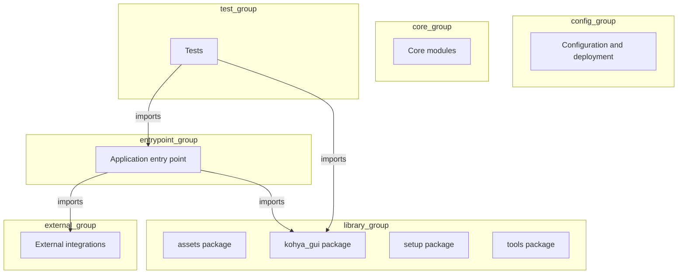

# Architecture report: bmaltais/kohya_ss

> Automated static analysis. **Observed** = directly seen in files/imports/AST; **Inferred** = interpretation from that evidence. Repository code was not executed.

## 1. Repository at a glance

| Item | Value |
| --- | --- |
| Repository | bmaltais/kohya_ss |
| Description | Not provided |
| Language | Python |
| Stars | 12666 |
| Licence | Apache-2.0 |
| Analysed commit / branch | 45088f04af78e11cec5407ff4652ea3ed2c14422 / master |
| Framework(s) | None detected |
| Files analysed | 343 |
| Components | 9 |

## 2. Architecture in one minute

bmaltais/kohya_ss. This repository was analysed statically from 343 file(s) (132 Python). Detected technologies (observed from imports/manifests): GitHub Actions, NumPy, requests, Poetry, setuptools, Docker. Files are grouped into 9 component(s): assets package, Configuration and deployment, Core modules, Application entry point, External integrations, kohya_gui package, setup package, Tests. Observed entry point(s): kohya_gui.py, local_train.py, setup/setup_linux.py. Findings below distinguish observed facts from inferred interpretation.

## 3. High-level block diagram

## 4. Main components

### assets package (`assets`)

- **Kind:** library
- **Status:** Observed
- **Confidence:** 0.85
- **Responsibility:** Groups 4 file(s) under assets package (observed from repository paths and static analysis).
- **Paths:** `assets/js/icon_button_titles.js`, `assets/js/info_tooltip.js`, `assets/js/localization.js`, `assets/js/script.js`
- **Evidence:** [assets/js/icon_button_titles.js](https://github.com/bmaltais/kohya_ss/blob/45088f04af78e11cec5407ff4652ea3ed2c14422/assets/js/icon_button_titles.js); [assets/js/info_tooltip.js](https://github.com/bmaltais/kohya_ss/blob/45088f04af78e11cec5407ff4652ea3ed2c14422/assets/js/info_tooltip.js); [assets/js/localization.js](https://github.com/bmaltais/kohya_ss/blob/45088f04af78e11cec5407ff4652ea3ed2c14422/assets/js/localization.js); [assets/js/script.js](https://github.com/bmaltais/kohya_ss/blob/45088f04af78e11cec5407ff4652ea3ed2c14422/assets/js/script.js)

### Configuration and deployment (`config`)

- **Kind:** config
- **Status:** Observed
- **Confidence:** 0.85
- **Responsibility:** Groups 58 file(s) under configuration and deployment (observed from repository paths and static analysis).
- **Paths:** `Dockerfile`, `_typos.toml`, `config example.toml`, `config_files/accelerate/default_config.yaml`, `config_files/accelerate/runpod.yaml`, `docker-compose.yaml`, `localizations/chinese-sample.json`, `localizations/en-GB.json`, `localizations/zh-CN.json`, `localizations/zh-TW.json`, `presets/dreambooth/sd3_bdsqlsz_v1.json`, `presets/dreambooth/sd3_bdsqlsz_v2.json`, `presets/finetune/SDXL - AI_Now PagedAdamW8bit v1.0.json`, `presets/finetune/SDXL - Essenz series by AI_Characters_Training v1.0.json`, `presets/finetune/adafactor.json`, `presets/finetune/lion.json`, `presets/lora/SDXL - 1 image LoRA v1.0.json`, `presets/lora/SDXL - LoHA AI_Characters v1.0.json`, `presets/lora/SDXL - LoKR v1.0.json`, `presets/lora/SDXL - LoRA AI_Now ADamW v1.0.json`, `presets/lora/SDXL - LoRA AI_Now prodigy v1.0.json`, `presets/lora/SDXL - LoRA AI_characters standard v1.0.json`, `presets/lora/SDXL - LoRA AI_characters standard v1.1.json`, `presets/lora/SDXL - LoRA adafactor v1.0.json`, `presets/lora/SDXL - LoRA aitrepreneur clothing v1.0.json`, `presets/lora/SDXL - LoRA by malcolmrey training v1.0.json`, `presets/lora/SDXL - LoRA face dogu_cat v1.0.json`, `presets/lora/SDXL - LoRA finetuning phase 1_v1.1.json`, `presets/lora/SDXL - LoRA finetuning phase 2_v1.1.json`, `presets/lora/SDXL - LoRA kudou-reira dadaptadam v1.0.json`, `presets/lora/SDXL - LoRA kudou-reira dadaptadam v1.1.json`, `presets/lora/SDXL - LoRA kudou-reira prodigy v4.0.json`, `presets/lora/SDXL - edgLoRAXL AI_Now.json`, `presets/lora/SDXL - edgLoRAXL.json`, `presets/lora/flux1D - adamw8bit fp8.json`, `presets/lora/iA3-Prodigy-sd15.json`, `presets/lora/ia3-sd15.json`, `presets/lora/locon-dadaptation-sdxl.json`, `presets/lora/loha-sd15.json`, `presets/lora/lokr-sd15.json`, `presets/lora/sd15 - EDG_LoConOptiSettings.json`, `presets/lora/sd15 - EDG_LoHaOptiSettings.json`, `presets/lora/sd15 - EDG_LoraOptiSettings.json`, `presets/lora/sd15 - GLoRA v1.0.json`, `presets/lora/sd15 - LoKR v1.0.json`, `presets/lora/sd15 - LoKr v1.1.json`, `presets/lora/sd15 - LoKr v2.0.json`, `pyproject.toml`, `requirements.txt`, `requirements_ipex_xpu.txt`, `requirements_linux.txt`, `requirements_linux_ipex.txt`, `requirements_linux_rocm.txt`, `requirements_macos_amd64.txt`, `requirements_macos_arm64.txt`, `requirements_pytorch_windows.txt`, `requirements_runpod.txt`, `requirements_windows.txt`
- **Evidence:** [Dockerfile](https://github.com/bmaltais/kohya_ss/blob/45088f04af78e11cec5407ff4652ea3ed2c14422/Dockerfile); [_typos.toml](https://github.com/bmaltais/kohya_ss/blob/45088f04af78e11cec5407ff4652ea3ed2c14422/_typos.toml); [config example.toml](https://github.com/bmaltais/kohya_ss/blob/45088f04af78e11cec5407ff4652ea3ed2c14422/config%20example.toml); [config_files/accelerate/default_config.yaml](https://github.com/bmaltais/kohya_ss/blob/45088f04af78e11cec5407ff4652ea3ed2c14422/config_files/accelerate/default_config.yaml); [config_files/accelerate/runpod.yaml](https://github.com/bmaltais/kohya_ss/blob/45088f04af78e11cec5407ff4652ea3ed2c14422/config_files/accelerate/runpod.yaml); [docker-compose.yaml](https://github.com/bmaltais/kohya_ss/blob/45088f04af78e11cec5407ff4652ea3ed2c14422/docker-compose.yaml); [localizations/chinese-sample.json](https://github.com/bmaltais/kohya_ss/blob/45088f04af78e11cec5407ff4652ea3ed2c14422/localizations/chinese-sample.json); [localizations/en-GB.json](https://github.com/bmaltais/kohya_ss/blob/45088f04af78e11cec5407ff4652ea3ed2c14422/localizations/en-GB.json)

### Core modules (`core`)

- **Kind:** core
- **Status:** Observed
- **Confidence:** 0.85
- **Responsibility:** Groups 4 file(s) under core modules (observed from repository paths and static analysis).
- **Paths:** `gui-uv.sh`, `gui.sh`, `setup-runpod.sh`, `setup.sh`
- **Evidence:** [gui-uv.sh](https://github.com/bmaltais/kohya_ss/blob/45088f04af78e11cec5407ff4652ea3ed2c14422/gui-uv.sh); [gui.sh](https://github.com/bmaltais/kohya_ss/blob/45088f04af78e11cec5407ff4652ea3ed2c14422/gui.sh); [setup-runpod.sh](https://github.com/bmaltais/kohya_ss/blob/45088f04af78e11cec5407ff4652ea3ed2c14422/setup-runpod.sh); [setup.sh](https://github.com/bmaltais/kohya_ss/blob/45088f04af78e11cec5407ff4652ea3ed2c14422/setup.sh)

### Application entry point (`entrypoint`)

- **Kind:** entrypoint
- **Status:** Observed
- **Confidence:** 0.85
- **Responsibility:** Groups 28 file(s) under application entry point (observed from repository paths and static analysis). Observed top-level classes: ImageProcessor, LocalLoRAModulePlaceholder, LogType, Logger. Observed top-level functions: UI, _build_local_sai_metadata, _calculate_module_diffs_and_check, _construct_lora_weights_from_svd_components, _determine_rank, _get_closest_ema_value_before_iter.
- **Paths:** `kohya_gui.py`, `local_train.py`, `setup/setup_linux.py`, `setup/setup_runpod.py`, `setup/setup_windows.py`, `setup/update_bitsandbytes.py`, `setup/validate_requirements.py`, `tools/analyse_loha.py`, `tools/caption.py`, `tools/caption_from_filename.py`, `tools/cleanup_captions.py`, `tools/convert_html_to_md.py`, `tools/convert_images_to_hq_jpg.py`, `tools/convert_images_to_webp.py`, `tools/create_txt_from_images.py`, `tools/crop_images_to_n_buckets.py`, `tools/dummy_loha.py`, `tools/extract_locon.py`, `tools/extract_loha_from_model.py`, `tools/extract_lora_from_models-new.py`, `tools/extract_model_difference.py`, `tools/group_images.py`, `tools/group_images_recommended_size.py`, `tools/lcm_convert.py`, `tools/lycoris_locon_extract.py`, `tools/merge_lycoris.py`, `tools/prepare_presets.py`, `tools/resize_lora.py`
- **Evidence:** [kohya_gui.py:43](https://github.com/bmaltais/kohya_ss/blob/45088f04af78e11cec5407ff4652ea3ed2c14422/kohya_gui.py#L43); [local_train.py:6](https://github.com/bmaltais/kohya_ss/blob/45088f04af78e11cec5407ff4652ea3ed2c14422/local_train.py#L6); [setup/setup_linux.py:13](https://github.com/bmaltais/kohya_ss/blob/45088f04af78e11cec5407ff4652ea3ed2c14422/setup/setup_linux.py#L13); [setup/setup_runpod.py:15](https://github.com/bmaltais/kohya_ss/blob/45088f04af78e11cec5407ff4652ea3ed2c14422/setup/setup_runpod.py#L15); [setup/setup_windows.py:18](https://github.com/bmaltais/kohya_ss/blob/45088f04af78e11cec5407ff4652ea3ed2c14422/setup/setup_windows.py#L18); [setup/update_bitsandbytes.py:6](https://github.com/bmaltais/kohya_ss/blob/45088f04af78e11cec5407ff4652ea3ed2c14422/setup/update_bitsandbytes.py#L6); [setup/validate_requirements.py:24](https://github.com/bmaltais/kohya_ss/blob/45088f04af78e11cec5407ff4652ea3ed2c14422/setup/validate_requirements.py#L24); [tools/analyse_loha.py:7](https://github.com/bmaltais/kohya_ss/blob/45088f04af78e11cec5407ff4652ea3ed2c14422/tools/analyse_loha.py#L7)

### External integrations (`external_integrations`)

- **Kind:** external
- **Status:** Inferred
- **Confidence:** 0.70
- **Responsibility:** Groups 0 file(s) under external integrations (observed from repository paths and static analysis).
- **Evidence:** [tools/convert_html_to_md.py:3](https://github.com/bmaltais/kohya_ss/blob/45088f04af78e11cec5407ff4652ea3ed2c14422/tools/convert_html_to_md.py#L3)

### kohya_gui package (`kohya_gui`)

- **Kind:** library
- **Status:** Observed
- **Confidence:** 0.85
- **Responsibility:** Groups 56 file(s) under kohya_gui package (observed from repository paths and static analysis). Observed top-level classes: AccelerateLaunch, AdvancedTraining, BasicTraining, CommandExecutor, ConfigurationFile, Folders. Observed top-level functions: SaveConfigFile, _get_caption_path, _get_quick_tags, _get_tag_checkbox_updates, _is_under, _paths_equal.
- **Paths:** `kohya_gui/__init__.py`, `kohya_gui/anima_lllite_gui.py`, `kohya_gui/basic_caption_gui.py`, `kohya_gui/blip2_caption_gui.py`, `kohya_gui/blip_caption_gui.py`, `kohya_gui/class_accelerate_launch.py`, `kohya_gui/class_advanced_training.py`, `kohya_gui/class_anima.py`, `kohya_gui/class_basic_training.py`, `kohya_gui/class_command_executor.py`, `kohya_gui/class_configuration_file.py`, `kohya_gui/class_flux1.py`, `kohya_gui/class_folders.py`, `kohya_gui/class_gui_config.py`, `kohya_gui/class_huggingface.py`, `kohya_gui/class_hunyuan_image.py`, `kohya_gui/class_lora_tab.py`, `kohya_gui/class_lumina.py`, `kohya_gui/class_metadata.py`, `kohya_gui/class_sample_images.py`, `kohya_gui/class_sd3.py`, `kohya_gui/class_sdxl_parameters.py`, `kohya_gui/class_source_model.py`, `kohya_gui/class_tensorboard.py`, `kohya_gui/common_gui.py`, `kohya_gui/convert_lcm_gui.py`, `kohya_gui/convert_model_gui.py`, `kohya_gui/custom_logging.py`, `kohya_gui/dataset_balancing_gui.py`, `kohya_gui/dreambooth_folder_creation_gui.py`, `kohya_gui/dreambooth_gui.py`, `kohya_gui/extract_lora_from_dylora_gui.py`, `kohya_gui/extract_lora_gui.py`, `kohya_gui/extract_lycoris_locon_gui.py`, `kohya_gui/finetune_gui.py`, `kohya_gui/flux_extract_lora_gui.py`, `kohya_gui/flux_merge_lora_gui.py`, `kohya_gui/git_caption_gui.py`, `kohya_gui/group_images_gui.py`, `kohya_gui/kontext_manual_caption_gui.py`, `kohya_gui/leco_gui.py`, `kohya_gui/localization.py`, `kohya_gui/localization_ext.py`, `kohya_gui/lora_gui.py`, `kohya_gui/manual_caption_gui.py`, `kohya_gui/merge_lora_gui.py`, `kohya_gui/merge_lycoris_gui.py`, `kohya_gui/offline_assets.py`, `kohya_gui/resize_lora_gui.py`, `kohya_gui/sd_modeltype.py`, `kohya_gui/settings_gui.py`, `kohya_gui/svd_merge_lora_gui.py`, `kohya_gui/textual_inversion_gui.py`, `kohya_gui/utilities.py`, `kohya_gui/verify_lora_gui.py`, `kohya_gui/wd14_caption_gui.py`
- **Evidence:** [kohya_gui/__init__.py](https://github.com/bmaltais/kohya_ss/blob/45088f04af78e11cec5407ff4652ea3ed2c14422/kohya_gui/__init__.py); [kohya_gui/anima_lllite_gui.py:87](https://github.com/bmaltais/kohya_ss/blob/45088f04af78e11cec5407ff4652ea3ed2c14422/kohya_gui/anima_lllite_gui.py#L87); [kohya_gui/basic_caption_gui.py:22](https://github.com/bmaltais/kohya_ss/blob/45088f04af78e11cec5407ff4652ea3ed2c14422/kohya_gui/basic_caption_gui.py#L22); [kohya_gui/blip2_caption_gui.py:18](https://github.com/bmaltais/kohya_ss/blob/45088f04af78e11cec5407ff4652ea3ed2c14422/kohya_gui/blip2_caption_gui.py#L18); [kohya_gui/blip_caption_gui.py:14](https://github.com/bmaltais/kohya_ss/blob/45088f04af78e11cec5407ff4652ea3ed2c14422/kohya_gui/blip_caption_gui.py#L14); [kohya_gui/class_accelerate_launch.py:12](https://github.com/bmaltais/kohya_ss/blob/45088f04af78e11cec5407ff4652ea3ed2c14422/kohya_gui/class_accelerate_launch.py#L12); [kohya_gui/class_advanced_training.py:13](https://github.com/bmaltais/kohya_ss/blob/45088f04af78e11cec5407ff4652ea3ed2c14422/kohya_gui/class_advanced_training.py#L13); [kohya_gui/class_anima.py:9](https://github.com/bmaltais/kohya_ss/blob/45088f04af78e11cec5407ff4652ea3ed2c14422/kohya_gui/class_anima.py#L9)

### setup package (`setup`)

- **Kind:** library
- **Status:** Observed
- **Confidence:** 0.85
- **Responsibility:** Groups 6 file(s) under setup package (observed from repository paths and static analysis). Observed top-level functions: _check_amd_toolkit, _check_hardware_toolkit, _check_intel_oneapi_toolkit, _check_nvidia_toolkit, _log_gpu_info, check_python_version.
- **Paths:** `setup/check_local_modules.py`, `setup/create_user_files.py`, `setup/debug_info.py`, `setup/docker_setup.py`, `setup/setup_common.py`, `setup/tkinter_preflight.sh`
- **Evidence:** [setup/check_local_modules.py](https://github.com/bmaltais/kohya_ss/blob/45088f04af78e11cec5407ff4652ea3ed2c14422/setup/check_local_modules.py); [setup/create_user_files.py](https://github.com/bmaltais/kohya_ss/blob/45088f04af78e11cec5407ff4652ea3ed2c14422/setup/create_user_files.py); [setup/debug_info.py](https://github.com/bmaltais/kohya_ss/blob/45088f04af78e11cec5407ff4652ea3ed2c14422/setup/debug_info.py); [setup/docker_setup.py](https://github.com/bmaltais/kohya_ss/blob/45088f04af78e11cec5407ff4652ea3ed2c14422/setup/docker_setup.py); [setup/setup_common.py:22](https://github.com/bmaltais/kohya_ss/blob/45088f04af78e11cec5407ff4652ea3ed2c14422/setup/setup_common.py#L22); [setup/tkinter_preflight.sh](https://github.com/bmaltais/kohya_ss/blob/45088f04af78e11cec5407ff4652ea3ed2c14422/setup/tkinter_preflight.sh)

### Tests (`tests`)

- **Kind:** test
- **Status:** Observed
- **Confidence:** 0.85
- **Responsibility:** Groups 97 file(s) under tests (observed from repository paths and static analysis). Observed routes: PATCH shutil.which, PATCH cpuinfo.get_cpu_info, PATCH shutil.which, PATCH cpuinfo.get_cpu_info, PATCH shutil.which. Observed top-level classes: TestAllowedPaths, TestAnimaAdvancedOptions, TestAnimaFinetuneAdvancedOptions, TestAnimaFinetuneConfigOutput, TestAnimaLlliteCommandGeneration, TestAnimaLlliteFieldRegistry. Observed top-level functions: _base_kwargs, _bash_available, _clear_accelerate_env_candidates, _declared_dependency_names, _default_kwargs, _fake_dist.
- **Paths:** `test/AGENTS.md`, `test/config/Diag-OFT-AdamW8bit-toml.json`, `test/config/DyLoRA-Adafactor-toml.json`, `test/config/LoKR-AdamW8bit-toml.json`, `test/config/SDXL-Standard-Adafactor.json`, `test/config/SDXL-Standard-AdamW.json`, `test/config/SDXL-Standard-AdamW8bit.json`, `test/config/Standard-AdamW.json`, `test/config/Standard-AdamW8bit.json`, `test/config/TI-AdamW8bit-SDXL.json`, `test/config/TI-AdamW8bit-toml.json`, `test/config/TI-AdamW8bit.json`, `test/config/dataset-finetune.toml`, `test/config/dataset-masked_loss.toml`, `test/config/dataset-multires.toml`, `test/config/dataset.toml`, `test/config/dreambooth-Adafactor.json`, `test/config/dreambooth-AdamW.json`, `test/config/dreambooth-AdamW8bit-masked_loss-toml.json`, `test/config/dreambooth-AdamW8bit-toml.json`, `test/config/dreambooth-AdamW8bit.json`, `test/config/dreambooth-DAdaptAdam.json`, `test/config/dreambooth-Prodigy-SDXL.json`, `test/config/dreambooth-Prodigy.json`, `test/config/dreambooth.json`, `test/config/finetune-AdamW-toml.json`, `test/config/finetune-AdamW.json`, `test/config/iA3-Prodigy.json`, `test/config/leco_prompts.toml`, `test/config/locon-Adafactor.json`, `test/config/locon-AdamW.json`, `test/config/locon-AdamW8bit-masked_loss-toml.json`, `test/config/locon-AdamW8bit-toml.json`, `test/config/locon-AdamW8bit.json`, `test/config/locon-Prodigy.json`, `test/config/loha-Prodigy.json`, `test/config/meta-1_lat.json`, `test/config/t5clrs.json`, `test/ft/.keep`, `test/img with spaces/10_darius kawasaki person/Dariusz_Zawadzki.txt`, `test/img with spaces/10_darius kawasaki person/Dariusz_Zawadzki_2.txt`, `test/img with spaces/10_darius kawasaki person/Dariusz_Zawadzki_3.txt`, `test/img with spaces/10_darius kawasaki person/Dariusz_Zawadzki_4.txt`, `test/img with spaces/10_darius kawasaki person/Dariusz_Zawadzki_5.txt`, `test/img with spaces/10_darius kawasaki person/Dariusz_Zawadzki_6.txt`, `test/img with spaces/10_darius kawasaki person/Dariusz_Zawadzki_7.txt`, `test/img with spaces/10_darius kawasaki person/Dariusz_Zawadzki_8.txt`, `test/img/10_darius kawasaki person/Dariusz_Zawadzki.txt`, `test/img/10_darius kawasaki person/Dariusz_Zawadzki_2.txt`, `test/img/10_darius kawasaki person/Dariusz_Zawadzki_3.txt`, `test/img/10_darius kawasaki person/Dariusz_Zawadzki_4.txt`, `test/img/10_darius kawasaki person/Dariusz_Zawadzki_5.txt`, `test/img/10_darius kawasaki person/Dariusz_Zawadzki_6.txt`, `test/img/10_darius kawasaki person/Dariusz_Zawadzki_7.txt`, `test/img/10_darius kawasaki person/Dariusz_Zawadzki_8.txt`, `test/log/.keep`, `test/logs/.keep`, `test/test_allowed_paths.py`, `tests/AGENTS.md`, `tests/conftest.py`, `tests/test_anima_finetune_gui.py`, `tests/test_anima_lllite_gui.py`, `tests/test_anima_lora_gui.py`, `tests/test_blip2_caption_gui.py`, `tests/test_check_torch_native_xpu.py`, `tests/test_command_executor.py`, `tests/test_configure_accelerate_hf_home.py`, `tests/test_dreambooth_folder_creation_gui.py`, `tests/test_dreambooth_gui.py`, `tests/test_finetune_gui.py`, `tests/test_get_executable_path.py`, `tests/test_gradio_pin_policy.py`, `tests/test_headless_recommendation.py`, `tests/test_hunyuan_image_lora_gui.py`, `tests/test_info_tooltip_gradio6.py`, `tests/test_install_requirements_failure.py`, `tests/test_leco_gui.py`, `tests/test_loha_lokr_gui.py`, `tests/test_lora_gui.py`, `tests/test_lora_regularizer_controls.py`, `tests/test_lr_warmup_resolve.py`, `tests/test_lumina_finetune_gui.py`, `tests/test_lumina_lora_gui.py`, `tests/test_offline_gui_assets.py`, `tests/test_resize_lora_gui.py`, `tests/test_resize_lora_model.py`, `tests/test_security_dependency_pins.py`, `tests/test_setup_common_installed.py`, `tests/test_show_timesteps_gui.py`, `tests/test_source_model_dataset_config_doc.py`, `tests/test_tensorboard_visibility.py`, `tests/test_textual_inversion_gui.py`, `tests/test_tkinter_preflight.py`, `tests/test_training_setup_errors.py`, `tests/test_verify_image_folder_pattern.py`, `tests/test_wd14_caption_gui.py`, `tests/test_xpu_requirements.py`
- **Evidence:** [test/AGENTS.md](https://github.com/bmaltais/kohya_ss/blob/45088f04af78e11cec5407ff4652ea3ed2c14422/test/AGENTS.md); [test/config/Diag-OFT-AdamW8bit-toml.json](https://github.com/bmaltais/kohya_ss/blob/45088f04af78e11cec5407ff4652ea3ed2c14422/test/config/Diag-OFT-AdamW8bit-toml.json); [test/config/DyLoRA-Adafactor-toml.json](https://github.com/bmaltais/kohya_ss/blob/45088f04af78e11cec5407ff4652ea3ed2c14422/test/config/DyLoRA-Adafactor-toml.json); [test/config/LoKR-AdamW8bit-toml.json](https://github.com/bmaltais/kohya_ss/blob/45088f04af78e11cec5407ff4652ea3ed2c14422/test/config/LoKR-AdamW8bit-toml.json); [test/config/SDXL-Standard-Adafactor.json](https://github.com/bmaltais/kohya_ss/blob/45088f04af78e11cec5407ff4652ea3ed2c14422/test/config/SDXL-Standard-Adafactor.json); [test/config/SDXL-Standard-AdamW.json](https://github.com/bmaltais/kohya_ss/blob/45088f04af78e11cec5407ff4652ea3ed2c14422/test/config/SDXL-Standard-AdamW.json); [test/config/SDXL-Standard-AdamW8bit.json](https://github.com/bmaltais/kohya_ss/blob/45088f04af78e11cec5407ff4652ea3ed2c14422/test/config/SDXL-Standard-AdamW8bit.json); [test/config/Standard-AdamW.json](https://github.com/bmaltais/kohya_ss/blob/45088f04af78e11cec5407ff4652ea3ed2c14422/test/config/Standard-AdamW.json)

### tools package (`tools`)

- **Kind:** library
- **Status:** Observed
- **Confidence:** 0.85
- **Responsibility:** Groups 4 file(s) under tools package (observed from repository paths and static analysis). Observed top-level functions: cp_weight, cp_weight_from_conv, extract_conv, extract_diff, extract_linear, get_module.
- **Paths:** `tools/gradio_theme_builder.py`, `tools/lycoris_utils.py`, `tools/prune.py`, `tools/rename_depth_mask.py`
- **Evidence:** [tools/gradio_theme_builder.py](https://github.com/bmaltais/kohya_ss/blob/45088f04af78e11cec5407ff4652ea3ed2c14422/tools/gradio_theme_builder.py); [tools/lycoris_utils.py:14](https://github.com/bmaltais/kohya_ss/blob/45088f04af78e11cec5407ff4652ea3ed2c14422/tools/lycoris_utils.py#L14); [tools/prune.py](https://github.com/bmaltais/kohya_ss/blob/45088f04af78e11cec5407ff4652ea3ed2c14422/tools/prune.py); [tools/rename_depth_mask.py](https://github.com/bmaltais/kohya_ss/blob/45088f04af78e11cec5407ff4652ea3ed2c14422/tools/rename_depth_mask.py)

## 5. Execution flow

**Observed** entry point(s):

- [kohya_gui.py:266](https://github.com/bmaltais/kohya_ss/blob/45088f04af78e11cec5407ff4652ea3ed2c14422/kohya_gui.py#L266)
- [local_train.py:90](https://github.com/bmaltais/kohya_ss/blob/45088f04af78e11cec5407ff4652ea3ed2c14422/local_train.py#L90)
- [setup/setup_linux.py:45](https://github.com/bmaltais/kohya_ss/blob/45088f04af78e11cec5407ff4652ea3ed2c14422/setup/setup_linux.py#L45)
- [setup/setup_runpod.py:78](https://github.com/bmaltais/kohya_ss/blob/45088f04af78e11cec5407ff4652ea3ed2c14422/setup/setup_runpod.py#L78)
- [setup/setup_windows.py:270](https://github.com/bmaltais/kohya_ss/blob/45088f04af78e11cec5407ff4652ea3ed2c14422/setup/setup_windows.py#L270)
- [setup/update_bitsandbytes.py:48](https://github.com/bmaltais/kohya_ss/blob/45088f04af78e11cec5407ff4652ea3ed2c14422/setup/update_bitsandbytes.py#L48)
- [setup/validate_requirements.py:227](https://github.com/bmaltais/kohya_ss/blob/45088f04af78e11cec5407ff4652ea3ed2c14422/setup/validate_requirements.py#L227)
- [tools/analyse_loha.py:149](https://github.com/bmaltais/kohya_ss/blob/45088f04af78e11cec5407ff4652ea3ed2c14422/tools/analyse_loha.py#L149)
- [tools/caption.py:59](https://github.com/bmaltais/kohya_ss/blob/45088f04af78e11cec5407ff4652ea3ed2c14422/tools/caption.py#L59)
- [tools/caption_from_filename.py:79](https://github.com/bmaltais/kohya_ss/blob/45088f04af78e11cec5407ff4652ea3ed2c14422/tools/caption_from_filename.py#L79)
- [tools/cleanup_captions.py:38](https://github.com/bmaltais/kohya_ss/blob/45088f04af78e11cec5407ff4652ea3ed2c14422/tools/cleanup_captions.py#L38)
- [tools/convert_html_to_md.py:58](https://github.com/bmaltais/kohya_ss/blob/45088f04af78e11cec5407ff4652ea3ed2c14422/tools/convert_html_to_md.py#L58)

**Observed** routes (from decorators):

- `PATCH shutil.which` -> `test_tensorboard_visibility_when_tensorboard_and_avx_are_present` in `tests/test_tensorboard_visibility.py:13`
- `PATCH cpuinfo.get_cpu_info` -> `test_tensorboard_visibility_when_tensorboard_and_avx_are_present` in `tests/test_tensorboard_visibility.py:13`
- `PATCH shutil.which` -> `test_tensorboard_visibility_when_tensorboard_is_absent` in `tests/test_tensorboard_visibility.py:19`
- `PATCH cpuinfo.get_cpu_info` -> `test_tensorboard_visibility_when_tensorboard_is_absent` in `tests/test_tensorboard_visibility.py:19`
- `PATCH shutil.which` -> `test_tensorboard_visibility_when_avx_is_absent` in `tests/test_tensorboard_visibility.py:25`
- `PATCH cpuinfo.get_cpu_info` -> `test_tensorboard_visibility_when_avx_is_absent` in `tests/test_tensorboard_visibility.py:25`
- `PATCH cpuinfo.get_cpu_info` -> `test_check_avx_support_exception` in `tests/test_tensorboard_visibility.py:30`

Representative flow (derived from observed entry points and the import graph; steps beyond the entry point are **Inferred**):

1. Execution starts at an observed entry point listed above, if present.
2. `entrypoint` imports `external_integrations` (Application entry point -> External integrations).
3. `entrypoint` imports `kohya_gui` (Application entry point -> kohya_gui package).
4. `tests` imports `entrypoint` (Tests -> Application entry point).
5. `tests` imports `kohya_gui` (Tests -> kohya_gui package).

## 6. Project structure

### `(root)`

- `.augmentignore` - other (136 bytes)
- `.dockerignore` - container (217 bytes)
- `.gitattributes` - other (76 bytes)
- `.gitignore` - other (623 bytes)
- `.gitmodules` - other (99 bytes)
- `.hadolint.yml` - config (495 bytes)
- `.python-version` - other (5 bytes)
- `.release` - other (8 bytes)
- `AGENTS.md` - docs (2434 bytes)
- `Dockerfile` - container (7234 bytes)
- `LICENSE.md` - docs (11342 bytes)
- `README.md` - docs (19530 bytes)
- `SECURITY.md` - docs (332 bytes)
- `_typos.toml` - config (683 bytes)
- `config example.toml` - config (12005 bytes)
- `docker-compose.yaml` - container (1679 bytes)
- `gui-uv.bat` - other (1491 bytes)
- `gui-uv.sh` - source, Shell (3295 bytes)
- `gui.bat` - other (851 bytes)
- `gui.ps1` - other (885 bytes)
- `gui.sh` - source, Shell (4934 bytes)
- `kohya_gui.py` - source, Python (11394 bytes)
- `kohya_ss_colab.ipynb` - other (3545 bytes)
- `local_train.py` - source, Python (3612 bytes)
- `pyproject.toml` - manifest (2363 bytes)
- `requirements.txt` - manifest (831 bytes)
- `requirements_ipex_xpu.txt` - manifest (378 bytes)
- `requirements_linux.txt` - manifest (273 bytes)
- `requirements_linux_ipex.txt` - manifest (250 bytes)
- `requirements_linux_rocm.txt` - manifest (482 bytes)
- `requirements_macos_amd64.txt` - manifest (198 bytes)
- `requirements_macos_arm64.txt` - manifest (271 bytes)
- `requirements_pytorch_windows.txt` - manifest (189 bytes)
- `requirements_runpod.txt` - manifest (246 bytes)
- `requirements_windows.txt` - manifest (96 bytes)
- `setup-3.10.bat` - other (839 bytes)
- `setup-runpod.sh` - source, Shell (1403 bytes)
- `setup.bat` - other (833 bytes)
- `setup.ps1` - other (454 bytes)
- `setup.sh` - source, Shell (23995 bytes)

### `.cache`

- `.cache/config/.gitkeep` - other (0 bytes)
- `.cache/keras/.gitkeep` - other (0 bytes)
- `.cache/nv/.gitkeep` - other (0 bytes)
- `.cache/triton/.gitkeep` - other (0 bytes)
- `.cache/user/.gitkeep` - other (0 bytes)

### `.github`

- `.github/FUNDING.yml` - config (66 bytes)
- `.github/dependabot.yml` - config (123 bytes)
- `.github/workflows/docker_publish.yml` - ci, YAML (3045 bytes)
- `.github/workflows/typos.yaml` - ci, YAML (335 bytes)

### `.out-of-scope`

- `.out-of-scope/README.md` - docs (367 bytes)
- `.out-of-scope/musubi-tuner-models.md` - docs (1779 bytes)

### `.vscode`

- `.vscode/settings.json` - config (167 bytes)

### `assets`

- `assets/js/icon_button_titles.js` - source, JavaScript (1385 bytes)
- `assets/js/info_tooltip.js` - source, JavaScript (4218 bytes)
- `assets/js/localization.js` - source, JavaScript (2478 bytes)
- `assets/js/script.js` - source, JavaScript (3204 bytes)
- `assets/style.css` - other (11927 bytes)

### `config_files`

- `config_files/accelerate/default_config.yaml` - config (436 bytes)
- `config_files/accelerate/runpod.yaml` - config (436 bytes)

### `dataset`

- `dataset/images/.gitkeep` - other (0 bytes)
- `dataset/logs/.gitkeep` - other (0 bytes)
- `dataset/outputs/.gitkeep` - other (0 bytes)
- `dataset/regularization/.gitkeep` - other (0 bytes)

### `docs`

- `docs/AGENTS.md` - docs (1582 bytes)
- `docs/Finetuning/top_level.md` - docs (1057 bytes)
- `docs/Installation/pip_linux.md` - docs (4551 bytes)
- `docs/Installation/pip_windows.md` - docs (4424 bytes)
- `docs/Installation/uv_linux.md` - docs (5291 bytes)
- `docs/Installation/uv_windows.md` - docs (3698 bytes)
- `docs/LoRA/options.md` - docs (43040 bytes)
- `docs/LoRA/top_level.md` - docs (1053 bytes)
- `docs/config_README-ja.md` - docs (18292 bytes)
- `docs/fine_tune_README_ja.md` - docs (10563 bytes)
- `docs/gen_img_README-ja.md` - docs (35819 bytes)
- `docs/image_folder_structure.md` - docs (2050 bytes)
- `docs/installation_docker.md` - docs (3368 bytes)
- `docs/installation_novita.md` - docs (263 bytes)
- `docs/installation_runpod.md` - docs (1231 bytes)
- `docs/train_README-ja.md` - docs (68083 bytes)
- `docs/train_README-zh.md` - docs (48595 bytes)
- `docs/train_README.md` - docs (57132 bytes)
- `docs/train_db_README-ja.md` - docs (10032 bytes)
- `docs/train_db_README-zh.md` - docs (7613 bytes)
- `docs/train_lllite_README-ja.md` - docs (11080 bytes)
- `docs/train_lllite_README.md` - docs (9772 bytes)
- `docs/train_network_README-ja.md` - docs (28540 bytes)
- `docs/train_network_README-zh.md` - docs (22407 bytes)
- `docs/train_ti_README-ja.md` - docs (7420 bytes)
- `docs/troubleshooting_tesla_v100.md` - docs (547 bytes)

### `examples`

- `examples/LoRA based finetuning 2 phase.ps1` - other (2648 bytes)
- `examples/caption.ps1` - other (554 bytes)
- `examples/caption_subfolders.ps1` - other (670 bytes)
- `examples/finetune_latent.ps1` - other (700 bytes)
- `examples/kohya-1-folders.ps1` - other (2910 bytes)
- `examples/kohya-3-folders.ps1` - other (5859 bytes)
- `examples/kohya.ps1` - other (5787 bytes)
- `examples/kohya_finetune.ps1` - other (6358 bytes)
- `examples/kohya_new-v3.ps1` - other (3446 bytes)
- `examples/kohya_train_db_fixed_with-reg_SDv2 512 base.ps1` - other (2137 bytes)
- `examples/lucoris extract examples.txt` - docs (1836 bytes)
- `examples/pull kohya_ss sd-scripts updates in.md` - docs (709 bytes)
- `examples/stable_cascade/test.toml` - config (0 bytes)
- `examples/word_frequency.ps1` - other (675 bytes)

### `kohya_gui`

- `kohya_gui/AGENTS.md` - docs (3180 bytes)
- `kohya_gui/__init__.py` - source, Python (12 bytes)
- `kohya_gui/anima_lllite_gui.py` - source, Python (61502 bytes)
- `kohya_gui/basic_caption_gui.py` - source, Python (9369 bytes)
- `kohya_gui/blip2_caption_gui.py` - source, Python (13464 bytes)
- `kohya_gui/blip_caption_gui.py` - source, Python (7098 bytes)
- `kohya_gui/class_accelerate_launch.py` - source, Python (8668 bytes)
- `kohya_gui/class_advanced_training.py` - source, Python (29187 bytes)
- `kohya_gui/class_anima.py` - source, Python (14921 bytes)
- `kohya_gui/class_basic_training.py` - source, Python (18638 bytes)
- `kohya_gui/class_command_executor.py` - source, Python (8542 bytes)
- `kohya_gui/class_configuration_file.py` - source, Python (3918 bytes)
- `kohya_gui/class_flux1.py` - source, Python (19485 bytes)
- `kohya_gui/class_folders.py` - source, Python (8038 bytes)
- `kohya_gui/class_gui_config.py` - source, Python (3465 bytes)
- `kohya_gui/class_huggingface.py` - source, Python (3891 bytes)
- `kohya_gui/class_hunyuan_image.py` - source, Python (8351 bytes)
- `kohya_gui/class_lora_tab.py` - source, Python (1385 bytes)
- `kohya_gui/class_lumina.py` - source, Python (6892 bytes)
- `kohya_gui/class_metadata.py` - source, Python (2609 bytes)
- `kohya_gui/class_sample_images.py` - source, Python (5750 bytes)
- `kohya_gui/class_sd3.py` - source, Python (11135 bytes)
- `kohya_gui/class_sdxl_parameters.py` - source, Python (3840 bytes)
- `kohya_gui/class_source_model.py` - source, Python (22909 bytes)
- `kohya_gui/class_tensorboard.py` - source, Python (5040 bytes)
- `kohya_gui/common_gui.py` - source, Python (70453 bytes)
- `kohya_gui/convert_lcm_gui.py` - source, Python (6600 bytes)
- `kohya_gui/convert_model_gui.py` - source, Python (9575 bytes)
- `kohya_gui/custom_logging.py` - source, Python (2049 bytes)
- `kohya_gui/dataset_balancing_gui.py` - source, Python (6749 bytes)
- `kohya_gui/dreambooth_folder_creation_gui.py` - source, Python (17926 bytes)
- `kohya_gui/dreambooth_gui.py` - source, Python (61142 bytes)
- `kohya_gui/extract_lora_from_dylora_gui.py` - source, Python (5066 bytes)
- `kohya_gui/extract_lora_gui.py` - source, Python (11694 bytes)
- `kohya_gui/extract_lycoris_locon_gui.py` - source, Python (14772 bytes)
- `kohya_gui/finetune_gui.py` - source, Python (80228 bytes)
- `kohya_gui/flux_extract_lora_gui.py` - source, Python (8366 bytes)
- `kohya_gui/flux_merge_lora_gui.py` - source, Python (16638 bytes)
- `kohya_gui/git_caption_gui.py` - source, Python (5368 bytes)
- `kohya_gui/group_images_gui.py` - source, Python (6110 bytes)
- `kohya_gui/kontext_manual_caption_gui.py` - source, Python (31505 bytes)
- `kohya_gui/leco_gui.py` - source, Python (48003 bytes)
- `kohya_gui/localization.py` - source, Python (759 bytes)
- `kohya_gui/localization_ext.py` - source, Python (1147 bytes)
- `kohya_gui/lora_gui.py` - source, Python (160571 bytes)
- `kohya_gui/manual_caption_gui.py` - source, Python (16768 bytes)
- `kohya_gui/merge_lora_gui.py` - source, Python (16769 bytes)
- `kohya_gui/merge_lycoris_gui.py` - source, Python (7766 bytes)
- `kohya_gui/offline_assets.py` - source, Python (5186 bytes)
- `kohya_gui/resize_lora_gui.py` - source, Python (7881 bytes)
- `kohya_gui/sd_modeltype.py` - source, Python (1941 bytes)
- `kohya_gui/settings_gui.py` - source, Python (1153 bytes)
- `kohya_gui/svd_merge_lora_gui.py` - source, Python (12810 bytes)
- `kohya_gui/textual_inversion_gui.py` - source, Python (51949 bytes)
- `kohya_gui/utilities.py` - source, Python (1561 bytes)
- `kohya_gui/verify_lora_gui.py` - source, Python (4044 bytes)
- `kohya_gui/wd14_caption_gui.py` - source, Python (20915 bytes)

### `localizations`

- `localizations/Put localization files here.txt` - docs (0 bytes)
- `localizations/chinese-sample.json` - config (2478 bytes)
- `localizations/en-GB.json` - config (612 bytes)
- `localizations/zh-CN.json` - config (24341 bytes)
- `localizations/zh-TW.json` - config (41153 bytes)

### `models`

- `models/.keep` - other (0 bytes)

### `presets`

- `presets/dreambooth/sd3_bdsqlsz_v1.json` - config (4232 bytes)
- `presets/dreambooth/sd3_bdsqlsz_v2.json` - config (4234 bytes)
- `presets/finetune/SDXL - AI_Now PagedAdamW8bit v1.0.json` - config (2051 bytes)
- `presets/finetune/SDXL - Essenz series by AI_Characters_Training v1.0.json` - config (2767 bytes)
- `presets/finetune/adafactor.json` - config (1433 bytes)
- `presets/finetune/lion.json` - config (1365 bytes)
- `presets/finetune/prepare_presets.md` - docs (174 bytes)
- `presets/finetune/user_presets/.put your own presets here` - other (0 bytes)
- `presets/lora/SDXL - 1 image LoRA v1.0.json` - config (3479 bytes)
- `presets/lora/SDXL - LoHA AI_Characters v1.0.json` - config (2635 bytes)
- `presets/lora/SDXL - LoKR v1.0.json` - config (2535 bytes)
- `presets/lora/SDXL - LoRA AI_Now ADamW v1.0.json` - config (2748 bytes)
- `presets/lora/SDXL - LoRA AI_Now prodigy v1.0.json` - config (2715 bytes)
- `presets/lora/SDXL - LoRA AI_characters standard v1.0.json` - config (2817 bytes)
- `presets/lora/SDXL - LoRA AI_characters standard v1.1.json` - config (2764 bytes)
- `presets/lora/SDXL - LoRA adafactor v1.0.json` - config (2673 bytes)
- `presets/lora/SDXL - LoRA aitrepreneur clothing v1.0.json` - config (2797 bytes)
- `presets/lora/SDXL - LoRA by malcolmrey training v1.0.json` - config (2660 bytes)
- `presets/lora/SDXL - LoRA face dogu_cat v1.0.json` - config (2878 bytes)
- `presets/lora/SDXL - LoRA finetuning phase 1_v1.1.json` - config (2633 bytes)
- `presets/lora/SDXL - LoRA finetuning phase 2_v1.1.json` - config (2726 bytes)
- `presets/lora/SDXL - LoRA kudou-reira dadaptadam v1.0.json` - config (2712 bytes)
- `presets/lora/SDXL - LoRA kudou-reira dadaptadam v1.1.json` - config (2689 bytes)
- `presets/lora/SDXL - LoRA kudou-reira prodigy v4.0.json` - config (2823 bytes)
- `presets/lora/SDXL - edgLoRAXL AI_Now.json` - config (2736 bytes)
- `presets/lora/SDXL - edgLoRAXL.json` - config (2703 bytes)
- `presets/lora/flux1D - adamw8bit fp8.json` - config (5159 bytes)
- `presets/lora/iA3-Prodigy-sd15.json` - config (880 bytes)
- `presets/lora/ia3-sd15.json` - config (2387 bytes)
- `presets/lora/locon-dadaptation-sdxl.json` - config (2486 bytes)
- `presets/lora/loha-sd15.json` - config (2392 bytes)
- `presets/lora/lokr-sd15.json` - config (2343 bytes)
- `presets/lora/prepare_presets.md` - docs (170 bytes)
- `presets/lora/sd15 - EDG_LoConOptiSettings.json` - config (1792 bytes)
- `presets/lora/sd15 - EDG_LoHaOptiSettings.json` - config (1787 bytes)
- `presets/lora/sd15 - EDG_LoraOptiSettings.json` - config (1786 bytes)
- `presets/lora/sd15 - GLoRA v1.0.json` - config (3040 bytes)
- `presets/lora/sd15 - LoKR v1.0.json` - config (2864 bytes)
- `presets/lora/sd15 - LoKr v1.1.json` - config (3040 bytes)
- `presets/lora/sd15 - LoKr v2.0.json` - config (3190 bytes)
- `presets/lora/user_presets/.put your own presets here` - other (0 bytes)

### `setup`

- `setup/check_local_modules.py` - source, Python (1165 bytes)
- `setup/create_user_files.py` - source, Python (1025 bytes)
- `setup/debug_info.py` - source, Python (1847 bytes)
- `setup/docker_setup.py` - source, Python (52 bytes)
- `setup/setup_common.py` - source, Python (34140 bytes)
- `setup/setup_linux.py` - source, Python (2272 bytes)
- `setup/setup_runpod.py` - source, Python (2881 bytes)
- `setup/setup_windows.py` - source, Python (10246 bytes)
- `setup/tkinter_preflight.sh` - source, Shell (4197 bytes)
- `setup/update_bitsandbytes.py` - source, Python (1602 bytes)
- `setup/validate_requirements.py` - source, Python (8715 bytes)

### `test`

- `test/AGENTS.md` - test (1952 bytes)
- `test/config/Diag-OFT-AdamW8bit-toml.json` - test (3520 bytes)
- `test/config/DyLoRA-Adafactor-toml.json` - test (3769 bytes)
- `test/config/LoKR-AdamW8bit-toml.json` - test (4042 bytes)
- `test/config/SDXL-Standard-Adafactor.json` - test (4274 bytes)
- `test/config/SDXL-Standard-AdamW.json` - test (4867 bytes)
- `test/config/SDXL-Standard-AdamW8bit.json` - test (2848 bytes)
- `test/config/Standard-AdamW.json` - test (4936 bytes)
- `test/config/Standard-AdamW8bit.json` - test (4940 bytes)
- `test/config/TI-AdamW8bit-SDXL.json` - test (3490 bytes)
- `test/config/TI-AdamW8bit-toml.json` - test (2678 bytes)
- `test/config/TI-AdamW8bit.json` - test (2766 bytes)
- `test/config/dataset-finetune.toml` - test (320 bytes)
- `test/config/dataset-masked_loss.toml` - test (345 bytes)
- `test/config/dataset-multires.toml` - test (844 bytes)
- `test/config/dataset.toml` - test (340 bytes)
- `test/config/dreambooth-Adafactor.json` - test (2209 bytes)
- `test/config/dreambooth-AdamW.json` - test (4912 bytes)
- `test/config/dreambooth-AdamW8bit-masked_loss-toml.json` - test (2841 bytes)
- `test/config/dreambooth-AdamW8bit-toml.json` - test (3748 bytes)
- `test/config/dreambooth-AdamW8bit.json` - test (3230 bytes)
- `test/config/dreambooth-DAdaptAdam.json` - test (3541 bytes)
- `test/config/dreambooth-Prodigy-SDXL.json` - test (2608 bytes)
- `test/config/dreambooth-Prodigy.json` - test (3294 bytes)
- `test/config/dreambooth.json` - test (2129 bytes)
- `test/config/finetune-AdamW-toml.json` - test (3647 bytes)
- `test/config/finetune-AdamW.json` - test (3117 bytes)
- `test/config/iA3-Prodigy.json` - test (2912 bytes)
- `test/config/leco_prompts.toml` - test (186 bytes)
- `test/config/locon-Adafactor.json` - test (3781 bytes)
- `test/config/locon-AdamW.json` - test (3834 bytes)
- `test/config/locon-AdamW8bit-masked_loss-toml.json` - test (3718 bytes)
- `test/config/locon-AdamW8bit-toml.json` - test (3484 bytes)
- `test/config/locon-AdamW8bit.json` - test (4332 bytes)
- `test/config/locon-Prodigy.json` - test (2815 bytes)
- `test/config/loha-Prodigy.json` - test (2906 bytes)
- `test/config/meta-1_lat.json` - test (1684 bytes)
- `test/config/t5clrs.json` - test (3616 bytes)
- `test/ft/.keep` - test (0 bytes)
- `test/img with spaces/10_darius kawasaki person/Dariusz_Zawadzki.txt` - test (69 bytes)
- `test/img with spaces/10_darius kawasaki person/Dariusz_Zawadzki_2.txt` - test (65 bytes)
- `test/img with spaces/10_darius kawasaki person/Dariusz_Zawadzki_3.txt` - test (68 bytes)
- `test/img with spaces/10_darius kawasaki person/Dariusz_Zawadzki_4.txt` - test (64 bytes)
- `test/img with spaces/10_darius kawasaki person/Dariusz_Zawadzki_5.txt` - test (56 bytes)
- `test/img with spaces/10_darius kawasaki person/Dariusz_Zawadzki_6.txt` - test (60 bytes)
- `test/img with spaces/10_darius kawasaki person/Dariusz_Zawadzki_7.txt` - test (61 bytes)
- `test/img with spaces/10_darius kawasaki person/Dariusz_Zawadzki_8.txt` - test (65 bytes)
- `test/img/10_darius kawasaki person/Dariusz_Zawadzki.txt` - test (69 bytes)
- `test/img/10_darius kawasaki person/Dariusz_Zawadzki_2.txt` - test (65 bytes)
- `test/img/10_darius kawasaki person/Dariusz_Zawadzki_3.txt` - test (68 bytes)
- `test/img/10_darius kawasaki person/Dariusz_Zawadzki_4.txt` - test (64 bytes)
- `test/img/10_darius kawasaki person/Dariusz_Zawadzki_5.txt` - test (56 bytes)
- `test/img/10_darius kawasaki person/Dariusz_Zawadzki_6.txt` - test (60 bytes)
- `test/img/10_darius kawasaki person/Dariusz_Zawadzki_7.txt` - test (61 bytes)
- `test/img/10_darius kawasaki person/Dariusz_Zawadzki_8.txt` - test (65 bytes)
- `test/log/.keep` - test (0 bytes)
- `test/logs/.keep` - test (0 bytes)
- `test/test_allowed_paths.py` - test, Python (2323 bytes)

### `tests`

- `tests/AGENTS.md` - test (1195 bytes)
- `tests/conftest.py` - test, Python (6049 bytes)
- `tests/test_anima_finetune_gui.py` - test, Python (10232 bytes)
- `tests/test_anima_lllite_gui.py` - test, Python (16299 bytes)
- `tests/test_anima_lora_gui.py` - test, Python (11037 bytes)
- `tests/test_blip2_caption_gui.py` - test, Python (5365 bytes)
- `tests/test_check_torch_native_xpu.py` - test, Python (3084 bytes)
- `tests/test_command_executor.py` - test, Python (7966 bytes)
- `tests/test_configure_accelerate_hf_home.py` - test, Python (2559 bytes)
- `tests/test_dreambooth_folder_creation_gui.py` - test, Python (7880 bytes)
- `tests/test_dreambooth_gui.py` - test, Python (11406 bytes)
- `tests/test_finetune_gui.py` - test, Python (13857 bytes)
- `tests/test_get_executable_path.py` - test, Python (2048 bytes)
- `tests/test_gradio_pin_policy.py` - test, Python (5982 bytes)
- `tests/test_headless_recommendation.py` - test, Python (3476 bytes)
- `tests/test_hunyuan_image_lora_gui.py` - test, Python (7181 bytes)
- `tests/test_info_tooltip_gradio6.py` - test, Python (2113 bytes)
- `tests/test_install_requirements_failure.py` - test, Python (4121 bytes)
- `tests/test_leco_gui.py` - test, Python (14656 bytes)
- `tests/test_loha_lokr_gui.py` - test, Python (10296 bytes)
- `tests/test_lora_gui.py` - test, Python (25075 bytes)
- `tests/test_lora_regularizer_controls.py` - test, Python (9533 bytes)
- `tests/test_lr_warmup_resolve.py` - test, Python (4585 bytes)
- `tests/test_lumina_finetune_gui.py` - test, Python (6576 bytes)
- `tests/test_lumina_lora_gui.py` - test, Python (6327 bytes)
- `tests/test_offline_gui_assets.py` - test, Python (7282 bytes)
- `tests/test_resize_lora_gui.py` - test, Python (1775 bytes)
- `tests/test_resize_lora_model.py` - test, Python (5012 bytes)
- `tests/test_security_dependency_pins.py` - test, Python (6335 bytes)
- `tests/test_setup_common_installed.py` - test, Python (4262 bytes)
- `tests/test_show_timesteps_gui.py` - test, Python (4168 bytes)
- `tests/test_source_model_dataset_config_doc.py` - test, Python (803 bytes)
- `tests/test_tensorboard_visibility.py` - test, Python (1534 bytes)
- `tests/test_textual_inversion_gui.py` - test, Python (9683 bytes)
- `tests/test_tkinter_preflight.py` - test, Python (10709 bytes)
- `tests/test_training_setup_errors.py` - test, Python (6798 bytes)
- `tests/test_verify_image_folder_pattern.py` - test, Python (10770 bytes)
- `tests/test_wd14_caption_gui.py` - test, Python (11988 bytes)
- `tests/test_xpu_requirements.py` - test, Python (1616 bytes)

### `tools`

- `tools/AGENTS.md` - docs (1899 bytes)
- `tools/analyse_loha.py` - source, Python (7409 bytes)
- `tools/caption.py` - source, Python (2868 bytes)
- `tools/caption_from_filename.py` - source, Python (4686 bytes)
- `tools/cleanup_captions.py` - source, Python (2707 bytes)
- `tools/convert_html_to_md.py` - source, Python (2443 bytes)
- `tools/convert_images_to_hq_jpg.py` - source, Python (2359 bytes)
- `tools/convert_images_to_webp.py` - source, Python (2479 bytes)
- `tools/create_txt_from_images.py` - source, Python (1222 bytes)
- `tools/crop_images_to_n_buckets.py` - source, Python (11477 bytes)
- `tools/dummy_loha.py` - source, Python (10102 bytes)
- `tools/extract loha and lora examples.txt` - docs (2263 bytes)
- `tools/extract_locon.py` - source, Python (5013 bytes)
- `tools/extract_loha.ps1` - other (1461 bytes)
- `tools/extract_loha_from_model.py` - source, Python (81211 bytes)
- `tools/extract_lora_from_models-new.py` - source, Python (27888 bytes)
- `tools/extract_model_difference.py` - source, Python (8000 bytes)
- `tools/gradio_theme_builder.py` - source, Python (40 bytes)
- `tools/group_images.py` - source, Python (8655 bytes)
- `tools/group_images_recommended_size.py` - source, Python (5429 bytes)
- `tools/lcm_convert.py` - source, Python (3150 bytes)
- `tools/lycoris_locon_extract.py` - source, Python (4989 bytes)
- `tools/lycoris_utils.py` - source, Python (20458 bytes)
- `tools/merge_lycoris.py` - source, Python (3232 bytes)
- `tools/prepare_presets.py` - source, Python (1483 bytes)
- `tools/prune.py` - source, Python (984 bytes)
- `tools/rename_depth_mask.py` - source, Python (702 bytes)
- `tools/resize_lora.py` - source, Python (12295 bytes)

## 7. Key dependencies and integrations

| Name | Category | Status | Confidence | Evidence |
| --- | --- | --- | --- | --- |
| GitHub Actions | ci | Observed | 0.90 | [.github/workflows/docker_publish.yml](https://github.com/bmaltais/kohya_ss/blob/45088f04af78e11cec5407ff4652ea3ed2c14422/.github/workflows/docker_publish.yml); [.github/workflows/typos.yaml](https://github.com/bmaltais/kohya_ss/blob/45088f04af78e11cec5407ff4652ea3ed2c14422/.github/workflows/typos.yaml) |
| NumPy | library | Observed | 0.95 | [kohya_gui/wd14_caption_gui.py:97](https://github.com/bmaltais/kohya_ss/blob/45088f04af78e11cec5407ff4652ea3ed2c14422/kohya_gui/wd14_caption_gui.py#L97); [pyproject.toml:26](https://github.com/bmaltais/kohya_ss/blob/45088f04af78e11cec5407ff4652ea3ed2c14422/pyproject.toml#L26); [requirements.txt:2](https://github.com/bmaltais/kohya_ss/blob/45088f04af78e11cec5407ff4652ea3ed2c14422/requirements.txt#L2); [tools/group_images.py:5](https://github.com/bmaltais/kohya_ss/blob/45088f04af78e11cec5407ff4652ea3ed2c14422/tools/group_images.py#L5) |
| requests | library | Observed | 0.90 | [tools/convert_html_to_md.py:3](https://github.com/bmaltais/kohya_ss/blob/45088f04af78e11cec5407ff4652ea3ed2c14422/tools/convert_html_to_md.py#L3) |
| Poetry | packaging | Observed | 0.85 | [pyproject.toml](https://github.com/bmaltais/kohya_ss/blob/45088f04af78e11cec5407ff4652ea3ed2c14422/pyproject.toml) |
| setuptools | packaging | Observed | 0.90 | [setup/docker_setup.py:1](https://github.com/bmaltais/kohya_ss/blob/45088f04af78e11cec5407ff4652ea3ed2c14422/setup/docker_setup.py#L1) |
| Docker | tooling | Observed | 0.90 | [.github/workflows/docker_publish.yml:4](https://github.com/bmaltais/kohya_ss/blob/45088f04af78e11cec5407ff4652ea3ed2c14422/.github/workflows/docker_publish.yml#L4); [Dockerfile](https://github.com/bmaltais/kohya_ss/blob/45088f04af78e11cec5407ff4652ea3ed2c14422/Dockerfile) |
| Docker Compose | tooling | Observed | 0.85 | [docker-compose.yaml](https://github.com/bmaltais/kohya_ss/blob/45088f04af78e11cec5407ff4652ea3ed2c14422/docker-compose.yaml) |
| pytest | tooling | Observed | 0.90 | [tests/test_offline_gui_assets.py:15](https://github.com/bmaltais/kohya_ss/blob/45088f04af78e11cec5407ff4652ea3ed2c14422/tests/test_offline_gui_assets.py#L15) |
| unittest | tooling | Observed | 0.95 | [test/test_allowed_paths.py:5](https://github.com/bmaltais/kohya_ss/blob/45088f04af78e11cec5407ff4652ea3ed2c14422/test/test_allowed_paths.py#L5); [test/test_allowed_paths.py:7](https://github.com/bmaltais/kohya_ss/blob/45088f04af78e11cec5407ff4652ea3ed2c14422/test/test_allowed_paths.py#L7); [tests/conftest.py:14](https://github.com/bmaltais/kohya_ss/blob/45088f04af78e11cec5407ff4652ea3ed2c14422/tests/conftest.py#L14); [tests/test_anima_finetune_gui.py:7](https://github.com/bmaltais/kohya_ss/blob/45088f04af78e11cec5407ff4652ea3ed2c14422/tests/test_anima_finetune_gui.py#L7) |

## 8. Data and state

No database, cache, queue, or persistent-state usage was observed in the analysed files. State handling, if any, may be in-memory or in files that were not analysed.

## 9. Configuration and deployment clues

- `.dockerignore` (container)
- `.github/FUNDING.yml` (config)
- `.github/dependabot.yml` (config)
- `.github/workflows/docker_publish.yml` (ci)
- `.github/workflows/typos.yaml` (ci)
- `.hadolint.yml` (config)
- `.vscode/settings.json` (config)
- `Dockerfile` (container)
- `_typos.toml` (config)
- `config example.toml` (config)
- `config_files/accelerate/default_config.yaml` (config)
- `config_files/accelerate/runpod.yaml` (config)
- `docker-compose.yaml` (container)
- `examples/stable_cascade/test.toml` (config)
- `localizations/chinese-sample.json` (config)
- `localizations/en-GB.json` (config)
- `localizations/zh-CN.json` (config)
- `localizations/zh-TW.json` (config)
- `presets/dreambooth/sd3_bdsqlsz_v1.json` (config)
- `presets/dreambooth/sd3_bdsqlsz_v2.json` (config)
- `presets/finetune/SDXL - AI_Now PagedAdamW8bit v1.0.json` (config)
- `presets/finetune/SDXL - Essenz series by AI_Characters_Training v1.0.json` (config)
- `presets/finetune/adafactor.json` (config)
- `presets/finetune/lion.json` (config)
- `presets/lora/SDXL - 1 image LoRA v1.0.json` (config)
- `presets/lora/SDXL - LoHA AI_Characters v1.0.json` (config)
- `presets/lora/SDXL - LoKR v1.0.json` (config)
- `presets/lora/SDXL - LoRA AI_Now ADamW v1.0.json` (config)
- `presets/lora/SDXL - LoRA AI_Now prodigy v1.0.json` (config)
- `presets/lora/SDXL - LoRA AI_characters standard v1.0.json` (config)
- `presets/lora/SDXL - LoRA AI_characters standard v1.1.json` (config)
- `presets/lora/SDXL - LoRA adafactor v1.0.json` (config)
- `presets/lora/SDXL - LoRA aitrepreneur clothing v1.0.json` (config)
- `presets/lora/SDXL - LoRA by malcolmrey training v1.0.json` (config)
- `presets/lora/SDXL - LoRA face dogu_cat v1.0.json` (config)
- `presets/lora/SDXL - LoRA finetuning phase 1_v1.1.json` (config)
- `presets/lora/SDXL - LoRA finetuning phase 2_v1.1.json` (config)
- `presets/lora/SDXL - LoRA kudou-reira dadaptadam v1.0.json` (config)
- `presets/lora/SDXL - LoRA kudou-reira dadaptadam v1.1.json` (config)
- `presets/lora/SDXL - LoRA kudou-reira prodigy v4.0.json` (config)
- `presets/lora/SDXL - edgLoRAXL AI_Now.json` (config)
- `presets/lora/SDXL - edgLoRAXL.json` (config)
- `presets/lora/flux1D - adamw8bit fp8.json` (config)
- `presets/lora/iA3-Prodigy-sd15.json` (config)
- `presets/lora/ia3-sd15.json` (config)
- `presets/lora/locon-dadaptation-sdxl.json` (config)
- `presets/lora/loha-sd15.json` (config)
- `presets/lora/lokr-sd15.json` (config)
- `presets/lora/sd15 - EDG_LoConOptiSettings.json` (config)
- `presets/lora/sd15 - EDG_LoHaOptiSettings.json` (config)
- `presets/lora/sd15 - EDG_LoraOptiSettings.json` (config)
- `presets/lora/sd15 - GLoRA v1.0.json` (config)
- `presets/lora/sd15 - LoKR v1.0.json` (config)
- `presets/lora/sd15 - LoKr v1.1.json` (config)
- `presets/lora/sd15 - LoKr v2.0.json` (config)
- `pyproject.toml` (manifest)
- `requirements.txt` (manifest)
- `requirements_ipex_xpu.txt` (manifest)
- `requirements_linux.txt` (manifest)
- `requirements_linux_ipex.txt` (manifest)
- `requirements_linux_rocm.txt` (manifest)
- `requirements_macos_amd64.txt` (manifest)
- `requirements_macos_arm64.txt` (manifest)
- `requirements_pytorch_windows.txt` (manifest)
- `requirements_runpod.txt` (manifest)
- `requirements_windows.txt` (manifest)

## 10. Design observations

- An entry/API layer is separated from other code (Inferred from paths and decorators).
- Tests are present alongside source code (Observed from test file paths).
- External integrations appear isolated behind a boundary component (Inferred from imports/paths).

These observations are interpretations (**Inferred**) of the observed structure, not guarantees about runtime design.

## 11. Limitations and unknowns

- Static analysis only: repository code was not executed, installed, or imported at runtime.
- Components and relationships are inferred from file paths, imports, and AST structure; runtime behaviour, dynamic imports, and reflection may not be visible.
- 1 file(s) were skipped during inventory (1 x likely secret file excluded).
- Repository text was treated as untrusted data; no instructions found in repository files were followed, and likely secret values were redacted/excluded.

## 12. Source references

- [.github/workflows/docker_publish.yml](https://github.com/bmaltais/kohya_ss/blob/45088f04af78e11cec5407ff4652ea3ed2c14422/.github/workflows/docker_publish.yml)
- [.github/workflows/docker_publish.yml:4](https://github.com/bmaltais/kohya_ss/blob/45088f04af78e11cec5407ff4652ea3ed2c14422/.github/workflows/docker_publish.yml#L4)
- [.github/workflows/typos.yaml](https://github.com/bmaltais/kohya_ss/blob/45088f04af78e11cec5407ff4652ea3ed2c14422/.github/workflows/typos.yaml)
- [Dockerfile](https://github.com/bmaltais/kohya_ss/blob/45088f04af78e11cec5407ff4652ea3ed2c14422/Dockerfile)
- [_typos.toml](https://github.com/bmaltais/kohya_ss/blob/45088f04af78e11cec5407ff4652ea3ed2c14422/_typos.toml)
- [assets/js/icon_button_titles.js](https://github.com/bmaltais/kohya_ss/blob/45088f04af78e11cec5407ff4652ea3ed2c14422/assets/js/icon_button_titles.js)
- [assets/js/info_tooltip.js](https://github.com/bmaltais/kohya_ss/blob/45088f04af78e11cec5407ff4652ea3ed2c14422/assets/js/info_tooltip.js)
- [assets/js/localization.js](https://github.com/bmaltais/kohya_ss/blob/45088f04af78e11cec5407ff4652ea3ed2c14422/assets/js/localization.js)
- [assets/js/script.js](https://github.com/bmaltais/kohya_ss/blob/45088f04af78e11cec5407ff4652ea3ed2c14422/assets/js/script.js)
- [config example.toml](https://github.com/bmaltais/kohya_ss/blob/45088f04af78e11cec5407ff4652ea3ed2c14422/config%20example.toml)
- [config_files/accelerate/default_config.yaml](https://github.com/bmaltais/kohya_ss/blob/45088f04af78e11cec5407ff4652ea3ed2c14422/config_files/accelerate/default_config.yaml)
- [config_files/accelerate/runpod.yaml](https://github.com/bmaltais/kohya_ss/blob/45088f04af78e11cec5407ff4652ea3ed2c14422/config_files/accelerate/runpod.yaml)
- [docker-compose.yaml](https://github.com/bmaltais/kohya_ss/blob/45088f04af78e11cec5407ff4652ea3ed2c14422/docker-compose.yaml)
- [gui-uv.sh](https://github.com/bmaltais/kohya_ss/blob/45088f04af78e11cec5407ff4652ea3ed2c14422/gui-uv.sh)
- [gui.sh](https://github.com/bmaltais/kohya_ss/blob/45088f04af78e11cec5407ff4652ea3ed2c14422/gui.sh)
- [kohya_gui.py:43](https://github.com/bmaltais/kohya_ss/blob/45088f04af78e11cec5407ff4652ea3ed2c14422/kohya_gui.py#L43)
- [kohya_gui.py:266](https://github.com/bmaltais/kohya_ss/blob/45088f04af78e11cec5407ff4652ea3ed2c14422/kohya_gui.py#L266)
- [kohya_gui/__init__.py](https://github.com/bmaltais/kohya_ss/blob/45088f04af78e11cec5407ff4652ea3ed2c14422/kohya_gui/__init__.py)
- [kohya_gui/anima_lllite_gui.py:87](https://github.com/bmaltais/kohya_ss/blob/45088f04af78e11cec5407ff4652ea3ed2c14422/kohya_gui/anima_lllite_gui.py#L87)
- [kohya_gui/basic_caption_gui.py:22](https://github.com/bmaltais/kohya_ss/blob/45088f04af78e11cec5407ff4652ea3ed2c14422/kohya_gui/basic_caption_gui.py#L22)
- [kohya_gui/blip2_caption_gui.py:18](https://github.com/bmaltais/kohya_ss/blob/45088f04af78e11cec5407ff4652ea3ed2c14422/kohya_gui/blip2_caption_gui.py#L18)
- [kohya_gui/blip_caption_gui.py:14](https://github.com/bmaltais/kohya_ss/blob/45088f04af78e11cec5407ff4652ea3ed2c14422/kohya_gui/blip_caption_gui.py#L14)
- [kohya_gui/class_accelerate_launch.py:12](https://github.com/bmaltais/kohya_ss/blob/45088f04af78e11cec5407ff4652ea3ed2c14422/kohya_gui/class_accelerate_launch.py#L12)
- [kohya_gui/class_advanced_training.py:13](https://github.com/bmaltais/kohya_ss/blob/45088f04af78e11cec5407ff4652ea3ed2c14422/kohya_gui/class_advanced_training.py#L13)
- [kohya_gui/class_anima.py:9](https://github.com/bmaltais/kohya_ss/blob/45088f04af78e11cec5407ff4652ea3ed2c14422/kohya_gui/class_anima.py#L9)
- [kohya_gui/wd14_caption_gui.py:97](https://github.com/bmaltais/kohya_ss/blob/45088f04af78e11cec5407ff4652ea3ed2c14422/kohya_gui/wd14_caption_gui.py#L97)
- [local_train.py:6](https://github.com/bmaltais/kohya_ss/blob/45088f04af78e11cec5407ff4652ea3ed2c14422/local_train.py#L6)
- [local_train.py:90](https://github.com/bmaltais/kohya_ss/blob/45088f04af78e11cec5407ff4652ea3ed2c14422/local_train.py#L90)
- [localizations/chinese-sample.json](https://github.com/bmaltais/kohya_ss/blob/45088f04af78e11cec5407ff4652ea3ed2c14422/localizations/chinese-sample.json)
- [localizations/en-GB.json](https://github.com/bmaltais/kohya_ss/blob/45088f04af78e11cec5407ff4652ea3ed2c14422/localizations/en-GB.json)
- [pyproject.toml](https://github.com/bmaltais/kohya_ss/blob/45088f04af78e11cec5407ff4652ea3ed2c14422/pyproject.toml)
- [pyproject.toml:26](https://github.com/bmaltais/kohya_ss/blob/45088f04af78e11cec5407ff4652ea3ed2c14422/pyproject.toml#L26)
- [requirements.txt:2](https://github.com/bmaltais/kohya_ss/blob/45088f04af78e11cec5407ff4652ea3ed2c14422/requirements.txt#L2)
- [setup-runpod.sh](https://github.com/bmaltais/kohya_ss/blob/45088f04af78e11cec5407ff4652ea3ed2c14422/setup-runpod.sh)
- [setup.sh](https://github.com/bmaltais/kohya_ss/blob/45088f04af78e11cec5407ff4652ea3ed2c14422/setup.sh)
- [setup/check_local_modules.py](https://github.com/bmaltais/kohya_ss/blob/45088f04af78e11cec5407ff4652ea3ed2c14422/setup/check_local_modules.py)
- [setup/create_user_files.py](https://github.com/bmaltais/kohya_ss/blob/45088f04af78e11cec5407ff4652ea3ed2c14422/setup/create_user_files.py)
- [setup/debug_info.py](https://github.com/bmaltais/kohya_ss/blob/45088f04af78e11cec5407ff4652ea3ed2c14422/setup/debug_info.py)
- [setup/docker_setup.py](https://github.com/bmaltais/kohya_ss/blob/45088f04af78e11cec5407ff4652ea3ed2c14422/setup/docker_setup.py)
- [setup/docker_setup.py:1](https://github.com/bmaltais/kohya_ss/blob/45088f04af78e11cec5407ff4652ea3ed2c14422/setup/docker_setup.py#L1)
- [setup/setup_common.py:22](https://github.com/bmaltais/kohya_ss/blob/45088f04af78e11cec5407ff4652ea3ed2c14422/setup/setup_common.py#L22)
- [setup/setup_linux.py:13](https://github.com/bmaltais/kohya_ss/blob/45088f04af78e11cec5407ff4652ea3ed2c14422/setup/setup_linux.py#L13)
- [setup/setup_linux.py:45](https://github.com/bmaltais/kohya_ss/blob/45088f04af78e11cec5407ff4652ea3ed2c14422/setup/setup_linux.py#L45)
- [setup/setup_runpod.py:15](https://github.com/bmaltais/kohya_ss/blob/45088f04af78e11cec5407ff4652ea3ed2c14422/setup/setup_runpod.py#L15)
- [setup/setup_runpod.py:78](https://github.com/bmaltais/kohya_ss/blob/45088f04af78e11cec5407ff4652ea3ed2c14422/setup/setup_runpod.py#L78)
- [setup/setup_windows.py:18](https://github.com/bmaltais/kohya_ss/blob/45088f04af78e11cec5407ff4652ea3ed2c14422/setup/setup_windows.py#L18)
- [setup/setup_windows.py:270](https://github.com/bmaltais/kohya_ss/blob/45088f04af78e11cec5407ff4652ea3ed2c14422/setup/setup_windows.py#L270)
- [setup/tkinter_preflight.sh](https://github.com/bmaltais/kohya_ss/blob/45088f04af78e11cec5407ff4652ea3ed2c14422/setup/tkinter_preflight.sh)
- [setup/update_bitsandbytes.py:6](https://github.com/bmaltais/kohya_ss/blob/45088f04af78e11cec5407ff4652ea3ed2c14422/setup/update_bitsandbytes.py#L6)
- [setup/update_bitsandbytes.py:48](https://github.com/bmaltais/kohya_ss/blob/45088f04af78e11cec5407ff4652ea3ed2c14422/setup/update_bitsandbytes.py#L48)
- [setup/validate_requirements.py:24](https://github.com/bmaltais/kohya_ss/blob/45088f04af78e11cec5407ff4652ea3ed2c14422/setup/validate_requirements.py#L24)
- [setup/validate_requirements.py:227](https://github.com/bmaltais/kohya_ss/blob/45088f04af78e11cec5407ff4652ea3ed2c14422/setup/validate_requirements.py#L227)
- [test/AGENTS.md](https://github.com/bmaltais/kohya_ss/blob/45088f04af78e11cec5407ff4652ea3ed2c14422/test/AGENTS.md)
- [test/config/Diag-OFT-AdamW8bit-toml.json](https://github.com/bmaltais/kohya_ss/blob/45088f04af78e11cec5407ff4652ea3ed2c14422/test/config/Diag-OFT-AdamW8bit-toml.json)
- [test/config/DyLoRA-Adafactor-toml.json](https://github.com/bmaltais/kohya_ss/blob/45088f04af78e11cec5407ff4652ea3ed2c14422/test/config/DyLoRA-Adafactor-toml.json)
- [test/config/LoKR-AdamW8bit-toml.json](https://github.com/bmaltais/kohya_ss/blob/45088f04af78e11cec5407ff4652ea3ed2c14422/test/config/LoKR-AdamW8bit-toml.json)
- [test/config/SDXL-Standard-Adafactor.json](https://github.com/bmaltais/kohya_ss/blob/45088f04af78e11cec5407ff4652ea3ed2c14422/test/config/SDXL-Standard-Adafactor.json)
- [test/config/SDXL-Standard-AdamW.json](https://github.com/bmaltais/kohya_ss/blob/45088f04af78e11cec5407ff4652ea3ed2c14422/test/config/SDXL-Standard-AdamW.json)
- [test/config/SDXL-Standard-AdamW8bit.json](https://github.com/bmaltais/kohya_ss/blob/45088f04af78e11cec5407ff4652ea3ed2c14422/test/config/SDXL-Standard-AdamW8bit.json)
- [test/config/Standard-AdamW.json](https://github.com/bmaltais/kohya_ss/blob/45088f04af78e11cec5407ff4652ea3ed2c14422/test/config/Standard-AdamW.json)
- [test/test_allowed_paths.py:5](https://github.com/bmaltais/kohya_ss/blob/45088f04af78e11cec5407ff4652ea3ed2c14422/test/test_allowed_paths.py#L5)
- [test/test_allowed_paths.py:7](https://github.com/bmaltais/kohya_ss/blob/45088f04af78e11cec5407ff4652ea3ed2c14422/test/test_allowed_paths.py#L7)
- [tests/conftest.py:14](https://github.com/bmaltais/kohya_ss/blob/45088f04af78e11cec5407ff4652ea3ed2c14422/tests/conftest.py#L14)
- [tests/test_anima_finetune_gui.py:7](https://github.com/bmaltais/kohya_ss/blob/45088f04af78e11cec5407ff4652ea3ed2c14422/tests/test_anima_finetune_gui.py#L7)
- [tests/test_anima_finetune_gui.py:8](https://github.com/bmaltais/kohya_ss/blob/45088f04af78e11cec5407ff4652ea3ed2c14422/tests/test_anima_finetune_gui.py#L8)
- [tests/test_anima_lllite_gui.py:11](https://github.com/bmaltais/kohya_ss/blob/45088f04af78e11cec5407ff4652ea3ed2c14422/tests/test_anima_lllite_gui.py#L11)
- [tests/test_anima_lllite_gui.py:12](https://github.com/bmaltais/kohya_ss/blob/45088f04af78e11cec5407ff4652ea3ed2c14422/tests/test_anima_lllite_gui.py#L12)
- [tests/test_anima_lora_gui.py:8](https://github.com/bmaltais/kohya_ss/blob/45088f04af78e11cec5407ff4652ea3ed2c14422/tests/test_anima_lora_gui.py#L8)
- [tests/test_offline_gui_assets.py:15](https://github.com/bmaltais/kohya_ss/blob/45088f04af78e11cec5407ff4652ea3ed2c14422/tests/test_offline_gui_assets.py#L15)
- [tools/analyse_loha.py:7](https://github.com/bmaltais/kohya_ss/blob/45088f04af78e11cec5407ff4652ea3ed2c14422/tools/analyse_loha.py#L7)
- [tools/analyse_loha.py:149](https://github.com/bmaltais/kohya_ss/blob/45088f04af78e11cec5407ff4652ea3ed2c14422/tools/analyse_loha.py#L149)
- [tools/caption.py:59](https://github.com/bmaltais/kohya_ss/blob/45088f04af78e11cec5407ff4652ea3ed2c14422/tools/caption.py#L59)
- [tools/caption_from_filename.py:79](https://github.com/bmaltais/kohya_ss/blob/45088f04af78e11cec5407ff4652ea3ed2c14422/tools/caption_from_filename.py#L79)
- [tools/cleanup_captions.py:38](https://github.com/bmaltais/kohya_ss/blob/45088f04af78e11cec5407ff4652ea3ed2c14422/tools/cleanup_captions.py#L38)
- [tools/convert_html_to_md.py:3](https://github.com/bmaltais/kohya_ss/blob/45088f04af78e11cec5407ff4652ea3ed2c14422/tools/convert_html_to_md.py#L3)
- [tools/convert_html_to_md.py:58](https://github.com/bmaltais/kohya_ss/blob/45088f04af78e11cec5407ff4652ea3ed2c14422/tools/convert_html_to_md.py#L58)
- [tools/gradio_theme_builder.py](https://github.com/bmaltais/kohya_ss/blob/45088f04af78e11cec5407ff4652ea3ed2c14422/tools/gradio_theme_builder.py)
- [tools/group_images.py:5](https://github.com/bmaltais/kohya_ss/blob/45088f04af78e11cec5407ff4652ea3ed2c14422/tools/group_images.py#L5)
- [tools/group_images_recommended_size.py:4](https://github.com/bmaltais/kohya_ss/blob/45088f04af78e11cec5407ff4652ea3ed2c14422/tools/group_images_recommended_size.py#L4)
- [tools/lycoris_utils.py:3](https://github.com/bmaltais/kohya_ss/blob/45088f04af78e11cec5407ff4652ea3ed2c14422/tools/lycoris_utils.py#L3)
- [tools/lycoris_utils.py:14](https://github.com/bmaltais/kohya_ss/blob/45088f04af78e11cec5407ff4652ea3ed2c14422/tools/lycoris_utils.py#L14)
- [tools/prune.py](https://github.com/bmaltais/kohya_ss/blob/45088f04af78e11cec5407ff4652ea3ed2c14422/tools/prune.py)
- [tools/rename_depth_mask.py](https://github.com/bmaltais/kohya_ss/blob/45088f04af78e11cec5407ff4652ea3ed2c14422/tools/rename_depth_mask.py)
- [tools/resize_lora.py:14](https://github.com/bmaltais/kohya_ss/blob/45088f04af78e11cec5407ff4652ea3ed2c14422/tools/resize_lora.py#L14)
