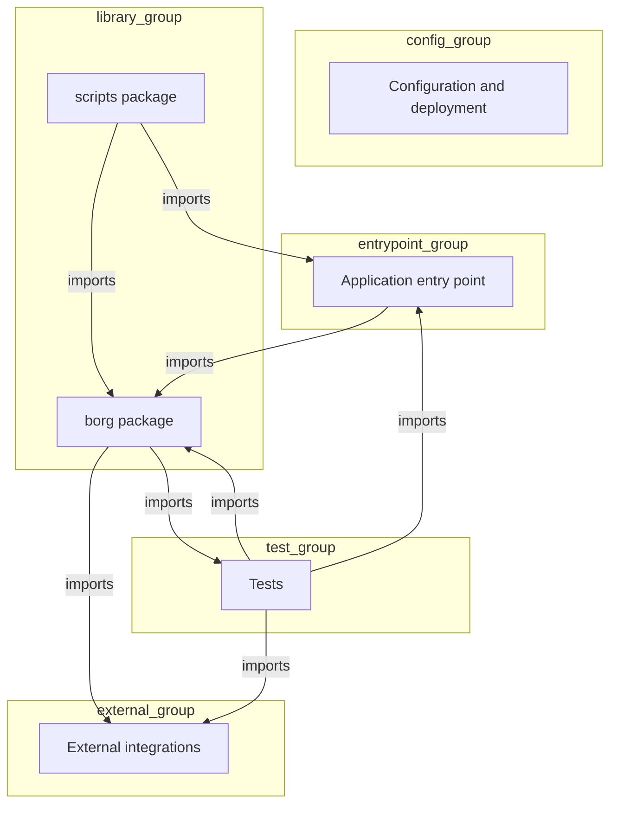

# Architecture report: borgbackup/borg

> Automated static analysis. **Observed** = directly seen in files/imports/AST; **Inferred** = interpretation from that evidence. Repository code was not executed.

## 1. Repository at a glance

| Item | Value |
| --- | --- |
| Repository | borgbackup/borg |
| Description | Deduplicating archiver with compression and authenticated encryption. |
| Language | Python |
| Stars | 13926 |
| Licence | Other |
| Analysed commit / branch | 119addc7c0235b1859c9efd74f771c02b1208bcb / master |
| Framework(s) | None detected |
| Files analysed | 561 |
| Components | 6 |

## 2. Architecture in one minute

borgbackup/borg - Deduplicating archiver with compression and authenticated encryption.. This repository was analysed statically from 561 file(s) (244 Python). Detected technologies (observed from imports/manifests): GitHub Actions, Poetry, setuptools, Docker, pytest, unittest. Files are grouped into 6 component(s): borg package, Configuration and deployment, Application entry point, External integrations, scripts package, Tests. Observed entry point(s): scripts/bench_chunker_kernels.py, scripts/blake3-optimize-mt-threshold.py, scripts/chunker_bench.py. Findings below distinguish observed facts from inferred interpretation.

## 3. High-level block diagram

## 4. Main components

### borg package (`borg`)

- **Kind:** library
- **Status:** Observed
- **Confidence:** 0.85
- **Responsibility:** Groups 127 file(s) under borg package (observed from repository paths and static analysis). Observed top-level classes: AEADKeyBase, AESCTRKey, AESKeyBase, AESOCBKey, AdHocWithFilesCache, AnalyzeMixIn. Observed top-level functions: ChunkerParams, DigestAlgos, FilesCacheGroupBySpec, FilesCacheMode, FilesystemDirSpec, FilesystemPathSpec.
- **Paths:** `src/borg/__init__.py`, `src/borg/archive.py`, `src/borg/archiver/_common.py`, `src/borg/archiver/analyze_cmd.py`, `src/borg/archiver/benchmark_cmd.py`, `src/borg/archiver/check_cmd.py`, `src/borg/archiver/compact_cmd.py`, `src/borg/archiver/completion_cmd.py`, `src/borg/archiver/copy_cmd.py`, `src/borg/archiver/create_cmd.py`, `src/borg/archiver/debug_cmd.py`, `src/borg/archiver/delete_cmd.py`, `src/borg/archiver/diff_cmd.py`, `src/borg/archiver/extract_cmd.py`, `src/borg/archiver/find_cmd.py`, `src/borg/archiver/help_cmd.py`, `src/borg/archiver/info_cmd.py`, `src/borg/archiver/key_cmds.py`, `src/borg/archiver/known_repos_cmd.py`, `src/borg/archiver/list_cmd.py`, `src/borg/archiver/lock_cmds.py`, `src/borg/archiver/mount_cmds.py`, `src/borg/archiver/prune_cmd.py`, `src/borg/archiver/recreate_cmd.py`, `src/borg/archiver/rename_cmd.py`, `src/borg/archiver/repo_compress_cmd.py`, `src/borg/archiver/repo_create_cmd.py`, `src/borg/archiver/repo_delete_cmd.py`, `src/borg/archiver/repo_info_cmd.py`, `src/borg/archiver/repo_list_cmd.py`, `src/borg/archiver/repo_space_cmd.py`, `src/borg/archiver/serve_cmd.py`, `src/borg/archiver/tag_cmd.py`, `src/borg/archiver/tar_cmds.py`, `src/borg/archiver/transfer_cmd.py`, `src/borg/archiver/undelete_cmd.py`, `src/borg/archiver/version_cmd.py`, `src/borg/archiver/webdav_cmd.py`, `src/borg/cache.py`, `src/borg/chunkers/__init__.py`, `src/borg/chunkers/buzhash64_impl.c`, `src/borg/chunkers/buzhash64_impl.h`, `src/borg/chunkers/failing.py`, `src/borg/chunkers/fastcdc_impl.c`, `src/borg/chunkers/fastcdc_impl.h`, `src/borg/chunkers/fixed.py`, `src/borg/chunkers/goldilocks_aes_impl.c`, `src/borg/chunkers/goldilocks_aes_impl.h`, `src/borg/chunkers/kernel_env.py`, `src/borg/chunkers/phte_core.h`, `src/borg/chunkers/phte_kernel.h`, `src/borg/chunkers/phte_scan.h`, `src/borg/chunkers/rabin_aes_impl.c`, `src/borg/chunkers/rabin_aes_impl.h`, `src/borg/chunkers/toeplitz_aes_impl.c`, `src/borg/chunkers/toeplitz_aes_impl.h`, `src/borg/cockpit/__init__.py`, `src/borg/cockpit/runner.py`, `src/borg/cockpit/theme.py`, `src/borg/cockpit/translator.py`, `src/borg/cockpit/widgets.py`, `src/borg/constants.py`, `src/borg/crypto/__init__.py`, `src/borg/crypto/file_integrity.py`, `src/borg/crypto/key.py`, `src/borg/crypto/keymanager.py`, `src/borg/crypto/sealed_stream.py`, `src/borg/digests.py`, `src/borg/fslocking.py`, `src/borg/fuse.py`, `src/borg/fuse_impl.py`, `src/borg/helpers/__init__.py`, `src/borg/helpers/argparsing.py`, `src/borg/helpers/datastruct.py`, `src/borg/helpers/errors.py`, `src/borg/helpers/fs.py`, `src/borg/helpers/lrucache.py`, `src/borg/helpers/misc.py`, `src/borg/helpers/msgpack.py`, `src/borg/helpers/nanorst.py`, `src/borg/helpers/parseformat.py`, `src/borg/helpers/passphrase.py`, `src/borg/helpers/process.py`, `src/borg/helpers/progress.py`, `src/borg/helpers/shellpattern.py`, `src/borg/helpers/sorting.py`, `src/borg/helpers/time.py`, `src/borg/helpers/yes_no.py`, `src/borg/hlfuse.py`, `src/borg/legacy/__init__.py`, `src/borg/legacy/archives.py`, `src/borg/legacy/crypto/__init__.py`, `src/borg/legacy/crypto/key.py`, `src/borg/legacy/fs.py`, `src/borg/legacy/hashindex.py`, `src/borg/legacy/helpers.py`, `src/borg/legacy/remote.py`, `src/borg/legacy/repoobj.py`, `src/borg/legacy/repository.py`, `src/borg/legacy/upgrade.py`, `src/borg/logger.py`, `src/borg/manifest.py`, `src/borg/patterns.py`, `src/borg/platform/__init__.py`, `src/borg/platform/base.py`, `src/borg/platform/posix_ug.py`, `src/borg/platform/solaris.py`, `src/borg/platform/windows_ug.py`, `src/borg/platform/xattr.py`, `src/borg/platformflags.py`, `src/borg/repoobj.py`, `src/borg/repository.py`, `src/borg/security.py`, `src/borg/selftest.py`, `src/borg/storelocking.py`, `src/borg/testsuite/__init__.py`, `src/borg/testsuite/archiver/__init__.py`, `src/borg/testsuite/chunkers/__init__.py`, `src/borg/testsuite/chunkers/pytest_helpers.py`, `src/borg/testsuite/crypto/__init__.py`, `src/borg/testsuite/helpers/__init__.py`, `src/borg/testsuite/platform/__init__.py`, `src/borg/upgrade.py`, `src/borg/version.py`, `src/borg/vfs.py`, `src/borg/webdav.py`, `src/borg/xattr.py`
- **Evidence:** [src/borg/__init__.py](https://github.com/borgbackup/borg/blob/119addc7c0235b1859c9efd74f771c02b1208bcb/src/borg/__init__.py); [src/borg/archive.py:93](https://github.com/borgbackup/borg/blob/119addc7c0235b1859c9efd74f771c02b1208bcb/src/borg/archive.py#L93); [src/borg/archiver/_common.py:34](https://github.com/borgbackup/borg/blob/119addc7c0235b1859c9efd74f771c02b1208bcb/src/borg/archiver/_common.py#L34); [src/borg/archiver/analyze_cmd.py:37](https://github.com/borgbackup/borg/blob/119addc7c0235b1859c9efd74f771c02b1208bcb/src/borg/archiver/analyze_cmd.py#L37); [src/borg/archiver/benchmark_cmd.py:21](https://github.com/borgbackup/borg/blob/119addc7c0235b1859c9efd74f771c02b1208bcb/src/borg/archiver/benchmark_cmd.py#L21); [src/borg/archiver/check_cmd.py:20](https://github.com/borgbackup/borg/blob/119addc7c0235b1859c9efd74f771c02b1208bcb/src/borg/archiver/check_cmd.py#L20); [src/borg/archiver/compact_cmd.py:27](https://github.com/borgbackup/borg/blob/119addc7c0235b1859c9efd74f771c02b1208bcb/src/borg/archiver/compact_cmd.py#L27); [src/borg/archiver/completion_cmd.py:957](https://github.com/borgbackup/borg/blob/119addc7c0235b1859c9efd74f771c02b1208bcb/src/borg/archiver/completion_cmd.py#L957)

### Configuration and deployment (`config`)

- **Kind:** config
- **Status:** Observed
- **Confidence:** 0.85
- **Responsibility:** Groups 4 file(s) under configuration and deployment (observed from repository paths and static analysis). Observed top-level functions: long_desc_from_readme.
- **Paths:** `MANIFEST.in`, `pyproject.toml`, `scripts/Dockerfile.linux-run`, `setup.py`
- **Evidence:** [MANIFEST.in](https://github.com/borgbackup/borg/blob/119addc7c0235b1859c9efd74f771c02b1208bcb/MANIFEST.in); [pyproject.toml](https://github.com/borgbackup/borg/blob/119addc7c0235b1859c9efd74f771c02b1208bcb/pyproject.toml); [scripts/Dockerfile.linux-run](https://github.com/borgbackup/borg/blob/119addc7c0235b1859c9efd74f771c02b1208bcb/scripts/Dockerfile.linux-run); [setup.py:300](https://github.com/borgbackup/borg/blob/119addc7c0235b1859c9efd74f771c02b1208bcb/setup.py#L300)

### Application entry point (`entrypoint`)

- **Kind:** entrypoint
- **Status:** Observed
- **Confidence:** 0.85
- **Responsibility:** Groups 10 file(s) under application entry point (observed from repository paths and static analysis). Observed top-level classes: Archiver, BorgCockpitApp, BuildMan, BuildUsage, Clean. Observed top-level functions: adversarial_probes, analyze, blocker_below, build_borgfs_parser, build_plan, chunk_stats.
- **Paths:** `scripts/bench_chunker_kernels.py`, `scripts/blake3-optimize-mt-threshold.py`, `scripts/chunker_bench.py`, `scripts/fame.py`, `scripts/glibc_check.py`, `scripts/lvm-thin-map.py`, `scripts/make.py`, `src/borg/__main__.py`, `src/borg/archiver/__init__.py`, `src/borg/cockpit/app.py`
- **Evidence:** [scripts/bench_chunker_kernels.py:58](https://github.com/borgbackup/borg/blob/119addc7c0235b1859c9efd74f771c02b1208bcb/scripts/bench_chunker_kernels.py#L58); [scripts/blake3-optimize-mt-threshold.py:104](https://github.com/borgbackup/borg/blob/119addc7c0235b1859c9efd74f771c02b1208bcb/scripts/blake3-optimize-mt-threshold.py#L104); [scripts/chunker_bench.py:52](https://github.com/borgbackup/borg/blob/119addc7c0235b1859c9efd74f771c02b1208bcb/scripts/chunker_bench.py#L52); [scripts/fame.py:120](https://github.com/borgbackup/borg/blob/119addc7c0235b1859c9efd74f771c02b1208bcb/scripts/fame.py#L120); [scripts/glibc_check.py:18](https://github.com/borgbackup/borg/blob/119addc7c0235b1859c9efd74f771c02b1208bcb/scripts/glibc_check.py#L18); [scripts/lvm-thin-map.py:63](https://github.com/borgbackup/borg/blob/119addc7c0235b1859c9efd74f771c02b1208bcb/scripts/lvm-thin-map.py#L63); [scripts/make.py:15](https://github.com/borgbackup/borg/blob/119addc7c0235b1859c9efd74f771c02b1208bcb/scripts/make.py#L15); [src/borg/__main__.py](https://github.com/borgbackup/borg/blob/119addc7c0235b1859c9efd74f771c02b1208bcb/src/borg/__main__.py)

### External integrations (`external_integrations`)

- **Kind:** external
- **Status:** Inferred
- **Confidence:** 0.70
- **Responsibility:** Groups 0 file(s) under external integrations (observed from repository paths and static analysis).
- **Evidence:** [src/borg/platform/base.py:5](https://github.com/borgbackup/borg/blob/119addc7c0235b1859c9efd74f771c02b1208bcb/src/borg/platform/base.py#L5); [src/borg/testsuite/archiver/create_cmd_test.py:8](https://github.com/borgbackup/borg/blob/119addc7c0235b1859c9efd74f771c02b1208bcb/src/borg/testsuite/archiver/create_cmd_test.py#L8); [src/borg/testsuite/archiver/webdav_cmd_test.py:9](https://github.com/borgbackup/borg/blob/119addc7c0235b1859c9efd74f771c02b1208bcb/src/borg/testsuite/archiver/webdav_cmd_test.py#L9)

### scripts package (`scripts`)

- **Kind:** library
- **Status:** Observed
- **Confidence:** 0.85
- **Responsibility:** Groups 5 file(s) under scripts package (observed from repository paths and static analysis). Observed top-level functions: subclasses.
- **Paths:** `scripts/build-borg-using-nuitka.sh`, `scripts/build-borg-using-pyinstaller.sh`, `scripts/errorlist.py`, `scripts/haiku_mmap_pread_shim.c`, `scripts/rest_perf_test.sh`
- **Evidence:** [scripts/build-borg-using-nuitka.sh](https://github.com/borgbackup/borg/blob/119addc7c0235b1859c9efd74f771c02b1208bcb/scripts/build-borg-using-nuitka.sh); [scripts/build-borg-using-pyinstaller.sh](https://github.com/borgbackup/borg/blob/119addc7c0235b1859c9efd74f771c02b1208bcb/scripts/build-borg-using-pyinstaller.sh); [scripts/errorlist.py:12](https://github.com/borgbackup/borg/blob/119addc7c0235b1859c9efd74f771c02b1208bcb/scripts/errorlist.py#L12); [scripts/haiku_mmap_pread_shim.c](https://github.com/borgbackup/borg/blob/119addc7c0235b1859c9efd74f771c02b1208bcb/scripts/haiku_mmap_pread_shim.c); [scripts/rest_perf_test.sh](https://github.com/borgbackup/borg/blob/119addc7c0235b1859c9efd74f771c02b1208bcb/scripts/rest_perf_test.sh)

### Tests (`tests`)

- **Kind:** test
- **Status:** Observed
- **Confidence:** 0.85
- **Responsibility:** Groups 117 file(s) under tests (observed from repository paths and static analysis). Observed routes: PATCH getpass.getpass. Observed top-level classes: ArchiverSetup, ChunkerBuzHash64TestCase, ChunkerFixedTestCase, ChunkerTestCase, CryptoTestCase, FakeStream. Observed top-level functions: H, H2, _archive_checker, _archive_meta, _archiveinfo, _archives.
- **Paths:** `scripts/endian_interop_test.py`, `scripts/make-testdata/test_transfer_upgrade.sh`, `src/borg/conftest.py`, `src/borg/testsuite/archive_test.py`, `src/borg/testsuite/archiver/_common_test.py`, `src/borg/testsuite/archiver/analyze_cmd_test.py`, `src/borg/testsuite/archiver/argparsing_test.py`, `src/borg/testsuite/archiver/benchmark_cmd_test.py`, `src/borg/testsuite/archiver/check_cmd_remote_test.py`, `src/borg/testsuite/archiver/check_cmd_test.py`, `src/borg/testsuite/archiver/checks_test.py`, `src/borg/testsuite/archiver/compact_cmd_test.py`, `src/borg/testsuite/archiver/completion_cmd_test.py`, `src/borg/testsuite/archiver/copy_cmd_test.py`, `src/borg/testsuite/archiver/corruption_test.py`, `src/borg/testsuite/archiver/create_cmd_test.py`, `src/borg/testsuite/archiver/debug_cmds_test.py`, `src/borg/testsuite/archiver/delete_cmd_test.py`, `src/borg/testsuite/archiver/diff_cmd_test.py`, `src/borg/testsuite/archiver/disk_full_test.py`, `src/borg/testsuite/archiver/extract_cmd_test.py`, `src/borg/testsuite/archiver/find_cmd_test.py`, `src/borg/testsuite/archiver/help_cmd_test.py`, `src/borg/testsuite/archiver/info_cmd_test.py`, `src/borg/testsuite/archiver/key_cmds_test.py`, `src/borg/testsuite/archiver/known_repos_cmd_test.py`, `src/borg/testsuite/archiver/list_cmd_test.py`, `src/borg/testsuite/archiver/lock_cmds_test.py`, `src/borg/testsuite/archiver/match_archives_date_test.py`, `src/borg/testsuite/archiver/mount_cmds_test.py`, `src/borg/testsuite/archiver/patterns_test.py`, `src/borg/testsuite/archiver/prune_cmd_test.py`, `src/borg/testsuite/archiver/recreate_cmd_test.py`, `src/borg/testsuite/archiver/remote_repo_test.py`, `src/borg/testsuite/archiver/rename_cmd_test.py`, `src/borg/testsuite/archiver/repo_compress_cmd_test.py`, `src/borg/testsuite/archiver/repo_create_cmd_test.py`, `src/borg/testsuite/archiver/repo_delete_cmd_test.py`, `src/borg/testsuite/archiver/repo_info_cmd_test.py`, `src/borg/testsuite/archiver/repo_list_cmd_test.py`, `src/borg/testsuite/archiver/repo_space_cmd_test.py`, `src/borg/testsuite/archiver/restricted_permissions_test.py`, `src/borg/testsuite/archiver/return_codes_test.py`, `src/borg/testsuite/archiver/serve_cmd_test.py`, `src/borg/testsuite/archiver/store_objects_test.py`, `src/borg/testsuite/archiver/tag_cmd_test.py`, `src/borg/testsuite/archiver/tar_cmds_test.py`, `src/borg/testsuite/archiver/transfer_cmd_test.py`, `src/borg/testsuite/archiver/undelete_cmd_test.py`, `src/borg/testsuite/archiver/version_cmd_test.py`, `src/borg/testsuite/archiver/webdav_cmd_test.py`, `src/borg/testsuite/archives_test.py`, `src/borg/testsuite/benchmark_test.py`, `src/borg/testsuite/cache_test.py`, `src/borg/testsuite/chunkers/buzhash64_self_test.py`, `src/borg/testsuite/chunkers/buzhash64_test.py`, `src/borg/testsuite/chunkers/buzhash_self_test.py`, `src/borg/testsuite/chunkers/buzhash_test.py`, `src/borg/testsuite/chunkers/failing_test.py`, `src/borg/testsuite/chunkers/fastcdc_test.py`, `src/borg/testsuite/chunkers/fixed_self_test.py`, `src/borg/testsuite/chunkers/fixed_test.py`, `src/borg/testsuite/chunkers/goldilocks_aes_test.py`, `src/borg/testsuite/chunkers/interaction_test.py`, `src/borg/testsuite/chunkers/phte_chunkers_test.py`, `src/borg/testsuite/chunkers/rabin_aes_test.py`, `src/borg/testsuite/chunkers/reader_test.py`, `src/borg/testsuite/chunkers/toeplitz_aes_test.py`, `src/borg/testsuite/cockpit_test.py`, `src/borg/testsuite/compress_test.py`, `src/borg/testsuite/crypto/crypto_test.py`, `src/borg/testsuite/crypto/csprng_test.py`, `src/borg/testsuite/crypto/file_integrity_test.py`, `src/borg/testsuite/crypto/key_test.py`, `src/borg/testsuite/crypto/legacy_key_test.py`, `src/borg/testsuite/crypto/low_level_test.py`, `src/borg/testsuite/crypto/sealed_stream_test.py`, `src/borg/testsuite/digests_test.py`, `src/borg/testsuite/fslocking_test.py`, `src/borg/testsuite/fuse_test.py`, `src/borg/testsuite/hashindex_test.py`, `src/borg/testsuite/helpers/__init__test.py`, `src/borg/testsuite/helpers/datastruct_test.py`, `src/borg/testsuite/helpers/efficient_collection_queue_test.py`, `src/borg/testsuite/helpers/fs_test.py`, `src/borg/testsuite/helpers/lrucache_test.py`, `src/borg/testsuite/helpers/misc_test.py`, `src/borg/testsuite/helpers/msgpack_test.py`, `src/borg/testsuite/helpers/nanorst_test.py`, `src/borg/testsuite/helpers/parseformat_test.py`, `src/borg/testsuite/helpers/passphrase_test.py`, `src/borg/testsuite/helpers/process_test.py`, `src/borg/testsuite/helpers/progress_test.py`, `src/borg/testsuite/helpers/shellpattern_test.py`, `src/borg/testsuite/helpers/sorting_test.py`, `src/borg/testsuite/helpers/time_test.py`, `src/borg/testsuite/helpers/yes_no_test.py`, `src/borg/testsuite/item_test.py`, `src/borg/testsuite/legacy_archives_test.py`, `src/borg/testsuite/legacy_fs_test.py`, `src/borg/testsuite/legacy_helpers_test.py`, `src/borg/testsuite/legacy_upgrade_test.py`, `src/borg/testsuite/legacyrepository_test.py`, `src/borg/testsuite/logger_test.py`, `src/borg/testsuite/patterns_test.py`, `src/borg/testsuite/platform/all_test.py`, `src/borg/testsuite/platform/darwin_test.py`, `src/borg/testsuite/platform/freebsd_test.py`, `src/borg/testsuite/platform/linux_test.py`, `src/borg/testsuite/platform/platform_test.py`, `src/borg/testsuite/platform/solaris_test.py`, `src/borg/testsuite/platform/windows_test.py`, `src/borg/testsuite/repoobj_test.py`, `src/borg/testsuite/storelocking_test.py`, `src/borg/testsuite/version_test.py`, `src/borg/testsuite/vfs_test.py`, `src/borg/testsuite/xattr_test.py`
- **Evidence:** [scripts/endian_interop_test.py:66](https://github.com/borgbackup/borg/blob/119addc7c0235b1859c9efd74f771c02b1208bcb/scripts/endian_interop_test.py#L66); [scripts/make-testdata/test_transfer_upgrade.sh](https://github.com/borgbackup/borg/blob/119addc7c0235b1859c9efd74f771c02b1208bcb/scripts/make-testdata/test_transfer_upgrade.sh); [src/borg/conftest.py:27](https://github.com/borgbackup/borg/blob/119addc7c0235b1859c9efd74f771c02b1208bcb/src/borg/conftest.py#L27); [src/borg/testsuite/archive_test.py:28](https://github.com/borgbackup/borg/blob/119addc7c0235b1859c9efd74f771c02b1208bcb/src/borg/testsuite/archive_test.py#L28); [src/borg/testsuite/archiver/_common_test.py:4](https://github.com/borgbackup/borg/blob/119addc7c0235b1859c9efd74f771c02b1208bcb/src/borg/testsuite/archiver/_common_test.py#L4); [src/borg/testsuite/archiver/analyze_cmd_test.py:14](https://github.com/borgbackup/borg/blob/119addc7c0235b1859c9efd74f771c02b1208bcb/src/borg/testsuite/archiver/analyze_cmd_test.py#L14); [src/borg/testsuite/archiver/argparsing_test.py:8](https://github.com/borgbackup/borg/blob/119addc7c0235b1859c9efd74f771c02b1208bcb/src/borg/testsuite/archiver/argparsing_test.py#L8); [src/borg/testsuite/archiver/benchmark_cmd_test.py:11](https://github.com/borgbackup/borg/blob/119addc7c0235b1859c9efd74f771c02b1208bcb/src/borg/testsuite/archiver/benchmark_cmd_test.py#L11)

## 5. Execution flow

**Observed** entry point(s):

- [scripts/bench_chunker_kernels.py:322](https://github.com/borgbackup/borg/blob/119addc7c0235b1859c9efd74f771c02b1208bcb/scripts/bench_chunker_kernels.py#L322)
- [scripts/blake3-optimize-mt-threshold.py:530](https://github.com/borgbackup/borg/blob/119addc7c0235b1859c9efd74f771c02b1208bcb/scripts/blake3-optimize-mt-threshold.py#L530)
- [scripts/chunker_bench.py:323](https://github.com/borgbackup/borg/blob/119addc7c0235b1859c9efd74f771c02b1208bcb/scripts/chunker_bench.py#L323)
- [scripts/endian_interop_test.py:260](https://github.com/borgbackup/borg/blob/119addc7c0235b1859c9efd74f771c02b1208bcb/scripts/endian_interop_test.py#L260)
- [scripts/fame.py:221](https://github.com/borgbackup/borg/blob/119addc7c0235b1859c9efd74f771c02b1208bcb/scripts/fame.py#L221)
- [scripts/glibc_check.py:63](https://github.com/borgbackup/borg/blob/119addc7c0235b1859c9efd74f771c02b1208bcb/scripts/glibc_check.py#L63)
- [scripts/lvm-thin-map.py:165](https://github.com/borgbackup/borg/blob/119addc7c0235b1859c9efd74f771c02b1208bcb/scripts/lvm-thin-map.py#L165)
- [scripts/make.py:657](https://github.com/borgbackup/borg/blob/119addc7c0235b1859c9efd74f771c02b1208bcb/scripts/make.py#L657)
- [src/borg/archiver/__init__.py](https://github.com/borgbackup/borg/blob/119addc7c0235b1859c9efd74f771c02b1208bcb/src/borg/archiver/__init__.py)
- [src/borg/archiver/__init__.py](https://github.com/borgbackup/borg/blob/119addc7c0235b1859c9efd74f771c02b1208bcb/src/borg/archiver/__init__.py)

**Observed** routes (from decorators):

- `PATCH getpass.getpass` -> `test_repo_key_detect_does_not_raise_integrity_error` in `src/borg/testsuite/crypto/crypto_test.py:279`

Representative flow (derived from observed entry points and the import graph; steps beyond the entry point are **Inferred**):

1. Execution starts at an observed entry point listed above, if present.
2. `borg` imports `external_integrations` (borg package -> External integrations).
3. `borg` imports `tests` (borg package -> Tests).
4. `entrypoint` imports `borg` (Application entry point -> borg package).
5. `scripts` imports `borg` (scripts package -> borg package).
6. `scripts` imports `entrypoint` (scripts package -> Application entry point).
7. `tests` imports `borg` (Tests -> borg package).
8. `tests` imports `entrypoint` (Tests -> Application entry point).
9. `tests` imports `external_integrations` (Tests -> External integrations).

## 6. Project structure

### `(root)`

- `.editorconfig` - config (201 bytes)
- `.git-blame-ignore-revs` - other (71 bytes)
- `.gitattributes` - other (576 bytes)
- `.gitignore` - other (940 bytes)
- `.mailmap` - other (2370 bytes)
- `.pre-commit-config.yaml` - config (183 bytes)
- `.readthedocs.yaml` - config (651 bytes)
- `AUTHORS` - other (1178 bytes)
- `Brewfile` - other (254 bytes)
- `CONTRIBUTING.md` - docs (3223 bytes)
- `FAME.md` - docs (12185 bytes)
- `FAME.svg` - other (4375 bytes)
- `LICENSE` - docs (1551 bytes)
- `MANIFEST.in` - manifest (488 bytes)
- `README.rst` - docs (8990 bytes)
- `SECURITY.md` - docs (500 bytes)
- `Vagrantfile` - other (19950 bytes)
- `pyproject.toml` - manifest (10757 bytes)
- `setup.py` - manifest, Python (12913 bytes)

### `.claude`

- `.claude/CLAUDE.md` - docs (10190 bytes)
- `.claude/settings.json` - config (1089 bytes)

### `.github`

- `.github/FUNDING.yml` - config (173 bytes)
- `.github/ISSUE_TEMPLATE.md` - docs (1644 bytes)
- `.github/PULL_REQUEST_TEMPLATE.md` - docs (556 bytes)
- `.github/dependabot.yml` - config (737 bytes)
- `.github/workflows/32bit.yml` - ci, YAML (9084 bytes)
- `.github/workflows/backport.yml` - ci, YAML (2008 bytes)
- `.github/workflows/bigendian.yml` - ci, YAML (8261 bytes)
- `.github/workflows/black.yaml` - ci, YAML (916 bytes)
- `.github/workflows/canary.yml` - ci, YAML (6711 bytes)
- `.github/workflows/ci.yml` - ci, YAML (62469 bytes)
- `.github/workflows/codeql-analysis.yml` - ci, YAML (3049 bytes)
- `.github/workflows/docs.yml` - ci, YAML (3068 bytes)
- `.github/workflows/fame.yml` - ci, YAML (2747 bytes)
- `.github/workflows/pypy.yml` - ci, YAML (2037 bytes)
- `.github/workflows/release.yml` - ci, YAML (9980 bytes)
- `.github/zizmor.yml` - config (1367 bytes)

### `docs`

- `docs/3rd_party/README` - docs (214 bytes)
- `docs/Makefile` - docs (4583 bytes)
- `docs/_static/Makefile` - docs (198 bytes)
- `docs/_static/logo.svg` - docs (1790 bytes)
- `docs/_static/logo_font.txt` - docs (111 bytes)
- `docs/_templates/downloads.html` - docs (1161 bytes)
- `docs/_templates/globaltoc.html` - docs (633 bytes)
- `docs/_templates/layout.html` - docs (5872 bytes)
- `docs/_templates/logo-text.html` - docs (160 bytes)
- `docs/_templates/versionselector.html` - docs (1194 bytes)
- `docs/authors.rst` - docs (139 bytes)
- `docs/binaries/00_README.txt` - docs (5598 bytes)
- `docs/book.rst` - docs (403 bytes)
- `docs/borg_theme/css/borg.css` - docs (5558 bytes)
- `docs/changes.rst` - docs (100420 bytes)
- `docs/changes_0.x.rst` - docs (33213 bytes)
- `docs/conf.py` - docs (8453 bytes)
- `docs/deployment.rst` - docs (397 bytes)
- `docs/deployment/age.rst` - docs (12023 bytes)
- `docs/deployment/automated-local.rst` - docs (8816 bytes)
- `docs/deployment/central-backup-server.rst` - docs (8076 bytes)
- `docs/deployment/hosting-repositories.rst` - docs (4152 bytes)
- `docs/deployment/image-backup.rst` - docs (7658 bytes)
- `docs/deployment/non-root-user.rst` - docs (2486 bytes)
- `docs/deployment/pull-backup.rst` - docs (22326 bytes)
- `docs/deployment/yubikey.rst` - docs (5720 bytes)
- `docs/development.rst` - docs (20477 bytes)
- `docs/faq.rst` - docs (66917 bytes)
- `docs/global.rst.inc` - docs (1579 bytes)
- `docs/index.rst` - docs (368 bytes)
- `docs/installation.rst` - docs (21101 bytes)
- `docs/internals.rst` - docs (2011 bytes)
- `docs/internals/chunker.rst` - docs (13790 bytes)
- `docs/internals/data-structures.rst` - docs (69993 bytes)
- `docs/internals/frontends.rst` - docs (49873 bytes)
- `docs/internals/packs.rst` - docs (27017 bytes)
- `docs/internals/security.rst` - docs (32312 bytes)
- `docs/introduction.rst` - docs (233 bytes)
- `docs/man/borg-analyze.1` - docs (7215 bytes)
- `docs/man/borg-benchmark-cpu.1` - docs (3686 bytes)
- `docs/man/borg-benchmark-crud.1` - docs (3720 bytes)
- `docs/man/borg-benchmark.1` - docs (1154 bytes)
- `docs/man/borg-break-lock.1` - docs (1414 bytes)
- `docs/man/borg-check.1` - docs (13392 bytes)
- `docs/man/borg-common.1` - docs (1955 bytes)
- `docs/man/borg-compact.1` - docs (5020 bytes)
- `docs/man/borg-completion.1` - docs (2318 bytes)
- `docs/man/borg-compression.1` - docs (5944 bytes)
- `docs/man/borg-config.1` - docs (2683 bytes)
- `docs/man/borg-copy.1` - docs (3253 bytes)
- `docs/man/borg-create.1` - docs (31411 bytes)
- `docs/man/borg-delete.1` - docs (3635 bytes)
- `docs/man/borg-diff.1` - docs (11901 bytes)
- `docs/man/borg-environment.1` - docs (33684 bytes)
- `docs/man/borg-export-tar.1` - docs (5243 bytes)
- `docs/man/borg-extract.1` - docs (8184 bytes)
- `docs/man/borg-find.1` - docs (7739 bytes)
- `docs/man/borg-import-tar.1` - docs (7720 bytes)
- `docs/man/borg-info.1` - docs (3414 bytes)
- `docs/man/borg-key-add.1` - docs (2055 bytes)
- `docs/man/borg-key-change-algorithm.1` - docs (2779 bytes)
- `docs/man/borg-key-change-location.1` - docs (1733 bytes)
- `docs/man/borg-key-change-passphrase.1` - docs (4216 bytes)
- `docs/man/borg-key-export.1` - docs (3753 bytes)
- `docs/man/borg-key-import.1` - docs (2576 bytes)
- `docs/man/borg-key-list.1` - docs (1345 bytes)
- `docs/man/borg-key-migrate-to-repokey.1` - docs (1955 bytes)
- `docs/man/borg-key-remove.1` - docs (1790 bytes)
- `docs/man/borg-key.1` - docs (1457 bytes)
- `docs/man/borg-known-repos.1` - docs (3274 bytes)
- `docs/man/borg-list.1` - docs (8821 bytes)
- `docs/man/borg-match-archives.1` - docs (5583 bytes)
- `docs/man/borg-mount.1` - docs (9600 bytes)
- `docs/man/borg-patterns.1` - docs (15225 bytes)
- `docs/man/borg-placeholders.1` - docs (3525 bytes)
- `docs/man/borg-prune.1` - docs (15113 bytes)
- `docs/man/borg-recreate.1` - docs (8689 bytes)
- `docs/man/borg-rename.1` - docs (1758 bytes)
- `docs/man/borg-repo-compress.1` - docs (3812 bytes)
- `docs/man/borg-repo-create.1` - docs (12666 bytes)
- `docs/man/borg-repo-delete.1` - docs (3051 bytes)
- `docs/man/borg-repo-info.1` - docs (1874 bytes)
- `docs/man/borg-repo-list.1` - docs (6607 bytes)
- `docs/man/borg-repo-space.1` - docs (2586 bytes)
- `docs/man/borg-serve.1` - docs (10293 bytes)
- `docs/man/borg-tag.1` - docs (4271 bytes)
- `docs/man/borg-transfer.1` - docs (13308 bytes)
- `docs/man/borg-umount.1` - docs (3551 bytes)
- `docs/man/borg-undelete.1` - docs (2822 bytes)
- `docs/man/borg-upgrade.1` - docs (3787 bytes)
- `docs/man/borg-version.1` - docs (2181 bytes)
- `docs/man/borg-webdav.1` - docs (8849 bytes)
- `docs/man/borg-with-lock.1` - docs (2097 bytes)
- `docs/man/borg.1` - docs (62736 bytes)
- `docs/man/borgfs.1` - docs (3175 bytes)
- `docs/man_intro.rst` - docs (1775 bytes)
- `docs/misc/asciinema/Containerfile` - docs (1923 bytes)
- `docs/misc/asciinema/README.md` - docs (2150 bytes)
- `docs/misc/asciinema/borg2-demo.cast` - docs (78579 bytes)
- `docs/misc/asciinema/demo-data.py` - docs (4024 bytes)
- `docs/misc/asciinema/demo.tcl` - docs (6759 bytes)
- `docs/misc/asciinema/entrypoint.sh` - docs (732 bytes)
- `docs/misc/asciinema/record.exp` - docs (438 bytes)
- `docs/misc/asciinema/record.sh` - docs (2325 bytes)
- `docs/misc/benchmark-crud.txt` - docs (3824 bytes)
- `docs/misc/create_chunker-params.txt` - docs (5093 bytes)
- `docs/misc/internals-picture.txt` - docs (1827 bytes)
- `docs/misc/joke-issue-10000/README.md` - docs (2423 bytes)
- `docs/misc/joke-issue-10000/we_are_borg.svg` - docs (11115 bytes)
- `docs/misc/logging.conf` - docs (305 bytes)
- `docs/misc/prune-example-interval.txt` - docs (7515 bytes)
- `docs/misc/prune-example.txt` - docs (5671 bytes)
- `docs/misc/stickers/README.md` - docs (1467 bytes)
- `docs/quickstart.rst` - docs (23546 bytes)
- `docs/quickstart_example.rst.inc` - docs (3093 bytes)
- `docs/support.rst` - docs (2055 bytes)
- `docs/usage.rst` - docs (1835 bytes)
- `docs/usage/analyze.rst` - docs (5233 bytes)
- `docs/usage/analyze.rst.inc` - docs (15729 bytes)
- `docs/usage/benchmark.rst` - docs (72 bytes)
- `docs/usage/benchmark_cpu.rst.inc` - docs (6763 bytes)
- `docs/usage/benchmark_crud.rst.inc` - docs (4627 bytes)
- `docs/usage/break-lock.rst.inc` - docs (1093 bytes)
- `docs/usage/check.rst` - docs (27 bytes)
- `docs/usage/check.rst.inc` - docs (23059 bytes)
- `docs/usage/common-options.rst.inc` - docs (946 bytes)
- `docs/usage/compact.rst` - docs (159 bytes)
- `docs/usage/compact.rst.inc` - docs (7363 bytes)
- `docs/usage/completion.rst` - docs (353 bytes)
- `docs/usage/completion.rst.inc` - docs (2489 bytes)
- `docs/usage/copy.rst` - docs (713 bytes)
- `docs/usage/copy.rst.inc` - docs (3158 bytes)
- `docs/usage/create.rst` - docs (4314 bytes)
- `docs/usage/create.rst.inc` - docs (65238 bytes)
- `docs/usage/debug.rst` - docs (1770 bytes)
- `docs/usage/delete.rst` - docs (584 bytes)
- `docs/usage/delete.rst.inc` - docs (10805 bytes)
- `docs/usage/diff.rst` - docs (2126 bytes)
- `docs/usage/diff.rst.inc` - docs (15112 bytes)
- `docs/usage/export-tar.rst.inc` - docs (12555 bytes)
- `docs/usage/extract.rst` - docs (939 bytes)
- `docs/usage/extract.rst.inc` - docs (19394 bytes)
- `docs/usage/find.rst` - docs (1012 bytes)
- `docs/usage/find.rst.inc` - docs (19108 bytes)
- `docs/usage/general.rst` - docs (1540 bytes)
- `docs/usage/general/archive-specification.rst.inc` - docs (1002 bytes)
- `docs/usage/general/config.rst.inc` - docs (2907 bytes)
- `docs/usage/general/date-time.rst.inc` - docs (1236 bytes)
- `docs/usage/general/environment.rst.inc` - docs (34799 bytes)
- `docs/usage/general/file-metadata.rst.inc` - docs (3049 bytes)
- `docs/usage/general/file-systems.rst.inc` - docs (1887 bytes)
- `docs/usage/general/logging.rst.inc` - docs (1661 bytes)
- `docs/usage/general/positional-arguments.rst.inc` - docs (629 bytes)
- `docs/usage/general/repository-locations.rst.inc` - docs (618 bytes)
- `docs/usage/general/repository-urls.rst.inc` - docs (3886 bytes)
- `docs/usage/general/resources.rst.inc` - docs (3463 bytes)
- `docs/usage/general/return-codes.rst.inc` - docs (1767 bytes)
- `docs/usage/general/units.rst.inc` - docs (492 bytes)
- `docs/usage/help.rst` - docs (65 bytes)
- `docs/usage/help.rst.inc` - docs (25218 bytes)
- `docs/usage/import-tar.rst.inc` - docs (21442 bytes)
- `docs/usage/info.rst` - docs (595 bytes)
- `docs/usage/info.rst.inc` - docs (10184 bytes)
- `docs/usage/key.rst` - docs (3198 bytes)
- `docs/usage/key_add.rst.inc` - docs (2541 bytes)
- `docs/usage/key_change-location.rst.inc` - docs (2930 bytes)
- `docs/usage/key_change-passphrase.rst.inc` - docs (1299 bytes)
- `docs/usage/key_export.rst.inc` - docs (5532 bytes)
- `docs/usage/key_import.rst.inc` - docs (4938 bytes)
- `docs/usage/key_list.rst.inc` - docs (1058 bytes)
- `docs/usage/key_remove.rst.inc` - docs (3027 bytes)
- `docs/usage/known-repos.rst` - docs (952 bytes)
- `docs/usage/known-repos.rst.inc` - docs (2479 bytes)
- `docs/usage/list.rst` - docs (2222 bytes)
- `docs/usage/list.rst.inc` - docs (14547 bytes)
- `docs/usage/lock.rst` - docs (64 bytes)
- `docs/usage/mount.rst` - docs (2401 bytes)
- `docs/usage/mount.rst.inc` - docs (21249 bytes)
- `docs/usage/notes.rst` - docs (11650 bytes)
- `docs/usage/prune.rst` - docs (3038 bytes)
- `docs/usage/prune.rst.inc` - docs (30083 bytes)
- `docs/usage/recreate.rst` - docs (1645 bytes)
- `docs/usage/recreate.rst.inc` - docs (38899 bytes)
- `docs/usage/rename.rst` - docs (436 bytes)
- `docs/usage/rename.rst.inc` - docs (1939 bytes)
- `docs/usage/repo-compress.rst` - docs (274 bytes)
- `docs/usage/repo-compress.rst.inc` - docs (5901 bytes)
- `docs/usage/repo-create.rst` - docs (1499 bytes)
- `docs/usage/repo-create.rst.inc` - docs (16288 bytes)
- `docs/usage/repo-delete.rst` - docs (585 bytes)
- `docs/usage/repo-delete.rst.inc` - docs (5959 bytes)
- `docs/usage/repo-info.rst` - docs (641 bytes)
- `docs/usage/repo-info.rst.inc` - docs (1531 bytes)
- `docs/usage/repo-list.rst` - docs (697 bytes)
- `docs/usage/repo-list.rst.inc` - docs (16473 bytes)
- `docs/usage/repo-space.rst` - docs (32 bytes)
- `docs/usage/repo-space.rst.inc` - docs (3652 bytes)
- `docs/usage/serve.rst` - docs (5489 bytes)
- `docs/usage/serve.rst.inc` - docs (12949 bytes)
- `docs/usage/tag.rst` - docs (25 bytes)
- `docs/usage/tag.rst.inc` - docs (13117 bytes)
- `docs/usage/tar.rst` - docs (2070 bytes)
- `docs/usage/transfer.rst` - docs (5219 bytes)
- `docs/usage/transfer.rst.inc` - docs (26785 bytes)
- `docs/usage/umount.rst.inc` - docs (1882 bytes)
- `docs/usage/undelete.rst` - docs (30 bytes)
- `docs/usage/undelete.rst.inc` - docs (10762 bytes)
- `docs/usage/usage_general.rst.inc` - docs (625 bytes)
- `docs/usage/version.rst` - docs (29 bytes)
- `docs/usage/version.rst.inc` - docs (2669 bytes)
- `docs/usage/webdav.rst` - docs (2685 bytes)
- `docs/usage/webdav.rst.inc` - docs (12632 bytes)
- `docs/usage/with-lock.rst.inc` - docs (2424 bytes)
- `docs/usage_general.rst.inc` - docs (957 bytes)

### `requirements.d`

- `requirements.d/codestyle.txt` - docs (18 bytes)
- `requirements.d/development.lock.txt` - docs (227 bytes)
- `requirements.d/development.txt` - docs (147 bytes)
- `requirements.d/docs.txt` - docs (48 bytes)
- `requirements.d/pyinstaller.txt` - docs (20 bytes)
- `requirements.d/s3-test-server.txt` - docs (295 bytes)

### `scripts`

- `scripts/Dockerfile.linux-run` - container (595 bytes)
- `scripts/bench_chunker_kernels.py` - source, Python (13021 bytes)
- `scripts/blake3-optimize-mt-threshold.py` - source, Python (21149 bytes)
- `scripts/borg.exe.spec` - other (4737 bytes)
- `scripts/build-borg-using-nuitka.sh` - source, Shell (798 bytes)
- `scripts/build-borg-using-pyinstaller.sh` - source, Shell (576 bytes)
- `scripts/chunker_bench.py` - source, Python (11784 bytes)
- `scripts/endian_interop_test.py` - test, Python (11986 bytes)
- `scripts/errorlist.py` - source, Python (2503 bytes)
- `scripts/fame.py` - source, Python (9906 bytes)
- `scripts/fetch-binaries` - other (625 bytes)
- `scripts/glibc_check.py` - source, Python (1786 bytes)
- `scripts/haiku_mmap_pread_shim.c` - source, C (3117 bytes)
- `scripts/linux-run` - other (3292 bytes)
- `scripts/lvm-thin-map.py` - source, Python (7128 bytes)
- `scripts/make-testdata/test_transfer_upgrade.sh` - test, Shell (1615 bytes)
- `scripts/make.py` - source, Python (26375 bytes)
- `scripts/msys2-install-deps` - other (454 bytes)
- `scripts/rest_perf_test.sh` - source, Shell (9953 bytes)
- `scripts/sdist-sign` - other (309 bytes)
- `scripts/sign-binaries` - other (338 bytes)
- `scripts/upload-pypi` - other (261 bytes)

### `src`

- `src/borg/__init__.py` - source, Python (715 bytes)
- `src/borg/__main__.py` - source, Python (702 bytes)
- `src/borg/archive.py` - source, Python (176277 bytes)
- `src/borg/archiver/__init__.py` - source, Python (33495 bytes)
- `src/borg/archiver/_common.py` - source, Python (24133 bytes)
- `src/borg/archiver/analyze_cmd.py` - source, Python (29373 bytes)
- `src/borg/archiver/benchmark_cmd.py` - source, Python (32071 bytes)
- `src/borg/archiver/check_cmd.py` - source, Python (22982 bytes)
- `src/borg/archiver/compact_cmd.py` - source, Python (37395 bytes)
- `src/borg/archiver/completion_cmd.py` - source, Python (43326 bytes)
- `src/borg/archiver/copy_cmd.py` - source, Python (2707 bytes)
- `src/borg/archiver/create_cmd.py` - source, Python (71467 bytes)
- `src/borg/archiver/debug_cmd.py` - source, Python (21801 bytes)
- `src/borg/archiver/delete_cmd.py` - source, Python (4429 bytes)
- `src/borg/archiver/diff_cmd.py` - source, Python (17799 bytes)
- `src/borg/archiver/extract_cmd.py` - source, Python (13506 bytes)
- `src/borg/archiver/find_cmd.py` - source, Python (5567 bytes)
- `src/borg/archiver/help_cmd.py` - source, Python (70413 bytes)
- `src/borg/archiver/info_cmd.py` - source, Python (3454 bytes)
- `src/borg/archiver/key_cmds.py` - source, Python (16330 bytes)
- `src/borg/archiver/known_repos_cmd.py` - source, Python (16930 bytes)
- `src/borg/archiver/list_cmd.py` - source, Python (8467 bytes)
- `src/borg/archiver/lock_cmds.py` - source, Python (3687 bytes)
- `src/borg/archiver/mount_cmds.py` - source, Python (18217 bytes)
- `src/borg/archiver/prune_cmd.py` - source, Python (31028 bytes)
- `src/borg/archiver/recreate_cmd.py` - source, Python (8871 bytes)
- `src/borg/archiver/rename_cmd.py` - source, Python (1268 bytes)
- `src/borg/archiver/repo_compress_cmd.py` - source, Python (14997 bytes)
- `src/borg/archiver/repo_create_cmd.py` - source, Python (17129 bytes)
- `src/borg/archiver/repo_delete_cmd.py` - source, Python (7082 bytes)
- `src/borg/archiver/repo_info_cmd.py` - source, Python (4108 bytes)
- `src/borg/archiver/repo_list_cmd.py` - source, Python (6472 bytes)
- `src/borg/archiver/repo_space_cmd.py` - source, Python (4732 bytes)
- `src/borg/archiver/serve_cmd.py` - source, Python (7104 bytes)
- `src/borg/archiver/tag_cmd.py` - source, Python (7058 bytes)
- `src/borg/archiver/tar_cmds.py` - source, Python (42552 bytes)
- `src/borg/archiver/transfer_cmd.py` - source, Python (22124 bytes)
- `src/borg/archiver/undelete_cmd.py` - source, Python (3923 bytes)
- `src/borg/archiver/version_cmd.py` - source, Python (2805 bytes)
- `src/borg/archiver/webdav_cmd.py` - source, Python (7954 bytes)
- `src/borg/cache.py` - source, Python (70730 bytes)
- `src/borg/chunkers/__init__.py` - source, Python (4642 bytes)
- `src/borg/chunkers/base.pxd` - other (1788 bytes)
- `src/borg/chunkers/base.pyx` - other (11461 bytes)
- `src/borg/chunkers/buzhash.pyi` - other (620 bytes)
- `src/borg/chunkers/buzhash.pyx` - other (11684 bytes)
- `src/borg/chunkers/buzhash64.pyi` - other (747 bytes)
- `src/borg/chunkers/buzhash64.pyx` - other (12148 bytes)
- `src/borg/chunkers/buzhash64_impl.c` - source, C (21845 bytes)
- `src/borg/chunkers/buzhash64_impl.h` - source, C/C++ (2468 bytes)
- `src/borg/chunkers/failing.py` - source, Python (2307 bytes)
- `src/borg/chunkers/fastcdc.pyi` - other (578 bytes)
- `src/borg/chunkers/fastcdc.pyx` - other (5406 bytes)
- `src/borg/chunkers/fastcdc_impl.c` - source, C (19093 bytes)
- `src/borg/chunkers/fastcdc_impl.h` - source, C/C++ (3060 bytes)
- `src/borg/chunkers/fixed.py` - source, Python (3526 bytes)
- `src/borg/chunkers/goldilocks_aes.pyi` - other (881 bytes)
- `src/borg/chunkers/goldilocks_aes.pyx` - other (10004 bytes)
- `src/borg/chunkers/goldilocks_aes_impl.c` - source, C (8460 bytes)
- `src/borg/chunkers/goldilocks_aes_impl.h` - source, C/C++ (2879 bytes)
- `src/borg/chunkers/kernel_env.py` - source, Python (1703 bytes)
- `src/borg/chunkers/phte_chunker.pxd` - other (510 bytes)
- `src/borg/chunkers/phte_chunker.pyx` - other (2644 bytes)
- `src/borg/chunkers/phte_core.h` - source, C/C++ (11214 bytes)
- `src/borg/chunkers/phte_kernel.h` - source, C/C++ (2114 bytes)
- `src/borg/chunkers/phte_scan.h` - source, C/C++ (22708 bytes)
- `src/borg/chunkers/rabin_aes.pyi` - other (705 bytes)
- `src/borg/chunkers/rabin_aes.pyx` - other (9870 bytes)
- `src/borg/chunkers/rabin_aes_impl.c` - source, C (3647 bytes)
- `src/borg/chunkers/rabin_aes_impl.h` - source, C/C++ (2699 bytes)
- `src/borg/chunkers/reader.pyi` - other (1281 bytes)
- `src/borg/chunkers/reader.pyx` - other (21286 bytes)
- `src/borg/chunkers/toeplitz_aes.pyi` - other (770 bytes)
- `src/borg/chunkers/toeplitz_aes.pyx` - other (8584 bytes)
- `src/borg/chunkers/toeplitz_aes_impl.c` - source, C (4024 bytes)
- `src/borg/chunkers/toeplitz_aes_impl.h` - source, C/C++ (2940 bytes)
- `src/borg/cockpit/__init__.py` - source, Python (123 bytes)
- `src/borg/cockpit/app.py` - source, Python (4534 bytes)
- `src/borg/cockpit/cockpit.tcss` - other (3669 bytes)
- `src/borg/cockpit/runner.py` - source, Python (2607 bytes)
- `src/borg/cockpit/theme.py` - source, Python (838 bytes)
- `src/borg/cockpit/translator.py` - source, Python (1482 bytes)
- `src/borg/cockpit/widgets.py` - source, Python (15969 bytes)
- `src/borg/compress.pyi` - other (2010 bytes)
- `src/borg/compress.pyx` - other (35581 bytes)
- `src/borg/conftest.py` - test, Python (9198 bytes)
- `src/borg/constants.py` - source, Python (15035 bytes)
- `src/borg/crypto/__init__.py` - source, Python (0 bytes)
- `src/borg/crypto/file_integrity.py` - source, Python (8910 bytes)
- `src/borg/crypto/key.py` - source, Python (72149 bytes)
- `src/borg/crypto/keymanager.py` - source, Python (10247 bytes)
- `src/borg/crypto/low_level.pyi` - other (5866 bytes)
- `src/borg/crypto/low_level.pyx` - other (45814 bytes)
- `src/borg/crypto/sealed_stream.py` - source, Python (6315 bytes)
- `src/borg/digests.py` - source, Python (5638 bytes)
- `src/borg/fslocking.py` - source, Python (17979 bytes)
- `src/borg/fuse.py` - source, Python (9718 bytes)
- `src/borg/fuse_impl.py` - source, Python (1898 bytes)
- `src/borg/hashindex.pyi` - other (1553 bytes)
- `src/borg/hashindex.pyx` - other (10404 bytes)
- `src/borg/helpers/__init__.py` - source, Python (9536 bytes)
- `src/borg/helpers/argparsing.py` - source, Python (10346 bytes)
- `src/borg/helpers/datastruct.py` - source, Python (4324 bytes)
- `src/borg/helpers/errors.py` - source, Python (7319 bytes)
- `src/borg/helpers/fs.py` - source, Python (31083 bytes)
- `src/borg/helpers/lrucache.py` - source, Python (4297 bytes)
- `src/borg/helpers/misc.py` - source, Python (6834 bytes)
- `src/borg/helpers/msgpack.py` - source, Python (8021 bytes)
- `src/borg/helpers/nanorst.py` - source, Python (7844 bytes)
- `src/borg/helpers/parseformat.py` - source, Python (69699 bytes)
- `src/borg/helpers/passphrase.py` - source, Python (8010 bytes)
- `src/borg/helpers/process.py` - source, Python (19265 bytes)
- `src/borg/helpers/progress.py` - source, Python (12691 bytes)
- `src/borg/helpers/shellpattern.py` - source, Python (5529 bytes)
- `src/borg/helpers/sorting.py` - source, Python (2463 bytes)
- `src/borg/helpers/time.py` - source, Python (13827 bytes)
- `src/borg/helpers/yes_no.py` - source, Python (5592 bytes)
- `src/borg/hlfuse.py` - source, Python (9032 bytes)
- `src/borg/item.pyi` - other (10777 bytes)
- `src/borg/item.pyx` - other (35013 bytes)
- `src/borg/legacy/__init__.py` - source, Python (308 bytes)
- `src/borg/legacy/archives.py` - source, Python (10957 bytes)
- `src/borg/legacy/crypto/__init__.py` - source, Python (0 bytes)
- `src/borg/legacy/crypto/key.py` - source, Python (10325 bytes)
- `src/borg/legacy/crypto/low_level.pyi` - other (564 bytes)
- `src/borg/legacy/crypto/low_level.pyx` - other (5261 bytes)
- `src/borg/legacy/fs.py` - source, Python (5532 bytes)
- `src/borg/legacy/hashindex.py` - source, Python (3834 bytes)
- `src/borg/legacy/helpers.py` - source, Python (956 bytes)
- `src/borg/legacy/remote.py` - source, Python (40171 bytes)
- `src/borg/legacy/repoobj.py` - source, Python (3159 bytes)
- `src/borg/legacy/repository.py` - source, Python (78621 bytes)
- `src/borg/legacy/upgrade.py` - source, Python (6565 bytes)
- `src/borg/logger.py` - source, Python (16375 bytes)
- `src/borg/manifest.py` - source, Python (24501 bytes)
- `src/borg/paperkey.html` - other (66061 bytes)
- `src/borg/patterns.py` - source, Python (14724 bytes)
- `src/borg/platform/__init__.py` - source, Python (5466 bytes)
- `src/borg/platform/base.py` - source, Python (17967 bytes)
- `src/borg/platform/darwin.pyx` - other (11646 bytes)
- `src/borg/platform/freebsd.pyx` - other (12321 bytes)
- `src/borg/platform/linux.pyx` - other (21628 bytes)
- `src/borg/platform/netbsd.pyx` - other (5529 bytes)
- `src/borg/platform/posix.pyx` - other (2293 bytes)
- `src/borg/platform/posix_ug.py` - source, Python (685 bytes)
- `src/borg/platform/solaris.py` - source, Python (5192 bytes)
- `src/borg/platform/syncfilerange.pyx` - other (588 bytes)
- `src/borg/platform/windows.pyx` - other (7819 bytes)
- `src/borg/platform/windows_ug.py` - source, Python (785 bytes)
- `src/borg/platform/xattr.py` - source, Python (2764 bytes)
- `src/borg/platformflags.py` - source, Python (715 bytes)
- `src/borg/repoobj.py` - source, Python (17066 bytes)
- `src/borg/repository.py` - source, Python (157517 bytes)
- `src/borg/security.py` - source, Python (10256 bytes)
- `src/borg/selftest.py` - source, Python (3556 bytes)
- `src/borg/storelocking.py` - source, Python (42402 bytes)
- `src/borg/testsuite/__init__.py` - source, Python (11461 bytes)
- `src/borg/testsuite/archive_test.py` - test, Python (37817 bytes)
- `src/borg/testsuite/archiver/__init__.py` - source, Python (29708 bytes)
- `src/borg/testsuite/archiver/_common_test.py` - test, Python (2672 bytes)
- `src/borg/testsuite/archiver/analyze_cmd_test.py` - test, Python (17127 bytes)
- `src/borg/testsuite/archiver/argparsing_test.py` - test, Python (9103 bytes)
- `src/borg/testsuite/archiver/benchmark_cmd_test.py` - test, Python (8962 bytes)
- `src/borg/testsuite/archiver/check_cmd_remote_test.py` - test, Python (2198 bytes)
- `src/borg/testsuite/archiver/check_cmd_test.py` - test, Python (139112 bytes)
- `src/borg/testsuite/archiver/checks_test.py` - test, Python (14741 bytes)
- `src/borg/testsuite/archiver/compact_cmd_test.py` - test, Python (69769 bytes)
- `src/borg/testsuite/archiver/completion_cmd_test.py` - test, Python (35796 bytes)
- `src/borg/testsuite/archiver/copy_cmd_test.py` - test, Python (6121 bytes)
- `src/borg/testsuite/archiver/corruption_test.py` - test, Python (322 bytes)
- `src/borg/testsuite/archiver/create_cmd_test.py` - test, Python (104729 bytes)
- `src/borg/testsuite/archiver/debug_cmds_test.py` - test, Python (12378 bytes)
- `src/borg/testsuite/archiver/delete_cmd_test.py` - test, Python (6181 bytes)
- `src/borg/testsuite/archiver/diff_cmd_test.py` - test, Python (40195 bytes)
- `src/borg/testsuite/archiver/disk_full_test.py` - test, Python (3595 bytes)
- `src/borg/testsuite/archiver/extract_cmd_test.py` - test, Python (60616 bytes)
- `src/borg/testsuite/archiver/find_cmd_test.py` - test, Python (6085 bytes)
- `src/borg/testsuite/archiver/help_cmd_test.py` - test, Python (3050 bytes)
- `src/borg/testsuite/archiver/info_cmd_test.py` - test, Python (3533 bytes)
- `src/borg/testsuite/archiver/key_cmds_test.py` - test, Python (33019 bytes)
- `src/borg/testsuite/archiver/known_repos_cmd_test.py` - test, Python (25924 bytes)
- `src/borg/testsuite/archiver/list_cmd_test.py` - test, Python (19217 bytes)
- `src/borg/testsuite/archiver/lock_cmds_test.py` - test, Python (4690 bytes)
- `src/borg/testsuite/archiver/match_archives_date_test.py` - test, Python (16784 bytes)
- `src/borg/testsuite/archiver/mount_cmds_test.py` - test, Python (40479 bytes)
- `src/borg/testsuite/archiver/patterns_test.py` - test, Python (878 bytes)
- `src/borg/testsuite/archiver/prune_cmd_test.py` - test, Python (54840 bytes)
- `src/borg/testsuite/archiver/recreate_cmd_test.py` - test, Python (17846 bytes)
- `src/borg/testsuite/archiver/remote_repo_test.py` - test, Python (7734 bytes)
- `src/borg/testsuite/archiver/rename_cmd_test.py` - test, Python (1316 bytes)
- `src/borg/testsuite/archiver/repo_compress_cmd_test.py` - test, Python (23106 bytes)
- `src/borg/testsuite/archiver/repo_create_cmd_test.py` - test, Python (17648 bytes)
- `src/borg/testsuite/archiver/repo_delete_cmd_test.py` - test, Python (3825 bytes)
- `src/borg/testsuite/archiver/repo_info_cmd_test.py` - test, Python (3307 bytes)
- `src/borg/testsuite/archiver/repo_list_cmd_test.py` - test, Python (16067 bytes)
- `src/borg/testsuite/archiver/repo_space_cmd_test.py` - test, Python (3604 bytes)
- `src/borg/testsuite/archiver/restricted_permissions_test.py` - test, Python (8037 bytes)
- `src/borg/testsuite/archiver/return_codes_test.py` - test, Python (2902 bytes)
- `src/borg/testsuite/archiver/serve_cmd_test.py` - test, Python (1308 bytes)
- `src/borg/testsuite/archiver/store_objects_test.py` - test, Python (7928 bytes)
- `src/borg/testsuite/archiver/tag_cmd_test.py` - test, Python (7025 bytes)
- `src/borg/testsuite/archiver/tar_cmds_test.py` - test, Python (49115 bytes)
- `src/borg/testsuite/archiver/transfer_cmd_test.py` - test, Python (33698 bytes)
- `src/borg/testsuite/archiver/undelete_cmd_test.py` - test, Python (5585 bytes)
- `src/borg/testsuite/archiver/version_cmd_test.py` - test, Python (2000 bytes)
- `src/borg/testsuite/archiver/webdav_cmd_test.py` - test, Python (35239 bytes)
- `src/borg/testsuite/archives_test.py` - test, Python (21433 bytes)
- `src/borg/testsuite/benchmark_test.py` - test, Python (4171 bytes)
- `src/borg/testsuite/cache_test.py` - test, Python (63716 bytes)
- `src/borg/testsuite/chunkers/__init__.py` - source, Python (3355 bytes)
- `src/borg/testsuite/chunkers/buzhash64_self_test.py` - test, Python (4123 bytes)
- `src/borg/testsuite/chunkers/buzhash64_test.py` - test, Python (7248 bytes)
- `src/borg/testsuite/chunkers/buzhash_self_test.py` - test, Python (3456 bytes)
- `src/borg/testsuite/chunkers/buzhash_test.py` - test, Python (4236 bytes)
- `src/borg/testsuite/chunkers/failing_test.py` - test, Python (1130 bytes)
- `src/borg/testsuite/chunkers/fastcdc_test.py` - test, Python (15340 bytes)
- `src/borg/testsuite/chunkers/fixed_self_test.py` - test, Python (2814 bytes)
- `src/borg/testsuite/chunkers/fixed_test.py` - test, Python (5210 bytes)
- `src/borg/testsuite/chunkers/goldilocks_aes_test.py` - test, Python (4131 bytes)
- `src/borg/testsuite/chunkers/interaction_test.py` - test, Python (2661 bytes)
- `src/borg/testsuite/chunkers/phte_chunkers_test.py` - test, Python (9207 bytes)
- `src/borg/testsuite/chunkers/pytest_helpers.py` - source, Python (1065 bytes)
- `src/borg/testsuite/chunkers/rabin_aes_test.py` - test, Python (2749 bytes)
- `src/borg/testsuite/chunkers/reader_test.py` - test, Python (17908 bytes)
- `src/borg/testsuite/chunkers/toeplitz_aes_test.py` - test, Python (3656 bytes)
- `src/borg/testsuite/cockpit_test.py` - test, Python (1547 bytes)
- `src/borg/testsuite/compress_test.py` - test, Python (18582 bytes)
- `src/borg/testsuite/crypto/__init__.py` - source, Python (0 bytes)
- `src/borg/testsuite/crypto/crypto_test.py` - test, Python (17010 bytes)
- `src/borg/testsuite/crypto/csprng_test.py` - test, Python (5060 bytes)
- `src/borg/testsuite/crypto/file_integrity_test.py` - test, Python (11110 bytes)
- `src/borg/testsuite/crypto/key_test.py` - test, Python (30254 bytes)
- `src/borg/testsuite/crypto/legacy_key_test.py` - test, Python (4294 bytes)
- `src/borg/testsuite/crypto/low_level_test.py` - test, Python (6544 bytes)
- `src/borg/testsuite/crypto/sealed_stream_test.py` - test, Python (8755 bytes)
- `src/borg/testsuite/digests_test.py` - test, Python (4634 bytes)
- `src/borg/testsuite/fslocking_test.py` - test, Python (14407 bytes)
- `src/borg/testsuite/fuse_test.py` - test, Python (6020 bytes)
- `src/borg/testsuite/hashindex_test.py` - test, Python (8511 bytes)
- `src/borg/testsuite/helpers/__init__.py` - source, Python (0 bytes)
- `src/borg/testsuite/helpers/__init__test.py` - test, Python (3325 bytes)
- `src/borg/testsuite/helpers/datastruct_test.py` - test, Python (2213 bytes)
- `src/borg/testsuite/helpers/efficient_collection_queue_test.py` - test, Python (1607 bytes)
- `src/borg/testsuite/helpers/fs_test.py` - test, Python (27402 bytes)
- `src/borg/testsuite/helpers/lrucache_test.py` - test, Python (4760 bytes)
- `src/borg/testsuite/helpers/misc_test.py` - test, Python (1490 bytes)
- `src/borg/testsuite/helpers/msgpack_test.py` - test, Python (1277 bytes)
- `src/borg/testsuite/helpers/nanorst_test.py` - test, Python (1899 bytes)
- `src/borg/testsuite/helpers/parseformat_test.py` - test, Python (40372 bytes)
- `src/borg/testsuite/helpers/passphrase_test.py` - test, Python (9044 bytes)
- `src/borg/testsuite/helpers/process_test.py` - test, Python (2416 bytes)
- `src/borg/testsuite/helpers/progress_test.py` - test, Python (12663 bytes)
- `src/borg/testsuite/helpers/shellpattern_test.py` - test, Python (4016 bytes)
- `src/borg/testsuite/helpers/sorting_test.py` - test, Python (2785 bytes)
- `src/borg/testsuite/helpers/time_test.py` - test, Python (4932 bytes)
- `src/borg/testsuite/helpers/yes_no_test.py` - test, Python (6443 bytes)
- `src/borg/testsuite/item_test.py` - test, Python (8430 bytes)
- `src/borg/testsuite/legacy_archives_test.py` - test, Python (14718 bytes)
- `src/borg/testsuite/legacy_fs_test.py` - test, Python (5274 bytes)
- `src/borg/testsuite/legacy_helpers_test.py` - test, Python (2921 bytes)
- `src/borg/testsuite/legacy_upgrade_test.py` - test, Python (8270 bytes)
- `src/borg/testsuite/legacyrepository_test.py` - test, Python (42157 bytes)
- `src/borg/testsuite/logger_test.py` - test, Python (3313 bytes)
- `src/borg/testsuite/patterns_test.py` - test, Python (21948 bytes)
- `src/borg/testsuite/platform/__init__.py` - source, Python (0 bytes)
- `src/borg/testsuite/platform/all_test.py` - test, Python (2169 bytes)
- `src/borg/testsuite/platform/darwin_test.py` - test, Python (3501 bytes)
- `src/borg/testsuite/platform/freebsd_test.py` - test, Python (2768 bytes)
- `src/borg/testsuite/platform/linux_test.py` - test, Python (11221 bytes)
- `src/borg/testsuite/platform/platform_test.py` - test, Python (7309 bytes)
- `src/borg/testsuite/platform/solaris_test.py` - test, Python (973 bytes)
- `src/borg/testsuite/platform/windows_test.py` - test, Python (5019 bytes)
- `src/borg/testsuite/repoobj_test.py` - test, Python (25710 bytes)
- `src/borg/testsuite/storelocking_test.py` - test, Python (30465 bytes)
- `src/borg/testsuite/version_test.py` - test, Python (1887 bytes)
- `src/borg/testsuite/vfs_test.py` - test, Python (10946 bytes)
- `src/borg/testsuite/xattr_test.py` - test, Python (4518 bytes)
- `src/borg/upgrade.py` - source, Python (1216 bytes)
- `src/borg/version.py` - source, Python (2138 bytes)
- `src/borg/vfs.py` - source, Python (36996 bytes)
- `src/borg/webdav.py` - source, Python (37894 bytes)
- `src/borg/xattr.py` - source, Python (6220 bytes)

## 7. Key dependencies and integrations

| Name | Category | Status | Confidence | Evidence |
| --- | --- | --- | --- | --- |
| GitHub Actions | ci | Observed | 0.90 | [.github/workflows/32bit.yml](https://github.com/borgbackup/borg/blob/119addc7c0235b1859c9efd74f771c02b1208bcb/.github/workflows/32bit.yml); [.github/workflows/backport.yml](https://github.com/borgbackup/borg/blob/119addc7c0235b1859c9efd74f771c02b1208bcb/.github/workflows/backport.yml); [.github/workflows/bigendian.yml](https://github.com/borgbackup/borg/blob/119addc7c0235b1859c9efd74f771c02b1208bcb/.github/workflows/bigendian.yml); [.github/workflows/black.yaml](https://github.com/borgbackup/borg/blob/119addc7c0235b1859c9efd74f771c02b1208bcb/.github/workflows/black.yaml) |
| Poetry | packaging | Observed | 0.85 | [pyproject.toml](https://github.com/borgbackup/borg/blob/119addc7c0235b1859c9efd74f771c02b1208bcb/pyproject.toml) |
| setuptools | packaging | Observed | 0.95 | [pyproject.toml:75](https://github.com/borgbackup/borg/blob/119addc7c0235b1859c9efd74f771c02b1208bcb/pyproject.toml#L75); [setup.py:13](https://github.com/borgbackup/borg/blob/119addc7c0235b1859c9efd74f771c02b1208bcb/setup.py#L13); [setup.py:14](https://github.com/borgbackup/borg/blob/119addc7c0235b1859c9efd74f771c02b1208bcb/setup.py#L14); [setup.py:15](https://github.com/borgbackup/borg/blob/119addc7c0235b1859c9efd74f771c02b1208bcb/setup.py#L15) |
| Docker | tooling | Observed | 0.90 | [.github/workflows/32bit.yml:68](https://github.com/borgbackup/borg/blob/119addc7c0235b1859c9efd74f771c02b1208bcb/.github/workflows/32bit.yml#L68); [.github/workflows/bigendian.yml:56](https://github.com/borgbackup/borg/blob/119addc7c0235b1859c9efd74f771c02b1208bcb/.github/workflows/bigendian.yml#L56); [scripts/Dockerfile.linux-run](https://github.com/borgbackup/borg/blob/119addc7c0235b1859c9efd74f771c02b1208bcb/scripts/Dockerfile.linux-run) |
| pytest | tooling | Observed | 0.95 | [.github/workflows/32bit.yml:73](https://github.com/borgbackup/borg/blob/119addc7c0235b1859c9efd74f771c02b1208bcb/.github/workflows/32bit.yml#L73); [.github/workflows/bigendian.yml:61](https://github.com/borgbackup/borg/blob/119addc7c0235b1859c9efd74f771c02b1208bcb/.github/workflows/bigendian.yml#L61); [.github/workflows/canary.yml:12](https://github.com/borgbackup/borg/blob/119addc7c0235b1859c9efd74f771c02b1208bcb/.github/workflows/canary.yml#L12); [.github/workflows/ci.yml:32](https://github.com/borgbackup/borg/blob/119addc7c0235b1859c9efd74f771c02b1208bcb/.github/workflows/ci.yml#L32) |
| unittest | tooling | Observed | 0.95 | [src/borg/selftest.py:21](https://github.com/borgbackup/borg/blob/119addc7c0235b1859c9efd74f771c02b1208bcb/src/borg/selftest.py#L21); [src/borg/testsuite/__init__.py:15](https://github.com/borgbackup/borg/blob/119addc7c0235b1859c9efd74f771c02b1208bcb/src/borg/testsuite/__init__.py#L15); [src/borg/testsuite/archive_test.py:7](https://github.com/borgbackup/borg/blob/119addc7c0235b1859c9efd74f771c02b1208bcb/src/borg/testsuite/archive_test.py#L7); [src/borg/testsuite/archiver/_common_test.py:1](https://github.com/borgbackup/borg/blob/119addc7c0235b1859c9efd74f771c02b1208bcb/src/borg/testsuite/archiver/_common_test.py#L1) |

## 8. Data and state

No database, cache, queue, or persistent-state usage was observed in the analysed files. State handling, if any, may be in-memory or in files that were not analysed.

## 9. Configuration and deployment clues

- `.claude/settings.json` (config)
- `.editorconfig` (config)
- `.github/FUNDING.yml` (config)
- `.github/dependabot.yml` (config)
- `.github/workflows/32bit.yml` (ci)
- `.github/workflows/backport.yml` (ci)
- `.github/workflows/bigendian.yml` (ci)
- `.github/workflows/black.yaml` (ci)
- `.github/workflows/canary.yml` (ci)
- `.github/workflows/ci.yml` (ci)
- `.github/workflows/codeql-analysis.yml` (ci)
- `.github/workflows/docs.yml` (ci)
- `.github/workflows/fame.yml` (ci)
- `.github/workflows/pypy.yml` (ci)
- `.github/workflows/release.yml` (ci)
- `.github/zizmor.yml` (config)
- `.pre-commit-config.yaml` (config)
- `.readthedocs.yaml` (config)
- `MANIFEST.in` (manifest)
- `pyproject.toml` (manifest)
- `scripts/Dockerfile.linux-run` (container)
- `setup.py` (manifest)

Console scripts declared in packaging metadata (**Observed**):

- `borg` -> `borg.archiver:main`
- `borgfs` -> `borg.archiver:main`

## 10. Design observations

- An entry/API layer is separated from other code (Inferred from paths and decorators).
- Tests are present alongside source code (Observed from test file paths).
- External integrations appear isolated behind a boundary component (Inferred from imports/paths).

These observations are interpretations (**Inferred**) of the observed structure, not guarantees about runtime design.

## 11. Limitations and unknowns

- Static analysis only: repository code was not executed, installed, or imported at runtime.
- Components and relationships are inferred from file paths, imports, and AST structure; runtime behaviour, dynamic imports, and reflection may not be visible.
- Repository text was treated as untrusted data; no instructions found in repository files were followed, and likely secret values were redacted/excluded.

## 12. Source references

- [.github/workflows/32bit.yml](https://github.com/borgbackup/borg/blob/119addc7c0235b1859c9efd74f771c02b1208bcb/.github/workflows/32bit.yml)
- [.github/workflows/32bit.yml:68](https://github.com/borgbackup/borg/blob/119addc7c0235b1859c9efd74f771c02b1208bcb/.github/workflows/32bit.yml#L68)
- [.github/workflows/32bit.yml:73](https://github.com/borgbackup/borg/blob/119addc7c0235b1859c9efd74f771c02b1208bcb/.github/workflows/32bit.yml#L73)
- [.github/workflows/backport.yml](https://github.com/borgbackup/borg/blob/119addc7c0235b1859c9efd74f771c02b1208bcb/.github/workflows/backport.yml)
- [.github/workflows/bigendian.yml](https://github.com/borgbackup/borg/blob/119addc7c0235b1859c9efd74f771c02b1208bcb/.github/workflows/bigendian.yml)
- [.github/workflows/bigendian.yml:56](https://github.com/borgbackup/borg/blob/119addc7c0235b1859c9efd74f771c02b1208bcb/.github/workflows/bigendian.yml#L56)
- [.github/workflows/bigendian.yml:61](https://github.com/borgbackup/borg/blob/119addc7c0235b1859c9efd74f771c02b1208bcb/.github/workflows/bigendian.yml#L61)
- [.github/workflows/black.yaml](https://github.com/borgbackup/borg/blob/119addc7c0235b1859c9efd74f771c02b1208bcb/.github/workflows/black.yaml)
- [.github/workflows/canary.yml](https://github.com/borgbackup/borg/blob/119addc7c0235b1859c9efd74f771c02b1208bcb/.github/workflows/canary.yml)
- [.github/workflows/canary.yml:12](https://github.com/borgbackup/borg/blob/119addc7c0235b1859c9efd74f771c02b1208bcb/.github/workflows/canary.yml#L12)
- [.github/workflows/ci.yml](https://github.com/borgbackup/borg/blob/119addc7c0235b1859c9efd74f771c02b1208bcb/.github/workflows/ci.yml)
- [.github/workflows/ci.yml:32](https://github.com/borgbackup/borg/blob/119addc7c0235b1859c9efd74f771c02b1208bcb/.github/workflows/ci.yml#L32)
- [.github/workflows/codeql-analysis.yml](https://github.com/borgbackup/borg/blob/119addc7c0235b1859c9efd74f771c02b1208bcb/.github/workflows/codeql-analysis.yml)
- [.github/workflows/docs.yml](https://github.com/borgbackup/borg/blob/119addc7c0235b1859c9efd74f771c02b1208bcb/.github/workflows/docs.yml)
- [.github/workflows/pypy.yml:79](https://github.com/borgbackup/borg/blob/119addc7c0235b1859c9efd74f771c02b1208bcb/.github/workflows/pypy.yml#L79)
- [MANIFEST.in](https://github.com/borgbackup/borg/blob/119addc7c0235b1859c9efd74f771c02b1208bcb/MANIFEST.in)
- [pyproject.toml](https://github.com/borgbackup/borg/blob/119addc7c0235b1859c9efd74f771c02b1208bcb/pyproject.toml)
- [pyproject.toml:75](https://github.com/borgbackup/borg/blob/119addc7c0235b1859c9efd74f771c02b1208bcb/pyproject.toml#L75)
- [scripts/Dockerfile.linux-run](https://github.com/borgbackup/borg/blob/119addc7c0235b1859c9efd74f771c02b1208bcb/scripts/Dockerfile.linux-run)
- [scripts/bench_chunker_kernels.py:58](https://github.com/borgbackup/borg/blob/119addc7c0235b1859c9efd74f771c02b1208bcb/scripts/bench_chunker_kernels.py#L58)
- [scripts/bench_chunker_kernels.py:322](https://github.com/borgbackup/borg/blob/119addc7c0235b1859c9efd74f771c02b1208bcb/scripts/bench_chunker_kernels.py#L322)
- [scripts/blake3-optimize-mt-threshold.py:104](https://github.com/borgbackup/borg/blob/119addc7c0235b1859c9efd74f771c02b1208bcb/scripts/blake3-optimize-mt-threshold.py#L104)
- [scripts/blake3-optimize-mt-threshold.py:530](https://github.com/borgbackup/borg/blob/119addc7c0235b1859c9efd74f771c02b1208bcb/scripts/blake3-optimize-mt-threshold.py#L530)
- [scripts/build-borg-using-nuitka.sh](https://github.com/borgbackup/borg/blob/119addc7c0235b1859c9efd74f771c02b1208bcb/scripts/build-borg-using-nuitka.sh)
- [scripts/build-borg-using-pyinstaller.sh](https://github.com/borgbackup/borg/blob/119addc7c0235b1859c9efd74f771c02b1208bcb/scripts/build-borg-using-pyinstaller.sh)
- [scripts/chunker_bench.py:52](https://github.com/borgbackup/borg/blob/119addc7c0235b1859c9efd74f771c02b1208bcb/scripts/chunker_bench.py#L52)
- [scripts/chunker_bench.py:323](https://github.com/borgbackup/borg/blob/119addc7c0235b1859c9efd74f771c02b1208bcb/scripts/chunker_bench.py#L323)
- [scripts/endian_interop_test.py:66](https://github.com/borgbackup/borg/blob/119addc7c0235b1859c9efd74f771c02b1208bcb/scripts/endian_interop_test.py#L66)
- [scripts/endian_interop_test.py:260](https://github.com/borgbackup/borg/blob/119addc7c0235b1859c9efd74f771c02b1208bcb/scripts/endian_interop_test.py#L260)
- [scripts/errorlist.py:12](https://github.com/borgbackup/borg/blob/119addc7c0235b1859c9efd74f771c02b1208bcb/scripts/errorlist.py#L12)
- [scripts/fame.py:120](https://github.com/borgbackup/borg/blob/119addc7c0235b1859c9efd74f771c02b1208bcb/scripts/fame.py#L120)
- [scripts/fame.py:221](https://github.com/borgbackup/borg/blob/119addc7c0235b1859c9efd74f771c02b1208bcb/scripts/fame.py#L221)
- [scripts/glibc_check.py:18](https://github.com/borgbackup/borg/blob/119addc7c0235b1859c9efd74f771c02b1208bcb/scripts/glibc_check.py#L18)
- [scripts/glibc_check.py:63](https://github.com/borgbackup/borg/blob/119addc7c0235b1859c9efd74f771c02b1208bcb/scripts/glibc_check.py#L63)
- [scripts/haiku_mmap_pread_shim.c](https://github.com/borgbackup/borg/blob/119addc7c0235b1859c9efd74f771c02b1208bcb/scripts/haiku_mmap_pread_shim.c)
- [scripts/lvm-thin-map.py:63](https://github.com/borgbackup/borg/blob/119addc7c0235b1859c9efd74f771c02b1208bcb/scripts/lvm-thin-map.py#L63)
- [scripts/lvm-thin-map.py:165](https://github.com/borgbackup/borg/blob/119addc7c0235b1859c9efd74f771c02b1208bcb/scripts/lvm-thin-map.py#L165)
- [scripts/make-testdata/test_transfer_upgrade.sh](https://github.com/borgbackup/borg/blob/119addc7c0235b1859c9efd74f771c02b1208bcb/scripts/make-testdata/test_transfer_upgrade.sh)
- [scripts/make.py:15](https://github.com/borgbackup/borg/blob/119addc7c0235b1859c9efd74f771c02b1208bcb/scripts/make.py#L15)
- [scripts/make.py:657](https://github.com/borgbackup/borg/blob/119addc7c0235b1859c9efd74f771c02b1208bcb/scripts/make.py#L657)
- [scripts/rest_perf_test.sh](https://github.com/borgbackup/borg/blob/119addc7c0235b1859c9efd74f771c02b1208bcb/scripts/rest_perf_test.sh)
- [setup.py:13](https://github.com/borgbackup/borg/blob/119addc7c0235b1859c9efd74f771c02b1208bcb/setup.py#L13)
- [setup.py:14](https://github.com/borgbackup/borg/blob/119addc7c0235b1859c9efd74f771c02b1208bcb/setup.py#L14)
- [setup.py:15](https://github.com/borgbackup/borg/blob/119addc7c0235b1859c9efd74f771c02b1208bcb/setup.py#L15)
- [setup.py:300](https://github.com/borgbackup/borg/blob/119addc7c0235b1859c9efd74f771c02b1208bcb/setup.py#L300)
- [src/borg/__init__.py](https://github.com/borgbackup/borg/blob/119addc7c0235b1859c9efd74f771c02b1208bcb/src/borg/__init__.py)
- [src/borg/__main__.py](https://github.com/borgbackup/borg/blob/119addc7c0235b1859c9efd74f771c02b1208bcb/src/borg/__main__.py)
- [src/borg/archive.py:93](https://github.com/borgbackup/borg/blob/119addc7c0235b1859c9efd74f771c02b1208bcb/src/borg/archive.py#L93)
- [src/borg/archiver/__init__.py](https://github.com/borgbackup/borg/blob/119addc7c0235b1859c9efd74f771c02b1208bcb/src/borg/archiver/__init__.py)
- [src/borg/archiver/_common.py:34](https://github.com/borgbackup/borg/blob/119addc7c0235b1859c9efd74f771c02b1208bcb/src/borg/archiver/_common.py#L34)
- [src/borg/archiver/analyze_cmd.py:37](https://github.com/borgbackup/borg/blob/119addc7c0235b1859c9efd74f771c02b1208bcb/src/borg/archiver/analyze_cmd.py#L37)
- [src/borg/archiver/benchmark_cmd.py:21](https://github.com/borgbackup/borg/blob/119addc7c0235b1859c9efd74f771c02b1208bcb/src/borg/archiver/benchmark_cmd.py#L21)
- [src/borg/archiver/check_cmd.py:20](https://github.com/borgbackup/borg/blob/119addc7c0235b1859c9efd74f771c02b1208bcb/src/borg/archiver/check_cmd.py#L20)
- [src/borg/archiver/compact_cmd.py:27](https://github.com/borgbackup/borg/blob/119addc7c0235b1859c9efd74f771c02b1208bcb/src/borg/archiver/compact_cmd.py#L27)
- [src/borg/archiver/completion_cmd.py:957](https://github.com/borgbackup/borg/blob/119addc7c0235b1859c9efd74f771c02b1208bcb/src/borg/archiver/completion_cmd.py#L957)
- [src/borg/conftest.py:7](https://github.com/borgbackup/borg/blob/119addc7c0235b1859c9efd74f771c02b1208bcb/src/borg/conftest.py#L7)
- [src/borg/conftest.py:27](https://github.com/borgbackup/borg/blob/119addc7c0235b1859c9efd74f771c02b1208bcb/src/borg/conftest.py#L27)
- [src/borg/platform/base.py:5](https://github.com/borgbackup/borg/blob/119addc7c0235b1859c9efd74f771c02b1208bcb/src/borg/platform/base.py#L5)
- [src/borg/selftest.py:21](https://github.com/borgbackup/borg/blob/119addc7c0235b1859c9efd74f771c02b1208bcb/src/borg/selftest.py#L21)
- [src/borg/testsuite/__init__.py:15](https://github.com/borgbackup/borg/blob/119addc7c0235b1859c9efd74f771c02b1208bcb/src/borg/testsuite/__init__.py#L15)
- [src/borg/testsuite/__init__.py:19](https://github.com/borgbackup/borg/blob/119addc7c0235b1859c9efd74f771c02b1208bcb/src/borg/testsuite/__init__.py#L19)
- [src/borg/testsuite/archive_test.py:7](https://github.com/borgbackup/borg/blob/119addc7c0235b1859c9efd74f771c02b1208bcb/src/borg/testsuite/archive_test.py#L7)
- [src/borg/testsuite/archive_test.py:9](https://github.com/borgbackup/borg/blob/119addc7c0235b1859c9efd74f771c02b1208bcb/src/borg/testsuite/archive_test.py#L9)
- [src/borg/testsuite/archive_test.py:28](https://github.com/borgbackup/borg/blob/119addc7c0235b1859c9efd74f771c02b1208bcb/src/borg/testsuite/archive_test.py#L28)
- [src/borg/testsuite/archiver/_common_test.py:1](https://github.com/borgbackup/borg/blob/119addc7c0235b1859c9efd74f771c02b1208bcb/src/borg/testsuite/archiver/_common_test.py#L1)
- [src/borg/testsuite/archiver/_common_test.py:4](https://github.com/borgbackup/borg/blob/119addc7c0235b1859c9efd74f771c02b1208bcb/src/borg/testsuite/archiver/_common_test.py#L4)
- [src/borg/testsuite/archiver/analyze_cmd_test.py:14](https://github.com/borgbackup/borg/blob/119addc7c0235b1859c9efd74f771c02b1208bcb/src/borg/testsuite/archiver/analyze_cmd_test.py#L14)
- [src/borg/testsuite/archiver/argparsing_test.py:8](https://github.com/borgbackup/borg/blob/119addc7c0235b1859c9efd74f771c02b1208bcb/src/borg/testsuite/archiver/argparsing_test.py#L8)
- [src/borg/testsuite/archiver/benchmark_cmd_test.py:11](https://github.com/borgbackup/borg/blob/119addc7c0235b1859c9efd74f771c02b1208bcb/src/borg/testsuite/archiver/benchmark_cmd_test.py#L11)
- [src/borg/testsuite/archiver/check_cmd_test.py:9](https://github.com/borgbackup/borg/blob/119addc7c0235b1859c9efd74f771c02b1208bcb/src/borg/testsuite/archiver/check_cmd_test.py#L9)
- [src/borg/testsuite/archiver/create_cmd_test.py:8](https://github.com/borgbackup/borg/blob/119addc7c0235b1859c9efd74f771c02b1208bcb/src/borg/testsuite/archiver/create_cmd_test.py#L8)
- [src/borg/testsuite/archiver/create_cmd_test.py:14](https://github.com/borgbackup/borg/blob/119addc7c0235b1859c9efd74f771c02b1208bcb/src/borg/testsuite/archiver/create_cmd_test.py#L14)
- [src/borg/testsuite/archiver/extract_cmd_test.py:7](https://github.com/borgbackup/borg/blob/119addc7c0235b1859c9efd74f771c02b1208bcb/src/borg/testsuite/archiver/extract_cmd_test.py#L7)
- [src/borg/testsuite/archiver/prune_cmd_test.py:7](https://github.com/borgbackup/borg/blob/119addc7c0235b1859c9efd74f771c02b1208bcb/src/borg/testsuite/archiver/prune_cmd_test.py#L7)
- [src/borg/testsuite/archiver/webdav_cmd_test.py:9](https://github.com/borgbackup/borg/blob/119addc7c0235b1859c9efd74f771c02b1208bcb/src/borg/testsuite/archiver/webdav_cmd_test.py#L9)
