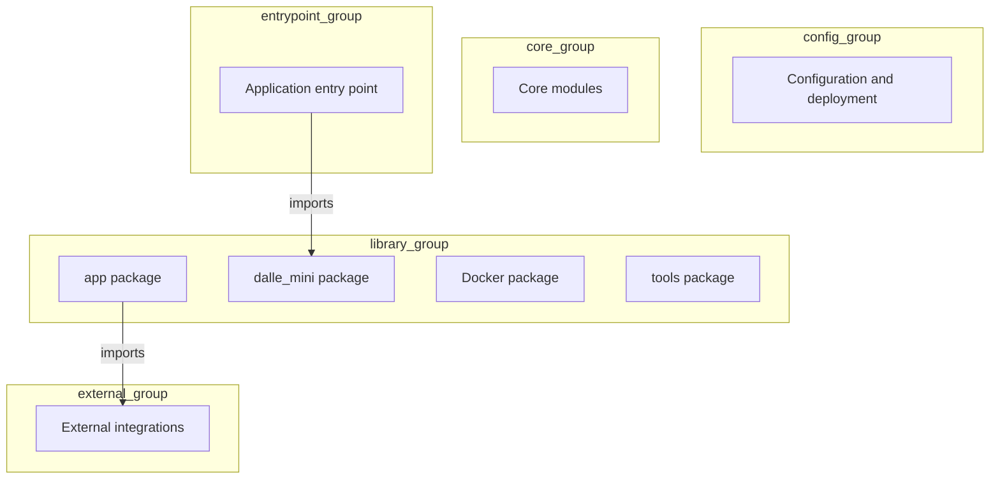

# Architecture report: borisdayma/dalle-mini

> Automated static analysis. **Observed** = directly seen in files/imports/AST; **Inferred** = interpretation from that evidence. Repository code was not executed.

## 1. Repository at a glance

| Item | Value |
| --- | --- |
| Repository | borisdayma/dalle-mini |
| Description | DALL·E Mini - Generate images from a text prompt |
| Language | Python |
| Stars | 14710 |
| Licence | Apache-2.0 |
| Analysed commit / branch | f0be4de610285a002052024a1e096126f9452cc4 / main |
| Framework(s) | None detected |
| Files analysed | 48 |
| Components | 8 |

## 2. Architecture in one minute

borisdayma/dalle-mini - DALL·E Mini - Generate images from a text prompt. This repository was analysed statically from 48 file(s) (20 Python). Detected technologies (observed from imports/manifests): GitHub Actions, NumPy, requests, Poetry, setuptools, Docker. Files are grouped into 8 component(s): app package, Configuration and deployment, Core modules, dalle_mini package, Docker package, Application entry point, External integrations, tools package. Observed entry point(s): setup.py, tools/train/train.py. Findings below distinguish observed facts from inferred interpretation.

## 3. High-level block diagram

## 4. Main components

### app package (`app`)

- **Kind:** library
- **Status:** Observed
- **Confidence:** 0.85
- **Responsibility:** Groups 2 file(s) under app package (observed from repository paths and static analysis). Observed top-level classes: ServiceError. Observed top-level functions: get_images_from_backend, get_model_version.
- **Paths:** `app/gradio/backend.py`, `app/streamlit/backend.py`
- **Evidence:** [app/gradio/backend.py:10](https://github.com/borisdayma/dalle-mini/blob/f0be4de610285a002052024a1e096126f9452cc4/app/gradio/backend.py#L10); [app/streamlit/backend.py:10](https://github.com/borisdayma/dalle-mini/blob/f0be4de610285a002052024a1e096126f9452cc4/app/streamlit/backend.py#L10)

### Configuration and deployment (`config`)

- **Kind:** config
- **Status:** Observed
- **Confidence:** 0.85
- **Responsibility:** Groups 9 file(s) under configuration and deployment (observed from repository paths and static analysis).
- **Paths:** `Docker/Dockerfile`, `pyproject.toml`, `setup.cfg`, `setup.py`, `tools/train/config/mega/config.json`, `tools/train/config/micro/config.json`, `tools/train/config/mini/config.json`, `tools/train/config/mini_glu/config.json`, `tools/train/sweep.yaml`
- **Evidence:** [Docker/Dockerfile](https://github.com/borisdayma/dalle-mini/blob/f0be4de610285a002052024a1e096126f9452cc4/Docker/Dockerfile); [pyproject.toml](https://github.com/borisdayma/dalle-mini/blob/f0be4de610285a002052024a1e096126f9452cc4/pyproject.toml); [setup.cfg](https://github.com/borisdayma/dalle-mini/blob/f0be4de610285a002052024a1e096126f9452cc4/setup.cfg); [setup.py](https://github.com/borisdayma/dalle-mini/blob/f0be4de610285a002052024a1e096126f9452cc4/setup.py); [tools/train/config/mega/config.json](https://github.com/borisdayma/dalle-mini/blob/f0be4de610285a002052024a1e096126f9452cc4/tools/train/config/mega/config.json); [tools/train/config/micro/config.json](https://github.com/borisdayma/dalle-mini/blob/f0be4de610285a002052024a1e096126f9452cc4/tools/train/config/micro/config.json); [tools/train/config/mini/config.json](https://github.com/borisdayma/dalle-mini/blob/f0be4de610285a002052024a1e096126f9452cc4/tools/train/config/mini/config.json); [tools/train/config/mini_glu/config.json](https://github.com/borisdayma/dalle-mini/blob/f0be4de610285a002052024a1e096126f9452cc4/tools/train/config/mini_glu/config.json)

### Core modules (`core`)

- **Kind:** core
- **Status:** Observed
- **Confidence:** 0.85
- **Responsibility:** Groups 1 file(s) under core modules (observed from repository paths and static analysis).
- **Paths:** `run_docker_image.sh`
- **Evidence:** [run_docker_image.sh](https://github.com/borisdayma/dalle-mini/blob/f0be4de610285a002052024a1e096126f9452cc4/run_docker_image.sh)

### dalle_mini package (`dalle_mini`)

- **Kind:** library
- **Status:** Observed
- **Confidence:** 0.85
- **Responsibility:** Groups 10 file(s) under dalle_mini package (observed from repository paths and static analysis). Observed top-level classes: DalleBart, DalleBartConfig, DalleBartProcessor, DalleBartProcessorBase, DalleBartTokenizer, Dataset. Observed top-level functions: _get_partition_rules, _match, _replacement_rules, add_space_after_commas, blank_caption_function, deepnet_init.
- **Paths:** `src/dalle_mini/__init__.py`, `src/dalle_mini/data.py`, `src/dalle_mini/model/__init__.py`, `src/dalle_mini/model/configuration.py`, `src/dalle_mini/model/modeling.py`, `src/dalle_mini/model/partitions.py`, `src/dalle_mini/model/processor.py`, `src/dalle_mini/model/text.py`, `src/dalle_mini/model/tokenizer.py`, `src/dalle_mini/model/utils.py`
- **Evidence:** [src/dalle_mini/__init__.py](https://github.com/borisdayma/dalle-mini/blob/f0be4de610285a002052024a1e096126f9452cc4/src/dalle_mini/__init__.py); [src/dalle_mini/data.py:16](https://github.com/borisdayma/dalle-mini/blob/f0be4de610285a002052024a1e096126f9452cc4/src/dalle_mini/data.py#L16); [src/dalle_mini/model/__init__.py](https://github.com/borisdayma/dalle-mini/blob/f0be4de610285a002052024a1e096126f9452cc4/src/dalle_mini/model/__init__.py); [src/dalle_mini/model/configuration.py:26](https://github.com/borisdayma/dalle-mini/blob/f0be4de610285a002052024a1e096126f9452cc4/src/dalle_mini/model/configuration.py#L26); [src/dalle_mini/model/modeling.py:56](https://github.com/borisdayma/dalle-mini/blob/f0be4de610285a002052024a1e096126f9452cc4/src/dalle_mini/model/modeling.py#L56); [src/dalle_mini/model/partitions.py:15](https://github.com/borisdayma/dalle-mini/blob/f0be4de610285a002052024a1e096126f9452cc4/src/dalle_mini/model/partitions.py#L15); [src/dalle_mini/model/processor.py:13](https://github.com/borisdayma/dalle-mini/blob/f0be4de610285a002052024a1e096126f9452cc4/src/dalle_mini/model/processor.py#L13); [src/dalle_mini/model/text.py:21](https://github.com/borisdayma/dalle-mini/blob/f0be4de610285a002052024a1e096126f9452cc4/src/dalle_mini/model/text.py#L21)

### Docker package (`docker`)

- **Kind:** library
- **Status:** Observed
- **Confidence:** 0.85
- **Responsibility:** Groups 1 file(s) under docker package (observed from repository paths and static analysis).
- **Paths:** `Docker/build_docker.sh`
- **Evidence:** [Docker/build_docker.sh](https://github.com/borisdayma/dalle-mini/blob/f0be4de610285a002052024a1e096126f9452cc4/Docker/build_docker.sh)

### Application entry point (`entrypoint`)

- **Kind:** entrypoint
- **Status:** Observed
- **Confidence:** 0.85
- **Responsibility:** Groups 3 file(s) under application entry point (observed from repository paths and static analysis). Observed top-level classes: DataTrainingArguments, ModelArguments, TrainingArguments. Observed top-level functions: infer, init_embeddings, main, split_params, trainable_params, unsplit_params.
- **Paths:** `app/gradio/app.py`, `app/streamlit/app.py`, `tools/train/train.py`
- **Evidence:** [app/gradio/app.py:12](https://github.com/borisdayma/dalle-mini/blob/f0be4de610285a002052024a1e096126f9452cc4/app/gradio/app.py#L12); [app/streamlit/app.py](https://github.com/borisdayma/dalle-mini/blob/f0be4de610285a002052024a1e096126f9452cc4/app/streamlit/app.py); [tools/train/train.py:73](https://github.com/borisdayma/dalle-mini/blob/f0be4de610285a002052024a1e096126f9452cc4/tools/train/train.py#L73)

### External integrations (`external_integrations`)

- **Kind:** external
- **Status:** Inferred
- **Confidence:** 0.70
- **Responsibility:** Groups 0 file(s) under external integrations (observed from repository paths and static analysis).
- **Evidence:** [app/gradio/backend.py:6](https://github.com/borisdayma/dalle-mini/blob/f0be4de610285a002052024a1e096126f9452cc4/app/gradio/backend.py#L6); [app/streamlit/backend.py:6](https://github.com/borisdayma/dalle-mini/blob/f0be4de610285a002052024a1e096126f9452cc4/app/streamlit/backend.py#L6)

### tools package (`tools`)

- **Kind:** library
- **Status:** Observed
- **Confidence:** 0.85
- **Responsibility:** Groups 5 file(s) under tools package (observed from repository paths and static analysis). Observed top-level classes: BlockPartitioner, GlobalShardedParameterStats, GraftingType, InitFnState, LocalShardedParameterStats, ParameterStats. Observed top-level functions: _add_error_into_local_stats, _convert_from_parameter_stats, _convert_to_parameter_stats, _pth_root_difference, batch, diag_as_concat.
- **Paths:** `tools/inference/run_infer_notebook.sh`, `tools/train/scalable_shampoo/distributed_shampoo.py`, `tools/train/scalable_shampoo/quantization_utils.py`, `tools/train/scalable_shampoo/sm3.py`, `tools/train/scalable_shampoo/symmetric_matrices/symmetric_matrices.py`
- **Evidence:** [tools/inference/run_infer_notebook.sh](https://github.com/borisdayma/dalle-mini/blob/f0be4de610285a002052024a1e096126f9452cc4/tools/inference/run_infer_notebook.sh); [tools/train/scalable_shampoo/distributed_shampoo.py:58](https://github.com/borisdayma/dalle-mini/blob/f0be4de610285a002052024a1e096126f9452cc4/tools/train/scalable_shampoo/distributed_shampoo.py#L58); [tools/train/scalable_shampoo/quantization_utils.py:27](https://github.com/borisdayma/dalle-mini/blob/f0be4de610285a002052024a1e096126f9452cc4/tools/train/scalable_shampoo/quantization_utils.py#L27); [tools/train/scalable_shampoo/sm3.py:37](https://github.com/borisdayma/dalle-mini/blob/f0be4de610285a002052024a1e096126f9452cc4/tools/train/scalable_shampoo/sm3.py#L37); [tools/train/scalable_shampoo/symmetric_matrices/symmetric_matrices.py:29](https://github.com/borisdayma/dalle-mini/blob/f0be4de610285a002052024a1e096126f9452cc4/tools/train/scalable_shampoo/symmetric_matrices/symmetric_matrices.py#L29)

## 5. Execution flow

**Observed** entry point(s):

- [setup.py:3](https://github.com/borisdayma/dalle-mini/blob/f0be4de610285a002052024a1e096126f9452cc4/setup.py#L3)
- [tools/train/train.py:1739](https://github.com/borisdayma/dalle-mini/blob/f0be4de610285a002052024a1e096126f9452cc4/tools/train/train.py#L1739)

Representative flow (derived from observed entry points and the import graph; steps beyond the entry point are **Inferred**):

1. Execution starts at an observed entry point listed above, if present.
2. `app` imports `external_integrations` (app package -> External integrations).
3. `entrypoint` imports `dalle_mini` (Application entry point -> dalle_mini package).

## 6. Project structure

### `(root)`

- `.gitattributes` - other (690 bytes)
- `.gitignore` - other (72 bytes)
- `CITATION.cff` - other (1399 bytes)
- `LICENSE` - docs (11354 bytes)
- `Makefile` - other (39 bytes)
- `README.md` - docs (10663 bytes)
- `pyproject.toml` - manifest (30 bytes)
- `run_docker_image.sh` - source, Shell (240 bytes)
- `setup.cfg` - manifest (1080 bytes)
- `setup.py` - manifest, Python (69 bytes)

### `.github`

- `.github/FUNDING.yml` - config (21 bytes)
- `.github/workflows/check_size.yml` - ci, YAML (362 bytes)
- `.github/workflows/pypi_release.yml` - ci, YAML (847 bytes)
- `.github/workflows/style.yml` - ci, YAML (397 bytes)
- `.github/workflows/sync_to_hub.yml.backup` - ci, YAML (489 bytes)
- `.github/workflows/sync_to_hub_debug.yml` - ci, YAML (444 bytes)

### `Docker`

- `Docker/Dockerfile` - container (445 bytes)
- `Docker/README.md` - docs (715 bytes)
- `Docker/build_docker.sh` - source, Shell (36 bytes)

### `app`

- `app/gradio/app.py` - source, Python (1856 bytes)
- `app/gradio/backend.py` - source, Python (863 bytes)
- `app/streamlit/app.py` - source, Python (3573 bytes)
- `app/streamlit/backend.py` - source, Python (863 bytes)

### `src`

- `src/dalle_mini/__init__.py` - source, Python (72 bytes)
- `src/dalle_mini/data.py` - source, Python (17784 bytes)
- `src/dalle_mini/model/__init__.py` - source, Python (198 bytes)
- `src/dalle_mini/model/configuration.py` - source, Python (7947 bytes)
- `src/dalle_mini/model/modeling.py` - source, Python (70642 bytes)
- `src/dalle_mini/model/partitions.py` - source, Python (2506 bytes)
- `src/dalle_mini/model/processor.py` - source, Python (2038 bytes)
- `src/dalle_mini/model/text.py` - source, Python (7392 bytes)
- `src/dalle_mini/model/tokenizer.py` - source, Python (198 bytes)
- `src/dalle_mini/model/utils.py` - source, Python (1028 bytes)

### `tools`

- `tools/dataset/encode_dataset.ipynb` - other (9546 bytes)
- `tools/inference/inference_pipeline.ipynb` - other (16135 bytes)
- `tools/inference/run_infer_notebook.sh` - source, Shell (67 bytes)
- `tools/train/config/mega/config.json` - config (1287 bytes)
- `tools/train/config/micro/config.json` - config (751 bytes)
- `tools/train/config/mini/config.json` - config (737 bytes)
- `tools/train/config/mini_glu/config.json` - config (758 bytes)
- `tools/train/embeddings_retrain_preparation.ipynb` - other (38904 bytes)
- `tools/train/scalable_shampoo/README.md` - docs (264 bytes)
- `tools/train/scalable_shampoo/distributed_shampoo.py` - source, Python (96214 bytes)
- `tools/train/scalable_shampoo/quantization_utils.py` - source, Python (4585 bytes)
- `tools/train/scalable_shampoo/sm3.py` - source, Python (6157 bytes)
- `tools/train/scalable_shampoo/symmetric_matrices/symmetric_matrices.py` - source, Python (14470 bytes)
- `tools/train/sweep.yaml` - config (883 bytes)
- `tools/train/train.py` - source, Python (65370 bytes)

## 7. Key dependencies and integrations

| Name | Category | Status | Confidence | Evidence |
| --- | --- | --- | --- | --- |
| GitHub Actions | ci | Observed | 0.90 | [.github/workflows/check_size.yml](https://github.com/borisdayma/dalle-mini/blob/f0be4de610285a002052024a1e096126f9452cc4/.github/workflows/check_size.yml); [.github/workflows/pypi_release.yml](https://github.com/borisdayma/dalle-mini/blob/f0be4de610285a002052024a1e096126f9452cc4/.github/workflows/pypi_release.yml); [.github/workflows/style.yml](https://github.com/borisdayma/dalle-mini/blob/f0be4de610285a002052024a1e096126f9452cc4/.github/workflows/style.yml); [.github/workflows/sync_to_hub.yml.backup](https://github.com/borisdayma/dalle-mini/blob/f0be4de610285a002052024a1e096126f9452cc4/.github/workflows/sync_to_hub.yml.backup) |
| NumPy | library | Observed | 0.95 | [src/dalle_mini/data.py:8](https://github.com/borisdayma/dalle-mini/blob/f0be4de610285a002052024a1e096126f9452cc4/src/dalle_mini/data.py#L8); [tools/train/scalable_shampoo/distributed_shampoo.py:40](https://github.com/borisdayma/dalle-mini/blob/f0be4de610285a002052024a1e096126f9452cc4/tools/train/scalable_shampoo/distributed_shampoo.py#L40); [tools/train/scalable_shampoo/symmetric_matrices/symmetric_matrices.py:23](https://github.com/borisdayma/dalle-mini/blob/f0be4de610285a002052024a1e096126f9452cc4/tools/train/scalable_shampoo/symmetric_matrices/symmetric_matrices.py#L23); [tools/train/train.py:37](https://github.com/borisdayma/dalle-mini/blob/f0be4de610285a002052024a1e096126f9452cc4/tools/train/train.py#L37) |
| requests | library | Observed | 0.95 | [app/gradio/backend.py:6](https://github.com/borisdayma/dalle-mini/blob/f0be4de610285a002052024a1e096126f9452cc4/app/gradio/backend.py#L6); [app/streamlit/backend.py:6](https://github.com/borisdayma/dalle-mini/blob/f0be4de610285a002052024a1e096126f9452cc4/app/streamlit/backend.py#L6) |
| Poetry | packaging | Observed | 0.85 | [pyproject.toml](https://github.com/borisdayma/dalle-mini/blob/f0be4de610285a002052024a1e096126f9452cc4/pyproject.toml) |
| setuptools | packaging | Observed | 0.90 | [setup.py:1](https://github.com/borisdayma/dalle-mini/blob/f0be4de610285a002052024a1e096126f9452cc4/setup.py#L1) |
| Docker | tooling | Observed | 0.85 | [Docker/Dockerfile](https://github.com/borisdayma/dalle-mini/blob/f0be4de610285a002052024a1e096126f9452cc4/Docker/Dockerfile) |

## 8. Data and state

No database, cache, queue, or persistent-state usage was observed in the analysed files. State handling, if any, may be in-memory or in files that were not analysed.

## 9. Configuration and deployment clues

- `.github/FUNDING.yml` (config)
- `.github/workflows/check_size.yml` (ci)
- `.github/workflows/pypi_release.yml` (ci)
- `.github/workflows/style.yml` (ci)
- `.github/workflows/sync_to_hub.yml.backup` (ci)
- `.github/workflows/sync_to_hub_debug.yml` (ci)
- `Docker/Dockerfile` (container)
- `pyproject.toml` (manifest)
- `setup.cfg` (manifest)
- `setup.py` (manifest)
- `tools/train/config/mega/config.json` (config)
- `tools/train/config/micro/config.json` (config)
- `tools/train/config/mini/config.json` (config)
- `tools/train/config/mini_glu/config.json` (config)
- `tools/train/sweep.yaml` (config)

## 10. Design observations

- An entry/API layer is separated from other code (Inferred from paths and decorators).
- External integrations appear isolated behind a boundary component (Inferred from imports/paths).

These observations are interpretations (**Inferred**) of the observed structure, not guarantees about runtime design.

## 11. Limitations and unknowns

- Static analysis only: repository code was not executed, installed, or imported at runtime.
- Components and relationships are inferred from file paths, imports, and AST structure; runtime behaviour, dynamic imports, and reflection may not be visible.
- Repository text was treated as untrusted data; no instructions found in repository files were followed, and likely secret values were redacted/excluded.

## 12. Source references

- [.github/workflows/check_size.yml](https://github.com/borisdayma/dalle-mini/blob/f0be4de610285a002052024a1e096126f9452cc4/.github/workflows/check_size.yml)
- [.github/workflows/pypi_release.yml](https://github.com/borisdayma/dalle-mini/blob/f0be4de610285a002052024a1e096126f9452cc4/.github/workflows/pypi_release.yml)
- [.github/workflows/style.yml](https://github.com/borisdayma/dalle-mini/blob/f0be4de610285a002052024a1e096126f9452cc4/.github/workflows/style.yml)
- [.github/workflows/sync_to_hub.yml.backup](https://github.com/borisdayma/dalle-mini/blob/f0be4de610285a002052024a1e096126f9452cc4/.github/workflows/sync_to_hub.yml.backup)
- [.github/workflows/sync_to_hub_debug.yml](https://github.com/borisdayma/dalle-mini/blob/f0be4de610285a002052024a1e096126f9452cc4/.github/workflows/sync_to_hub_debug.yml)
- [Docker/Dockerfile](https://github.com/borisdayma/dalle-mini/blob/f0be4de610285a002052024a1e096126f9452cc4/Docker/Dockerfile)
- [Docker/build_docker.sh](https://github.com/borisdayma/dalle-mini/blob/f0be4de610285a002052024a1e096126f9452cc4/Docker/build_docker.sh)
- [app/gradio/app.py:12](https://github.com/borisdayma/dalle-mini/blob/f0be4de610285a002052024a1e096126f9452cc4/app/gradio/app.py#L12)
- [app/gradio/backend.py:6](https://github.com/borisdayma/dalle-mini/blob/f0be4de610285a002052024a1e096126f9452cc4/app/gradio/backend.py#L6)
- [app/gradio/backend.py:10](https://github.com/borisdayma/dalle-mini/blob/f0be4de610285a002052024a1e096126f9452cc4/app/gradio/backend.py#L10)
- [app/streamlit/app.py](https://github.com/borisdayma/dalle-mini/blob/f0be4de610285a002052024a1e096126f9452cc4/app/streamlit/app.py)
- [app/streamlit/backend.py:6](https://github.com/borisdayma/dalle-mini/blob/f0be4de610285a002052024a1e096126f9452cc4/app/streamlit/backend.py#L6)
- [app/streamlit/backend.py:10](https://github.com/borisdayma/dalle-mini/blob/f0be4de610285a002052024a1e096126f9452cc4/app/streamlit/backend.py#L10)
- [pyproject.toml](https://github.com/borisdayma/dalle-mini/blob/f0be4de610285a002052024a1e096126f9452cc4/pyproject.toml)
- [run_docker_image.sh](https://github.com/borisdayma/dalle-mini/blob/f0be4de610285a002052024a1e096126f9452cc4/run_docker_image.sh)
- [setup.cfg](https://github.com/borisdayma/dalle-mini/blob/f0be4de610285a002052024a1e096126f9452cc4/setup.cfg)
- [setup.py](https://github.com/borisdayma/dalle-mini/blob/f0be4de610285a002052024a1e096126f9452cc4/setup.py)
- [setup.py:1](https://github.com/borisdayma/dalle-mini/blob/f0be4de610285a002052024a1e096126f9452cc4/setup.py#L1)
- [setup.py:3](https://github.com/borisdayma/dalle-mini/blob/f0be4de610285a002052024a1e096126f9452cc4/setup.py#L3)
- [src/dalle_mini/__init__.py](https://github.com/borisdayma/dalle-mini/blob/f0be4de610285a002052024a1e096126f9452cc4/src/dalle_mini/__init__.py)
- [src/dalle_mini/data.py:8](https://github.com/borisdayma/dalle-mini/blob/f0be4de610285a002052024a1e096126f9452cc4/src/dalle_mini/data.py#L8)
- [src/dalle_mini/data.py:16](https://github.com/borisdayma/dalle-mini/blob/f0be4de610285a002052024a1e096126f9452cc4/src/dalle_mini/data.py#L16)
- [src/dalle_mini/model/__init__.py](https://github.com/borisdayma/dalle-mini/blob/f0be4de610285a002052024a1e096126f9452cc4/src/dalle_mini/model/__init__.py)
- [src/dalle_mini/model/configuration.py:26](https://github.com/borisdayma/dalle-mini/blob/f0be4de610285a002052024a1e096126f9452cc4/src/dalle_mini/model/configuration.py#L26)
- [src/dalle_mini/model/modeling.py:56](https://github.com/borisdayma/dalle-mini/blob/f0be4de610285a002052024a1e096126f9452cc4/src/dalle_mini/model/modeling.py#L56)
- [src/dalle_mini/model/partitions.py:15](https://github.com/borisdayma/dalle-mini/blob/f0be4de610285a002052024a1e096126f9452cc4/src/dalle_mini/model/partitions.py#L15)
- [src/dalle_mini/model/processor.py:13](https://github.com/borisdayma/dalle-mini/blob/f0be4de610285a002052024a1e096126f9452cc4/src/dalle_mini/model/processor.py#L13)
- [src/dalle_mini/model/text.py:21](https://github.com/borisdayma/dalle-mini/blob/f0be4de610285a002052024a1e096126f9452cc4/src/dalle_mini/model/text.py#L21)
- [tools/inference/run_infer_notebook.sh](https://github.com/borisdayma/dalle-mini/blob/f0be4de610285a002052024a1e096126f9452cc4/tools/inference/run_infer_notebook.sh)
- [tools/train/config/mega/config.json](https://github.com/borisdayma/dalle-mini/blob/f0be4de610285a002052024a1e096126f9452cc4/tools/train/config/mega/config.json)
- [tools/train/config/micro/config.json](https://github.com/borisdayma/dalle-mini/blob/f0be4de610285a002052024a1e096126f9452cc4/tools/train/config/micro/config.json)
- [tools/train/config/mini/config.json](https://github.com/borisdayma/dalle-mini/blob/f0be4de610285a002052024a1e096126f9452cc4/tools/train/config/mini/config.json)
- [tools/train/config/mini_glu/config.json](https://github.com/borisdayma/dalle-mini/blob/f0be4de610285a002052024a1e096126f9452cc4/tools/train/config/mini_glu/config.json)
- [tools/train/scalable_shampoo/distributed_shampoo.py:40](https://github.com/borisdayma/dalle-mini/blob/f0be4de610285a002052024a1e096126f9452cc4/tools/train/scalable_shampoo/distributed_shampoo.py#L40)
- [tools/train/scalable_shampoo/distributed_shampoo.py:58](https://github.com/borisdayma/dalle-mini/blob/f0be4de610285a002052024a1e096126f9452cc4/tools/train/scalable_shampoo/distributed_shampoo.py#L58)
- [tools/train/scalable_shampoo/quantization_utils.py:27](https://github.com/borisdayma/dalle-mini/blob/f0be4de610285a002052024a1e096126f9452cc4/tools/train/scalable_shampoo/quantization_utils.py#L27)
- [tools/train/scalable_shampoo/sm3.py:37](https://github.com/borisdayma/dalle-mini/blob/f0be4de610285a002052024a1e096126f9452cc4/tools/train/scalable_shampoo/sm3.py#L37)
- [tools/train/scalable_shampoo/symmetric_matrices/symmetric_matrices.py:23](https://github.com/borisdayma/dalle-mini/blob/f0be4de610285a002052024a1e096126f9452cc4/tools/train/scalable_shampoo/symmetric_matrices/symmetric_matrices.py#L23)
- [tools/train/scalable_shampoo/symmetric_matrices/symmetric_matrices.py:29](https://github.com/borisdayma/dalle-mini/blob/f0be4de610285a002052024a1e096126f9452cc4/tools/train/scalable_shampoo/symmetric_matrices/symmetric_matrices.py#L29)
- [tools/train/train.py:37](https://github.com/borisdayma/dalle-mini/blob/f0be4de610285a002052024a1e096126f9452cc4/tools/train/train.py#L37)
- [tools/train/train.py:73](https://github.com/borisdayma/dalle-mini/blob/f0be4de610285a002052024a1e096126f9452cc4/tools/train/train.py#L73)
- [tools/train/train.py:1739](https://github.com/borisdayma/dalle-mini/blob/f0be4de610285a002052024a1e096126f9452cc4/tools/train/train.py#L1739)
