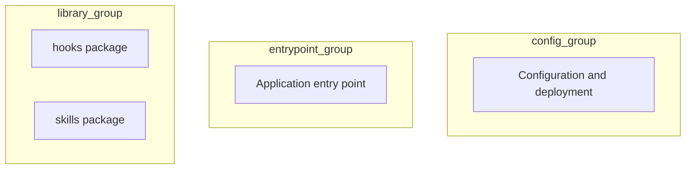

# Architecture report: bradautomates/claude-video

> Automated static analysis. **Observed** = directly seen in files/imports/AST; **Inferred** = interpretation from that evidence. Repository code was not executed.

## 1. Repository at a glance

| Item | Value |
| --- | --- |
| Repository | bradautomates/claude-video |
| Description | Give Claude the ability to watch any video. /watch downloads, extracts frames, transcribes, hands it all to Claude. |
| Language | Python |
| Stars | 20805 |
| Licence | MIT |
| Analysed commit / branch | 03ceb42f7fa2c4439aca01752118044baabffb8f / main |
| Framework(s) | None detected |
| Files analysed | 22 |
| Components | 4 |

## 2. Architecture in one minute

bradautomates/claude-video - Give Claude the ability to watch any video. /watch downloads, extracts frames, transcribes, hands it all to Claude.. This repository was analysed statically from 22 file(s) (10 Python). Detected technologies (observed from imports/manifests): no known frameworks/libraries. Files are grouped into 4 component(s): Configuration and deployment, Application entry point, hooks package, skills package. Observed entry point(s): skills/watch/scripts/download.py, skills/watch/scripts/frames.py, skills/watch/scripts/setup.py. Findings below distinguish observed facts from inferred interpretation.

## 3. High-level block diagram

## 4. Main components

### Configuration and deployment (`config`)

- **Kind:** config
- **Status:** Observed
- **Confidence:** 0.85
- **Responsibility:** Groups 3 file(s) under configuration and deployment (observed from repository paths and static analysis). Observed top-level classes: ConfigError. Observed top-level functions: _brew_pkg, _check_binaries, _check_file_permissions, _ensure_uv, _have_api_key, _install_hint_linux.
- **Paths:** `hooks/hooks.json`, `skills/watch/scripts/config.py`, `skills/watch/scripts/setup.py`
- **Evidence:** [hooks/hooks.json](https://github.com/bradautomates/claude-video/blob/03ceb42f7fa2c4439aca01752118044baabffb8f/hooks/hooks.json); [skills/watch/scripts/config.py:20](https://github.com/bradautomates/claude-video/blob/03ceb42f7fa2c4439aca01752118044baabffb8f/skills/watch/scripts/config.py#L20); [skills/watch/scripts/setup.py:34](https://github.com/bradautomates/claude-video/blob/03ceb42f7fa2c4439aca01752118044baabffb8f/skills/watch/scripts/setup.py#L34)

### Application entry point (`entrypoint`)

- **Kind:** entrypoint
- **Status:** Observed
- **Confidence:** 0.85
- **Responsibility:** Groups 5 file(s) under application entry point (observed from repository paths and static analysis). Observed top-level classes: Segments. Observed top-level functions: _build_multipart, _clamp_fps, _common, _dedupe, _dedupe_by_deltas, _emitted_frames.
- **Paths:** `skills/watch/scripts/download.py`, `skills/watch/scripts/frames.py`, `skills/watch/scripts/transcribe.py`, `skills/watch/scripts/watch.py`, `skills/watch/scripts/whisper.py`
- **Evidence:** [skills/watch/scripts/download.py:17](https://github.com/bradautomates/claude-video/blob/03ceb42f7fa2c4439aca01752118044baabffb8f/skills/watch/scripts/download.py#L17); [skills/watch/scripts/frames.py:45](https://github.com/bradautomates/claude-video/blob/03ceb42f7fa2c4439aca01752118044baabffb8f/skills/watch/scripts/frames.py#L45); [skills/watch/scripts/transcribe.py:18](https://github.com/bradautomates/claude-video/blob/03ceb42f7fa2c4439aca01752118044baabffb8f/skills/watch/scripts/transcribe.py#L18); [skills/watch/scripts/watch.py:33](https://github.com/bradautomates/claude-video/blob/03ceb42f7fa2c4439aca01752118044baabffb8f/skills/watch/scripts/watch.py#L33); [skills/watch/scripts/whisper.py:43](https://github.com/bradautomates/claude-video/blob/03ceb42f7fa2c4439aca01752118044baabffb8f/skills/watch/scripts/whisper.py#L43)

### hooks package (`hooks`)

- **Kind:** library
- **Status:** Observed
- **Confidence:** 0.85
- **Responsibility:** Groups 1 file(s) under hooks package (observed from repository paths and static analysis).
- **Paths:** `hooks/scripts/check-setup.sh`
- **Evidence:** [hooks/scripts/check-setup.sh](https://github.com/bradautomates/claude-video/blob/03ceb42f7fa2c4439aca01752118044baabffb8f/hooks/scripts/check-setup.sh)

### skills package (`skills`)

- **Kind:** library
- **Status:** Observed
- **Confidence:** 0.85
- **Responsibility:** Groups 3 file(s) under skills package (observed from repository paths and static analysis). Observed top-level functions: _call, _clock, _error_message, _fail, _processing, ask.
- **Paths:** `skills/watch/scripts/gemini.py`, `skills/watch/scripts/local_whisperx.py`, `skills/watch/scripts/runtime.py`
- **Evidence:** [skills/watch/scripts/gemini.py:40](https://github.com/bradautomates/claude-video/blob/03ceb42f7fa2c4439aca01752118044baabffb8f/skills/watch/scripts/gemini.py#L40); [skills/watch/scripts/local_whisperx.py:23](https://github.com/bradautomates/claude-video/blob/03ceb42f7fa2c4439aca01752118044baabffb8f/skills/watch/scripts/local_whisperx.py#L23); [skills/watch/scripts/runtime.py:8](https://github.com/bradautomates/claude-video/blob/03ceb42f7fa2c4439aca01752118044baabffb8f/skills/watch/scripts/runtime.py#L8)

## 5. Execution flow

**Observed** entry point(s):

- [skills/watch/scripts/download.py:203](https://github.com/bradautomates/claude-video/blob/03ceb42f7fa2c4439aca01752118044baabffb8f/skills/watch/scripts/download.py#L203)
- [skills/watch/scripts/frames.py:686](https://github.com/bradautomates/claude-video/blob/03ceb42f7fa2c4439aca01752118044baabffb8f/skills/watch/scripts/frames.py#L686)
- [skills/watch/scripts/setup.py:336](https://github.com/bradautomates/claude-video/blob/03ceb42f7fa2c4439aca01752118044baabffb8f/skills/watch/scripts/setup.py#L336)
- [skills/watch/scripts/transcribe.py:109](https://github.com/bradautomates/claude-video/blob/03ceb42f7fa2c4439aca01752118044baabffb8f/skills/watch/scripts/transcribe.py#L109)
- [skills/watch/scripts/watch.py:425](https://github.com/bradautomates/claude-video/blob/03ceb42f7fa2c4439aca01752118044baabffb8f/skills/watch/scripts/watch.py#L425)
- [skills/watch/scripts/whisper.py:413](https://github.com/bradautomates/claude-video/blob/03ceb42f7fa2c4439aca01752118044baabffb8f/skills/watch/scripts/whisper.py#L413)

Representative flow (derived from observed entry points and the import graph; steps beyond the entry point are **Inferred**):

1. Execution starts at an observed entry point listed above, if present.
2. No internal import relationships between components were observed.

## 6. Project structure

### `(root)`

- `.skillignore` - other (623 bytes)
- `AGENTS.md` - docs (3943 bytes)
- `CHANGELOG.md` - docs (9216 bytes)
- `CLAUDE.md` - docs (11 bytes)
- `LICENSE` - docs (1072 bytes)
- `README.md` - docs (27715 bytes)

### `.claude-plugin`

- `.claude-plugin/marketplace.json` - config (608 bytes)
- `.claude-plugin/plugin.json` - config (590 bytes)

### `.codex-plugin`

- `.codex-plugin/plugin.json` - config (1504 bytes)

### `hooks`

- `hooks/hooks.json` - config (283 bytes)
- `hooks/scripts/check-setup.sh` - source, Shell (744 bytes)

### `skills`

- `skills/watch/SKILL.md` - docs (17164 bytes)
- `skills/watch/scripts/config.py` - source, Python (7258 bytes)
- `skills/watch/scripts/download.py` - source, Python (10822 bytes)
- `skills/watch/scripts/frames.py` - source, Python (29083 bytes)
- `skills/watch/scripts/gemini.py` - source, Python (8261 bytes)
- `skills/watch/scripts/local_whisperx.py` - source, Python (7099 bytes)
- `skills/watch/scripts/runtime.py` - source, Python (1377 bytes)
- `skills/watch/scripts/setup.py` - manifest, Python (15685 bytes)
- `skills/watch/scripts/transcribe.py` - source, Python (4435 bytes)
- `skills/watch/scripts/watch.py` - source, Python (21139 bytes)
- `skills/watch/scripts/whisper.py` - source, Python (15980 bytes)

## 7. Key dependencies and integrations

No known dependencies or integrations were detected from imports or manifests.

## 8. Data and state

No database, cache, queue, or persistent-state usage was observed in the analysed files. State handling, if any, may be in-memory or in files that were not analysed.

## 9. Configuration and deployment clues

- `.claude-plugin/marketplace.json` (config)
- `.claude-plugin/plugin.json` (config)
- `.codex-plugin/plugin.json` (config)
- `hooks/hooks.json` (config)
- `skills/watch/scripts/setup.py` (manifest)

## 10. Design observations

- An entry/API layer is separated from other code (Inferred from paths and decorators).

These observations are interpretations (**Inferred**) of the observed structure, not guarantees about runtime design.

## 11. Limitations and unknowns

- Static analysis only: repository code was not executed, installed, or imported at runtime.
- Components and relationships are inferred from file paths, imports, and AST structure; runtime behaviour, dynamic imports, and reflection may not be visible.
- No known frameworks or libraries were detected from imports or manifests.
- Repository text was treated as untrusted data; no instructions found in repository files were followed, and likely secret values were redacted/excluded.

## 12. Source references

- [hooks/hooks.json](https://github.com/bradautomates/claude-video/blob/03ceb42f7fa2c4439aca01752118044baabffb8f/hooks/hooks.json)
- [hooks/scripts/check-setup.sh](https://github.com/bradautomates/claude-video/blob/03ceb42f7fa2c4439aca01752118044baabffb8f/hooks/scripts/check-setup.sh)
- [skills/watch/scripts/config.py:20](https://github.com/bradautomates/claude-video/blob/03ceb42f7fa2c4439aca01752118044baabffb8f/skills/watch/scripts/config.py#L20)
- [skills/watch/scripts/download.py:17](https://github.com/bradautomates/claude-video/blob/03ceb42f7fa2c4439aca01752118044baabffb8f/skills/watch/scripts/download.py#L17)
- [skills/watch/scripts/download.py:203](https://github.com/bradautomates/claude-video/blob/03ceb42f7fa2c4439aca01752118044baabffb8f/skills/watch/scripts/download.py#L203)
- [skills/watch/scripts/frames.py:45](https://github.com/bradautomates/claude-video/blob/03ceb42f7fa2c4439aca01752118044baabffb8f/skills/watch/scripts/frames.py#L45)
- [skills/watch/scripts/frames.py:686](https://github.com/bradautomates/claude-video/blob/03ceb42f7fa2c4439aca01752118044baabffb8f/skills/watch/scripts/frames.py#L686)
- [skills/watch/scripts/gemini.py:40](https://github.com/bradautomates/claude-video/blob/03ceb42f7fa2c4439aca01752118044baabffb8f/skills/watch/scripts/gemini.py#L40)
- [skills/watch/scripts/local_whisperx.py:23](https://github.com/bradautomates/claude-video/blob/03ceb42f7fa2c4439aca01752118044baabffb8f/skills/watch/scripts/local_whisperx.py#L23)
- [skills/watch/scripts/runtime.py:8](https://github.com/bradautomates/claude-video/blob/03ceb42f7fa2c4439aca01752118044baabffb8f/skills/watch/scripts/runtime.py#L8)
- [skills/watch/scripts/setup.py:34](https://github.com/bradautomates/claude-video/blob/03ceb42f7fa2c4439aca01752118044baabffb8f/skills/watch/scripts/setup.py#L34)
- [skills/watch/scripts/setup.py:336](https://github.com/bradautomates/claude-video/blob/03ceb42f7fa2c4439aca01752118044baabffb8f/skills/watch/scripts/setup.py#L336)
- [skills/watch/scripts/transcribe.py:18](https://github.com/bradautomates/claude-video/blob/03ceb42f7fa2c4439aca01752118044baabffb8f/skills/watch/scripts/transcribe.py#L18)
- [skills/watch/scripts/transcribe.py:109](https://github.com/bradautomates/claude-video/blob/03ceb42f7fa2c4439aca01752118044baabffb8f/skills/watch/scripts/transcribe.py#L109)
- [skills/watch/scripts/watch.py:33](https://github.com/bradautomates/claude-video/blob/03ceb42f7fa2c4439aca01752118044baabffb8f/skills/watch/scripts/watch.py#L33)
- [skills/watch/scripts/watch.py:425](https://github.com/bradautomates/claude-video/blob/03ceb42f7fa2c4439aca01752118044baabffb8f/skills/watch/scripts/watch.py#L425)
- [skills/watch/scripts/whisper.py:43](https://github.com/bradautomates/claude-video/blob/03ceb42f7fa2c4439aca01752118044baabffb8f/skills/watch/scripts/whisper.py#L43)
- [skills/watch/scripts/whisper.py:413](https://github.com/bradautomates/claude-video/blob/03ceb42f7fa2c4439aca01752118044baabffb8f/skills/watch/scripts/whisper.py#L413)
