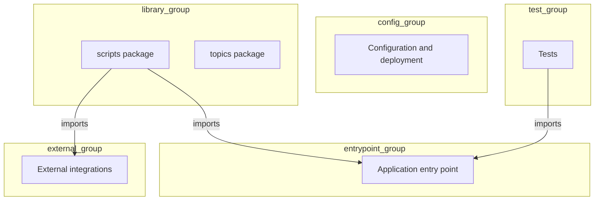

# Architecture report: bregman-arie/devops-exercises

> Automated static analysis. **Observed** = directly seen in files/imports/AST; **Inferred** = interpretation from that evidence. Repository code was not executed.

## 1. Repository at a glance

| Item | Value |
| --- | --- |
| Repository | bregman-arie/devops-exercises |
| Description | Linux, Jenkins, AWS, SRE, Prometheus, Docker, Python, Ansible, Git, Kubernetes, Terraform, OpenStack, SQL, NoSQL, Azure, GCP, DNS, Elastic, Network, Virtualization. DevOps Interview Questions |
| Language | Python |
| Stars | 86804 |
| Licence | Other |
| Analysed commit / branch | 9e49ef97f16377d901db01f3562187394828ca6a / master |
| Framework(s) | Flask |
| Files analysed | 352 |
| Components | 6 |

## 2. Architecture in one minute

bregman-arie/devops-exercises - Linux, Jenkins, AWS, SRE, Prometheus, Docker, Python, Ansible, Git, Kubernetes, Terraform, OpenStack, SQL, NoSQL, Azure, GCP, DNS, Elastic, Network, Virtualization. DevOps Interview Questions. This repository was analysed statically from 352 file(s) (22 Python). Detected technologies (observed from imports/manifests): GitHub Actions, Flask, AWS (boto3), unittest. Files are grouped into 6 component(s): Configuration and deployment, Application entry point, External integrations, scripts package, Tests, topics package. Observed entry point(s): coding/python/binary_search.py, coding/python/merge_sort.py, scripts/question_utils.py. Findings below distinguish observed facts from inferred interpretation.

## 3. High-level block diagram

## 4. Main components

### Configuration and deployment (`config`)

- **Kind:** config
- **Status:** Observed
- **Confidence:** 0.85
- **Responsibility:** Groups 10 file(s) under configuration and deployment (observed from repository paths and static analysis).
- **Paths:** `scripts/aws s3 event triggering/s3-lambda/requirements.txt`, `topics/cicd/solutions/deploy_to_kubernetes/deploy.yml`, `topics/cicd/solutions/deploy_to_kubernetes/helloworld.yml`, `topics/flask_container_ci/app/config.py`, `topics/flask_container_ci/requirements.txt`, `topics/flask_container_ci/users.json`, `topics/flask_container_ci2/app/config.py`, `topics/flask_container_ci2/requirements.txt`, `topics/kubernetes/exercises/kustomize_common_labels/someApp/deployment.yml`, `topics/kubernetes/exercises/kustomize_common_labels/someApp/service.yml`
- **Evidence:** [scripts/aws s3 event triggering/s3-lambda/requirements.txt](https://github.com/bregman-arie/devops-exercises/blob/9e49ef97f16377d901db01f3562187394828ca6a/scripts/aws%20s3%20event%20triggering/s3-lambda/requirements.txt); [topics/cicd/solutions/deploy_to_kubernetes/deploy.yml](https://github.com/bregman-arie/devops-exercises/blob/9e49ef97f16377d901db01f3562187394828ca6a/topics/cicd/solutions/deploy_to_kubernetes/deploy.yml); [topics/cicd/solutions/deploy_to_kubernetes/helloworld.yml](https://github.com/bregman-arie/devops-exercises/blob/9e49ef97f16377d901db01f3562187394828ca6a/topics/cicd/solutions/deploy_to_kubernetes/helloworld.yml); [topics/flask_container_ci/app/config.py](https://github.com/bregman-arie/devops-exercises/blob/9e49ef97f16377d901db01f3562187394828ca6a/topics/flask_container_ci/app/config.py); [topics/flask_container_ci/requirements.txt](https://github.com/bregman-arie/devops-exercises/blob/9e49ef97f16377d901db01f3562187394828ca6a/topics/flask_container_ci/requirements.txt); [topics/flask_container_ci/users.json](https://github.com/bregman-arie/devops-exercises/blob/9e49ef97f16377d901db01f3562187394828ca6a/topics/flask_container_ci/users.json); [topics/flask_container_ci2/app/config.py](https://github.com/bregman-arie/devops-exercises/blob/9e49ef97f16377d901db01f3562187394828ca6a/topics/flask_container_ci2/app/config.py); [topics/flask_container_ci2/requirements.txt](https://github.com/bregman-arie/devops-exercises/blob/9e49ef97f16377d901db01f3562187394828ca6a/topics/flask_container_ci2/requirements.txt)

### Application entry point (`entrypoint`)

- **Kind:** entrypoint
- **Status:** Observed
- **Confidence:** 0.85
- **Responsibility:** Groups 13 file(s) under application entry point (observed from repository paths and static analysis). Observed application object created via Flask. Observed routes: ROUTE /, ROUTE /users, ROUTE /users/<username>, ROUTE /users/<username>/something, ROUTE /matrix/<matrix>. Observed top-level classes: TestCase. Observed top-level functions: all_users, binary_search, column, create_test_app, find_target_in_list, generate_random_list.
- **Paths:** `coding/python/binary_search.py`, `coding/python/merge_sort.py`, `scripts/question_utils.py`, `scripts/random_question.py`, `topics/aws/exercises/new_vpc/pulumi/__main__.py`, `topics/aws/exercises/s3/new_bucket/pulumi/__main__.py`, `topics/aws/exercises/subnets/pulumi/__main__.py`, `topics/flask_container_ci/app/main.py`, `topics/flask_container_ci/app/tests.py`, `topics/flask_container_ci/tests.py`, `topics/flask_container_ci2/app/main.py`, `topics/flask_container_ci2/app/tests.py`, `topics/flask_container_ci2/tests.py`
- **Evidence:** [coding/python/binary_search.py:7](https://github.com/bregman-arie/devops-exercises/blob/9e49ef97f16377d901db01f3562187394828ca6a/coding/python/binary_search.py#L7); [coding/python/merge_sort.py:7](https://github.com/bregman-arie/devops-exercises/blob/9e49ef97f16377d901db01f3562187394828ca6a/coding/python/merge_sort.py#L7); [scripts/question_utils.py:18](https://github.com/bregman-arie/devops-exercises/blob/9e49ef97f16377d901db01f3562187394828ca6a/scripts/question_utils.py#L18); [scripts/random_question.py:6](https://github.com/bregman-arie/devops-exercises/blob/9e49ef97f16377d901db01f3562187394828ca6a/scripts/random_question.py#L6); [topics/aws/exercises/new_vpc/pulumi/__main__.py](https://github.com/bregman-arie/devops-exercises/blob/9e49ef97f16377d901db01f3562187394828ca6a/topics/aws/exercises/new_vpc/pulumi/__main__.py); [topics/aws/exercises/s3/new_bucket/pulumi/__main__.py](https://github.com/bregman-arie/devops-exercises/blob/9e49ef97f16377d901db01f3562187394828ca6a/topics/aws/exercises/s3/new_bucket/pulumi/__main__.py); [topics/aws/exercises/subnets/pulumi/__main__.py](https://github.com/bregman-arie/devops-exercises/blob/9e49ef97f16377d901db01f3562187394828ca6a/topics/aws/exercises/subnets/pulumi/__main__.py); [topics/flask_container_ci/app/main.py:13](https://github.com/bregman-arie/devops-exercises/blob/9e49ef97f16377d901db01f3562187394828ca6a/topics/flask_container_ci/app/main.py#L13)

### External integrations (`external_integrations`)

- **Kind:** external
- **Status:** Inferred
- **Confidence:** 0.70
- **Responsibility:** Groups 0 file(s) under external integrations (observed from repository paths and static analysis).
- **Evidence:** [scripts/aws s3 event triggering/s3-lambda/s3-lambda.py:1](https://github.com/bregman-arie/devops-exercises/blob/9e49ef97f16377d901db01f3562187394828ca6a/scripts/aws%20s3%20event%20triggering/s3-lambda/s3-lambda.py#L1)

### scripts package (`scripts`)

- **Kind:** library
- **Status:** Observed
- **Confidence:** 0.85
- **Responsibility:** Groups 5 file(s) under scripts package (observed from repository paths and static analysis). Observed top-level functions: lambda_handler.
- **Paths:** `scripts/aws s3 event triggering/aws_s3_event_trigger.sh`, `scripts/aws s3 event triggering/s3-lambda/s3-lambda.py`, `scripts/count_questions.sh`, `scripts/run_ci.sh`, `scripts/update_question_number.py`
- **Evidence:** [scripts/aws s3 event triggering/aws_s3_event_trigger.sh](https://github.com/bregman-arie/devops-exercises/blob/9e49ef97f16377d901db01f3562187394828ca6a/scripts/aws%20s3%20event%20triggering/aws_s3_event_trigger.sh); [scripts/aws s3 event triggering/s3-lambda/s3-lambda.py:5](https://github.com/bregman-arie/devops-exercises/blob/9e49ef97f16377d901db01f3562187394828ca6a/scripts/aws%20s3%20event%20triggering/s3-lambda/s3-lambda.py#L5); [scripts/count_questions.sh](https://github.com/bregman-arie/devops-exercises/blob/9e49ef97f16377d901db01f3562187394828ca6a/scripts/count_questions.sh); [scripts/run_ci.sh](https://github.com/bregman-arie/devops-exercises/blob/9e49ef97f16377d901db01f3562187394828ca6a/scripts/run_ci.sh); [scripts/update_question_number.py](https://github.com/bregman-arie/devops-exercises/blob/9e49ef97f16377d901db01f3562187394828ca6a/scripts/update_question_number.py)

### Tests (`tests`)

- **Kind:** test
- **Status:** Observed
- **Confidence:** 0.85
- **Responsibility:** Groups 6 file(s) under tests (observed from repository paths and static analysis). Observed top-level classes: QuestionCount, TestSyntax. Observed top-level functions: check_details_tag, check_md_file, check_summary_tag, count_details, count_summary, open_test_case_file.
- **Paths:** `tests/scripts_question_utils_unittest.py`, `tests/syntax_checker_unittest.py`, `tests/syntax_lint.py`, `tests/testcases/testcase1.md`, `tests/testcases/testcase2.md`, `tests/testcases/testcase3.md`
- **Evidence:** [tests/scripts_question_utils_unittest.py:7](https://github.com/bregman-arie/devops-exercises/blob/9e49ef97f16377d901db01f3562187394828ca6a/tests/scripts_question_utils_unittest.py#L7); [tests/syntax_checker_unittest.py:12](https://github.com/bregman-arie/devops-exercises/blob/9e49ef97f16377d901db01f3562187394828ca6a/tests/syntax_checker_unittest.py#L12); [tests/syntax_lint.py:22](https://github.com/bregman-arie/devops-exercises/blob/9e49ef97f16377d901db01f3562187394828ca6a/tests/syntax_lint.py#L22); [tests/testcases/testcase1.md](https://github.com/bregman-arie/devops-exercises/blob/9e49ef97f16377d901db01f3562187394828ca6a/tests/testcases/testcase1.md); [tests/testcases/testcase2.md](https://github.com/bregman-arie/devops-exercises/blob/9e49ef97f16377d901db01f3562187394828ca6a/tests/testcases/testcase2.md); [tests/testcases/testcase3.md](https://github.com/bregman-arie/devops-exercises/blob/9e49ef97f16377d901db01f3562187394828ca6a/tests/testcases/testcase3.md)

### topics package (`topics`)

- **Kind:** library
- **Status:** Observed
- **Confidence:** 0.85
- **Responsibility:** Groups 2 file(s) under topics package (observed from repository paths and static analysis).
- **Paths:** `topics/flask_container_ci/app/__init__.py`, `topics/flask_container_ci2/app/__init__.py`
- **Evidence:** [topics/flask_container_ci/app/__init__.py](https://github.com/bregman-arie/devops-exercises/blob/9e49ef97f16377d901db01f3562187394828ca6a/topics/flask_container_ci/app/__init__.py); [topics/flask_container_ci2/app/__init__.py](https://github.com/bregman-arie/devops-exercises/blob/9e49ef97f16377d901db01f3562187394828ca6a/topics/flask_container_ci2/app/__init__.py)

## 5. Execution flow

**Observed** entry point(s):

- [coding/python/binary_search.py:41](https://github.com/bregman-arie/devops-exercises/blob/9e49ef97f16377d901db01f3562187394828ca6a/coding/python/binary_search.py#L41)
- [coding/python/merge_sort.py:46](https://github.com/bregman-arie/devops-exercises/blob/9e49ef97f16377d901db01f3562187394828ca6a/coding/python/merge_sort.py#L46)
- [scripts/question_utils.py:81](https://github.com/bregman-arie/devops-exercises/blob/9e49ef97f16377d901db01f3562187394828ca6a/scripts/question_utils.py#L81)
- [scripts/random_question.py:57](https://github.com/bregman-arie/devops-exercises/blob/9e49ef97f16377d901db01f3562187394828ca6a/scripts/random_question.py#L57)
- [topics/flask_container_ci/app/main.py:13](https://github.com/bregman-arie/devops-exercises/blob/9e49ef97f16377d901db01f3562187394828ca6a/topics/flask_container_ci/app/main.py#L13)
- [topics/flask_container_ci/app/tests.py:27](https://github.com/bregman-arie/devops-exercises/blob/9e49ef97f16377d901db01f3562187394828ca6a/topics/flask_container_ci/app/tests.py#L27)
- [topics/flask_container_ci/tests.py:23](https://github.com/bregman-arie/devops-exercises/blob/9e49ef97f16377d901db01f3562187394828ca6a/topics/flask_container_ci/tests.py#L23)
- [topics/flask_container_ci2/app/main.py:12](https://github.com/bregman-arie/devops-exercises/blob/9e49ef97f16377d901db01f3562187394828ca6a/topics/flask_container_ci2/app/main.py#L12)
- [topics/flask_container_ci2/app/tests.py:27](https://github.com/bregman-arie/devops-exercises/blob/9e49ef97f16377d901db01f3562187394828ca6a/topics/flask_container_ci2/app/tests.py#L27)
- [topics/flask_container_ci2/tests.py:24](https://github.com/bregman-arie/devops-exercises/blob/9e49ef97f16377d901db01f3562187394828ca6a/topics/flask_container_ci2/tests.py#L24)

**Observed** routes (from decorators):

- `ROUTE /` -> `index` in `topics/flask_container_ci/app/main.py:21`
- `ROUTE /users` -> `all_users` in `topics/flask_container_ci/app/main.py:32`
- `ROUTE /users/<username>` -> `user_data` in `topics/flask_container_ci/app/main.py:37`
- `ROUTE /users/<username>/something` -> `user_something` in `topics/flask_container_ci/app/main.py:45`
- `ROUTE /matrix/<matrix>` -> `matrix` in `topics/flask_container_ci2/app/main.py:30`
- `ROUTE /matrix/<matrix>/<column_number>` -> `column` in `topics/flask_container_ci2/app/main.py:36`
- `ROUTE /matrix/<matrix>/<row_number>` -> `row` in `topics/flask_container_ci2/app/main.py:42`

Representative flow (derived from observed entry points and the import graph; steps beyond the entry point are **Inferred**):

1. Execution starts at an observed entry point listed above, if present.
2. `scripts` imports `entrypoint` (scripts package -> Application entry point).
3. `scripts` imports `external_integrations` (scripts package -> External integrations).
4. `tests` imports `entrypoint` (Tests -> Application entry point).

## 6. Project structure

### `(root)`

- `.gitignore` - other (1091 bytes)
- `.travis.yml` - ci, YAML (152 bytes)
- `CONTRIBUTING-pt-BR.md` - docs (772 bytes)
- `CONTRIBUTING.md` - docs (720 bytes)
- `LICENSE` - docs (15963 bytes)
- `README-pt-BR.md` - docs (195555 bytes)
- `README-zh_CN.md` - docs (118149 bytes)
- `README.md` - docs (189574 bytes)
- `credits-pt-BR.md` - docs (2433 bytes)
- `credits.md` - docs (2318 bytes)
- `faq-pt-BR.md` - docs (7454 bytes)
- `faq.md` - docs (6704 bytes)
- `prepare_for_interview-pt-BR.md` - docs (12997 bytes)
- `prepare_for_interview.md` - docs (11621 bytes)

### `.github`

- `.github/workflows/ci_workflow.yml` - ci, YAML (439 bytes)

### `certificates`

- `certificates/aws-certification-paths.md` - docs (183 bytes)
- `certificates/aws-cloud-practitioner.md` - docs (46250 bytes)
- `certificates/aws-cloud-sysops-associate.md` - docs (2650 bytes)
- `certificates/aws-solutions-architect-associate.md` - docs (40696 bytes)
- `certificates/azure-fundamentals-az-900.md` - docs (1303 bytes)
- `certificates/cka.md` - docs (366 bytes)
- `certificates/ckad.md` - docs (772 bytes)

### `coding`

- `coding/python/binary_search.py` - source, Python (1101 bytes)
- `coding/python/merge_sort.py` - source, Python (1128 bytes)

### `exercises`

- `exercises/docker/docker-debugging.md` - docs (5511 bytes)
- `exercises/shell/solutions/directories_comparision.md` - docs (407 bytes)
- `exercises/shell/solutions/directories_comparison.md` - docs (1006 bytes)

### `scripts`

- `scripts/aws s3 event triggering/README.md` - docs (17 bytes)
- `scripts/aws s3 event triggering/aws_s3_event_trigger.sh` - source, Shell (3628 bytes)
- `scripts/aws s3 event triggering/s3-lambda/requirements.txt` - manifest (14 bytes)
- `scripts/aws s3 event triggering/s3-lambda/s3-lambda.py` - source, Python (1313 bytes)
- `scripts/count_questions.sh` - source, Shell (280 bytes)
- `scripts/question_utils.py` - source, Python (2280 bytes)
- `scripts/random_question.py` - source, Python (1635 bytes)
- `scripts/run_ci.sh` - source, Shell (495 bytes)
- `scripts/update_question_number.py` - source, Python (831 bytes)

### `tests`

- `tests/scripts_question_utils_unittest.py` - test, Python (977 bytes)
- `tests/syntax_checker_unittest.py` - test, Python (1236 bytes)
- `tests/syntax_lint.py` - test, Python (3866 bytes)
- `tests/testcases/testcase1.md` - test (2050 bytes)
- `tests/testcases/testcase2.md` - test (6678 bytes)
- `tests/testcases/testcase3.md` - test (2161 bytes)

### `topics`

- `topics/ansible/README.md` - docs (17904 bytes)
- `topics/ansible/my_first_playbook.md` - docs (168 bytes)
- `topics/ansible/my_first_task.md` - docs (93 bytes)
- `topics/ansible/solutions/my_first_playbook.md` - docs (517 bytes)
- `topics/ansible/solutions/my_first_task.md` - docs (128 bytes)
- `topics/ansible/solutions/update_upgrade_task.md` - docs (163 bytes)
- `topics/ansible/update_upgrade_task.md` - docs (102 bytes)
- `topics/argo/README.md` - docs (20475 bytes)
- `topics/argo/exercises/app_creation/exercise.md` - docs (571 bytes)
- `topics/argo/exercises/app_creation/solution.md` - docs (1495 bytes)
- `topics/argo/exercises/argocd_helm_app/exercise.md` - docs (285 bytes)
- `topics/argo/exercises/argocd_helm_app/solution.md` - docs (438 bytes)
- `topics/argo/exercises/blue_green_rollout/exercise.md` - docs (500 bytes)
- `topics/argo/exercises/blue_green_rollout/solution.md` - docs (1314 bytes)
- `topics/argo/exercises/canary_rollout/exercise.md` - docs (500 bytes)
- `topics/argo/exercises/canary_rollout/solution.md` - docs (1577 bytes)
- `topics/argo/exercises/secrets_101/exercise.md` - docs (386 bytes)
- `topics/argo/exercises/secrets_101/solution.md` - docs (858 bytes)
- `topics/argo/exercises/sync_app_cluster/exercise.md` - docs (609 bytes)
- `topics/argo/exercises/sync_app_cluster/solution.md` - docs (1362 bytes)
- `topics/argo/exercises/sync_app_git/exercise.md` - docs (2023 bytes)
- `topics/argo/exercises/sync_app_git/solution.md` - docs (1975 bytes)
- `topics/aws/README.md` - docs (127047 bytes)
- `topics/aws/exercises/access_advisor/exercise.md` - docs (338 bytes)
- `topics/aws/exercises/access_advisor/solution.md` - docs (714 bytes)
- `topics/aws/exercises/alb_multiple_target_groups/exercise.md` - docs (662 bytes)
- `topics/aws/exercises/alb_multiple_target_groups/solution.md` - docs (2019 bytes)
- `topics/aws/exercises/app_load_balancer/exercise.md` - docs (510 bytes)
- `topics/aws/exercises/app_load_balancer/solution.md` - docs (1392 bytes)
- `topics/aws/exercises/asg_dynamic_scaling_policy/exercise.md` - docs (525 bytes)
- `topics/aws/exercises/asg_dynamic_scaling_policy/solution.md` - docs (1118 bytes)
- `topics/aws/exercises/aurora_db/exercise.md` - docs (355 bytes)
- `topics/aws/exercises/aurora_db/solution.md` - docs (1160 bytes)
- `topics/aws/exercises/auto_scaling_groups_basics/exercise.md` - docs (546 bytes)
- `topics/aws/exercises/auto_scaling_groups_basics/solution.md` - docs (1760 bytes)
- `topics/aws/exercises/basic_s3_ci/exercise.md` - docs (376 bytes)
- `topics/aws/exercises/basic_s3_ci/solution.md` - docs (1963 bytes)
- `topics/aws/exercises/budget_setup/exercise.md` - docs (100 bytes)
- `topics/aws/exercises/budget_setup/solution.md` - docs (611 bytes)
- `topics/aws/exercises/create_ami/exercise.md` - docs (290 bytes)
- `topics/aws/exercises/create_ami/solution.md` - docs (639 bytes)
- `topics/aws/exercises/create_efs/exercise.md` - docs (350 bytes)
- `topics/aws/exercises/create_efs/solution.md` - docs (1188 bytes)
- `topics/aws/exercises/create_role/exercise.md` - docs (774 bytes)
- `topics/aws/exercises/create_role/solution.md` - docs (774 bytes)
- `topics/aws/exercises/create_spot_instances/exercise.md` - docs (477 bytes)
- `topics/aws/exercises/create_spot_instances/solution.md` - docs (1152 bytes)
- `topics/aws/exercises/create_user/exercise.md` - docs (482 bytes)
- `topics/aws/exercises/create_user/solution.md` - docs (1596 bytes)
- `topics/aws/exercises/creating_records/exercise.md` - docs (359 bytes)
- `topics/aws/exercises/creating_records/solution.md` - docs (673 bytes)
- `topics/aws/exercises/credential_report/exercise.md` - docs (295 bytes)
- `topics/aws/exercises/credential_report/solution.md` - docs (747 bytes)
- `topics/aws/exercises/ebs_volume_creation/exercise.md` - docs (373 bytes)
- `topics/aws/exercises/ebs_volume_creation/solution.md` - docs (1063 bytes)
- `topics/aws/exercises/ec2_iam_roles/exercise.md` - docs (392 bytes)
- `topics/aws/exercises/ec2_iam_roles/solution.md` - docs (737 bytes)
- `topics/aws/exercises/ecs_task/exercise.md` - docs (152 bytes)
- `topics/aws/exercises/ecs_task/solution.md` - docs (736 bytes)
- `topics/aws/exercises/elastic_beanstalk_simple/exercise.md` - docs (486 bytes)
- `topics/aws/exercises/elastic_beanstalk_simple/solution.md` - docs (1454 bytes)
- `topics/aws/exercises/elastic_ip/exercise.md` - docs (347 bytes)
- `topics/aws/exercises/elastic_ip/solution.md` - docs (1221 bytes)
- `topics/aws/exercises/elastic_network_interfaces/exercise.md` - docs (275 bytes)
- `topics/aws/exercises/elastic_network_interfaces/solution.md` - docs (883 bytes)
- `topics/aws/exercises/elasticache/exercise.md` - docs (134 bytes)
- `topics/aws/exercises/elasticache/solution.md` - docs (392 bytes)
- `topics/aws/exercises/health_checks/exercise.md` - docs (391 bytes)
- `topics/aws/exercises/health_checks/solution.md` - docs (1100 bytes)
- `topics/aws/exercises/hello_function/exercise.md` - docs (165 bytes)
- `topics/aws/exercises/hello_function/solution.md` - docs (1333 bytes)
- `topics/aws/exercises/hibernate_instance/exercise.md` - docs (228 bytes)
- `topics/aws/exercises/hibernate_instance/solution.md` - docs (852 bytes)
- `topics/aws/exercises/launch_ec2_web_instance/exercise.md` - docs (615 bytes)
- `topics/aws/exercises/launch_ec2_web_instance/solution.md` - docs (2716 bytes)
- `topics/aws/exercises/mysql_db/exercise.md` - docs (402 bytes)
- `topics/aws/exercises/mysql_db/solution.md` - docs (1413 bytes)
- `topics/aws/exercises/network_load_balancer/exercise.md` - docs (285 bytes)
- `topics/aws/exercises/network_load_balancer/solution.md` - docs (1071 bytes)
- `topics/aws/exercises/new_vpc/exercise.md` - docs (221 bytes)
- `topics/aws/exercises/new_vpc/main.tf` - other (0 bytes)
- `topics/aws/exercises/new_vpc/pulumi/__main__.py` - source, Python (286 bytes)
- `topics/aws/exercises/new_vpc/solution.md` - docs (675 bytes)
- `topics/aws/exercises/new_vpc/terraform/main.tf` - other (169 bytes)
- `topics/aws/exercises/no_application/exercise.md` - docs (225 bytes)
- `topics/aws/exercises/no_application/solution.md` - docs (676 bytes)
- `topics/aws/exercises/password_policy_and_mfa/exercise.md` - docs (374 bytes)
- `topics/aws/exercises/password_policy_and_mfa/solution.md` - docs (1282 bytes)
- `topics/aws/exercises/placement_groups/exercise.md` - docs (295 bytes)
- `topics/aws/exercises/placement_groups/solution.md` - docs (1056 bytes)
- `topics/aws/exercises/register_domain/exercise.md` - docs (337 bytes)
- `topics/aws/exercises/register_domain/solution.md` - docs (1040 bytes)
- `topics/aws/exercises/route_53_failover/exercise.md` - docs (327 bytes)
- `topics/aws/exercises/route_53_failover/solution.md` - docs (1004 bytes)
- `topics/aws/exercises/s3/new_bucket/exercise.md` - docs (312 bytes)
- `topics/aws/exercises/s3/new_bucket/pulumi/__main__.py` - source, Python (900 bytes)
- `topics/aws/exercises/s3/new_bucket/solution.md` - docs (1213 bytes)
- `topics/aws/exercises/s3/new_bucket/terraform/main.tf` - other (838 bytes)
- `topics/aws/exercises/sample_cdk/exercise.md` - docs (162 bytes)
- `topics/aws/exercises/sample_cdk/solution.md` - docs (2754 bytes)
- `topics/aws/exercises/security_groups/exercise.md` - docs (494 bytes)
- `topics/aws/exercises/security_groups/solution.md` - docs (1551 bytes)
- `topics/aws/exercises/snapshots/exercise.md` - docs (288 bytes)
- `topics/aws/exercises/snapshots/solution.md` - docs (760 bytes)
- `topics/aws/exercises/subnets/exercise.md` - docs (521 bytes)
- `topics/aws/exercises/subnets/pulumi/__main__.py` - source, Python (810 bytes)
- `topics/aws/exercises/subnets/solution.md` - docs (1208 bytes)
- `topics/aws/exercises/subnets/terraform/main.tf` - other (905 bytes)
- `topics/aws/exercises/url_function/exercise.md` - docs (170 bytes)
- `topics/aws/exercises/url_function/solution.md` - docs (2497 bytes)
- `topics/aws/exercises/web_app_lambda_dynamodb/exercise.md` - docs (140 bytes)
- `topics/aws/exercises/web_app_lambda_dynamodb/terraform/main.tf` - other (310 bytes)
- `topics/azure/README.md` - docs (8658 bytes)
- `topics/chaos_engineering/README.md` - docs (1803 bytes)
- `topics/cicd/README.md` - docs (35750 bytes)
- `topics/cicd/ci_for_open_source_project.md` - docs (1541 bytes)
- `topics/cicd/deploy_to_kubernetes.md` - docs (270 bytes)
- `topics/cicd/remove_builds.md` - docs (491 bytes)
- `topics/cicd/remove_jobs.md` - docs (257 bytes)
- `topics/cicd/solutions/deploy_to_kubernetes/Jenkinsfile` - other (934 bytes)
- `topics/cicd/solutions/deploy_to_kubernetes/README.md` - docs (733 bytes)
- `topics/cicd/solutions/deploy_to_kubernetes/deploy.yml` - config (1319 bytes)
- `topics/cicd/solutions/deploy_to_kubernetes/helloworld.yml` - config (1282 bytes)
- `topics/cicd/solutions/deploy_to_kubernetes/html/css/normalize.css` - other (7797 bytes)
- `topics/cicd/solutions/deploy_to_kubernetes/html/css/skeleton.css` - other (11452 bytes)
- `topics/cicd/solutions/deploy_to_kubernetes/html/index.html` - other (1980 bytes)
- `topics/cicd/solutions/deploy_to_kubernetes/inventory` - other (21 bytes)
- `topics/cicd/solutions/remove_builds_solution.groovy` - other (437 bytes)
- `topics/cicd/solutions/remove_jobs_solution.groovy` - other (140 bytes)
- `topics/circleci/README.md` - docs (2460 bytes)
- `topics/cloud/README.md` - docs (6013 bytes)
- `topics/cloud_slack_bot.md` - docs (580 bytes)
- `topics/containers/README.md` - docs (56280 bytes)
- `topics/containers/commit_image.md` - docs (1126 bytes)
- `topics/containers/containerized_db.md` - docs (404 bytes)
- `topics/containers/containerized_db_persistent_storage.md` - docs (367 bytes)
- `topics/containers/containerized_web_server.md` - docs (342 bytes)
- `topics/containers/image_layers.md` - docs (588 bytes)
- `topics/containers/multi_stage_builds.md` - docs (840 bytes)
- `topics/containers/run_forest_run.md` - docs (898 bytes)
- `topics/containers/running_containers.md` - docs (530 bytes)
- `topics/containers/sharing_images.md` - docs (545 bytes)
- `topics/containers/solutions/commit_image.md` - docs (2648 bytes)
- `topics/containers/solutions/containerized_db.md` - docs (836 bytes)
- `topics/containers/solutions/containerized_db_persistent_storage.md` - docs (986 bytes)
- `topics/containers/solutions/containerized_web_server.md` - docs (918 bytes)
- `topics/containers/solutions/image_layers.md` - docs (1825 bytes)
- `topics/containers/solutions/multi_stage_builds.md` - docs (1722 bytes)
- `topics/containers/solutions/run_forest_run.md` - docs (1993 bytes)
- `topics/containers/solutions/running_containers.md` - docs (1015 bytes)
- `topics/containers/solutions/sharing_images.md` - docs (930 bytes)
- `topics/containers/solutions/working_with_images.md` - docs (675 bytes)
- `topics/containers/working_with_images.md` - docs (427 bytes)
- `topics/containers/write_containerfile_run_container.md` - docs (492 bytes)
- `topics/databases/README.md` - docs (7579 bytes)
- `topics/databases/solutions/table_for_message_board_system.md` - docs (1752 bytes)
- `topics/databases/table_for_message_board_system.md` - docs (408 bytes)
- `topics/datadog/README.md` - docs (2519 bytes)
- `topics/devops/README.md` - docs (26102 bytes)
- `topics/devops/containerize_app.md` - docs (544 bytes)
- `topics/devops/ha_hello_world.md` - docs (334 bytes)
- `topics/devops/solutions/containerize_app.md` - docs (1169 bytes)
- `topics/devops/solutions/ha_hello_world.md` - docs (370 bytes)
- `topics/dns/README.md` - docs (6613 bytes)
- `topics/eflk.md` - docs (327 bytes)
- `topics/flask_container_ci/README.md` - docs (2395 bytes)
- `topics/flask_container_ci/app/__init__.py` - source, Python (37 bytes)
- `topics/flask_container_ci/app/config.py` - source, Python (217 bytes)
- `topics/flask_container_ci/app/main.py` - source, Python (1444 bytes)
- `topics/flask_container_ci/app/tests.py` - source, Python (568 bytes)
- `topics/flask_container_ci/requirements.txt` - manifest (6 bytes)
- `topics/flask_container_ci/tests.py` - source, Python (518 bytes)
- `topics/flask_container_ci/users.json` - config (550 bytes)
- `topics/flask_container_ci2/README.md` - docs (2612 bytes)
- `topics/flask_container_ci2/app/__init__.py` - source, Python (37 bytes)
- `topics/flask_container_ci2/app/config.py` - source, Python (217 bytes)
- `topics/flask_container_ci2/app/main.py` - source, Python (1314 bytes)
- `topics/flask_container_ci2/app/tests.py` - source, Python (568 bytes)
- `topics/flask_container_ci2/requirements.txt` - manifest (6 bytes)
- `topics/flask_container_ci2/tests.py` - source, Python (607 bytes)
- `topics/gcp/README.md` - docs (21122 bytes)
- `topics/gcp/exercises/assign_roles/exercise.md` - docs (270 bytes)
- `topics/gcp/exercises/assign_roles/main.tf` - other (543 bytes)
- `topics/gcp/exercises/assign_roles/solution.md` - docs (627 bytes)
- `topics/gcp/exercises/assign_roles/vars.tf` - other (80 bytes)
- `topics/gcp/exercises/assign_roles/versions.tf` - other (189 bytes)
- `topics/gcp/exercises/create_project/exercise.md` - docs (134 bytes)
- `topics/gcp/exercises/create_project/main.tf` - other (286 bytes)
- `topics/gcp/exercises/create_project/solution.md` - docs (480 bytes)
- `topics/gcp/exercises/create_project/versions.tf` - other (189 bytes)
- `topics/gcp/exercises/instance_101/exercise.md` - docs (363 bytes)
- `topics/gcp/exercises/instance_101/main.tf` - other (557 bytes)
- `topics/gcp/exercises/instance_101/solution.md` - docs (1183 bytes)
- `topics/gcp/exercises/instance_101/versions.tf` - other (189 bytes)
- `topics/git/README.md` - docs (14648 bytes)
- `topics/git/branch_01.md` - docs (475 bytes)
- `topics/git/commit_01.md` - docs (453 bytes)
- `topics/git/solutions/branch_01_solution.md` - docs (328 bytes)
- `topics/git/solutions/commit_01_solution.md` - docs (173 bytes)
- `topics/git/solutions/squashing_commits.md` - docs (1514 bytes)
- `topics/git/squashing_commits.md` - docs (542 bytes)
- `topics/grafana/README.md` - docs (8946 bytes)
- `topics/jenkins_pipelines.md` - docs (349 bytes)
- `topics/jenkins_scripts.md` - docs (330 bytes)
- `topics/kafka/README.md` - docs (1899 bytes)
- `topics/kubernetes/CKA.md` - docs (21486 bytes)
- `topics/kubernetes/README.md` - docs (110920 bytes)
- `topics/kubernetes/exercises/kustomize_common_labels/exercise.md` - docs (475 bytes)
- `topics/kubernetes/exercises/kustomize_common_labels/solution.md` - docs (680 bytes)
- `topics/kubernetes/exercises/kustomize_common_labels/someApp/deployment.yml` - config (341 bytes)
- `topics/kubernetes/exercises/kustomize_common_labels/someApp/service.yml` - config (158 bytes)
- `topics/kubernetes/exercises/labels_and_selectors/exercise.md` - docs (274 bytes)
- `topics/kubernetes/exercises/labels_and_selectors/solution.md` - docs (311 bytes)
- `topics/kubernetes/exercises/node_selectors/exercise.md` - docs (316 bytes)
- `topics/kubernetes/exercises/node_selectors/solution.md` - docs (771 bytes)
- `topics/kubernetes/exercises/taints_101/exercise.md` - docs (435 bytes)
- `topics/kubernetes/exercises/taints_101/solution.md` - docs (743 bytes)
- `topics/kubernetes/killing_containers.md` - docs (376 bytes)
- `topics/kubernetes/pods_01.md` - docs (232 bytes)
- `topics/kubernetes/replicaset_01.md` - docs (409 bytes)
- `topics/kubernetes/replicaset_02.md` - docs (337 bytes)
- `topics/kubernetes/replicaset_03.md` - docs (502 bytes)
- `topics/kubernetes/services_01.md` - docs (194 bytes)
- `topics/kubernetes/solutions/killing_containers.md` - docs (692 bytes)
- `topics/kubernetes/solutions/pods_01_solution.md` - docs (96 bytes)
- `topics/kubernetes/solutions/replicaset_01_solution.md` - docs (1112 bytes)
- `topics/kubernetes/solutions/replicaset_02_solution.md` - docs (1217 bytes)
- `topics/kubernetes/solutions/replicaset_03_solution.md` - docs (1343 bytes)
- `topics/kubernetes/solutions/services_01_solution.md` - docs (320 bytes)
- `topics/linux/README.md` - docs (79623 bytes)
- `topics/linux/exercises/copy/README.md` - docs (449 bytes)
- `topics/linux/exercises/copy/solution.md` - docs (544 bytes)
- `topics/linux/exercises/create_remove/README.md` - docs (384 bytes)
- `topics/linux/exercises/create_remove/solution.md` - docs (442 bytes)
- `topics/linux/exercises/navigation/README.md` - docs (359 bytes)
- `topics/linux/exercises/navigation/solution.md` - docs (371 bytes)
- `topics/linux/exercises/uniqe_count/README.md` - docs (258 bytes)
- `topics/linux/exercises/uniqe_count/ip_list` - other (2549 bytes)
- `topics/linux/exercises/uniqe_count/solution.md` - docs (272 bytes)
- `topics/misc/elk_kibana_aws.md` - docs (1586 bytes)
- `topics/node/node_questions_basic.md` - docs (648 bytes)
- `topics/node/solutions/node_questions_basic_ans.md` - docs (1167 bytes)
- `topics/observability/README.md` - docs (2782 bytes)
- `topics/openshift/README.md` - docs (10001 bytes)
- `topics/openshift/projects_101.md` - docs (265 bytes)
- `topics/openshift/solutions/my_first_app.md` - docs (226 bytes)
- `topics/openshift/solutions/projects_101.md` - docs (416 bytes)
- `topics/os/fork_101.md` - docs (280 bytes)
- `topics/os/fork_102.md` - docs (291 bytes)
- `topics/os/solutions/fork_101_solution.md` - docs (34 bytes)
- `topics/os/solutions/fork_102_solution.md` - docs (34 bytes)
- `topics/perl/README.md` - docs (14260 bytes)
- `topics/pipeline_deploy_image_to_k8.md` - docs (216 bytes)
- `topics/programming/grep_berfore_and_after.md` - docs (108 bytes)
- `topics/programming/web_scraper.md` - docs (316 bytes)
- `topics/python/advanced_data_types.md` - docs (214 bytes)
- `topics/python/class_0x00.md` - docs (108 bytes)
- `topics/python/compress_string.md` - docs (234 bytes)
- `topics/python/data_types.md` - docs (297 bytes)
- `topics/python/reverse_string.md` - docs (57 bytes)
- `topics/python/solutions/advanced_data_types_solution.md` - docs (253 bytes)
- `topics/python/solutions/class_0x00_solution.md` - docs (1328 bytes)
- `topics/python/solutions/compress_string_solution.md` - docs (735 bytes)
- `topics/python/solutions/data_types_solution.md` - docs (234 bytes)
- `topics/python/solutions/reverse_string.md` - docs (236 bytes)
- `topics/python/solutions/sort_solution.md` - docs (598 bytes)
- `topics/python/sort.md` - docs (238 bytes)
- `topics/security/README.md` - docs (33489 bytes)
- `topics/shell/README.md` - docs (7888 bytes)
- `topics/shell/argument_check.md` - docs (276 bytes)
- `topics/shell/basic_date.md` - docs (112 bytes)
- `topics/shell/count_chars.md` - docs (253 bytes)
- `topics/shell/directories_comparison.md` - docs (157 bytes)
- `topics/shell/empty_files.md` - docs (132 bytes)
- `topics/shell/factors.md` - docs (321 bytes)
- `topics/shell/files_size.md` - docs (136 bytes)
- `topics/shell/great_day.md` - docs (240 bytes)
- `topics/shell/hello_world.md` - docs (208 bytes)
- `topics/shell/host_status.md` - docs (98 bytes)
- `topics/shell/num_of_args.md` - docs (278 bytes)
- `topics/shell/print_arguments.md` - docs (227 bytes)
- `topics/shell/solutions/argument_check.md` - docs (391 bytes)
- `topics/shell/solutions/basic_date.md` - docs (184 bytes)
- `topics/shell/solutions/count_chars.md` - docs (429 bytes)
- `topics/shell/solutions/directories_comparison.md` - docs (767 bytes)
- `topics/shell/solutions/empty_files.md` - docs (264 bytes)
- `topics/shell/solutions/factors.md` - docs (455 bytes)
- `topics/shell/solutions/files_size.md` - docs (247 bytes)
- `topics/shell/solutions/great_day.md` - docs (319 bytes)
- `topics/shell/solutions/hello_world.md` - docs (307 bytes)
- `topics/shell/solutions/host_status.md` - docs (345 bytes)
- `topics/shell/solutions/num_of_args.md` - docs (507 bytes)
- `topics/shell/solutions/sum.md` - docs (465 bytes)
- `topics/shell/sum.md` - docs (261 bytes)
- `topics/soft_skills/README.md` - docs (3279 bytes)
- `topics/software_development/README.md` - docs (15110 bytes)
- `topics/sql/improve_query.md` - docs (179 bytes)
- `topics/sql/solutions/improve_query.md` - docs (161 bytes)
- `topics/sre/README.md` - docs (2664 bytes)
- `topics/terraform/README.md` - docs (73618 bytes)
- `topics/terraform/exercises/launch_ec2_instance/exercise.md` - docs (313 bytes)
- `topics/terraform/exercises/launch_ec2_instance/solution.md` - docs (1366 bytes)
- `topics/terraform/exercises/launch_ec2_web_instance/exercise.md` - docs (0 bytes)
- `topics/terraform/exercises/s3_bucket_rename/exercise.md` - docs (557 bytes)
- `topics/terraform/exercises/s3_bucket_rename/solution.md` - docs (1712 bytes)
- `topics/terraform/exercises/terraform_local_provider/exercise.md` - docs (573 bytes)
- `topics/terraform/exercises/terraform_local_provider/solution.md` - docs (1756 bytes)
- `topics/terraform/exercises/vpc_subnet_creation/exercise.md` - docs (726 bytes)
- `topics/terraform/exercises/vpc_subnet_creation/solution.md` - docs (1685 bytes)
- `topics/zuul/README.md` - docs (1412 bytes)

## 7. Key dependencies and integrations

| Name | Category | Status | Confidence | Evidence |
| --- | --- | --- | --- | --- |
| GitHub Actions | ci | Observed | 0.85 | [.github/workflows/ci_workflow.yml](https://github.com/bregman-arie/devops-exercises/blob/9e49ef97f16377d901db01f3562187394828ca6a/.github/workflows/ci_workflow.yml) |
| Flask | framework | Observed | 0.95 | [topics/flask_container_ci/app/main.py:4](https://github.com/bregman-arie/devops-exercises/blob/9e49ef97f16377d901db01f3562187394828ca6a/topics/flask_container_ci/app/main.py#L4); [topics/flask_container_ci/app/main.py:5](https://github.com/bregman-arie/devops-exercises/blob/9e49ef97f16377d901db01f3562187394828ca6a/topics/flask_container_ci/app/main.py#L5); [topics/flask_container_ci/requirements.txt:1](https://github.com/bregman-arie/devops-exercises/blob/9e49ef97f16377d901db01f3562187394828ca6a/topics/flask_container_ci/requirements.txt#L1); [topics/flask_container_ci2/app/main.py:4](https://github.com/bregman-arie/devops-exercises/blob/9e49ef97f16377d901db01f3562187394828ca6a/topics/flask_container_ci2/app/main.py#L4) |
| AWS (boto3) | library | Observed | 0.90 | [scripts/aws s3 event triggering/s3-lambda/requirements.txt:1](https://github.com/bregman-arie/devops-exercises/blob/9e49ef97f16377d901db01f3562187394828ca6a/scripts/aws%20s3%20event%20triggering/s3-lambda/requirements.txt#L1); [scripts/aws s3 event triggering/s3-lambda/s3-lambda.py:1](https://github.com/bregman-arie/devops-exercises/blob/9e49ef97f16377d901db01f3562187394828ca6a/scripts/aws%20s3%20event%20triggering/s3-lambda/s3-lambda.py#L1) |
| unittest | tooling | Observed | 0.95 | [tests/scripts_question_utils_unittest.py:1](https://github.com/bregman-arie/devops-exercises/blob/9e49ef97f16377d901db01f3562187394828ca6a/tests/scripts_question_utils_unittest.py#L1); [tests/syntax_checker_unittest.py:8](https://github.com/bregman-arie/devops-exercises/blob/9e49ef97f16377d901db01f3562187394828ca6a/tests/syntax_checker_unittest.py#L8); [topics/flask_container_ci/app/tests.py:5](https://github.com/bregman-arie/devops-exercises/blob/9e49ef97f16377d901db01f3562187394828ca6a/topics/flask_container_ci/app/tests.py#L5); [topics/flask_container_ci/tests.py:4](https://github.com/bregman-arie/devops-exercises/blob/9e49ef97f16377d901db01f3562187394828ca6a/topics/flask_container_ci/tests.py#L4) |

## 8. Data and state

No database, cache, queue, or persistent-state usage was observed in the analysed files. State handling, if any, may be in-memory or in files that were not analysed.

## 9. Configuration and deployment clues

- `.github/workflows/ci_workflow.yml` (ci)
- `.travis.yml` (ci)
- `scripts/aws s3 event triggering/s3-lambda/requirements.txt` (manifest)
- `topics/cicd/solutions/deploy_to_kubernetes/deploy.yml` (config)
- `topics/cicd/solutions/deploy_to_kubernetes/helloworld.yml` (config)
- `topics/flask_container_ci/requirements.txt` (manifest)
- `topics/flask_container_ci/users.json` (config)
- `topics/flask_container_ci2/requirements.txt` (manifest)
- `topics/kubernetes/exercises/kustomize_common_labels/someApp/deployment.yml` (config)
- `topics/kubernetes/exercises/kustomize_common_labels/someApp/service.yml` (config)

## 10. Design observations

- An entry/API layer is separated from other code (Inferred from paths and decorators).
- Tests are present alongside source code (Observed from test file paths).
- External integrations appear isolated behind a boundary component (Inferred from imports/paths).

These observations are interpretations (**Inferred**) of the observed structure, not guarantees about runtime design.

## 11. Limitations and unknowns

- Static analysis only: repository code was not executed, installed, or imported at runtime.
- Components and relationships are inferred from file paths, imports, and AST structure; runtime behaviour, dynamic imports, and reflection may not be visible.
- Repository text was treated as untrusted data; no instructions found in repository files were followed, and likely secret values were redacted/excluded.

## 12. Source references

- [.github/workflows/ci_workflow.yml](https://github.com/bregman-arie/devops-exercises/blob/9e49ef97f16377d901db01f3562187394828ca6a/.github/workflows/ci_workflow.yml)
- [coding/python/binary_search.py:7](https://github.com/bregman-arie/devops-exercises/blob/9e49ef97f16377d901db01f3562187394828ca6a/coding/python/binary_search.py#L7)
- [coding/python/binary_search.py:41](https://github.com/bregman-arie/devops-exercises/blob/9e49ef97f16377d901db01f3562187394828ca6a/coding/python/binary_search.py#L41)
- [coding/python/merge_sort.py:7](https://github.com/bregman-arie/devops-exercises/blob/9e49ef97f16377d901db01f3562187394828ca6a/coding/python/merge_sort.py#L7)
- [coding/python/merge_sort.py:46](https://github.com/bregman-arie/devops-exercises/blob/9e49ef97f16377d901db01f3562187394828ca6a/coding/python/merge_sort.py#L46)
- [scripts/aws s3 event triggering/aws_s3_event_trigger.sh](https://github.com/bregman-arie/devops-exercises/blob/9e49ef97f16377d901db01f3562187394828ca6a/scripts/aws%20s3%20event%20triggering/aws_s3_event_trigger.sh)
- [scripts/aws s3 event triggering/s3-lambda/requirements.txt](https://github.com/bregman-arie/devops-exercises/blob/9e49ef97f16377d901db01f3562187394828ca6a/scripts/aws%20s3%20event%20triggering/s3-lambda/requirements.txt)
- [scripts/aws s3 event triggering/s3-lambda/requirements.txt:1](https://github.com/bregman-arie/devops-exercises/blob/9e49ef97f16377d901db01f3562187394828ca6a/scripts/aws%20s3%20event%20triggering/s3-lambda/requirements.txt#L1)
- [scripts/aws s3 event triggering/s3-lambda/s3-lambda.py:1](https://github.com/bregman-arie/devops-exercises/blob/9e49ef97f16377d901db01f3562187394828ca6a/scripts/aws%20s3%20event%20triggering/s3-lambda/s3-lambda.py#L1)
- [scripts/aws s3 event triggering/s3-lambda/s3-lambda.py:5](https://github.com/bregman-arie/devops-exercises/blob/9e49ef97f16377d901db01f3562187394828ca6a/scripts/aws%20s3%20event%20triggering/s3-lambda/s3-lambda.py#L5)
- [scripts/count_questions.sh](https://github.com/bregman-arie/devops-exercises/blob/9e49ef97f16377d901db01f3562187394828ca6a/scripts/count_questions.sh)
- [scripts/question_utils.py:18](https://github.com/bregman-arie/devops-exercises/blob/9e49ef97f16377d901db01f3562187394828ca6a/scripts/question_utils.py#L18)
- [scripts/question_utils.py:81](https://github.com/bregman-arie/devops-exercises/blob/9e49ef97f16377d901db01f3562187394828ca6a/scripts/question_utils.py#L81)
- [scripts/random_question.py:6](https://github.com/bregman-arie/devops-exercises/blob/9e49ef97f16377d901db01f3562187394828ca6a/scripts/random_question.py#L6)
- [scripts/random_question.py:57](https://github.com/bregman-arie/devops-exercises/blob/9e49ef97f16377d901db01f3562187394828ca6a/scripts/random_question.py#L57)
- [scripts/run_ci.sh](https://github.com/bregman-arie/devops-exercises/blob/9e49ef97f16377d901db01f3562187394828ca6a/scripts/run_ci.sh)
- [scripts/update_question_number.py](https://github.com/bregman-arie/devops-exercises/blob/9e49ef97f16377d901db01f3562187394828ca6a/scripts/update_question_number.py)
- [tests/scripts_question_utils_unittest.py:1](https://github.com/bregman-arie/devops-exercises/blob/9e49ef97f16377d901db01f3562187394828ca6a/tests/scripts_question_utils_unittest.py#L1)
- [tests/scripts_question_utils_unittest.py:7](https://github.com/bregman-arie/devops-exercises/blob/9e49ef97f16377d901db01f3562187394828ca6a/tests/scripts_question_utils_unittest.py#L7)
- [tests/syntax_checker_unittest.py:8](https://github.com/bregman-arie/devops-exercises/blob/9e49ef97f16377d901db01f3562187394828ca6a/tests/syntax_checker_unittest.py#L8)
- [tests/syntax_checker_unittest.py:12](https://github.com/bregman-arie/devops-exercises/blob/9e49ef97f16377d901db01f3562187394828ca6a/tests/syntax_checker_unittest.py#L12)
- [tests/syntax_lint.py:22](https://github.com/bregman-arie/devops-exercises/blob/9e49ef97f16377d901db01f3562187394828ca6a/tests/syntax_lint.py#L22)
- [tests/testcases/testcase1.md](https://github.com/bregman-arie/devops-exercises/blob/9e49ef97f16377d901db01f3562187394828ca6a/tests/testcases/testcase1.md)
- [tests/testcases/testcase2.md](https://github.com/bregman-arie/devops-exercises/blob/9e49ef97f16377d901db01f3562187394828ca6a/tests/testcases/testcase2.md)
- [tests/testcases/testcase3.md](https://github.com/bregman-arie/devops-exercises/blob/9e49ef97f16377d901db01f3562187394828ca6a/tests/testcases/testcase3.md)
- [topics/aws/exercises/new_vpc/pulumi/__main__.py](https://github.com/bregman-arie/devops-exercises/blob/9e49ef97f16377d901db01f3562187394828ca6a/topics/aws/exercises/new_vpc/pulumi/__main__.py)
- [topics/aws/exercises/s3/new_bucket/pulumi/__main__.py](https://github.com/bregman-arie/devops-exercises/blob/9e49ef97f16377d901db01f3562187394828ca6a/topics/aws/exercises/s3/new_bucket/pulumi/__main__.py)
- [topics/aws/exercises/subnets/pulumi/__main__.py](https://github.com/bregman-arie/devops-exercises/blob/9e49ef97f16377d901db01f3562187394828ca6a/topics/aws/exercises/subnets/pulumi/__main__.py)
- [topics/cicd/solutions/deploy_to_kubernetes/deploy.yml](https://github.com/bregman-arie/devops-exercises/blob/9e49ef97f16377d901db01f3562187394828ca6a/topics/cicd/solutions/deploy_to_kubernetes/deploy.yml)
- [topics/cicd/solutions/deploy_to_kubernetes/helloworld.yml](https://github.com/bregman-arie/devops-exercises/blob/9e49ef97f16377d901db01f3562187394828ca6a/topics/cicd/solutions/deploy_to_kubernetes/helloworld.yml)
- [topics/flask_container_ci/app/__init__.py](https://github.com/bregman-arie/devops-exercises/blob/9e49ef97f16377d901db01f3562187394828ca6a/topics/flask_container_ci/app/__init__.py)
- [topics/flask_container_ci/app/config.py](https://github.com/bregman-arie/devops-exercises/blob/9e49ef97f16377d901db01f3562187394828ca6a/topics/flask_container_ci/app/config.py)
- [topics/flask_container_ci/app/main.py:4](https://github.com/bregman-arie/devops-exercises/blob/9e49ef97f16377d901db01f3562187394828ca6a/topics/flask_container_ci/app/main.py#L4)
- [topics/flask_container_ci/app/main.py:5](https://github.com/bregman-arie/devops-exercises/blob/9e49ef97f16377d901db01f3562187394828ca6a/topics/flask_container_ci/app/main.py#L5)
- [topics/flask_container_ci/app/main.py:13](https://github.com/bregman-arie/devops-exercises/blob/9e49ef97f16377d901db01f3562187394828ca6a/topics/flask_container_ci/app/main.py#L13)
- [topics/flask_container_ci/app/tests.py:5](https://github.com/bregman-arie/devops-exercises/blob/9e49ef97f16377d901db01f3562187394828ca6a/topics/flask_container_ci/app/tests.py#L5)
- [topics/flask_container_ci/app/tests.py:27](https://github.com/bregman-arie/devops-exercises/blob/9e49ef97f16377d901db01f3562187394828ca6a/topics/flask_container_ci/app/tests.py#L27)
- [topics/flask_container_ci/requirements.txt](https://github.com/bregman-arie/devops-exercises/blob/9e49ef97f16377d901db01f3562187394828ca6a/topics/flask_container_ci/requirements.txt)
- [topics/flask_container_ci/requirements.txt:1](https://github.com/bregman-arie/devops-exercises/blob/9e49ef97f16377d901db01f3562187394828ca6a/topics/flask_container_ci/requirements.txt#L1)
- [topics/flask_container_ci/tests.py:4](https://github.com/bregman-arie/devops-exercises/blob/9e49ef97f16377d901db01f3562187394828ca6a/topics/flask_container_ci/tests.py#L4)
- [topics/flask_container_ci/tests.py:23](https://github.com/bregman-arie/devops-exercises/blob/9e49ef97f16377d901db01f3562187394828ca6a/topics/flask_container_ci/tests.py#L23)
- [topics/flask_container_ci/users.json](https://github.com/bregman-arie/devops-exercises/blob/9e49ef97f16377d901db01f3562187394828ca6a/topics/flask_container_ci/users.json)
- [topics/flask_container_ci2/app/__init__.py](https://github.com/bregman-arie/devops-exercises/blob/9e49ef97f16377d901db01f3562187394828ca6a/topics/flask_container_ci2/app/__init__.py)
- [topics/flask_container_ci2/app/config.py](https://github.com/bregman-arie/devops-exercises/blob/9e49ef97f16377d901db01f3562187394828ca6a/topics/flask_container_ci2/app/config.py)
- [topics/flask_container_ci2/app/main.py:4](https://github.com/bregman-arie/devops-exercises/blob/9e49ef97f16377d901db01f3562187394828ca6a/topics/flask_container_ci2/app/main.py#L4)
- [topics/flask_container_ci2/app/main.py:5](https://github.com/bregman-arie/devops-exercises/blob/9e49ef97f16377d901db01f3562187394828ca6a/topics/flask_container_ci2/app/main.py#L5)
- [topics/flask_container_ci2/app/main.py:12](https://github.com/bregman-arie/devops-exercises/blob/9e49ef97f16377d901db01f3562187394828ca6a/topics/flask_container_ci2/app/main.py#L12)
- [topics/flask_container_ci2/app/tests.py:5](https://github.com/bregman-arie/devops-exercises/blob/9e49ef97f16377d901db01f3562187394828ca6a/topics/flask_container_ci2/app/tests.py#L5)
- [topics/flask_container_ci2/app/tests.py:27](https://github.com/bregman-arie/devops-exercises/blob/9e49ef97f16377d901db01f3562187394828ca6a/topics/flask_container_ci2/app/tests.py#L27)
- [topics/flask_container_ci2/requirements.txt](https://github.com/bregman-arie/devops-exercises/blob/9e49ef97f16377d901db01f3562187394828ca6a/topics/flask_container_ci2/requirements.txt)
- [topics/flask_container_ci2/requirements.txt:1](https://github.com/bregman-arie/devops-exercises/blob/9e49ef97f16377d901db01f3562187394828ca6a/topics/flask_container_ci2/requirements.txt#L1)
- [topics/flask_container_ci2/tests.py:4](https://github.com/bregman-arie/devops-exercises/blob/9e49ef97f16377d901db01f3562187394828ca6a/topics/flask_container_ci2/tests.py#L4)
- [topics/flask_container_ci2/tests.py:24](https://github.com/bregman-arie/devops-exercises/blob/9e49ef97f16377d901db01f3562187394828ca6a/topics/flask_container_ci2/tests.py#L24)
