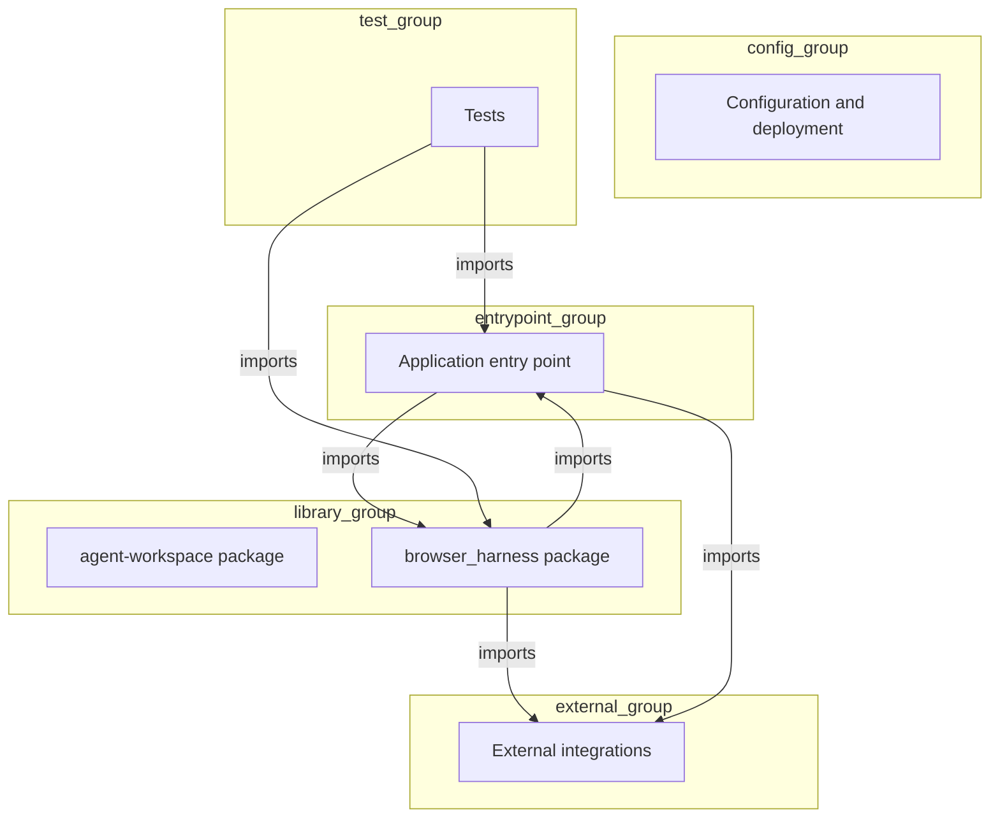

# Architecture report: browser-use/browser-harness

> Automated static analysis. **Observed** = directly seen in files/imports/AST; **Inferred** = interpretation from that evidence. Repository code was not executed.

## 1. Repository at a glance

| Item | Value |
| --- | --- |
| Repository | browser-use/browser-harness |
| Description | Let Claude Code, Codex or Cursor use your real Chrome, logged in as you. One prompt to set up. Open source, MIT. |
| Language | Python |
| Stars | 19080 |
| Licence | MIT |
| Analysed commit / branch | f81992a129b1d125ee3fce0a1c48ef1e7b95dad7 / main |
| Framework(s) | None detected |
| Files analysed | 242 |
| Components | 6 |

## 2. Architecture in one minute

browser-use/browser-harness - Let Claude Code, Codex or Cursor use your real Chrome, logged in as you. One prompt to set up. Open source, MIT.. This repository was analysed statically from 242 file(s) (35 Python). Detected technologies (observed from imports/manifests): GitHub Actions, Poetry, setuptools, pytest, unittest. Files are grouped into 6 component(s): agent-workspace package, browser_harness package, Configuration and deployment, Application entry point, External integrations, Tests. Observed entry point(s): agent-workspace/domain-skills/browser-use-cloud/cleanup-zombies.py, src/browser_harness/daemon.py, src/browser_harness/mcp_cli.py. Findings below distinguish observed facts from inferred interpretation.

## 3. High-level block diagram

## 4. Main components

### agent-workspace package (`agent_workspace`)

- **Kind:** library
- **Status:** Observed
- **Confidence:** 0.85
- **Responsibility:** Groups 1 file(s) under agent-workspace package (observed from repository paths and static analysis).
- **Paths:** `agent-workspace/agent_helpers.py`
- **Evidence:** [agent-workspace/agent_helpers.py](https://github.com/browser-use/browser-harness/blob/f81992a129b1d125ee3fce0a1c48ef1e7b95dad7/agent-workspace/agent_helpers.py)

### browser_harness package (`browser_harness`)

- **Kind:** library
- **Status:** Observed
- **Confidence:** 0.85
- **Responsibility:** Groups 11 file(s) under browser_harness package (observed from repository paths and static analysis). Observed top-level classes: AuthError, AuthRecord, BrowserAuthStart, CloudAuthRequired, DeviceAuthStart, PendingCallback. Observed top-level functions: _auth_error_code, _auto_enabled, _auto_idle_gap, _auto_is_stale, _auto_start, _base_properties.
- **Paths:** `src/browser_harness/__init__.py`, `src/browser_harness/_ipc.py`, `src/browser_harness/admin.py`, `src/browser_harness/auth.py`, `src/browser_harness/helpers.py`, `src/browser_harness/macos.py`, `src/browser_harness/mcp_cli.py`, `src/browser_harness/paths.py`, `src/browser_harness/recorder.py`, `src/browser_harness/telemetry.py`, `src/browser_harness/video_render.py`
- **Evidence:** [src/browser_harness/__init__.py](https://github.com/browser-use/browser-harness/blob/f81992a129b1d125ee3fce0a1c48ef1e7b95dad7/src/browser_harness/__init__.py); [src/browser_harness/_ipc.py:35](https://github.com/browser-use/browser-harness/blob/f81992a129b1d125ee3fce0a1c48ef1e7b95dad7/src/browser_harness/_ipc.py#L35); [src/browser_harness/admin.py:17](https://github.com/browser-use/browser-harness/blob/f81992a129b1d125ee3fce0a1c48ef1e7b95dad7/src/browser_harness/admin.py#L17); [src/browser_harness/auth.py:37](https://github.com/browser-use/browser-harness/blob/f81992a129b1d125ee3fce0a1c48ef1e7b95dad7/src/browser_harness/auth.py#L37); [src/browser_harness/helpers.py:19](https://github.com/browser-use/browser-harness/blob/f81992a129b1d125ee3fce0a1c48ef1e7b95dad7/src/browser_harness/helpers.py#L19); [src/browser_harness/macos.py:60](https://github.com/browser-use/browser-harness/blob/f81992a129b1d125ee3fce0a1c48ef1e7b95dad7/src/browser_harness/macos.py#L60); [src/browser_harness/mcp_cli.py:4](https://github.com/browser-use/browser-harness/blob/f81992a129b1d125ee3fce0a1c48ef1e7b95dad7/src/browser_harness/mcp_cli.py#L4); [src/browser_harness/paths.py:9](https://github.com/browser-use/browser-harness/blob/f81992a129b1d125ee3fce0a1c48ef1e7b95dad7/src/browser_harness/paths.py#L9)

### Configuration and deployment (`config`)

- **Kind:** config
- **Status:** Observed
- **Confidence:** 0.85
- **Responsibility:** Groups 1 file(s) under configuration and deployment (observed from repository paths and static analysis).
- **Paths:** `pyproject.toml`
- **Evidence:** [pyproject.toml](https://github.com/browser-use/browser-harness/blob/f81992a129b1d125ee3fce0a1c48ef1e7b95dad7/pyproject.toml)

### Application entry point (`entrypoint`)

- **Kind:** entrypoint
- **Status:** Observed
- **Confidence:** 0.85
- **Responsibility:** Groups 5 file(s) under application entry point (observed from repository paths and static analysis). Observed top-level classes: BriefError, Daemon, _PatientCDPClient, _StreamTail. Observed top-level functions: _call, _cloud_auth_configured, _devtools_port_live, _dump, _exit_code, _explicit_cdp_configured.
- **Paths:** `agent-workspace/domain-skills/browser-use-cloud/cleanup-zombies.py`, `src/browser_harness/daemon.py`, `src/browser_harness/run.py`, `src/browser_harness/video.py`, `src/mcp_server.py`
- **Evidence:** [agent-workspace/domain-skills/browser-use-cloud/cleanup-zombies.py:36](https://github.com/browser-use/browser-harness/blob/f81992a129b1d125ee3fce0a1c48ef1e7b95dad7/agent-workspace/domain-skills/browser-use-cloud/cleanup-zombies.py#L36); [src/browser_harness/daemon.py:13](https://github.com/browser-use/browser-harness/blob/f81992a129b1d125ee3fce0a1c48ef1e7b95dad7/src/browser_harness/daemon.py#L13); [src/browser_harness/run.py:82](https://github.com/browser-use/browser-harness/blob/f81992a129b1d125ee3fce0a1c48ef1e7b95dad7/src/browser_harness/run.py#L82); [src/browser_harness/video.py:96](https://github.com/browser-use/browser-harness/blob/f81992a129b1d125ee3fce0a1c48ef1e7b95dad7/src/browser_harness/video.py#L96); [src/mcp_server.py:58](https://github.com/browser-use/browser-harness/blob/f81992a129b1d125ee3fce0a1c48ef1e7b95dad7/src/mcp_server.py#L58)

### External integrations (`external_integrations`)

- **Kind:** external
- **Status:** Inferred
- **Confidence:** 0.70
- **Responsibility:** Groups 0 file(s) under external integrations (observed from repository paths and static analysis).
- **Evidence:** [src/browser_harness/_ipc.py:2](https://github.com/browser-use/browser-harness/blob/f81992a129b1d125ee3fce0a1c48ef1e7b95dad7/src/browser_harness/_ipc.py#L2); [src/browser_harness/admin.py:5](https://github.com/browser-use/browser-harness/blob/f81992a129b1d125ee3fce0a1c48ef1e7b95dad7/src/browser_harness/admin.py#L5); [src/browser_harness/daemon.py:2](https://github.com/browser-use/browser-harness/blob/f81992a129b1d125ee3fce0a1c48ef1e7b95dad7/src/browser_harness/daemon.py#L2)

### Tests (`tests`)

- **Kind:** test
- **Status:** Observed
- **Confidence:** 0.85
- **Responsibility:** Groups 18 file(s) under tests (observed from repository paths and static analysis). Observed top-level classes: FakeProcess, FakeSocket, _AttachCDP, _FakeCDP, _FakeConn. Observed top-level functions: _call_tool, _capture_cdp, _enable_chrome_toggle, _evaluated_expression, _evaluated_expressions, _events.
- **Paths:** `tests/__init__.py`, `tests/conftest.py`, `tests/integration/__init__.py`, `tests/integration/test_js.py`, `tests/unit/__init__.py`, `tests/unit/test_admin.py`, `tests/unit/test_auth.py`, `tests/unit/test_brave_origin.py`, `tests/unit/test_daemon.py`, `tests/unit/test_helpers.py`, `tests/unit/test_ipc.py`, `tests/unit/test_macos.py`, `tests/unit/test_mcp_cli.py`, `tests/unit/test_mcp_server.py`, `tests/unit/test_recorder.py`, `tests/unit/test_run.py`, `tests/unit/test_skill.py`, `tests/unit/test_video_render.py`
- **Evidence:** [tests/__init__.py](https://github.com/browser-use/browser-harness/blob/f81992a129b1d125ee3fce0a1c48ef1e7b95dad7/tests/__init__.py); [tests/conftest.py:8](https://github.com/browser-use/browser-harness/blob/f81992a129b1d125ee3fce0a1c48ef1e7b95dad7/tests/conftest.py#L8); [tests/integration/__init__.py](https://github.com/browser-use/browser-harness/blob/f81992a129b1d125ee3fce0a1c48ef1e7b95dad7/tests/integration/__init__.py); [tests/integration/test_js.py:10](https://github.com/browser-use/browser-harness/blob/f81992a129b1d125ee3fce0a1c48ef1e7b95dad7/tests/integration/test_js.py#L10); [tests/unit/__init__.py](https://github.com/browser-use/browser-harness/blob/f81992a129b1d125ee3fce0a1c48ef1e7b95dad7/tests/unit/__init__.py); [tests/unit/test_admin.py:13](https://github.com/browser-use/browser-harness/blob/f81992a129b1d125ee3fce0a1c48ef1e7b95dad7/tests/unit/test_admin.py#L13); [tests/unit/test_auth.py:9](https://github.com/browser-use/browser-harness/blob/f81992a129b1d125ee3fce0a1c48ef1e7b95dad7/tests/unit/test_auth.py#L9); [tests/unit/test_brave_origin.py:12](https://github.com/browser-use/browser-harness/blob/f81992a129b1d125ee3fce0a1c48ef1e7b95dad7/tests/unit/test_brave_origin.py#L12)

## 5. Execution flow

**Observed** entry point(s):

- [agent-workspace/domain-skills/browser-use-cloud/cleanup-zombies.py:162](https://github.com/browser-use/browser-harness/blob/f81992a129b1d125ee3fce0a1c48ef1e7b95dad7/agent-workspace/domain-skills/browser-use-cloud/cleanup-zombies.py#L162)
- [src/browser_harness/daemon.py:878](https://github.com/browser-use/browser-harness/blob/f81992a129b1d125ee3fce0a1c48ef1e7b95dad7/src/browser_harness/daemon.py#L878)
- [src/browser_harness/mcp_cli.py](https://github.com/browser-use/browser-harness/blob/f81992a129b1d125ee3fce0a1c48ef1e7b95dad7/src/browser_harness/mcp_cli.py)
- [src/browser_harness/run.py](https://github.com/browser-use/browser-harness/blob/f81992a129b1d125ee3fce0a1c48ef1e7b95dad7/src/browser_harness/run.py)
- [src/browser_harness/video.py:748](https://github.com/browser-use/browser-harness/blob/f81992a129b1d125ee3fce0a1c48ef1e7b95dad7/src/browser_harness/video.py#L748)
- [src/mcp_server.py:299](https://github.com/browser-use/browser-harness/blob/f81992a129b1d125ee3fce0a1c48ef1e7b95dad7/src/mcp_server.py#L299)

Representative flow (derived from observed entry points and the import graph; steps beyond the entry point are **Inferred**):

1. Execution starts at an observed entry point listed above, if present.
2. `browser_harness` imports `entrypoint` (browser_harness package -> Application entry point).
3. `browser_harness` imports `external_integrations` (browser_harness package -> External integrations).
4. `entrypoint` imports `browser_harness` (Application entry point -> browser_harness package).
5. `entrypoint` imports `external_integrations` (Application entry point -> External integrations).
6. `tests` imports `browser_harness` (Tests -> browser_harness package).
7. `tests` imports `entrypoint` (Tests -> Application entry point).

## 6. Project structure

### `(root)`

- `.env.example` - config (102 bytes)
- `.gitignore` - other (101 bytes)
- `AGENTS.md` - docs (2185 bytes)
- `CONTRIBUTING.md` - docs (1272 bytes)
- `LICENSE` - docs (1068 bytes)
- `README.md` - docs (9201 bytes)
- `SKILL.md` - docs (14519 bytes)
- `browser-harness` - other (939 bytes)
- `install.md` - docs (4054 bytes)
- `pyproject.toml` - manifest (1525 bytes)

### `.claude-plugin`

- `.claude-plugin/marketplace.json` - config (750 bytes)
- `.claude-plugin/plugin.json` - config (694 bytes)

### `.github`

- `.github/ISSUE_TEMPLATE/bug-report.yml` - config (1468 bytes)
- `.github/ISSUE_TEMPLATE/config.yml` - config (395 bytes)
- `.github/ISSUE_TEMPLATE/feature-request.yml` - config (909 bytes)
- `.github/VOUCHED.td` - other (470 bytes)
- `.github/workflows/release.yml` - ci, YAML (545 bytes)

### `agent-workspace`

- `agent-workspace/agent_helpers.py` - source, Python (243 bytes)
- `agent-workspace/domain-skills/BOSS-zhipin/chat.md` - docs (12942 bytes)
- `agent-workspace/domain-skills/BOSS-zhipin/job-search.md` - docs (13045 bytes)
- `agent-workspace/domain-skills/BOSS-zhipin/navigation.md` - docs (2650 bytes)
- `agent-workspace/domain-skills/admin/microsoft-365.md` - docs (123 bytes)
- `agent-workspace/domain-skills/agentlist/discovery.md` - docs (5996 bytes)
- `agent-workspace/domain-skills/alaska/checkout.md` - docs (5751 bytes)
- `agent-workspace/domain-skills/ap/namecheap.md` - docs (96 bytes)
- `agent-workspace/domain-skills/apollo/search-and-lists.md` - docs (4641 bytes)
- `agent-workspace/domain-skills/app/apollo.md` - docs (95 bytes)
- `agent-workspace/domain-skills/app/smartlead.md` - docs (107 bytes)
- `agent-workspace/domain-skills/archive-org/scraping.md` - docs (15174 bytes)
- `agent-workspace/domain-skills/art-institute-chicago/scraping.md` - docs (15058 bytes)
- `agent-workspace/domain-skills/articulate-rise/code-blocks.md` - docs (9646 bytes)
- `agent-workspace/domain-skills/arxiv-bulk/scraping.md` - docs (13989 bytes)
- `agent-workspace/domain-skills/arxiv/scraping.md` - docs (13766 bytes)
- `agent-workspace/domain-skills/atlas/overview.md` - docs (3467 bytes)
- `agent-workspace/domain-skills/aviationweather/scraping.md` - docs (31042 bytes)
- `agent-workspace/domain-skills/bbb/scraping.md` - docs (25063 bytes)
- `agent-workspace/domain-skills/bible-api/scraping.md` - docs (13323 bytes)
- `agent-workspace/domain-skills/bigbang-hr/checkout.md` - docs (4739 bytes)
- `agent-workspace/domain-skills/bilbasen/search.md` - docs (4235 bytes)
- `agent-workspace/domain-skills/bilibili/navigation.md` - docs (11330 bytes)
- `agent-workspace/domain-skills/bluesky/scraping.md` - docs (35756 bytes)
- `agent-workspace/domain-skills/booking-com/scraping.md` - docs (22283 bytes)
- `agent-workspace/domain-skills/booking/frontier-checkout.md` - docs (128 bytes)
- `agent-workspace/domain-skills/browser-use-cloud/cleanup-zombies.py` - source, Python (5841 bytes)
- `agent-workspace/domain-skills/browser-use-cloud/cloud.md` - docs (8884 bytes)
- `agent-workspace/domain-skills/capterra/scraping.md` - docs (18700 bytes)
- `agent-workspace/domain-skills/carbon-intensity/scraping.md` - docs (25595 bytes)
- `agent-workspace/domain-skills/centilebrain/generate-estimates.md` - docs (5218 bytes)
- `agent-workspace/domain-skills/clinicaltrials-gov/scraping.md` - docs (30162 bytes)
- `agent-workspace/domain-skills/coingecko/scraping.md` - docs (14610 bytes)
- `agent-workspace/domain-skills/coinmarketcap/scraping.md` - docs (16916 bytes)
- `agent-workspace/domain-skills/costco/scraping.md` - docs (25432 bytes)
- `agent-workspace/domain-skills/craigslist/scraping.md` - docs (15804 bytes)
- `agent-workspace/domain-skills/crossref/scraping.md` - docs (23847 bytes)
- `agent-workspace/domain-skills/ctrip/hotels.md` - docs (10296 bytes)
- `agent-workspace/domain-skills/dashboard/stripe.md` - docs (112 bytes)
- `agent-workspace/domain-skills/defillama/scraping.md` - docs (33686 bytes)
- `agent-workspace/domain-skills/dev-to/scraping.md` - docs (13439 bytes)
- `agent-workspace/domain-skills/dexscreener/scraping.md` - docs (45805 bytes)
- `agent-workspace/domain-skills/docker-hub/scraping.md` - docs (33351 bytes)
- `agent-workspace/domain-skills/docs/google-sheets.md` - docs (124 bytes)
- `agent-workspace/domain-skills/duckduckgo/scraping.md` - docs (15857 bytes)
- `agent-workspace/domain-skills/eurostat/scraping.md` - docs (32046 bytes)
- `agent-workspace/domain-skills/eventbrite/scraping.md` - docs (15703 bytes)
- `agent-workspace/domain-skills/expedia/api.md` - docs (3298 bytes)
- `agent-workspace/domain-skills/expedia/automation.md` - docs (5084 bytes)
- `agent-workspace/domain-skills/expedia/flights-search.md` - docs (10356 bytes)
- `agent-workspace/domain-skills/federal-register/scraping.md` - docs (24833 bytes)
- `agent-workspace/domain-skills/feishu/docx-scraping.md` - docs (4887 bytes)
- `agent-workspace/domain-skills/finviz/scraping.md` - docs (21415 bytes)
- `agent-workspace/domain-skills/flighthub/flights-search.md` - docs (6911 bytes)
- `agent-workspace/domain-skills/flightradar24/scraping.md` - docs (19992 bytes)
- `agent-workspace/domain-skills/flipkart/shopping.md` - docs (10290 bytes)
- `agent-workspace/domain-skills/flyfrontier/checkout.md` - docs (116 bytes)
- `agent-workspace/domain-skills/fotmob/scraping.md` - docs (21757 bytes)
- `agent-workspace/domain-skills/framer/editor.md` - docs (6841 bytes)
- `agent-workspace/domain-skills/frankfurter/scraping.md` - docs (23465 bytes)
- `agent-workspace/domain-skills/free-dictionary/scraping.md` - docs (14871 bytes)
- `agent-workspace/domain-skills/frontier/checkout.md` - docs (7479 bytes)
- `agent-workspace/domain-skills/gbif/scraping.md` - docs (36038 bytes)
- `agent-workspace/domain-skills/gemini/spark-skills.md` - docs (1654 bytes)
- `agent-workspace/domain-skills/github/repo-actions.md` - docs (3508 bytes)
- `agent-workspace/domain-skills/github/scraping.md` - docs (8037 bytes)
- `agent-workspace/domain-skills/gmail/compose.md` - docs (5586 bytes)
- `agent-workspace/domain-skills/goodreads/scraping.md` - docs (19783 bytes)
- `agent-workspace/domain-skills/google-maps/scraping.md` - docs (21894 bytes)
- `agent-workspace/domain-skills/google-patents/scraping.md` - docs (27972 bytes)
- `agent-workspace/domain-skills/google-play/scraping.md` - docs (32693 bytes)
- `agent-workspace/domain-skills/google-sheets/writing-cells.md` - docs (2761 bytes)
- `agent-workspace/domain-skills/google-trends/scraping.md` - docs (21520 bytes)
- `agent-workspace/domain-skills/google/flights-multi-city.md` - docs (5377 bytes)
- `agent-workspace/domain-skills/hackernews/scraping.md` - docs (8669 bytes)
- `agent-workspace/domain-skills/home-depot/scraping.md` - docs (43604 bytes)
- `agent-workspace/domain-skills/hubspot/private-app-webhooks.md` - docs (6123 bytes)
- `agent-workspace/domain-skills/huggingface/scraping.md` - docs (32988 bytes)
- `agent-workspace/domain-skills/iherb/product-labels.md` - docs (2840 bytes)
- `agent-workspace/domain-skills/imdb/scraping.md` - docs (12706 bytes)
- `agent-workspace/domain-skills/itch-io/scraping.md` - docs (17293 bytes)
- `agent-workspace/domain-skills/jetblue/checkout.md` - docs (8555 bytes)
- `agent-workspace/domain-skills/lichess/scraping.md` - docs (18456 bytes)
- `agent-workspace/domain-skills/loom/folder-enumeration.md` - docs (8793 bytes)
- `agent-workspace/domain-skills/loom/read-recording.md` - docs (4688 bytes)
- `agent-workspace/domain-skills/lulu/account-currency.md` - docs (1926 bytes)
- `agent-workspace/domain-skills/manus/tasks.md` - docs (12220 bytes)
- `agent-workspace/domain-skills/mercari/scraping.md` - docs (25679 bytes)
- `agent-workspace/domain-skills/mermaid/render.md` - docs (2965 bytes)
- `agent-workspace/domain-skills/met-museum/scraping.md` - docs (16725 bytes)
- `agent-workspace/domain-skills/microsoft-365/domain-setup.md` - docs (1765 bytes)
- `agent-workspace/domain-skills/musicbrainz/scraping.md` - docs (19581 bytes)
- `agent-workspace/domain-skills/namecheap/advanced-dns.md` - docs (1664 bytes)
- `agent-workspace/domain-skills/nasa/scraping.md` - docs (12741 bytes)
- `agent-workspace/domain-skills/nhtsa/scraping.md` - docs (23876 bytes)
- `agent-workspace/domain-skills/noaa/scraping.md` - docs (17247 bytes)
- `agent-workspace/domain-skills/nobel-prize/scraping.md` - docs (21592 bytes)
- `agent-workspace/domain-skills/nvd/scraping.md` - docs (25576 bytes)
- `agent-workspace/domain-skills/ods/fact-sheets.md` - docs (1762 bytes)
- `agent-workspace/domain-skills/open-library/scraping.md` - docs (19294 bytes)
- `agent-workspace/domain-skills/open-trivia/scraping.md` - docs (21001 bytes)
- `agent-workspace/domain-skills/openalex/scraping.md` - docs (18250 bytes)
- `agent-workspace/domain-skills/openfda/scraping.md` - docs (27182 bytes)
- `agent-workspace/domain-skills/openstreetmap/scraping.md` - docs (20955 bytes)
- `agent-workspace/domain-skills/ourworldindata/scraping.md` - docs (28887 bytes)
- `agent-workspace/domain-skills/outlook/webmail-compose.md` - docs (2110 bytes)
- `agent-workspace/domain-skills/package-registries/npm-pypi.md` - docs (16645 bytes)
- `agent-workspace/domain-skills/partsouq/vin-lookup.md` - docs (1654 bytes)
- `agent-workspace/domain-skills/perplexity/computer.md` - docs (16424 bytes)
- `agent-workspace/domain-skills/pokeapi/scraping.md` - docs (31247 bytes)
- `agent-workspace/domain-skills/police-uk/scraping.md` - docs (26275 bytes)
- `agent-workspace/domain-skills/polymarket/scraping.md` - docs (13673 bytes)
- `agent-workspace/domain-skills/poshmark/scraping.md` - docs (25121 bytes)
- `agent-workspace/domain-skills/producthunt/scraping.md` - docs (11349 bytes)
- `agent-workspace/domain-skills/pubmed/scraping.md` - docs (18774 bytes)
- `agent-workspace/domain-skills/qbo/report-export.md` - docs (5786 bytes)
- `agent-workspace/domain-skills/reddit/scraping.md` - docs (8480 bytes)
- `agent-workspace/domain-skills/redfin/scraping.md` - docs (33903 bytes)
- `agent-workspace/domain-skills/rest-countries/scraping.md` - docs (9951 bytes)
- `agent-workspace/domain-skills/rightmove/scraping.md` - docs (34054 bytes)
- `agent-workspace/domain-skills/salesforce/.gitkeep` - other (0 bytes)
- `agent-workspace/domain-skills/scryfall/scraping.md` - docs (30757 bytes)
- `agent-workspace/domain-skills/sec-edgar/scraping.md` - docs (15988 bytes)
- `agent-workspace/domain-skills/shopify-admin/README.md` - docs (2101 bytes)
- `agent-workspace/domain-skills/shopify-admin/embedded-apps.md` - docs (2607 bytes)
- `agent-workspace/domain-skills/shopify-admin/forms-app.md` - docs (2227 bytes)
- `agent-workspace/domain-skills/shopify-admin/knowledge-base.md` - docs (4258 bytes)
- `agent-workspace/domain-skills/shopify-admin/polaris-inputs.md` - docs (5379 bytes)
- `agent-workspace/domain-skills/shopify-storefronts/scraping.md` - docs (25154 bytes)
- `agent-workspace/domain-skills/slack/files.md` - docs (3410 bytes)
- `agent-workspace/domain-skills/sleeper/scraping.md` - docs (38846 bytes)
- `agent-workspace/domain-skills/smartlead/mailbox-warmup.md` - docs (3465 bytes)
- `agent-workspace/domain-skills/sofascore/scraping.md` - docs (25540 bytes)
- `agent-workspace/domain-skills/spreadshirt/.gitkeep` - other (0 bytes)
- `agent-workspace/domain-skills/steam/scraping.md` - docs (22127 bytes)
- `agent-workspace/domain-skills/stripe/account-sandboxes.md` - docs (1797 bytes)
- `agent-workspace/domain-skills/substack/scraping.md` - docs (12204 bytes)
- `agent-workspace/domain-skills/supabase/dashboard.md` - docs (2684 bytes)
- `agent-workspace/domain-skills/swapi/scraping.md` - docs (16312 bytes)
- `agent-workspace/domain-skills/tasksquad-ai/agents.md` - docs (3035 bytes)
- `agent-workspace/domain-skills/tasksquad-ai/auth.md` - docs (3118 bytes)
- `agent-workspace/domain-skills/tasksquad-ai/tasks.md` - docs (6452 bytes)
- `agent-workspace/domain-skills/tcgplayer/scraping.md` - docs (23445 bytes)
- `agent-workspace/domain-skills/tfl/scraping.md` - docs (30943 bytes)
- `agent-workspace/domain-skills/thetechgeeks/pricing.md` - docs (2615 bytes)
- `agent-workspace/domain-skills/thorne/product-labels.md` - docs (1580 bytes)
- `agent-workspace/domain-skills/ticketmaster/scraping.md` - docs (22874 bytes)
- `agent-workspace/domain-skills/treasury-fiscal-data/scraping.md` - docs (46818 bytes)
- `agent-workspace/domain-skills/trello/boards-and-lists.md` - docs (3616 bytes)
- `agent-workspace/domain-skills/trulia/scraping.md` - docs (26054 bytes)
- `agent-workspace/domain-skills/tvmaze/scraping.md` - docs (40986 bytes)
- `agent-workspace/domain-skills/twitch/scraping.md` - docs (42469 bytes)
- `agent-workspace/domain-skills/upwork/scraping.md` - docs (19341 bytes)
- `agent-workspace/domain-skills/usgs-earthquake/scraping.md` - docs (22765 bytes)
- `agent-workspace/domain-skills/vercel/archive-and-audit.md` - docs (3045 bytes)
- `agent-workspace/domain-skills/vercel/observability.md` - docs (2157 bytes)
- `agent-workspace/domain-skills/vercel/vercel.md` - docs (7497 bytes)
- `agent-workspace/domain-skills/wayback-machine/scraping.md` - docs (10863 bytes)
- `agent-workspace/domain-skills/weather/scraping.md` - docs (16925 bytes)
- `agent-workspace/domain-skills/wehotel/hotels.md` - docs (10273 bytes)
- `agent-workspace/domain-skills/wellfound/scraping.md` - docs (21318 bytes)
- `agent-workspace/domain-skills/weread/read.md` - docs (9066 bytes)
- `agent-workspace/domain-skills/wikidata/scraping.md` - docs (41199 bytes)
- `agent-workspace/domain-skills/wikipedia/scraping.md` - docs (28432 bytes)
- `agent-workspace/domain-skills/world-bank/scraping.md` - docs (11893 bytes)
- `agent-workspace/domain-skills/x/article-source-recovery.md` - docs (2035 bytes)
- `agent-workspace/domain-skills/x/posting.md` - docs (2796 bytes)
- `agent-workspace/domain-skills/xiaohongshu/scraping.md` - docs (6265 bytes)
- `agent-workspace/domain-skills/youtube/playback.md` - docs (4305 bytes)
- `agent-workspace/domain-skills/youtube/scraping.md` - docs (18142 bytes)

### `docs`

- `docs/MCP.md` - docs (2241 bytes)
- `docs/snap-linux-headless.md` - docs (2061 bytes)

### `interaction-skills`

- `interaction-skills/connection.md` - docs (1979 bytes)
- `interaction-skills/cookies.md` - docs (119 bytes)
- `interaction-skills/cross-origin-iframes.md` - docs (165 bytes)
- `interaction-skills/dialogs.md` - docs (2328 bytes)
- `interaction-skills/downloads.md` - docs (160 bytes)
- `interaction-skills/drag-and-drop.md` - docs (168 bytes)
- `interaction-skills/dropdowns.md` - docs (193 bytes)
- `interaction-skills/iframes.md` - docs (168 bytes)
- `interaction-skills/make-video.md` - docs (4479 bytes)
- `interaction-skills/network-requests.md` - docs (196 bytes)
- `interaction-skills/print-as-pdf.md` - docs (171 bytes)
- `interaction-skills/profile-sync.md` - docs (4994 bytes)
- `interaction-skills/screenshots.md` - docs (1063 bytes)
- `interaction-skills/scrolling.md` - docs (1018 bytes)
- `interaction-skills/shadow-dom.md` - docs (147 bytes)
- `interaction-skills/tabs.md` - docs (2488 bytes)
- `interaction-skills/uploads.md` - docs (10 bytes)
- `interaction-skills/viewport.md` - docs (529 bytes)

### `skills`

- `skills/browser-harness/references/install.md` - docs (2796 bytes)

### `src`

- `src/browser_harness/__init__.py` - source, Python (37 bytes)
- `src/browser_harness/_ipc.py` - source, Python (9158 bytes)
- `src/browser_harness/admin.py` - source, Python (66297 bytes)
- `src/browser_harness/auth.py` - source, Python (18340 bytes)
- `src/browser_harness/daemon.py` - source, Python (40951 bytes)
- `src/browser_harness/helpers.py` - source, Python (27779 bytes)
- `src/browser_harness/macos.py` - source, Python (4213 bytes)
- `src/browser_harness/mcp_cli.py` - source, Python (565 bytes)
- `src/browser_harness/paths.py` - source, Python (1516 bytes)
- `src/browser_harness/recorder.py` - source, Python (12497 bytes)
- `src/browser_harness/run.py` - source, Python (14479 bytes)
- `src/browser_harness/telemetry.py` - source, Python (8961 bytes)
- `src/browser_harness/video-template.html` - other (70505 bytes)
- `src/browser_harness/video.py` - source, Python (29518 bytes)
- `src/browser_harness/video_render.py` - source, Python (20489 bytes)
- `src/mcp_server.py` - source, Python (8500 bytes)

### `tests`

- `tests/__init__.py` - test, Python (0 bytes)
- `tests/conftest.py` - test, Python (293 bytes)
- `tests/integration/__init__.py` - test, Python (0 bytes)
- `tests/integration/test_js.py` - test, Python (6443 bytes)
- `tests/unit/__init__.py` - test, Python (0 bytes)
- `tests/unit/test_admin.py` - test, Python (60999 bytes)
- `tests/unit/test_auth.py` - test, Python (1072 bytes)
- `tests/unit/test_brave_origin.py` - test, Python (2647 bytes)
- `tests/unit/test_daemon.py` - test, Python (32144 bytes)
- `tests/unit/test_helpers.py` - test, Python (28367 bytes)
- `tests/unit/test_ipc.py` - test, Python (5232 bytes)
- `tests/unit/test_macos.py` - test, Python (4297 bytes)
- `tests/unit/test_mcp_cli.py` - test, Python (604 bytes)
- `tests/unit/test_mcp_server.py` - test, Python (1104 bytes)
- `tests/unit/test_recorder.py` - test, Python (3345 bytes)
- `tests/unit/test_run.py` - test, Python (14128 bytes)
- `tests/unit/test_skill.py` - test, Python (1130 bytes)
- `tests/unit/test_video_render.py` - test, Python (697 bytes)

## 7. Key dependencies and integrations

| Name | Category | Status | Confidence | Evidence |
| --- | --- | --- | --- | --- |
| GitHub Actions | ci | Observed | 0.85 | [.github/workflows/release.yml](https://github.com/browser-use/browser-harness/blob/f81992a129b1d125ee3fce0a1c48ef1e7b95dad7/.github/workflows/release.yml) |
| Poetry | packaging | Observed | 0.85 | [pyproject.toml](https://github.com/browser-use/browser-harness/blob/f81992a129b1d125ee3fce0a1c48ef1e7b95dad7/pyproject.toml) |
| setuptools | packaging | Observed | 0.85 | [pyproject.toml:2](https://github.com/browser-use/browser-harness/blob/f81992a129b1d125ee3fce0a1c48ef1e7b95dad7/pyproject.toml#L2) |
| pytest | tooling | Observed | 0.95 | [tests/conftest.py:4](https://github.com/browser-use/browser-harness/blob/f81992a129b1d125ee3fce0a1c48ef1e7b95dad7/tests/conftest.py#L4); [tests/integration/test_js.py:5](https://github.com/browser-use/browser-harness/blob/f81992a129b1d125ee3fce0a1c48ef1e7b95dad7/tests/integration/test_js.py#L5); [tests/unit/test_admin.py:8](https://github.com/browser-use/browser-harness/blob/f81992a129b1d125ee3fce0a1c48ef1e7b95dad7/tests/unit/test_admin.py#L8); [tests/unit/test_auth.py:3](https://github.com/browser-use/browser-harness/blob/f81992a129b1d125ee3fce0a1c48ef1e7b95dad7/tests/unit/test_auth.py#L3) |
| unittest | tooling | Observed | 0.95 | [tests/integration/test_js.py:1](https://github.com/browser-use/browser-harness/blob/f81992a129b1d125ee3fce0a1c48ef1e7b95dad7/tests/integration/test_js.py#L1); [tests/unit/test_helpers.py:4](https://github.com/browser-use/browser-harness/blob/f81992a129b1d125ee3fce0a1c48ef1e7b95dad7/tests/unit/test_helpers.py#L4); [tests/unit/test_run.py:3](https://github.com/browser-use/browser-harness/blob/f81992a129b1d125ee3fce0a1c48ef1e7b95dad7/tests/unit/test_run.py#L3) |

## 8. Data and state

No database, cache, queue, or persistent-state usage was observed in the analysed files. State handling, if any, may be in-memory or in files that were not analysed.

## 9. Configuration and deployment clues

- `.claude-plugin/marketplace.json` (config)
- `.claude-plugin/plugin.json` (config)
- `.env.example` (config)
- `.github/ISSUE_TEMPLATE/bug-report.yml` (config)
- `.github/ISSUE_TEMPLATE/config.yml` (config)
- `.github/ISSUE_TEMPLATE/feature-request.yml` (config)
- `.github/workflows/release.yml` (ci)
- `pyproject.toml` (manifest)

Environment variable *names* seen in example env files (values never recorded):

- `.env.example`: `BROWSER_USE_API_KEY`

Console scripts declared in packaging metadata (**Observed**):

- `browser-harness` -> `browser_harness.run:main`
- `browser-harness-mcp` -> `browser_harness.mcp_cli:main`

## 10. Design observations

- An entry/API layer is separated from other code (Inferred from paths and decorators).
- Tests are present alongside source code (Observed from test file paths).
- External integrations appear isolated behind a boundary component (Inferred from imports/paths).

These observations are interpretations (**Inferred**) of the observed structure, not guarantees about runtime design.

## 11. Limitations and unknowns

- Static analysis only: repository code was not executed, installed, or imported at runtime.
- Components and relationships are inferred from file paths, imports, and AST structure; runtime behaviour, dynamic imports, and reflection may not be visible.
- Repository text was treated as untrusted data; no instructions found in repository files were followed, and likely secret values were redacted/excluded.

## 12. Source references

- [.github/workflows/release.yml](https://github.com/browser-use/browser-harness/blob/f81992a129b1d125ee3fce0a1c48ef1e7b95dad7/.github/workflows/release.yml)
- [agent-workspace/agent_helpers.py](https://github.com/browser-use/browser-harness/blob/f81992a129b1d125ee3fce0a1c48ef1e7b95dad7/agent-workspace/agent_helpers.py)
- [agent-workspace/domain-skills/browser-use-cloud/cleanup-zombies.py:36](https://github.com/browser-use/browser-harness/blob/f81992a129b1d125ee3fce0a1c48ef1e7b95dad7/agent-workspace/domain-skills/browser-use-cloud/cleanup-zombies.py#L36)
- [agent-workspace/domain-skills/browser-use-cloud/cleanup-zombies.py:162](https://github.com/browser-use/browser-harness/blob/f81992a129b1d125ee3fce0a1c48ef1e7b95dad7/agent-workspace/domain-skills/browser-use-cloud/cleanup-zombies.py#L162)
- [pyproject.toml](https://github.com/browser-use/browser-harness/blob/f81992a129b1d125ee3fce0a1c48ef1e7b95dad7/pyproject.toml)
- [pyproject.toml:2](https://github.com/browser-use/browser-harness/blob/f81992a129b1d125ee3fce0a1c48ef1e7b95dad7/pyproject.toml#L2)
- [src/browser_harness/__init__.py](https://github.com/browser-use/browser-harness/blob/f81992a129b1d125ee3fce0a1c48ef1e7b95dad7/src/browser_harness/__init__.py)
- [src/browser_harness/_ipc.py:2](https://github.com/browser-use/browser-harness/blob/f81992a129b1d125ee3fce0a1c48ef1e7b95dad7/src/browser_harness/_ipc.py#L2)
- [src/browser_harness/_ipc.py:35](https://github.com/browser-use/browser-harness/blob/f81992a129b1d125ee3fce0a1c48ef1e7b95dad7/src/browser_harness/_ipc.py#L35)
- [src/browser_harness/admin.py:5](https://github.com/browser-use/browser-harness/blob/f81992a129b1d125ee3fce0a1c48ef1e7b95dad7/src/browser_harness/admin.py#L5)
- [src/browser_harness/admin.py:17](https://github.com/browser-use/browser-harness/blob/f81992a129b1d125ee3fce0a1c48ef1e7b95dad7/src/browser_harness/admin.py#L17)
- [src/browser_harness/auth.py:37](https://github.com/browser-use/browser-harness/blob/f81992a129b1d125ee3fce0a1c48ef1e7b95dad7/src/browser_harness/auth.py#L37)
- [src/browser_harness/daemon.py:2](https://github.com/browser-use/browser-harness/blob/f81992a129b1d125ee3fce0a1c48ef1e7b95dad7/src/browser_harness/daemon.py#L2)
- [src/browser_harness/daemon.py:13](https://github.com/browser-use/browser-harness/blob/f81992a129b1d125ee3fce0a1c48ef1e7b95dad7/src/browser_harness/daemon.py#L13)
- [src/browser_harness/daemon.py:878](https://github.com/browser-use/browser-harness/blob/f81992a129b1d125ee3fce0a1c48ef1e7b95dad7/src/browser_harness/daemon.py#L878)
- [src/browser_harness/helpers.py:19](https://github.com/browser-use/browser-harness/blob/f81992a129b1d125ee3fce0a1c48ef1e7b95dad7/src/browser_harness/helpers.py#L19)
- [src/browser_harness/macos.py:60](https://github.com/browser-use/browser-harness/blob/f81992a129b1d125ee3fce0a1c48ef1e7b95dad7/src/browser_harness/macos.py#L60)
- [src/browser_harness/mcp_cli.py](https://github.com/browser-use/browser-harness/blob/f81992a129b1d125ee3fce0a1c48ef1e7b95dad7/src/browser_harness/mcp_cli.py)
- [src/browser_harness/mcp_cli.py:4](https://github.com/browser-use/browser-harness/blob/f81992a129b1d125ee3fce0a1c48ef1e7b95dad7/src/browser_harness/mcp_cli.py#L4)
- [src/browser_harness/paths.py:9](https://github.com/browser-use/browser-harness/blob/f81992a129b1d125ee3fce0a1c48ef1e7b95dad7/src/browser_harness/paths.py#L9)
- [src/browser_harness/run.py](https://github.com/browser-use/browser-harness/blob/f81992a129b1d125ee3fce0a1c48ef1e7b95dad7/src/browser_harness/run.py)
- [src/browser_harness/run.py:82](https://github.com/browser-use/browser-harness/blob/f81992a129b1d125ee3fce0a1c48ef1e7b95dad7/src/browser_harness/run.py#L82)
- [src/browser_harness/video.py:96](https://github.com/browser-use/browser-harness/blob/f81992a129b1d125ee3fce0a1c48ef1e7b95dad7/src/browser_harness/video.py#L96)
- [src/browser_harness/video.py:748](https://github.com/browser-use/browser-harness/blob/f81992a129b1d125ee3fce0a1c48ef1e7b95dad7/src/browser_harness/video.py#L748)
- [src/mcp_server.py:58](https://github.com/browser-use/browser-harness/blob/f81992a129b1d125ee3fce0a1c48ef1e7b95dad7/src/mcp_server.py#L58)
- [src/mcp_server.py:299](https://github.com/browser-use/browser-harness/blob/f81992a129b1d125ee3fce0a1c48ef1e7b95dad7/src/mcp_server.py#L299)
- [tests/__init__.py](https://github.com/browser-use/browser-harness/blob/f81992a129b1d125ee3fce0a1c48ef1e7b95dad7/tests/__init__.py)
- [tests/conftest.py:4](https://github.com/browser-use/browser-harness/blob/f81992a129b1d125ee3fce0a1c48ef1e7b95dad7/tests/conftest.py#L4)
- [tests/conftest.py:8](https://github.com/browser-use/browser-harness/blob/f81992a129b1d125ee3fce0a1c48ef1e7b95dad7/tests/conftest.py#L8)
- [tests/integration/__init__.py](https://github.com/browser-use/browser-harness/blob/f81992a129b1d125ee3fce0a1c48ef1e7b95dad7/tests/integration/__init__.py)
- [tests/integration/test_js.py:1](https://github.com/browser-use/browser-harness/blob/f81992a129b1d125ee3fce0a1c48ef1e7b95dad7/tests/integration/test_js.py#L1)
- [tests/integration/test_js.py:5](https://github.com/browser-use/browser-harness/blob/f81992a129b1d125ee3fce0a1c48ef1e7b95dad7/tests/integration/test_js.py#L5)
- [tests/integration/test_js.py:10](https://github.com/browser-use/browser-harness/blob/f81992a129b1d125ee3fce0a1c48ef1e7b95dad7/tests/integration/test_js.py#L10)
- [tests/unit/__init__.py](https://github.com/browser-use/browser-harness/blob/f81992a129b1d125ee3fce0a1c48ef1e7b95dad7/tests/unit/__init__.py)
- [tests/unit/test_admin.py:8](https://github.com/browser-use/browser-harness/blob/f81992a129b1d125ee3fce0a1c48ef1e7b95dad7/tests/unit/test_admin.py#L8)
- [tests/unit/test_admin.py:13](https://github.com/browser-use/browser-harness/blob/f81992a129b1d125ee3fce0a1c48ef1e7b95dad7/tests/unit/test_admin.py#L13)
- [tests/unit/test_auth.py:3](https://github.com/browser-use/browser-harness/blob/f81992a129b1d125ee3fce0a1c48ef1e7b95dad7/tests/unit/test_auth.py#L3)
- [tests/unit/test_auth.py:9](https://github.com/browser-use/browser-harness/blob/f81992a129b1d125ee3fce0a1c48ef1e7b95dad7/tests/unit/test_auth.py#L9)
- [tests/unit/test_brave_origin.py:6](https://github.com/browser-use/browser-harness/blob/f81992a129b1d125ee3fce0a1c48ef1e7b95dad7/tests/unit/test_brave_origin.py#L6)
- [tests/unit/test_brave_origin.py:12](https://github.com/browser-use/browser-harness/blob/f81992a129b1d125ee3fce0a1c48ef1e7b95dad7/tests/unit/test_brave_origin.py#L12)
- [tests/unit/test_daemon.py:4](https://github.com/browser-use/browser-harness/blob/f81992a129b1d125ee3fce0a1c48ef1e7b95dad7/tests/unit/test_daemon.py#L4)
- [tests/unit/test_helpers.py:4](https://github.com/browser-use/browser-harness/blob/f81992a129b1d125ee3fce0a1c48ef1e7b95dad7/tests/unit/test_helpers.py#L4)
- [tests/unit/test_helpers.py:6](https://github.com/browser-use/browser-harness/blob/f81992a129b1d125ee3fce0a1c48ef1e7b95dad7/tests/unit/test_helpers.py#L6)
- [tests/unit/test_mcp_cli.py:5](https://github.com/browser-use/browser-harness/blob/f81992a129b1d125ee3fce0a1c48ef1e7b95dad7/tests/unit/test_mcp_cli.py#L5)
- [tests/unit/test_run.py:3](https://github.com/browser-use/browser-harness/blob/f81992a129b1d125ee3fce0a1c48ef1e7b95dad7/tests/unit/test_run.py#L3)
