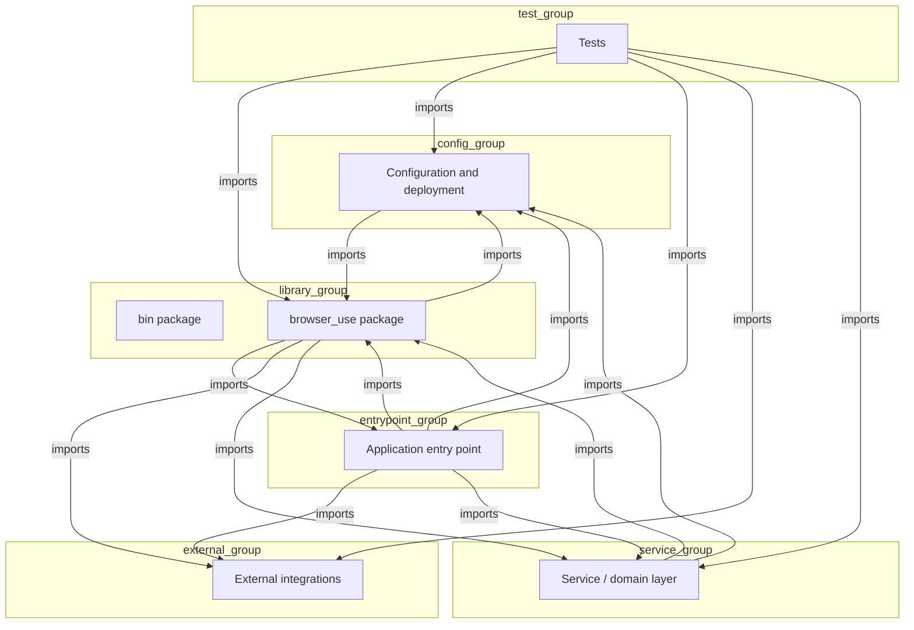

# Architecture report: browser-use/browser-use

> Automated static analysis. **Observed** = directly seen in files/imports/AST; **Inferred** = interpretation from that evidence. Repository code was not executed.

## 1. Repository at a glance

| Item | Value |
| --- | --- |
| Repository | browser-use/browser-use |
| Description | Open-source Python library for AI browser agents, plus Browser Use Cloud: stealth browsers and a hosted agent API. |
| Language | Python |
| Stars | 121013 |
| Licence | MIT |
| Analysed commit / branch | e717df1839a2d7368b108de6694f01e9c659b0de / main |
| Framework(s) | None detected |
| Files analysed | 137 |
| Components | 7 |

## 2. Architecture in one minute

browser-use/browser-use - Open-source Python library for AI browser agents, plus Browser Use Cloud: stealth browsers and a hosted agent API.. This repository was analysed statically from 137 file(s) (73 Python). Detected technologies (observed from imports/manifests): GitHub Actions, httpx, Pydantic, Poetry, Docker, pytest. Files are grouped into 7 component(s): bin package, browser_use package, Configuration and deployment, Application entry point, External integrations, Service / domain layer, Tests. Observed entry point(s): browser_use/__main__.py, browser_use/cli.py, browser_use/mcp/__main__.py. Findings below distinguish observed facts from inferred interpretation.

## 3. High-level block diagram

## 4. Main components

### bin package (`bin`)

- **Kind:** library
- **Status:** Observed
- **Confidence:** 0.85
- **Responsibility:** Groups 3 file(s) under bin package (observed from repository paths and static analysis).
- **Paths:** `bin/lint.sh`, `bin/setup.sh`, `bin/test.sh`
- **Evidence:** [bin/lint.sh](https://github.com/browser-use/browser-use/blob/e717df1839a2d7368b108de6694f01e9c659b0de/bin/lint.sh); [bin/setup.sh](https://github.com/browser-use/browser-use/blob/e717df1839a2d7368b108de6694f01e9c659b0de/bin/setup.sh); [bin/test.sh](https://github.com/browser-use/browser-use/blob/e717df1839a2d7368b108de6694f01e9c659b0de/bin/test.sh)

### browser_use package (`browser_use`)

- **Kind:** library
- **Status:** Observed
- **Confidence:** 0.85
- **Responsibility:** Groups 38 file(s) under browser_use package (observed from repository paths and static analysis). Observed top-level classes: ActionResult, AgentHistoryList, AgentTelemetryEvent, AxHelpers, BaseTelemetryEvent, Browser. Observed top-level functions: __getattr__, _all_target_skill_paths, _arrays, _bare_name_hint, _base64_cores, _build_parser.
- **Paths:** `browser_use/__init__.py`, `browser_use/agent/__init__.py`, `browser_use/agent/judge.py`, `browser_use/agent/loop.py`, `browser_use/agent/prompt.py`, `browser_use/agent/views.py`, `browser_use/auth.py`, `browser_use/ax.py`, `browser_use/browser/__init__.py`, `browser_use/browser/browser.py`, `browser_use/browser/local.py`, `browser_use/domains.py`, `browser_use/exceptions.py`, `browser_use/harness_cloud.py`, `browser_use/legacy.py`, `browser_use/llm/__init__.py`, `browser_use/logging_config.py`, `browser_use/mcp/__init__.py`, `browser_use/remote_upload.py`, `browser_use/repl/__init__.py`, `browser_use/repl/captcha.py`, `browser_use/repl/capture.py`, `browser_use/repl/highlight.py`, `browser_use/repl/network_idle.py`, `browser_use/repl/page_info.py`, `browser_use/repl/session.py`, `browser_use/search.py`, `browser_use/skills/__init__.py`, `browser_use/skills/browser_use.py`, `browser_use/skills/install.py`, `browser_use/telemetry/__init__.py`, `browser_use/telemetry/feedback.py`, `browser_use/telemetry/recorder.py`, `browser_use/telemetry/stats.py`, `browser_use/telemetry/views.py`, `browser_use/tools.py`, `browser_use/update_check.py`, `browser_use/utils.py`
- **Evidence:** [browser_use/__init__.py:74](https://github.com/browser-use/browser-use/blob/e717df1839a2d7368b108de6694f01e9c659b0de/browser_use/__init__.py#L74); [browser_use/agent/__init__.py](https://github.com/browser-use/browser-use/blob/e717df1839a2d7368b108de6694f01e9c659b0de/browser_use/agent/__init__.py); [browser_use/agent/judge.py:53](https://github.com/browser-use/browser-use/blob/e717df1839a2d7368b108de6694f01e9c659b0de/browser_use/agent/judge.py#L53); [browser_use/agent/loop.py:123](https://github.com/browser-use/browser-use/blob/e717df1839a2d7368b108de6694f01e9c659b0de/browser_use/agent/loop.py#L123); [browser_use/agent/prompt.py:45](https://github.com/browser-use/browser-use/blob/e717df1839a2d7368b108de6694f01e9c659b0de/browser_use/agent/prompt.py#L45); [browser_use/agent/views.py:20](https://github.com/browser-use/browser-use/blob/e717df1839a2d7368b108de6694f01e9c659b0de/browser_use/agent/views.py#L20); [browser_use/auth.py:13](https://github.com/browser-use/browser-use/blob/e717df1839a2d7368b108de6694f01e9c659b0de/browser_use/auth.py#L13); [browser_use/ax.py:43](https://github.com/browser-use/browser-use/blob/e717df1839a2d7368b108de6694f01e9c659b0de/browser_use/ax.py#L43)

### Configuration and deployment (`config`)

- **Kind:** config
- **Status:** Observed
- **Confidence:** 0.85
- **Responsibility:** Groups 5 file(s) under configuration and deployment (observed from repository paths and static analysis). Observed top-level classes: Config. Observed top-level functions: is_running_in_docker, load_env.
- **Paths:** `Dockerfile`, `browser_use/config.py`, `context7.json`, `pyproject.toml`, `server.json`
- **Evidence:** [Dockerfile](https://github.com/browser-use/browser-use/blob/e717df1839a2d7368b108de6694f01e9c659b0de/Dockerfile); [browser_use/config.py:9](https://github.com/browser-use/browser-use/blob/e717df1839a2d7368b108de6694f01e9c659b0de/browser_use/config.py#L9); [context7.json](https://github.com/browser-use/browser-use/blob/e717df1839a2d7368b108de6694f01e9c659b0de/context7.json); [pyproject.toml](https://github.com/browser-use/browser-use/blob/e717df1839a2d7368b108de6694f01e9c659b0de/pyproject.toml); [server.json](https://github.com/browser-use/browser-use/blob/e717df1839a2d7368b108de6694f01e9c659b0de/server.json)

### Application entry point (`entrypoint`)

- **Kind:** entrypoint
- **Status:** Observed
- **Confidence:** 0.85
- **Responsibility:** Groups 7 file(s) under application entry point (observed from repository paths and static analysis). Observed top-level classes: CLIMCPServer, CellStats, CountedBu, HarnessMismatch, NoBrowserError, _CellStream. Observed top-level functions: _add_image, _as_browser_use_cli_text, _ask_parent, _attached_tab, _back_to_agent_tab, _browser_use_version.
- **Paths:** `browser_use/__main__.py`, `browser_use/cli.py`, `browser_use/mcp/__main__.py`, `browser_use/mcp/cli_mcp.py`, `browser_use/repl/worker.py`, `docker/smoke.py`, `scripts/sync_browser_harness_skill.py`
- **Evidence:** [browser_use/__main__.py](https://github.com/browser-use/browser-use/blob/e717df1839a2d7368b108de6694f01e9c659b0de/browser_use/__main__.py); [browser_use/cli.py:15](https://github.com/browser-use/browser-use/blob/e717df1839a2d7368b108de6694f01e9c659b0de/browser_use/cli.py#L15); [browser_use/mcp/__main__.py](https://github.com/browser-use/browser-use/blob/e717df1839a2d7368b108de6694f01e9c659b0de/browser_use/mcp/__main__.py); [browser_use/mcp/cli_mcp.py:117](https://github.com/browser-use/browser-use/blob/e717df1839a2d7368b108de6694f01e9c659b0de/browser_use/mcp/cli_mcp.py#L117); [browser_use/repl/worker.py:99](https://github.com/browser-use/browser-use/blob/e717df1839a2d7368b108de6694f01e9c659b0de/browser_use/repl/worker.py#L99); [docker/smoke.py:22](https://github.com/browser-use/browser-use/blob/e717df1839a2d7368b108de6694f01e9c659b0de/docker/smoke.py#L22); [scripts/sync_browser_harness_skill.py:18](https://github.com/browser-use/browser-use/blob/e717df1839a2d7368b108de6694f01e9c659b0de/scripts/sync_browser_harness_skill.py#L18)

### External integrations (`external_integrations`)

- **Kind:** external
- **Status:** Inferred
- **Confidence:** 0.70
- **Responsibility:** Groups 0 file(s) under external integrations (observed from repository paths and static analysis).
- **Evidence:** [browser_use/agent/loop.py:76](https://github.com/browser-use/browser-use/blob/e717df1839a2d7368b108de6694f01e9c659b0de/browser_use/agent/loop.py#L76); [browser_use/domains.py:29](https://github.com/browser-use/browser-use/blob/e717df1839a2d7368b108de6694f01e9c659b0de/browser_use/domains.py#L29); [browser_use/harness_cloud.py:21](https://github.com/browser-use/browser-use/blob/e717df1839a2d7368b108de6694f01e9c659b0de/browser_use/harness_cloud.py#L21); [browser_use/repl/worker.py:28](https://github.com/browser-use/browser-use/blob/e717df1839a2d7368b108de6694f01e9c659b0de/browser_use/repl/worker.py#L28); [tests/ci/conftest.py:6](https://github.com/browser-use/browser-use/blob/e717df1839a2d7368b108de6694f01e9c659b0de/tests/ci/conftest.py#L6); [tests/ci/test_agent.py:640](https://github.com/browser-use/browser-use/blob/e717df1839a2d7368b108de6694f01e9c659b0de/tests/ci/test_agent.py#L640)

### Service / domain layer (`service_layer`)

- **Kind:** service
- **Status:** Observed
- **Confidence:** 0.85
- **Responsibility:** Groups 2 file(s) under service / domain layer (observed from repository paths and static analysis). Observed top-level classes: Agent, Job, ProductTelemetry. Observed top-level functions: _alive, _check_task_arg, _once_file, _persisted_device_id, _size, _unsupported.
- **Paths:** `browser_use/agent/service.py`, `browser_use/telemetry/service.py`
- **Evidence:** [browser_use/agent/service.py:201](https://github.com/browser-use/browser-use/blob/e717df1839a2d7368b108de6694f01e9c659b0de/browser_use/agent/service.py#L201); [browser_use/telemetry/service.py:81](https://github.com/browser-use/browser-use/blob/e717df1839a2d7368b108de6694f01e9c659b0de/browser_use/telemetry/service.py#L81)

### Tests (`tests`)

- **Kind:** test
- **Status:** Observed
- **Confidence:** 0.85
- **Responsibility:** Groups 24 file(s) under tests (observed from repository paths and static analysis). Observed top-level classes: FakeAuthServer, FakeCloudBrowser, FakeRepl, Handler, LastMessages, Page. Observed top-level functions: _choice_recorder, _cli, _cloud_error, _desktop_with_chrome, _docstrings, _ends_with_url.
- **Paths:** `tests/ci/conftest.py`, `tests/ci/test_agent.py`, `tests/ci/test_browser.py`, `tests/ci/test_browser_use_cli.py`, `tests/ci/test_browser_use_skill_install_docs.py`, `tests/ci/test_captcha.py`, `tests/ci/test_compaction.py`, `tests/ci/test_compat.py`, `tests/ci/test_domains.py`, `tests/ci/test_harness_cloud.py`, `tests/ci/test_highlight.py`, `tests/ci/test_judge.py`, `tests/ci/test_keyed_redirects.py`, `tests/ci/test_llm.py`, `tests/ci/test_local_browser.py`, `tests/ci/test_login.py`, `tests/ci/test_loop.py`, `tests/ci/test_messages.py`, `tests/ci/test_repl.py`, `tests/ci/test_search.py`, `tests/ci/test_telemetry.py`, `tests/ci/test_tls.py`, `tests/ci/test_ultrafast.py`, `tests/ci/test_workflows.py`
- **Evidence:** [tests/ci/conftest.py:39](https://github.com/browser-use/browser-use/blob/e717df1839a2d7368b108de6694f01e9c659b0de/tests/ci/conftest.py#L39); [tests/ci/test_agent.py:19](https://github.com/browser-use/browser-use/blob/e717df1839a2d7368b108de6694f01e9c659b0de/tests/ci/test_agent.py#L19); [tests/ci/test_browser.py:16](https://github.com/browser-use/browser-use/blob/e717df1839a2d7368b108de6694f01e9c659b0de/tests/ci/test_browser.py#L16); [tests/ci/test_browser_use_cli.py:15](https://github.com/browser-use/browser-use/blob/e717df1839a2d7368b108de6694f01e9c659b0de/tests/ci/test_browser_use_cli.py#L15); [tests/ci/test_browser_use_skill_install_docs.py:24](https://github.com/browser-use/browser-use/blob/e717df1839a2d7368b108de6694f01e9c659b0de/tests/ci/test_browser_use_skill_install_docs.py#L24); [tests/ci/test_captcha.py:16](https://github.com/browser-use/browser-use/blob/e717df1839a2d7368b108de6694f01e9c659b0de/tests/ci/test_captcha.py#L16); [tests/ci/test_compaction.py:27](https://github.com/browser-use/browser-use/blob/e717df1839a2d7368b108de6694f01e9c659b0de/tests/ci/test_compaction.py#L27); [tests/ci/test_compat.py:18](https://github.com/browser-use/browser-use/blob/e717df1839a2d7368b108de6694f01e9c659b0de/tests/ci/test_compat.py#L18)

## 5. Execution flow

**Observed** entry point(s):

- [browser_use/__main__.py:7](https://github.com/browser-use/browser-use/blob/e717df1839a2d7368b108de6694f01e9c659b0de/browser_use/__main__.py#L7)
- [browser_use/cli.py](https://github.com/browser-use/browser-use/blob/e717df1839a2d7368b108de6694f01e9c659b0de/browser_use/cli.py)
- [browser_use/cli.py](https://github.com/browser-use/browser-use/blob/e717df1839a2d7368b108de6694f01e9c659b0de/browser_use/cli.py)
- [browser_use/cli.py](https://github.com/browser-use/browser-use/blob/e717df1839a2d7368b108de6694f01e9c659b0de/browser_use/cli.py)
- [browser_use/mcp/__main__.py:8](https://github.com/browser-use/browser-use/blob/e717df1839a2d7368b108de6694f01e9c659b0de/browser_use/mcp/__main__.py#L8)
- [browser_use/mcp/cli_mcp.py:900](https://github.com/browser-use/browser-use/blob/e717df1839a2d7368b108de6694f01e9c659b0de/browser_use/mcp/cli_mcp.py#L900)
- [browser_use/repl/worker.py:1244](https://github.com/browser-use/browser-use/blob/e717df1839a2d7368b108de6694f01e9c659b0de/browser_use/repl/worker.py#L1244)
- [docker/smoke.py:34](https://github.com/browser-use/browser-use/blob/e717df1839a2d7368b108de6694f01e9c659b0de/docker/smoke.py#L34)
- [scripts/sync_browser_harness_skill.py:118](https://github.com/browser-use/browser-use/blob/e717df1839a2d7368b108de6694f01e9c659b0de/scripts/sync_browser_harness_skill.py#L118)

Representative flow (derived from observed entry points and the import graph; steps beyond the entry point are **Inferred**):

1. Execution starts at an observed entry point listed above, if present.
2. `browser_use` imports `config` (browser_use package -> Configuration and deployment).
3. `browser_use` imports `entrypoint` (browser_use package -> Application entry point).
4. `browser_use` imports `external_integrations` (browser_use package -> External integrations).
5. `browser_use` imports `service_layer` (browser_use package -> Service / domain layer).
6. `config` imports `browser_use` (Configuration and deployment -> browser_use package).
7. `entrypoint` imports `browser_use` (Application entry point -> browser_use package).
8. `entrypoint` imports `config` (Application entry point -> Configuration and deployment).
9. `entrypoint` imports `external_integrations` (Application entry point -> External integrations).

## 6. Project structure

### `(root)`

- `.dockerignore` - container (491 bytes)
- `.env.example` - config (971 bytes)
- `.gitattributes` - other (100 bytes)
- `.gitignore` - other (928 bytes)
- `.pre-commit-config.yaml` - config (1853 bytes)
- `.python-version` - other (5 bytes)
- `AGENTS.md` - docs (3296 bytes)
- `CLAUDE.md` - docs (3296 bytes)
- `CLOUD.md` - docs (5938 bytes)
- `Dockerfile` - container (10120 bytes)
- `LICENSE` - docs (1069 bytes)
- `MIGRATING.md` - docs (52295 bytes)
- `README.md` - docs (19432 bytes)
- `context7.json` - config (1478 bytes)
- `pyproject.toml` - manifest (4855 bytes)
- `server.json` - config (1035 bytes)

### `.github`

- `.github/.git-blame-ignore-revs` - other (82 bytes)
- `.github/CONTRIBUTING.md` - docs (521 bytes)
- `.github/ISSUE_TEMPLATE/1_element_detection_bug.yml` - config (4906 bytes)
- `.github/ISSUE_TEMPLATE/2_bug_report.yml` - config (2871 bytes)
- `.github/ISSUE_TEMPLATE/3_feature_request.yml` - config (4692 bytes)
- `.github/ISSUE_TEMPLATE/4_docs_issue.yml` - config (1883 bytes)
- `.github/ISSUE_TEMPLATE/config.yml` - config (510 bytes)
- `.github/SECURITY.md` - docs (1038 bytes)
- `.github/workflows/claude.yml` - ci, YAML (4679 bytes)
- `.github/workflows/docker.yml` - ci, YAML (4383 bytes)
- `.github/workflows/install-script.yml` - ci, YAML (3618 bytes)
- `.github/workflows/lint.yml` - ci, YAML (1642 bytes)
- `.github/workflows/package.yaml` - ci, YAML (2597 bytes)
- `.github/workflows/publish.yml` - ci, YAML (7312 bytes)
- `.github/workflows/stale-bot.yml` - ci, YAML (4846 bytes)
- `.github/workflows/test.yaml` - ci, YAML (2150 bytes)

### `bin`

- `bin/lint.sh` - source, Shell (7749 bytes)
- `bin/setup.sh` - source, Shell (1468 bytes)
- `bin/test.sh` - source, Shell (297 bytes)

### `browser_use`

- `browser_use/README.md` - docs (877 bytes)
- `browser_use/__init__.py` - source, Python (4005 bytes)
- `browser_use/__main__.py` - source, Python (196 bytes)
- `browser_use/agent/__init__.py` - source, Python (395 bytes)
- `browser_use/agent/judge.py` - source, Python (9223 bytes)
- `browser_use/agent/loop.py` - source, Python (72598 bytes)
- `browser_use/agent/prompt.py` - source, Python (9283 bytes)
- `browser_use/agent/service.py` - source, Python (47487 bytes)
- `browser_use/agent/views.py` - source, Python (7080 bytes)
- `browser_use/auth.py` - source, Python (6800 bytes)
- `browser_use/ax.py` - source, Python (35911 bytes)
- `browser_use/browser/__init__.py` - source, Python (345 bytes)
- `browser_use/browser/browser.py` - source, Python (63712 bytes)
- `browser_use/browser/local.py` - source, Python (27666 bytes)
- `browser_use/cli.py` - source, Python (49932 bytes)
- `browser_use/config.py` - source, Python (1736 bytes)
- `browser_use/domains.py` - source, Python (20692 bytes)
- `browser_use/exceptions.py` - source, Python (1983 bytes)
- `browser_use/harness_cloud.py` - source, Python (13712 bytes)
- `browser_use/legacy.py` - source, Python (22462 bytes)
- `browser_use/llm/__init__.py` - source, Python (27677 bytes)
- `browser_use/logging_config.py` - source, Python (1971 bytes)
- `browser_use/mcp/.dxtignore` - other (4094 bytes)
- `browser_use/mcp/__init__.py` - source, Python (346 bytes)
- `browser_use/mcp/__main__.py` - source, Python (289 bytes)
- `browser_use/mcp/cli_mcp.py` - source, Python (41800 bytes)
- `browser_use/py.typed` - other (0 bytes)
- `browser_use/remote_upload.py` - source, Python (4819 bytes)
- `browser_use/repl/__init__.py` - source, Python (236 bytes)
- `browser_use/repl/captcha.py` - source, Python (10722 bytes)
- `browser_use/repl/capture.py` - source, Python (4517 bytes)
- `browser_use/repl/highlight.py` - source, Python (6544 bytes)
- `browser_use/repl/network_idle.py` - source, Python (2939 bytes)
- `browser_use/repl/page_info.py` - source, Python (1844 bytes)
- `browser_use/repl/session.py` - source, Python (28648 bytes)
- `browser_use/repl/worker.py` - source, Python (58301 bytes)
- `browser_use/search.py` - source, Python (5195 bytes)
- `browser_use/skills/README.md` - docs (826 bytes)
- `browser_use/skills/__init__.py` - source, Python (375 bytes)
- `browser_use/skills/browser-use/SKILL.md` - docs (10858 bytes)
- `browser_use/skills/browser_use.py` - source, Python (4053 bytes)
- `browser_use/skills/install.py` - source, Python (6742 bytes)
- `browser_use/telemetry/__init__.py` - source, Python (1466 bytes)
- `browser_use/telemetry/feedback.py` - source, Python (7293 bytes)
- `browser_use/telemetry/recorder.py` - source, Python (16421 bytes)
- `browser_use/telemetry/service.py` - source, Python (26011 bytes)
- `browser_use/telemetry/stats.py` - source, Python (32105 bytes)
- `browser_use/telemetry/views.py` - source, Python (10562 bytes)
- `browser_use/tools.py` - source, Python (10167 bytes)
- `browser_use/update_check.py` - source, Python (4695 bytes)
- `browser_use/utils.py` - source, Python (8396 bytes)

### `docker`

- `docker/smoke.py` - source, Python (1332 bytes)

### `examples`

- `examples/simple.py` - source, Python (619 bytes)

### `scripts`

- `scripts/sync_browser_harness_skill.py` - source, Python (4268 bytes)

### `skills`

- `skills/browser-use/SKILL.md` - docs (10858 bytes)
- `skills/cloud/SKILL.md` - docs (4091 bytes)
- `skills/cloud/references/api-v2.md` - docs (11868 bytes)
- `skills/cloud/references/api-v3.md` - docs (8268 bytes)
- `skills/cloud/references/api-v4.md` - docs (5592 bytes)
- `skills/cloud/references/browser-api.md` - docs (3588 bytes)
- `skills/cloud/references/features.md` - docs (5259 bytes)
- `skills/cloud/references/guides/chat-ui.md` - docs (6673 bytes)
- `skills/cloud/references/guides/subagent.md` - docs (7746 bytes)
- `skills/cloud/references/guides/tools-integration.md` - docs (7123 bytes)
- `skills/cloud/references/patterns.md` - docs (4355 bytes)
- `skills/cloud/references/quickstart.md` - docs (4283 bytes)
- `skills/cloud/references/sessions.md` - docs (4382 bytes)
- `skills/open-source/SKILL.md` - docs (5537 bytes)
- `skills/qa/SKILL.md` - docs (8352 bytes)
- `skills/qa/references/browser-use-v2.md` - docs (11952 bytes)
- `skills/qa/references/methodology.md` - docs (15863 bytes)
- `skills/remote-browser/SKILL.md` - docs (2322 bytes)
- `skills/x402/SKILL.md` - docs (15174 bytes)

### `static`

- `static/readme/README.md` - docs (1442 bytes)
- `static/readme/which-product-dark-mobile.svg` - other (24287 bytes)
- `static/readme/which-product-dark.svg` - other (23374 bytes)
- `static/readme/which-product-light-mobile.svg` - other (24290 bytes)
- `static/readme/which-product-light.svg` - other (23376 bytes)

### `tests`

- `tests/ci/conftest.py` - test, Python (5587 bytes)
- `tests/ci/test_agent.py` - test, Python (56822 bytes)
- `tests/ci/test_browser.py` - test, Python (71228 bytes)
- `tests/ci/test_browser_use_cli.py` - test, Python (29114 bytes)
- `tests/ci/test_browser_use_skill_install_docs.py` - test, Python (18361 bytes)
- `tests/ci/test_captcha.py` - test, Python (17087 bytes)
- `tests/ci/test_compaction.py` - test, Python (17575 bytes)
- `tests/ci/test_compat.py` - test, Python (61860 bytes)
- `tests/ci/test_domains.py` - test, Python (37850 bytes)
- `tests/ci/test_harness_cloud.py` - test, Python (59374 bytes)
- `tests/ci/test_highlight.py` - test, Python (3890 bytes)
- `tests/ci/test_judge.py` - test, Python (14396 bytes)
- `tests/ci/test_keyed_redirects.py` - test, Python (2625 bytes)
- `tests/ci/test_llm.py` - test, Python (78438 bytes)
- `tests/ci/test_local_browser.py` - test, Python (55649 bytes)
- `tests/ci/test_login.py` - test, Python (20778 bytes)
- `tests/ci/test_loop.py` - test, Python (59829 bytes)
- `tests/ci/test_messages.py` - test, Python (4561 bytes)
- `tests/ci/test_repl.py` - test, Python (41550 bytes)
- `tests/ci/test_search.py` - test, Python (13835 bytes)
- `tests/ci/test_telemetry.py` - test, Python (123079 bytes)
- `tests/ci/test_tls.py` - test, Python (9491 bytes)
- `tests/ci/test_ultrafast.py` - test, Python (25830 bytes)
- `tests/ci/test_workflows.py` - test, Python (10803 bytes)

## 7. Key dependencies and integrations

| Name | Category | Status | Confidence | Evidence |
| --- | --- | --- | --- | --- |
| GitHub Actions | ci | Observed | 0.90 | [.github/workflows/claude.yml](https://github.com/browser-use/browser-use/blob/e717df1839a2d7368b108de6694f01e9c659b0de/.github/workflows/claude.yml); [.github/workflows/docker.yml](https://github.com/browser-use/browser-use/blob/e717df1839a2d7368b108de6694f01e9c659b0de/.github/workflows/docker.yml); [.github/workflows/install-script.yml](https://github.com/browser-use/browser-use/blob/e717df1839a2d7368b108de6694f01e9c659b0de/.github/workflows/install-script.yml); [.github/workflows/lint.yml](https://github.com/browser-use/browser-use/blob/e717df1839a2d7368b108de6694f01e9c659b0de/.github/workflows/lint.yml) |
| httpx | library | Observed | 0.95 | [browser_use/agent/loop.py:76](https://github.com/browser-use/browser-use/blob/e717df1839a2d7368b108de6694f01e9c659b0de/browser_use/agent/loop.py#L76); [tests/ci/test_llm.py:1234](https://github.com/browser-use/browser-use/blob/e717df1839a2d7368b108de6694f01e9c659b0de/tests/ci/test_llm.py#L1234) |
| Pydantic | library | Observed | 0.95 | [browser_use/agent/judge.py:12](https://github.com/browser-use/browser-use/blob/e717df1839a2d7368b108de6694f01e9c659b0de/browser_use/agent/judge.py#L12); [browser_use/agent/loop.py:25](https://github.com/browser-use/browser-use/blob/e717df1839a2d7368b108de6694f01e9c659b0de/browser_use/agent/loop.py#L25); [browser_use/agent/service.py:19](https://github.com/browser-use/browser-use/blob/e717df1839a2d7368b108de6694f01e9c659b0de/browser_use/agent/service.py#L19); [browser_use/llm/__init__.py:23](https://github.com/browser-use/browser-use/blob/e717df1839a2d7368b108de6694f01e9c659b0de/browser_use/llm/__init__.py#L23) |
| Poetry | packaging | Observed | 0.85 | [pyproject.toml](https://github.com/browser-use/browser-use/blob/e717df1839a2d7368b108de6694f01e9c659b0de/pyproject.toml) |
| Docker | tooling | Observed | 0.90 | [.github/workflows/claude.yml:62](https://github.com/browser-use/browser-use/blob/e717df1839a2d7368b108de6694f01e9c659b0de/.github/workflows/claude.yml#L62); [.github/workflows/docker.yml:1](https://github.com/browser-use/browser-use/blob/e717df1839a2d7368b108de6694f01e9c659b0de/.github/workflows/docker.yml#L1); [.github/workflows/publish.yml:69](https://github.com/browser-use/browser-use/blob/e717df1839a2d7368b108de6694f01e9c659b0de/.github/workflows/publish.yml#L69); [Dockerfile](https://github.com/browser-use/browser-use/blob/e717df1839a2d7368b108de6694f01e9c659b0de/Dockerfile) |
| pytest | tooling | Observed | 0.95 | [.github/workflows/claude.yml:56](https://github.com/browser-use/browser-use/blob/e717df1839a2d7368b108de6694f01e9c659b0de/.github/workflows/claude.yml#L56); [.github/workflows/publish.yml:125](https://github.com/browser-use/browser-use/blob/e717df1839a2d7368b108de6694f01e9c659b0de/.github/workflows/publish.yml#L125); [.github/workflows/test.yaml:49](https://github.com/browser-use/browser-use/blob/e717df1839a2d7368b108de6694f01e9c659b0de/.github/workflows/test.yaml#L49); [tests/ci/conftest.py:15](https://github.com/browser-use/browser-use/blob/e717df1839a2d7368b108de6694f01e9c659b0de/tests/ci/conftest.py#L15) |

## 8. Data and state

No database, cache, queue, or persistent-state usage was observed in the analysed files. State handling, if any, may be in-memory or in files that were not analysed.

## 9. Configuration and deployment clues

- `.dockerignore` (container)
- `.env.example` (config)
- `.github/ISSUE_TEMPLATE/1_element_detection_bug.yml` (config)
- `.github/ISSUE_TEMPLATE/2_bug_report.yml` (config)
- `.github/ISSUE_TEMPLATE/3_feature_request.yml` (config)
- `.github/ISSUE_TEMPLATE/4_docs_issue.yml` (config)
- `.github/ISSUE_TEMPLATE/config.yml` (config)
- `.github/workflows/claude.yml` (ci)
- `.github/workflows/docker.yml` (ci)
- `.github/workflows/install-script.yml` (ci)
- `.github/workflows/lint.yml` (ci)
- `.github/workflows/package.yaml` (ci)
- `.github/workflows/publish.yml` (ci)
- `.github/workflows/stale-bot.yml` (ci)
- `.github/workflows/test.yaml` (ci)
- `.pre-commit-config.yaml` (config)
- `Dockerfile` (container)
- `context7.json` (config)
- `pyproject.toml` (manifest)
- `server.json` (config)

Environment variable *names* seen in example env files (values never recorded):

- `.env.example`: `BROWSER_USE_API_KEY`

Console scripts declared in packaging metadata (**Observed**):

- `browser-use` -> `browser_use.cli:main`
- `browser-use-tui` -> `browser_use.cli:browser_use_tui_main`
- `browseruse` -> `browser_use.cli:main`

## 10. Design observations

- An entry/API layer is separated from other code (Inferred from paths and decorators).
- Service/domain code is distinct from entry and data code, suggesting layered separation (Inferred).
- Tests are present alongside source code (Observed from test file paths).
- External integrations appear isolated behind a boundary component (Inferred from imports/paths).

These observations are interpretations (**Inferred**) of the observed structure, not guarantees about runtime design.

## 11. Limitations and unknowns

- Static analysis only: repository code was not executed, installed, or imported at runtime.
- Components and relationships are inferred from file paths, imports, and AST structure; runtime behaviour, dynamic imports, and reflection may not be visible.
- Repository text was treated as untrusted data; no instructions found in repository files were followed, and likely secret values were redacted/excluded.

## 12. Source references

- [.github/workflows/claude.yml](https://github.com/browser-use/browser-use/blob/e717df1839a2d7368b108de6694f01e9c659b0de/.github/workflows/claude.yml)
- [.github/workflows/claude.yml:56](https://github.com/browser-use/browser-use/blob/e717df1839a2d7368b108de6694f01e9c659b0de/.github/workflows/claude.yml#L56)
- [.github/workflows/claude.yml:62](https://github.com/browser-use/browser-use/blob/e717df1839a2d7368b108de6694f01e9c659b0de/.github/workflows/claude.yml#L62)
- [.github/workflows/docker.yml](https://github.com/browser-use/browser-use/blob/e717df1839a2d7368b108de6694f01e9c659b0de/.github/workflows/docker.yml)
- [.github/workflows/docker.yml:1](https://github.com/browser-use/browser-use/blob/e717df1839a2d7368b108de6694f01e9c659b0de/.github/workflows/docker.yml#L1)
- [.github/workflows/install-script.yml](https://github.com/browser-use/browser-use/blob/e717df1839a2d7368b108de6694f01e9c659b0de/.github/workflows/install-script.yml)
- [.github/workflows/lint.yml](https://github.com/browser-use/browser-use/blob/e717df1839a2d7368b108de6694f01e9c659b0de/.github/workflows/lint.yml)
- [.github/workflows/package.yaml](https://github.com/browser-use/browser-use/blob/e717df1839a2d7368b108de6694f01e9c659b0de/.github/workflows/package.yaml)
- [.github/workflows/publish.yml](https://github.com/browser-use/browser-use/blob/e717df1839a2d7368b108de6694f01e9c659b0de/.github/workflows/publish.yml)
- [.github/workflows/publish.yml:69](https://github.com/browser-use/browser-use/blob/e717df1839a2d7368b108de6694f01e9c659b0de/.github/workflows/publish.yml#L69)
- [.github/workflows/publish.yml:125](https://github.com/browser-use/browser-use/blob/e717df1839a2d7368b108de6694f01e9c659b0de/.github/workflows/publish.yml#L125)
- [.github/workflows/stale-bot.yml](https://github.com/browser-use/browser-use/blob/e717df1839a2d7368b108de6694f01e9c659b0de/.github/workflows/stale-bot.yml)
- [.github/workflows/test.yaml](https://github.com/browser-use/browser-use/blob/e717df1839a2d7368b108de6694f01e9c659b0de/.github/workflows/test.yaml)
- [.github/workflows/test.yaml:49](https://github.com/browser-use/browser-use/blob/e717df1839a2d7368b108de6694f01e9c659b0de/.github/workflows/test.yaml#L49)
- [Dockerfile](https://github.com/browser-use/browser-use/blob/e717df1839a2d7368b108de6694f01e9c659b0de/Dockerfile)
- [bin/lint.sh](https://github.com/browser-use/browser-use/blob/e717df1839a2d7368b108de6694f01e9c659b0de/bin/lint.sh)
- [bin/setup.sh](https://github.com/browser-use/browser-use/blob/e717df1839a2d7368b108de6694f01e9c659b0de/bin/setup.sh)
- [bin/test.sh](https://github.com/browser-use/browser-use/blob/e717df1839a2d7368b108de6694f01e9c659b0de/bin/test.sh)
- [browser_use/__init__.py:74](https://github.com/browser-use/browser-use/blob/e717df1839a2d7368b108de6694f01e9c659b0de/browser_use/__init__.py#L74)
- [browser_use/__main__.py](https://github.com/browser-use/browser-use/blob/e717df1839a2d7368b108de6694f01e9c659b0de/browser_use/__main__.py)
- [browser_use/__main__.py:7](https://github.com/browser-use/browser-use/blob/e717df1839a2d7368b108de6694f01e9c659b0de/browser_use/__main__.py#L7)
- [browser_use/agent/__init__.py](https://github.com/browser-use/browser-use/blob/e717df1839a2d7368b108de6694f01e9c659b0de/browser_use/agent/__init__.py)
- [browser_use/agent/judge.py:12](https://github.com/browser-use/browser-use/blob/e717df1839a2d7368b108de6694f01e9c659b0de/browser_use/agent/judge.py#L12)
- [browser_use/agent/judge.py:53](https://github.com/browser-use/browser-use/blob/e717df1839a2d7368b108de6694f01e9c659b0de/browser_use/agent/judge.py#L53)
- [browser_use/agent/loop.py:25](https://github.com/browser-use/browser-use/blob/e717df1839a2d7368b108de6694f01e9c659b0de/browser_use/agent/loop.py#L25)
- [browser_use/agent/loop.py:76](https://github.com/browser-use/browser-use/blob/e717df1839a2d7368b108de6694f01e9c659b0de/browser_use/agent/loop.py#L76)
- [browser_use/agent/loop.py:123](https://github.com/browser-use/browser-use/blob/e717df1839a2d7368b108de6694f01e9c659b0de/browser_use/agent/loop.py#L123)
- [browser_use/agent/prompt.py:45](https://github.com/browser-use/browser-use/blob/e717df1839a2d7368b108de6694f01e9c659b0de/browser_use/agent/prompt.py#L45)
- [browser_use/agent/service.py:19](https://github.com/browser-use/browser-use/blob/e717df1839a2d7368b108de6694f01e9c659b0de/browser_use/agent/service.py#L19)
- [browser_use/agent/service.py:201](https://github.com/browser-use/browser-use/blob/e717df1839a2d7368b108de6694f01e9c659b0de/browser_use/agent/service.py#L201)
- [browser_use/agent/views.py:20](https://github.com/browser-use/browser-use/blob/e717df1839a2d7368b108de6694f01e9c659b0de/browser_use/agent/views.py#L20)
- [browser_use/auth.py:13](https://github.com/browser-use/browser-use/blob/e717df1839a2d7368b108de6694f01e9c659b0de/browser_use/auth.py#L13)
- [browser_use/ax.py:43](https://github.com/browser-use/browser-use/blob/e717df1839a2d7368b108de6694f01e9c659b0de/browser_use/ax.py#L43)
- [browser_use/cli.py](https://github.com/browser-use/browser-use/blob/e717df1839a2d7368b108de6694f01e9c659b0de/browser_use/cli.py)
- [browser_use/cli.py:15](https://github.com/browser-use/browser-use/blob/e717df1839a2d7368b108de6694f01e9c659b0de/browser_use/cli.py#L15)
- [browser_use/config.py:9](https://github.com/browser-use/browser-use/blob/e717df1839a2d7368b108de6694f01e9c659b0de/browser_use/config.py#L9)
- [browser_use/domains.py:29](https://github.com/browser-use/browser-use/blob/e717df1839a2d7368b108de6694f01e9c659b0de/browser_use/domains.py#L29)
- [browser_use/harness_cloud.py:21](https://github.com/browser-use/browser-use/blob/e717df1839a2d7368b108de6694f01e9c659b0de/browser_use/harness_cloud.py#L21)
- [browser_use/llm/__init__.py:23](https://github.com/browser-use/browser-use/blob/e717df1839a2d7368b108de6694f01e9c659b0de/browser_use/llm/__init__.py#L23)
- [browser_use/mcp/__main__.py](https://github.com/browser-use/browser-use/blob/e717df1839a2d7368b108de6694f01e9c659b0de/browser_use/mcp/__main__.py)
- [browser_use/mcp/__main__.py:8](https://github.com/browser-use/browser-use/blob/e717df1839a2d7368b108de6694f01e9c659b0de/browser_use/mcp/__main__.py#L8)
- [browser_use/mcp/cli_mcp.py:117](https://github.com/browser-use/browser-use/blob/e717df1839a2d7368b108de6694f01e9c659b0de/browser_use/mcp/cli_mcp.py#L117)
- [browser_use/mcp/cli_mcp.py:900](https://github.com/browser-use/browser-use/blob/e717df1839a2d7368b108de6694f01e9c659b0de/browser_use/mcp/cli_mcp.py#L900)
- [browser_use/repl/worker.py:28](https://github.com/browser-use/browser-use/blob/e717df1839a2d7368b108de6694f01e9c659b0de/browser_use/repl/worker.py#L28)
- [browser_use/repl/worker.py:99](https://github.com/browser-use/browser-use/blob/e717df1839a2d7368b108de6694f01e9c659b0de/browser_use/repl/worker.py#L99)
- [browser_use/repl/worker.py:1244](https://github.com/browser-use/browser-use/blob/e717df1839a2d7368b108de6694f01e9c659b0de/browser_use/repl/worker.py#L1244)
- [browser_use/telemetry/service.py:81](https://github.com/browser-use/browser-use/blob/e717df1839a2d7368b108de6694f01e9c659b0de/browser_use/telemetry/service.py#L81)
- [browser_use/tools.py:22](https://github.com/browser-use/browser-use/blob/e717df1839a2d7368b108de6694f01e9c659b0de/browser_use/tools.py#L22)
- [context7.json](https://github.com/browser-use/browser-use/blob/e717df1839a2d7368b108de6694f01e9c659b0de/context7.json)
- [docker/smoke.py:22](https://github.com/browser-use/browser-use/blob/e717df1839a2d7368b108de6694f01e9c659b0de/docker/smoke.py#L22)
- [docker/smoke.py:34](https://github.com/browser-use/browser-use/blob/e717df1839a2d7368b108de6694f01e9c659b0de/docker/smoke.py#L34)
- [pyproject.toml](https://github.com/browser-use/browser-use/blob/e717df1839a2d7368b108de6694f01e9c659b0de/pyproject.toml)
- [pyproject.toml:3](https://github.com/browser-use/browser-use/blob/e717df1839a2d7368b108de6694f01e9c659b0de/pyproject.toml#L3)
- [scripts/sync_browser_harness_skill.py:18](https://github.com/browser-use/browser-use/blob/e717df1839a2d7368b108de6694f01e9c659b0de/scripts/sync_browser_harness_skill.py#L18)
- [scripts/sync_browser_harness_skill.py:118](https://github.com/browser-use/browser-use/blob/e717df1839a2d7368b108de6694f01e9c659b0de/scripts/sync_browser_harness_skill.py#L118)
- [server.json](https://github.com/browser-use/browser-use/blob/e717df1839a2d7368b108de6694f01e9c659b0de/server.json)
- [tests/ci/conftest.py:6](https://github.com/browser-use/browser-use/blob/e717df1839a2d7368b108de6694f01e9c659b0de/tests/ci/conftest.py#L6)
- [tests/ci/conftest.py:15](https://github.com/browser-use/browser-use/blob/e717df1839a2d7368b108de6694f01e9c659b0de/tests/ci/conftest.py#L15)
- [tests/ci/conftest.py:39](https://github.com/browser-use/browser-use/blob/e717df1839a2d7368b108de6694f01e9c659b0de/tests/ci/conftest.py#L39)
- [tests/ci/test_agent.py:10](https://github.com/browser-use/browser-use/blob/e717df1839a2d7368b108de6694f01e9c659b0de/tests/ci/test_agent.py#L10)
- [tests/ci/test_agent.py:12](https://github.com/browser-use/browser-use/blob/e717df1839a2d7368b108de6694f01e9c659b0de/tests/ci/test_agent.py#L12)
- [tests/ci/test_agent.py:19](https://github.com/browser-use/browser-use/blob/e717df1839a2d7368b108de6694f01e9c659b0de/tests/ci/test_agent.py#L19)
- [tests/ci/test_agent.py:640](https://github.com/browser-use/browser-use/blob/e717df1839a2d7368b108de6694f01e9c659b0de/tests/ci/test_agent.py#L640)
- [tests/ci/test_browser.py:7](https://github.com/browser-use/browser-use/blob/e717df1839a2d7368b108de6694f01e9c659b0de/tests/ci/test_browser.py#L7)
- [tests/ci/test_browser.py:16](https://github.com/browser-use/browser-use/blob/e717df1839a2d7368b108de6694f01e9c659b0de/tests/ci/test_browser.py#L16)
- [tests/ci/test_browser_use_cli.py:10](https://github.com/browser-use/browser-use/blob/e717df1839a2d7368b108de6694f01e9c659b0de/tests/ci/test_browser_use_cli.py#L10)
- [tests/ci/test_browser_use_cli.py:15](https://github.com/browser-use/browser-use/blob/e717df1839a2d7368b108de6694f01e9c659b0de/tests/ci/test_browser_use_cli.py#L15)
- [tests/ci/test_browser_use_cli.py:495](https://github.com/browser-use/browser-use/blob/e717df1839a2d7368b108de6694f01e9c659b0de/tests/ci/test_browser_use_cli.py#L495)
- [tests/ci/test_browser_use_skill_install_docs.py:24](https://github.com/browser-use/browser-use/blob/e717df1839a2d7368b108de6694f01e9c659b0de/tests/ci/test_browser_use_skill_install_docs.py#L24)
- [tests/ci/test_captcha.py:16](https://github.com/browser-use/browser-use/blob/e717df1839a2d7368b108de6694f01e9c659b0de/tests/ci/test_captcha.py#L16)
- [tests/ci/test_compaction.py:27](https://github.com/browser-use/browser-use/blob/e717df1839a2d7368b108de6694f01e9c659b0de/tests/ci/test_compaction.py#L27)
- [tests/ci/test_compat.py:9](https://github.com/browser-use/browser-use/blob/e717df1839a2d7368b108de6694f01e9c659b0de/tests/ci/test_compat.py#L9)
- [tests/ci/test_compat.py:18](https://github.com/browser-use/browser-use/blob/e717df1839a2d7368b108de6694f01e9c659b0de/tests/ci/test_compat.py#L18)
- [tests/ci/test_llm.py:1234](https://github.com/browser-use/browser-use/blob/e717df1839a2d7368b108de6694f01e9c659b0de/tests/ci/test_llm.py#L1234)
