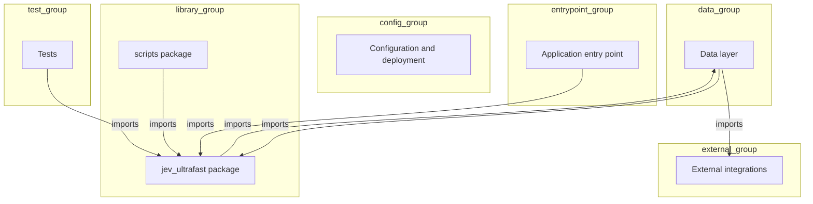

# Architecture report: browser-use/jev-ultrafast

> Automated static analysis. **Observed** = directly seen in files/imports/AST; **Inferred** = interpretation from that evidence. Repository code was not executed.

## 1. Repository at a glance

| Item | Value |
| --- | --- |
| Repository | browser-use/jev-ultrafast |
| Description | Fastest and cheapest web agent |
| Language | Python |
| Stars | 24497 |
| Licence | MIT |
| Analysed commit / branch | cf3c406f0fc4becff8986ed4d4d37b7b9f102e45 / main |
| Framework(s) | None detected |
| Files analysed | 35 |
| Components | 7 |

## 2. Architecture in one minute

browser-use/jev-ultrafast - Fastest and cheapest web agent. This repository was analysed statically from 35 file(s) (15 Python). Detected technologies (observed from imports/manifests): httpx, Poetry, pytest, unittest. Files are grouped into 7 component(s): Configuration and deployment, Data layer, Application entry point, External integrations, jev_ultrafast package, scripts package, Tests. Observed entry point(s): jev_ultrafast/demo.py, scripts/check_guards.py, scripts/smoke.py. Findings below distinguish observed facts from inferred interpretation.

## 3. High-level block diagram

## 4. Main components

### Configuration and deployment (`config`)

- **Kind:** config
- **Status:** Observed
- **Confidence:** 0.85
- **Responsibility:** Groups 1 file(s) under configuration and deployment (observed from repository paths and static analysis).
- **Paths:** `pyproject.toml`
- **Evidence:** [pyproject.toml](https://github.com/browser-use/jev-ultrafast/blob/cf3c406f0fc4becff8986ed4d4d37b7b9f102e45/pyproject.toml)

### Data layer (`data_layer`)

- **Kind:** data
- **Status:** Observed
- **Confidence:** 0.85
- **Responsibility:** Groups 1 file(s) under data layer (observed from repository paths and static analysis). Observed top-level functions: action_space, choose, field_context, field_text, post_json, validate_choice.
- **Paths:** `jev_ultrafast/model.py`
- **Evidence:** [jev_ultrafast/model.py:15](https://github.com/browser-use/jev-ultrafast/blob/cf3c406f0fc4becff8986ed4d4d37b7b9f102e45/jev_ultrafast/model.py#L15)

### Application entry point (`entrypoint`)

- **Kind:** entrypoint
- **Status:** Observed
- **Confidence:** 0.85
- **Responsibility:** Groups 3 file(s) under application entry point (observed from repository paths and static analysis). Observed top-level classes: Handler. Observed top-level functions: close_browser, command, load_environment, main, response_state.
- **Paths:** `jev_ultrafast/demo.py`, `scripts/check_guards.py`, `scripts/smoke.py`
- **Evidence:** [jev_ultrafast/demo.py:23](https://github.com/browser-use/jev-ultrafast/blob/cf3c406f0fc4becff8986ed4d4d37b7b9f102e45/jev_ultrafast/demo.py#L23); [scripts/check_guards.py:17](https://github.com/browser-use/jev-ultrafast/blob/cf3c406f0fc4becff8986ed4d4d37b7b9f102e45/scripts/check_guards.py#L17); [scripts/smoke.py:17](https://github.com/browser-use/jev-ultrafast/blob/cf3c406f0fc4becff8986ed4d4d37b7b9f102e45/scripts/smoke.py#L17)

### External integrations (`external_integrations`)

- **Kind:** external
- **Status:** Inferred
- **Confidence:** 0.70
- **Responsibility:** Groups 0 file(s) under external integrations (observed from repository paths and static analysis).
- **Evidence:** [jev_ultrafast/model.py:8](https://github.com/browser-use/jev-ultrafast/blob/cf3c406f0fc4becff8986ed4d4d37b7b9f102e45/jev_ultrafast/model.py#L8)

### jev_ultrafast package (`jev_ultrafast`)

- **Kind:** library
- **Status:** Observed
- **Confidence:** 0.85
- **Responsibility:** Groups 6 file(s) under jev_ultrafast package (observed from repository paths and static analysis). Observed top-level classes: Agent, Browser, StalePage. Observed top-level functions: browser_operation, fingerprint.
- **Paths:** `jev_ultrafast/__init__.py`, `jev_ultrafast/agent.py`, `jev_ultrafast/browser.py`, `jev_ultrafast/questions.py`, `jev_ultrafast/snapshot.js`, `jev_ultrafast/static/app.js`
- **Evidence:** [jev_ultrafast/__init__.py](https://github.com/browser-use/jev-ultrafast/blob/cf3c406f0fc4becff8986ed4d4d37b7b9f102e45/jev_ultrafast/__init__.py); [jev_ultrafast/agent.py:12](https://github.com/browser-use/jev-ultrafast/blob/cf3c406f0fc4becff8986ed4d4d37b7b9f102e45/jev_ultrafast/agent.py#L12); [jev_ultrafast/browser.py:16](https://github.com/browser-use/jev-ultrafast/blob/cf3c406f0fc4becff8986ed4d4d37b7b9f102e45/jev_ultrafast/browser.py#L16); [jev_ultrafast/questions.py](https://github.com/browser-use/jev-ultrafast/blob/cf3c406f0fc4becff8986ed4d4d37b7b9f102e45/jev_ultrafast/questions.py); [jev_ultrafast/snapshot.js](https://github.com/browser-use/jev-ultrafast/blob/cf3c406f0fc4becff8986ed4d4d37b7b9f102e45/jev_ultrafast/snapshot.js); [jev_ultrafast/static/app.js](https://github.com/browser-use/jev-ultrafast/blob/cf3c406f0fc4becff8986ed4d4d37b7b9f102e45/jev_ultrafast/static/app.js)

### scripts package (`scripts`)

- **Kind:** library
- **Status:** Observed
- **Confidence:** 0.85
- **Responsibility:** Groups 4 file(s) under scripts package (observed from repository paths and static analysis). Observed top-level functions: capture, font, mono, timed.
- **Paths:** `scripts/measure_flights.py`, `scripts/record_flights.py`, `scripts/render_demo.py`, `scripts/render_fixture.py`
- **Evidence:** [scripts/measure_flights.py:34](https://github.com/browser-use/jev-ultrafast/blob/cf3c406f0fc4becff8986ed4d4d37b7b9f102e45/scripts/measure_flights.py#L34); [scripts/record_flights.py:36](https://github.com/browser-use/jev-ultrafast/blob/cf3c406f0fc4becff8986ed4d4d37b7b9f102e45/scripts/record_flights.py#L36); [scripts/render_demo.py:27](https://github.com/browser-use/jev-ultrafast/blob/cf3c406f0fc4becff8986ed4d4d37b7b9f102e45/scripts/render_demo.py#L27); [scripts/render_fixture.py](https://github.com/browser-use/jev-ultrafast/blob/cf3c406f0fc4becff8986ed4d4d37b7b9f102e45/scripts/render_fixture.py)

### Tests (`tests`)

- **Kind:** test
- **Status:** Observed
- **Confidence:** 0.85
- **Responsibility:** Groups 1 file(s) under tests (observed from repository paths and static analysis). Observed top-level functions: choice, decision, page, runner, test_all_heads_are_one_request_and_only_matching_head_executes, test_changed_field_context_does_not_reuse_generated_text.
- **Paths:** `tests/test_agent.py`
- **Evidence:** [tests/test_agent.py:15](https://github.com/browser-use/jev-ultrafast/blob/cf3c406f0fc4becff8986ed4d4d37b7b9f102e45/tests/test_agent.py#L15)

## 5. Execution flow

**Observed** entry point(s):

- [jev_ultrafast/demo.py](https://github.com/browser-use/jev-ultrafast/blob/cf3c406f0fc4becff8986ed4d4d37b7b9f102e45/jev_ultrafast/demo.py)
- [jev_ultrafast/static/app.js](https://github.com/browser-use/jev-ultrafast/blob/cf3c406f0fc4becff8986ed4d4d37b7b9f102e45/jev_ultrafast/static/app.js)
- [scripts/check_guards.py:136](https://github.com/browser-use/jev-ultrafast/blob/cf3c406f0fc4becff8986ed4d4d37b7b9f102e45/scripts/check_guards.py#L136)
- [scripts/smoke.py:56](https://github.com/browser-use/jev-ultrafast/blob/cf3c406f0fc4becff8986ed4d4d37b7b9f102e45/scripts/smoke.py#L56)

Representative flow (derived from observed entry points and the import graph; steps beyond the entry point are **Inferred**):

1. Execution starts at an observed entry point listed above, if present.
2. `data_layer` imports `external_integrations` (Data layer -> External integrations).
3. `data_layer` imports `jev_ultrafast` (Data layer -> jev_ultrafast package).
4. `entrypoint` imports `jev_ultrafast` (Application entry point -> jev_ultrafast package).
5. `jev_ultrafast` imports `data_layer` (jev_ultrafast package -> Data layer).
6. `scripts` imports `jev_ultrafast` (scripts package -> jev_ultrafast package).
7. `tests` imports `jev_ultrafast` (Tests -> jev_ultrafast package).

## 6. Project structure

### `(root)`

- `.env.example` - config (254 bytes)
- `.gitignore` - other (93 bytes)
- `AGENTS.md` - docs (1176 bytes)
- `LICENSE` - docs (1068 bytes)
- `README.md` - docs (9302 bytes)
- `pyproject.toml` - manifest (581 bytes)

### `docs`

- `docs/banner.svg` - docs (1871 bytes)
- `docs/design.md` - docs (4772 bytes)
- `docs/flights-measurement.json` - config (6950 bytes)
- `docs/flights-prepared-measurement.json` - config (5559 bytes)
- `docs/full-speed-measurement.json` - config (31411 bytes)
- `docs/launch-draft.md` - docs (686 bytes)
- `docs/measurement.json` - config (2943 bytes)
- `docs/performance-prepared.md` - docs (3204 bytes)
- `docs/performance.md` - docs (6701 bytes)

### `examples`

- `examples/flights.py` - source, Python (2748 bytes)
- `examples/run.py` - source, Python (552 bytes)

### `jev_ultrafast`

- `jev_ultrafast/__init__.py` - source, Python (146 bytes)
- `jev_ultrafast/agent.py` - source, Python (7880 bytes)
- `jev_ultrafast/browser.py` - source, Python (9266 bytes)
- `jev_ultrafast/demo.py` - source, Python (5062 bytes)
- `jev_ultrafast/model.py` - source, Python (8469 bytes)
- `jev_ultrafast/questions.py` - source, Python (2048 bytes)
- `jev_ultrafast/snapshot.js` - source, JavaScript (6490 bytes)
- `jev_ultrafast/static/app.js` - source, JavaScript (9227 bytes)
- `jev_ultrafast/static/fixture.html` - other (16059 bytes)
- `jev_ultrafast/static/index.html` - other (5806 bytes)
- `jev_ultrafast/static/style.css` - other (12312 bytes)

### `scripts`

- `scripts/check_guards.py` - source, Python (7624 bytes)
- `scripts/measure_flights.py` - source, Python (2542 bytes)
- `scripts/record_flights.py` - source, Python (2991 bytes)
- `scripts/render_demo.py` - source, Python (5663 bytes)
- `scripts/render_fixture.py` - source, Python (2141 bytes)
- `scripts/smoke.py` - source, Python (2264 bytes)

### `tests`

- `tests/test_agent.py` - test, Python (12352 bytes)

## 7. Key dependencies and integrations

| Name | Category | Status | Confidence | Evidence |
| --- | --- | --- | --- | --- |
| httpx | library | Observed | 0.90 | [jev_ultrafast/model.py:8](https://github.com/browser-use/jev-ultrafast/blob/cf3c406f0fc4becff8986ed4d4d37b7b9f102e45/jev_ultrafast/model.py#L8); [pyproject.toml:8](https://github.com/browser-use/jev-ultrafast/blob/cf3c406f0fc4becff8986ed4d4d37b7b9f102e45/pyproject.toml#L8) |
| Poetry | packaging | Observed | 0.85 | [pyproject.toml](https://github.com/browser-use/jev-ultrafast/blob/cf3c406f0fc4becff8986ed4d4d37b7b9f102e45/pyproject.toml) |
| pytest | tooling | Observed | 0.90 | [tests/test_agent.py:8](https://github.com/browser-use/jev-ultrafast/blob/cf3c406f0fc4becff8986ed4d4d37b7b9f102e45/tests/test_agent.py#L8) |
| unittest | tooling | Observed | 0.90 | [tests/test_agent.py:6](https://github.com/browser-use/jev-ultrafast/blob/cf3c406f0fc4becff8986ed4d4d37b7b9f102e45/tests/test_agent.py#L6) |

## 8. Data and state

- Data component `data_layer` (Observed): Groups 1 file(s) under data layer (observed from repository paths and static analysis). Observed top-level functions: action_space, choose, field_context, field_text, post_json, validate_choice.

## 9. Configuration and deployment clues

- `.env.example` (config)
- `docs/flights-measurement.json` (config)
- `docs/flights-prepared-measurement.json` (config)
- `docs/full-speed-measurement.json` (config)
- `docs/measurement.json` (config)
- `pyproject.toml` (manifest)

Environment variable *names* seen in example env files (values never recorded):

- `.env.example`: `TEXT_MODEL`, `TEXT_MODEL_API_KEY`, `TEXT_MODEL_BASE_URL`, `TEXT_MODEL_REASONING`, `TYPESAFE_API_KEY`, `TYPESAFE_MODEL`

Console scripts declared in packaging metadata (**Observed**):

- `jev` -> `jev_ultrafast.demo:main`

## 10. Design observations

- An entry/API layer is separated from other code (Inferred from paths and decorators).
- Data-related code is grouped separately, suggesting a data-layer boundary (Inferred).
- Tests are present alongside source code (Observed from test file paths).
- External integrations appear isolated behind a boundary component (Inferred from imports/paths).

These observations are interpretations (**Inferred**) of the observed structure, not guarantees about runtime design.

## 11. Limitations and unknowns

- Static analysis only: repository code was not executed, installed, or imported at runtime.
- Components and relationships are inferred from file paths, imports, and AST structure; runtime behaviour, dynamic imports, and reflection may not be visible.
- 1 file(s) were skipped during inventory (1 x lockfile excluded).
- Repository text was treated as untrusted data; no instructions found in repository files were followed, and likely secret values were redacted/excluded.

## 12. Source references

- [jev_ultrafast/__init__.py](https://github.com/browser-use/jev-ultrafast/blob/cf3c406f0fc4becff8986ed4d4d37b7b9f102e45/jev_ultrafast/__init__.py)
- [jev_ultrafast/agent.py:12](https://github.com/browser-use/jev-ultrafast/blob/cf3c406f0fc4becff8986ed4d4d37b7b9f102e45/jev_ultrafast/agent.py#L12)
- [jev_ultrafast/browser.py:16](https://github.com/browser-use/jev-ultrafast/blob/cf3c406f0fc4becff8986ed4d4d37b7b9f102e45/jev_ultrafast/browser.py#L16)
- [jev_ultrafast/demo.py](https://github.com/browser-use/jev-ultrafast/blob/cf3c406f0fc4becff8986ed4d4d37b7b9f102e45/jev_ultrafast/demo.py)
- [jev_ultrafast/demo.py:23](https://github.com/browser-use/jev-ultrafast/blob/cf3c406f0fc4becff8986ed4d4d37b7b9f102e45/jev_ultrafast/demo.py#L23)
- [jev_ultrafast/model.py:8](https://github.com/browser-use/jev-ultrafast/blob/cf3c406f0fc4becff8986ed4d4d37b7b9f102e45/jev_ultrafast/model.py#L8)
- [jev_ultrafast/model.py:15](https://github.com/browser-use/jev-ultrafast/blob/cf3c406f0fc4becff8986ed4d4d37b7b9f102e45/jev_ultrafast/model.py#L15)
- [jev_ultrafast/questions.py](https://github.com/browser-use/jev-ultrafast/blob/cf3c406f0fc4becff8986ed4d4d37b7b9f102e45/jev_ultrafast/questions.py)
- [jev_ultrafast/snapshot.js](https://github.com/browser-use/jev-ultrafast/blob/cf3c406f0fc4becff8986ed4d4d37b7b9f102e45/jev_ultrafast/snapshot.js)
- [jev_ultrafast/static/app.js](https://github.com/browser-use/jev-ultrafast/blob/cf3c406f0fc4becff8986ed4d4d37b7b9f102e45/jev_ultrafast/static/app.js)
- [pyproject.toml](https://github.com/browser-use/jev-ultrafast/blob/cf3c406f0fc4becff8986ed4d4d37b7b9f102e45/pyproject.toml)
- [pyproject.toml:8](https://github.com/browser-use/jev-ultrafast/blob/cf3c406f0fc4becff8986ed4d4d37b7b9f102e45/pyproject.toml#L8)
- [scripts/check_guards.py:17](https://github.com/browser-use/jev-ultrafast/blob/cf3c406f0fc4becff8986ed4d4d37b7b9f102e45/scripts/check_guards.py#L17)
- [scripts/check_guards.py:136](https://github.com/browser-use/jev-ultrafast/blob/cf3c406f0fc4becff8986ed4d4d37b7b9f102e45/scripts/check_guards.py#L136)
- [scripts/measure_flights.py:34](https://github.com/browser-use/jev-ultrafast/blob/cf3c406f0fc4becff8986ed4d4d37b7b9f102e45/scripts/measure_flights.py#L34)
- [scripts/record_flights.py:36](https://github.com/browser-use/jev-ultrafast/blob/cf3c406f0fc4becff8986ed4d4d37b7b9f102e45/scripts/record_flights.py#L36)
- [scripts/render_demo.py:27](https://github.com/browser-use/jev-ultrafast/blob/cf3c406f0fc4becff8986ed4d4d37b7b9f102e45/scripts/render_demo.py#L27)
- [scripts/render_fixture.py](https://github.com/browser-use/jev-ultrafast/blob/cf3c406f0fc4becff8986ed4d4d37b7b9f102e45/scripts/render_fixture.py)
- [scripts/smoke.py:17](https://github.com/browser-use/jev-ultrafast/blob/cf3c406f0fc4becff8986ed4d4d37b7b9f102e45/scripts/smoke.py#L17)
- [scripts/smoke.py:56](https://github.com/browser-use/jev-ultrafast/blob/cf3c406f0fc4becff8986ed4d4d37b7b9f102e45/scripts/smoke.py#L56)
- [tests/test_agent.py:6](https://github.com/browser-use/jev-ultrafast/blob/cf3c406f0fc4becff8986ed4d4d37b7b9f102e45/tests/test_agent.py#L6)
- [tests/test_agent.py:8](https://github.com/browser-use/jev-ultrafast/blob/cf3c406f0fc4becff8986ed4d4d37b7b9f102e45/tests/test_agent.py#L8)
- [tests/test_agent.py:15](https://github.com/browser-use/jev-ultrafast/blob/cf3c406f0fc4becff8986ed4d4d37b7b9f102e45/tests/test_agent.py#L15)
