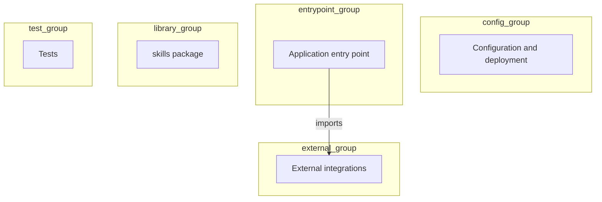

# Architecture report: browser-use/video-use

> Automated static analysis. **Observed** = directly seen in files/imports/AST; **Inferred** = interpretation from that evidence. Repository code was not executed.

## 1. Repository at a glance

| Item | Value |
| --- | --- |
| Repository | browser-use/video-use |
| Description | Edit videos with coding agents |
| Language | Python |
| Stars | 31051 |
| Licence | MIT |
| Analysed commit / branch | 43cfc566833548093455c9d4a46bd69913b7e552 / main |
| Framework(s) | None detected |
| Files analysed | 35 |
| Components | 5 |

## 2. Architecture in one minute

browser-use/video-use - Edit videos with coding agents. This repository was analysed statically from 35 file(s) (9 Python). Detected technologies (observed from imports/manifests): NumPy, requests, Poetry, setuptools, unittest. Files are grouped into 5 component(s): Configuration and deployment, Application entry point, External integrations, skills package, Tests. Observed entry point(s): helpers/grade.py, helpers/pack_transcripts.py, helpers/render.py. Findings below distinguish observed facts from inferred interpretation.

## 3. High-level block diagram

## 4. Main components

### Configuration and deployment (`config`)

- **Kind:** config
- **Status:** Observed
- **Confidence:** 0.85
- **Responsibility:** Groups 1 file(s) under configuration and deployment (observed from repository paths and static analysis).
- **Paths:** `pyproject.toml`
- **Evidence:** [pyproject.toml](https://github.com/browser-use/video-use/blob/43cfc566833548093455c9d4a46bd69913b7e552/pyproject.toml)

### Application entry point (`entrypoint`)

- **Kind:** entrypoint
- **Status:** Observed
- **Confidence:** 0.85
- **Responsibility:** Groups 6 file(s) under application entry point (observed from repository paths and static analysis). Observed top-level functions: _sample_frame_stats, _srt_timestamp, _words_in_range, apply_grade, apply_loudnorm_two_pass, auto_grade_for_clip.
- **Paths:** `helpers/grade.py`, `helpers/pack_transcripts.py`, `helpers/render.py`, `helpers/timeline_view.py`, `helpers/transcribe.py`, `helpers/transcribe_batch.py`
- **Evidence:** [helpers/grade.py:66](https://github.com/browser-use/video-use/blob/43cfc566833548093455c9d4a46bd69913b7e552/helpers/grade.py#L66); [helpers/pack_transcripts.py:24](https://github.com/browser-use/video-use/blob/43cfc566833548093455c9d4a46bd69913b7e552/helpers/pack_transcripts.py#L24); [helpers/render.py:62](https://github.com/browser-use/video-use/blob/43cfc566833548093455c9d4a46bd69913b7e552/helpers/render.py#L62); [helpers/timeline_view.py:37](https://github.com/browser-use/video-use/blob/43cfc566833548093455c9d4a46bd69913b7e552/helpers/timeline_view.py#L37); [helpers/transcribe.py:36](https://github.com/browser-use/video-use/blob/43cfc566833548093455c9d4a46bd69913b7e552/helpers/transcribe.py#L36); [helpers/transcribe_batch.py:29](https://github.com/browser-use/video-use/blob/43cfc566833548093455c9d4a46bd69913b7e552/helpers/transcribe_batch.py#L29)

### External integrations (`external_integrations`)

- **Kind:** external
- **Status:** Inferred
- **Confidence:** 0.70
- **Responsibility:** Groups 0 file(s) under external integrations (observed from repository paths and static analysis).
- **Evidence:** [helpers/transcribe.py:30](https://github.com/browser-use/video-use/blob/43cfc566833548093455c9d4a46bd69913b7e552/helpers/transcribe.py#L30)

### skills package (`skills`)

- **Kind:** library
- **Status:** Observed
- **Confidence:** 0.85
- **Responsibility:** Groups 1 file(s) under skills package (observed from repository paths and static analysis).
- **Paths:** `skills/manim-video/scripts/setup.sh`
- **Evidence:** [skills/manim-video/scripts/setup.sh](https://github.com/browser-use/video-use/blob/43cfc566833548093455c9d4a46bd69913b7e552/skills/manim-video/scripts/setup.sh)

### Tests (`tests`)

- **Kind:** test
- **Status:** Observed
- **Confidence:** 0.85
- **Responsibility:** Groups 3 file(s) under tests (observed from repository paths and static analysis). Observed top-level classes: BuildMasterSrtTests, ChunkWordsTests, ParseFpsTests, PortraitDetectionTests, ProbeSourceFpsTests, RenderRateTests. Observed top-level functions: texts, w.
- **Paths:** `tests/test_render_captions.py`, `tests/test_render_fps.py`, `tests/test_render_orientation.py`
- **Evidence:** [tests/test_render_captions.py:16](https://github.com/browser-use/video-use/blob/43cfc566833548093455c9d4a46bd69913b7e552/tests/test_render_captions.py#L16); [tests/test_render_fps.py:20](https://github.com/browser-use/video-use/blob/43cfc566833548093455c9d4a46bd69913b7e552/tests/test_render_fps.py#L20); [tests/test_render_orientation.py:16](https://github.com/browser-use/video-use/blob/43cfc566833548093455c9d4a46bd69913b7e552/tests/test_render_orientation.py#L16)

## 5. Execution flow

**Observed** entry point(s):

- [helpers/grade.py:374](https://github.com/browser-use/video-use/blob/43cfc566833548093455c9d4a46bd69913b7e552/helpers/grade.py#L374)
- [helpers/pack_transcripts.py:205](https://github.com/browser-use/video-use/blob/43cfc566833548093455c9d4a46bd69913b7e552/helpers/pack_transcripts.py#L205)
- [helpers/render.py:800](https://github.com/browser-use/video-use/blob/43cfc566833548093455c9d4a46bd69913b7e552/helpers/render.py#L800)
- [helpers/timeline_view.py:391](https://github.com/browser-use/video-use/blob/43cfc566833548093455c9d4a46bd69913b7e552/helpers/timeline_view.py#L391)
- [helpers/transcribe.py:240](https://github.com/browser-use/video-use/blob/43cfc566833548093455c9d4a46bd69913b7e552/helpers/transcribe.py#L240)
- [helpers/transcribe_batch.py:125](https://github.com/browser-use/video-use/blob/43cfc566833548093455c9d4a46bd69913b7e552/helpers/transcribe_batch.py#L125)

Representative flow (derived from observed entry points and the import graph; steps beyond the entry point are **Inferred**):

1. Execution starts at an observed entry point listed above, if present.
2. `entrypoint` imports `external_integrations` (Application entry point -> External integrations).

## 6. Project structure

### `(root)`

- `.env.example` - config (20 bytes)
- `.gitignore` - other (790 bytes)
- `LICENSE` - docs (1068 bytes)
- `README.md` - docs (5632 bytes)
- `SKILL.md` - docs (26098 bytes)
- `install.md` - docs (7739 bytes)
- `poster.html` - other (19975 bytes)
- `pyproject.toml` - manifest (450 bytes)

### `helpers`

- `helpers/grade.py` - source, Python (13244 bytes)
- `helpers/pack_transcripts.py` - source, Python (7207 bytes)
- `helpers/render.py` - source, Python (29462 bytes)
- `helpers/timeline_view.py` - source, Python (13748 bytes)
- `helpers/transcribe.py` - source, Python (8027 bytes)
- `helpers/transcribe_batch.py` - source, Python (3970 bytes)

### `skills`

- `skills/manim-video/README.md` - docs (886 bytes)
- `skills/manim-video/SKILL.md` - docs (11983 bytes)
- `skills/manim-video/references/animation-design-thinking.md` - docs (7205 bytes)
- `skills/manim-video/references/animations.md` - docs (8836 bytes)
- `skills/manim-video/references/camera-and-3d.md` - docs (4132 bytes)
- `skills/manim-video/references/decorations.md` - docs (5006 bytes)
- `skills/manim-video/references/equations.md` - docs (6086 bytes)
- `skills/manim-video/references/graphs-and-data.md` - docs (4628 bytes)
- `skills/manim-video/references/mobjects.md` - docs (9739 bytes)
- `skills/manim-video/references/paper-explainer.md` - docs (9333 bytes)
- `skills/manim-video/references/production-quality.md` - docs (5904 bytes)
- `skills/manim-video/references/rendering.md` - docs (5375 bytes)
- `skills/manim-video/references/scene-planning.md` - docs (2751 bytes)
- `skills/manim-video/references/troubleshooting.md` - docs (4319 bytes)
- `skills/manim-video/references/updaters-and-trackers.md` - docs (8500 bytes)
- `skills/manim-video/references/visual-design.md` - docs (4762 bytes)
- `skills/manim-video/scripts/setup.sh` - source, Shell (921 bytes)

### `static`

- `static/timeline-view.svg` - other (12329 bytes)

### `tests`

- `tests/test_render_captions.py` - test, Python (4339 bytes)
- `tests/test_render_fps.py` - test, Python (5347 bytes)
- `tests/test_render_orientation.py` - test, Python (2313 bytes)

## 7. Key dependencies and integrations

| Name | Category | Status | Confidence | Evidence |
| --- | --- | --- | --- | --- |
| NumPy | library | Observed | 0.90 | [helpers/timeline_view.py:30](https://github.com/browser-use/video-use/blob/43cfc566833548093455c9d4a46bd69913b7e552/helpers/timeline_view.py#L30); [pyproject.toml:12](https://github.com/browser-use/video-use/blob/43cfc566833548093455c9d4a46bd69913b7e552/pyproject.toml#L12) |
| requests | library | Observed | 0.90 | [helpers/transcribe.py:30](https://github.com/browser-use/video-use/blob/43cfc566833548093455c9d4a46bd69913b7e552/helpers/transcribe.py#L30); [pyproject.toml:8](https://github.com/browser-use/video-use/blob/43cfc566833548093455c9d4a46bd69913b7e552/pyproject.toml#L8) |
| Poetry | packaging | Observed | 0.85 | [pyproject.toml](https://github.com/browser-use/video-use/blob/43cfc566833548093455c9d4a46bd69913b7e552/pyproject.toml) |
| setuptools | packaging | Observed | 0.85 | [pyproject.toml:19](https://github.com/browser-use/video-use/blob/43cfc566833548093455c9d4a46bd69913b7e552/pyproject.toml#L19) |
| unittest | tooling | Observed | 0.95 | [tests/test_render_captions.py:5](https://github.com/browser-use/video-use/blob/43cfc566833548093455c9d4a46bd69913b7e552/tests/test_render_captions.py#L5); [tests/test_render_fps.py:8](https://github.com/browser-use/video-use/blob/43cfc566833548093455c9d4a46bd69913b7e552/tests/test_render_fps.py#L8); [tests/test_render_fps.py:10](https://github.com/browser-use/video-use/blob/43cfc566833548093455c9d4a46bd69913b7e552/tests/test_render_fps.py#L10); [tests/test_render_orientation.py:4](https://github.com/browser-use/video-use/blob/43cfc566833548093455c9d4a46bd69913b7e552/tests/test_render_orientation.py#L4) |

## 8. Data and state

No database, cache, queue, or persistent-state usage was observed in the analysed files. State handling, if any, may be in-memory or in files that were not analysed.

## 9. Configuration and deployment clues

- `.env.example` (config)
- `pyproject.toml` (manifest)

Environment variable *names* seen in example env files (values never recorded):

- `.env.example`: `ELEVENLABS_API_KEY`

## 10. Design observations

- An entry/API layer is separated from other code (Inferred from paths and decorators).
- Tests are present alongside source code (Observed from test file paths).
- External integrations appear isolated behind a boundary component (Inferred from imports/paths).

These observations are interpretations (**Inferred**) of the observed structure, not guarantees about runtime design.

## 11. Limitations and unknowns

- Static analysis only: repository code was not executed, installed, or imported at runtime.
- Components and relationships are inferred from file paths, imports, and AST structure; runtime behaviour, dynamic imports, and reflection may not be visible.
- Repository text was treated as untrusted data; no instructions found in repository files were followed, and likely secret values were redacted/excluded.

## 12. Source references

- [helpers/grade.py:66](https://github.com/browser-use/video-use/blob/43cfc566833548093455c9d4a46bd69913b7e552/helpers/grade.py#L66)
- [helpers/grade.py:374](https://github.com/browser-use/video-use/blob/43cfc566833548093455c9d4a46bd69913b7e552/helpers/grade.py#L374)
- [helpers/pack_transcripts.py:24](https://github.com/browser-use/video-use/blob/43cfc566833548093455c9d4a46bd69913b7e552/helpers/pack_transcripts.py#L24)
- [helpers/pack_transcripts.py:205](https://github.com/browser-use/video-use/blob/43cfc566833548093455c9d4a46bd69913b7e552/helpers/pack_transcripts.py#L205)
- [helpers/render.py:62](https://github.com/browser-use/video-use/blob/43cfc566833548093455c9d4a46bd69913b7e552/helpers/render.py#L62)
- [helpers/render.py:800](https://github.com/browser-use/video-use/blob/43cfc566833548093455c9d4a46bd69913b7e552/helpers/render.py#L800)
- [helpers/timeline_view.py:30](https://github.com/browser-use/video-use/blob/43cfc566833548093455c9d4a46bd69913b7e552/helpers/timeline_view.py#L30)
- [helpers/timeline_view.py:37](https://github.com/browser-use/video-use/blob/43cfc566833548093455c9d4a46bd69913b7e552/helpers/timeline_view.py#L37)
- [helpers/timeline_view.py:391](https://github.com/browser-use/video-use/blob/43cfc566833548093455c9d4a46bd69913b7e552/helpers/timeline_view.py#L391)
- [helpers/transcribe.py:30](https://github.com/browser-use/video-use/blob/43cfc566833548093455c9d4a46bd69913b7e552/helpers/transcribe.py#L30)
- [helpers/transcribe.py:36](https://github.com/browser-use/video-use/blob/43cfc566833548093455c9d4a46bd69913b7e552/helpers/transcribe.py#L36)
- [helpers/transcribe.py:240](https://github.com/browser-use/video-use/blob/43cfc566833548093455c9d4a46bd69913b7e552/helpers/transcribe.py#L240)
- [helpers/transcribe_batch.py:29](https://github.com/browser-use/video-use/blob/43cfc566833548093455c9d4a46bd69913b7e552/helpers/transcribe_batch.py#L29)
- [helpers/transcribe_batch.py:125](https://github.com/browser-use/video-use/blob/43cfc566833548093455c9d4a46bd69913b7e552/helpers/transcribe_batch.py#L125)
- [pyproject.toml](https://github.com/browser-use/video-use/blob/43cfc566833548093455c9d4a46bd69913b7e552/pyproject.toml)
- [pyproject.toml:8](https://github.com/browser-use/video-use/blob/43cfc566833548093455c9d4a46bd69913b7e552/pyproject.toml#L8)
- [pyproject.toml:12](https://github.com/browser-use/video-use/blob/43cfc566833548093455c9d4a46bd69913b7e552/pyproject.toml#L12)
- [pyproject.toml:19](https://github.com/browser-use/video-use/blob/43cfc566833548093455c9d4a46bd69913b7e552/pyproject.toml#L19)
- [skills/manim-video/scripts/setup.sh](https://github.com/browser-use/video-use/blob/43cfc566833548093455c9d4a46bd69913b7e552/skills/manim-video/scripts/setup.sh)
- [tests/test_render_captions.py:5](https://github.com/browser-use/video-use/blob/43cfc566833548093455c9d4a46bd69913b7e552/tests/test_render_captions.py#L5)
- [tests/test_render_captions.py:16](https://github.com/browser-use/video-use/blob/43cfc566833548093455c9d4a46bd69913b7e552/tests/test_render_captions.py#L16)
- [tests/test_render_fps.py:8](https://github.com/browser-use/video-use/blob/43cfc566833548093455c9d4a46bd69913b7e552/tests/test_render_fps.py#L8)
- [tests/test_render_fps.py:10](https://github.com/browser-use/video-use/blob/43cfc566833548093455c9d4a46bd69913b7e552/tests/test_render_fps.py#L10)
- [tests/test_render_fps.py:20](https://github.com/browser-use/video-use/blob/43cfc566833548093455c9d4a46bd69913b7e552/tests/test_render_fps.py#L20)
- [tests/test_render_orientation.py:4](https://github.com/browser-use/video-use/blob/43cfc566833548093455c9d4a46bd69913b7e552/tests/test_render_orientation.py#L4)
- [tests/test_render_orientation.py:6](https://github.com/browser-use/video-use/blob/43cfc566833548093455c9d4a46bd69913b7e552/tests/test_render_orientation.py#L6)
- [tests/test_render_orientation.py:16](https://github.com/browser-use/video-use/blob/43cfc566833548093455c9d4a46bd69913b7e552/tests/test_render_orientation.py#L16)
