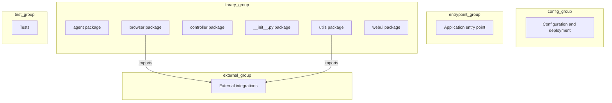

# Architecture report: browser-use/web-ui

> Automated static analysis. **Observed** = directly seen in files/imports/AST; **Inferred** = interpretation from that evidence. Repository code was not executed.

## 1. Repository at a glance

| Item | Value |
| --- | --- |
| Repository | browser-use/web-ui |
| Description | 🖥️ Run AI Agent in your browser. |
| Language | Python |
| Stars | 16653 |
| Licence | MIT |
| Analysed commit / branch | 61962296c38a0d064e0ba02c827192b7a81d1819 / main |
| Framework(s) | None detected |
| Files analysed | 40 |
| Components | 10 |

## 2. Architecture in one minute

browser-use/web-ui - 🖥️ Run AI Agent in your browser.. This repository was analysed statically from 40 file(s) (28 Python). Detected technologies (observed from imports/manifests): GitHub Actions, Pydantic, requests, Docker, Docker Compose. Files are grouped into 10 component(s): agent package, browser package, Configuration and deployment, controller package, Application entry point, External integrations, __init__.py package, Tests. Observed entry point(s): webui.py. Findings below distinguish observed facts from inferred interpretation.

## 3. High-level block diagram

## 4. Main components

### agent package (`agent`)

- **Kind:** library
- **Status:** Observed
- **Confidence:** 0.85
- **Responsibility:** Groups 3 file(s) under agent package (observed from repository paths and static analysis). Observed top-level classes: BrowserSearchInput, BrowserUseAgent, DeepResearchAgent, DeepResearchState, ResearchCategoryItem, ResearchTaskItem. Observed top-level functions: _load_previous_state, _run_browser_search_tool, _save_plan_to_md, _save_report_to_md, _save_search_results_to_json, create_browser_search_tool.
- **Paths:** `src/agent/__init__.py`, `src/agent/browser_use/browser_use_agent.py`, `src/agent/deep_research/deep_research_agent.py`
- **Evidence:** [src/agent/__init__.py](https://github.com/browser-use/web-ui/blob/61962296c38a0d064e0ba02c827192b7a81d1819/src/agent/__init__.py); [src/agent/browser_use/browser_use_agent.py:30](https://github.com/browser-use/web-ui/blob/61962296c38a0d064e0ba02c827192b7a81d1819/src/agent/browser_use/browser_use_agent.py#L30); [src/agent/deep_research/deep_research_agent.py:50](https://github.com/browser-use/web-ui/blob/61962296c38a0d064e0ba02c827192b7a81d1819/src/agent/deep_research/deep_research_agent.py#L50)

### browser package (`browser`)

- **Kind:** library
- **Status:** Observed
- **Confidence:** 0.85
- **Responsibility:** Groups 3 file(s) under browser package (observed from repository paths and static analysis). Observed top-level classes: CustomBrowser, CustomBrowserContext.
- **Paths:** `src/browser/__init__.py`, `src/browser/custom_browser.py`, `src/browser/custom_context.py`
- **Evidence:** [src/browser/__init__.py](https://github.com/browser-use/web-ui/blob/61962296c38a0d064e0ba02c827192b7a81d1819/src/browser/__init__.py); [src/browser/custom_browser.py:34](https://github.com/browser-use/web-ui/blob/61962296c38a0d064e0ba02c827192b7a81d1819/src/browser/custom_browser.py#L34); [src/browser/custom_context.py:15](https://github.com/browser-use/web-ui/blob/61962296c38a0d064e0ba02c827192b7a81d1819/src/browser/custom_context.py#L15)

### Configuration and deployment (`config`)

- **Kind:** config
- **Status:** Observed
- **Confidence:** 0.85
- **Responsibility:** Groups 4 file(s) under configuration and deployment (observed from repository paths and static analysis).
- **Paths:** `Dockerfile`, `docker-compose.yml`, `requirements.txt`, `src/utils/config.py`
- **Evidence:** [Dockerfile](https://github.com/browser-use/web-ui/blob/61962296c38a0d064e0ba02c827192b7a81d1819/Dockerfile); [docker-compose.yml](https://github.com/browser-use/web-ui/blob/61962296c38a0d064e0ba02c827192b7a81d1819/docker-compose.yml); [requirements.txt](https://github.com/browser-use/web-ui/blob/61962296c38a0d064e0ba02c827192b7a81d1819/requirements.txt); [src/utils/config.py](https://github.com/browser-use/web-ui/blob/61962296c38a0d064e0ba02c827192b7a81d1819/src/utils/config.py)

### controller package (`controller`)

- **Kind:** library
- **Status:** Observed
- **Confidence:** 0.85
- **Responsibility:** Groups 2 file(s) under controller package (observed from repository paths and static analysis). Observed top-level classes: CustomController.
- **Paths:** `src/controller/__init__.py`, `src/controller/custom_controller.py`
- **Evidence:** [src/controller/__init__.py](https://github.com/browser-use/web-ui/blob/61962296c38a0d064e0ba02c827192b7a81d1819/src/controller/__init__.py); [src/controller/custom_controller.py:39](https://github.com/browser-use/web-ui/blob/61962296c38a0d064e0ba02c827192b7a81d1819/src/controller/custom_controller.py#L39)

### Application entry point (`entrypoint`)

- **Kind:** entrypoint
- **Status:** Observed
- **Confidence:** 0.85
- **Responsibility:** Groups 1 file(s) under application entry point (observed from repository paths and static analysis). Observed top-level functions: main.
- **Paths:** `webui.py`
- **Evidence:** [webui.py:7](https://github.com/browser-use/web-ui/blob/61962296c38a0d064e0ba02c827192b7a81d1819/webui.py#L7)

### External integrations (`external_integrations`)

- **Kind:** external
- **Status:** Observed
- **Confidence:** 0.85
- **Responsibility:** Groups 1 file(s) under external integrations (observed from repository paths and static analysis). Observed top-level functions: create_tool_param_model, resolve_type, setup_mcp_client_and_tools.
- **Paths:** `src/utils/mcp_client.py`
- **Evidence:** [src/utils/mcp_client.py:17](https://github.com/browser-use/web-ui/blob/61962296c38a0d064e0ba02c827192b7a81d1819/src/utils/mcp_client.py#L17)

### __init__.py package (`init_py`)

- **Kind:** library
- **Status:** Observed
- **Confidence:** 0.85
- **Responsibility:** Groups 1 file(s) under __init__.py package (observed from repository paths and static analysis).
- **Paths:** `src/__init__.py`
- **Evidence:** [src/__init__.py](https://github.com/browser-use/web-ui/blob/61962296c38a0d064e0ba02c827192b7a81d1819/src/__init__.py)

### Tests (`tests`)

- **Kind:** test
- **Status:** Observed
- **Confidence:** 0.85
- **Responsibility:** Groups 4 file(s) under tests (observed from repository paths and static analysis). Observed top-level classes: LLMConfig. Observed top-level functions: create_message_content, get_env_value, test_azure_openai_model, test_browser_use_agent, test_browser_use_parallel, test_connect_browser.
- **Paths:** `tests/test_agents.py`, `tests/test_controller.py`, `tests/test_llm_api.py`, `tests/test_playwright.py`
- **Evidence:** [tests/test_agents.py:20](https://github.com/browser-use/web-ui/blob/61962296c38a0d064e0ba02c827192b7a81d1819/tests/test_agents.py#L20); [tests/test_controller.py:13](https://github.com/browser-use/web-ui/blob/61962296c38a0d064e0ba02c827192b7a81d1819/tests/test_controller.py#L13); [tests/test_llm_api.py:17](https://github.com/browser-use/web-ui/blob/61962296c38a0d064e0ba02c827192b7a81d1819/tests/test_llm_api.py#L17); [tests/test_playwright.py:7](https://github.com/browser-use/web-ui/blob/61962296c38a0d064e0ba02c827192b7a81d1819/tests/test_playwright.py#L7)

### utils package (`utils`)

- **Kind:** library
- **Status:** Observed
- **Confidence:** 0.85
- **Responsibility:** Groups 3 file(s) under utils package (observed from repository paths and static analysis). Observed top-level classes: DeepSeekR1ChatOllama, DeepSeekR1ChatOpenAI. Observed top-level functions: encode_image, get_latest_files, get_llm_model.
- **Paths:** `src/utils/__init__.py`, `src/utils/llm_provider.py`, `src/utils/utils.py`
- **Evidence:** [src/utils/__init__.py](https://github.com/browser-use/web-ui/blob/61962296c38a0d064e0ba02c827192b7a81d1819/src/utils/__init__.py); [src/utils/llm_provider.py:55](https://github.com/browser-use/web-ui/blob/61962296c38a0d064e0ba02c827192b7a81d1819/src/utils/llm_provider.py#L55); [src/utils/utils.py:12](https://github.com/browser-use/web-ui/blob/61962296c38a0d064e0ba02c827192b7a81d1819/src/utils/utils.py#L12)

### webui package (`webui`)

- **Kind:** library
- **Status:** Observed
- **Confidence:** 0.85
- **Responsibility:** Groups 9 file(s) under webui package (observed from repository paths and static analysis). Observed top-level classes: WebuiManager. Observed top-level functions: _ask_assistant_callback, _format_agent_output, _get_config_value, _handle_done, _handle_new_step, _initialize_llm.
- **Paths:** `src/webui/__init__.py`, `src/webui/components/__init__.py`, `src/webui/components/agent_settings_tab.py`, `src/webui/components/browser_settings_tab.py`, `src/webui/components/browser_use_agent_tab.py`, `src/webui/components/deep_research_agent_tab.py`, `src/webui/components/load_save_config_tab.py`, `src/webui/interface.py`, `src/webui/webui_manager.py`
- **Evidence:** [src/webui/__init__.py](https://github.com/browser-use/web-ui/blob/61962296c38a0d064e0ba02c827192b7a81d1819/src/webui/__init__.py); [src/webui/components/__init__.py](https://github.com/browser-use/web-ui/blob/61962296c38a0d064e0ba02c827192b7a81d1819/src/webui/components/__init__.py); [src/webui/components/agent_settings_tab.py:15](https://github.com/browser-use/web-ui/blob/61962296c38a0d064e0ba02c827192b7a81d1819/src/webui/components/agent_settings_tab.py#L15); [src/webui/components/browser_settings_tab.py:12](https://github.com/browser-use/web-ui/blob/61962296c38a0d064e0ba02c827192b7a81d1819/src/webui/components/browser_settings_tab.py#L12); [src/webui/components/browser_use_agent_tab.py:33](https://github.com/browser-use/web-ui/blob/61962296c38a0d064e0ba02c827192b7a81d1819/src/webui/components/browser_use_agent_tab.py#L33); [src/webui/components/deep_research_agent_tab.py:18](https://github.com/browser-use/web-ui/blob/61962296c38a0d064e0ba02c827192b7a81d1819/src/webui/components/deep_research_agent_tab.py#L18); [src/webui/components/load_save_config_tab.py:8](https://github.com/browser-use/web-ui/blob/61962296c38a0d064e0ba02c827192b7a81d1819/src/webui/components/load_save_config_tab.py#L8); [src/webui/interface.py:22](https://github.com/browser-use/web-ui/blob/61962296c38a0d064e0ba02c827192b7a81d1819/src/webui/interface.py#L22)

## 5. Execution flow

**Observed** entry point(s):

- [webui.py:18](https://github.com/browser-use/web-ui/blob/61962296c38a0d064e0ba02c827192b7a81d1819/webui.py#L18)

Representative flow (derived from observed entry points and the import graph; steps beyond the entry point are **Inferred**):

1. Execution starts at an observed entry point listed above, if present.
2. `browser` imports `external_integrations` (browser package -> External integrations).
3. `utils` imports `external_integrations` (utils package -> External integrations).

## 6. Project structure

### `(root)`

- `.dockerignore` - container (22 bytes)
- `.env.example` - config (1572 bytes)
- `.gitignore` - other (3429 bytes)
- `Dockerfile` - container (2339 bytes)
- `LICENSE` - docs (1073 bytes)
- `README.md` - docs (6164 bytes)
- `SECURITY.md` - docs (1033 bytes)
- `docker-compose.yml` - container (3245 bytes)
- `requirements.txt` - manifest (209 bytes)
- `supervisord.conf` - other (2055 bytes)
- `webui.py` - source, Python (692 bytes)

### `.github`

- `.github/workflows/build.yml` - ci, YAML (3529 bytes)

### `.vscode`

- `.vscode/settings.json` - config (285 bytes)

### `src`

- `src/__init__.py` - source, Python (0 bytes)
- `src/agent/__init__.py` - source, Python (0 bytes)
- `src/agent/browser_use/browser_use_agent.py` - source, Python (6622 bytes)
- `src/agent/deep_research/deep_research_agent.py` - source, Python (55214 bytes)
- `src/browser/__init__.py` - source, Python (0 bytes)
- `src/browser/custom_browser.py` - source, Python (4555 bytes)
- `src/browser/custom_context.py` - source, Python (768 bytes)
- `src/controller/__init__.py` - source, Python (0 bytes)
- `src/controller/custom_controller.py` - source, Python (7920 bytes)
- `src/utils/__init__.py` - source, Python (0 bytes)
- `src/utils/config.py` - source, Python (4018 bytes)
- `src/utils/llm_provider.py` - source, Python (12948 bytes)
- `src/utils/mcp_client.py` - source, Python (9429 bytes)
- `src/utils/utils.py` - source, Python (1226 bytes)
- `src/webui/__init__.py` - source, Python (0 bytes)
- `src/webui/components/__init__.py` - source, Python (0 bytes)
- `src/webui/components/agent_settings_tab.py` - source, Python (9409 bytes)
- `src/webui/components/browser_settings_tab.py` - source, Python (5674 bytes)
- `src/webui/components/browser_use_agent_tab.py` - source, Python (46119 bytes)
- `src/webui/components/deep_research_agent_tab.py` - source, Python (21899 bytes)
- `src/webui/components/load_save_config_tab.py` - source, Python (1338 bytes)
- `src/webui/interface.py` - source, Python (2894 bytes)
- `src/webui/webui_manager.py` - source, Python (4610 bytes)

### `tests`

- `tests/test_agents.py` - test, Python (12686 bytes)
- `tests/test_controller.py` - test, Python (4157 bytes)
- `tests/test_llm_api.py` - test, Python (5422 bytes)
- `tests/test_playwright.py` - test, Python (771 bytes)

## 7. Key dependencies and integrations

| Name | Category | Status | Confidence | Evidence |
| --- | --- | --- | --- | --- |
| GitHub Actions | ci | Observed | 0.85 | [.github/workflows/build.yml](https://github.com/browser-use/web-ui/blob/61962296c38a0d064e0ba02c827192b7a81d1819/.github/workflows/build.yml) |
| Pydantic | library | Observed | 0.95 | [src/agent/deep_research/deep_research_agent.py:30](https://github.com/browser-use/web-ui/blob/61962296c38a0d064e0ba02c827192b7a81d1819/src/agent/deep_research/deep_research_agent.py#L30); [src/controller/custom_controller.py:5](https://github.com/browser-use/web-ui/blob/61962296c38a0d064e0ba02c827192b7a81d1819/src/controller/custom_controller.py#L5); [src/utils/llm_provider.py:50](https://github.com/browser-use/web-ui/blob/61962296c38a0d064e0ba02c827192b7a81d1819/src/utils/llm_provider.py#L50); [src/utils/mcp_client.py:11](https://github.com/browser-use/web-ui/blob/61962296c38a0d064e0ba02c827192b7a81d1819/src/utils/mcp_client.py#L11) |
| requests | library | Observed | 0.90 | [src/utils/utils.py:6](https://github.com/browser-use/web-ui/blob/61962296c38a0d064e0ba02c827192b7a81d1819/src/utils/utils.py#L6) |
| Docker | tooling | Observed | 0.90 | [.github/workflows/build.yml:1](https://github.com/browser-use/web-ui/blob/61962296c38a0d064e0ba02c827192b7a81d1819/.github/workflows/build.yml#L1); [Dockerfile](https://github.com/browser-use/web-ui/blob/61962296c38a0d064e0ba02c827192b7a81d1819/Dockerfile) |
| Docker Compose | tooling | Observed | 0.85 | [docker-compose.yml](https://github.com/browser-use/web-ui/blob/61962296c38a0d064e0ba02c827192b7a81d1819/docker-compose.yml) |

## 8. Data and state

No database, cache, queue, or persistent-state usage was observed in the analysed files. State handling, if any, may be in-memory or in files that were not analysed.

## 9. Configuration and deployment clues

- `.dockerignore` (container)
- `.env.example` (config)
- `.github/workflows/build.yml` (ci)
- `.vscode/settings.json` (config)
- `Dockerfile` (container)
- `docker-compose.yml` (container)
- `requirements.txt` (manifest)

Environment variable *names* seen in example env files (values never recorded):

- `.env.example`: `ALIBABA_API_KEY`, `ALIBABA_ENDPOINT`, `ANONYMIZED_TELEMETRY`, `ANTHROPIC_API_KEY`, `ANTHROPIC_ENDPOINT`, `AZURE_OPENAI_API_KEY`, `AZURE_OPENAI_API_VERSION`, `AZURE_OPENAI_ENDPOINT`, `BROWSER_CDP`, `BROWSER_DEBUGGING_HOST`, `BROWSER_DEBUGGING_PORT`, `BROWSER_PATH`, `BROWSER_USER_DATA`, `BROWSER_USE_LOGGING_LEVEL`, `DEEPSEEK_API_KEY`, `DEEPSEEK_ENDPOINT`, `DEFAULT_LLM`, `GOOGLE_API_KEY`, `GROK_API_KEY`, `GROK_ENDPOINT`, `IBM_API_KEY`, `IBM_ENDPOINT`, `IBM_PROJECT_ID`, `KEEP_BROWSER_OPEN`, `MISTRAL_API_KEY`, `MISTRAL_ENDPOINT`, `MODELSCOPE_API_KEY`, `MODELSCOPE_ENDPOINT`, `MOONSHOT_API_KEY`, `MOONSHOT_ENDPOINT`, `OLLAMA_ENDPOINT`, `OPENAI_API_KEY`, `OPENAI_ENDPOINT`, `RESOLUTION`, `RESOLUTION_HEIGHT`, `RESOLUTION_WIDTH`, `SiliconFLOW_API_KEY`, `SiliconFLOW_ENDPOINT`, `UNBOUND_API_KEY`, `UNBOUND_ENDPOINT`, `USE_OWN_BROWSER`, `VNC_PASSWORD`

## 10. Design observations

- An entry/API layer is separated from other code (Inferred from paths and decorators).
- Tests are present alongside source code (Observed from test file paths).
- External integrations appear isolated behind a boundary component (Inferred from imports/paths).

These observations are interpretations (**Inferred**) of the observed structure, not guarantees about runtime design.

## 11. Limitations and unknowns

- Static analysis only: repository code was not executed, installed, or imported at runtime.
- Components and relationships are inferred from file paths, imports, and AST structure; runtime behaviour, dynamic imports, and reflection may not be visible.
- Repository text was treated as untrusted data; no instructions found in repository files were followed, and likely secret values were redacted/excluded.

## 12. Source references

- [.github/workflows/build.yml](https://github.com/browser-use/web-ui/blob/61962296c38a0d064e0ba02c827192b7a81d1819/.github/workflows/build.yml)
- [.github/workflows/build.yml:1](https://github.com/browser-use/web-ui/blob/61962296c38a0d064e0ba02c827192b7a81d1819/.github/workflows/build.yml#L1)
- [Dockerfile](https://github.com/browser-use/web-ui/blob/61962296c38a0d064e0ba02c827192b7a81d1819/Dockerfile)
- [docker-compose.yml](https://github.com/browser-use/web-ui/blob/61962296c38a0d064e0ba02c827192b7a81d1819/docker-compose.yml)
- [requirements.txt](https://github.com/browser-use/web-ui/blob/61962296c38a0d064e0ba02c827192b7a81d1819/requirements.txt)
- [src/__init__.py](https://github.com/browser-use/web-ui/blob/61962296c38a0d064e0ba02c827192b7a81d1819/src/__init__.py)
- [src/agent/__init__.py](https://github.com/browser-use/web-ui/blob/61962296c38a0d064e0ba02c827192b7a81d1819/src/agent/__init__.py)
- [src/agent/browser_use/browser_use_agent.py:30](https://github.com/browser-use/web-ui/blob/61962296c38a0d064e0ba02c827192b7a81d1819/src/agent/browser_use/browser_use_agent.py#L30)
- [src/agent/deep_research/deep_research_agent.py:30](https://github.com/browser-use/web-ui/blob/61962296c38a0d064e0ba02c827192b7a81d1819/src/agent/deep_research/deep_research_agent.py#L30)
- [src/agent/deep_research/deep_research_agent.py:50](https://github.com/browser-use/web-ui/blob/61962296c38a0d064e0ba02c827192b7a81d1819/src/agent/deep_research/deep_research_agent.py#L50)
- [src/browser/__init__.py](https://github.com/browser-use/web-ui/blob/61962296c38a0d064e0ba02c827192b7a81d1819/src/browser/__init__.py)
- [src/browser/custom_browser.py:34](https://github.com/browser-use/web-ui/blob/61962296c38a0d064e0ba02c827192b7a81d1819/src/browser/custom_browser.py#L34)
- [src/browser/custom_context.py:15](https://github.com/browser-use/web-ui/blob/61962296c38a0d064e0ba02c827192b7a81d1819/src/browser/custom_context.py#L15)
- [src/controller/__init__.py](https://github.com/browser-use/web-ui/blob/61962296c38a0d064e0ba02c827192b7a81d1819/src/controller/__init__.py)
- [src/controller/custom_controller.py:5](https://github.com/browser-use/web-ui/blob/61962296c38a0d064e0ba02c827192b7a81d1819/src/controller/custom_controller.py#L5)
- [src/controller/custom_controller.py:39](https://github.com/browser-use/web-ui/blob/61962296c38a0d064e0ba02c827192b7a81d1819/src/controller/custom_controller.py#L39)
- [src/utils/__init__.py](https://github.com/browser-use/web-ui/blob/61962296c38a0d064e0ba02c827192b7a81d1819/src/utils/__init__.py)
- [src/utils/config.py](https://github.com/browser-use/web-ui/blob/61962296c38a0d064e0ba02c827192b7a81d1819/src/utils/config.py)
- [src/utils/llm_provider.py:50](https://github.com/browser-use/web-ui/blob/61962296c38a0d064e0ba02c827192b7a81d1819/src/utils/llm_provider.py#L50)
- [src/utils/llm_provider.py:55](https://github.com/browser-use/web-ui/blob/61962296c38a0d064e0ba02c827192b7a81d1819/src/utils/llm_provider.py#L55)
- [src/utils/mcp_client.py:11](https://github.com/browser-use/web-ui/blob/61962296c38a0d064e0ba02c827192b7a81d1819/src/utils/mcp_client.py#L11)
- [src/utils/mcp_client.py:12](https://github.com/browser-use/web-ui/blob/61962296c38a0d064e0ba02c827192b7a81d1819/src/utils/mcp_client.py#L12)
- [src/utils/mcp_client.py:17](https://github.com/browser-use/web-ui/blob/61962296c38a0d064e0ba02c827192b7a81d1819/src/utils/mcp_client.py#L17)
- [src/utils/utils.py:6](https://github.com/browser-use/web-ui/blob/61962296c38a0d064e0ba02c827192b7a81d1819/src/utils/utils.py#L6)
- [src/utils/utils.py:12](https://github.com/browser-use/web-ui/blob/61962296c38a0d064e0ba02c827192b7a81d1819/src/utils/utils.py#L12)
- [src/webui/__init__.py](https://github.com/browser-use/web-ui/blob/61962296c38a0d064e0ba02c827192b7a81d1819/src/webui/__init__.py)
- [src/webui/components/__init__.py](https://github.com/browser-use/web-ui/blob/61962296c38a0d064e0ba02c827192b7a81d1819/src/webui/components/__init__.py)
- [src/webui/components/agent_settings_tab.py:15](https://github.com/browser-use/web-ui/blob/61962296c38a0d064e0ba02c827192b7a81d1819/src/webui/components/agent_settings_tab.py#L15)
- [src/webui/components/browser_settings_tab.py:12](https://github.com/browser-use/web-ui/blob/61962296c38a0d064e0ba02c827192b7a81d1819/src/webui/components/browser_settings_tab.py#L12)
- [src/webui/components/browser_use_agent_tab.py:33](https://github.com/browser-use/web-ui/blob/61962296c38a0d064e0ba02c827192b7a81d1819/src/webui/components/browser_use_agent_tab.py#L33)
- [src/webui/components/deep_research_agent_tab.py:18](https://github.com/browser-use/web-ui/blob/61962296c38a0d064e0ba02c827192b7a81d1819/src/webui/components/deep_research_agent_tab.py#L18)
- [src/webui/components/load_save_config_tab.py:8](https://github.com/browser-use/web-ui/blob/61962296c38a0d064e0ba02c827192b7a81d1819/src/webui/components/load_save_config_tab.py#L8)
- [src/webui/interface.py:22](https://github.com/browser-use/web-ui/blob/61962296c38a0d064e0ba02c827192b7a81d1819/src/webui/interface.py#L22)
- [tests/test_agents.py:20](https://github.com/browser-use/web-ui/blob/61962296c38a0d064e0ba02c827192b7a81d1819/tests/test_agents.py#L20)
- [tests/test_controller.py:13](https://github.com/browser-use/web-ui/blob/61962296c38a0d064e0ba02c827192b7a81d1819/tests/test_controller.py#L13)
- [tests/test_llm_api.py:17](https://github.com/browser-use/web-ui/blob/61962296c38a0d064e0ba02c827192b7a81d1819/tests/test_llm_api.py#L17)
- [tests/test_playwright.py:7](https://github.com/browser-use/web-ui/blob/61962296c38a0d064e0ba02c827192b7a81d1819/tests/test_playwright.py#L7)
- [webui.py:7](https://github.com/browser-use/web-ui/blob/61962296c38a0d064e0ba02c827192b7a81d1819/webui.py#L7)
- [webui.py:18](https://github.com/browser-use/web-ui/blob/61962296c38a0d064e0ba02c827192b7a81d1819/webui.py#L18)
