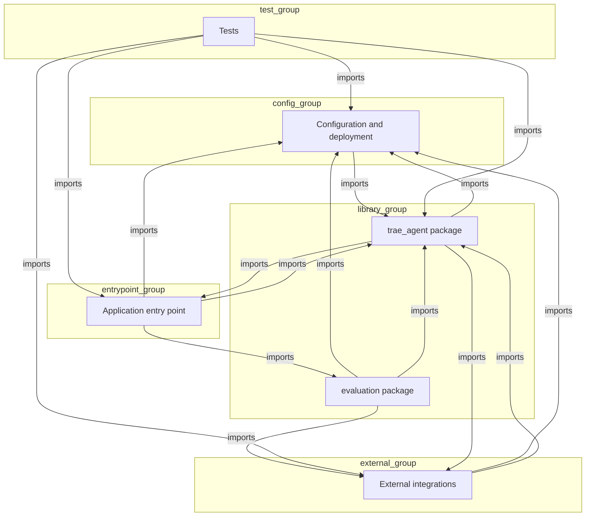

# Architecture report: bytedance/trae-agent

> Automated static analysis. **Observed** = directly seen in files/imports/AST; **Inferred** = interpretation from that evidence. Repository code was not executed.

## 1. Repository at a glance

| Item | Value |
| --- | --- |
| Repository | bytedance/trae-agent |
| Description | Trae Agent is an LLM-based agent for general purpose software engineering tasks. |
| Language | Python |
| Stars | 12202 |
| Licence | MIT |
| Analysed commit / branch | e839e559ac61bdd0e057c375dd1dee391fee797d / main |
| Framework(s) | None detected |
| Files analysed | 105 |
| Components | 6 |

## 2. Architecture in one minute

bytedance/trae-agent - Trae Agent is an LLM-based agent for general purpose software engineering tasks.. This repository was analysed statically from 105 file(s) (75 Python). Detected technologies (observed from imports/manifests): GitHub Actions, SQLite, Click, Pydantic, Poetry, pytest. Files are grouped into 6 component(s): Configuration and deployment, Application entry point, evaluation package, External integrations, Tests, trae_agent package. Observed entry point(s): evaluation/patch_selection/analysis.py, evaluation/patch_selection/selector.py, evaluation/patch_selection/trae_selector/tools/tools/execute_bash.py. Findings below distinguish observed facts from inferred interpretation.

## 3. High-level block diagram

## 4. Main components

### Configuration and deployment (`config`)

- **Kind:** config
- **Status:** Observed
- **Confidence:** 0.85
- **Responsibility:** Groups 2 file(s) under configuration and deployment (observed from repository paths and static analysis). Observed top-level classes: AgentConfig, Config, ConfigError, LakeviewConfig, MCPServerConfig, ModelConfig. Observed top-level functions: resolve_config_value.
- **Paths:** `pyproject.toml`, `trae_agent/utils/config.py`
- **Evidence:** [pyproject.toml](https://github.com/bytedance/trae-agent/blob/e839e559ac61bdd0e057c375dd1dee391fee797d/pyproject.toml); [trae_agent/utils/config.py:12](https://github.com/bytedance/trae-agent/blob/e839e559ac61bdd0e057c375dd1dee391fee797d/trae_agent/utils/config.py#L12)

### Application entry point (`entrypoint`)

- **Kind:** entrypoint
- **Status:** Observed
- **Confidence:** 0.85
- **Responsibility:** Groups 10 file(s) under application entry point (observed from repository paths and static analysis). Observed top-level classes: BenchmarkEvaluation, JSONEditTool, TextEditorTool, Tool, ToolError, ToolExecResult. Observed top-level functions: _run_rich_interactive_loop, _run_simple_interactive_loop, amain, analyze_group, build_with_pyinstaller, check_docker.
- **Paths:** `evaluation/patch_selection/analysis.py`, `evaluation/patch_selection/selector.py`, `evaluation/patch_selection/trae_selector/tools/tools/execute_bash.py`, `evaluation/patch_selection/trae_selector/tools/tools/execute_str_replace_editor.py`, `evaluation/patch_selection/trae_selector/tools/tools/run.py`, `evaluation/run_evaluation.py`, `trae_agent/cli.py`, `trae_agent/tools/edit_tool_cli.py`, `trae_agent/tools/json_edit_tool_cli.py`, `trae_agent/tools/run.py`
- **Evidence:** [evaluation/patch_selection/analysis.py:10](https://github.com/bytedance/trae-agent/blob/e839e559ac61bdd0e057c375dd1dee391fee797d/evaluation/patch_selection/analysis.py#L10); [evaluation/patch_selection/selector.py:14](https://github.com/bytedance/trae-agent/blob/e839e559ac61bdd0e057c375dd1dee391fee797d/evaluation/patch_selection/selector.py#L14); [evaluation/patch_selection/trae_selector/tools/tools/execute_bash.py:8](https://github.com/bytedance/trae-agent/blob/e839e559ac61bdd0e057c375dd1dee391fee797d/evaluation/patch_selection/trae_selector/tools/tools/execute_bash.py#L8); [evaluation/patch_selection/trae_selector/tools/tools/execute_str_replace_editor.py:13](https://github.com/bytedance/trae-agent/blob/e839e559ac61bdd0e057c375dd1dee391fee797d/evaluation/patch_selection/trae_selector/tools/tools/execute_str_replace_editor.py#L13); [evaluation/patch_selection/trae_selector/tools/tools/run.py:8](https://github.com/bytedance/trae-agent/blob/e839e559ac61bdd0e057c375dd1dee391fee797d/evaluation/patch_selection/trae_selector/tools/tools/run.py#L8); [evaluation/run_evaluation.py:23](https://github.com/bytedance/trae-agent/blob/e839e559ac61bdd0e057c375dd1dee391fee797d/evaluation/run_evaluation.py#L23); [trae_agent/cli.py:31](https://github.com/bytedance/trae-agent/blob/e839e559ac61bdd0e057c375dd1dee391fee797d/trae_agent/cli.py#L31); [trae_agent/tools/edit_tool_cli.py:9](https://github.com/bytedance/trae-agent/blob/e839e559ac61bdd0e057c375dd1dee391fee797d/trae_agent/tools/edit_tool_cli.py#L9)

### evaluation package (`evaluation`)

- **Kind:** library
- **Status:** Observed
- **Confidence:** 0.85
- **Responsibility:** Groups 11 file(s) under evaluation package (observed from repository paths and static analysis). Observed top-level classes: BashTool, BenchmarkConfig, CLIResult, CandidatePatch, EditTool, Sandbox. Observed top-level functions: _load_jsonl_dataset, _write_multi_problem_statement, _write_problem_statement, build_system_prompt, clean_patch, docker_exec.
- **Paths:** `evaluation/__init__.py`, `evaluation/patch_selection/trae_selector/__init__.py`, `evaluation/patch_selection/trae_selector/sandbox.py`, `evaluation/patch_selection/trae_selector/selector_agent.py`, `evaluation/patch_selection/trae_selector/selector_evaluation.py`, `evaluation/patch_selection/trae_selector/tools/tools/base.py`, `evaluation/patch_selection/trae_selector/tools/tools/bash.py`, `evaluation/patch_selection/trae_selector/tools/tools/edit.py`, `evaluation/patch_selection/trae_selector/utils.py`, `evaluation/setup.sh`, `evaluation/utils.py`
- **Evidence:** [evaluation/__init__.py](https://github.com/bytedance/trae-agent/blob/e839e559ac61bdd0e057c375dd1dee391fee797d/evaluation/__init__.py); [evaluation/patch_selection/trae_selector/__init__.py](https://github.com/bytedance/trae-agent/blob/e839e559ac61bdd0e057c375dd1dee391fee797d/evaluation/patch_selection/trae_selector/__init__.py); [evaluation/patch_selection/trae_selector/sandbox.py:8](https://github.com/bytedance/trae-agent/blob/e839e559ac61bdd0e057c375dd1dee391fee797d/evaluation/patch_selection/trae_selector/sandbox.py#L8); [evaluation/patch_selection/trae_selector/selector_agent.py:14](https://github.com/bytedance/trae-agent/blob/e839e559ac61bdd0e057c375dd1dee391fee797d/evaluation/patch_selection/trae_selector/selector_agent.py#L14); [evaluation/patch_selection/trae_selector/selector_evaluation.py:18](https://github.com/bytedance/trae-agent/blob/e839e559ac61bdd0e057c375dd1dee391fee797d/evaluation/patch_selection/trae_selector/selector_evaluation.py#L18); [evaluation/patch_selection/trae_selector/tools/tools/base.py:5](https://github.com/bytedance/trae-agent/blob/e839e559ac61bdd0e057c375dd1dee391fee797d/evaluation/patch_selection/trae_selector/tools/tools/base.py#L5); [evaluation/patch_selection/trae_selector/tools/tools/bash.py:8](https://github.com/bytedance/trae-agent/blob/e839e559ac61bdd0e057c375dd1dee391fee797d/evaluation/patch_selection/trae_selector/tools/tools/bash.py#L8); [evaluation/patch_selection/trae_selector/tools/tools/edit.py:21](https://github.com/bytedance/trae-agent/blob/e839e559ac61bdd0e057c375dd1dee391fee797d/evaluation/patch_selection/trae_selector/tools/tools/edit.py#L21)

### External integrations (`external_integrations`)

- **Kind:** external
- **Status:** Observed
- **Confidence:** 0.85
- **Responsibility:** Groups 10 file(s) under external integrations (observed from repository paths and static analysis). Observed top-level classes: AnthropicClient, AzureClient, AzureProvider, BaseLLMClient, DoubaoClient, DoubaoProvider.
- **Paths:** `trae_agent/utils/llm_clients/anthropic_client.py`, `trae_agent/utils/llm_clients/azure_client.py`, `trae_agent/utils/llm_clients/base_client.py`, `trae_agent/utils/llm_clients/doubao_client.py`, `trae_agent/utils/llm_clients/google_client.py`, `trae_agent/utils/llm_clients/llm_client.py`, `trae_agent/utils/llm_clients/ollama_client.py`, `trae_agent/utils/llm_clients/openai_client.py`, `trae_agent/utils/llm_clients/openrouter_client.py`, `trae_agent/utils/mcp_client.py`
- **Evidence:** [trae_agent/utils/llm_clients/anthropic_client.py:19](https://github.com/bytedance/trae-agent/blob/e839e559ac61bdd0e057c375dd1dee391fee797d/trae_agent/utils/llm_clients/anthropic_client.py#L19); [trae_agent/utils/llm_clients/azure_client.py:15](https://github.com/bytedance/trae-agent/blob/e839e559ac61bdd0e057c375dd1dee391fee797d/trae_agent/utils/llm_clients/azure_client.py#L15); [trae_agent/utils/llm_clients/base_client.py:13](https://github.com/bytedance/trae-agent/blob/e839e559ac61bdd0e057c375dd1dee391fee797d/trae_agent/utils/llm_clients/base_client.py#L13); [trae_agent/utils/llm_clients/doubao_client.py:15](https://github.com/bytedance/trae-agent/blob/e839e559ac61bdd0e057c375dd1dee391fee797d/trae_agent/utils/llm_clients/doubao_client.py#L15); [trae_agent/utils/llm_clients/google_client.py:21](https://github.com/bytedance/trae-agent/blob/e839e559ac61bdd0e057c375dd1dee391fee797d/trae_agent/utils/llm_clients/google_client.py#L21); [trae_agent/utils/llm_clients/llm_client.py:15](https://github.com/bytedance/trae-agent/blob/e839e559ac61bdd0e057c375dd1dee391fee797d/trae_agent/utils/llm_clients/llm_client.py#L15); [trae_agent/utils/llm_clients/ollama_client.py:28](https://github.com/bytedance/trae-agent/blob/e839e559ac61bdd0e057c375dd1dee391fee797d/trae_agent/utils/llm_clients/ollama_client.py#L28); [trae_agent/utils/llm_clients/openai_client.py:27](https://github.com/bytedance/trae-agent/blob/e839e559ac61bdd0e057c375dd1dee391fee797d/trae_agent/utils/llm_clients/openai_client.py#L27)

### Tests (`tests`)

- **Kind:** test
- **Status:** Observed
- **Confidence:** 0.85
- **Responsibility:** Groups 11 file(s) under tests (observed from repository paths and static analysis). Observed routes: PATCH subprocess.check_output, PATCH os.chdir, PATCH os.path.isdir, PATCH trae_agent.cli.resolve_config_file, PATCH trae_agent.cli.Agent. Observed top-level classes: TestBashTool, TestCli, TestConfigBaseURL, TestGoogleClient, TestJSONEditTool, TestLakeviewConfig.
- **Paths:** `tests/agent/test_trae_agent.py`, `tests/test_cli.py`, `tests/tools/test_bash_tool.py`, `tests/tools/test_edit_tool.py`, `tests/tools/test_json_edit_tool.py`, `tests/tools/test_mcp_tool.py`, `tests/utils/test_config.py`, `tests/utils/test_google_client.py`, `tests/utils/test_mcp_client.py`, `tests/utils/test_ollama_client_utils.py`, `tests/utils/test_openrouter_client_utils.py`
- **Evidence:** [tests/agent/test_trae_agent.py:14](https://github.com/bytedance/trae-agent/blob/e839e559ac61bdd0e057c375dd1dee391fee797d/tests/agent/test_trae_agent.py#L14); [tests/test_cli.py:9](https://github.com/bytedance/trae-agent/blob/e839e559ac61bdd0e057c375dd1dee391fee797d/tests/test_cli.py#L9); [tests/tools/test_bash_tool.py:10](https://github.com/bytedance/trae-agent/blob/e839e559ac61bdd0e057c375dd1dee391fee797d/tests/tools/test_bash_tool.py#L10); [tests/tools/test_edit_tool.py:12](https://github.com/bytedance/trae-agent/blob/e839e559ac61bdd0e057c375dd1dee391fee797d/tests/tools/test_edit_tool.py#L12); [tests/tools/test_json_edit_tool.py:14](https://github.com/bytedance/trae-agent/blob/e839e559ac61bdd0e057c375dd1dee391fee797d/tests/tools/test_json_edit_tool.py#L14); [tests/tools/test_mcp_tool.py:8](https://github.com/bytedance/trae-agent/blob/e839e559ac61bdd0e057c375dd1dee391fee797d/tests/tools/test_mcp_tool.py#L8); [tests/utils/test_config.py:13](https://github.com/bytedance/trae-agent/blob/e839e559ac61bdd0e057c375dd1dee391fee797d/tests/utils/test_config.py#L13); [tests/utils/test_google_client.py:27](https://github.com/bytedance/trae-agent/blob/e839e559ac61bdd0e057c375dd1dee391fee797d/tests/utils/test_google_client.py#L27)

### trae_agent package (`trae_agent`)

- **Kind:** library
- **Status:** Observed
- **Confidence:** 0.85
- **Responsibility:** Groups 33 file(s) under trae_agent package (observed from repository paths and static analysis). Observed top-level classes: Agent, AgentError, AgentExecution, AgentState, AgentStep, AgentStepState. Observed top-level functions: _msg_role_handler, _msg_tool_call_handler, _msg_tool_result_handler, clear_older_ckg, generate_agent_step_table, get_ckg_database_path.
- **Paths:** `trae_agent/__init__.py`, `trae_agent/agent/__init__.py`, `trae_agent/agent/agent.py`, `trae_agent/agent/agent_basics.py`, `trae_agent/agent/base_agent.py`, `trae_agent/agent/docker_manager.py`, `trae_agent/agent/trae_agent.py`, `trae_agent/prompt/__init__.py`, `trae_agent/prompt/agent_prompt.py`, `trae_agent/tools/__init__.py`, `trae_agent/tools/base.py`, `trae_agent/tools/bash_tool.py`, `trae_agent/tools/ckg/base.py`, `trae_agent/tools/ckg/ckg_database.py`, `trae_agent/tools/ckg_tool.py`, `trae_agent/tools/docker_tool_executor.py`, `trae_agent/tools/edit_tool.py`, `trae_agent/tools/json_edit_tool.py`, `trae_agent/tools/mcp_tool.py`, `trae_agent/tools/sequential_thinking_tool.py`, `trae_agent/tools/task_done_tool.py`, `trae_agent/utils/cli/__init__.py`, `trae_agent/utils/cli/cli_console.py`, `trae_agent/utils/cli/console_factory.py`, `trae_agent/utils/cli/rich_console.py`, `trae_agent/utils/cli/simple_console.py`, `trae_agent/utils/constants.py`, `trae_agent/utils/lake_view.py`, `trae_agent/utils/legacy_config.py`, `trae_agent/utils/llm_clients/llm_basics.py`, `trae_agent/utils/llm_clients/openai_compatible_base.py`, `trae_agent/utils/llm_clients/retry_utils.py`, `trae_agent/utils/trajectory_recorder.py`
- **Evidence:** [trae_agent/__init__.py](https://github.com/bytedance/trae-agent/blob/e839e559ac61bdd0e057c375dd1dee391fee797d/trae_agent/__init__.py); [trae_agent/agent/__init__.py](https://github.com/bytedance/trae-agent/blob/e839e559ac61bdd0e057c375dd1dee391fee797d/trae_agent/agent/__init__.py); [trae_agent/agent/agent.py:10](https://github.com/bytedance/trae-agent/blob/e839e559ac61bdd0e057c375dd1dee391fee797d/trae_agent/agent/agent.py#L10); [trae_agent/agent/agent_basics.py:19](https://github.com/bytedance/trae-agent/blob/e839e559ac61bdd0e057c375dd1dee391fee797d/trae_agent/agent/agent_basics.py#L19); [trae_agent/agent/base_agent.py:24](https://github.com/bytedance/trae-agent/blob/e839e559ac61bdd0e057c375dd1dee391fee797d/trae_agent/agent/base_agent.py#L24); [trae_agent/agent/docker_manager.py:10](https://github.com/bytedance/trae-agent/blob/e839e559ac61bdd0e057c375dd1dee391fee797d/trae_agent/agent/docker_manager.py#L10); [trae_agent/agent/trae_agent.py:30](https://github.com/bytedance/trae-agent/blob/e839e559ac61bdd0e057c375dd1dee391fee797d/trae_agent/agent/trae_agent.py#L30); [trae_agent/prompt/__init__.py](https://github.com/bytedance/trae-agent/blob/e839e559ac61bdd0e057c375dd1dee391fee797d/trae_agent/prompt/__init__.py)

## 5. Execution flow

**Observed** entry point(s):

- [evaluation/patch_selection/analysis.py:154](https://github.com/bytedance/trae-agent/blob/e839e559ac61bdd0e057c375dd1dee391fee797d/evaluation/patch_selection/analysis.py#L154)
- [evaluation/patch_selection/selector.py:101](https://github.com/bytedance/trae-agent/blob/e839e559ac61bdd0e057c375dd1dee391fee797d/evaluation/patch_selection/selector.py#L101)
- [evaluation/patch_selection/trae_selector/tools/tools/execute_bash.py:30](https://github.com/bytedance/trae-agent/blob/e839e559ac61bdd0e057c375dd1dee391fee797d/evaluation/patch_selection/trae_selector/tools/tools/execute_bash.py#L30)
- [evaluation/patch_selection/trae_selector/tools/tools/execute_str_replace_editor.py:54](https://github.com/bytedance/trae-agent/blob/e839e559ac61bdd0e057c375dd1dee391fee797d/evaluation/patch_selection/trae_selector/tools/tools/execute_str_replace_editor.py#L54)
- [evaluation/run_evaluation.py:473](https://github.com/bytedance/trae-agent/blob/e839e559ac61bdd0e057c375dd1dee391fee797d/evaluation/run_evaluation.py#L473)
- [trae_agent/cli.py](https://github.com/bytedance/trae-agent/blob/e839e559ac61bdd0e057c375dd1dee391fee797d/trae_agent/cli.py)
- [trae_agent/tools/edit_tool_cli.py:476](https://github.com/bytedance/trae-agent/blob/e839e559ac61bdd0e057c375dd1dee391fee797d/trae_agent/tools/edit_tool_cli.py#L476)
- [trae_agent/tools/json_edit_tool_cli.py:281](https://github.com/bytedance/trae-agent/blob/e839e559ac61bdd0e057c375dd1dee391fee797d/trae_agent/tools/json_edit_tool_cli.py#L281)

**Observed** routes (from decorators):

- `PATCH subprocess.check_output` -> `test_git_diff_generation` in `tests/agent/test_trae_agent.py:70`
- `PATCH os.chdir` -> `test_git_diff_generation` in `tests/agent/test_trae_agent.py:70`
- `PATCH os.path.isdir` -> `test_git_diff_generation` in `tests/agent/test_trae_agent.py:70`
- `PATCH trae_agent.cli.resolve_config_file` -> `test_run_with_long_prompt` in `tests/test_cli.py:18`
- `PATCH trae_agent.cli.Agent` -> `test_run_with_long_prompt` in `tests/test_cli.py:18`
- `PATCH trae_agent.cli.asyncio.run` -> `test_run_with_long_prompt` in `tests/test_cli.py:18`
- `PATCH trae_agent.cli.Config.create` -> `test_run_with_long_prompt` in `tests/test_cli.py:18`
- `PATCH trae_agent.cli.ConsoleFactory.create_console` -> `test_run_with_long_prompt` in `tests/test_cli.py:18`
- `PATCH trae_agent.cli.resolve_config_file` -> `test_run_with_file_argument` in `tests/test_cli.py:54`
- `PATCH trae_agent.cli.Agent` -> `test_run_with_file_argument` in `tests/test_cli.py:54`
- `PATCH trae_agent.cli.asyncio.run` -> `test_run_with_file_argument` in `tests/test_cli.py:54`
- `PATCH trae_agent.cli.Config.create` -> `test_run_with_file_argument` in `tests/test_cli.py:54`
- `PATCH trae_agent.cli.ConsoleFactory.create_console` -> `test_run_with_file_argument` in `tests/test_cli.py:54`
- `PATCH trae_agent.cli.resolve_config_file` -> `test_run_with_nonexistent_file` in `tests/test_cli.py:89`
- `PATCH trae_agent.cli.resolve_config_file` -> `test_run_with_both_task_and_file` in `tests/test_cli.py:96`
- `PATCH trae_agent.cli.resolve_config_file` -> `test_run_with_nonexistent_working_dir` in `tests/test_cli.py:114`
- `PATCH trae_agent.cli.Agent` -> `test_run_with_nonexistent_working_dir` in `tests/test_cli.py:114`
- `PATCH trae_agent.cli.Config.create` -> `test_run_with_nonexistent_working_dir` in `tests/test_cli.py:114`
- `PATCH trae_agent.cli.ConsoleFactory.create_console` -> `test_run_with_nonexistent_working_dir` in `tests/test_cli.py:114`
- `PATCH trae_agent.cli.os.chdir` -> `test_run_with_nonexistent_working_dir` in `tests/test_cli.py:114`
- `PATCH trae_agent.cli.resolve_config_file` -> `test_run_with_string_that_is_also_a_filename` in `tests/test_cli.py:145`
- `PATCH trae_agent.cli.Agent` -> `test_run_with_string_that_is_also_a_filename` in `tests/test_cli.py:145`
- `PATCH trae_agent.cli.asyncio.run` -> `test_run_with_string_that_is_also_a_filename` in `tests/test_cli.py:145`
- `PATCH trae_agent.cli.Config.create` -> `test_run_with_string_that_is_also_a_filename` in `tests/test_cli.py:145`
- `PATCH trae_agent.cli.ConsoleFactory.create_console` -> `test_run_with_string_that_is_also_a_filename` in `tests/test_cli.py:145`
- `PATCH json.dump` -> `test_set_config_value` in `tests/tools/test_json_edit_tool.py:48`
- `PATCH json.dump` -> `test_update_user_name` in `tests/tools/test_json_edit_tool.py:69`
- `PATCH json.dump` -> `test_add_new_user` in `tests/tools/test_json_edit_tool.py:89`
- `PATCH json.dump` -> `test_add_new_config_key` in `tests/tools/test_json_edit_tool.py:110`
- `PATCH json.dump` -> `test_remove_user_by_index` in `tests/tools/test_json_edit_tool.py:130`
- `PATCH json.dump` -> `test_remove_config_key` in `tests/tools/test_json_edit_tool.py:150`
- `PATCH trae_agent.utils.llm_clients.openai_client.openai.OpenAI` -> `test_openai_client_with_custom_base_url` in `tests/utils/test_config.py:73`
- `PATCH trae_agent.utils.llm_clients.anthropic_client.anthropic.Anthropic` -> `test_anthropic_client_base_url_attribute_set` in `tests/utils/test_config.py:97`
- `PATCH trae_agent.utils.llm_clients.anthropic_client.anthropic.Anthropic` -> `test_anthropic_client_with_custom_base_url` in `tests/utils/test_config.py:118`
- `PATCH trae_agent.utils.google_client.genai.Client` -> `test_google_client_init` in `tests/utils/test_google_client.py:29`
- `PATCH trae_agent.utils.google_client.genai.Client` -> `test_google_client_init_with_env_key` in `tests/utils/test_google_client.py:47`
- `PATCH trae_agent.utils.google_client.genai.Client` -> `test_google_set_chat_history` in `tests/utils/test_google_client.py:84`
- `PATCH trae_agent.utils.google_client.genai.Client` -> `test_google_chat` in `tests/utils/test_google_client.py:112`
- `PATCH trae_agent.utils.google_client.genai.Client` -> `test_google_chat_with_tool_call` in `tests/utils/test_google_client.py:146`
- `PATCH trae_agent.utils.mcp_client.ClientSession` -> `test_connect_to_server` in `tests/utils/test_mcp_client.py:21`
- `PATCH trae_agent.utils.mcp_client.stdio_client` -> `test_connect_and_discover_stdio` in `tests/utils/test_mcp_client.py:37`
- `PATCH trae_agent.utils.mcp_client.ClientSession` -> `test_connect_and_discover_stdio` in `tests/utils/test_mcp_client.py:37`

Representative flow (derived from observed entry points and the import graph; steps beyond the entry point are **Inferred**):

1. Execution starts at an observed entry point listed above, if present.
2. `config` imports `trae_agent` (Configuration and deployment -> trae_agent package).
3. `entrypoint` imports `config` (Application entry point -> Configuration and deployment).
4. `entrypoint` imports `evaluation` (Application entry point -> evaluation package).
5. `entrypoint` imports `trae_agent` (Application entry point -> trae_agent package).
6. `evaluation` imports `config` (evaluation package -> Configuration and deployment).
7. `evaluation` imports `external_integrations` (evaluation package -> External integrations).
8. `evaluation` imports `trae_agent` (evaluation package -> trae_agent package).
9. `external_integrations` imports `config` (External integrations -> Configuration and deployment).

## 6. Project structure

### `(root)`

- `.gitignore` - other (3330 bytes)
- `.pre-commit-config.yaml` - config (747 bytes)
- `.python-version` - other (5 bytes)
- `CONTRIBUTING.md` - docs (2518 bytes)
- `LICENSE` - docs (1084 bytes)
- `Makefile` - other (1902 bytes)
- `README.md` - docs (10238 bytes)
- `pyproject.toml` - manifest (2004 bytes)
- `trae_config.json.example` - other (2049 bytes)
- `trae_config.yaml.example` - other (985 bytes)

### `.github`

- `.github/ISSUE_TEMPLATE/bug-report.yml` - config (1760 bytes)
- `.github/ISSUE_TEMPLATE/config.yml` - config (371 bytes)
- `.github/ISSUE_TEMPLATE/feature-request.yml` - config (1163 bytes)
- `.github/ISSUE_TEMPLATE/proposal.yml` - config (1146 bytes)
- `.github/ISSUE_TEMPLATE/question.yml` - config (854 bytes)
- `.github/pull_request_template.md` - docs (883 bytes)
- `.github/workflows/pre-commit.yml` - ci, YAML (696 bytes)
- `.github/workflows/unit-test.yml` - ci, YAML (615 bytes)

### `.vscode`

- `.vscode/launch.template.json` - config (641 bytes)

### `docs`

- `docs/TRAJECTORY_RECORDING.md` - docs (10085 bytes)
- `docs/legacy_config.md` - docs (2566 bytes)
- `docs/roadmap.md` - docs (6071 bytes)
- `docs/tools.md` - docs (2605 bytes)

### `evaluation`

- `evaluation/README.md` - docs (8253 bytes)
- `evaluation/__init__.py` - source, Python (89 bytes)
- `evaluation/patch_selection/README.md` - docs (4105 bytes)
- `evaluation/patch_selection/analysis.py` - source, Python (5959 bytes)
- `evaluation/patch_selection/example/example.jsonl` - data (67652 bytes)
- `evaluation/patch_selection/selector.py` - source, Python (3662 bytes)
- `evaluation/patch_selection/trae_selector/__init__.py` - source, Python (39 bytes)
- `evaluation/patch_selection/trae_selector/sandbox.py` - source, Python (5255 bytes)
- `evaluation/patch_selection/trae_selector/selector_agent.py` - source, Python (10606 bytes)
- `evaluation/patch_selection/trae_selector/selector_evaluation.py` - source, Python (15455 bytes)
- `evaluation/patch_selection/trae_selector/tools/tools/base.py` - source, Python (1440 bytes)
- `evaluation/patch_selection/trae_selector/tools/tools/bash.py` - source, Python (3671 bytes)
- `evaluation/patch_selection/trae_selector/tools/tools/edit.py` - source, Python (9935 bytes)
- `evaluation/patch_selection/trae_selector/tools/tools/execute_bash.py` - source, Python (1168 bytes)
- `evaluation/patch_selection/trae_selector/tools/tools/execute_str_replace_editor.py` - source, Python (2020 bytes)
- `evaluation/patch_selection/trae_selector/tools/tools/run.py` - source, Python (1353 bytes)
- `evaluation/patch_selection/trae_selector/utils.py` - source, Python (4769 bytes)
- `evaluation/run_evaluation.py` - source, Python (18009 bytes)
- `evaluation/setup.sh` - source, Shell (1212 bytes)
- `evaluation/utils.py` - source, Python (10655 bytes)

### `server`

- `server/Readme.md` - docs (1442 bytes)

### `tests`

- `tests/agent/test_trae_agent.py` - test, Python (5606 bytes)
- `tests/test_cli.py` - test, Python (7538 bytes)
- `tests/tools/test_bash_tool.py` - test, Python (2579 bytes)
- `tests/tools/test_edit_tool.py` - test, Python (4812 bytes)
- `tests/tools/test_json_edit_tool.py` - test, Python (7201 bytes)
- `tests/tools/test_mcp_tool.py` - test, Python (2929 bytes)
- `tests/utils/test_config.py` - test, Python (8780 bytes)
- `tests/utils/test_google_client.py` - test, Python (12217 bytes)
- `tests/utils/test_mcp_client.py` - test, Python (3751 bytes)
- `tests/utils/test_ollama_client_utils.py` - test, Python (4408 bytes)
- `tests/utils/test_openrouter_client_utils.py` - test, Python (4210 bytes)

### `trae_agent`

- `trae_agent/__init__.py` - source, Python (487 bytes)
- `trae_agent/agent/__init__.py` - source, Python (314 bytes)
- `trae_agent/agent/agent.py` - source, Python (3503 bytes)
- `trae_agent/agent/agent_basics.py` - source, Python (2567 bytes)
- `trae_agent/agent/base_agent.py` - source, Python (13609 bytes)
- `trae_agent/agent/docker_manager.py` - source, Python (10804 bytes)
- `trae_agent/agent/trae_agent.py` - source, Python (10248 bytes)
- `trae_agent/cli.py` - source, Python (24599 bytes)
- `trae_agent/prompt/__init__.py` - source, Python (89 bytes)
- `trae_agent/prompt/agent_prompt.py` - source, Python (3860 bytes)
- `trae_agent/tools/__init__.py` - source, Python (999 bytes)
- `trae_agent/tools/base.py` - source, Python (7668 bytes)
- `trae_agent/tools/bash_tool.py` - source, Python (9860 bytes)
- `trae_agent/tools/ckg/base.py` - source, Python (1034 bytes)
- `trae_agent/tools/ckg/ckg_database.py` - source, Python (30879 bytes)
- `trae_agent/tools/ckg_tool.py` - source, Python (8392 bytes)
- `trae_agent/tools/docker_tool_executor.py` - source, Python (7257 bytes)
- `trae_agent/tools/edit_tool.py` - source, Python (16767 bytes)
- `trae_agent/tools/edit_tool_cli.py` - source, Python (21055 bytes)
- `trae_agent/tools/json_edit_tool.py` - source, Python (13436 bytes)
- `trae_agent/tools/json_edit_tool_cli.py` - source, Python (10782 bytes)
- `trae_agent/tools/mcp_tool.py` - source, Python (1973 bytes)
- `trae_agent/tools/run.py` - source, Python (2012 bytes)
- `trae_agent/tools/sequential_thinking_tool.py` - source, Python (13011 bytes)
- `trae_agent/tools/task_done_tool.py` - source, Python (1022 bytes)
- `trae_agent/utils/cli/__init__.py` - source, Python (463 bytes)
- `trae_agent/utils/cli/cli_console.py` - source, Python (5523 bytes)
- `trae_agent/utils/cli/console_factory.py` - source, Python (1789 bytes)
- `trae_agent/utils/cli/rich_console.py` - source, Python (13386 bytes)
- `trae_agent/utils/cli/rich_console.tcss` - other (478 bytes)
- `trae_agent/utils/cli/simple_console.py` - source, Python (8722 bytes)
- `trae_agent/utils/config.py` - source, Python (14327 bytes)
- `trae_agent/utils/constants.py` - source, Python (165 bytes)
- `trae_agent/utils/lake_view.py` - source, Python (8674 bytes)
- `trae_agent/utils/legacy_config.py` - source, Python (6153 bytes)
- `trae_agent/utils/llm_clients/anthropic_client.py` - source, Python (8563 bytes)
- `trae_agent/utils/llm_clients/azure_client.py` - source, Python (1636 bytes)
- `trae_agent/utils/llm_clients/base_client.py` - source, Python (1581 bytes)
- `trae_agent/utils/llm_clients/doubao_client.py` - source, Python (1462 bytes)
- `trae_agent/utils/llm_clients/google_client.py` - source, Python (9074 bytes)
- `trae_agent/utils/llm_clients/llm_basics.py` - source, Python (1631 bytes)
- `trae_agent/utils/llm_clients/llm_client.py` - source, Python (3070 bytes)
- `trae_agent/utils/llm_clients/ollama_client.py` - source, Python (6870 bytes)
- `trae_agent/utils/llm_clients/openai_client.py` - source, Python (8078 bytes)
- `trae_agent/utils/llm_clients/openai_compatible_base.py` - source, Python (10608 bytes)
- `trae_agent/utils/llm_clients/openrouter_client.py` - source, Python (2458 bytes)
- `trae_agent/utils/llm_clients/readme.md` - docs (93 bytes)
- `trae_agent/utils/llm_clients/retry_utils.py` - source, Python (1600 bytes)
- `trae_agent/utils/mcp_client.py` - source, Python (4004 bytes)
- `trae_agent/utils/trajectory_recorder.py` - source, Python (9819 bytes)

## 7. Key dependencies and integrations

| Name | Category | Status | Confidence | Evidence |
| --- | --- | --- | --- | --- |
| GitHub Actions | ci | Observed | 0.90 | [.github/workflows/pre-commit.yml](https://github.com/bytedance/trae-agent/blob/e839e559ac61bdd0e057c375dd1dee391fee797d/.github/workflows/pre-commit.yml); [.github/workflows/unit-test.yml](https://github.com/bytedance/trae-agent/blob/e839e559ac61bdd0e057c375dd1dee391fee797d/.github/workflows/unit-test.yml) |
| SQLite | database | Observed | 0.90 | [trae_agent/tools/ckg/ckg_database.py:6](https://github.com/bytedance/trae-agent/blob/e839e559ac61bdd0e057c375dd1dee391fee797d/trae_agent/tools/ckg/ckg_database.py#L6) |
| Click | library | Observed | 0.95 | [pyproject.toml:10](https://github.com/bytedance/trae-agent/blob/e839e559ac61bdd0e057c375dd1dee391fee797d/pyproject.toml#L10); [tests/test_cli.py:4](https://github.com/bytedance/trae-agent/blob/e839e559ac61bdd0e057c375dd1dee391fee797d/tests/test_cli.py#L4); [trae_agent/cli.py:14](https://github.com/bytedance/trae-agent/blob/e839e559ac61bdd0e057c375dd1dee391fee797d/trae_agent/cli.py#L14) |
| Pydantic | library | Observed | 0.85 | [pyproject.toml:13](https://github.com/bytedance/trae-agent/blob/e839e559ac61bdd0e057c375dd1dee391fee797d/pyproject.toml#L13) |
| Poetry | packaging | Observed | 0.85 | [pyproject.toml](https://github.com/bytedance/trae-agent/blob/e839e559ac61bdd0e057c375dd1dee391fee797d/pyproject.toml) |
| pytest | tooling | Observed | 0.85 | [pyproject.toml:31](https://github.com/bytedance/trae-agent/blob/e839e559ac61bdd0e057c375dd1dee391fee797d/pyproject.toml#L31) |
| unittest | tooling | Observed | 0.95 | [tests/agent/test_trae_agent.py:4](https://github.com/bytedance/trae-agent/blob/e839e559ac61bdd0e057c375dd1dee391fee797d/tests/agent/test_trae_agent.py#L4); [tests/agent/test_trae_agent.py:5](https://github.com/bytedance/trae-agent/blob/e839e559ac61bdd0e057c375dd1dee391fee797d/tests/agent/test_trae_agent.py#L5); [tests/test_cli.py:1](https://github.com/bytedance/trae-agent/blob/e839e559ac61bdd0e057c375dd1dee391fee797d/tests/test_cli.py#L1); [tests/test_cli.py:2](https://github.com/bytedance/trae-agent/blob/e839e559ac61bdd0e057c375dd1dee391fee797d/tests/test_cli.py#L2) |

## 8. Data and state

- **SQLite** (Observed, confidence 0.90) - evidence: [trae_agent/tools/ckg/ckg_database.py:6](https://github.com/bytedance/trae-agent/blob/e839e559ac61bdd0e057c375dd1dee391fee797d/trae_agent/tools/ckg/ckg_database.py#L6)

## 9. Configuration and deployment clues

- `.github/ISSUE_TEMPLATE/bug-report.yml` (config)
- `.github/ISSUE_TEMPLATE/config.yml` (config)
- `.github/ISSUE_TEMPLATE/feature-request.yml` (config)
- `.github/ISSUE_TEMPLATE/proposal.yml` (config)
- `.github/ISSUE_TEMPLATE/question.yml` (config)
- `.github/workflows/pre-commit.yml` (ci)
- `.github/workflows/unit-test.yml` (ci)
- `.pre-commit-config.yaml` (config)
- `.vscode/launch.template.json` (config)
- `pyproject.toml` (manifest)

Console scripts declared in packaging metadata (**Observed**):

- `trae-cli` -> `trae_agent.cli:main`

## 10. Design observations

- An entry/API layer is separated from other code (Inferred from paths and decorators).
- Tests are present alongside source code (Observed from test file paths).
- External integrations appear isolated behind a boundary component (Inferred from imports/paths).

These observations are interpretations (**Inferred**) of the observed structure, not guarantees about runtime design.

## 11. Limitations and unknowns

- Static analysis only: repository code was not executed, installed, or imported at runtime.
- Components and relationships are inferred from file paths, imports, and AST structure; runtime behaviour, dynamic imports, and reflection may not be visible.
- Repository text was treated as untrusted data; no instructions found in repository files were followed, and likely secret values were redacted/excluded.

## 12. Source references

- [.github/workflows/pre-commit.yml](https://github.com/bytedance/trae-agent/blob/e839e559ac61bdd0e057c375dd1dee391fee797d/.github/workflows/pre-commit.yml)
- [.github/workflows/unit-test.yml](https://github.com/bytedance/trae-agent/blob/e839e559ac61bdd0e057c375dd1dee391fee797d/.github/workflows/unit-test.yml)
- [evaluation/__init__.py](https://github.com/bytedance/trae-agent/blob/e839e559ac61bdd0e057c375dd1dee391fee797d/evaluation/__init__.py)
- [evaluation/patch_selection/analysis.py:10](https://github.com/bytedance/trae-agent/blob/e839e559ac61bdd0e057c375dd1dee391fee797d/evaluation/patch_selection/analysis.py#L10)
- [evaluation/patch_selection/analysis.py:154](https://github.com/bytedance/trae-agent/blob/e839e559ac61bdd0e057c375dd1dee391fee797d/evaluation/patch_selection/analysis.py#L154)
- [evaluation/patch_selection/selector.py:14](https://github.com/bytedance/trae-agent/blob/e839e559ac61bdd0e057c375dd1dee391fee797d/evaluation/patch_selection/selector.py#L14)
- [evaluation/patch_selection/selector.py:101](https://github.com/bytedance/trae-agent/blob/e839e559ac61bdd0e057c375dd1dee391fee797d/evaluation/patch_selection/selector.py#L101)
- [evaluation/patch_selection/trae_selector/__init__.py](https://github.com/bytedance/trae-agent/blob/e839e559ac61bdd0e057c375dd1dee391fee797d/evaluation/patch_selection/trae_selector/__init__.py)
- [evaluation/patch_selection/trae_selector/sandbox.py:8](https://github.com/bytedance/trae-agent/blob/e839e559ac61bdd0e057c375dd1dee391fee797d/evaluation/patch_selection/trae_selector/sandbox.py#L8)
- [evaluation/patch_selection/trae_selector/selector_agent.py:14](https://github.com/bytedance/trae-agent/blob/e839e559ac61bdd0e057c375dd1dee391fee797d/evaluation/patch_selection/trae_selector/selector_agent.py#L14)
- [evaluation/patch_selection/trae_selector/selector_evaluation.py:18](https://github.com/bytedance/trae-agent/blob/e839e559ac61bdd0e057c375dd1dee391fee797d/evaluation/patch_selection/trae_selector/selector_evaluation.py#L18)
- [evaluation/patch_selection/trae_selector/tools/tools/base.py:5](https://github.com/bytedance/trae-agent/blob/e839e559ac61bdd0e057c375dd1dee391fee797d/evaluation/patch_selection/trae_selector/tools/tools/base.py#L5)
- [evaluation/patch_selection/trae_selector/tools/tools/bash.py:8](https://github.com/bytedance/trae-agent/blob/e839e559ac61bdd0e057c375dd1dee391fee797d/evaluation/patch_selection/trae_selector/tools/tools/bash.py#L8)
- [evaluation/patch_selection/trae_selector/tools/tools/edit.py:21](https://github.com/bytedance/trae-agent/blob/e839e559ac61bdd0e057c375dd1dee391fee797d/evaluation/patch_selection/trae_selector/tools/tools/edit.py#L21)
- [evaluation/patch_selection/trae_selector/tools/tools/execute_bash.py:8](https://github.com/bytedance/trae-agent/blob/e839e559ac61bdd0e057c375dd1dee391fee797d/evaluation/patch_selection/trae_selector/tools/tools/execute_bash.py#L8)
- [evaluation/patch_selection/trae_selector/tools/tools/execute_bash.py:30](https://github.com/bytedance/trae-agent/blob/e839e559ac61bdd0e057c375dd1dee391fee797d/evaluation/patch_selection/trae_selector/tools/tools/execute_bash.py#L30)
- [evaluation/patch_selection/trae_selector/tools/tools/execute_str_replace_editor.py:13](https://github.com/bytedance/trae-agent/blob/e839e559ac61bdd0e057c375dd1dee391fee797d/evaluation/patch_selection/trae_selector/tools/tools/execute_str_replace_editor.py#L13)
- [evaluation/patch_selection/trae_selector/tools/tools/execute_str_replace_editor.py:54](https://github.com/bytedance/trae-agent/blob/e839e559ac61bdd0e057c375dd1dee391fee797d/evaluation/patch_selection/trae_selector/tools/tools/execute_str_replace_editor.py#L54)
- [evaluation/patch_selection/trae_selector/tools/tools/run.py:8](https://github.com/bytedance/trae-agent/blob/e839e559ac61bdd0e057c375dd1dee391fee797d/evaluation/patch_selection/trae_selector/tools/tools/run.py#L8)
- [evaluation/run_evaluation.py:23](https://github.com/bytedance/trae-agent/blob/e839e559ac61bdd0e057c375dd1dee391fee797d/evaluation/run_evaluation.py#L23)
- [evaluation/run_evaluation.py:473](https://github.com/bytedance/trae-agent/blob/e839e559ac61bdd0e057c375dd1dee391fee797d/evaluation/run_evaluation.py#L473)
- [pyproject.toml](https://github.com/bytedance/trae-agent/blob/e839e559ac61bdd0e057c375dd1dee391fee797d/pyproject.toml)
- [pyproject.toml:10](https://github.com/bytedance/trae-agent/blob/e839e559ac61bdd0e057c375dd1dee391fee797d/pyproject.toml#L10)
- [pyproject.toml:13](https://github.com/bytedance/trae-agent/blob/e839e559ac61bdd0e057c375dd1dee391fee797d/pyproject.toml#L13)
- [pyproject.toml:31](https://github.com/bytedance/trae-agent/blob/e839e559ac61bdd0e057c375dd1dee391fee797d/pyproject.toml#L31)
- [tests/agent/test_trae_agent.py:4](https://github.com/bytedance/trae-agent/blob/e839e559ac61bdd0e057c375dd1dee391fee797d/tests/agent/test_trae_agent.py#L4)
- [tests/agent/test_trae_agent.py:5](https://github.com/bytedance/trae-agent/blob/e839e559ac61bdd0e057c375dd1dee391fee797d/tests/agent/test_trae_agent.py#L5)
- [tests/agent/test_trae_agent.py:14](https://github.com/bytedance/trae-agent/blob/e839e559ac61bdd0e057c375dd1dee391fee797d/tests/agent/test_trae_agent.py#L14)
- [tests/test_cli.py:1](https://github.com/bytedance/trae-agent/blob/e839e559ac61bdd0e057c375dd1dee391fee797d/tests/test_cli.py#L1)
- [tests/test_cli.py:2](https://github.com/bytedance/trae-agent/blob/e839e559ac61bdd0e057c375dd1dee391fee797d/tests/test_cli.py#L2)
- [tests/test_cli.py:4](https://github.com/bytedance/trae-agent/blob/e839e559ac61bdd0e057c375dd1dee391fee797d/tests/test_cli.py#L4)
- [tests/test_cli.py:9](https://github.com/bytedance/trae-agent/blob/e839e559ac61bdd0e057c375dd1dee391fee797d/tests/test_cli.py#L9)
- [tests/tools/test_bash_tool.py:4](https://github.com/bytedance/trae-agent/blob/e839e559ac61bdd0e057c375dd1dee391fee797d/tests/tools/test_bash_tool.py#L4)
- [tests/tools/test_bash_tool.py:10](https://github.com/bytedance/trae-agent/blob/e839e559ac61bdd0e057c375dd1dee391fee797d/tests/tools/test_bash_tool.py#L10)
- [tests/tools/test_edit_tool.py:4](https://github.com/bytedance/trae-agent/blob/e839e559ac61bdd0e057c375dd1dee391fee797d/tests/tools/test_edit_tool.py#L4)
- [tests/tools/test_edit_tool.py:6](https://github.com/bytedance/trae-agent/blob/e839e559ac61bdd0e057c375dd1dee391fee797d/tests/tools/test_edit_tool.py#L6)
- [tests/tools/test_edit_tool.py:12](https://github.com/bytedance/trae-agent/blob/e839e559ac61bdd0e057c375dd1dee391fee797d/tests/tools/test_edit_tool.py#L12)
- [tests/tools/test_json_edit_tool.py:7](https://github.com/bytedance/trae-agent/blob/e839e559ac61bdd0e057c375dd1dee391fee797d/tests/tools/test_json_edit_tool.py#L7)
- [tests/tools/test_json_edit_tool.py:14](https://github.com/bytedance/trae-agent/blob/e839e559ac61bdd0e057c375dd1dee391fee797d/tests/tools/test_json_edit_tool.py#L14)
- [tests/tools/test_mcp_tool.py:8](https://github.com/bytedance/trae-agent/blob/e839e559ac61bdd0e057c375dd1dee391fee797d/tests/tools/test_mcp_tool.py#L8)
- [tests/utils/test_config.py:13](https://github.com/bytedance/trae-agent/blob/e839e559ac61bdd0e057c375dd1dee391fee797d/tests/utils/test_config.py#L13)
- [tests/utils/test_google_client.py:27](https://github.com/bytedance/trae-agent/blob/e839e559ac61bdd0e057c375dd1dee391fee797d/tests/utils/test_google_client.py#L27)
- [trae_agent/__init__.py](https://github.com/bytedance/trae-agent/blob/e839e559ac61bdd0e057c375dd1dee391fee797d/trae_agent/__init__.py)
- [trae_agent/agent/__init__.py](https://github.com/bytedance/trae-agent/blob/e839e559ac61bdd0e057c375dd1dee391fee797d/trae_agent/agent/__init__.py)
- [trae_agent/agent/agent.py:10](https://github.com/bytedance/trae-agent/blob/e839e559ac61bdd0e057c375dd1dee391fee797d/trae_agent/agent/agent.py#L10)
- [trae_agent/agent/agent_basics.py:19](https://github.com/bytedance/trae-agent/blob/e839e559ac61bdd0e057c375dd1dee391fee797d/trae_agent/agent/agent_basics.py#L19)
- [trae_agent/agent/base_agent.py:24](https://github.com/bytedance/trae-agent/blob/e839e559ac61bdd0e057c375dd1dee391fee797d/trae_agent/agent/base_agent.py#L24)
- [trae_agent/agent/docker_manager.py:10](https://github.com/bytedance/trae-agent/blob/e839e559ac61bdd0e057c375dd1dee391fee797d/trae_agent/agent/docker_manager.py#L10)
- [trae_agent/agent/trae_agent.py:30](https://github.com/bytedance/trae-agent/blob/e839e559ac61bdd0e057c375dd1dee391fee797d/trae_agent/agent/trae_agent.py#L30)
- [trae_agent/cli.py](https://github.com/bytedance/trae-agent/blob/e839e559ac61bdd0e057c375dd1dee391fee797d/trae_agent/cli.py)
- [trae_agent/cli.py:14](https://github.com/bytedance/trae-agent/blob/e839e559ac61bdd0e057c375dd1dee391fee797d/trae_agent/cli.py#L14)
- [trae_agent/cli.py:31](https://github.com/bytedance/trae-agent/blob/e839e559ac61bdd0e057c375dd1dee391fee797d/trae_agent/cli.py#L31)
- [trae_agent/prompt/__init__.py](https://github.com/bytedance/trae-agent/blob/e839e559ac61bdd0e057c375dd1dee391fee797d/trae_agent/prompt/__init__.py)
- [trae_agent/tools/ckg/ckg_database.py:6](https://github.com/bytedance/trae-agent/blob/e839e559ac61bdd0e057c375dd1dee391fee797d/trae_agent/tools/ckg/ckg_database.py#L6)
- [trae_agent/tools/edit_tool_cli.py:9](https://github.com/bytedance/trae-agent/blob/e839e559ac61bdd0e057c375dd1dee391fee797d/trae_agent/tools/edit_tool_cli.py#L9)
- [trae_agent/tools/edit_tool_cli.py:476](https://github.com/bytedance/trae-agent/blob/e839e559ac61bdd0e057c375dd1dee391fee797d/trae_agent/tools/edit_tool_cli.py#L476)
- [trae_agent/tools/json_edit_tool_cli.py:281](https://github.com/bytedance/trae-agent/blob/e839e559ac61bdd0e057c375dd1dee391fee797d/trae_agent/tools/json_edit_tool_cli.py#L281)
- [trae_agent/utils/config.py:12](https://github.com/bytedance/trae-agent/blob/e839e559ac61bdd0e057c375dd1dee391fee797d/trae_agent/utils/config.py#L12)
- [trae_agent/utils/llm_clients/anthropic_client.py:19](https://github.com/bytedance/trae-agent/blob/e839e559ac61bdd0e057c375dd1dee391fee797d/trae_agent/utils/llm_clients/anthropic_client.py#L19)
- [trae_agent/utils/llm_clients/azure_client.py:15](https://github.com/bytedance/trae-agent/blob/e839e559ac61bdd0e057c375dd1dee391fee797d/trae_agent/utils/llm_clients/azure_client.py#L15)
- [trae_agent/utils/llm_clients/base_client.py:13](https://github.com/bytedance/trae-agent/blob/e839e559ac61bdd0e057c375dd1dee391fee797d/trae_agent/utils/llm_clients/base_client.py#L13)
- [trae_agent/utils/llm_clients/doubao_client.py:15](https://github.com/bytedance/trae-agent/blob/e839e559ac61bdd0e057c375dd1dee391fee797d/trae_agent/utils/llm_clients/doubao_client.py#L15)
- [trae_agent/utils/llm_clients/google_client.py:21](https://github.com/bytedance/trae-agent/blob/e839e559ac61bdd0e057c375dd1dee391fee797d/trae_agent/utils/llm_clients/google_client.py#L21)
- [trae_agent/utils/llm_clients/llm_client.py:15](https://github.com/bytedance/trae-agent/blob/e839e559ac61bdd0e057c375dd1dee391fee797d/trae_agent/utils/llm_clients/llm_client.py#L15)
- [trae_agent/utils/llm_clients/ollama_client.py:28](https://github.com/bytedance/trae-agent/blob/e839e559ac61bdd0e057c375dd1dee391fee797d/trae_agent/utils/llm_clients/ollama_client.py#L28)
- [trae_agent/utils/llm_clients/openai_client.py:27](https://github.com/bytedance/trae-agent/blob/e839e559ac61bdd0e057c375dd1dee391fee797d/trae_agent/utils/llm_clients/openai_client.py#L27)
