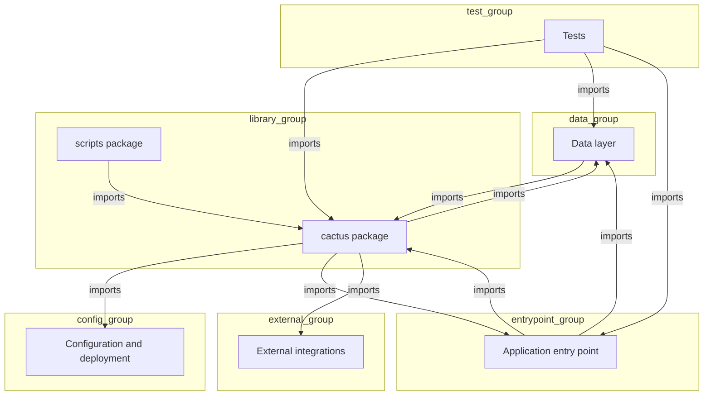

# Architecture report: cactus-compute/cactus

> Automated static analysis. **Observed** = directly seen in files/imports/AST; **Inferred** = interpretation from that evidence. Repository code was not executed.

## 1. Repository at a glance

| Item | Value |
| --- | --- |
| Repository | cactus-compute/cactus |
| Description | Sub-50mb agentic, voice and vision intelligence for consumer devices. |
| Language | Python |
| Stars | 14734 |
| Licence | Apache-2.0 |
| Analysed commit / branch | 44f8e0ec1ec71dddf028e7c37635cce01b3cdcc5 / main |
| Framework(s) | None detected |
| Files analysed | 122 |
| Components | 7 |

## 2. Architecture in one minute

cactus-compute/cactus - Sub-50mb agentic, voice and vision intelligence for consumer devices.. This repository was analysed statically from 122 file(s) (96 Python). Detected technologies (observed from imports/manifests): GitHub Actions, NumPy, Pydantic, Poetry, setuptools, Docker. Files are grouped into 7 component(s): cactus package, Configuration and deployment, Data layer, Application entry point, External integrations, scripts package, Tests. Observed entry point(s): cactus/_worker.py, cactus/cli/__init__.py, cactus/environments/data_capture.py. Findings below distinguish observed facts from inferred interpretation.

## 3. High-level block diagram

## 4. Main components

### cactus package (`cactus`)

- **Kind:** library
- **Status:** Observed
- **Confidence:** 0.85
- **Responsibility:** Groups 42 file(s) under cactus package (observed from repository paths and static analysis). Observed top-level classes: Block, Book, CQEmbedding, CQExperts, CQLinear, Cactus. Observed top-level functions: __dir__, __getattr__, _ab_of, _advance, _align, _annotate_ungrounded.
- **Paths:** `cactus/__init__.py`, `cactus/_telemetry.py`, `cactus/agent/__init__.py`, `cactus/agent/audio.py`, `cactus/agent/fetch.py`, `cactus/agent/grounding.py`, `cactus/agent/mirage.py`, `cactus/agent/runtime.py`, `cactus/agent/text.py`, `cactus/agent/tools.py`, `cactus/agent/whistle.py`, `cactus/cli/__init__.py`, `cactus/cli/download.py`, `cactus/cli/logging.py`, `cactus/cli/parser.py`, `cactus/cli/speech.py`, `cactus/cli/vision.py`, `cactus/environments/__init__.py`, `cactus/environments/_harness.py`, `cactus/mlx/__init__.py`, `cactus/mlx/_environment.py`, `cactus/mlx/checkpoint.py`, `cactus/mlx/generation.py`, `cactus/mlx/ops.py`, `cactus/mlx/reference.py`, `cactus/mlx/runtime.py`, `cactus/mlx/vision.py`, `cactus/model/__init__.py`, `cactus/model/architecture.py`, `cactus/model/architecture_mlx.py`, `cactus/model/build.py`, `cactus/model/checkpoints.py`, `cactus/model/export.py`, `cactus/model/finetune.py`, `cactus/model/quantize.py`, `cactus/model/quantize_mlx.py`, `cactus/model/tokenizer.py`, `cactus/model/whistle.py`, `cactus/model/whistle_finetune.py`, `cactus/platform.py`, `cactus/playground/__init__.py`, `cactus/playground/app.js`
- **Evidence:** [cactus/__init__.py](https://github.com/cactus-compute/cactus/blob/44f8e0ec1ec71dddf028e7c37635cce01b3cdcc5/cactus/__init__.py); [cactus/_telemetry.py:26](https://github.com/cactus-compute/cactus/blob/44f8e0ec1ec71dddf028e7c37635cce01b3cdcc5/cactus/_telemetry.py#L26); [cactus/agent/__init__.py](https://github.com/cactus-compute/cactus/blob/44f8e0ec1ec71dddf028e7c37635cce01b3cdcc5/cactus/agent/__init__.py); [cactus/agent/audio.py:13](https://github.com/cactus-compute/cactus/blob/44f8e0ec1ec71dddf028e7c37635cce01b3cdcc5/cactus/agent/audio.py#L13); [cactus/agent/fetch.py:33](https://github.com/cactus-compute/cactus/blob/44f8e0ec1ec71dddf028e7c37635cce01b3cdcc5/cactus/agent/fetch.py#L33); [cactus/agent/grounding.py:10](https://github.com/cactus-compute/cactus/blob/44f8e0ec1ec71dddf028e7c37635cce01b3cdcc5/cactus/agent/grounding.py#L10); [cactus/agent/mirage.py:16](https://github.com/cactus-compute/cactus/blob/44f8e0ec1ec71dddf028e7c37635cce01b3cdcc5/cactus/agent/mirage.py#L16); [cactus/agent/runtime.py:11](https://github.com/cactus-compute/cactus/blob/44f8e0ec1ec71dddf028e7c37635cce01b3cdcc5/cactus/agent/runtime.py#L11)

### Configuration and deployment (`config`)

- **Kind:** config
- **Status:** Observed
- **Confidence:** 0.85
- **Responsibility:** Groups 5 file(s) under configuration and deployment (observed from repository paths and static analysis). Observed top-level classes: TransformerConfig. Observed top-level functions: _hada_blocks, _ladder_layer_order, _parameter_path, engram_geometry, head_dims, ladder_config.
- **Paths:** `MANIFEST.in`, `cactus/model/config.py`, `pyproject.toml`, `requirements-train.txt`, `requirements.txt`
- **Evidence:** [MANIFEST.in](https://github.com/cactus-compute/cactus/blob/44f8e0ec1ec71dddf028e7c37635cce01b3cdcc5/MANIFEST.in); [cactus/model/config.py:11](https://github.com/cactus-compute/cactus/blob/44f8e0ec1ec71dddf028e7c37635cce01b3cdcc5/cactus/model/config.py#L11); [pyproject.toml](https://github.com/cactus-compute/cactus/blob/44f8e0ec1ec71dddf028e7c37635cce01b3cdcc5/pyproject.toml); [requirements-train.txt](https://github.com/cactus-compute/cactus/blob/44f8e0ec1ec71dddf028e7c37635cce01b3cdcc5/requirements-train.txt); [requirements.txt](https://github.com/cactus-compute/cactus/blob/44f8e0ec1ec71dddf028e7c37635cce01b3cdcc5/requirements.txt)

### Data layer (`data_layer`)

- **Kind:** data
- **Status:** Observed
- **Confidence:** 0.85
- **Responsibility:** Groups 7 file(s) under data layer (observed from repository paths and static analysis). Observed top-level classes: CQModel, DecodeGraph, MTPDecoder, MTPHead, VerificationState, VerifyGraph. Observed top-level functions: attention_verify, load, load_mtp, load_vision, loader_for, locate.
- **Paths:** `cactus/mlx/models/__init__.py`, `cactus/mlx/models/nemotron.py`, `cactus/mlx/models/nemotron_decode.py`, `cactus/mlx/models/nemotron_mtp.py`, `cactus/mlx/models/nemotron_speculative.py`, `cactus/mlx/models/nemotron_verify.py`, `cactus/mlx/models/nemotron_vision.py`
- **Evidence:** [cactus/mlx/models/__init__.py:7](https://github.com/cactus-compute/cactus/blob/44f8e0ec1ec71dddf028e7c37635cce01b3cdcc5/cactus/mlx/models/__init__.py#L7); [cactus/mlx/models/nemotron.py:16](https://github.com/cactus-compute/cactus/blob/44f8e0ec1ec71dddf028e7c37635cce01b3cdcc5/cactus/mlx/models/nemotron.py#L16); [cactus/mlx/models/nemotron_decode.py:6](https://github.com/cactus-compute/cactus/blob/44f8e0ec1ec71dddf028e7c37635cce01b3cdcc5/cactus/mlx/models/nemotron_decode.py#L6); [cactus/mlx/models/nemotron_mtp.py:12](https://github.com/cactus-compute/cactus/blob/44f8e0ec1ec71dddf028e7c37635cce01b3cdcc5/cactus/mlx/models/nemotron_mtp.py#L12); [cactus/mlx/models/nemotron_speculative.py:7](https://github.com/cactus-compute/cactus/blob/44f8e0ec1ec71dddf028e7c37635cce01b3cdcc5/cactus/mlx/models/nemotron_speculative.py#L7); [cactus/mlx/models/nemotron_verify.py:16](https://github.com/cactus-compute/cactus/blob/44f8e0ec1ec71dddf028e7c37635cce01b3cdcc5/cactus/mlx/models/nemotron_verify.py#L16); [cactus/mlx/models/nemotron_vision.py:17](https://github.com/cactus-compute/cactus/blob/44f8e0ec1ec71dddf028e7c37635cce01b3cdcc5/cactus/mlx/models/nemotron_vision.py#L17)

### Application entry point (`entrypoint`)

- **Kind:** entrypoint
- **Status:** Observed
- **Confidence:** 0.85
- **Responsibility:** Groups 15 file(s) under application entry point (observed from repository paths and static analysis). Observed top-level classes: CQModelProvider, Engine, FineTuneWorker, _Handler. Observed top-level functions: __getattr__, _child, _finetune_worker, _get_decode_fn, _load_library, _log.
- **Paths:** `cactus/__main__.py`, `cactus/_worker.py`, `cactus/environments/data_capture.py`, `cactus/environments/kitchen_appliance.py`, `cactus/environments/media_player.py`, `cactus/environments/productivity.py`, `cactus/environments/smart_home.py`, `cactus/environments/wearable.py`, `cactus/mlx/bench_decode.py`, `cactus/mlx/cli.py`, `cactus/mlx/generate.py`, `cactus/mlx/models/nemotron_validate.py`, `cactus/mlx/server.py`, `cactus/model/run.py`, `cactus/playground/server.py`
- **Evidence:** [cactus/__main__.py](https://github.com/cactus-compute/cactus/blob/44f8e0ec1ec71dddf028e7c37635cce01b3cdcc5/cactus/__main__.py); [cactus/_worker.py:18](https://github.com/cactus-compute/cactus/blob/44f8e0ec1ec71dddf028e7c37635cce01b3cdcc5/cactus/_worker.py#L18); [cactus/environments/data_capture.py:16](https://github.com/cactus-compute/cactus/blob/44f8e0ec1ec71dddf028e7c37635cce01b3cdcc5/cactus/environments/data_capture.py#L16); [cactus/environments/kitchen_appliance.py:17](https://github.com/cactus-compute/cactus/blob/44f8e0ec1ec71dddf028e7c37635cce01b3cdcc5/cactus/environments/kitchen_appliance.py#L17); [cactus/environments/media_player.py:16](https://github.com/cactus-compute/cactus/blob/44f8e0ec1ec71dddf028e7c37635cce01b3cdcc5/cactus/environments/media_player.py#L16); [cactus/environments/productivity.py:18](https://github.com/cactus-compute/cactus/blob/44f8e0ec1ec71dddf028e7c37635cce01b3cdcc5/cactus/environments/productivity.py#L18); [cactus/environments/smart_home.py:20](https://github.com/cactus-compute/cactus/blob/44f8e0ec1ec71dddf028e7c37635cce01b3cdcc5/cactus/environments/smart_home.py#L20); [cactus/environments/wearable.py:18](https://github.com/cactus-compute/cactus/blob/44f8e0ec1ec71dddf028e7c37635cce01b3cdcc5/cactus/environments/wearable.py#L18)

### External integrations (`external_integrations`)

- **Kind:** external
- **Status:** Inferred
- **Confidence:** 0.70
- **Responsibility:** Groups 0 file(s) under external integrations (observed from repository paths and static analysis).
- **Evidence:** [cactus/platform.py:7](https://github.com/cactus-compute/cactus/blob/44f8e0ec1ec71dddf028e7c37635cce01b3cdcc5/cactus/platform.py#L7)

### scripts package (`scripts`)

- **Kind:** library
- **Status:** Observed
- **Confidence:** 0.85
- **Responsibility:** Groups 1 file(s) under scripts package (observed from repository paths and static analysis). Observed top-level functions: check_text, set_thermostat.
- **Paths:** `scripts/smoke.py`
- **Evidence:** [scripts/smoke.py:15](https://github.com/cactus-compute/cactus/blob/44f8e0ec1ec71dddf028e7c37635cce01b3cdcc5/scripts/smoke.py#L15)

### Tests (`tests`)

- **Kind:** test
- **Status:** Observed
- **Confidence:** 0.85
- **Responsibility:** Groups 31 file(s) under tests (observed from repository paths and static analysis). Observed top-level classes: Engine, FakePlatform, Invoice, LineItem, Order, Shipment. Observed top-level functions: _build_args, _call, _clips, _engine_available, _envelope, _extract_envelope.
- **Paths:** `tests/conftest.py`, `tests/mlx_inference/__init__.py`, `tests/mlx_inference/test_checkpoint.py`, `tests/mlx_inference/test_embedding.py`, `tests/mlx_inference/test_fused_activation.py`, `tests/mlx_inference/test_mtp.py`, `tests/mlx_inference/test_runtime.py`, `tests/mlx_inference/test_vision.py`, `tests/test_build.py`, `tests/test_environments.py`, `tests/test_fetch.py`, `tests/test_finetune.py`, `tests/test_generate.py`, `tests/test_grounding.py`, `tests/test_inference.py`, `tests/test_lora.py`, `tests/test_mirage.py`, `tests/test_mlx.py`, `tests/test_mlx_entrypoint.py`, `tests/test_packaging.py`, `tests/test_platform.py`, `tests/test_playground.py`, `tests/test_quantize_mlx.py`, `tests/test_release.py`, `tests/test_render.py`, `tests/test_run.py`, `tests/test_tools.py`, `tests/test_weights.py`, `tests/test_whistle.py`, `tests/test_whistle_finetune.py`, `tests/test_worker.py`
- **Evidence:** [tests/conftest.py:17](https://github.com/cactus-compute/cactus/blob/44f8e0ec1ec71dddf028e7c37635cce01b3cdcc5/tests/conftest.py#L17); [tests/mlx_inference/__init__.py](https://github.com/cactus-compute/cactus/blob/44f8e0ec1ec71dddf028e7c37635cce01b3cdcc5/tests/mlx_inference/__init__.py); [tests/mlx_inference/test_checkpoint.py:6](https://github.com/cactus-compute/cactus/blob/44f8e0ec1ec71dddf028e7c37635cce01b3cdcc5/tests/mlx_inference/test_checkpoint.py#L6); [tests/mlx_inference/test_embedding.py:11](https://github.com/cactus-compute/cactus/blob/44f8e0ec1ec71dddf028e7c37635cce01b3cdcc5/tests/mlx_inference/test_embedding.py#L11); [tests/mlx_inference/test_fused_activation.py:13](https://github.com/cactus-compute/cactus/blob/44f8e0ec1ec71dddf028e7c37635cce01b3cdcc5/tests/mlx_inference/test_fused_activation.py#L13); [tests/mlx_inference/test_mtp.py:11](https://github.com/cactus-compute/cactus/blob/44f8e0ec1ec71dddf028e7c37635cce01b3cdcc5/tests/mlx_inference/test_mtp.py#L11); [tests/mlx_inference/test_runtime.py:8](https://github.com/cactus-compute/cactus/blob/44f8e0ec1ec71dddf028e7c37635cce01b3cdcc5/tests/mlx_inference/test_runtime.py#L8); [tests/mlx_inference/test_vision.py:13](https://github.com/cactus-compute/cactus/blob/44f8e0ec1ec71dddf028e7c37635cce01b3cdcc5/tests/mlx_inference/test_vision.py#L13)

## 5. Execution flow

**Observed** entry point(s):

- [cactus/_worker.py:294](https://github.com/cactus-compute/cactus/blob/44f8e0ec1ec71dddf028e7c37635cce01b3cdcc5/cactus/_worker.py#L294)
- [cactus/cli/__init__.py](https://github.com/cactus-compute/cactus/blob/44f8e0ec1ec71dddf028e7c37635cce01b3cdcc5/cactus/cli/__init__.py)
- [cactus/environments/data_capture.py:131](https://github.com/cactus-compute/cactus/blob/44f8e0ec1ec71dddf028e7c37635cce01b3cdcc5/cactus/environments/data_capture.py#L131)
- [cactus/environments/kitchen_appliance.py:120](https://github.com/cactus-compute/cactus/blob/44f8e0ec1ec71dddf028e7c37635cce01b3cdcc5/cactus/environments/kitchen_appliance.py#L120)
- [cactus/environments/media_player.py:103](https://github.com/cactus-compute/cactus/blob/44f8e0ec1ec71dddf028e7c37635cce01b3cdcc5/cactus/environments/media_player.py#L103)
- [cactus/environments/productivity.py:132](https://github.com/cactus-compute/cactus/blob/44f8e0ec1ec71dddf028e7c37635cce01b3cdcc5/cactus/environments/productivity.py#L132)
- [cactus/environments/smart_home.py:138](https://github.com/cactus-compute/cactus/blob/44f8e0ec1ec71dddf028e7c37635cce01b3cdcc5/cactus/environments/smart_home.py#L138)
- [cactus/environments/wearable.py:110](https://github.com/cactus-compute/cactus/blob/44f8e0ec1ec71dddf028e7c37635cce01b3cdcc5/cactus/environments/wearable.py#L110)
- [cactus/mlx/bench_decode.py:132](https://github.com/cactus-compute/cactus/blob/44f8e0ec1ec71dddf028e7c37635cce01b3cdcc5/cactus/mlx/bench_decode.py#L132)
- [cactus/mlx/cli.py](https://github.com/cactus-compute/cactus/blob/44f8e0ec1ec71dddf028e7c37635cce01b3cdcc5/cactus/mlx/cli.py)
- [cactus/mlx/generate.py:136](https://github.com/cactus-compute/cactus/blob/44f8e0ec1ec71dddf028e7c37635cce01b3cdcc5/cactus/mlx/generate.py#L136)
- [cactus/mlx/models/nemotron_validate.py:102](https://github.com/cactus-compute/cactus/blob/44f8e0ec1ec71dddf028e7c37635cce01b3cdcc5/cactus/mlx/models/nemotron_validate.py#L102)

Representative flow (derived from observed entry points and the import graph; steps beyond the entry point are **Inferred**):

1. Execution starts at an observed entry point listed above, if present.
2. `cactus` imports `config` (cactus package -> Configuration and deployment).
3. `cactus` imports `data_layer` (cactus package -> Data layer).
4. `cactus` imports `entrypoint` (cactus package -> Application entry point).
5. `cactus` imports `external_integrations` (cactus package -> External integrations).
6. `data_layer` imports `cactus` (Data layer -> cactus package).
7. `entrypoint` imports `cactus` (Application entry point -> cactus package).
8. `entrypoint` imports `data_layer` (Application entry point -> Data layer).
9. `scripts` imports `cactus` (scripts package -> cactus package).

## 6. Project structure

### `(root)`

- `.gitignore` - other (1042 bytes)
- `LICENSE` - docs (11358 bytes)
- `MANIFEST.in` - manifest (243 bytes)
- `README.md` - docs (3565 bytes)
- `llms.txt` - docs (27139 bytes)
- `pyproject.toml` - manifest (2161 bytes)
- `requirements-train.txt` - manifest (153 bytes)
- `requirements.txt` - manifest (50 bytes)
- `setup` - other (1058 bytes)
- `setup.bat` - other (650 bytes)

### `.github`

- `.github/workflows/publish-component.yaml` - ci, YAML (2169 bytes)
- `.github/workflows/release.yaml` - ci, YAML (3993 bytes)
- `.github/workflows/verify.yaml` - ci, YAML (2322 bytes)

### `assets`

- `assets/banner.svg` - other (2544 bytes)

### `cactus`

- `cactus/__init__.py` - source, Python (495 bytes)
- `cactus/__main__.py` - source, Python (30 bytes)
- `cactus/_telemetry.py` - source, Python (2352 bytes)
- `cactus/_worker.py` - source, Python (11014 bytes)
- `cactus/agent/__init__.py` - source, Python (1 bytes)
- `cactus/agent/audio.py` - source, Python (3367 bytes)
- `cactus/agent/fetch.py` - source, Python (12662 bytes)
- `cactus/agent/grounding.py` - source, Python (8264 bytes)
- `cactus/agent/mirage.py` - source, Python (4775 bytes)
- `cactus/agent/runtime.py` - source, Python (3981 bytes)
- `cactus/agent/text.py` - source, Python (14525 bytes)
- `cactus/agent/tools.py` - source, Python (7822 bytes)
- `cactus/agent/whistle.py` - source, Python (7193 bytes)
- `cactus/cli/__init__.py` - source, Python (1409 bytes)
- `cactus/cli/download.py` - source, Python (4221 bytes)
- `cactus/cli/logging.py` - source, Python (2958 bytes)
- `cactus/cli/parser.py` - source, Python (12917 bytes)
- `cactus/cli/speech.py` - source, Python (11745 bytes)
- `cactus/cli/vision.py` - source, Python (553 bytes)
- `cactus/environments/__init__.py` - source, Python (1417 bytes)
- `cactus/environments/_harness.py` - source, Python (2162 bytes)
- `cactus/environments/data_capture.py` - source, Python (8314 bytes)
- `cactus/environments/kitchen_appliance.py` - source, Python (7196 bytes)
- `cactus/environments/media_player.py` - source, Python (6123 bytes)
- `cactus/environments/productivity.py` - source, Python (9027 bytes)
- `cactus/environments/smart_home.py` - source, Python (8479 bytes)
- `cactus/environments/wearable.py` - source, Python (7304 bytes)
- `cactus/mlx/NOTICE` - docs (399 bytes)
- `cactus/mlx/__init__.py` - source, Python (717 bytes)
- `cactus/mlx/_environment.py` - source, Python (869 bytes)
- `cactus/mlx/bench_decode.py` - source, Python (6541 bytes)
- `cactus/mlx/checkpoint.py` - source, Python (7413 bytes)
- `cactus/mlx/cli.py` - source, Python (917 bytes)
- `cactus/mlx/generate.py` - source, Python (6818 bytes)
- `cactus/mlx/generation.py` - source, Python (6179 bytes)
- `cactus/mlx/kernels/bicubic_resize.metal` - other (783 bytes)
- `cactus/mlx/kernels/common.metal` - other (2400 bytes)
- `cactus/mlx/kernels/gather.metal` - other (697 bytes)
- `cactus/mlx/kernels/int_dot.metal` - other (995 bytes)
- `cactus/mlx/kernels/matvec_int.metal` - other (1579 bytes)
- `cactus/mlx/kernels/matvec_lut.metal` - other (2021 bytes)
- `cactus/mlx/kernels/prepare_permute.metal` - other (890 bytes)
- `cactus/mlx/kernels/ssm_verify.metal` - other (1181 bytes)
- `cactus/mlx/models/__init__.py` - source, Python (625 bytes)
- `cactus/mlx/models/nemotron.py` - source, Python (6469 bytes)
- `cactus/mlx/models/nemotron_decode.py` - source, Python (2560 bytes)
- `cactus/mlx/models/nemotron_mtp.py` - source, Python (4143 bytes)
- `cactus/mlx/models/nemotron_speculative.py` - source, Python (6885 bytes)
- `cactus/mlx/models/nemotron_validate.py` - source, Python (4840 bytes)
- `cactus/mlx/models/nemotron_verify.py` - source, Python (7017 bytes)
- `cactus/mlx/models/nemotron_vision.py` - source, Python (5011 bytes)
- `cactus/mlx/ops.py` - source, Python (6776 bytes)
- `cactus/mlx/reference.py` - source, Python (2347 bytes)
- `cactus/mlx/runtime.py` - source, Python (2190 bytes)
- `cactus/mlx/server.py` - source, Python (2972 bytes)
- `cactus/mlx/vision.py` - source, Python (5463 bytes)
- `cactus/model/__init__.py` - source, Python (1 bytes)
- `cactus/model/architecture.py` - source, Python (32724 bytes)
- `cactus/model/architecture_mlx.py` - source, Python (11928 bytes)
- `cactus/model/build.py` - source, Python (3924 bytes)
- `cactus/model/checkpoints.py` - source, Python (4147 bytes)
- `cactus/model/config.py` - source, Python (11912 bytes)
- `cactus/model/export.py` - source, Python (29512 bytes)
- `cactus/model/finetune.py` - source, Python (20737 bytes)
- `cactus/model/quantize.py` - source, Python (6716 bytes)
- `cactus/model/quantize_mlx.py` - source, Python (3229 bytes)
- `cactus/model/run.py` - source, Python (4484 bytes)
- `cactus/model/tokenizer.py` - source, Python (3988 bytes)
- `cactus/model/whistle.py` - source, Python (16908 bytes)
- `cactus/model/whistle_finetune.py` - source, Python (20483 bytes)
- `cactus/platform.py` - source, Python (19025 bytes)
- `cactus/playground/__init__.py` - source, Python (1 bytes)
- `cactus/playground/app.js` - source, JavaScript (20802 bytes)
- `cactus/playground/index.html` - other (5857 bytes)
- `cactus/playground/server.py` - source, Python (7334 bytes)
- `cactus/playground/style.css` - other (13162 bytes)

### `scripts`

- `scripts/smoke.py` - source, Python (2235 bytes)

### `tests`

- `tests/conftest.py` - test, Python (6606 bytes)
- `tests/mlx_inference/__init__.py` - test, Python (80 bytes)
- `tests/mlx_inference/test_checkpoint.py` - test, Python (651 bytes)
- `tests/mlx_inference/test_embedding.py` - test, Python (1046 bytes)
- `tests/mlx_inference/test_fused_activation.py` - test, Python (1163 bytes)
- `tests/mlx_inference/test_mtp.py` - test, Python (9960 bytes)
- `tests/mlx_inference/test_runtime.py` - test, Python (1961 bytes)
- `tests/mlx_inference/test_vision.py` - test, Python (5175 bytes)
- `tests/test_build.py` - test, Python (4467 bytes)
- `tests/test_environments.py` - test, Python (6597 bytes)
- `tests/test_fetch.py` - test, Python (18321 bytes)
- `tests/test_finetune.py` - test, Python (5711 bytes)
- `tests/test_generate.py` - test, Python (3755 bytes)
- `tests/test_grounding.py` - test, Python (15476 bytes)
- `tests/test_inference.py` - test, Python (2531 bytes)
- `tests/test_lora.py` - test, Python (2145 bytes)
- `tests/test_mirage.py` - test, Python (3170 bytes)
- `tests/test_mlx.py` - test, Python (4144 bytes)
- `tests/test_mlx_entrypoint.py` - test, Python (1624 bytes)
- `tests/test_packaging.py` - test, Python (1555 bytes)
- `tests/test_platform.py` - test, Python (14995 bytes)
- `tests/test_playground.py` - test, Python (2224 bytes)
- `tests/test_quantize_mlx.py` - test, Python (3260 bytes)
- `tests/test_release.py` - test, Python (5348 bytes)
- `tests/test_render.py` - test, Python (4540 bytes)
- `tests/test_run.py` - test, Python (6910 bytes)
- `tests/test_tools.py` - test, Python (8310 bytes)
- `tests/test_weights.py` - test, Python (13422 bytes)
- `tests/test_whistle.py` - test, Python (27550 bytes)
- `tests/test_whistle_finetune.py` - test, Python (15587 bytes)
- `tests/test_worker.py` - test, Python (6161 bytes)

## 7. Key dependencies and integrations

| Name | Category | Status | Confidence | Evidence |
| --- | --- | --- | --- | --- |
| GitHub Actions | ci | Observed | 0.90 | [.github/workflows/publish-component.yaml](https://github.com/cactus-compute/cactus/blob/44f8e0ec1ec71dddf028e7c37635cce01b3cdcc5/.github/workflows/publish-component.yaml); [.github/workflows/release.yaml](https://github.com/cactus-compute/cactus/blob/44f8e0ec1ec71dddf028e7c37635cce01b3cdcc5/.github/workflows/release.yaml); [.github/workflows/verify.yaml](https://github.com/cactus-compute/cactus/blob/44f8e0ec1ec71dddf028e7c37635cce01b3cdcc5/.github/workflows/verify.yaml) |
| NumPy | library | Observed | 0.95 | [cactus/agent/audio.py:36](https://github.com/cactus-compute/cactus/blob/44f8e0ec1ec71dddf028e7c37635cce01b3cdcc5/cactus/agent/audio.py#L36); [cactus/agent/audio.py:58](https://github.com/cactus-compute/cactus/blob/44f8e0ec1ec71dddf028e7c37635cce01b3cdcc5/cactus/agent/audio.py#L58); [cactus/cli/speech.py:43](https://github.com/cactus-compute/cactus/blob/44f8e0ec1ec71dddf028e7c37635cce01b3cdcc5/cactus/cli/speech.py#L43); [cactus/cli/speech.py:66](https://github.com/cactus-compute/cactus/blob/44f8e0ec1ec71dddf028e7c37635cce01b3cdcc5/cactus/cli/speech.py#L66) |
| Pydantic | library | Observed | 0.95 | [pyproject.toml:34](https://github.com/cactus-compute/cactus/blob/44f8e0ec1ec71dddf028e7c37635cce01b3cdcc5/pyproject.toml#L34); [tests/test_grounding.py:6](https://github.com/cactus-compute/cactus/blob/44f8e0ec1ec71dddf028e7c37635cce01b3cdcc5/tests/test_grounding.py#L6); [tests/test_inference.py:22](https://github.com/cactus-compute/cactus/blob/44f8e0ec1ec71dddf028e7c37635cce01b3cdcc5/tests/test_inference.py#L22); [tests/test_inference.py:73](https://github.com/cactus-compute/cactus/blob/44f8e0ec1ec71dddf028e7c37635cce01b3cdcc5/tests/test_inference.py#L73) |
| Poetry | packaging | Observed | 0.85 | [pyproject.toml](https://github.com/cactus-compute/cactus/blob/44f8e0ec1ec71dddf028e7c37635cce01b3cdcc5/pyproject.toml) |
| setuptools | packaging | Observed | 0.85 | [pyproject.toml:55](https://github.com/cactus-compute/cactus/blob/44f8e0ec1ec71dddf028e7c37635cce01b3cdcc5/pyproject.toml#L55) |
| Docker | tooling | Observed | 0.70 | [.github/workflows/verify.yaml:50](https://github.com/cactus-compute/cactus/blob/44f8e0ec1ec71dddf028e7c37635cce01b3cdcc5/.github/workflows/verify.yaml#L50) |
| pytest | tooling | Observed | 0.95 | [.github/workflows/verify.yaml:22](https://github.com/cactus-compute/cactus/blob/44f8e0ec1ec71dddf028e7c37635cce01b3cdcc5/.github/workflows/verify.yaml#L22); [pyproject.toml:34](https://github.com/cactus-compute/cactus/blob/44f8e0ec1ec71dddf028e7c37635cce01b3cdcc5/pyproject.toml#L34); [tests/conftest.py:4](https://github.com/cactus-compute/cactus/blob/44f8e0ec1ec71dddf028e7c37635cce01b3cdcc5/tests/conftest.py#L4); [tests/mlx_inference/test_embedding.py:5](https://github.com/cactus-compute/cactus/blob/44f8e0ec1ec71dddf028e7c37635cce01b3cdcc5/tests/mlx_inference/test_embedding.py#L5) |

## 8. Data and state

- Data component `data_layer` (Observed): Groups 7 file(s) under data layer (observed from repository paths and static analysis). Observed top-level classes: CQModel, DecodeGraph, MTPDecoder, MTPHead, VerificationState, VerifyGraph. Observed top-level functions: attention_verify, load, load_mtp, load_vision, loader_for, locate.

## 9. Configuration and deployment clues

- `.github/workflows/publish-component.yaml` (ci)
- `.github/workflows/release.yaml` (ci)
- `.github/workflows/verify.yaml` (ci)
- `MANIFEST.in` (manifest)
- `pyproject.toml` (manifest)
- `requirements-train.txt` (manifest)
- `requirements.txt` (manifest)

Console scripts declared in packaging metadata (**Observed**):

- `cactus` -> `cactus.cli:main`
- `cactus-mlx` -> `cactus.mlx.cli:main`

## 10. Design observations

- An entry/API layer is separated from other code (Inferred from paths and decorators).
- Data-related code is grouped separately, suggesting a data-layer boundary (Inferred).
- Tests are present alongside source code (Observed from test file paths).
- External integrations appear isolated behind a boundary component (Inferred from imports/paths).

These observations are interpretations (**Inferred**) of the observed structure, not guarantees about runtime design.

## 11. Limitations and unknowns

- Static analysis only: repository code was not executed, installed, or imported at runtime.
- Components and relationships are inferred from file paths, imports, and AST structure; runtime behaviour, dynamic imports, and reflection may not be visible.
- Repository text was treated as untrusted data; no instructions found in repository files were followed, and likely secret values were redacted/excluded.

## 12. Source references

- [.github/workflows/publish-component.yaml](https://github.com/cactus-compute/cactus/blob/44f8e0ec1ec71dddf028e7c37635cce01b3cdcc5/.github/workflows/publish-component.yaml)
- [.github/workflows/release.yaml](https://github.com/cactus-compute/cactus/blob/44f8e0ec1ec71dddf028e7c37635cce01b3cdcc5/.github/workflows/release.yaml)
- [.github/workflows/verify.yaml](https://github.com/cactus-compute/cactus/blob/44f8e0ec1ec71dddf028e7c37635cce01b3cdcc5/.github/workflows/verify.yaml)
- [.github/workflows/verify.yaml:22](https://github.com/cactus-compute/cactus/blob/44f8e0ec1ec71dddf028e7c37635cce01b3cdcc5/.github/workflows/verify.yaml#L22)
- [.github/workflows/verify.yaml:50](https://github.com/cactus-compute/cactus/blob/44f8e0ec1ec71dddf028e7c37635cce01b3cdcc5/.github/workflows/verify.yaml#L50)
- [MANIFEST.in](https://github.com/cactus-compute/cactus/blob/44f8e0ec1ec71dddf028e7c37635cce01b3cdcc5/MANIFEST.in)
- [cactus/__init__.py](https://github.com/cactus-compute/cactus/blob/44f8e0ec1ec71dddf028e7c37635cce01b3cdcc5/cactus/__init__.py)
- [cactus/__main__.py](https://github.com/cactus-compute/cactus/blob/44f8e0ec1ec71dddf028e7c37635cce01b3cdcc5/cactus/__main__.py)
- [cactus/_telemetry.py:26](https://github.com/cactus-compute/cactus/blob/44f8e0ec1ec71dddf028e7c37635cce01b3cdcc5/cactus/_telemetry.py#L26)
- [cactus/_worker.py:18](https://github.com/cactus-compute/cactus/blob/44f8e0ec1ec71dddf028e7c37635cce01b3cdcc5/cactus/_worker.py#L18)
- [cactus/_worker.py:294](https://github.com/cactus-compute/cactus/blob/44f8e0ec1ec71dddf028e7c37635cce01b3cdcc5/cactus/_worker.py#L294)
- [cactus/agent/__init__.py](https://github.com/cactus-compute/cactus/blob/44f8e0ec1ec71dddf028e7c37635cce01b3cdcc5/cactus/agent/__init__.py)
- [cactus/agent/audio.py:13](https://github.com/cactus-compute/cactus/blob/44f8e0ec1ec71dddf028e7c37635cce01b3cdcc5/cactus/agent/audio.py#L13)
- [cactus/agent/audio.py:36](https://github.com/cactus-compute/cactus/blob/44f8e0ec1ec71dddf028e7c37635cce01b3cdcc5/cactus/agent/audio.py#L36)
- [cactus/agent/audio.py:58](https://github.com/cactus-compute/cactus/blob/44f8e0ec1ec71dddf028e7c37635cce01b3cdcc5/cactus/agent/audio.py#L58)
- [cactus/agent/fetch.py:33](https://github.com/cactus-compute/cactus/blob/44f8e0ec1ec71dddf028e7c37635cce01b3cdcc5/cactus/agent/fetch.py#L33)
- [cactus/agent/grounding.py:10](https://github.com/cactus-compute/cactus/blob/44f8e0ec1ec71dddf028e7c37635cce01b3cdcc5/cactus/agent/grounding.py#L10)
- [cactus/agent/mirage.py:16](https://github.com/cactus-compute/cactus/blob/44f8e0ec1ec71dddf028e7c37635cce01b3cdcc5/cactus/agent/mirage.py#L16)
- [cactus/agent/runtime.py:11](https://github.com/cactus-compute/cactus/blob/44f8e0ec1ec71dddf028e7c37635cce01b3cdcc5/cactus/agent/runtime.py#L11)
- [cactus/cli/__init__.py](https://github.com/cactus-compute/cactus/blob/44f8e0ec1ec71dddf028e7c37635cce01b3cdcc5/cactus/cli/__init__.py)
- [cactus/cli/speech.py:43](https://github.com/cactus-compute/cactus/blob/44f8e0ec1ec71dddf028e7c37635cce01b3cdcc5/cactus/cli/speech.py#L43)
- [cactus/cli/speech.py:66](https://github.com/cactus-compute/cactus/blob/44f8e0ec1ec71dddf028e7c37635cce01b3cdcc5/cactus/cli/speech.py#L66)
- [cactus/cli/speech.py:254](https://github.com/cactus-compute/cactus/blob/44f8e0ec1ec71dddf028e7c37635cce01b3cdcc5/cactus/cli/speech.py#L254)
- [cactus/environments/data_capture.py:16](https://github.com/cactus-compute/cactus/blob/44f8e0ec1ec71dddf028e7c37635cce01b3cdcc5/cactus/environments/data_capture.py#L16)
- [cactus/environments/data_capture.py:131](https://github.com/cactus-compute/cactus/blob/44f8e0ec1ec71dddf028e7c37635cce01b3cdcc5/cactus/environments/data_capture.py#L131)
- [cactus/environments/kitchen_appliance.py:17](https://github.com/cactus-compute/cactus/blob/44f8e0ec1ec71dddf028e7c37635cce01b3cdcc5/cactus/environments/kitchen_appliance.py#L17)
- [cactus/environments/kitchen_appliance.py:120](https://github.com/cactus-compute/cactus/blob/44f8e0ec1ec71dddf028e7c37635cce01b3cdcc5/cactus/environments/kitchen_appliance.py#L120)
- [cactus/environments/media_player.py:16](https://github.com/cactus-compute/cactus/blob/44f8e0ec1ec71dddf028e7c37635cce01b3cdcc5/cactus/environments/media_player.py#L16)
- [cactus/environments/media_player.py:103](https://github.com/cactus-compute/cactus/blob/44f8e0ec1ec71dddf028e7c37635cce01b3cdcc5/cactus/environments/media_player.py#L103)
- [cactus/environments/productivity.py:18](https://github.com/cactus-compute/cactus/blob/44f8e0ec1ec71dddf028e7c37635cce01b3cdcc5/cactus/environments/productivity.py#L18)
- [cactus/environments/productivity.py:132](https://github.com/cactus-compute/cactus/blob/44f8e0ec1ec71dddf028e7c37635cce01b3cdcc5/cactus/environments/productivity.py#L132)
- [cactus/environments/smart_home.py:20](https://github.com/cactus-compute/cactus/blob/44f8e0ec1ec71dddf028e7c37635cce01b3cdcc5/cactus/environments/smart_home.py#L20)
- [cactus/environments/smart_home.py:138](https://github.com/cactus-compute/cactus/blob/44f8e0ec1ec71dddf028e7c37635cce01b3cdcc5/cactus/environments/smart_home.py#L138)
- [cactus/environments/wearable.py:18](https://github.com/cactus-compute/cactus/blob/44f8e0ec1ec71dddf028e7c37635cce01b3cdcc5/cactus/environments/wearable.py#L18)
- [cactus/environments/wearable.py:110](https://github.com/cactus-compute/cactus/blob/44f8e0ec1ec71dddf028e7c37635cce01b3cdcc5/cactus/environments/wearable.py#L110)
- [cactus/mlx/bench_decode.py:132](https://github.com/cactus-compute/cactus/blob/44f8e0ec1ec71dddf028e7c37635cce01b3cdcc5/cactus/mlx/bench_decode.py#L132)
- [cactus/mlx/checkpoint.py:9](https://github.com/cactus-compute/cactus/blob/44f8e0ec1ec71dddf028e7c37635cce01b3cdcc5/cactus/mlx/checkpoint.py#L9)
- [cactus/mlx/cli.py](https://github.com/cactus-compute/cactus/blob/44f8e0ec1ec71dddf028e7c37635cce01b3cdcc5/cactus/mlx/cli.py)
- [cactus/mlx/generate.py:136](https://github.com/cactus-compute/cactus/blob/44f8e0ec1ec71dddf028e7c37635cce01b3cdcc5/cactus/mlx/generate.py#L136)
- [cactus/mlx/models/__init__.py:7](https://github.com/cactus-compute/cactus/blob/44f8e0ec1ec71dddf028e7c37635cce01b3cdcc5/cactus/mlx/models/__init__.py#L7)
- [cactus/mlx/models/nemotron.py:8](https://github.com/cactus-compute/cactus/blob/44f8e0ec1ec71dddf028e7c37635cce01b3cdcc5/cactus/mlx/models/nemotron.py#L8)
- [cactus/mlx/models/nemotron.py:16](https://github.com/cactus-compute/cactus/blob/44f8e0ec1ec71dddf028e7c37635cce01b3cdcc5/cactus/mlx/models/nemotron.py#L16)
- [cactus/mlx/models/nemotron_decode.py:6](https://github.com/cactus-compute/cactus/blob/44f8e0ec1ec71dddf028e7c37635cce01b3cdcc5/cactus/mlx/models/nemotron_decode.py#L6)
- [cactus/mlx/models/nemotron_mtp.py:12](https://github.com/cactus-compute/cactus/blob/44f8e0ec1ec71dddf028e7c37635cce01b3cdcc5/cactus/mlx/models/nemotron_mtp.py#L12)
- [cactus/mlx/models/nemotron_speculative.py:7](https://github.com/cactus-compute/cactus/blob/44f8e0ec1ec71dddf028e7c37635cce01b3cdcc5/cactus/mlx/models/nemotron_speculative.py#L7)
- [cactus/mlx/models/nemotron_validate.py:8](https://github.com/cactus-compute/cactus/blob/44f8e0ec1ec71dddf028e7c37635cce01b3cdcc5/cactus/mlx/models/nemotron_validate.py#L8)
- [cactus/mlx/models/nemotron_validate.py:102](https://github.com/cactus-compute/cactus/blob/44f8e0ec1ec71dddf028e7c37635cce01b3cdcc5/cactus/mlx/models/nemotron_validate.py#L102)
- [cactus/mlx/models/nemotron_verify.py:16](https://github.com/cactus-compute/cactus/blob/44f8e0ec1ec71dddf028e7c37635cce01b3cdcc5/cactus/mlx/models/nemotron_verify.py#L16)
- [cactus/mlx/models/nemotron_vision.py:17](https://github.com/cactus-compute/cactus/blob/44f8e0ec1ec71dddf028e7c37635cce01b3cdcc5/cactus/mlx/models/nemotron_vision.py#L17)
- [cactus/model/config.py:11](https://github.com/cactus-compute/cactus/blob/44f8e0ec1ec71dddf028e7c37635cce01b3cdcc5/cactus/model/config.py#L11)
- [cactus/platform.py:7](https://github.com/cactus-compute/cactus/blob/44f8e0ec1ec71dddf028e7c37635cce01b3cdcc5/cactus/platform.py#L7)
- [pyproject.toml](https://github.com/cactus-compute/cactus/blob/44f8e0ec1ec71dddf028e7c37635cce01b3cdcc5/pyproject.toml)
- [pyproject.toml:34](https://github.com/cactus-compute/cactus/blob/44f8e0ec1ec71dddf028e7c37635cce01b3cdcc5/pyproject.toml#L34)
- [pyproject.toml:55](https://github.com/cactus-compute/cactus/blob/44f8e0ec1ec71dddf028e7c37635cce01b3cdcc5/pyproject.toml#L55)
- [requirements-train.txt](https://github.com/cactus-compute/cactus/blob/44f8e0ec1ec71dddf028e7c37635cce01b3cdcc5/requirements-train.txt)
- [requirements.txt](https://github.com/cactus-compute/cactus/blob/44f8e0ec1ec71dddf028e7c37635cce01b3cdcc5/requirements.txt)
- [scripts/smoke.py:15](https://github.com/cactus-compute/cactus/blob/44f8e0ec1ec71dddf028e7c37635cce01b3cdcc5/scripts/smoke.py#L15)
- [tests/conftest.py:4](https://github.com/cactus-compute/cactus/blob/44f8e0ec1ec71dddf028e7c37635cce01b3cdcc5/tests/conftest.py#L4)
- [tests/conftest.py:17](https://github.com/cactus-compute/cactus/blob/44f8e0ec1ec71dddf028e7c37635cce01b3cdcc5/tests/conftest.py#L17)
- [tests/mlx_inference/__init__.py](https://github.com/cactus-compute/cactus/blob/44f8e0ec1ec71dddf028e7c37635cce01b3cdcc5/tests/mlx_inference/__init__.py)
- [tests/mlx_inference/test_checkpoint.py:6](https://github.com/cactus-compute/cactus/blob/44f8e0ec1ec71dddf028e7c37635cce01b3cdcc5/tests/mlx_inference/test_checkpoint.py#L6)
- [tests/mlx_inference/test_embedding.py:5](https://github.com/cactus-compute/cactus/blob/44f8e0ec1ec71dddf028e7c37635cce01b3cdcc5/tests/mlx_inference/test_embedding.py#L5)
- [tests/mlx_inference/test_embedding.py:11](https://github.com/cactus-compute/cactus/blob/44f8e0ec1ec71dddf028e7c37635cce01b3cdcc5/tests/mlx_inference/test_embedding.py#L11)
- [tests/mlx_inference/test_fused_activation.py:7](https://github.com/cactus-compute/cactus/blob/44f8e0ec1ec71dddf028e7c37635cce01b3cdcc5/tests/mlx_inference/test_fused_activation.py#L7)
- [tests/mlx_inference/test_fused_activation.py:13](https://github.com/cactus-compute/cactus/blob/44f8e0ec1ec71dddf028e7c37635cce01b3cdcc5/tests/mlx_inference/test_fused_activation.py#L13)
- [tests/mlx_inference/test_mtp.py:11](https://github.com/cactus-compute/cactus/blob/44f8e0ec1ec71dddf028e7c37635cce01b3cdcc5/tests/mlx_inference/test_mtp.py#L11)
- [tests/mlx_inference/test_runtime.py:2](https://github.com/cactus-compute/cactus/blob/44f8e0ec1ec71dddf028e7c37635cce01b3cdcc5/tests/mlx_inference/test_runtime.py#L2)
- [tests/mlx_inference/test_runtime.py:8](https://github.com/cactus-compute/cactus/blob/44f8e0ec1ec71dddf028e7c37635cce01b3cdcc5/tests/mlx_inference/test_runtime.py#L8)
- [tests/mlx_inference/test_vision.py:4](https://github.com/cactus-compute/cactus/blob/44f8e0ec1ec71dddf028e7c37635cce01b3cdcc5/tests/mlx_inference/test_vision.py#L4)
- [tests/mlx_inference/test_vision.py:13](https://github.com/cactus-compute/cactus/blob/44f8e0ec1ec71dddf028e7c37635cce01b3cdcc5/tests/mlx_inference/test_vision.py#L13)
- [tests/test_build.py:4](https://github.com/cactus-compute/cactus/blob/44f8e0ec1ec71dddf028e7c37635cce01b3cdcc5/tests/test_build.py#L4)
- [tests/test_grounding.py:6](https://github.com/cactus-compute/cactus/blob/44f8e0ec1ec71dddf028e7c37635cce01b3cdcc5/tests/test_grounding.py#L6)
- [tests/test_inference.py:22](https://github.com/cactus-compute/cactus/blob/44f8e0ec1ec71dddf028e7c37635cce01b3cdcc5/tests/test_inference.py#L22)
- [tests/test_inference.py:73](https://github.com/cactus-compute/cactus/blob/44f8e0ec1ec71dddf028e7c37635cce01b3cdcc5/tests/test_inference.py#L73)
- [tests/test_tools.py:178](https://github.com/cactus-compute/cactus/blob/44f8e0ec1ec71dddf028e7c37635cce01b3cdcc5/tests/test_tools.py#L178)
- [tests/test_tools.py:243](https://github.com/cactus-compute/cactus/blob/44f8e0ec1ec71dddf028e7c37635cce01b3cdcc5/tests/test_tools.py#L243)
- [tests/test_weights.py:224](https://github.com/cactus-compute/cactus/blob/44f8e0ec1ec71dddf028e7c37635cce01b3cdcc5/tests/test_weights.py#L224)
