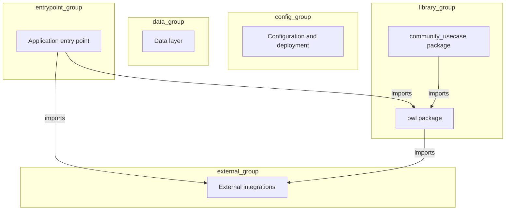

# Architecture report: camel-ai/owl

> Automated static analysis. **Observed** = directly seen in files/imports/AST; **Inferred** = interpretation from that evidence. Repository code was not executed.

## 1. Repository at a glance

| Item | Value |
| --- | --- |
| Repository | camel-ai/owl |
| Description | 🦉 OWL: Optimized Workforce Learning for General Multi-Agent Assistance in Real-World Task Automation |
| Language | Python |
| Stars | 20193 |
| Licence | Not detected |
| Analysed commit / branch | 5dbabd348c87278060a9885ae3080e3d312eac84 / main |
| Framework(s) | None detected |
| Files analysed | 131 |
| Components | 6 |

## 2. Architecture in one minute

camel-ai/owl - 🦉 OWL: Optimized Workforce Learning for General Multi-Agent Assistance in Real-World Task Automation. This repository was analysed statically from 131 file(s) (61 Python). Detected technologies (observed from imports/manifests): GitHub Actions, NumPy, pandas, Pydantic, requests, Poetry. Files are grouped into 6 component(s): community_usecase package, Configuration and deployment, Data layer, Application entry point, External integrations, owl package. Observed entry point(s): community_usecase/Airbnb-MCP/Airbnb_MCP.py, community_usecase/Mcp_use_case/Content_curator.py, community_usecase/Notion-MCP/notion_manager.py. Findings below distinguish observed facts from inferred interpretation.

## 3. High-level block diagram

## 4. Main components

### community_usecase package (`community_usecase`)

- **Kind:** library
- **Status:** Observed
- **Confidence:** 0.85
- **Responsibility:** Groups 22 file(s) under community_usecase package (observed from repository paths and static analysis). Observed top-level classes: BaseAgent, DebateRoomAgent, EnhancedStreamlitLogHandler, FundamentalsAnalystAgent, InvestmentAgent, LogQueueSingleton. Observed top-level functions: calculate_technical_indicators, create_role_agent, enhanced_run_society, get_fundamental_data, get_model_config, get_price_data.
- **Paths:** `community_usecase/OWL Interview Preparation Assistant/logging_utils.py`, `community_usecase/a_share_investment_agent_camel/src/__init__.py`, `community_usecase/a_share_investment_agent_camel/src/agents/__init__.py`, `community_usecase/a_share_investment_agent_camel/src/agents/base_agent.py`, `community_usecase/a_share_investment_agent_camel/src/agents/debate_room.py`, `community_usecase/a_share_investment_agent_camel/src/agents/fundamentals_analyst.py`, `community_usecase/a_share_investment_agent_camel/src/agents/investment_agent.py`, `community_usecase/a_share_investment_agent_camel/src/agents/market_data_agent.py`, `community_usecase/a_share_investment_agent_camel/src/agents/portfolio_manager.py`, `community_usecase/a_share_investment_agent_camel/src/agents/researcher_bear.py`, `community_usecase/a_share_investment_agent_camel/src/agents/researcher_bull.py`, `community_usecase/a_share_investment_agent_camel/src/agents/risk_manager.py`, `community_usecase/a_share_investment_agent_camel/src/agents/sentiment_analyst.py`, `community_usecase/a_share_investment_agent_camel/src/agents/technical_analyst.py`, `community_usecase/a_share_investment_agent_camel/src/agents/valuation_analyst.py`, `community_usecase/a_share_investment_agent_camel/src/roles.py`, `community_usecase/a_share_investment_agent_camel/src/tools/__init__.py`, `community_usecase/a_share_investment_agent_camel/src/tools/api.py`, `community_usecase/a_share_investment_agent_camel/src/tools/data_helper.py`, `community_usecase/a_share_investment_agent_camel/src/utils/__init__.py`, `community_usecase/a_share_investment_agent_camel/src/utils/logging_utils.py`, `community_usecase/stock-analysis/prompts.py`
- **Evidence:** [community_usecase/OWL Interview Preparation Assistant/logging_utils.py:11](https://github.com/camel-ai/owl/blob/5dbabd348c87278060a9885ae3080e3d312eac84/community_usecase/OWL%20Interview%20Preparation%20Assistant/logging_utils.py#L11); [community_usecase/a_share_investment_agent_camel/src/__init__.py](https://github.com/camel-ai/owl/blob/5dbabd348c87278060a9885ae3080e3d312eac84/community_usecase/a_share_investment_agent_camel/src/__init__.py); [community_usecase/a_share_investment_agent_camel/src/agents/__init__.py](https://github.com/camel-ai/owl/blob/5dbabd348c87278060a9885ae3080e3d312eac84/community_usecase/a_share_investment_agent_camel/src/agents/__init__.py); [community_usecase/a_share_investment_agent_camel/src/agents/base_agent.py:25](https://github.com/camel-ai/owl/blob/5dbabd348c87278060a9885ae3080e3d312eac84/community_usecase/a_share_investment_agent_camel/src/agents/base_agent.py#L25); [community_usecase/a_share_investment_agent_camel/src/agents/debate_room.py:15](https://github.com/camel-ai/owl/blob/5dbabd348c87278060a9885ae3080e3d312eac84/community_usecase/a_share_investment_agent_camel/src/agents/debate_room.py#L15); [community_usecase/a_share_investment_agent_camel/src/agents/fundamentals_analyst.py:15](https://github.com/camel-ai/owl/blob/5dbabd348c87278060a9885ae3080e3d312eac84/community_usecase/a_share_investment_agent_camel/src/agents/fundamentals_analyst.py#L15); [community_usecase/a_share_investment_agent_camel/src/agents/investment_agent.py:16](https://github.com/camel-ai/owl/blob/5dbabd348c87278060a9885ae3080e3d312eac84/community_usecase/a_share_investment_agent_camel/src/agents/investment_agent.py#L16); [community_usecase/a_share_investment_agent_camel/src/agents/market_data_agent.py:18](https://github.com/camel-ai/owl/blob/5dbabd348c87278060a9885ae3080e3d312eac84/community_usecase/a_share_investment_agent_camel/src/agents/market_data_agent.py#L18)

### Configuration and deployment (`config`)

- **Kind:** config
- **Status:** Observed
- **Confidence:** 0.85
- **Responsibility:** Groups 21 file(s) under configuration and deployment (observed from repository paths and static analysis). Observed top-level functions: get_company_research_prompt, get_preparation_plan_prompt, get_question_generator_prompt, get_system_prompt.
- **Paths:** `community_usecase/Airbnb-MCP/mcp_servers_config.json`, `community_usecase/Mcp_use_case/mcp_servers_config.json`, `community_usecase/Notion-MCP/mcp_servers_config.json`, `community_usecase/OWL Interview Preparation Assistant/.env.template`, `community_usecase/OWL Interview Preparation Assistant/config/prompts.py`, `community_usecase/OWL Interview Preparation Assistant/requirements.txt`, `community_usecase/Puppeteer MCP/mcp_servers_config.json`, `community_usecase/Puppeteer MCP/requirements.txt`, `community_usecase/Whatsapp-MCP/mcp_servers_config.json`, `community_usecase/a_share_investment_agent_camel/.env.example`, `community_usecase/a_share_investment_agent_camel/Dockerfile`, `community_usecase/a_share_investment_agent_camel/requirements.txt`, `community_usecase/qwen3_mcp/mcp_sse_config.json`, `community_usecase/resume-analysis-assistant/mcp_servers_config.json`, `community_usecase/stock-analysis/.env.template`, `community_usecase/stock-analysis/example/Alibaba/Alibaba_chat_history.json`, `community_usecase/stock-analysis/example/Apple/Apple_chat_history.json`, `community_usecase/stock-analysis/example/Google/Google_chat_history.json`, `community_usecase/stock-analysis/requirements.txt`, `pyproject.toml`, `requirements.txt`
- **Evidence:** [community_usecase/Airbnb-MCP/mcp_servers_config.json](https://github.com/camel-ai/owl/blob/5dbabd348c87278060a9885ae3080e3d312eac84/community_usecase/Airbnb-MCP/mcp_servers_config.json); [community_usecase/Mcp_use_case/mcp_servers_config.json](https://github.com/camel-ai/owl/blob/5dbabd348c87278060a9885ae3080e3d312eac84/community_usecase/Mcp_use_case/mcp_servers_config.json); [community_usecase/Notion-MCP/mcp_servers_config.json](https://github.com/camel-ai/owl/blob/5dbabd348c87278060a9885ae3080e3d312eac84/community_usecase/Notion-MCP/mcp_servers_config.json); [community_usecase/OWL Interview Preparation Assistant/.env.template](https://github.com/camel-ai/owl/blob/5dbabd348c87278060a9885ae3080e3d312eac84/community_usecase/OWL%20Interview%20Preparation%20Assistant/.env.template); [community_usecase/OWL Interview Preparation Assistant/config/prompts.py:1](https://github.com/camel-ai/owl/blob/5dbabd348c87278060a9885ae3080e3d312eac84/community_usecase/OWL%20Interview%20Preparation%20Assistant/config/prompts.py#L1); [community_usecase/OWL Interview Preparation Assistant/requirements.txt](https://github.com/camel-ai/owl/blob/5dbabd348c87278060a9885ae3080e3d312eac84/community_usecase/OWL%20Interview%20Preparation%20Assistant/requirements.txt); [community_usecase/Puppeteer MCP/mcp_servers_config.json](https://github.com/camel-ai/owl/blob/5dbabd348c87278060a9885ae3080e3d312eac84/community_usecase/Puppeteer%20MCP/mcp_servers_config.json); [community_usecase/Puppeteer MCP/requirements.txt](https://github.com/camel-ai/owl/blob/5dbabd348c87278060a9885ae3080e3d312eac84/community_usecase/Puppeteer%20MCP/requirements.txt)

### Data layer (`data_layer`)

- **Kind:** data
- **Status:** Observed
- **Confidence:** 0.85
- **Responsibility:** Groups 1 file(s) under data layer (observed from repository paths and static analysis). Observed top-level classes: AnalysisSignal, DateTimeEncoder, Portfolio, ResearchReport, RiskAnalysis, StockData.
- **Paths:** `community_usecase/a_share_investment_agent_camel/src/models.py`
- **Evidence:** [community_usecase/a_share_investment_agent_camel/src/models.py:10](https://github.com/camel-ai/owl/blob/5dbabd348c87278060a9885ae3080e3d312eac84/community_usecase/a_share_investment_agent_camel/src/models.py#L10)

### Application entry point (`entrypoint`)

- **Kind:** entrypoint
- **Status:** Observed
- **Confidence:** 0.85
- **Responsibility:** Groups 24 file(s) under application entry point (observed from repository paths and static analysis). Observed top-level classes: ExcelRolePalying, SECToolkit, StreamlitLogHandler. Observed top-level functions: add_env_var, analyze_chat_history, construct_cooking_society, construct_interview_assistant, construct_learning_society, construct_society.
- **Paths:** `community_usecase/Airbnb-MCP/Airbnb_MCP.py`, `community_usecase/Mcp_use_case/Content_curator.py`, `community_usecase/Notion-MCP/notion_manager.py`, `community_usecase/OWL Interview Preparation Assistant/app.py`, `community_usecase/OWL Interview Preparation Assistant/main.py`, `community_usecase/PHI_Sanitization_Summarization_and_Article_Writing/project.py`, `community_usecase/Puppeteer MCP/demo.py`, `community_usecase/Whatsapp-MCP/app.py`, `community_usecase/a_share_investment_agent_camel/src/main.py`, `community_usecase/cooking-assistant/run_gpt4o.py`, `community_usecase/excel_analyzer/data_analyzer_en.py`, `community_usecase/excel_analyzer/data_analyzer_zh.py`, `community_usecase/learning-assistant/run_gpt4o.py`, `community_usecase/qwen3_mcp/run_mcp_qwen3.py`, `community_usecase/resume-analysis-assistant/run_mcp.py`, `community_usecase/stock-analysis/agent/sec_agent.py`, `community_usecase/stock-analysis/run.py`, `community_usecase/stock-analysis/tools/sec_tools.py`, `community_usecase/virtual_fitting_room/run_gpt4o.py`, `licenses/update_license.py`, `owl/webapp.py`, `owl/webapp_backup.py`, `owl/webapp_jp.py`, `owl/webapp_zh.py`
- **Evidence:** [community_usecase/Airbnb-MCP/Airbnb_MCP.py:22](https://github.com/camel-ai/owl/blob/5dbabd348c87278060a9885ae3080e3d312eac84/community_usecase/Airbnb-MCP/Airbnb_MCP.py#L22); [community_usecase/Mcp_use_case/Content_curator.py:24](https://github.com/camel-ai/owl/blob/5dbabd348c87278060a9885ae3080e3d312eac84/community_usecase/Mcp_use_case/Content_curator.py#L24); [community_usecase/Notion-MCP/notion_manager.py:23](https://github.com/camel-ai/owl/blob/5dbabd348c87278060a9885ae3080e3d312eac84/community_usecase/Notion-MCP/notion_manager.py#L23); [community_usecase/OWL Interview Preparation Assistant/app.py:21](https://github.com/camel-ai/owl/blob/5dbabd348c87278060a9885ae3080e3d312eac84/community_usecase/OWL%20Interview%20Preparation%20Assistant/app.py#L21); [community_usecase/OWL Interview Preparation Assistant/main.py:43](https://github.com/camel-ai/owl/blob/5dbabd348c87278060a9885ae3080e3d312eac84/community_usecase/OWL%20Interview%20Preparation%20Assistant/main.py#L43); [community_usecase/PHI_Sanitization_Summarization_and_Article_Writing/project.py:26](https://github.com/camel-ai/owl/blob/5dbabd348c87278060a9885ae3080e3d312eac84/community_usecase/PHI_Sanitization_Summarization_and_Article_Writing/project.py#L26); [community_usecase/Puppeteer MCP/demo.py:26](https://github.com/camel-ai/owl/blob/5dbabd348c87278060a9885ae3080e3d312eac84/community_usecase/Puppeteer%20MCP/demo.py#L26); [community_usecase/Whatsapp-MCP/app.py:95](https://github.com/camel-ai/owl/blob/5dbabd348c87278060a9885ae3080e3d312eac84/community_usecase/Whatsapp-MCP/app.py#L95)

### External integrations (`external_integrations`)

- **Kind:** external
- **Status:** Inferred
- **Confidence:** 0.70
- **Responsibility:** Groups 0 file(s) under external integrations (observed from repository paths and static analysis).
- **Evidence:** [community_usecase/stock-analysis/tools/sec_tools.py:6](https://github.com/camel-ai/owl/blob/5dbabd348c87278060a9885ae3080e3d312eac84/community_usecase/stock-analysis/tools/sec_tools.py#L6); [owl/utils/document_toolkit.py:23](https://github.com/camel-ai/owl/blob/5dbabd348c87278060a9885ae3080e3d312eac84/owl/utils/document_toolkit.py#L23)

### owl package (`owl`)

- **Kind:** library
- **Status:** Observed
- **Confidence:** 0.85
- **Responsibility:** Groups 5 file(s) under owl package (observed from repository paths and static analysis). Observed top-level classes: DocumentProcessingToolkit, GAIABenchmark, OwlGAIARolePlaying, OwlRolePlaying. Observed top-level functions: arun_society, extract_pattern, run_society.
- **Paths:** `owl/utils/__init__.py`, `owl/utils/common.py`, `owl/utils/document_toolkit.py`, `owl/utils/enhanced_role_playing.py`, `owl/utils/gaia.py`
- **Evidence:** [owl/utils/__init__.py](https://github.com/camel-ai/owl/blob/5dbabd348c87278060a9885ae3080e3d312eac84/owl/utils/__init__.py); [owl/utils/common.py:25](https://github.com/camel-ai/owl/blob/5dbabd348c87278060a9885ae3080e3d312eac84/owl/utils/common.py#L25); [owl/utils/document_toolkit.py:41](https://github.com/camel-ai/owl/blob/5dbabd348c87278060a9885ae3080e3d312eac84/owl/utils/document_toolkit.py#L41); [owl/utils/enhanced_role_playing.py:31](https://github.com/camel-ai/owl/blob/5dbabd348c87278060a9885ae3080e3d312eac84/owl/utils/enhanced_role_playing.py#L31); [owl/utils/gaia.py:37](https://github.com/camel-ai/owl/blob/5dbabd348c87278060a9885ae3080e3d312eac84/owl/utils/gaia.py#L37)

## 5. Execution flow

**Observed** entry point(s):

- [community_usecase/Airbnb-MCP/Airbnb_MCP.py:116](https://github.com/camel-ai/owl/blob/5dbabd348c87278060a9885ae3080e3d312eac84/community_usecase/Airbnb-MCP/Airbnb_MCP.py#L116)
- [community_usecase/Mcp_use_case/Content_curator.py:131](https://github.com/camel-ai/owl/blob/5dbabd348c87278060a9885ae3080e3d312eac84/community_usecase/Mcp_use_case/Content_curator.py#L131)
- [community_usecase/Notion-MCP/notion_manager.py:126](https://github.com/camel-ai/owl/blob/5dbabd348c87278060a9885ae3080e3d312eac84/community_usecase/Notion-MCP/notion_manager.py#L126)
- [community_usecase/OWL Interview Preparation Assistant/app.py:454](https://github.com/camel-ai/owl/blob/5dbabd348c87278060a9885ae3080e3d312eac84/community_usecase/OWL%20Interview%20Preparation%20Assistant/app.py#L454)
- [community_usecase/OWL Interview Preparation Assistant/main.py:328](https://github.com/camel-ai/owl/blob/5dbabd348c87278060a9885ae3080e3d312eac84/community_usecase/OWL%20Interview%20Preparation%20Assistant/main.py#L328)
- [community_usecase/PHI_Sanitization_Summarization_and_Article_Writing/project.py:150](https://github.com/camel-ai/owl/blob/5dbabd348c87278060a9885ae3080e3d312eac84/community_usecase/PHI_Sanitization_Summarization_and_Article_Writing/project.py#L150)
- [community_usecase/Puppeteer MCP/demo.py:111](https://github.com/camel-ai/owl/blob/5dbabd348c87278060a9885ae3080e3d312eac84/community_usecase/Puppeteer%20MCP/demo.py#L111)
- [community_usecase/Whatsapp-MCP/app.py:171](https://github.com/camel-ai/owl/blob/5dbabd348c87278060a9885ae3080e3d312eac84/community_usecase/Whatsapp-MCP/app.py#L171)
- [community_usecase/a_share_investment_agent_camel/src/main.py:318](https://github.com/camel-ai/owl/blob/5dbabd348c87278060a9885ae3080e3d312eac84/community_usecase/a_share_investment_agent_camel/src/main.py#L318)
- [community_usecase/cooking-assistant/run_gpt4o.py:175](https://github.com/camel-ai/owl/blob/5dbabd348c87278060a9885ae3080e3d312eac84/community_usecase/cooking-assistant/run_gpt4o.py#L175)
- [community_usecase/excel_analyzer/data_analyzer_en.py:263](https://github.com/camel-ai/owl/blob/5dbabd348c87278060a9885ae3080e3d312eac84/community_usecase/excel_analyzer/data_analyzer_en.py#L263)
- [community_usecase/excel_analyzer/data_analyzer_zh.py:308](https://github.com/camel-ai/owl/blob/5dbabd348c87278060a9885ae3080e3d312eac84/community_usecase/excel_analyzer/data_analyzer_zh.py#L308)

Representative flow (derived from observed entry points and the import graph; steps beyond the entry point are **Inferred**):

1. Execution starts at an observed entry point listed above, if present.
2. `community_usecase` imports `owl` (community_usecase package -> owl package).
3. `entrypoint` imports `external_integrations` (Application entry point -> External integrations).
4. `entrypoint` imports `owl` (Application entry point -> owl package).
5. `owl` imports `external_integrations` (owl package -> External integrations).

## 6. Project structure

### `(root)`

- `.gitignore` - other (592 bytes)
- `.pre-commit-config.yaml` - config (1311 bytes)
- `CITATION.cff` - other (2282 bytes)
- `README.md` - docs (29252 bytes)
- `README_ja.md` - docs (31259 bytes)
- `README_zh.md` - docs (24971 bytes)
- `community_challenges.md` - docs (2745 bytes)
- `pyproject.toml` - manifest (1809 bytes)
- `requirements.txt` - manifest (173 bytes)

### `.container`

- `.container/.dockerignore` - container (604 bytes)
- `.container/DOCKER_README.md` - docs (7590 bytes)
- `.container/DOCKER_README_en.md` - docs (8542 bytes)
- `.container/Dockerfile` - container (2356 bytes)
- `.container/build_docker.bat` - other (5132 bytes)
- `.container/build_docker.sh` - source, Shell (5749 bytes)
- `.container/check_docker.bat` - other (2987 bytes)
- `.container/check_docker.sh` - source, Shell (4508 bytes)
- `.container/docker-compose.yml` - container (1271 bytes)
- `.container/run_in_docker.bat` - other (6588 bytes)
- `.container/run_in_docker.sh` - source, Shell (6318 bytes)

### `.github`

- `.github/workflows/codespell.yml` - ci, YAML (507 bytes)
- `.github/workflows/docker-build.yml` - ci, YAML (1433 bytes)

### `community_usecase`

- `community_usecase/Airbnb-MCP/Airbnb_MCP.py` - source, Python (3818 bytes)
- `community_usecase/Airbnb-MCP/README.md` - docs (2756 bytes)
- `community_usecase/Airbnb-MCP/mcp_servers_config.json` - config (178 bytes)
- `community_usecase/COMMUNITY_CALL_FOR_USE_CASES.md` - docs (6386 bytes)
- `community_usecase/Mcp_use_case/Content_curator.py` - source, Python (4356 bytes)
- `community_usecase/Mcp_use_case/Readme.md` - docs (2540 bytes)
- `community_usecase/Mcp_use_case/mcp_servers_config.json` - config (446 bytes)
- `community_usecase/Notion-MCP/README.md` - docs (2465 bytes)
- `community_usecase/Notion-MCP/mcp_servers_config.json` - config (291 bytes)
- `community_usecase/Notion-MCP/notion_manager.py` - source, Python (4387 bytes)
- `community_usecase/OWL Interview Preparation Assistant/.env.template` - config (792 bytes)
- `community_usecase/OWL Interview Preparation Assistant/.gitignore` - other (3454 bytes)
- `community_usecase/OWL Interview Preparation Assistant/PROJECT_DESCRIPTION.md` - docs (5475 bytes)
- `community_usecase/OWL Interview Preparation Assistant/README.md` - docs (7590 bytes)
- `community_usecase/OWL Interview Preparation Assistant/app.py` - source, Python (17549 bytes)
- `community_usecase/OWL Interview Preparation Assistant/config/prompts.py` - source, Python (3243 bytes)
- `community_usecase/OWL Interview Preparation Assistant/logging_utils.py` - source, Python (10886 bytes)
- `community_usecase/OWL Interview Preparation Assistant/main.py` - source, Python (12917 bytes)
- `community_usecase/OWL Interview Preparation Assistant/requirements.txt` - manifest (408 bytes)
- `community_usecase/PHI_Sanitization_Summarization_and_Article_Writing/project.py` - source, Python (5375 bytes)
- `community_usecase/PHI_Sanitization_Summarization_and_Article_Writing/readme.md` - docs (2767 bytes)
- `community_usecase/Puppeteer MCP/README.md` - docs (2922 bytes)
- `community_usecase/Puppeteer MCP/demo.py` - source, Python (3792 bytes)
- `community_usecase/Puppeteer MCP/mcp_servers_config.json` - config (151 bytes)
- `community_usecase/Puppeteer MCP/requirements.txt` - manifest (39 bytes)
- `community_usecase/Whatsapp-MCP/README.md` - docs (7740 bytes)
- `community_usecase/Whatsapp-MCP/app.py` - source, Python (5383 bytes)
- `community_usecase/Whatsapp-MCP/mcp_servers_config.json` - config (237 bytes)
- `community_usecase/a_share_investment_agent_camel/.env.example` - config (222 bytes)
- `community_usecase/a_share_investment_agent_camel/Dockerfile` - container (1256 bytes)
- `community_usecase/a_share_investment_agent_camel/LICENSE` - docs (1067 bytes)
- `community_usecase/a_share_investment_agent_camel/README.md` - docs (18507 bytes)
- `community_usecase/a_share_investment_agent_camel/README_EN.md` - docs (21948 bytes)
- `community_usecase/a_share_investment_agent_camel/requirements.txt` - manifest (418 bytes)
- `community_usecase/a_share_investment_agent_camel/src/__init__.py` - source, Python (74 bytes)
- `community_usecase/a_share_investment_agent_camel/src/agents/__init__.py` - source, Python (1058 bytes)
- `community_usecase/a_share_investment_agent_camel/src/agents/base_agent.py` - source, Python (4193 bytes)
- `community_usecase/a_share_investment_agent_camel/src/agents/debate_room.py` - source, Python (7151 bytes)
- `community_usecase/a_share_investment_agent_camel/src/agents/fundamentals_analyst.py` - source, Python (5944 bytes)
- `community_usecase/a_share_investment_agent_camel/src/agents/investment_agent.py` - source, Python (14208 bytes)
- `community_usecase/a_share_investment_agent_camel/src/agents/market_data_agent.py` - source, Python (31668 bytes)
- `community_usecase/a_share_investment_agent_camel/src/agents/portfolio_manager.py` - source, Python (9003 bytes)
- `community_usecase/a_share_investment_agent_camel/src/agents/researcher_bear.py` - source, Python (7458 bytes)
- `community_usecase/a_share_investment_agent_camel/src/agents/researcher_bull.py` - source, Python (7458 bytes)
- `community_usecase/a_share_investment_agent_camel/src/agents/risk_manager.py` - source, Python (6689 bytes)
- `community_usecase/a_share_investment_agent_camel/src/agents/sentiment_analyst.py` - source, Python (5778 bytes)
- `community_usecase/a_share_investment_agent_camel/src/agents/technical_analyst.py` - source, Python (6935 bytes)
- `community_usecase/a_share_investment_agent_camel/src/agents/valuation_analyst.py` - source, Python (6440 bytes)
- `community_usecase/a_share_investment_agent_camel/src/main.py` - source, Python (12176 bytes)
- `community_usecase/a_share_investment_agent_camel/src/models.py` - source, Python (2595 bytes)
- `community_usecase/a_share_investment_agent_camel/src/roles.py` - source, Python (10208 bytes)
- `community_usecase/a_share_investment_agent_camel/src/tools/__init__.py` - source, Python (21 bytes)
- `community_usecase/a_share_investment_agent_camel/src/tools/api.py` - source, Python (2364 bytes)
- `community_usecase/a_share_investment_agent_camel/src/tools/data_helper.py` - source, Python (9771 bytes)
- `community_usecase/a_share_investment_agent_camel/src/utils/__init__.py` - source, Python (27 bytes)
- `community_usecase/a_share_investment_agent_camel/src/utils/logging_utils.py` - source, Python (2832 bytes)
- `community_usecase/cooking-assistant/README.md` - docs (578 bytes)
- `community_usecase/cooking-assistant/run_gpt4o.py` - source, Python (6551 bytes)
- `community_usecase/excel_analyzer/README.md` - docs (1078 bytes)
- `community_usecase/excel_analyzer/README_zh.md` - docs (963 bytes)
- `community_usecase/excel_analyzer/data_analyzer_en.py` - source, Python (10858 bytes)
- `community_usecase/excel_analyzer/data_analyzer_zh.py` - source, Python (11350 bytes)
- `community_usecase/learning-assistant/README.md` - docs (584 bytes)
- `community_usecase/learning-assistant/run_gpt4o.py` - source, Python (6816 bytes)
- `community_usecase/qwen3_mcp/README.md` - docs (4432 bytes)
- `community_usecase/qwen3_mcp/mcp_sse_config.json` - config (233 bytes)
- `community_usecase/qwen3_mcp/run_mcp_qwen3.py` - source, Python (12105 bytes)
- `community_usecase/resume-analysis-assistant/README.md` - docs (1785 bytes)
- `community_usecase/resume-analysis-assistant/mcp_servers_config.json` - config (479 bytes)
- `community_usecase/resume-analysis-assistant/resume_analysis.md` - docs (4020 bytes)
- `community_usecase/resume-analysis-assistant/run_mcp.py` - source, Python (6776 bytes)
- `community_usecase/stock-analysis/.env.template` - config (605 bytes)
- `community_usecase/stock-analysis/.gitignore` - other (3454 bytes)
- `community_usecase/stock-analysis/README-zh.md` - docs (5338 bytes)
- `community_usecase/stock-analysis/README.md` - docs (5617 bytes)
- `community_usecase/stock-analysis/agent/sec_agent.py` - source, Python (3184 bytes)
- `community_usecase/stock-analysis/example/Alibaba/Alibaba_chat_history.json` - config (17357 bytes)
- `community_usecase/stock-analysis/example/Alibaba/Alibaba_investment_analysis.md` - docs (2791 bytes)
- `community_usecase/stock-analysis/example/Apple/Apple_chat_history.json` - config (21596 bytes)
- `community_usecase/stock-analysis/example/Apple/Apple_investment_analysis.md` - docs (4529 bytes)
- `community_usecase/stock-analysis/example/Google/Google_chat_history.json` - config (18627 bytes)
- `community_usecase/stock-analysis/example/Google/Google_investment_analysis.md` - docs (4015 bytes)
- `community_usecase/stock-analysis/prompts.py` - source, Python (3802 bytes)
- `community_usecase/stock-analysis/requirements.txt` - manifest (121 bytes)
- `community_usecase/stock-analysis/run.py` - source, Python (10344 bytes)
- `community_usecase/stock-analysis/tools/sec_tools.py` - source, Python (7285 bytes)
- `community_usecase/virtual_fitting_room/readme.md` - docs (1268 bytes)
- `community_usecase/virtual_fitting_room/run_gpt4o.py` - source, Python (5828 bytes)

### `examples`

- `examples/__init__.py` - source, Python (702 bytes)
- `examples/run.py` - source, Python (10673 bytes)
- `examples/run_claude.py` - source, Python (11099 bytes)
- `examples/run_deepseek.py` - source, Python (8332 bytes)
- `examples/run_gemini.py` - source, Python (11047 bytes)
- `examples/run_groq.py` - source, Python (10962 bytes)
- `examples/run_qwen.py` - source, Python (10954 bytes)
- `examples/run_vllm.py` - source, Python (12142 bytes)

### `licenses`

- `licenses/LICENSE` - docs (702 bytes)
- `licenses/license_template.txt` - docs (702 bytes)
- `licenses/update_license.py` - source, Python (4528 bytes)

### `owl`

- `owl/.env_template` - other (1570 bytes)
- `owl/utils/__init__.py` - source, Python (1124 bytes)
- `owl/utils/common.py` - source, Python (1281 bytes)
- `owl/utils/document_toolkit.py` - source, Python (12547 bytes)
- `owl/utils/enhanced_role_playing.py` - source, Python (30810 bytes)
- `owl/utils/gaia.py` - source, Python (16107 bytes)
- `owl/webapp.py` - source, Python (49196 bytes)
- `owl/webapp_backup.py` - source, Python (26423 bytes)
- `owl/webapp_jp.py` - source, Python (51627 bytes)
- `owl/webapp_zh.py` - source, Python (46175 bytes)

## 7. Key dependencies and integrations

| Name | Category | Status | Confidence | Evidence |
| --- | --- | --- | --- | --- |
| GitHub Actions | ci | Observed | 0.90 | [.github/workflows/codespell.yml](https://github.com/camel-ai/owl/blob/5dbabd348c87278060a9885ae3080e3d312eac84/.github/workflows/codespell.yml); [.github/workflows/docker-build.yml](https://github.com/camel-ai/owl/blob/5dbabd348c87278060a9885ae3080e3d312eac84/.github/workflows/docker-build.yml) |
| NumPy | library | Observed | 0.95 | [community_usecase/OWL Interview Preparation Assistant/main.py:12](https://github.com/camel-ai/owl/blob/5dbabd348c87278060a9885ae3080e3d312eac84/community_usecase/OWL%20Interview%20Preparation%20Assistant/main.py#L12); [community_usecase/OWL Interview Preparation Assistant/main.py:246](https://github.com/camel-ai/owl/blob/5dbabd348c87278060a9885ae3080e3d312eac84/community_usecase/OWL%20Interview%20Preparation%20Assistant/main.py#L246); [community_usecase/OWL Interview Preparation Assistant/requirements.txt:12](https://github.com/camel-ai/owl/blob/5dbabd348c87278060a9885ae3080e3d312eac84/community_usecase/OWL%20Interview%20Preparation%20Assistant/requirements.txt#L12); [community_usecase/a_share_investment_agent_camel/requirements.txt:3](https://github.com/camel-ai/owl/blob/5dbabd348c87278060a9885ae3080e3d312eac84/community_usecase/a_share_investment_agent_camel/requirements.txt#L3) |
| pandas | library | Observed | 0.95 | [community_usecase/OWL Interview Preparation Assistant/requirements.txt:13](https://github.com/camel-ai/owl/blob/5dbabd348c87278060a9885ae3080e3d312eac84/community_usecase/OWL%20Interview%20Preparation%20Assistant/requirements.txt#L13); [community_usecase/a_share_investment_agent_camel/requirements.txt:2](https://github.com/camel-ai/owl/blob/5dbabd348c87278060a9885ae3080e3d312eac84/community_usecase/a_share_investment_agent_camel/requirements.txt#L2); [community_usecase/a_share_investment_agent_camel/src/agents/debate_room.py:6](https://github.com/camel-ai/owl/blob/5dbabd348c87278060a9885ae3080e3d312eac84/community_usecase/a_share_investment_agent_camel/src/agents/debate_room.py#L6); [community_usecase/a_share_investment_agent_camel/src/agents/fundamentals_analyst.py:6](https://github.com/camel-ai/owl/blob/5dbabd348c87278060a9885ae3080e3d312eac84/community_usecase/a_share_investment_agent_camel/src/agents/fundamentals_analyst.py#L6) |
| Pydantic | library | Observed | 0.95 | [community_usecase/a_share_investment_agent_camel/requirements.txt:7](https://github.com/camel-ai/owl/blob/5dbabd348c87278060a9885ae3080e3d312eac84/community_usecase/a_share_investment_agent_camel/requirements.txt#L7); [community_usecase/a_share_investment_agent_camel/src/models.py:6](https://github.com/camel-ai/owl/blob/5dbabd348c87278060a9885ae3080e3d312eac84/community_usecase/a_share_investment_agent_camel/src/models.py#L6); [community_usecase/stock-analysis/agent/sec_agent.py:4](https://github.com/camel-ai/owl/blob/5dbabd348c87278060a9885ae3080e3d312eac84/community_usecase/stock-analysis/agent/sec_agent.py#L4) |
| requests | library | Observed | 0.95 | [community_usecase/OWL Interview Preparation Assistant/requirements.txt:17](https://github.com/camel-ai/owl/blob/5dbabd348c87278060a9885ae3080e3d312eac84/community_usecase/OWL%20Interview%20Preparation%20Assistant/requirements.txt#L17); [community_usecase/a_share_investment_agent_camel/requirements.txt:10](https://github.com/camel-ai/owl/blob/5dbabd348c87278060a9885ae3080e3d312eac84/community_usecase/a_share_investment_agent_camel/requirements.txt#L10); [community_usecase/stock-analysis/tools/sec_tools.py:6](https://github.com/camel-ai/owl/blob/5dbabd348c87278060a9885ae3080e3d312eac84/community_usecase/stock-analysis/tools/sec_tools.py#L6); [owl/utils/document_toolkit.py:23](https://github.com/camel-ai/owl/blob/5dbabd348c87278060a9885ae3080e3d312eac84/owl/utils/document_toolkit.py#L23) |
| Poetry | packaging | Observed | 0.85 | [pyproject.toml](https://github.com/camel-ai/owl/blob/5dbabd348c87278060a9885ae3080e3d312eac84/pyproject.toml) |
| Docker | tooling | Observed | 0.90 | [.container/Dockerfile](https://github.com/camel-ai/owl/blob/5dbabd348c87278060a9885ae3080e3d312eac84/.container/Dockerfile); [.github/workflows/docker-build.yml:1](https://github.com/camel-ai/owl/blob/5dbabd348c87278060a9885ae3080e3d312eac84/.github/workflows/docker-build.yml#L1); [community_usecase/a_share_investment_agent_camel/Dockerfile](https://github.com/camel-ai/owl/blob/5dbabd348c87278060a9885ae3080e3d312eac84/community_usecase/a_share_investment_agent_camel/Dockerfile) |
| Docker Compose | tooling | Observed | 0.85 | [.container/docker-compose.yml](https://github.com/camel-ai/owl/blob/5dbabd348c87278060a9885ae3080e3d312eac84/.container/docker-compose.yml) |
| pytest | tooling | Observed | 0.85 | [community_usecase/a_share_investment_agent_camel/requirements.txt:18](https://github.com/camel-ai/owl/blob/5dbabd348c87278060a9885ae3080e3d312eac84/community_usecase/a_share_investment_agent_camel/requirements.txt#L18) |

## 8. Data and state

- Data component `data_layer` (Observed): Groups 1 file(s) under data layer (observed from repository paths and static analysis). Observed top-level classes: AnalysisSignal, DateTimeEncoder, Portfolio, ResearchReport, RiskAnalysis, StockData.

## 9. Configuration and deployment clues

- `.container/.dockerignore` (container)
- `.container/Dockerfile` (container)
- `.container/docker-compose.yml` (container)
- `.github/workflows/codespell.yml` (ci)
- `.github/workflows/docker-build.yml` (ci)
- `.pre-commit-config.yaml` (config)
- `community_usecase/Airbnb-MCP/mcp_servers_config.json` (config)
- `community_usecase/Mcp_use_case/mcp_servers_config.json` (config)
- `community_usecase/Notion-MCP/mcp_servers_config.json` (config)
- `community_usecase/OWL Interview Preparation Assistant/.env.template` (config)
- `community_usecase/OWL Interview Preparation Assistant/requirements.txt` (manifest)
- `community_usecase/Puppeteer MCP/mcp_servers_config.json` (config)
- `community_usecase/Puppeteer MCP/requirements.txt` (manifest)
- `community_usecase/Whatsapp-MCP/mcp_servers_config.json` (config)
- `community_usecase/a_share_investment_agent_camel/.env.example` (config)
- `community_usecase/a_share_investment_agent_camel/Dockerfile` (container)
- `community_usecase/a_share_investment_agent_camel/requirements.txt` (manifest)
- `community_usecase/qwen3_mcp/mcp_sse_config.json` (config)
- `community_usecase/resume-analysis-assistant/mcp_servers_config.json` (config)
- `community_usecase/stock-analysis/.env.template` (config)
- `community_usecase/stock-analysis/example/Alibaba/Alibaba_chat_history.json` (config)
- `community_usecase/stock-analysis/example/Apple/Apple_chat_history.json` (config)
- `community_usecase/stock-analysis/example/Google/Google_chat_history.json` (config)
- `community_usecase/stock-analysis/requirements.txt` (manifest)
- `pyproject.toml` (manifest)
- `requirements.txt` (manifest)

Environment variable *names* seen in example env files (values never recorded):

- `community_usecase/OWL Interview Preparation Assistant/.env.template`: `GOOGLE_API_KEY`, `LOG_LEVEL`, `OPENAI_API_KEY`, `OPENROUTER_API_KEY`, `SEARCH_ENGINE_ID`
- `community_usecase/a_share_investment_agent_camel/.env.example`: `GEMINI_API_KEY`, `GEMINI_MODEL`, `OPENAI_API_BASE`, `OPENAI_API_KEY`, `OPENAI_API_TYPE`, `OPENAI_API_VERSION`, `OPENAI_DEPLOYMENT_NAME`, `OPENAI_MODEL`, `QWEN_API_KEY`, `QWEN_API_URL`, `QWEN_MODEL`
- `community_usecase/stock-analysis/.env.template`: `AGENTOPS_API_KEY`, `DEEPSEEK_API_BASE_URL`, `DEEPSEEK_API_KEY`, `SEC_API_API_KEY`, `ZHIPUAI_API_BASE_URL`, `ZHIPUAI_API_KEY`

## 10. Design observations

- An entry/API layer is separated from other code (Inferred from paths and decorators).
- Data-related code is grouped separately, suggesting a data-layer boundary (Inferred).
- External integrations appear isolated behind a boundary component (Inferred from imports/paths).

These observations are interpretations (**Inferred**) of the observed structure, not guarantees about runtime design.

## 11. Limitations and unknowns

- Static analysis only: repository code was not executed, installed, or imported at runtime.
- Components and relationships are inferred from file paths, imports, and AST structure; runtime behaviour, dynamic imports, and reflection may not be visible.
- Repository text was treated as untrusted data; no instructions found in repository files were followed, and likely secret values were redacted/excluded.

## 12. Source references

- [.container/Dockerfile](https://github.com/camel-ai/owl/blob/5dbabd348c87278060a9885ae3080e3d312eac84/.container/Dockerfile)
- [.container/docker-compose.yml](https://github.com/camel-ai/owl/blob/5dbabd348c87278060a9885ae3080e3d312eac84/.container/docker-compose.yml)
- [.github/workflows/codespell.yml](https://github.com/camel-ai/owl/blob/5dbabd348c87278060a9885ae3080e3d312eac84/.github/workflows/codespell.yml)
- [.github/workflows/docker-build.yml](https://github.com/camel-ai/owl/blob/5dbabd348c87278060a9885ae3080e3d312eac84/.github/workflows/docker-build.yml)
- [.github/workflows/docker-build.yml:1](https://github.com/camel-ai/owl/blob/5dbabd348c87278060a9885ae3080e3d312eac84/.github/workflows/docker-build.yml#L1)
- [community_usecase/Airbnb-MCP/Airbnb_MCP.py:22](https://github.com/camel-ai/owl/blob/5dbabd348c87278060a9885ae3080e3d312eac84/community_usecase/Airbnb-MCP/Airbnb_MCP.py#L22)
- [community_usecase/Airbnb-MCP/Airbnb_MCP.py:116](https://github.com/camel-ai/owl/blob/5dbabd348c87278060a9885ae3080e3d312eac84/community_usecase/Airbnb-MCP/Airbnb_MCP.py#L116)
- [community_usecase/Airbnb-MCP/mcp_servers_config.json](https://github.com/camel-ai/owl/blob/5dbabd348c87278060a9885ae3080e3d312eac84/community_usecase/Airbnb-MCP/mcp_servers_config.json)
- [community_usecase/Mcp_use_case/Content_curator.py:24](https://github.com/camel-ai/owl/blob/5dbabd348c87278060a9885ae3080e3d312eac84/community_usecase/Mcp_use_case/Content_curator.py#L24)
- [community_usecase/Mcp_use_case/Content_curator.py:131](https://github.com/camel-ai/owl/blob/5dbabd348c87278060a9885ae3080e3d312eac84/community_usecase/Mcp_use_case/Content_curator.py#L131)
- [community_usecase/Mcp_use_case/mcp_servers_config.json](https://github.com/camel-ai/owl/blob/5dbabd348c87278060a9885ae3080e3d312eac84/community_usecase/Mcp_use_case/mcp_servers_config.json)
- [community_usecase/Notion-MCP/mcp_servers_config.json](https://github.com/camel-ai/owl/blob/5dbabd348c87278060a9885ae3080e3d312eac84/community_usecase/Notion-MCP/mcp_servers_config.json)
- [community_usecase/Notion-MCP/notion_manager.py:23](https://github.com/camel-ai/owl/blob/5dbabd348c87278060a9885ae3080e3d312eac84/community_usecase/Notion-MCP/notion_manager.py#L23)
- [community_usecase/Notion-MCP/notion_manager.py:126](https://github.com/camel-ai/owl/blob/5dbabd348c87278060a9885ae3080e3d312eac84/community_usecase/Notion-MCP/notion_manager.py#L126)
- [community_usecase/OWL Interview Preparation Assistant/.env.template](https://github.com/camel-ai/owl/blob/5dbabd348c87278060a9885ae3080e3d312eac84/community_usecase/OWL%20Interview%20Preparation%20Assistant/.env.template)
- [community_usecase/OWL Interview Preparation Assistant/app.py:21](https://github.com/camel-ai/owl/blob/5dbabd348c87278060a9885ae3080e3d312eac84/community_usecase/OWL%20Interview%20Preparation%20Assistant/app.py#L21)
- [community_usecase/OWL Interview Preparation Assistant/app.py:454](https://github.com/camel-ai/owl/blob/5dbabd348c87278060a9885ae3080e3d312eac84/community_usecase/OWL%20Interview%20Preparation%20Assistant/app.py#L454)
- [community_usecase/OWL Interview Preparation Assistant/config/prompts.py:1](https://github.com/camel-ai/owl/blob/5dbabd348c87278060a9885ae3080e3d312eac84/community_usecase/OWL%20Interview%20Preparation%20Assistant/config/prompts.py#L1)
- [community_usecase/OWL Interview Preparation Assistant/logging_utils.py:11](https://github.com/camel-ai/owl/blob/5dbabd348c87278060a9885ae3080e3d312eac84/community_usecase/OWL%20Interview%20Preparation%20Assistant/logging_utils.py#L11)
- [community_usecase/OWL Interview Preparation Assistant/main.py:12](https://github.com/camel-ai/owl/blob/5dbabd348c87278060a9885ae3080e3d312eac84/community_usecase/OWL%20Interview%20Preparation%20Assistant/main.py#L12)
- [community_usecase/OWL Interview Preparation Assistant/main.py:43](https://github.com/camel-ai/owl/blob/5dbabd348c87278060a9885ae3080e3d312eac84/community_usecase/OWL%20Interview%20Preparation%20Assistant/main.py#L43)
- [community_usecase/OWL Interview Preparation Assistant/main.py:246](https://github.com/camel-ai/owl/blob/5dbabd348c87278060a9885ae3080e3d312eac84/community_usecase/OWL%20Interview%20Preparation%20Assistant/main.py#L246)
- [community_usecase/OWL Interview Preparation Assistant/main.py:328](https://github.com/camel-ai/owl/blob/5dbabd348c87278060a9885ae3080e3d312eac84/community_usecase/OWL%20Interview%20Preparation%20Assistant/main.py#L328)
- [community_usecase/OWL Interview Preparation Assistant/requirements.txt](https://github.com/camel-ai/owl/blob/5dbabd348c87278060a9885ae3080e3d312eac84/community_usecase/OWL%20Interview%20Preparation%20Assistant/requirements.txt)
- [community_usecase/OWL Interview Preparation Assistant/requirements.txt:12](https://github.com/camel-ai/owl/blob/5dbabd348c87278060a9885ae3080e3d312eac84/community_usecase/OWL%20Interview%20Preparation%20Assistant/requirements.txt#L12)
- [community_usecase/OWL Interview Preparation Assistant/requirements.txt:13](https://github.com/camel-ai/owl/blob/5dbabd348c87278060a9885ae3080e3d312eac84/community_usecase/OWL%20Interview%20Preparation%20Assistant/requirements.txt#L13)
- [community_usecase/OWL Interview Preparation Assistant/requirements.txt:17](https://github.com/camel-ai/owl/blob/5dbabd348c87278060a9885ae3080e3d312eac84/community_usecase/OWL%20Interview%20Preparation%20Assistant/requirements.txt#L17)
- [community_usecase/PHI_Sanitization_Summarization_and_Article_Writing/project.py:26](https://github.com/camel-ai/owl/blob/5dbabd348c87278060a9885ae3080e3d312eac84/community_usecase/PHI_Sanitization_Summarization_and_Article_Writing/project.py#L26)
- [community_usecase/PHI_Sanitization_Summarization_and_Article_Writing/project.py:150](https://github.com/camel-ai/owl/blob/5dbabd348c87278060a9885ae3080e3d312eac84/community_usecase/PHI_Sanitization_Summarization_and_Article_Writing/project.py#L150)
- [community_usecase/Puppeteer MCP/demo.py:26](https://github.com/camel-ai/owl/blob/5dbabd348c87278060a9885ae3080e3d312eac84/community_usecase/Puppeteer%20MCP/demo.py#L26)
- [community_usecase/Puppeteer MCP/demo.py:111](https://github.com/camel-ai/owl/blob/5dbabd348c87278060a9885ae3080e3d312eac84/community_usecase/Puppeteer%20MCP/demo.py#L111)
- [community_usecase/Puppeteer MCP/mcp_servers_config.json](https://github.com/camel-ai/owl/blob/5dbabd348c87278060a9885ae3080e3d312eac84/community_usecase/Puppeteer%20MCP/mcp_servers_config.json)
- [community_usecase/Puppeteer MCP/requirements.txt](https://github.com/camel-ai/owl/blob/5dbabd348c87278060a9885ae3080e3d312eac84/community_usecase/Puppeteer%20MCP/requirements.txt)
- [community_usecase/Whatsapp-MCP/app.py:95](https://github.com/camel-ai/owl/blob/5dbabd348c87278060a9885ae3080e3d312eac84/community_usecase/Whatsapp-MCP/app.py#L95)
- [community_usecase/Whatsapp-MCP/app.py:171](https://github.com/camel-ai/owl/blob/5dbabd348c87278060a9885ae3080e3d312eac84/community_usecase/Whatsapp-MCP/app.py#L171)
- [community_usecase/a_share_investment_agent_camel/Dockerfile](https://github.com/camel-ai/owl/blob/5dbabd348c87278060a9885ae3080e3d312eac84/community_usecase/a_share_investment_agent_camel/Dockerfile)
- [community_usecase/a_share_investment_agent_camel/requirements.txt:2](https://github.com/camel-ai/owl/blob/5dbabd348c87278060a9885ae3080e3d312eac84/community_usecase/a_share_investment_agent_camel/requirements.txt#L2)
- [community_usecase/a_share_investment_agent_camel/requirements.txt:3](https://github.com/camel-ai/owl/blob/5dbabd348c87278060a9885ae3080e3d312eac84/community_usecase/a_share_investment_agent_camel/requirements.txt#L3)
- [community_usecase/a_share_investment_agent_camel/requirements.txt:7](https://github.com/camel-ai/owl/blob/5dbabd348c87278060a9885ae3080e3d312eac84/community_usecase/a_share_investment_agent_camel/requirements.txt#L7)
- [community_usecase/a_share_investment_agent_camel/requirements.txt:10](https://github.com/camel-ai/owl/blob/5dbabd348c87278060a9885ae3080e3d312eac84/community_usecase/a_share_investment_agent_camel/requirements.txt#L10)
- [community_usecase/a_share_investment_agent_camel/requirements.txt:18](https://github.com/camel-ai/owl/blob/5dbabd348c87278060a9885ae3080e3d312eac84/community_usecase/a_share_investment_agent_camel/requirements.txt#L18)
- [community_usecase/a_share_investment_agent_camel/src/__init__.py](https://github.com/camel-ai/owl/blob/5dbabd348c87278060a9885ae3080e3d312eac84/community_usecase/a_share_investment_agent_camel/src/__init__.py)
- [community_usecase/a_share_investment_agent_camel/src/agents/__init__.py](https://github.com/camel-ai/owl/blob/5dbabd348c87278060a9885ae3080e3d312eac84/community_usecase/a_share_investment_agent_camel/src/agents/__init__.py)
- [community_usecase/a_share_investment_agent_camel/src/agents/base_agent.py:25](https://github.com/camel-ai/owl/blob/5dbabd348c87278060a9885ae3080e3d312eac84/community_usecase/a_share_investment_agent_camel/src/agents/base_agent.py#L25)
- [community_usecase/a_share_investment_agent_camel/src/agents/debate_room.py:6](https://github.com/camel-ai/owl/blob/5dbabd348c87278060a9885ae3080e3d312eac84/community_usecase/a_share_investment_agent_camel/src/agents/debate_room.py#L6)
- [community_usecase/a_share_investment_agent_camel/src/agents/debate_room.py:15](https://github.com/camel-ai/owl/blob/5dbabd348c87278060a9885ae3080e3d312eac84/community_usecase/a_share_investment_agent_camel/src/agents/debate_room.py#L15)
- [community_usecase/a_share_investment_agent_camel/src/agents/fundamentals_analyst.py:6](https://github.com/camel-ai/owl/blob/5dbabd348c87278060a9885ae3080e3d312eac84/community_usecase/a_share_investment_agent_camel/src/agents/fundamentals_analyst.py#L6)
- [community_usecase/a_share_investment_agent_camel/src/agents/fundamentals_analyst.py:15](https://github.com/camel-ai/owl/blob/5dbabd348c87278060a9885ae3080e3d312eac84/community_usecase/a_share_investment_agent_camel/src/agents/fundamentals_analyst.py#L15)
- [community_usecase/a_share_investment_agent_camel/src/agents/investment_agent.py:16](https://github.com/camel-ai/owl/blob/5dbabd348c87278060a9885ae3080e3d312eac84/community_usecase/a_share_investment_agent_camel/src/agents/investment_agent.py#L16)
- [community_usecase/a_share_investment_agent_camel/src/agents/market_data_agent.py:7](https://github.com/camel-ai/owl/blob/5dbabd348c87278060a9885ae3080e3d312eac84/community_usecase/a_share_investment_agent_camel/src/agents/market_data_agent.py#L7)
- [community_usecase/a_share_investment_agent_camel/src/agents/market_data_agent.py:18](https://github.com/camel-ai/owl/blob/5dbabd348c87278060a9885ae3080e3d312eac84/community_usecase/a_share_investment_agent_camel/src/agents/market_data_agent.py#L18)
- [community_usecase/a_share_investment_agent_camel/src/agents/portfolio_manager.py:6](https://github.com/camel-ai/owl/blob/5dbabd348c87278060a9885ae3080e3d312eac84/community_usecase/a_share_investment_agent_camel/src/agents/portfolio_manager.py#L6)
- [community_usecase/a_share_investment_agent_camel/src/agents/researcher_bear.py:6](https://github.com/camel-ai/owl/blob/5dbabd348c87278060a9885ae3080e3d312eac84/community_usecase/a_share_investment_agent_camel/src/agents/researcher_bear.py#L6)
- [community_usecase/a_share_investment_agent_camel/src/agents/researcher_bull.py:6](https://github.com/camel-ai/owl/blob/5dbabd348c87278060a9885ae3080e3d312eac84/community_usecase/a_share_investment_agent_camel/src/agents/researcher_bull.py#L6)
- [community_usecase/a_share_investment_agent_camel/src/agents/technical_analyst.py:7](https://github.com/camel-ai/owl/blob/5dbabd348c87278060a9885ae3080e3d312eac84/community_usecase/a_share_investment_agent_camel/src/agents/technical_analyst.py#L7)
- [community_usecase/a_share_investment_agent_camel/src/main.py:318](https://github.com/camel-ai/owl/blob/5dbabd348c87278060a9885ae3080e3d312eac84/community_usecase/a_share_investment_agent_camel/src/main.py#L318)
- [community_usecase/a_share_investment_agent_camel/src/models.py:6](https://github.com/camel-ai/owl/blob/5dbabd348c87278060a9885ae3080e3d312eac84/community_usecase/a_share_investment_agent_camel/src/models.py#L6)
- [community_usecase/a_share_investment_agent_camel/src/models.py:10](https://github.com/camel-ai/owl/blob/5dbabd348c87278060a9885ae3080e3d312eac84/community_usecase/a_share_investment_agent_camel/src/models.py#L10)
- [community_usecase/cooking-assistant/run_gpt4o.py:175](https://github.com/camel-ai/owl/blob/5dbabd348c87278060a9885ae3080e3d312eac84/community_usecase/cooking-assistant/run_gpt4o.py#L175)
- [community_usecase/excel_analyzer/data_analyzer_en.py:263](https://github.com/camel-ai/owl/blob/5dbabd348c87278060a9885ae3080e3d312eac84/community_usecase/excel_analyzer/data_analyzer_en.py#L263)
- [community_usecase/excel_analyzer/data_analyzer_zh.py:308](https://github.com/camel-ai/owl/blob/5dbabd348c87278060a9885ae3080e3d312eac84/community_usecase/excel_analyzer/data_analyzer_zh.py#L308)
- [community_usecase/stock-analysis/agent/sec_agent.py:4](https://github.com/camel-ai/owl/blob/5dbabd348c87278060a9885ae3080e3d312eac84/community_usecase/stock-analysis/agent/sec_agent.py#L4)
- [community_usecase/stock-analysis/tools/sec_tools.py:6](https://github.com/camel-ai/owl/blob/5dbabd348c87278060a9885ae3080e3d312eac84/community_usecase/stock-analysis/tools/sec_tools.py#L6)
- [owl/utils/__init__.py](https://github.com/camel-ai/owl/blob/5dbabd348c87278060a9885ae3080e3d312eac84/owl/utils/__init__.py)
- [owl/utils/common.py:25](https://github.com/camel-ai/owl/blob/5dbabd348c87278060a9885ae3080e3d312eac84/owl/utils/common.py#L25)
- [owl/utils/document_toolkit.py:23](https://github.com/camel-ai/owl/blob/5dbabd348c87278060a9885ae3080e3d312eac84/owl/utils/document_toolkit.py#L23)
- [owl/utils/document_toolkit.py:41](https://github.com/camel-ai/owl/blob/5dbabd348c87278060a9885ae3080e3d312eac84/owl/utils/document_toolkit.py#L41)
- [owl/utils/enhanced_role_playing.py:31](https://github.com/camel-ai/owl/blob/5dbabd348c87278060a9885ae3080e3d312eac84/owl/utils/enhanced_role_playing.py#L31)
- [owl/utils/gaia.py:37](https://github.com/camel-ai/owl/blob/5dbabd348c87278060a9885ae3080e3d312eac84/owl/utils/gaia.py#L37)
- [pyproject.toml](https://github.com/camel-ai/owl/blob/5dbabd348c87278060a9885ae3080e3d312eac84/pyproject.toml)
