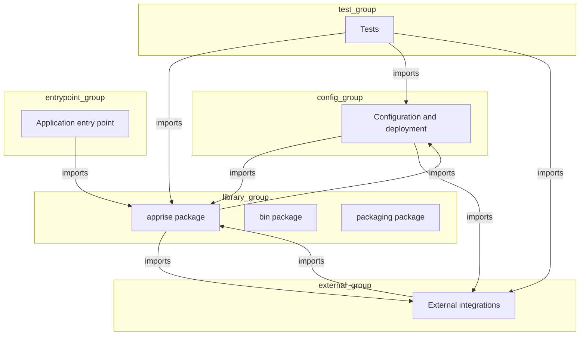

# Architecture report: caronc/apprise

> Automated static analysis. **Observed** = directly seen in files/imports/AST; **Inferred** = interpretation from that evidence. Repository code was not executed.

## 1. Repository at a glance

| Item | Value |
| --- | --- |
| Repository | caronc/apprise |
| Description | Apprise - Push Notifications that work with just about every platform! |
| Language | Python |
| Stars | 17765 |
| Licence | BSD-2-Clause |
| Analysed commit / branch | c6f76f3599ec9bc1591abfd4fc8c27a5124f88fa / master |
| Framework(s) | None detected |
| Files analysed | 390 |
| Components | 7 |

## 2. Architecture in one minute

caronc/apprise - Apprise - Push Notifications that work with just about every platform!. This repository was analysed statically from 390 file(s) (316 Python). Detected technologies (observed from imports/manifests): GitHub Actions, Click, RabbitMQ (pika), requests, Poetry, setuptools. Files are grouped into 7 component(s): apprise package, bin package, Configuration and deployment, Application entry point, External integrations, packaging package, Tests. Observed entry point(s): apprise/cli.py, packaging/i18n_status.py, packaging/verify_translations.py. Findings below distinguish observed facts from inferred interpretation.

## 3. High-level block diagram

## 4. Main components

### apprise package (`apprise`)

- **Kind:** library
- **Status:** Observed
- **Confidence:** 0.85
- **Responsibility:** Groups 269 file(s) under apprise package (observed from repository paths and static analysis). Observed top-level classes: AMQP091Adapter, AMQP10Adapter, AMQPConfig, AMQPError, AMQPMessage, AMQPVersion. Observed top-level functions: _aes_cbc_encrypt, _b64_unpadded_len, _b64dec, _b64enc, _bech32_hrp_expand, _bech32_polymod.
- **Paths:** `apprise/__init__.py`, `apprise/apprise.py`, `apprise/apprise_attachment.py`, `apprise/apprise_config.py`, `apprise/asset.py`, `apprise/attachment/__init__.py`, `apprise/attachment/base.py`, `apprise/attachment/file.py`, `apprise/attachment/http.py`, `apprise/attachment/memory.py`, `apprise/common.py`, `apprise/compat/__init__.py`, `apprise/compat/markdown33.py`, `apprise/compat/py39.py`, `apprise/conversion/__init__.py`, `apprise/conversion/commonmark.py`, `apprise/conversion/dialect.py`, `apprise/conversion/format.py`, `apprise/conversion/html.py`, `apprise/decorators/__init__.py`, `apprise/decorators/base.py`, `apprise/decorators/notify.py`, `apprise/dispatch.py`, `apprise/emojis.py`, `apprise/exception.py`, `apprise/i18n/__init__.py`, `apprise/locale.py`, `apprise/logger.py`, `apprise/manager.py`, `apprise/manager_attachment.py`, `apprise/manager_config.py`, `apprise/manager_plugins.py`, `apprise/persistent_store.py`, `apprise/plugins/__init__.py`, `apprise/plugins/africas_talking.py`, `apprise/plugins/amqp/__init__.py`, `apprise/plugins/amqp/base.py`, `apprise/plugins/amqp/common.py`, `apprise/plugins/amqp/v091.py`, `apprise/plugins/amqp/v10.py`, `apprise/plugins/aprs.py`, `apprise/plugins/awswhatsapp.py`, `apprise/plugins/bark.py`, `apprise/plugins/base.py`, `apprise/plugins/betterstack.py`, `apprise/plugins/blink1.py`, `apprise/plugins/bluesky.py`, `apprise/plugins/brevo.py`, `apprise/plugins/bulksms.py`, `apprise/plugins/bulkvs.py`, `apprise/plugins/burstsms.py`, `apprise/plugins/chanify.py`, `apprise/plugins/clickatell.py`, `apprise/plugins/clicksend.py`, `apprise/plugins/cliq.py`, `apprise/plugins/cm.py`, `apprise/plugins/custom_form.py`, `apprise/plugins/custom_json.py`, `apprise/plugins/custom_xml.py`, `apprise/plugins/d7networks.py`, `apprise/plugins/dapnet.py`, `apprise/plugins/dbus.py`, `apprise/plugins/deltachat.py`, `apprise/plugins/dingtalk.py`, `apprise/plugins/discord.py`, `apprise/plugins/dot.py`, `apprise/plugins/eight00com.py`, `apprise/plugins/email/__init__.py`, `apprise/plugins/email/base.py`, `apprise/plugins/email/common.py`, `apprise/plugins/email/smtp.py`, `apprise/plugins/email/templates.py`, `apprise/plugins/emby.py`, `apprise/plugins/enigma2.py`, `apprise/plugins/evolution.py`, `apprise/plugins/exotel.py`, `apprise/plugins/fcm/__init__.py`, `apprise/plugins/fcm/color.py`, `apprise/plugins/fcm/common.py`, `apprise/plugins/fcm/oauth.py`, `apprise/plugins/fcm/priority.py`, `apprise/plugins/feishu.py`, `apprise/plugins/firehydrant.py`, `apprise/plugins/flock.py`, `apprise/plugins/flowtriq.py`, `apprise/plugins/fluxer.py`, `apprise/plugins/fortysixelks.py`, `apprise/plugins/freemobile.py`, `apprise/plugins/github.py`, `apprise/plugins/glib.py`, `apprise/plugins/gnome.py`, `apprise/plugins/goalert.py`, `apprise/plugins/google_chat.py`, `apprise/plugins/gorush.py`, `apprise/plugins/gotify.py`, `apprise/plugins/groundmail.py`, `apprise/plugins/groupme.py`, `apprise/plugins/growl.py`, `apprise/plugins/guilded.py`, `apprise/plugins/gupshup.py`, `apprise/plugins/home_assistant.py`, `apprise/plugins/httpsms.py`, `apprise/plugins/humhub.py`, `apprise/plugins/ifttt.py`, `apprise/plugins/ilert.py`, `apprise/plugins/incidentio.py`, `apprise/plugins/infobip.py`, `apprise/plugins/irc/__init__.py`, `apprise/plugins/irc/base.py`, `apprise/plugins/irc/protocol.py`, `apprise/plugins/irc/state.py`, `apprise/plugins/irc/templates.py`, `apprise/plugins/jellyfin.py`, `apprise/plugins/jira.py`, `apprise/plugins/join.py`, `apprise/plugins/kakaotalk.py`, `apprise/plugins/kaleyra.py`, `apprise/plugins/kavenegar.py`, `apprise/plugins/kodi.py`, `apprise/plugins/kook.py`, `apprise/plugins/kumulos.py`, `apprise/plugins/lametric.py`, `apprise/plugins/lark.py`, `apprise/plugins/lauther.py`, `apprise/plugins/lfgalarm.py`, `apprise/plugins/line.py`, `apprise/plugins/macosx.py`, `apprise/plugins/mailersend.py`, `apprise/plugins/mailgun.py`, `apprise/plugins/mastodon.py`, `apprise/plugins/matrix/__init__.py`, `apprise/plugins/matrix/base.py`, `apprise/plugins/matrix/e2ee.py`, `apprise/plugins/matrix/sas.py`, `apprise/plugins/matrix/sizing.py`, `apprise/plugins/mattermost.py`, `apprise/plugins/messagebird.py`, `apprise/plugins/misskey.py`, `apprise/plugins/mobilemessage.py`, `apprise/plugins/mqtt.py`, `apprise/plugins/msg91.py`, `apprise/plugins/nextcloud.py`, `apprise/plugins/nextcloudtalk.py`, `apprise/plugins/nostr/__init__.py`, `apprise/plugins/nostr/base.py`, `apprise/plugins/nostr/crypto.py`, `apprise/plugins/nostr/relay.py`, `apprise/plugins/notica.py`, `apprise/plugins/notifiarr.py`, `apprise/plugins/notifico.py`, `apprise/plugins/notifyre.py`, `apprise/plugins/ntfy.py`, `apprise/plugins/octopush.py`, `apprise/plugins/office365.py`, `apprise/plugins/one_signal.py`, `apprise/plugins/onebot.py`, `apprise/plugins/opsgenie.py`, `apprise/plugins/pagerduty.py`, `apprise/plugins/pagertree.py`, `apprise/plugins/parseplatform.py`, `apprise/plugins/pinglet.py`, `apprise/plugins/pingram.py`, `apprise/plugins/plivo.py`, `apprise/plugins/postmark.py`, `apprise/plugins/prowl.py`, `apprise/plugins/pushbullet.py`, `apprise/plugins/pushdeer.py`, `apprise/plugins/pushed.py`, `apprise/plugins/pushjet.py`, `apprise/plugins/pushme.py`, `apprise/plugins/pushover.py`, `apprise/plugins/pushplus.py`, `apprise/plugins/pushsafer.py`, `apprise/plugins/pushward.py`, `apprise/plugins/pushy.py`, `apprise/plugins/qq.py`, `apprise/plugins/reddit.py`, `apprise/plugins/resend.py`, `apprise/plugins/revolt.py`, `apprise/plugins/ringcentral.py`, `apprise/plugins/rocketchat.py`, `apprise/plugins/rsyslog.py`, `apprise/plugins/ryver.py`, `apprise/plugins/sendgrid.py`, `apprise/plugins/sendpulse.py`, `apprise/plugins/serverchan.py`, `apprise/plugins/serwersms.py`, `apprise/plugins/ses.py`, `apprise/plugins/seven.py`, `apprise/plugins/sfr.py`, `apprise/plugins/signalgrid.py`, `apprise/plugins/signl4.py`, `apprise/plugins/simplepush.py`, `apprise/plugins/sinch.py`, `apprise/plugins/slack.py`, `apprise/plugins/smpp.py`, `apprise/plugins/smsc.py`, `apprise/plugins/smseagle.py`, `apprise/plugins/smsmanager.py`, `apprise/plugins/smstunnel.py`, `apprise/plugins/smtp2go.py`, `apprise/plugins/sns.py`, `apprise/plugins/sogs.py`, `apprise/plugins/sparkpost.py`, `apprise/plugins/spike.py`, `apprise/plugins/splunk.py`, `apprise/plugins/spugpush.py`, `apprise/plugins/squadcast.py`, `apprise/plugins/stackfield.py`, `apprise/plugins/streamlabs.py`, `apprise/plugins/synology.py`, `apprise/plugins/syslog.py`, `apprise/plugins/techuluspush.py`, `apprise/plugins/telegram.py`, `apprise/plugins/telesign.py`, `apprise/plugins/telnyx.py`, `apprise/plugins/threema.py`, `apprise/plugins/trigv.py`, `apprise/plugins/twilio.py`, `apprise/plugins/twist.py`, `apprise/plugins/twitter.py`, `apprise/plugins/vapid/__init__.py`, `apprise/plugins/vapid/subscription.py`, `apprise/plugins/viber.py`, `apprise/plugins/voipms.py`, `apprise/plugins/vonage.py`, `apprise/plugins/webexteams.py`, `apprise/plugins/wechat.py`, `apprise/plugins/wecombot.py`, `apprise/plugins/whapi.py`, `apprise/plugins/whatsapp.py`, `apprise/plugins/windows.py`, `apprise/plugins/workflows.py`, `apprise/plugins/wpush.py`, `apprise/plugins/wxpusher.py`, `apprise/plugins/xmatters.py`, `apprise/plugins/xmpp/__init__.py`, `apprise/plugins/xmpp/adapter.py`, `apprise/plugins/xmpp/base.py`, `apprise/plugins/xmpp/common.py`, `apprise/plugins/youlmk.py`, `apprise/plugins/zalo.py`, `apprise/plugins/zoom.py`, `apprise/plugins/zulip.py`, `apprise/result.py`, `apprise/tag.py`, `apprise/template.py`, `apprise/url.py`, `apprise/utils/__init__.py`, `apprise/utils/base64.py`, `apprise/utils/cwe312.py`, `apprise/utils/disk.py`, `apprise/utils/format.py`, `apprise/utils/http.py`, `apprise/utils/json.py`, `apprise/utils/logic.py`, `apprise/utils/module.py`, `apprise/utils/parse.py`, `apprise/utils/pem.py`, `apprise/utils/pgp.py`, `apprise/utils/sanitize.py`, `apprise/utils/singleton.py`, `apprise/utils/socket.py`, `apprise/utils/template.py`, `apprise/utils/templates.py`, `apprise/utils/time.py`, `apprise/utils/wkd.py`, `apprise/utils/xml.py`, `apprise/utils/yaml.py`
- **Evidence:** [apprise/__init__.py](https://github.com/caronc/apprise/blob/c6f76f3599ec9bc1591abfd4fc8c27a5124f88fa/apprise/__init__.py); [apprise/apprise.py:108](https://github.com/caronc/apprise/blob/c6f76f3599ec9bc1591abfd4fc8c27a5124f88fa/apprise/apprise.py#L108); [apprise/apprise_attachment.py:45](https://github.com/caronc/apprise/blob/c6f76f3599ec9bc1591abfd4fc8c27a5124f88fa/apprise/apprise_attachment.py#L45); [apprise/apprise_config.py:50](https://github.com/caronc/apprise/blob/c6f76f3599ec9bc1591abfd4fc8c27a5124f88fa/apprise/apprise_config.py#L50); [apprise/asset.py:51](https://github.com/caronc/apprise/blob/c6f76f3599ec9bc1591abfd4fc8c27a5124f88fa/apprise/asset.py#L51); [apprise/attachment/__init__.py](https://github.com/caronc/apprise/blob/c6f76f3599ec9bc1591abfd4fc8c27a5124f88fa/apprise/attachment/__init__.py); [apprise/attachment/base.py:42](https://github.com/caronc/apprise/blob/c6f76f3599ec9bc1591abfd4fc8c27a5124f88fa/apprise/attachment/base.py#L42); [apprise/attachment/file.py:37](https://github.com/caronc/apprise/blob/c6f76f3599ec9bc1591abfd4fc8c27a5124f88fa/apprise/attachment/file.py#L37)

### bin package (`bin`)

- **Kind:** library
- **Status:** Observed
- **Confidence:** 0.85
- **Responsibility:** Groups 3 file(s) under bin package (observed from repository paths and static analysis).
- **Paths:** `bin/build-rpm.sh`, `bin/checkdone.sh`, `bin/test.sh`
- **Evidence:** [bin/build-rpm.sh](https://github.com/caronc/apprise/blob/c6f76f3599ec9bc1591abfd4fc8c27a5124f88fa/bin/build-rpm.sh); [bin/checkdone.sh](https://github.com/caronc/apprise/blob/c6f76f3599ec9bc1591abfd4fc8c27a5124f88fa/bin/checkdone.sh); [bin/test.sh](https://github.com/caronc/apprise/blob/c6f76f3599ec9bc1591abfd4fc8c27a5124f88fa/bin/test.sh)

### Configuration and deployment (`config`)

- **Kind:** config
- **Status:** Observed
- **Confidence:** 0.85
- **Responsibility:** Groups 19 file(s) under configuration and deployment (observed from repository paths and static analysis). Observed top-level classes: BuildPyWithTranslations, ConfigBase, ConfigFile, ConfigHTTP, ConfigMemory. Observed top-level functions: read_version.
- **Paths:** `MANIFEST.in`, `apprise/config/__init__.py`, `apprise/config/base.py`, `apprise/config/file.py`, `apprise/config/http.py`, `apprise/config/memory.py`, `babel.cfg`, `docker-compose.yml`, `pyproject.toml`, `requirements.txt`, `setup.py`, `tests/docker/Dockerfile.el10`, `tests/docker/Dockerfile.el9`, `tests/docker/Dockerfile.f44`, `tests/docker/Dockerfile.py310`, `tests/docker/Dockerfile.py311`, `tests/docker/Dockerfile.py312`, `tests/docker/Dockerfile.py39`, `tests/docker/Dockerfile.rawhide`
- **Evidence:** [MANIFEST.in](https://github.com/caronc/apprise/blob/c6f76f3599ec9bc1591abfd4fc8c27a5124f88fa/MANIFEST.in); [apprise/config/__init__.py](https://github.com/caronc/apprise/blob/c6f76f3599ec9bc1591abfd4fc8c27a5124f88fa/apprise/config/__init__.py); [apprise/config/base.py:78](https://github.com/caronc/apprise/blob/c6f76f3599ec9bc1591abfd4fc8c27a5124f88fa/apprise/config/base.py#L78); [apprise/config/file.py:37](https://github.com/caronc/apprise/blob/c6f76f3599ec9bc1591abfd4fc8c27a5124f88fa/apprise/config/file.py#L37); [apprise/config/http.py:53](https://github.com/caronc/apprise/blob/c6f76f3599ec9bc1591abfd4fc8c27a5124f88fa/apprise/config/http.py#L53); [apprise/config/memory.py:32](https://github.com/caronc/apprise/blob/c6f76f3599ec9bc1591abfd4fc8c27a5124f88fa/apprise/config/memory.py#L32); [babel.cfg](https://github.com/caronc/apprise/blob/c6f76f3599ec9bc1591abfd4fc8c27a5124f88fa/babel.cfg); [docker-compose.yml](https://github.com/caronc/apprise/blob/c6f76f3599ec9bc1591abfd4fc8c27a5124f88fa/docker-compose.yml)

### Application entry point (`entrypoint`)

- **Kind:** entrypoint
- **Status:** Observed
- **Confidence:** 0.85
- **Responsibility:** Groups 3 file(s) under application entry point (observed from repository paths and static analysis). Observed top-level classes: Catalog, CustomHelpCommand, Entry, PersistentStorageMode. Observed top-level functions: _env_int, _force_exit, _log_runtime_env, _wait_for_abandoned_calls, expected_catalogs, extract.
- **Paths:** `apprise/cli.py`, `packaging/i18n_status.py`, `packaging/verify_translations.py`
- **Evidence:** [apprise/cli.py:103](https://github.com/caronc/apprise/blob/c6f76f3599ec9bc1591abfd4fc8c27a5124f88fa/apprise/cli.py#L103); [packaging/i18n_status.py:84](https://github.com/caronc/apprise/blob/c6f76f3599ec9bc1591abfd4fc8c27a5124f88fa/packaging/i18n_status.py#L84); [packaging/verify_translations.py:57](https://github.com/caronc/apprise/blob/c6f76f3599ec9bc1591abfd4fc8c27a5124f88fa/packaging/verify_translations.py#L57)

### External integrations (`external_integrations`)

- **Kind:** external
- **Status:** Observed
- **Confidence:** 0.85
- **Responsibility:** Groups 3 file(s) under external integrations (observed from repository paths and static analysis). Observed top-level classes: AppriseAPIMethod, AppriseAPIVersion, IRCClient, NotifyAppriseAPI, NotifySignalAPI.
- **Paths:** `apprise/plugins/apprise_api.py`, `apprise/plugins/irc/client.py`, `apprise/plugins/signal_api.py`
- **Evidence:** [apprise/plugins/apprise_api.py:45](https://github.com/caronc/apprise/blob/c6f76f3599ec9bc1591abfd4fc8c27a5124f88fa/apprise/plugins/apprise_api.py#L45); [apprise/plugins/irc/client.py:53](https://github.com/caronc/apprise/blob/c6f76f3599ec9bc1591abfd4fc8c27a5124f88fa/apprise/plugins/irc/client.py#L53); [apprise/plugins/signal_api.py:77](https://github.com/caronc/apprise/blob/c6f76f3599ec9bc1591abfd4fc8c27a5124f88fa/apprise/plugins/signal_api.py#L77)

### packaging package (`packaging`)

- **Kind:** library
- **Status:** Observed
- **Confidence:** 0.85
- **Responsibility:** Groups 1 file(s) under packaging package (observed from repository paths and static analysis).
- **Paths:** `packaging/i18n_normalize.sh`
- **Evidence:** [packaging/i18n_normalize.sh](https://github.com/caronc/apprise/blob/c6f76f3599ec9bc1591abfd4fc8c27a5124f88fa/packaging/i18n_normalize.sh)

### Tests (`tests`)

- **Kind:** test
- **Status:** Observed
- **Confidence:** 0.85
- **Responsibility:** Groups 35 file(s) under tests (observed from repository paths and static analysis). Observed routes: PATCH requests.get, PATCH requests.post, PATCH requests.request, PATCH requests.get, PATCH requests.post. Observed top-level classes: AppriseURLTester, OuterEventLoop, SizedResponse, _Dummy, _Unhashable. Observed top-level functions: _json_post, _keepalive_server, _plain, _reset_apprise_logger_state, _tgram_post, _three_pieces.
- **Paths:** `tests/conftest.py`, `tests/helpers/__init__.py`, `tests/helpers/asyncio.py`, `tests/helpers/delivery.py`, `tests/helpers/environment.py`, `tests/helpers/module.py`, `tests/helpers/rest.py`, `tests/test_api.py`, `tests/test_apprise_asset.py`, `tests/test_apprise_attachments.py`, `tests/test_apprise_cli.py`, `tests/test_apprise_config.py`, `tests/test_apprise_emojis.py`, `tests/test_apprise_helpers.py`, `tests/test_apprise_jsonencoder.py`, `tests/test_apprise_pickle.py`, `tests/test_apprise_template.py`, `tests/test_apprise_template_placement.py`, `tests/test_apprise_translations.py`, `tests/test_apprise_utils.py`, `tests/test_asyncio.py`, `tests/test_attach_base.py`, `tests/test_attach_file.py`, `tests/test_attach_http.py`, `tests/test_attach_memory.py`, `tests/test_compat_markdown33.py`, `tests/test_compat_py39.py`, `tests/test_config_base.py`, `tests/test_config_file.py`, `tests/test_config_http.py`, `tests/test_config_memory.py`, `tests/test_decorator_notify.py`, `tests/test_delivery_tracking.py`, `tests/test_delivery_tracking_keys.py`, `tests/test_exception.py`
- **Evidence:** [tests/conftest.py:62](https://github.com/caronc/apprise/blob/c6f76f3599ec9bc1591abfd4fc8c27a5124f88fa/tests/conftest.py#L62); [tests/helpers/__init__.py](https://github.com/caronc/apprise/blob/c6f76f3599ec9bc1591abfd4fc8c27a5124f88fa/tests/helpers/__init__.py); [tests/helpers/asyncio.py:31](https://github.com/caronc/apprise/blob/c6f76f3599ec9bc1591abfd4fc8c27a5124f88fa/tests/helpers/asyncio.py#L31); [tests/helpers/delivery.py:88](https://github.com/caronc/apprise/blob/c6f76f3599ec9bc1591abfd4fc8c27a5124f88fa/tests/helpers/delivery.py#L88); [tests/helpers/environment.py:39](https://github.com/caronc/apprise/blob/c6f76f3599ec9bc1591abfd4fc8c27a5124f88fa/tests/helpers/environment.py#L39); [tests/helpers/module.py:58](https://github.com/caronc/apprise/blob/c6f76f3599ec9bc1591abfd4fc8c27a5124f88fa/tests/helpers/module.py#L58); [tests/helpers/rest.py:53](https://github.com/caronc/apprise/blob/c6f76f3599ec9bc1591abfd4fc8c27a5124f88fa/tests/helpers/rest.py#L53); [tests/test_api.py:77](https://github.com/caronc/apprise/blob/c6f76f3599ec9bc1591abfd4fc8c27a5124f88fa/tests/test_api.py#L77)

## 5. Execution flow

**Observed** entry point(s):

- [apprise/cli.py](https://github.com/caronc/apprise/blob/c6f76f3599ec9bc1591abfd4fc8c27a5124f88fa/apprise/cli.py)
- [packaging/i18n_status.py:424](https://github.com/caronc/apprise/blob/c6f76f3599ec9bc1591abfd4fc8c27a5124f88fa/packaging/i18n_status.py#L424)
- [packaging/verify_translations.py:118](https://github.com/caronc/apprise/blob/c6f76f3599ec9bc1591abfd4fc8c27a5124f88fa/packaging/verify_translations.py#L118)

**Observed** routes (from decorators):

- `PATCH requests.get` -> `run` in `tests/helpers/rest.py:136`
- `PATCH requests.post` -> `run` in `tests/helpers/rest.py:136`
- `PATCH requests.request` -> `run` in `tests/helpers/rest.py:136`
- `PATCH requests.get` -> `__notify` in `tests/helpers/rest.py:354`
- `PATCH requests.post` -> `__notify` in `tests/helpers/rest.py:354`
- `PATCH requests.head` -> `__notify` in `tests/helpers/rest.py:354`
- `PATCH requests.put` -> `__notify` in `tests/helpers/rest.py:354`
- `PATCH requests.delete` -> `__notify` in `tests/helpers/rest.py:354`
- `PATCH requests.patch` -> `__notify` in `tests/helpers/rest.py:354`
- `PATCH requests.request` -> `__notify` in `tests/helpers/rest.py:354`
- `PATCH requests.request` -> `test_apprise_tagging` in `tests/test_api.py:724`
- `PATCH requests.request` -> `test_apprise_tagging_async` in `tests/test_api.py:737`
- `PATCH requests.request` -> `test_apprise_async_mode` in `tests/test_api.py:3005`
- `PATCH asyncio.gather` -> `test_apprise_async_mode` in `tests/test_api.py:3005`
- `PATCH concurrent.futures.ThreadPoolExecutor` -> `test_apprise_async_mode` in `tests/test_api.py:3005`
- `PATCH requests.request` -> `test_apprise_attachment_truncate` in `tests/test_apprise_attachments.py:285`
- `PATCH requests.request` -> `test_apprise_cli_plugin_loading` in `tests/test_apprise_cli.py:2255`
- `PATCH platform.system` -> `test_apprise_cli_windows_env` in `tests/test_apprise_cli.py:2728`
- `PATCH apprise.cli.NotificationManager` -> `test_apprise_cli_runtime_env_skip_when_not_debug` in `tests/test_apprise_cli.py:2744`
- `PATCH importlib.metadata.packages_distributions` -> `test_apprise_cli_runtime_env_skip_when_not_debug` in `tests/test_apprise_cli.py:2744`
- `PATCH importlib.metadata.version` -> `test_apprise_cli_runtime_env_skip_when_not_debug` in `tests/test_apprise_cli.py:2744`
- `PATCH apprise.cli.logger` -> `test_apprise_cli_runtime_env_skip_when_not_debug` in `tests/test_apprise_cli.py:2744`
- `PATCH apprise.cli.NotificationManager` -> `test_apprise_cli_runtime_env_logging` in `tests/test_apprise_cli.py:2766`
- `PATCH importlib.metadata.packages_distributions` -> `test_apprise_cli_runtime_env_logging` in `tests/test_apprise_cli.py:2766`
- `PATCH importlib.metadata.version` -> `test_apprise_cli_runtime_env_logging` in `tests/test_apprise_cli.py:2766`
- `PATCH apprise.cli.logger` -> `test_apprise_cli_runtime_env_logging` in `tests/test_apprise_cli.py:2766`
- `PATCH apprise.cli.NotificationManager` -> `test_apprise_cli_runtime_env_no_runtime_deps` in `tests/test_apprise_cli.py:2832`
- `PATCH importlib.metadata.packages_distributions` -> `test_apprise_cli_runtime_env_no_runtime_deps` in `tests/test_apprise_cli.py:2832`
- `PATCH importlib.metadata.version` -> `test_apprise_cli_runtime_env_no_runtime_deps` in `tests/test_apprise_cli.py:2832`
- `PATCH apprise.cli.logger` -> `test_apprise_cli_runtime_env_no_runtime_deps` in `tests/test_apprise_cli.py:2832`
- `PATCH apprise.cli.NotificationManager` -> `test_apprise_cli_runtime_env_dist_map_exception` in `tests/test_apprise_cli.py:2868`
- `PATCH importlib.metadata.packages_distributions` -> `test_apprise_cli_runtime_env_dist_map_exception` in `tests/test_apprise_cli.py:2868`
- `PATCH importlib.metadata.version` -> `test_apprise_cli_runtime_env_dist_map_exception` in `tests/test_apprise_cli.py:2868`
- `PATCH apprise.cli.logger` -> `test_apprise_cli_runtime_env_dist_map_exception` in `tests/test_apprise_cli.py:2868`
- `PATCH apprise.cli.NotificationManager` -> `test_apprise_cli_runtime_env_lookup_errors` in `tests/test_apprise_cli.py:2901`
- `PATCH importlib.metadata.packages_distributions` -> `test_apprise_cli_runtime_env_lookup_errors` in `tests/test_apprise_cli.py:2901`
- `PATCH importlib.metadata.version` -> `test_apprise_cli_runtime_env_lookup_errors` in `tests/test_apprise_cli.py:2901`
- `PATCH apprise.cli.logger` -> `test_apprise_cli_runtime_env_lookup_errors` in `tests/test_apprise_cli.py:2901`
- `PATCH apprise.cli.NotificationManager` -> `test_apprise_cli_runtime_env_no_packages_distributions` in `tests/test_apprise_cli.py:2961`
- `PATCH apprise.cli.logger` -> `test_apprise_cli_runtime_env_no_packages_distributions` in `tests/test_apprise_cli.py:2961`
- `PATCH apprise.cli.NotificationManager` -> `test_apprise_cli_runtime_env_py39_no_packages_distributions` in `tests/test_apprise_cli.py:3006`
- `PATCH apprise.cli.logger` -> `test_apprise_cli_runtime_env_py39_no_packages_distributions` in `tests/test_apprise_cli.py:3006`
- `PATCH requests.request` -> `test_apprise_cli_notify_runtime_stat_log` in `tests/test_apprise_cli.py:3047`
- `PATCH apprise.cli._force_exit` -> `test_apprise_cli_limit_option_times_out_service` in `tests/test_apprise_cli.py:3080`
- `PATCH requests.request` -> `test_apprise_cli_limit_option_times_out_service` in `tests/test_apprise_cli.py:3080`
- `PATCH apprise.cli._force_exit` -> `test_apprise_cli_limit_hard_exit` in `tests/test_apprise_cli.py:3125`
- `PATCH requests.request` -> `test_apprise_cli_limit_hard_exit` in `tests/test_apprise_cli.py:3125`
- `PATCH apprise.cli.AppriseAsset` -> `test_apprise_cli_service_limit_option_passed_to_asset` in `tests/test_apprise_cli.py:3366`
- `PATCH requests.request` -> `test_apprise_cli_service_limit_option_passed_to_asset` in `tests/test_apprise_cli.py:3366`
- `PATCH apprise.cli.AppriseAsset` -> `test_apprise_cli_service_limit_option_omitted` in `tests/test_apprise_cli.py:3401`
- `PATCH requests.request` -> `test_apprise_cli_service_limit_option_omitted` in `tests/test_apprise_cli.py:3401`
- `PATCH os.path.getsize` -> `test_config_base_inaccessible_text_file` in `tests/test_apprise_config.py:1059`
- `PATCH requests.request` -> `test_apprise_pickle_notify` in `tests/test_apprise_pickle.py:120`
- `PATCH gettext.translation` -> `test_apprise_trans_gettext_translations` in `tests/test_apprise_translations.py:93`
- `PATCH locale.getlocale` -> `test_apprise_trans_gettext_translations` in `tests/test_apprise_translations.py:93`
- `PATCH locale.getlocale` -> `test_apprise_trans_gettext_lang_at` in `tests/test_apprise_translations.py:120`
- `PATCH locale.getlocale` -> `test_detect_language_precedence` in `tests/test_apprise_translations.py:328`
- `PATCH gettext.translation` -> `test_lazy_translation_context` in `tests/test_apprise_translations.py:442`
- `PATCH gettext.translation` -> `test_asset_language_honored` in `tests/test_apprise_translations.py:469`
- `PATCH locale.getlocale` -> `test_apprise_trans_add` in `tests/test_apprise_translations.py:494`
- `PATCH locale.getlocale` -> `test_apprise_trans_windows_users_win` in `tests/test_apprise_translations.py:545`
- `PATCH locale.getlocale` -> `test_apprise_trans_windows_users_nux` in `tests/test_apprise_translations.py:591`
- `PATCH locale.getlocale` -> `test_detect_language_using_env` in `tests/test_apprise_translations.py:643`
- `PATCH gettext.translation` -> `test_apprise_locale_add_existing_language` in `tests/test_apprise_translations.py:756`
- `PATCH gettext.translation` -> `test_apprise_trans_successful_translation` in `tests/test_apprise_translations.py:770`
- `PATCH locale.getlocale` -> `test_apprise_trans_successful_translation` in `tests/test_apprise_translations.py:770`
- `PATCH requests.request` -> `test_attach_http` in `tests/test_attach_http.py:146`
- `PATCH requests.Session.get` -> `test_attach_http` in `tests/test_attach_http.py:146`
- `PATCH requests.Session.get` -> `test_attach_http_download_dir` in `tests/test_attach_http.py:636`
- `PATCH requests.Session.get` -> `test_attach_http_size_limit` in `tests/test_attach_http.py:659`
- `PATCH apprise.attachment.http.NamedTemporaryFile` -> `test_attach_http_preserves_storage_error` in `tests/test_attach_http.py:701`
- `PATCH requests.Session.get` -> `test_attach_http_preserves_storage_error` in `tests/test_attach_http.py:701`
- `PATCH requests.Session.get` -> `test_attach_http_time_limit` in `tests/test_attach_http.py:761`
- `PATCH requests.Session.get` -> `test_attach_http_late_reply` in `tests/test_attach_http.py:790`
- `PATCH requests.Session.get` -> `test_attach_http_separate_locks` in `tests/test_attach_http.py:1095`
- `PATCH requests.post` -> `test_config_http` in `tests/test_config_http.py:59`
- `PATCH requests.post` -> `test_config_http_streaming` in `tests/test_config_http.py:397`
- `PATCH requests.post` -> `test_no_tracker_survives_a_delivery` in `tests/test_delivery_tracking.py:462`
- `PATCH requests.post` -> `test_tracker_released_after_plugin_error` in `tests/test_delivery_tracking.py:478`

Representative flow (derived from observed entry points and the import graph; steps beyond the entry point are **Inferred**):

1. Execution starts at an observed entry point listed above, if present.
2. `apprise` imports `config` (apprise package -> Configuration and deployment).
3. `apprise` imports `external_integrations` (apprise package -> External integrations).
4. `config` imports `apprise` (Configuration and deployment -> apprise package).
5. `config` imports `external_integrations` (Configuration and deployment -> External integrations).
6. `entrypoint` imports `apprise` (Application entry point -> apprise package).
7. `external_integrations` imports `apprise` (External integrations -> apprise package).
8. `tests` imports `apprise` (Tests -> apprise package).
9. `tests` imports `config` (Tests -> Configuration and deployment).

## 6. Project structure

### `(root)`

- `.codecov.yml` - config (338 bytes)
- `.gitignore` - other (842 bytes)
- `.gitleaks.toml` - config (537 bytes)
- `ACKNOWLEDGEMENTS.md` - docs (1131 bytes)
- `CONTRIBUTING.md` - docs (5147 bytes)
- `LICENSE` - docs (1343 bytes)
- `MANIFEST.in` - manifest (555 bytes)
- `README.md` - docs (70260 bytes)
- `SECURITY.md` - docs (383 bytes)
- `all-plugin-requirements.txt` - docs (886 bytes)
- `babel.cfg` - config (33 bytes)
- `dev-requirements.txt` - docs (338 bytes)
- `docker-compose.yml` - container (2010 bytes)
- `pyproject.toml` - manifest (9932 bytes)
- `requirements.txt` - manifest (372 bytes)
- `setup.py` - manifest, Python (3884 bytes)

### `.github`

- `.github/FUNDING.yml` - config (91 bytes)
- `.github/ISSUE_TEMPLATE/1_bug_report.md` - docs (1008 bytes)
- `.github/ISSUE_TEMPLATE/2_enhancement_request.md` - docs (773 bytes)
- `.github/ISSUE_TEMPLATE/3_new-notification-request.md` - docs (1255 bytes)
- `.github/ISSUE_TEMPLATE/4_question.md` - docs (435 bytes)
- `.github/ISSUE_TEMPLATE/config.yaml` - config (464 bytes)
- `.github/PULL_REQUEST_TEMPLATE.md` - docs (2436 bytes)
- `.github/badges/loc.svg` - other (925 bytes)
- `.github/workflows/codeql-analysis.yml` - ci, YAML (978 bytes)
- `.github/workflows/lint.yml` - ci, YAML (462 bytes)
- `.github/workflows/loc-badge.yml` - ci, YAML (1328 bytes)
- `.github/workflows/pkgbuild.yml` - ci, YAML (3090 bytes)
- `.github/workflows/tests.yml` - ci, YAML (4682 bytes)

### `.vscode`

- `.vscode/extensions.json` - config (191 bytes)
- `.vscode/settings.json` - config (1031 bytes)

### `apprise`

- `apprise/__init__.py` - source, Python (4190 bytes)
- `apprise/apprise.py` - source, Python (90014 bytes)
- `apprise/apprise_attachment.py` - source, Python (14444 bytes)
- `apprise/apprise_config.py` - source, Python (19636 bytes)
- `apprise/asset.py` - source, Python (30188 bytes)
- `apprise/assets/NotifyXML-1.0.xsd` - other (986 bytes)
- `apprise/assets/NotifyXML-1.1.xsd` - other (1758 bytes)
- `apprise/attachment/__init__.py` - source, Python (1654 bytes)
- `apprise/attachment/base.py` - source, Python (17044 bytes)
- `apprise/attachment/file.py` - source, Python (4952 bytes)
- `apprise/attachment/http.py` - source, Python (18670 bytes)
- `apprise/attachment/memory.py` - source, Python (7110 bytes)
- `apprise/cli.py` - source, Python (53720 bytes)
- `apprise/common.py` - source, Python (7574 bytes)
- `apprise/compat/__init__.py` - source, Python (1574 bytes)
- `apprise/compat/markdown33.py` - source, Python (2543 bytes)
- `apprise/compat/py39.py` - source, Python (2052 bytes)
- `apprise/config/__init__.py` - source, Python (1655 bytes)
- `apprise/config/base.py` - source, Python (77828 bytes)
- `apprise/config/file.py` - source, Python (6117 bytes)
- `apprise/config/http.py` - source, Python (10542 bytes)
- `apprise/config/memory.py` - source, Python (2733 bytes)
- `apprise/conversion/__init__.py` - source, Python (4090 bytes)
- `apprise/conversion/commonmark.py` - source, Python (100092 bytes)
- `apprise/conversion/dialect.py` - source, Python (13214 bytes)
- `apprise/conversion/format.py` - source, Python (5641 bytes)
- `apprise/conversion/html.py` - source, Python (71941 bytes)
- `apprise/decorators/__init__.py` - source, Python (1456 bytes)
- `apprise/decorators/base.py` - source, Python (9335 bytes)
- `apprise/decorators/notify.py` - source, Python (5082 bytes)
- `apprise/dispatch.py` - source, Python (33141 bytes)
- `apprise/emojis.py` - source, Python (88358 bytes)
- `apprise/exception.py` - source, Python (3739 bytes)
- `apprise/i18n/__init__.py` - source, Python (0 bytes)
- `apprise/i18n/ar/LC_MESSAGES/apprise.po` - other (75311 bytes)
- `apprise/i18n/de/LC_MESSAGES/apprise.po` - other (70772 bytes)
- `apprise/i18n/en/LC_MESSAGES/apprise.po` - other (69200 bytes)
- `apprise/i18n/es/LC_MESSAGES/apprise.po` - other (72463 bytes)
- `apprise/i18n/fr/LC_MESSAGES/apprise.po` - other (72121 bytes)
- `apprise/i18n/hi/LC_MESSAGES/apprise.po` - other (80860 bytes)
- `apprise/i18n/id/LC_MESSAGES/apprise.po` - other (69995 bytes)
- `apprise/i18n/it/LC_MESSAGES/apprise.po` - other (71390 bytes)
- `apprise/i18n/ja/LC_MESSAGES/apprise.po` - other (73441 bytes)
- `apprise/i18n/ko/LC_MESSAGES/apprise.po` - other (70656 bytes)
- `apprise/i18n/ms/LC_MESSAGES/apprise.po` - other (70059 bytes)
- `apprise/i18n/nl/LC_MESSAGES/apprise.po` - other (70763 bytes)
- `apprise/i18n/pl/LC_MESSAGES/apprise.po` - other (71597 bytes)
- `apprise/i18n/pt/LC_MESSAGES/apprise.po` - other (72352 bytes)
- `apprise/i18n/ru/LC_MESSAGES/apprise.po` - other (78785 bytes)
- `apprise/i18n/th/LC_MESSAGES/apprise.po` - other (82404 bytes)
- `apprise/i18n/tl/LC_MESSAGES/apprise.po` - other (71408 bytes)
- `apprise/i18n/tr/LC_MESSAGES/apprise.po` - other (70939 bytes)
- `apprise/i18n/vi/LC_MESSAGES/apprise.po` - other (72613 bytes)
- `apprise/i18n/zh/LC_MESSAGES/apprise.po` - other (69549 bytes)
- `apprise/locale.py` - source, Python (14862 bytes)
- `apprise/logger.py` - source, Python (35029 bytes)
- `apprise/manager.py` - source, Python (34863 bytes)
- `apprise/manager_attachment.py` - source, Python (2134 bytes)
- `apprise/manager_config.py` - source, Python (2146 bytes)
- `apprise/manager_plugins.py` - source, Python (2160 bytes)
- `apprise/persistent_store.py` - source, Python (61168 bytes)
- `apprise/plugins/__init__.py` - source, Python (19856 bytes)
- `apprise/plugins/africas_talking.py` - source, Python (20966 bytes)
- `apprise/plugins/amqp/__init__.py` - source, Python (1497 bytes)
- `apprise/plugins/amqp/base.py` - source, Python (23976 bytes)
- `apprise/plugins/amqp/common.py` - source, Python (4115 bytes)
- `apprise/plugins/amqp/v091.py` - source, Python (7454 bytes)
- `apprise/plugins/amqp/v10.py` - source, Python (8538 bytes)
- `apprise/plugins/apprise_api.py` - source, Python (22156 bytes)
- `apprise/plugins/aprs.py` - source, Python (26041 bytes)
- `apprise/plugins/awswhatsapp.py` - source, Python (38663 bytes)
- `apprise/plugins/bark.py` - source, Python (32739 bytes)
- `apprise/plugins/base.py` - source, Python (73940 bytes)
- `apprise/plugins/betterstack.py` - source, Python (18798 bytes)
- `apprise/plugins/blink1.py` - source, Python (12035 bytes)
- `apprise/plugins/bluesky.py` - source, Python (25896 bytes)
- `apprise/plugins/brevo.py` - source, Python (20724 bytes)
- `apprise/plugins/bulksms.py` - source, Python (17932 bytes)
- `apprise/plugins/bulkvs.py` - source, Python (14369 bytes)
- `apprise/plugins/burstsms.py` - source, Python (17139 bytes)
- `apprise/plugins/chanify.py` - source, Python (7022 bytes)
- `apprise/plugins/clickatell.py` - source, Python (10916 bytes)
- `apprise/plugins/clicksend.py` - source, Python (12446 bytes)
- `apprise/plugins/cliq.py` - source, Python (26040 bytes)
- `apprise/plugins/cm.py` - source, Python (18207 bytes)
- `apprise/plugins/custom_form.py` - source, Python (19585 bytes)
- `apprise/plugins/custom_json.py` - source, Python (15270 bytes)
- `apprise/plugins/custom_xml.py` - source, Python (18673 bytes)
- `apprise/plugins/d7networks.py` - source, Python (16210 bytes)
- `apprise/plugins/dapnet.py` - source, Python (14340 bytes)
- `apprise/plugins/dbus.py` - source, Python (14806 bytes)
- `apprise/plugins/deltachat.py` - source, Python (5064 bytes)
- `apprise/plugins/dingtalk.py` - source, Python (13537 bytes)
- `apprise/plugins/discord.py` - source, Python (45375 bytes)
- `apprise/plugins/dot.py` - source, Python (20678 bytes)
- `apprise/plugins/eight00com.py` - source, Python (17457 bytes)
- `apprise/plugins/email/__init__.py` - source, Python (1917 bytes)
- `apprise/plugins/email/base.py` - source, Python (55227 bytes)
- `apprise/plugins/email/common.py` - source, Python (2371 bytes)
- `apprise/plugins/email/smtp.py` - source, Python (6610 bytes)
- `apprise/plugins/email/templates.py` - source, Python (10348 bytes)
- `apprise/plugins/emby.py` - source, Python (23139 bytes)
- `apprise/plugins/enigma2.py` - source, Python (12282 bytes)
- `apprise/plugins/evolution.py` - source, Python (20311 bytes)
- `apprise/plugins/exotel.py` - source, Python (21304 bytes)
- `apprise/plugins/fcm/__init__.py` - source, Python (22961 bytes)
- `apprise/plugins/fcm/color.py` - source, Python (4609 bytes)
- `apprise/plugins/fcm/common.py` - source, Python (1687 bytes)
- `apprise/plugins/fcm/oauth.py` - source, Python (11331 bytes)
- `apprise/plugins/fcm/priority.py` - source, Python (7305 bytes)
- `apprise/plugins/feishu.py` - source, Python (10398 bytes)
- `apprise/plugins/firehydrant.py` - source, Python (18719 bytes)
- `apprise/plugins/flock.py` - source, Python (13655 bytes)
- `apprise/plugins/flowtriq.py` - source, Python (10581 bytes)
- `apprise/plugins/fluxer.py` - source, Python (40593 bytes)
- `apprise/plugins/fortysixelks.py` - source, Python (12229 bytes)
- `apprise/plugins/freemobile.py` - source, Python (7045 bytes)
- `apprise/plugins/github.py` - source, Python (23006 bytes)
- `apprise/plugins/glib.py` - source, Python (13444 bytes)
- `apprise/plugins/gnome.py` - source, Python (9295 bytes)
- `apprise/plugins/goalert.py` - source, Python (17445 bytes)
- `apprise/plugins/google_chat.py` - source, Python (24389 bytes)
- `apprise/plugins/gorush.py` - source, Python (18264 bytes)
- `apprise/plugins/gotify.py` - source, Python (11364 bytes)
- `apprise/plugins/groundmail.py` - source, Python (24606 bytes)
- `apprise/plugins/groupme.py` - source, Python (15496 bytes)
- `apprise/plugins/growl.py` - source, Python (15155 bytes)
- `apprise/plugins/guilded.py` - source, Python (3801 bytes)
- `apprise/plugins/gupshup.py` - source, Python (18909 bytes)
- `apprise/plugins/home_assistant.py` - source, Python (22595 bytes)
- `apprise/plugins/httpsms.py` - source, Python (11904 bytes)
- `apprise/plugins/humhub.py` - source, Python (17608 bytes)
- `apprise/plugins/ifttt.py` - source, Python (14502 bytes)
- `apprise/plugins/ilert.py` - source, Python (16880 bytes)
- `apprise/plugins/incidentio.py` - source, Python (15825 bytes)
- `apprise/plugins/infobip.py` - source, Python (15076 bytes)
- `apprise/plugins/irc/__init__.py` - source, Python (1493 bytes)
- `apprise/plugins/irc/base.py` - source, Python (18132 bytes)
- `apprise/plugins/irc/client.py` - source, Python (13091 bytes)
- `apprise/plugins/irc/protocol.py` - source, Python (6583 bytes)
- `apprise/plugins/irc/state.py` - source, Python (7464 bytes)
- `apprise/plugins/irc/templates.py` - source, Python (2707 bytes)
- `apprise/plugins/jellyfin.py` - source, Python (2155 bytes)
- `apprise/plugins/jira.py` - source, Python (29301 bytes)
- `apprise/plugins/join.py` - source, Python (14631 bytes)
- `apprise/plugins/kakaotalk.py` - source, Python (20567 bytes)
- `apprise/plugins/kaleyra.py` - source, Python (20760 bytes)
- `apprise/plugins/kavenegar.py` - source, Python (13620 bytes)
- `apprise/plugins/kodi.py` - source, Python (13136 bytes)
- `apprise/plugins/kook.py` - source, Python (29331 bytes)
- `apprise/plugins/kumulos.py` - source, Python (8617 bytes)
- `apprise/plugins/lametric.py` - source, Python (40524 bytes)
- `apprise/plugins/lark.py` - source, Python (9212 bytes)
- `apprise/plugins/lauther.py` - source, Python (13384 bytes)
- `apprise/plugins/lfgalarm.py` - source, Python (10326 bytes)
- `apprise/plugins/line.py` - source, Python (11455 bytes)
- `apprise/plugins/macosx.py` - source, Python (15238 bytes)
- `apprise/plugins/mailersend.py` - source, Python (20143 bytes)
- `apprise/plugins/mailgun.py` - source, Python (26809 bytes)
- `apprise/plugins/mastodon.py` - source, Python (44570 bytes)
- `apprise/plugins/matrix/__init__.py` - source, Python (1590 bytes)
- `apprise/plugins/matrix/base.py` - source, Python (135480 bytes)
- `apprise/plugins/matrix/e2ee.py` - source, Python (44866 bytes)
- `apprise/plugins/matrix/sas.py` - source, Python (25531 bytes)
- `apprise/plugins/matrix/sizing.py` - source, Python (13489 bytes)
- `apprise/plugins/mattermost.py` - source, Python (32620 bytes)
- `apprise/plugins/messagebird.py` - source, Python (12996 bytes)
- `apprise/plugins/misskey.py` - source, Python (10208 bytes)
- `apprise/plugins/mobilemessage.py` - source, Python (21960 bytes)
- `apprise/plugins/mqtt.py` - source, Python (24664 bytes)
- `apprise/plugins/msg91.py` - source, Python (13305 bytes)
- `apprise/plugins/nextcloud.py` - source, Python (20917 bytes)
- `apprise/plugins/nextcloudtalk.py` - source, Python (16130 bytes)
- `apprise/plugins/nostr/__init__.py` - source, Python (1500 bytes)
- `apprise/plugins/nostr/base.py` - source, Python (38141 bytes)
- `apprise/plugins/nostr/crypto.py` - source, Python (18960 bytes)
- `apprise/plugins/nostr/relay.py` - source, Python (19535 bytes)
- `apprise/plugins/notica.py` - source, Python (13658 bytes)
- `apprise/plugins/notifiarr.py` - source, Python (16481 bytes)
- `apprise/plugins/notifico.py` - source, Python (18861 bytes)
- `apprise/plugins/notifyre.py` - source, Python (23572 bytes)
- `apprise/plugins/ntfy.py` - source, Python (33677 bytes)
- `apprise/plugins/octopush.py` - source, Python (17225 bytes)
- `apprise/plugins/office365.py` - source, Python (53007 bytes)
- `apprise/plugins/one_signal.py` - source, Python (26170 bytes)
- `apprise/plugins/onebot.py` - source, Python (16749 bytes)
- `apprise/plugins/opsgenie.py` - source, Python (29975 bytes)
- `apprise/plugins/pagerduty.py` - source, Python (23023 bytes)
- `apprise/plugins/pagertree.py` - source, Python (16369 bytes)
- `apprise/plugins/parseplatform.py` - source, Python (11349 bytes)
- `apprise/plugins/pinglet.py` - source, Python (17109 bytes)
- `apprise/plugins/pingram.py` - source, Python (35300 bytes)
- `apprise/plugins/plivo.py` - source, Python (14848 bytes)
- `apprise/plugins/postmark.py` - source, Python (22256 bytes)
- `apprise/plugins/prowl.py` - source, Python (10395 bytes)
- `apprise/plugins/pushbullet.py` - source, Python (17408 bytes)
- `apprise/plugins/pushdeer.py` - source, Python (7381 bytes)
- `apprise/plugins/pushed.py` - source, Python (13597 bytes)
- `apprise/plugins/pushjet.py` - source, Python (9726 bytes)
- `apprise/plugins/pushme.py` - source, Python (7550 bytes)
- `apprise/plugins/pushover.py` - source, Python (40925 bytes)
- `apprise/plugins/pushplus.py` - source, Python (25727 bytes)
- `apprise/plugins/pushsafer.py` - source, Python (29979 bytes)
- `apprise/plugins/pushward.py` - source, Python (32709 bytes)
- `apprise/plugins/pushy.py` - source, Python (13749 bytes)
- `apprise/plugins/qq.py` - source, Python (5773 bytes)
- `apprise/plugins/reddit.py` - source, Python (27461 bytes)
- `apprise/plugins/resend.py` - source, Python (21057 bytes)
- `apprise/plugins/revolt.py` - source, Python (15615 bytes)
- `apprise/plugins/ringcentral.py` - source, Python (29975 bytes)
- `apprise/plugins/rocketchat.py` - source, Python (28231 bytes)
- `apprise/plugins/rsyslog.py` - source, Python (12616 bytes)
- `apprise/plugins/ryver.py` - source, Python (12404 bytes)
- `apprise/plugins/sendgrid.py` - source, Python (19920 bytes)
- `apprise/plugins/sendpulse.py` - source, Python (30010 bytes)
- `apprise/plugins/serverchan.py` - source, Python (6161 bytes)
- `apprise/plugins/serwersms.py` - source, Python (21537 bytes)
- `apprise/plugins/ses.py` - source, Python (37291 bytes)
- `apprise/plugins/seven.py` - source, Python (12927 bytes)
- `apprise/plugins/sfr.py` - source, Python (15875 bytes)
- `apprise/plugins/signal_api.py` - source, Python (31018 bytes)
- `apprise/plugins/signalgrid.py` - source, Python (11717 bytes)
- `apprise/plugins/signl4.py` - source, Python (14932 bytes)
- `apprise/plugins/simplepush.py` - source, Python (37605 bytes)
- `apprise/plugins/sinch.py` - source, Python (17957 bytes)
- `apprise/plugins/slack.py` - source, Python (75042 bytes)
- `apprise/plugins/smpp.py` - source, Python (13530 bytes)
- `apprise/plugins/smsc.py` - source, Python (18188 bytes)
- `apprise/plugins/smseagle.py` - source, Python (27141 bytes)
- `apprise/plugins/smsmanager.py` - source, Python (15209 bytes)
- `apprise/plugins/smstunnel.py` - source, Python (18035 bytes)
- `apprise/plugins/smtp2go.py` - source, Python (21617 bytes)
- `apprise/plugins/sns.py` - source, Python (30856 bytes)
- `apprise/plugins/sogs.py` - source, Python (21979 bytes)
- `apprise/plugins/sparkpost.py` - source, Python (29312 bytes)
- `apprise/plugins/spike.py` - source, Python (6081 bytes)
- `apprise/plugins/splunk.py` - source, Python (17385 bytes)
- `apprise/plugins/spugpush.py` - source, Python (5734 bytes)
- `apprise/plugins/squadcast.py` - source, Python (17165 bytes)
- `apprise/plugins/stackfield.py` - source, Python (9090 bytes)
- `apprise/plugins/streamlabs.py` - source, Python (17573 bytes)
- `apprise/plugins/synology.py` - source, Python (12374 bytes)
- `apprise/plugins/syslog.py` - source, Python (10869 bytes)
- `apprise/plugins/techuluspush.py` - source, Python (7547 bytes)
- `apprise/plugins/telegram.py` - source, Python (86413 bytes)
- `apprise/plugins/telesign.py` - source, Python (15725 bytes)
- `apprise/plugins/telnyx.py` - source, Python (13242 bytes)
- `apprise/plugins/threema.py` - source, Python (12751 bytes)
- `apprise/plugins/trigv.py` - source, Python (19919 bytes)
- `apprise/plugins/twilio.py` - source, Python (24195 bytes)
- `apprise/plugins/twist.py` - source, Python (27867 bytes)
- `apprise/plugins/twitter.py` - source, Python (34681 bytes)
- `apprise/plugins/vapid/__init__.py` - source, Python (25216 bytes)
- `apprise/plugins/vapid/subscription.py` - source, Python (28647 bytes)
- `apprise/plugins/viber.py` - source, Python (12033 bytes)
- `apprise/plugins/voipms.py` - source, Python (13906 bytes)
- `apprise/plugins/vonage.py` - source, Python (14235 bytes)
- `apprise/plugins/webexteams.py` - source, Python (24297 bytes)
- `apprise/plugins/wechat.py` - source, Python (24189 bytes)
- `apprise/plugins/wecombot.py` - source, Python (9374 bytes)
- `apprise/plugins/whapi.py` - source, Python (25766 bytes)
- `apprise/plugins/whatsapp.py` - source, Python (25849 bytes)
- `apprise/plugins/windows.py` - source, Python (9289 bytes)
- `apprise/plugins/workflows.py` - source, Python (29184 bytes)
- `apprise/plugins/wpush.py` - source, Python (19634 bytes)
- `apprise/plugins/wxpusher.py` - source, Python (13460 bytes)
- `apprise/plugins/xmatters.py` - source, Python (15378 bytes)
- `apprise/plugins/xmpp/__init__.py` - source, Python (1496 bytes)
- `apprise/plugins/xmpp/adapter.py` - source, Python (38294 bytes)
- `apprise/plugins/xmpp/base.py` - source, Python (20267 bytes)
- `apprise/plugins/xmpp/common.py` - source, Python (2098 bytes)
- `apprise/plugins/youlmk.py` - source, Python (19656 bytes)
- `apprise/plugins/zalo.py` - source, Python (12738 bytes)
- `apprise/plugins/zoom.py` - source, Python (13623 bytes)
- `apprise/plugins/zulip.py` - source, Python (15359 bytes)
- `apprise/py.typed` - other (0 bytes)
- `apprise/result.py` - source, Python (19304 bytes)
- `apprise/tag.py` - source, Python (7575 bytes)
- `apprise/template.py` - source, Python (23165 bytes)
- `apprise/url.py` - source, Python (40530 bytes)
- `apprise/utils/__init__.py` - source, Python (1406 bytes)
- `apprise/utils/base64.py` - source, Python (3771 bytes)
- `apprise/utils/cwe312.py` - source, Python (8970 bytes)
- `apprise/utils/disk.py` - source, Python (5659 bytes)
- `apprise/utils/format.py` - source, Python (10883 bytes)
- `apprise/utils/http.py` - source, Python (35986 bytes)
- `apprise/utils/json.py` - source, Python (2222 bytes)
- `apprise/utils/logic.py` - source, Python (5743 bytes)
- `apprise/utils/module.py` - source, Python (2054 bytes)
- `apprise/utils/parse.py` - source, Python (43815 bytes)
- `apprise/utils/pem.py` - source, Python (28616 bytes)
- `apprise/utils/pgp.py` - source, Python (29848 bytes)
- `apprise/utils/sanitize.py` - source, Python (9522 bytes)
- `apprise/utils/singleton.py` - source, Python (1795 bytes)
- `apprise/utils/socket.py` - source, Python (24815 bytes)
- `apprise/utils/template.py` - source, Python (20917 bytes)
- `apprise/utils/templates.py` - source, Python (3245 bytes)
- `apprise/utils/time.py` - source, Python (2927 bytes)
- `apprise/utils/wkd.py` - source, Python (15531 bytes)
- `apprise/utils/xml.py` - source, Python (5454 bytes)
- `apprise/utils/yaml.py` - source, Python (8804 bytes)

### `bin`

- `bin/README.md` - docs (4216 bytes)
- `bin/apprise` - other (2609 bytes)
- `bin/build-rpm.sh` - source, Shell (3151 bytes)
- `bin/checkdone.sh` - source, Shell (3524 bytes)
- `bin/test.sh` - source, Shell (2718 bytes)

### `packaging`

- `packaging/README.md` - docs (1744 bytes)
- `packaging/i18n_normalize.sh` - source, Shell (2445 bytes)
- `packaging/i18n_status.py` - source, Python (14220 bytes)
- `packaging/man/apprise.1` - other (19036 bytes)
- `packaging/man/apprise.1.html` - other (24609 bytes)
- `packaging/man/apprise.md` - docs (17447 bytes)
- `packaging/redhat/python-apprise.rpmlintrc.el10` - other (184 bytes)
- `packaging/redhat/python-apprise.rpmlintrc.el9` - other (383 bytes)
- `packaging/redhat/python-apprise.spec` - other (21927 bytes)
- `packaging/verify_translations.py` - source, Python (4351 bytes)

### `tests`

- `tests/conftest.py` - test, Python (9086 bytes)
- `tests/docker/Dockerfile.el10` - container (2790 bytes)
- `tests/docker/Dockerfile.el9` - container (2714 bytes)
- `tests/docker/Dockerfile.f44` - container (3135 bytes)
- `tests/docker/Dockerfile.py310` - container (2148 bytes)
- `tests/docker/Dockerfile.py311` - container (2148 bytes)
- `tests/docker/Dockerfile.py312` - container (2150 bytes)
- `tests/docker/Dockerfile.py39` - container (2148 bytes)
- `tests/docker/Dockerfile.rawhide` - container (3144 bytes)
- `tests/helpers/__init__.py` - test, Python (1840 bytes)
- `tests/helpers/asyncio.py` - test, Python (1852 bytes)
- `tests/helpers/delivery.py` - test, Python (4001 bytes)
- `tests/helpers/environment.py` - test, Python (2525 bytes)
- `tests/helpers/module.py` - test, Python (10219 bytes)
- `tests/helpers/rest.py` - test, Python (28480 bytes)
- `tests/test_api.py` - test, Python (110934 bytes)
- `tests/test_apprise_asset.py` - test, Python (15497 bytes)
- `tests/test_apprise_attachments.py` - test, Python (14304 bytes)
- `tests/test_apprise_cli.py` - test, Python (94699 bytes)
- `tests/test_apprise_config.py` - test, Python (46123 bytes)
- `tests/test_apprise_emojis.py` - test, Python (4678 bytes)
- `tests/test_apprise_helpers.py` - test, Python (4527 bytes)
- `tests/test_apprise_jsonencoder.py` - test, Python (8325 bytes)
- `tests/test_apprise_pickle.py` - test, Python (5366 bytes)
- `tests/test_apprise_template.py` - test, Python (78424 bytes)
- `tests/test_apprise_template_placement.py` - test, Python (7762 bytes)
- `tests/test_apprise_translations.py` - test, Python (27122 bytes)
- `tests/test_apprise_utils.py` - test, Python (136102 bytes)
- `tests/test_asyncio.py` - test, Python (3570 bytes)
- `tests/test_attach_base.py` - test, Python (4681 bytes)
- `tests/test_attach_file.py` - test, Python (11275 bytes)
- `tests/test_attach_http.py` - test, Python (38568 bytes)
- `tests/test_attach_memory.py` - test, Python (9257 bytes)
- `tests/test_compat_markdown33.py` - test, Python (2010 bytes)
- `tests/test_compat_py39.py` - test, Python (3029 bytes)
- `tests/test_config_base.py` - test, Python (91332 bytes)
- `tests/test_config_file.py` - test, Python (4038 bytes)
- `tests/test_config_http.py` - test, Python (14734 bytes)
- `tests/test_config_memory.py` - test, Python (2297 bytes)
- `tests/test_decorator_notify.py` - test, Python (41211 bytes)
- `tests/test_delivery_tracking.py` - test, Python (21566 bytes)
- `tests/test_delivery_tracking_keys.py` - test, Python (6945 bytes)
- `tests/test_exception.py` - test, Python (4643 bytes)

## 7. Key dependencies and integrations

| Name | Category | Status | Confidence | Evidence |
| --- | --- | --- | --- | --- |
| GitHub Actions | ci | Observed | 0.90 | [.github/workflows/codeql-analysis.yml](https://github.com/caronc/apprise/blob/c6f76f3599ec9bc1591abfd4fc8c27a5124f88fa/.github/workflows/codeql-analysis.yml); [.github/workflows/lint.yml](https://github.com/caronc/apprise/blob/c6f76f3599ec9bc1591abfd4fc8c27a5124f88fa/.github/workflows/lint.yml); [.github/workflows/loc-badge.yml](https://github.com/caronc/apprise/blob/c6f76f3599ec9bc1591abfd4fc8c27a5124f88fa/.github/workflows/loc-badge.yml); [.github/workflows/pkgbuild.yml](https://github.com/caronc/apprise/blob/c6f76f3599ec9bc1591abfd4fc8c27a5124f88fa/.github/workflows/pkgbuild.yml) |
| Click | library | Observed | 0.95 | [apprise/cli.py:39](https://github.com/caronc/apprise/blob/c6f76f3599ec9bc1591abfd4fc8c27a5124f88fa/apprise/cli.py#L39); [pyproject.toml:47](https://github.com/caronc/apprise/blob/c6f76f3599ec9bc1591abfd4fc8c27a5124f88fa/pyproject.toml#L47); [requirements.txt:14](https://github.com/caronc/apprise/blob/c6f76f3599ec9bc1591abfd4fc8c27a5124f88fa/requirements.txt#L14); [tests/test_apprise_cli.py:42](https://github.com/caronc/apprise/blob/c6f76f3599ec9bc1591abfd4fc8c27a5124f88fa/tests/test_apprise_cli.py#L42) |
| RabbitMQ (pika) | library | Observed | 0.95 | [apprise/plugins/amqp/v091.py:49](https://github.com/caronc/apprise/blob/c6f76f3599ec9bc1591abfd4fc8c27a5124f88fa/apprise/plugins/amqp/v091.py#L49); [apprise/plugins/amqp/v091.py:50](https://github.com/caronc/apprise/blob/c6f76f3599ec9bc1591abfd4fc8c27a5124f88fa/apprise/plugins/amqp/v091.py#L50); [pyproject.toml:283](https://github.com/caronc/apprise/blob/c6f76f3599ec9bc1591abfd4fc8c27a5124f88fa/pyproject.toml#L283) |
| requests | library | Observed | 0.95 | [apprise/attachment/http.py:38](https://github.com/caronc/apprise/blob/c6f76f3599ec9bc1591abfd4fc8c27a5124f88fa/apprise/attachment/http.py#L38); [apprise/config/http.py:31](https://github.com/caronc/apprise/blob/c6f76f3599ec9bc1591abfd4fc8c27a5124f88fa/apprise/config/http.py#L31); [apprise/plugins/africas_talking.py:38](https://github.com/caronc/apprise/blob/c6f76f3599ec9bc1591abfd4fc8c27a5124f88fa/apprise/plugins/africas_talking.py#L38); [apprise/plugins/apprise_api.py:33](https://github.com/caronc/apprise/blob/c6f76f3599ec9bc1591abfd4fc8c27a5124f88fa/apprise/plugins/apprise_api.py#L33) |
| Poetry | packaging | Observed | 0.85 | [pyproject.toml](https://github.com/caronc/apprise/blob/c6f76f3599ec9bc1591abfd4fc8c27a5124f88fa/pyproject.toml) |
| setuptools | packaging | Observed | 0.95 | [pyproject.toml:3](https://github.com/caronc/apprise/blob/c6f76f3599ec9bc1591abfd4fc8c27a5124f88fa/pyproject.toml#L3); [setup.py:39](https://github.com/caronc/apprise/blob/c6f76f3599ec9bc1591abfd4fc8c27a5124f88fa/setup.py#L39); [setup.py:40](https://github.com/caronc/apprise/blob/c6f76f3599ec9bc1591abfd4fc8c27a5124f88fa/setup.py#L40) |
| Docker | tooling | Observed | 0.90 | [tests/docker/Dockerfile.el10](https://github.com/caronc/apprise/blob/c6f76f3599ec9bc1591abfd4fc8c27a5124f88fa/tests/docker/Dockerfile.el10); [tests/docker/Dockerfile.el9](https://github.com/caronc/apprise/blob/c6f76f3599ec9bc1591abfd4fc8c27a5124f88fa/tests/docker/Dockerfile.el9); [tests/docker/Dockerfile.f44](https://github.com/caronc/apprise/blob/c6f76f3599ec9bc1591abfd4fc8c27a5124f88fa/tests/docker/Dockerfile.f44); [tests/docker/Dockerfile.py310](https://github.com/caronc/apprise/blob/c6f76f3599ec9bc1591abfd4fc8c27a5124f88fa/tests/docker/Dockerfile.py310) |
| Docker Compose | tooling | Observed | 0.85 | [docker-compose.yml](https://github.com/caronc/apprise/blob/c6f76f3599ec9bc1591abfd4fc8c27a5124f88fa/docker-compose.yml) |
| pytest | tooling | Observed | 0.95 | [pyproject.toml:263](https://github.com/caronc/apprise/blob/c6f76f3599ec9bc1591abfd4fc8c27a5124f88fa/pyproject.toml#L263); [tests/conftest.py:38](https://github.com/caronc/apprise/blob/c6f76f3599ec9bc1591abfd4fc8c27a5124f88fa/tests/conftest.py#L38); [tests/test_api.py:43](https://github.com/caronc/apprise/blob/c6f76f3599ec9bc1591abfd4fc8c27a5124f88fa/tests/test_api.py#L43); [tests/test_apprise_asset.py:35](https://github.com/caronc/apprise/blob/c6f76f3599ec9bc1591abfd4fc8c27a5124f88fa/tests/test_apprise_asset.py#L35) |
| unittest | tooling | Observed | 0.95 | [tests/helpers/delivery.py:34](https://github.com/caronc/apprise/blob/c6f76f3599ec9bc1591abfd4fc8c27a5124f88fa/tests/helpers/delivery.py#L34); [tests/helpers/rest.py:36](https://github.com/caronc/apprise/blob/c6f76f3599ec9bc1591abfd4fc8c27a5124f88fa/tests/helpers/rest.py#L36); [tests/test_api.py:40](https://github.com/caronc/apprise/blob/c6f76f3599ec9bc1591abfd4fc8c27a5124f88fa/tests/test_api.py#L40); [tests/test_apprise_attachments.py:34](https://github.com/caronc/apprise/blob/c6f76f3599ec9bc1591abfd4fc8c27a5124f88fa/tests/test_apprise_attachments.py#L34) |

## 8. Data and state

No database, cache, queue, or persistent-state usage was observed in the analysed files. State handling, if any, may be in-memory or in files that were not analysed.

## 9. Configuration and deployment clues

- `.codecov.yml` (config)
- `.github/FUNDING.yml` (config)
- `.github/ISSUE_TEMPLATE/config.yaml` (config)
- `.github/workflows/codeql-analysis.yml` (ci)
- `.github/workflows/lint.yml` (ci)
- `.github/workflows/loc-badge.yml` (ci)
- `.github/workflows/pkgbuild.yml` (ci)
- `.github/workflows/tests.yml` (ci)
- `.gitleaks.toml` (config)
- `.vscode/extensions.json` (config)
- `.vscode/settings.json` (config)
- `MANIFEST.in` (manifest)
- `babel.cfg` (config)
- `docker-compose.yml` (container)
- `pyproject.toml` (manifest)
- `requirements.txt` (manifest)
- `setup.py` (manifest)
- `tests/docker/Dockerfile.el10` (container)
- `tests/docker/Dockerfile.el9` (container)
- `tests/docker/Dockerfile.f44` (container)
- `tests/docker/Dockerfile.py310` (container)
- `tests/docker/Dockerfile.py311` (container)
- `tests/docker/Dockerfile.py312` (container)
- `tests/docker/Dockerfile.py39` (container)
- `tests/docker/Dockerfile.rawhide` (container)

Console scripts declared in packaging metadata (**Observed**):

- `apprise` -> `apprise.cli:main`

## 10. Design observations

- An entry/API layer is separated from other code (Inferred from paths and decorators).
- Tests are present alongside source code (Observed from test file paths).
- External integrations appear isolated behind a boundary component (Inferred from imports/paths).

These observations are interpretations (**Inferred**) of the observed structure, not guarantees about runtime design.

## 11. Limitations and unknowns

- Static analysis only: repository code was not executed, installed, or imported at runtime.
- Components and relationships are inferred from file paths, imports, and AST structure; runtime behaviour, dynamic imports, and reflection may not be visible.
- 1 file(s) were skipped during inventory (1 x likely secret file excluded).
- Repository text was treated as untrusted data; no instructions found in repository files were followed, and likely secret values were redacted/excluded.

## 12. Source references

- [.github/workflows/codeql-analysis.yml](https://github.com/caronc/apprise/blob/c6f76f3599ec9bc1591abfd4fc8c27a5124f88fa/.github/workflows/codeql-analysis.yml)
- [.github/workflows/lint.yml](https://github.com/caronc/apprise/blob/c6f76f3599ec9bc1591abfd4fc8c27a5124f88fa/.github/workflows/lint.yml)
- [.github/workflows/loc-badge.yml](https://github.com/caronc/apprise/blob/c6f76f3599ec9bc1591abfd4fc8c27a5124f88fa/.github/workflows/loc-badge.yml)
- [.github/workflows/pkgbuild.yml](https://github.com/caronc/apprise/blob/c6f76f3599ec9bc1591abfd4fc8c27a5124f88fa/.github/workflows/pkgbuild.yml)
- [.github/workflows/tests.yml](https://github.com/caronc/apprise/blob/c6f76f3599ec9bc1591abfd4fc8c27a5124f88fa/.github/workflows/tests.yml)
- [MANIFEST.in](https://github.com/caronc/apprise/blob/c6f76f3599ec9bc1591abfd4fc8c27a5124f88fa/MANIFEST.in)
- [apprise/__init__.py](https://github.com/caronc/apprise/blob/c6f76f3599ec9bc1591abfd4fc8c27a5124f88fa/apprise/__init__.py)
- [apprise/apprise.py:108](https://github.com/caronc/apprise/blob/c6f76f3599ec9bc1591abfd4fc8c27a5124f88fa/apprise/apprise.py#L108)
- [apprise/apprise_attachment.py:45](https://github.com/caronc/apprise/blob/c6f76f3599ec9bc1591abfd4fc8c27a5124f88fa/apprise/apprise_attachment.py#L45)
- [apprise/apprise_config.py:50](https://github.com/caronc/apprise/blob/c6f76f3599ec9bc1591abfd4fc8c27a5124f88fa/apprise/apprise_config.py#L50)
- [apprise/asset.py:51](https://github.com/caronc/apprise/blob/c6f76f3599ec9bc1591abfd4fc8c27a5124f88fa/apprise/asset.py#L51)
- [apprise/attachment/__init__.py](https://github.com/caronc/apprise/blob/c6f76f3599ec9bc1591abfd4fc8c27a5124f88fa/apprise/attachment/__init__.py)
- [apprise/attachment/base.py:42](https://github.com/caronc/apprise/blob/c6f76f3599ec9bc1591abfd4fc8c27a5124f88fa/apprise/attachment/base.py#L42)
- [apprise/attachment/file.py:37](https://github.com/caronc/apprise/blob/c6f76f3599ec9bc1591abfd4fc8c27a5124f88fa/apprise/attachment/file.py#L37)
- [apprise/attachment/http.py:38](https://github.com/caronc/apprise/blob/c6f76f3599ec9bc1591abfd4fc8c27a5124f88fa/apprise/attachment/http.py#L38)
- [apprise/cli.py](https://github.com/caronc/apprise/blob/c6f76f3599ec9bc1591abfd4fc8c27a5124f88fa/apprise/cli.py)
- [apprise/cli.py:39](https://github.com/caronc/apprise/blob/c6f76f3599ec9bc1591abfd4fc8c27a5124f88fa/apprise/cli.py#L39)
- [apprise/cli.py:103](https://github.com/caronc/apprise/blob/c6f76f3599ec9bc1591abfd4fc8c27a5124f88fa/apprise/cli.py#L103)
- [apprise/config/__init__.py](https://github.com/caronc/apprise/blob/c6f76f3599ec9bc1591abfd4fc8c27a5124f88fa/apprise/config/__init__.py)
- [apprise/config/base.py:78](https://github.com/caronc/apprise/blob/c6f76f3599ec9bc1591abfd4fc8c27a5124f88fa/apprise/config/base.py#L78)
- [apprise/config/file.py:37](https://github.com/caronc/apprise/blob/c6f76f3599ec9bc1591abfd4fc8c27a5124f88fa/apprise/config/file.py#L37)
- [apprise/config/http.py:31](https://github.com/caronc/apprise/blob/c6f76f3599ec9bc1591abfd4fc8c27a5124f88fa/apprise/config/http.py#L31)
- [apprise/config/http.py:53](https://github.com/caronc/apprise/blob/c6f76f3599ec9bc1591abfd4fc8c27a5124f88fa/apprise/config/http.py#L53)
- [apprise/config/memory.py:32](https://github.com/caronc/apprise/blob/c6f76f3599ec9bc1591abfd4fc8c27a5124f88fa/apprise/config/memory.py#L32)
- [apprise/plugins/africas_talking.py:38](https://github.com/caronc/apprise/blob/c6f76f3599ec9bc1591abfd4fc8c27a5124f88fa/apprise/plugins/africas_talking.py#L38)
- [apprise/plugins/amqp/v091.py:49](https://github.com/caronc/apprise/blob/c6f76f3599ec9bc1591abfd4fc8c27a5124f88fa/apprise/plugins/amqp/v091.py#L49)
- [apprise/plugins/amqp/v091.py:50](https://github.com/caronc/apprise/blob/c6f76f3599ec9bc1591abfd4fc8c27a5124f88fa/apprise/plugins/amqp/v091.py#L50)
- [apprise/plugins/apprise_api.py:33](https://github.com/caronc/apprise/blob/c6f76f3599ec9bc1591abfd4fc8c27a5124f88fa/apprise/plugins/apprise_api.py#L33)
- [apprise/plugins/apprise_api.py:45](https://github.com/caronc/apprise/blob/c6f76f3599ec9bc1591abfd4fc8c27a5124f88fa/apprise/plugins/apprise_api.py#L45)
- [apprise/plugins/awswhatsapp.py:61](https://github.com/caronc/apprise/blob/c6f76f3599ec9bc1591abfd4fc8c27a5124f88fa/apprise/plugins/awswhatsapp.py#L61)
- [apprise/plugins/bark.py:39](https://github.com/caronc/apprise/blob/c6f76f3599ec9bc1591abfd4fc8c27a5124f88fa/apprise/plugins/bark.py#L39)
- [apprise/plugins/betterstack.py:63](https://github.com/caronc/apprise/blob/c6f76f3599ec9bc1591abfd4fc8c27a5124f88fa/apprise/plugins/betterstack.py#L63)
- [apprise/plugins/bluesky.py:40](https://github.com/caronc/apprise/blob/c6f76f3599ec9bc1591abfd4fc8c27a5124f88fa/apprise/plugins/bluesky.py#L40)
- [apprise/plugins/irc/client.py:53](https://github.com/caronc/apprise/blob/c6f76f3599ec9bc1591abfd4fc8c27a5124f88fa/apprise/plugins/irc/client.py#L53)
- [apprise/plugins/signal_api.py:77](https://github.com/caronc/apprise/blob/c6f76f3599ec9bc1591abfd4fc8c27a5124f88fa/apprise/plugins/signal_api.py#L77)
- [babel.cfg](https://github.com/caronc/apprise/blob/c6f76f3599ec9bc1591abfd4fc8c27a5124f88fa/babel.cfg)
- [bin/build-rpm.sh](https://github.com/caronc/apprise/blob/c6f76f3599ec9bc1591abfd4fc8c27a5124f88fa/bin/build-rpm.sh)
- [bin/checkdone.sh](https://github.com/caronc/apprise/blob/c6f76f3599ec9bc1591abfd4fc8c27a5124f88fa/bin/checkdone.sh)
- [bin/test.sh](https://github.com/caronc/apprise/blob/c6f76f3599ec9bc1591abfd4fc8c27a5124f88fa/bin/test.sh)
- [docker-compose.yml](https://github.com/caronc/apprise/blob/c6f76f3599ec9bc1591abfd4fc8c27a5124f88fa/docker-compose.yml)
- [packaging/i18n_normalize.sh](https://github.com/caronc/apprise/blob/c6f76f3599ec9bc1591abfd4fc8c27a5124f88fa/packaging/i18n_normalize.sh)
- [packaging/i18n_status.py:84](https://github.com/caronc/apprise/blob/c6f76f3599ec9bc1591abfd4fc8c27a5124f88fa/packaging/i18n_status.py#L84)
- [packaging/i18n_status.py:424](https://github.com/caronc/apprise/blob/c6f76f3599ec9bc1591abfd4fc8c27a5124f88fa/packaging/i18n_status.py#L424)
- [packaging/verify_translations.py:57](https://github.com/caronc/apprise/blob/c6f76f3599ec9bc1591abfd4fc8c27a5124f88fa/packaging/verify_translations.py#L57)
- [packaging/verify_translations.py:118](https://github.com/caronc/apprise/blob/c6f76f3599ec9bc1591abfd4fc8c27a5124f88fa/packaging/verify_translations.py#L118)
- [pyproject.toml](https://github.com/caronc/apprise/blob/c6f76f3599ec9bc1591abfd4fc8c27a5124f88fa/pyproject.toml)
- [pyproject.toml:3](https://github.com/caronc/apprise/blob/c6f76f3599ec9bc1591abfd4fc8c27a5124f88fa/pyproject.toml#L3)
- [pyproject.toml:47](https://github.com/caronc/apprise/blob/c6f76f3599ec9bc1591abfd4fc8c27a5124f88fa/pyproject.toml#L47)
- [pyproject.toml:263](https://github.com/caronc/apprise/blob/c6f76f3599ec9bc1591abfd4fc8c27a5124f88fa/pyproject.toml#L263)
- [pyproject.toml:283](https://github.com/caronc/apprise/blob/c6f76f3599ec9bc1591abfd4fc8c27a5124f88fa/pyproject.toml#L283)
- [requirements.txt:14](https://github.com/caronc/apprise/blob/c6f76f3599ec9bc1591abfd4fc8c27a5124f88fa/requirements.txt#L14)
- [setup.py:39](https://github.com/caronc/apprise/blob/c6f76f3599ec9bc1591abfd4fc8c27a5124f88fa/setup.py#L39)
- [setup.py:40](https://github.com/caronc/apprise/blob/c6f76f3599ec9bc1591abfd4fc8c27a5124f88fa/setup.py#L40)
- [tests/conftest.py:38](https://github.com/caronc/apprise/blob/c6f76f3599ec9bc1591abfd4fc8c27a5124f88fa/tests/conftest.py#L38)
- [tests/conftest.py:62](https://github.com/caronc/apprise/blob/c6f76f3599ec9bc1591abfd4fc8c27a5124f88fa/tests/conftest.py#L62)
- [tests/docker/Dockerfile.el10](https://github.com/caronc/apprise/blob/c6f76f3599ec9bc1591abfd4fc8c27a5124f88fa/tests/docker/Dockerfile.el10)
- [tests/docker/Dockerfile.el9](https://github.com/caronc/apprise/blob/c6f76f3599ec9bc1591abfd4fc8c27a5124f88fa/tests/docker/Dockerfile.el9)
- [tests/docker/Dockerfile.f44](https://github.com/caronc/apprise/blob/c6f76f3599ec9bc1591abfd4fc8c27a5124f88fa/tests/docker/Dockerfile.f44)
- [tests/docker/Dockerfile.py310](https://github.com/caronc/apprise/blob/c6f76f3599ec9bc1591abfd4fc8c27a5124f88fa/tests/docker/Dockerfile.py310)
- [tests/docker/Dockerfile.py311](https://github.com/caronc/apprise/blob/c6f76f3599ec9bc1591abfd4fc8c27a5124f88fa/tests/docker/Dockerfile.py311)
- [tests/docker/Dockerfile.py312](https://github.com/caronc/apprise/blob/c6f76f3599ec9bc1591abfd4fc8c27a5124f88fa/tests/docker/Dockerfile.py312)
- [tests/docker/Dockerfile.py39](https://github.com/caronc/apprise/blob/c6f76f3599ec9bc1591abfd4fc8c27a5124f88fa/tests/docker/Dockerfile.py39)
- [tests/docker/Dockerfile.rawhide](https://github.com/caronc/apprise/blob/c6f76f3599ec9bc1591abfd4fc8c27a5124f88fa/tests/docker/Dockerfile.rawhide)
- [tests/helpers/__init__.py](https://github.com/caronc/apprise/blob/c6f76f3599ec9bc1591abfd4fc8c27a5124f88fa/tests/helpers/__init__.py)
- [tests/helpers/asyncio.py:31](https://github.com/caronc/apprise/blob/c6f76f3599ec9bc1591abfd4fc8c27a5124f88fa/tests/helpers/asyncio.py#L31)
- [tests/helpers/delivery.py:34](https://github.com/caronc/apprise/blob/c6f76f3599ec9bc1591abfd4fc8c27a5124f88fa/tests/helpers/delivery.py#L34)
- [tests/helpers/delivery.py:88](https://github.com/caronc/apprise/blob/c6f76f3599ec9bc1591abfd4fc8c27a5124f88fa/tests/helpers/delivery.py#L88)
- [tests/helpers/environment.py:39](https://github.com/caronc/apprise/blob/c6f76f3599ec9bc1591abfd4fc8c27a5124f88fa/tests/helpers/environment.py#L39)
- [tests/helpers/module.py:58](https://github.com/caronc/apprise/blob/c6f76f3599ec9bc1591abfd4fc8c27a5124f88fa/tests/helpers/module.py#L58)
- [tests/helpers/rest.py:36](https://github.com/caronc/apprise/blob/c6f76f3599ec9bc1591abfd4fc8c27a5124f88fa/tests/helpers/rest.py#L36)
- [tests/helpers/rest.py:53](https://github.com/caronc/apprise/blob/c6f76f3599ec9bc1591abfd4fc8c27a5124f88fa/tests/helpers/rest.py#L53)
- [tests/test_api.py:40](https://github.com/caronc/apprise/blob/c6f76f3599ec9bc1591abfd4fc8c27a5124f88fa/tests/test_api.py#L40)
- [tests/test_api.py:43](https://github.com/caronc/apprise/blob/c6f76f3599ec9bc1591abfd4fc8c27a5124f88fa/tests/test_api.py#L43)
- [tests/test_api.py:77](https://github.com/caronc/apprise/blob/c6f76f3599ec9bc1591abfd4fc8c27a5124f88fa/tests/test_api.py#L77)
- [tests/test_apprise_asset.py:35](https://github.com/caronc/apprise/blob/c6f76f3599ec9bc1591abfd4fc8c27a5124f88fa/tests/test_apprise_asset.py#L35)
- [tests/test_apprise_attachments.py:34](https://github.com/caronc/apprise/blob/c6f76f3599ec9bc1591abfd4fc8c27a5124f88fa/tests/test_apprise_attachments.py#L34)
- [tests/test_apprise_attachments.py:36](https://github.com/caronc/apprise/blob/c6f76f3599ec9bc1591abfd4fc8c27a5124f88fa/tests/test_apprise_attachments.py#L36)
- [tests/test_apprise_cli.py:40](https://github.com/caronc/apprise/blob/c6f76f3599ec9bc1591abfd4fc8c27a5124f88fa/tests/test_apprise_cli.py#L40)
- [tests/test_apprise_cli.py:42](https://github.com/caronc/apprise/blob/c6f76f3599ec9bc1591abfd4fc8c27a5124f88fa/tests/test_apprise_cli.py#L42)
- [tests/test_apprise_cli.py:44](https://github.com/caronc/apprise/blob/c6f76f3599ec9bc1591abfd4fc8c27a5124f88fa/tests/test_apprise_cli.py#L44)
- [tests/test_apprise_config.py:32](https://github.com/caronc/apprise/blob/c6f76f3599ec9bc1591abfd4fc8c27a5124f88fa/tests/test_apprise_config.py#L32)
- [tests/test_apprise_config.py:34](https://github.com/caronc/apprise/blob/c6f76f3599ec9bc1591abfd4fc8c27a5124f88fa/tests/test_apprise_config.py#L34)
- [tests/test_apprise_jsonencoder.py:35](https://github.com/caronc/apprise/blob/c6f76f3599ec9bc1591abfd4fc8c27a5124f88fa/tests/test_apprise_jsonencoder.py#L35)
- [tests/test_apprise_jsonencoder.py:37](https://github.com/caronc/apprise/blob/c6f76f3599ec9bc1591abfd4fc8c27a5124f88fa/tests/test_apprise_jsonencoder.py#L37)
- [tests/test_apprise_pickle.py:32](https://github.com/caronc/apprise/blob/c6f76f3599ec9bc1591abfd4fc8c27a5124f88fa/tests/test_apprise_pickle.py#L32)
- [tests/test_apprise_template.py:545](https://github.com/caronc/apprise/blob/c6f76f3599ec9bc1591abfd4fc8c27a5124f88fa/tests/test_apprise_template.py#L545)
- [tests/test_apprise_template.py:561](https://github.com/caronc/apprise/blob/c6f76f3599ec9bc1591abfd4fc8c27a5124f88fa/tests/test_apprise_template.py#L561)
- [tests/test_apprise_template.py:578](https://github.com/caronc/apprise/blob/c6f76f3599ec9bc1591abfd4fc8c27a5124f88fa/tests/test_apprise_template.py#L578)
- [tests/test_apprise_template.py:1720](https://github.com/caronc/apprise/blob/c6f76f3599ec9bc1591abfd4fc8c27a5124f88fa/tests/test_apprise_template.py#L1720)
