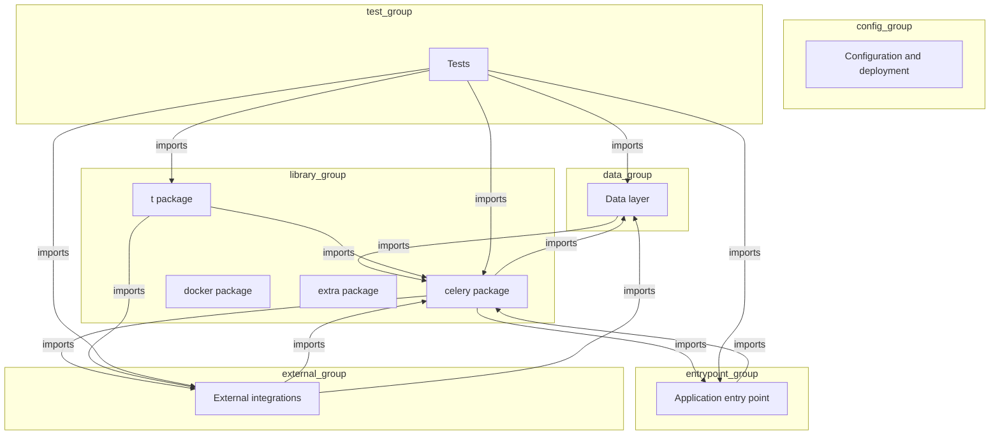

# Architecture report: celery/celery

> Automated static analysis. **Observed** = directly seen in files/imports/AST; **Inferred** = interpretation from that evidence. Repository code was not executed.

## 1. Repository at a glance

| Item | Value |
| --- | --- |
| Repository | celery/celery |
| Description | Distributed Task Queue (development branch) |
| Language | Python |
| Stars | 29194 |
| Licence | Other |
| Analysed commit / branch | 9c2f238334331db43f15956f131235fd3bb70fd1 / main |
| Framework(s) | Django |
| Files analysed | 797 |
| Components | 9 |

## 2. Architecture in one minute

celery/celery - Distributed Task Queue (development branch). This repository was analysed statically from 797 file(s) (404 Python). Detected technologies (observed from imports/manifests): GitHub Actions, MongoDB, Redis, Django, AWS (boto3), Celery. Files are grouped into 9 component(s): celery package, Configuration and deployment, Data layer, docker package, Application entry point, External integrations, extra package, t package. Observed entry point(s): celery/__main__.py, celery/bin/amqp.py, celery/bin/beat.py. Findings below distinguish observed facts from inferred interpretation.

## 3. High-level block diagram

## 4. Main components

### celery package (`celery`)

- **Kind:** library
- **Status:** Observed
- **Confidence:** 0.85
- **Responsibility:** Groups 153 file(s) under celery package (observed from repository paths and static analysis). Observed top-level classes: AMQP, AMQPContext, AbortableAsyncResult, AbortableTask, Agent, AlreadyRegistered. Observed top-level functions: Callable, ContextMock, EmbeddedService, Event, Namespace, Property.
- **Paths:** `celery/__init__.py`, `celery/_state.py`, `celery/app/__init__.py`, `celery/app/amqp.py`, `celery/app/annotations.py`, `celery/app/autoretry.py`, `celery/app/backends.py`, `celery/app/base.py`, `celery/app/builtins.py`, `celery/app/control.py`, `celery/app/defaults.py`, `celery/app/events.py`, `celery/app/log.py`, `celery/app/registry.py`, `celery/app/routes.py`, `celery/app/task.py`, `celery/app/trace.py`, `celery/app/utils.py`, `celery/apps/__init__.py`, `celery/apps/beat.py`, `celery/apps/multi.py`, `celery/apps/worker.py`, `celery/backends/__init__.py`, `celery/backends/arangodb.py`, `celery/backends/asynchronous.py`, `celery/backends/azureblockblob.py`, `celery/backends/base.py`, `celery/backends/cache.py`, `celery/backends/cassandra.py`, `celery/backends/consul.py`, `celery/backends/cosmosdbsql.py`, `celery/backends/couchbase.py`, `celery/backends/couchdb.py`, `celery/backends/dynamodb.py`, `celery/backends/elasticsearch.py`, `celery/backends/filesystem.py`, `celery/backends/gcs.py`, `celery/backends/mongodb.py`, `celery/backends/redis.py`, `celery/backends/rpc.py`, `celery/backends/s3.py`, `celery/beat.py`, `celery/bin/__init__.py`, `celery/bin/amqp.py`, `celery/bin/base.py`, `celery/bin/beat.py`, `celery/bin/call.py`, `celery/bin/celery.py`, `celery/bin/control.py`, `celery/bin/events.py`, `celery/bin/graph.py`, `celery/bin/list.py`, `celery/bin/logtool.py`, `celery/bin/migrate.py`, `celery/bin/multi.py`, `celery/bin/purge.py`, `celery/bin/result.py`, `celery/bin/shell.py`, `celery/bin/upgrade.py`, `celery/bin/worker.py`, `celery/bootsteps.py`, `celery/canvas.py`, `celery/concurrency/__init__.py`, `celery/concurrency/asynpool.py`, `celery/concurrency/base.py`, `celery/concurrency/eventlet.py`, `celery/concurrency/gevent.py`, `celery/concurrency/prefork.py`, `celery/concurrency/solo.py`, `celery/concurrency/thread.py`, `celery/contrib/__init__.py`, `celery/contrib/abortable.py`, `celery/contrib/django/__init__.py`, `celery/contrib/django/task.py`, `celery/contrib/migrate.py`, `celery/contrib/pytest.py`, `celery/contrib/rdb.py`, `celery/contrib/sphinx.py`, `celery/contrib/testing/__init__.py`, `celery/contrib/testing/manager.py`, `celery/contrib/testing/mocks.py`, `celery/contrib/testing/tasks.py`, `celery/contrib/testing/worker.py`, `celery/events/__init__.py`, `celery/events/dispatcher.py`, `celery/events/event.py`, `celery/events/receiver.py`, `celery/events/snapshot.py`, `celery/events/state.py`, `celery/exceptions.py`, `celery/fixups/__init__.py`, `celery/fixups/django.py`, `celery/loaders/__init__.py`, `celery/loaders/base.py`, `celery/loaders/default.py`, `celery/local.py`, `celery/platforms.py`, `celery/result.py`, `celery/schedules.py`, `celery/security/__init__.py`, `celery/security/certificate.py`, `celery/security/key.py`, `celery/security/serialization.py`, `celery/security/utils.py`, `celery/signals.py`, `celery/states.py`, `celery/utils/__init__.py`, `celery/utils/abstract.py`, `celery/utils/annotations.py`, `celery/utils/collections.py`, `celery/utils/debug.py`, `celery/utils/deprecated.py`, `celery/utils/dispatch/__init__.py`, `celery/utils/dispatch/signal.py`, `celery/utils/functional.py`, `celery/utils/graph.py`, `celery/utils/imports.py`, `celery/utils/iso8601.py`, `celery/utils/log.py`, `celery/utils/nodenames.py`, `celery/utils/objects.py`, `celery/utils/quorum_queues.py`, `celery/utils/saferepr.py`, `celery/utils/serialization.py`, `celery/utils/static/__init__.py`, `celery/utils/sysinfo.py`, `celery/utils/term.py`, `celery/utils/text.py`, `celery/utils/threads.py`, `celery/utils/time.py`, `celery/utils/timer2.py`, `celery/worker/__init__.py`, `celery/worker/autoscale.py`, `celery/worker/components.py`, `celery/worker/consumer/__init__.py`, `celery/worker/consumer/agent.py`, `celery/worker/consumer/connection.py`, `celery/worker/consumer/consumer.py`, `celery/worker/consumer/control.py`, `celery/worker/consumer/delayed_delivery.py`, `celery/worker/consumer/events.py`, `celery/worker/consumer/gossip.py`, `celery/worker/consumer/heart.py`, `celery/worker/consumer/mingle.py`, `celery/worker/consumer/tasks.py`, `celery/worker/control.py`, `celery/worker/heartbeat.py`, `celery/worker/loops.py`, `celery/worker/pidbox.py`, `celery/worker/request.py`, `celery/worker/state.py`, `celery/worker/strategy.py`, `celery/worker/worker.py`
- **Evidence:** [celery/__init__.py:84](https://github.com/celery/celery/blob/9c2f238334331db43f15956f131235fd3bb70fd1/celery/__init__.py#L84); [celery/_state.py:43](https://github.com/celery/celery/blob/9c2f238334331db43f15956f131235fd3bb70fd1/celery/_state.py#L43); [celery/app/__init__.py:19](https://github.com/celery/celery/blob/9c2f238334331db43f15956f131235fd3bb70fd1/celery/app/__init__.py#L19); [celery/app/amqp.py:48](https://github.com/celery/celery/blob/9c2f238334331db43f15956f131235fd3bb70fd1/celery/app/amqp.py#L48); [celery/app/annotations.py:18](https://github.com/celery/celery/blob/9c2f238334331db43f15956f131235fd3bb70fd1/celery/app/annotations.py#L18); [celery/app/autoretry.py:8](https://github.com/celery/celery/blob/9c2f238334331db43f15956f131235fd3bb70fd1/celery/app/autoretry.py#L8); [celery/app/backends.py:41](https://github.com/celery/celery/blob/9c2f238334331db43f15956f131235fd3bb70fd1/celery/app/backends.py#L41); [celery/app/base.py:116](https://github.com/celery/celery/blob/9c2f238334331db43f15956f131235fd3bb70fd1/celery/app/base.py#L116)

### Configuration and deployment (`config`)

- **Kind:** config
- **Status:** Observed
- **Confidence:** 0.85
- **Responsibility:** Groups 13 file(s) under configuration and deployment (observed from repository paths and static analysis). Observed top-level functions: _add_default, _add_doc, _pip_requirement, _reqs, _strip_comments, extras.
- **Paths:** `MANIFEST.in`, `bandit.json`, `docker/Dockerfile`, `docker/docker-compose.yml`, `docker/docs/Dockerfile`, `helm-chart/Chart.yaml`, `helm-chart/templates/configmap.yaml`, `helm-chart/templates/deployment.yaml`, `helm-chart/templates/serviceaccount.yaml`, `helm-chart/values.yaml`, `pyproject.toml`, `setup.cfg`, `setup.py`
- **Evidence:** [MANIFEST.in](https://github.com/celery/celery/blob/9c2f238334331db43f15956f131235fd3bb70fd1/MANIFEST.in); [bandit.json](https://github.com/celery/celery/blob/9c2f238334331db43f15956f131235fd3bb70fd1/bandit.json); [docker/Dockerfile](https://github.com/celery/celery/blob/9c2f238334331db43f15956f131235fd3bb70fd1/docker/Dockerfile); [docker/docker-compose.yml](https://github.com/celery/celery/blob/9c2f238334331db43f15956f131235fd3bb70fd1/docker/docker-compose.yml); [docker/docs/Dockerfile](https://github.com/celery/celery/blob/9c2f238334331db43f15956f131235fd3bb70fd1/docker/docs/Dockerfile); [helm-chart/Chart.yaml](https://github.com/celery/celery/blob/9c2f238334331db43f15956f131235fd3bb70fd1/helm-chart/Chart.yaml); [helm-chart/templates/configmap.yaml](https://github.com/celery/celery/blob/9c2f238334331db43f15956f131235fd3bb70fd1/helm-chart/templates/configmap.yaml); [helm-chart/templates/deployment.yaml](https://github.com/celery/celery/blob/9c2f238334331db43f15956f131235fd3bb70fd1/helm-chart/templates/deployment.yaml)

### Data layer (`data_layer`)

- **Kind:** data
- **Status:** Observed
- **Confidence:** 0.85
- **Responsibility:** Groups 3 file(s) under data layer (observed from repository paths and static analysis). Observed top-level classes: DatabaseBackend, SessionManager, Task, TaskExtended, TaskSet. Observed top-level functions: _after_fork_cleanup_session, _get_utc_now, session_cleanup.
- **Paths:** `celery/backends/database/__init__.py`, `celery/backends/database/models.py`, `celery/backends/database/session.py`
- **Evidence:** [celery/backends/database/__init__.py:42](https://github.com/celery/celery/blob/9c2f238334331db43f15956f131235fd3bb70fd1/celery/backends/database/__init__.py#L42); [celery/backends/database/models.py:16](https://github.com/celery/celery/blob/9c2f238334331db43f15956f131235fd3bb70fd1/celery/backends/database/models.py#L16); [celery/backends/database/session.py:28](https://github.com/celery/celery/blob/9c2f238334331db43f15956f131235fd3bb70fd1/celery/backends/database/session.py#L28)

### docker package (`docker`)

- **Kind:** library
- **Status:** Observed
- **Confidence:** 0.85
- **Responsibility:** Groups 2 file(s) under docker package (observed from repository paths and static analysis).
- **Paths:** `docker/scripts/create-linux-user.sh`, `docker/scripts/install-couchbase.sh`
- **Evidence:** [docker/scripts/create-linux-user.sh](https://github.com/celery/celery/blob/9c2f238334331db43f15956f131235fd3bb70fd1/docker/scripts/create-linux-user.sh); [docker/scripts/install-couchbase.sh](https://github.com/celery/celery/blob/9c2f238334331db43f15956f131235fd3bb70fd1/docker/scripts/install-couchbase.sh)

### Application entry point (`entrypoint`)

- **Kind:** entrypoint
- **Status:** Observed
- **Confidence:** 0.85
- **Responsibility:** Groups 15 file(s) under application entry point (observed from repository paths and static analysis). Observed application object created via Celery. Observed top-level classes: AppLoader, ConnMock, CursesMonitor, DisplayThread, Dumper, PurgeMock. Observed top-level functions: TestApp, author, bar, baz, bench_apply, bench_both.
- **Paths:** `celery/__main__.py`, `celery/contrib/testing/app.py`, `celery/events/cursesmon.py`, `celery/events/dumper.py`, `celery/loaders/app.py`, `extra/release/attribution.py`, `t/benchmarks/bench_worker.py`, `t/smoke/workers/alias.py`, `t/unit/bin/proj/__init__.py`, `t/unit/bin/proj/app.py`, `t/unit/bin/proj/app_with_custom_cmds.py`, `t/unit/bin/proj/daemon.py`, `t/unit/bin/proj/pyramid_celery_app.py`, `t/unit/contrib/proj/foo.py`, `t/unit/contrib/proj/xyzzy.py`
- **Evidence:** [celery/__main__.py:10](https://github.com/celery/celery/blob/9c2f238334331db43f15956f131235fd3bb70fd1/celery/__main__.py#L10); [celery/contrib/testing/app.py:57](https://github.com/celery/celery/blob/9c2f238334331db43f15956f131235fd3bb70fd1/celery/contrib/testing/app.py#L57); [celery/events/cursesmon.py:34](https://github.com/celery/celery/blob/9c2f238334331db43f15956f131235fd3bb70fd1/celery/events/cursesmon.py#L34); [celery/events/dumper.py:29](https://github.com/celery/celery/blob/9c2f238334331db43f15956f131235fd3bb70fd1/celery/events/dumper.py#L29); [celery/loaders/app.py:7](https://github.com/celery/celery/blob/9c2f238334331db43f15956f131235fd3bb70fd1/celery/loaders/app.py#L7); [extra/release/attribution.py:7](https://github.com/celery/celery/blob/9c2f238334331db43f15956f131235fd3bb70fd1/extra/release/attribution.py#L7); [t/benchmarks/bench_worker.py:19](https://github.com/celery/celery/blob/9c2f238334331db43f15956f131235fd3bb70fd1/t/benchmarks/bench_worker.py#L19); [t/smoke/workers/alias.py:18](https://github.com/celery/celery/blob/9c2f238334331db43f15956f131235fd3bb70fd1/t/smoke/workers/alias.py#L18)

### External integrations (`external_integrations`)

- **Kind:** external
- **Status:** Observed
- **Confidence:** 0.85
- **Responsibility:** Groups 5 file(s) under external integrations (observed from repository paths and static analysis). Observed top-level classes: AddParameterModel, AddResultModel, ClassBasedAutoRetryTask, ExpectedException, UnpickleableException. Observed top-level functions: add, add_chord_to_chord, add_ignore_result, add_not_typed, add_pydantic, add_pydantic_string_annotations.
- **Paths:** `t/integration/__init__.py`, `t/integration/django_settings.py`, `t/integration/serialization_config.py`, `t/integration/tasks.py`, `t/integration/worker_config.py`
- **Evidence:** [t/integration/__init__.py](https://github.com/celery/celery/blob/9c2f238334331db43f15956f131235fd3bb70fd1/t/integration/__init__.py); [t/integration/django_settings.py](https://github.com/celery/celery/blob/9c2f238334331db43f15956f131235fd3bb70fd1/t/integration/django_settings.py); [t/integration/serialization_config.py](https://github.com/celery/celery/blob/9c2f238334331db43f15956f131235fd3bb70fd1/t/integration/serialization_config.py); [t/integration/tasks.py:21](https://github.com/celery/celery/blob/9c2f238334331db43f15956f131235fd3bb70fd1/t/integration/tasks.py#L21); [t/integration/worker_config.py](https://github.com/celery/celery/blob/9c2f238334331db43f15956f131235fd3bb70fd1/t/integration/worker_config.py)

### extra package (`extra`)

- **Kind:** library
- **Status:** Observed
- **Confidence:** 0.85
- **Responsibility:** Groups 3 file(s) under extra package (observed from repository paths and static analysis).
- **Paths:** `extra/release/gen-cert.sh`, `extra/release/sphinx2rst_config.py`, `extra/supervisord/celery.sh`
- **Evidence:** [extra/release/gen-cert.sh](https://github.com/celery/celery/blob/9c2f238334331db43f15956f131235fd3bb70fd1/extra/release/gen-cert.sh); [extra/release/sphinx2rst_config.py](https://github.com/celery/celery/blob/9c2f238334331db43f15956f131235fd3bb70fd1/extra/release/sphinx2rst_config.py); [extra/supervisord/celery.sh](https://github.com/celery/celery/blob/9c2f238334331db43f15956f131235fd3bb70fd1/extra/supervisord/celery.sh)

### t package (`t`)

- **Kind:** library
- **Status:** Observed
- **Confidence:** 0.85
- **Responsibility:** Groups 34 file(s) under t package (observed from repository paths and static analysis). Observed top-level classes: AltSmokeWorkerContainer, CeleryLatestWorkerContainer, OtherSmokeWorkerContainer, SecurityCase, SmokeWorkerContainer, TaskTermination. Observed top-level functions: add_with_explicit_lazy_option, celery_alt_dev_worker, celery_latest_worker, celery_other_dev_worker, countdown_task_with_retry, default_worker_container_cls.
- **Paths:** `t/__init__.py`, `t/canvas_helpers.py`, `t/skip.py`, `t/smoke/__init__.py`, `t/smoke/operations/__init__.py`, `t/smoke/operations/task_termination.py`, `t/smoke/operations/worker_kill.py`, `t/smoke/operations/worker_restart.py`, `t/smoke/signals.py`, `t/smoke/tasks.py`, `t/smoke/workers/__init__.py`, `t/smoke/workers/alt.py`, `t/smoke/workers/dev.py`, `t/smoke/workers/latest.py`, `t/smoke/workers/other.py`, `t/unit/__init__.py`, `t/unit/app/__init__.py`, `t/unit/apps/__init__.py`, `t/unit/backends/__init__.py`, `t/unit/bin/__init__.py`, `t/unit/bin/celery.py`, `t/unit/bin/proj/app2.py`, `t/unit/bin/proj/daemon_config.py`, `t/unit/bin/proj/scheduler.py`, `t/unit/concurrency/__init__.py`, `t/unit/contrib/__init__.py`, `t/unit/contrib/django/__init__.py`, `t/unit/contrib/proj/__init__.py`, `t/unit/contrib/proj/conf.py`, `t/unit/events/__init__.py`, `t/unit/fixups/__init__.py`, `t/unit/security/__init__.py`, `t/unit/security/case.py`, `t/unit/tasks/__init__.py`
- **Evidence:** [t/__init__.py](https://github.com/celery/celery/blob/9c2f238334331db43f15956f131235fd3bb70fd1/t/__init__.py); [t/canvas_helpers.py:1](https://github.com/celery/celery/blob/9c2f238334331db43f15956f131235fd3bb70fd1/t/canvas_helpers.py#L1); [t/skip.py](https://github.com/celery/celery/blob/9c2f238334331db43f15956f131235fd3bb70fd1/t/skip.py); [t/smoke/__init__.py](https://github.com/celery/celery/blob/9c2f238334331db43f15956f131235fd3bb70fd1/t/smoke/__init__.py); [t/smoke/operations/__init__.py](https://github.com/celery/celery/blob/9c2f238334331db43f15956f131235fd3bb70fd1/t/smoke/operations/__init__.py); [t/smoke/operations/task_termination.py:13](https://github.com/celery/celery/blob/9c2f238334331db43f15956f131235fd3bb70fd1/t/smoke/operations/task_termination.py#L13); [t/smoke/operations/worker_kill.py:10](https://github.com/celery/celery/blob/9c2f238334331db43f15956f131235fd3bb70fd1/t/smoke/operations/worker_kill.py#L10); [t/smoke/operations/worker_restart.py:8](https://github.com/celery/celery/blob/9c2f238334331db43f15956f131235fd3bb70fd1/t/smoke/operations/worker_restart.py#L8)

### Tests (`tests`)

- **Kind:** test
- **Status:** Observed
- **Confidence:** 0.85
- **Responsibility:** Groups 148 file(s) under tests (observed from repository paths and static analysis). Observed application object created via Celery. Observed routes: PATCH celery.app.base.set_default_app, PATCH celery.security.setup_security, PATCH celery.bin.celery.celery, PATCH celery.bin.celery.celery, PATCH celery.app.base.logger. Observed top-level classes: AnnotationCase, AnySignatureWithTask, BlackholeProxy, BuiltinsCase, CachedBackendWithTreadTrucking, CanvasCase. Observed top-level functions: AAA_disable_multiprocessing, AAA_reset_CELERY_LOADER_env, E, Message, QTEV, Router.
- **Paths:** `examples/quorum-queues/test_cluster.sh`, `t/integration/conftest.py`, `t/integration/test_backend.py`, `t/integration/test_backend_leak_in_fixture_teardown.py`, `t/integration/test_beat.py`, `t/integration/test_cache_backend.py`, `t/integration/test_canvas.py`, `t/integration/test_connection_recovery.py`, `t/integration/test_database_backend.py`, `t/integration/test_events_state_memory_leak.py`, `t/integration/test_group_chains.py`, `t/integration/test_inspect.py`, `t/integration/test_loader.py`, `t/integration/test_logfile_format.py`, `t/integration/test_mem_leak_in_exception_handling.py`, `t/integration/test_redis_backend.py`, `t/integration/test_request_backend_down.py`, `t/integration/test_security.py`, `t/integration/test_serialization.py`, `t/integration/test_tasks.py`, `t/integration/test_upgrade.py`, `t/integration/test_worker.py`, `t/smoke/conftest.py`, `t/smoke/tests/__init__.py`, `t/smoke/tests/failover/__init__.py`, `t/smoke/tests/failover/test_broker_failover.py`, `t/smoke/tests/failover/test_worker_failover.py`, `t/smoke/tests/quorum_queues/__init__.py`, `t/smoke/tests/quorum_queues/conftest.py`, `t/smoke/tests/quorum_queues/test_chord_unlock_routing.py`, `t/smoke/tests/quorum_queues/test_cycle_detection.py`, `t/smoke/tests/quorum_queues/test_default_queue_type.py`, `t/smoke/tests/quorum_queues/test_native_delayed_delivery.py`, `t/smoke/tests/quorum_queues/test_native_delayed_delivery_binding.py`, `t/smoke/tests/quorum_queues/test_qos.py`, `t/smoke/tests/quorum_queues/test_quorum_queues.py`, `t/smoke/tests/stamping/__init__.py`, `t/smoke/tests/stamping/conftest.py`, `t/smoke/tests/stamping/signals.py`, `t/smoke/tests/stamping/tasks.py`, `t/smoke/tests/stamping/test_hybrid_cluster.py`, `t/smoke/tests/stamping/test_revoke.py`, `t/smoke/tests/stamping/test_visitor.py`, `t/smoke/tests/stamping/workers/__init__.py`, `t/smoke/tests/stamping/workers/legacy.py`, `t/smoke/tests/test_autoscale.py`, `t/smoke/tests/test_beat_remote_control.py`, `t/smoke/tests/test_beat_shutdown.py`, `t/smoke/tests/test_callback_publish_retry.py`, `t/smoke/tests/test_canvas.py`, `t/smoke/tests/test_chord_headers_exchange.py`, `t/smoke/tests/test_concurrency_auto.py`, `t/smoke/tests/test_consumer.py`, `t/smoke/tests/test_control.py`, `t/smoke/tests/test_dedup_chain_dispatch.py`, `t/smoke/tests/test_disabled_backend.py`, `t/smoke/tests/test_gossip.py`, `t/smoke/tests/test_memcached_backend.py`, `t/smoke/tests/test_query_task.py`, `t/smoke/tests/test_redis_backend_gevent.py`, `t/smoke/tests/test_redis_backend_reentrant.py`, `t/smoke/tests/test_revoke.py`, `t/smoke/tests/test_revoked_sync.py`, `t/smoke/tests/test_rpc_backend.py`, `t/smoke/tests/test_signals.py`, `t/smoke/tests/test_task_queue_default_exchange.py`, `t/smoke/tests/test_task_queue_max_priority.py`, `t/smoke/tests/test_task_queue_routing_key.py`, `t/smoke/tests/test_tasks.py`, `t/smoke/tests/test_thread_safe.py`, `t/smoke/tests/test_worker.py`, `t/smoke/tests/test_worker_heartbeats.py`, `t/smoke/tests/test_worker_shutdown_acks.py`, `t/unit/app/test_amqp.py`, `t/unit/app/test_amqp_callback_publish.py`, `t/unit/app/test_annotations.py`, `t/unit/app/test_app.py`, `t/unit/app/test_backends.py`, `t/unit/app/test_beat.py`, `t/unit/app/test_builtins.py`, `t/unit/app/test_celery.py`, `t/unit/app/test_control.py`, `t/unit/app/test_defaults.py`, `t/unit/app/test_exceptions.py`, `t/unit/app/test_loaders.py`, `t/unit/app/test_log.py`, `t/unit/app/test_preload_cli.py`, `t/unit/app/test_registry.py`, `t/unit/app/test_routes.py`, `t/unit/app/test_schedules.py`, `t/unit/app/test_trace.py`, `t/unit/app/test_utils.py`, `t/unit/apps/test_beat.py`, `t/unit/apps/test_multi.py`, `t/unit/apps/test_worker.py`, `t/unit/backends/test_arangodb.py`, `t/unit/backends/test_asynchronous.py`, `t/unit/backends/test_azureblockblob.py`, `t/unit/backends/test_base.py`, `t/unit/backends/test_cache.py`, `t/unit/backends/test_cassandra.py`, `t/unit/backends/test_consul.py`, `t/unit/backends/test_cosmosdbsql.py`, `t/unit/backends/test_couchbase.py`, `t/unit/backends/test_couchdb.py`, `t/unit/backends/test_database.py`, `t/unit/backends/test_dynamodb.py`, `t/unit/backends/test_elasticsearch.py`, `t/unit/backends/test_filesystem.py`, `t/unit/backends/test_gcs.py`, `t/unit/backends/test_mongodb.py`, `t/unit/backends/test_redis.py`, `t/unit/backends/test_rpc.py`, `t/unit/backends/test_s3.py`, `t/unit/bin/test_beat.py`, `t/unit/bin/test_control.py`, `t/unit/bin/test_daemonization.py`, `t/unit/bin/test_multi.py`, `t/unit/bin/test_upgrade.py`, `t/unit/bin/test_worker.py`, `t/unit/concurrency/test_concurrency.py`, `t/unit/concurrency/test_eventlet.py`, `t/unit/concurrency/test_gevent.py`, `t/unit/concurrency/test_pool.py`, `t/unit/concurrency/test_prefork.py`, `t/unit/concurrency/test_solo.py`, `t/unit/concurrency/test_thread.py`, `t/unit/conftest.py`, `t/unit/contrib/django/test_task.py`, `t/unit/contrib/test_abortable.py`, `t/unit/contrib/test_manager.py`, `t/unit/contrib/test_migrate.py`, `t/unit/contrib/test_pytest.py`, `t/unit/contrib/test_rdb.py`, `t/unit/contrib/test_sphinx.py`, `t/unit/contrib/test_worker.py`, `t/unit/events/test_cursesmon.py`, `t/unit/events/test_dumper.py`, `t/unit/events/test_events.py`, `t/unit/events/test_snapshot.py`, `t/unit/events/test_state.py`, `t/unit/fixups/test_django.py`, `t/unit/security/test_certificate.py`, `t/unit/security/test_key.py`, `t/unit/security/test_security.py`, `t/unit/security/test_serialization.py`, `t/unit/tasks/test_canvas.py`, `t/unit/tasks/test_chord.py`
- **Evidence:** [examples/quorum-queues/test_cluster.sh](https://github.com/celery/celery/blob/9c2f238334331db43f15956f131235fd3bb70fd1/examples/quorum-queues/test_cluster.sh); [t/integration/conftest.py:27](https://github.com/celery/celery/blob/9c2f238334331db43f15956f131235fd3bb70fd1/t/integration/conftest.py#L27); [t/integration/test_backend.py:15](https://github.com/celery/celery/blob/9c2f238334331db43f15956f131235fd3bb70fd1/t/integration/test_backend.py#L15); [t/integration/test_backend_leak_in_fixture_teardown.py:12](https://github.com/celery/celery/blob/9c2f238334331db43f15956f131235fd3bb70fd1/t/integration/test_backend_leak_in_fixture_teardown.py#L12); [t/integration/test_beat.py:17](https://github.com/celery/celery/blob/9c2f238334331db43f15956f131235fd3bb70fd1/t/integration/test_beat.py#L17); [t/integration/test_cache_backend.py:11](https://github.com/celery/celery/blob/9c2f238334331db43f15956f131235fd3bb70fd1/t/integration/test_cache_backend.py#L11); [t/integration/test_canvas.py:33](https://github.com/celery/celery/blob/9c2f238334331db43f15956f131235fd3bb70fd1/t/integration/test_canvas.py#L33); [t/integration/test_connection_recovery.py:57](https://github.com/celery/celery/blob/9c2f238334331db43f15956f131235fd3bb70fd1/t/integration/test_connection_recovery.py#L57)

## 5. Execution flow

**Observed** entry point(s):

- [celery/__main__.py](https://github.com/celery/celery/blob/9c2f238334331db43f15956f131235fd3bb70fd1/celery/__main__.py)
- [celery/bin/amqp.py:64](https://github.com/celery/celery/blob/9c2f238334331db43f15956f131235fd3bb70fd1/celery/bin/amqp.py#L64)
- [celery/bin/beat.py:62](https://github.com/celery/celery/blob/9c2f238334331db43f15956f131235fd3bb70fd1/celery/bin/beat.py#L62)
- [celery/bin/call.py:58](https://github.com/celery/celery/blob/9c2f238334331db43f15956f131235fd3bb70fd1/celery/bin/call.py#L58)
- [celery/bin/celery.py:113](https://github.com/celery/celery/blob/9c2f238334331db43f15956f131235fd3bb70fd1/celery/bin/celery.py#L113)
- [celery/bin/control.py:129](https://github.com/celery/celery/blob/9c2f238334331db43f15956f131235fd3bb70fd1/celery/bin/control.py#L129)
- [celery/bin/events.py:83](https://github.com/celery/celery/blob/9c2f238334331db43f15956f131235fd3bb70fd1/celery/bin/events.py#L83)
- [celery/bin/graph.py:14](https://github.com/celery/celery/blob/9c2f238334331db43f15956f131235fd3bb70fd1/celery/bin/graph.py#L14)
- [celery/bin/list.py:10](https://github.com/celery/celery/blob/9c2f238334331db43f15956f131235fd3bb70fd1/celery/bin/list.py#L10)
- [celery/bin/logtool.py:116](https://github.com/celery/celery/blob/9c2f238334331db43f15956f131235fd3bb70fd1/celery/bin/logtool.py#L116)
- [celery/bin/migrate.py:48](https://github.com/celery/celery/blob/9c2f238334331db43f15956f131235fd3bb70fd1/celery/bin/migrate.py#L48)
- [celery/bin/multi.py:472](https://github.com/celery/celery/blob/9c2f238334331db43f15956f131235fd3bb70fd1/celery/bin/multi.py#L472)

**Observed** routes (from decorators):

- `PATCH celery.app.base.set_default_app` -> `test_set_default` in `t/unit/app/test_app.py:151`
- `PATCH celery.security.setup_security` -> `test_setup_security` in `t/unit/app/test_app.py:156`
- `PATCH celery.bin.celery.celery` -> `test_worker_main` in `t/unit/app/test_app.py:1603`
- `PATCH celery.bin.celery.celery` -> `test_start` in `t/unit/app/test_app.py:1896`
- `PATCH celery.app.base.logger` -> `test_after_fork_cleanup_app__raises` in `t/unit/app/test_app.py:1954`
- `PATCH celery.app.base.register_after_fork` -> `test_ensure_after_fork__registers_once` in `t/unit/app/test_app.py:1972`
- `PATCH celery.utils.time.get_localzone` -> `test_use_local_timezone_failure` in `t/unit/app/test_app.py:2005`
- `PATCH celery.app.base.detect_quorum_queues` -> `test_send_task__connection_provided` in `t/unit/app/test_app.py:2109`
- `PATCH celery.app.base.detect_quorum_queues` -> `test_send_task_honours_task_serializer` in `t/unit/app/test_app.py:2130`
- `PATCH celery.app.base.detect_quorum_queues` -> `test_send_task_explicit_serializer_overrides_task` in `t/unit/app/test_app.py:2156`
- `PATCH celery.app.base.detect_quorum_queues` -> `test_send_task_unregistered_task_uses_defaults` in `t/unit/app/test_app.py:2180`
- `PATCH celery.app.base.detect_quorum_queues` -> `test_send_task_with_task_time_limit_no_duplicate_kwargs` in `t/unit/app/test_app.py:2195`
- `PATCH celery.app.base.detect_quorum_queues` -> `test_send_task_explicit_time_limit_overrides_task` in `t/unit/app/test_app.py:2224`
- `PATCH celery.app.base.detect_quorum_queues` -> `test_send_task_explicit_none_clears_task_defaults` in `t/unit/app/test_app.py:2255`
- `PATCH celery.app.base.detect_quorum_queues` -> `test_send_task_explicit_expires_pops_from_options` in `t/unit/app/test_app.py:2287`
- `PATCH celery.app.base.detect_quorum_queues` -> `test_send_task_registry_without_get_method` in `t/unit/app/test_app.py:2317`
- `PATCH celery.app.base.detect_quorum_queues` -> `test_send_task_registry_without_get_keyerror` in `t/unit/app/test_app.py:2353`
- `PATCH celery.app.base.detect_quorum_queues` -> `test_send_task_skips_unbound_get_exec_options` in `t/unit/app/test_app.py:2381`
- `PATCH celery.app.base.detect_quorum_queues` -> `test_native_delayed_delivery_countdown` in `t/unit/app/test_app.py:2589`
- `PATCH celery.app.base.detect_quorum_queues` -> `test_native_delayed_delivery__no_queue_arg__no_eta` in `t/unit/app/test_app.py:2616`
- `PATCH celery.app.base.detect_quorum_queues` -> `test_native_delayed_delivery__no_queue_arg__with_countdown` in `t/unit/app/test_app.py:2638`
- `PATCH celery.app.base.detect_quorum_queues` -> `test_native_delayed_delivery_eta_datetime` in `t/unit/app/test_app.py:2668`
- `PATCH celery.app.base.detect_quorum_queues` -> `test_native_delayed_delivery_eta_across_dst` in `t/unit/app/test_app.py:2718`
- `PATCH celery.app.base.detect_quorum_queues` -> `test_native_delayed_delivery_eta_str` in `t/unit/app/test_app.py:2747`
- `PATCH celery.app.base.detect_quorum_queues` -> `test_native_delayed_delivery_no_eta_or_countdown` in `t/unit/app/test_app.py:2773`
- `PATCH celery.app.base.detect_quorum_queues` -> `test_native_delayed_delivery_countdown_in_the_past` in `t/unit/app/test_app.py:2790`
- `PATCH celery.app.base.detect_quorum_queues` -> `test_native_delayed_delivery_eta_in_the_past` in `t/unit/app/test_app.py:2814`
- `PATCH celery.app.base.detect_quorum_queues` -> `test_native_delayed_delivery_eta_in_the_past_during_fall_back` in `t/unit/app/test_app.py:2853`
- `PATCH celery.app.base.detect_quorum_queues` -> `test_native_delayed_delivery_eta_is_now` in `t/unit/app/test_app.py:2881`
- `PATCH celery.app.base.detect_quorum_queues` -> `test_native_delayed_delivery_direct_exchange` in `t/unit/app/test_app.py:2908`
- `PATCH celery.app.base.detect_quorum_queues` -> `test_send_task_raises_on_pool_exhaustion` in `t/unit/app/test_app.py:2960`
- `PATCH celery.app.base.detect_quorum_queues` -> `test_send_task_skips_driver_type_without_eta_countdown` in `t/unit/app/test_app.py:2975`
- `PATCH celery.app.base.detect_quorum_queues` -> `test_send_task_with_eta_no_quorum_queues` in `t/unit/app/test_app.py:3040`
- `PATCH celery.app.base.Celery.send_task` -> `test_send_task` in `t/unit/app/test_beat.py:314`
- `PATCH kombu.connection.Connection.ensure_connection` -> `test_ensure_connection_error_handler` in `t/unit/app/test_beat.py:358`
- `PATCH celery.beat.error` -> `test_due_tick_SchedulingError` in `t/unit/app/test_beat.py:411`
- `PATCH celery.beat.error` -> `test_tick_survives_entry_failing_in_populate_heap` in `t/unit/app/test_beat.py:419`
- `PATCH celery.beat.error` -> `test_tick_survives_entry_failing_when_due` in `t/unit/app/test_beat.py:434`
- `PATCH celery.beat.Scheduler._when` -> `test_populate_heap` in `t/unit/app/test_beat.py:724`
- `PATCH os.remove` -> `test_remove_db` in `t/unit/app/test_beat.py:1145`
- `PATCH celery.canvas.chunks.apply_chunks` -> `test_run` in `t/unit/app/test_builtins.py:78`
- `PATCH celery.app.base.Celery.current_worker_task` -> `test_task` in `t/unit/app/test_builtins.py:117`
- `PATCH celery.app.base.Celery.current_worker_task` -> `test_task__disable_add_to_parent` in `t/unit/app/test_builtins.py:127`
- `PATCH celery.loaders.base.find_module` -> `test_read_configuration_not_a_package` in `t/unit/app/test_loaders.py:115`
- `PATCH celery.loaders.base.find_module` -> `test_read_configuration_py_in_name` in `t/unit/app/test_loaders.py:123`
- `PATCH celery.loaders.base.find_module` -> `test_read_configuration_importerror` in `t/unit/app/test_loaders.py:130`
- `PATCH celery.utils.log.safe_str` -> `test_formatException_not_string` in `t/unit/app/test_log.py:122`
- `PATCH logging.Formatter.formatException` -> `test_formatException_not_string` in `t/unit/app/test_log.py:122`
- `PATCH logging.Formatter.formatException` -> `test_formatException_bytes` in `t/unit/app/test_log.py:132`
- `PATCH celery.utils.log.safe_str` -> `test_formatException_bytes` in `t/unit/app/test_log.py:132`
- `PATCH logging.Formatter.format` -> `test_format_object` in `t/unit/app/test_log.py:141`
- `PATCH celery.utils.log.safe_str` -> `test_format_raises` in `t/unit/app/test_log.py:150`
- `PATCH os.fstat` -> `test_setup_logger_no_handlers_file` in `t/unit/app/test_log.py:298`
- `PATCH celery.apps.multi.os.mkdir` -> `test_parse` in `t/unit/apps/test_multi.py:118`
- `PATCH celery.apps.multi.gethostname` -> `test_parse` in `t/unit/apps/test_multi.py:118`
- `PATCH celery.apps.multi.os.makedirs` -> `test_workdir_tilde_is_expanded` in `t/unit/apps/test_multi.py:327`
- `PATCH celery.apps.multi.os.path.exists` -> `test_workdir_tilde_is_expanded` in `t/unit/apps/test_multi.py:327`
- `PATCH celery.apps.multi.os.makedirs` -> `test_pidfile_and_logfile_tilde_is_expanded` in `t/unit/apps/test_multi.py:337`
- `PATCH celery.apps.multi.os.path.exists` -> `test_pidfile_and_logfile_tilde_is_expanded` in `t/unit/apps/test_multi.py:337`
- `PATCH os.kill` -> `test_send` in `t/unit/apps/test_multi.py:359`
- `PATCH os.kill` -> `test_send__ESRCH` in `t/unit/apps/test_multi.py:364`
- `PATCH os.kill` -> `test_send__EPERM` in `t/unit/apps/test_multi.py:371`
- `PATCH os.kill` -> `test_send__error` in `t/unit/apps/test_multi.py:378`
- `PATCH celery.apps.multi.Popen` -> `test_waitexec` in `t/unit/apps/test_multi.py:399`
- `PATCH celery.apps.multi.os.path.exists` -> `test_pidfile_default` in `t/unit/apps/test_multi.py:442`
- `PATCH celery.apps.multi.os.makedirs` -> `test_pidfile_custom` in `t/unit/apps/test_multi.py:451`
- `PATCH celery.apps.multi.os.path.exists` -> `test_pidfile_custom` in `t/unit/apps/test_multi.py:451`
- `PATCH celery.apps.worker.current_process` -> `test_sets_should_stop_even_if_safe_say_raises` in `t/unit/apps/test_worker.py:158`
- `PATCH celery.apps.worker.current_process` -> `test_sets_should_terminate_even_if_callback_raises` in `t/unit/apps/test_worker.py:170`
- `PATCH celery.apps.worker.current_process` -> `test_cold_shutdown_flag_not_set_during_callback` in `t/unit/apps/test_worker.py:184`
- `PATCH celery.apps.worker.current_process` -> `test_normal_path_still_calls_say_and_signal` in `t/unit/apps/test_worker.py:208`
- `PATCH celery.apps.worker.current_process` -> `test_non_mainprocess_skips_say_but_still_sets_state` in `t/unit/apps/test_worker.py:222`
- `PATCH ` -> `test_create_client` in `t/unit/backends/test_azureblockblob.py:52`
- `PATCH ` -> `test_create_client__default_azure_credentials` in `t/unit/backends/test_azureblockblob.py:68`
- `PATCH ` -> `test_create_client__default_azure_credentials` in `t/unit/backends/test_azureblockblob.py:68`
- `PATCH ` -> `test_create_client__managed_identity_azure_credentials` in `t/unit/backends/test_azureblockblob.py:85`
- `PATCH ` -> `test_create_client__managed_identity_azure_credentials` in `t/unit/backends/test_azureblockblob.py:85`
- `PATCH ` -> `test_configure_client` in `t/unit/backends/test_azureblockblob.py:101`
- `PATCH ` -> `test_get` in `t/unit/backends/test_azureblockblob.py:137`
- `PATCH ` -> `test_get_missing` in `t/unit/backends/test_azureblockblob.py:150`
- `PATCH ` -> `test_set` in `t/unit/backends/test_azureblockblob.py:158`
- `PATCH ` -> `test_mget` in `t/unit/backends/test_azureblockblob.py:169`
- `PATCH ` -> `test_delete` in `t/unit/backends/test_azureblockblob.py:180`
- `PATCH ` -> `test_forget_missing_task_is_noop` in `t/unit/backends/test_azureblockblob.py:191`
- `PATCH ` -> `test_forget_twice_is_noop` in `t/unit/backends/test_azureblockblob.py:201`
- `PATCH celery.backends.base.group` -> `test_class_based_task_can_be_used_as_error_callback` in `t/unit/backends/test_base.py:801`
- `PATCH celery.backends.base.group` -> `test_unregistered_task_can_be_used_as_error_callback` in `t/unit/backends/test_base.py:818`
- `PATCH celery.backends.base.GroupResult` -> `test_chord_part_return_restore_raises` in `t/unit/backends/test_base.py:1892`
- `PATCH celery.backends.base.maybe_signature` -> `test_chord_part_return_restore_raises` in `t/unit/backends/test_base.py:1892`
- `PATCH celery.backends.base.GroupResult` -> `test_chord_part_return_restore_empty` in `t/unit/backends/test_base.py:1908`
- `PATCH celery.backends.base.maybe_signature` -> `test_chord_part_return_restore_empty` in `t/unit/backends/test_base.py:1908`
- `PATCH celery.result.GroupResult.restore` -> `test_on_chord_part_return` in `t/unit/backends/test_cache.py:83`
- `PATCH celery.result.GroupResult.restore` -> `test_chord_uses_chord_expires` in `t/unit/backends/test_cache.py:121`
- `PATCH celery.result.GroupResult.restore` -> `test_on_chord_part_return_resets_header_results` in `t/unit/backends/test_cache.py:149`
- `PATCH celery.result.GroupResult.restore` -> `test_chord_with_pymemcache_signatures` in `t/unit/backends/test_cache.py:562`
- `PATCH ` -> `test_create_client` in `t/unit/backends/test_cosmosdbsql.py:100`
- `PATCH ` -> `test_get` in `t/unit/backends/test_cosmosdbsql.py:118`
- `PATCH ` -> `test_get_missing` in `t/unit/backends/test_cosmosdbsql.py:127`
- `PATCH ` -> `test_set` in `t/unit/backends/test_cosmosdbsql.py:134`
- `PATCH ` -> `test_store_result_overwrites_earlier_state` in `t/unit/backends/test_cosmosdbsql.py:143`
- `PATCH ` -> `test_store_result_keeps_success` in `t/unit/backends/test_cosmosdbsql.py:157`
- `PATCH ` -> `test_mget` in `t/unit/backends/test_cosmosdbsql.py:172`
- `PATCH ` -> `test_delete` in `t/unit/backends/test_cosmosdbsql.py:186`
- `PATCH ` -> `test_forget_missing_task_is_noop` in `t/unit/backends/test_cosmosdbsql.py:194`
- `PATCH ` -> `test_forget_twice_is_noop` in `t/unit/backends/test_cosmosdbsql.py:203`
- `PATCH ` -> `test_delete_reraises_other_http_failures` in `t/unit/backends/test_cosmosdbsql.py:213`
- `PATCH celery.backends.database.session.create_engine` -> `test_get_engine_forked` in `t/unit/backends/test_database.py:1357`
- `PATCH celery.backends.database.session.create_engine` -> `test_get_engine_kwargs` in `t/unit/backends/test_database.py:1367`
- `PATCH celery.backends.database.session.sessionmaker` -> `test_create_session_forked` in `t/unit/backends/test_database.py:1403`
- `PATCH celery.backends.database.session.create_engine` -> `test_prepare_models_terminates` in `t/unit/backends/test_database.py:1430`
- `PATCH celery.backends.database.session.create_engine` -> `test_get_engine_filters_nullpool_unsupported_kwargs` in `t/unit/backends/test_database.py:1460`
- `PATCH celery.backends.database.session.create_engine` -> `test_callback_called_in_forked_mode` in `t/unit/backends/test_database.py:1533`
- `PATCH celery.backends.database.session.create_engine` -> `test_callback_called_in_non_forked_mode` in `t/unit/backends/test_database.py:1541`
- `PATCH celery.backends.database.session.create_engine` -> `test_callback_reapplied_after_invalidate` in `t/unit/backends/test_database.py:1548`
- `PATCH celery.backends.database.session.create_engine` -> `test_cached_engine_skips_callback` in `t/unit/backends/test_database.py:1562`
- `PATCH boto3.client` -> `test_get_client_time_to_live_called` in `t/unit/backends/test_dynamodb.py:157`
- `PATCH celery.backends.dynamodb.DynamoDBBackend._get_or_create_table` -> `test_get_client_time_to_live_called` in `t/unit/backends/test_dynamodb.py:157`
- `PATCH celery.backends.dynamodb.DynamoDBBackend._validate_ttl_methods` -> `test_get_client_time_to_live_called` in `t/unit/backends/test_dynamodb.py:157`
- `PATCH celery.backends.dynamodb.DynamoDBBackend._set_table_ttl` -> `test_get_client_time_to_live_called` in `t/unit/backends/test_dynamodb.py:157`
- `PATCH celery.backends.elasticsearch.datetime` -> `test_index_conflict` in `t/unit/backends/test_elasticsearch.py:152`
- `PATCH celery.backends.elasticsearch.datetime` -> `test_index_conflict_with_doctype` in `t/unit/backends/test_elasticsearch.py:192`
- `PATCH celery.backends.elasticsearch.datetime` -> `test_index_conflict_without_state` in `t/unit/backends/test_elasticsearch.py:234`
- `PATCH celery.backends.elasticsearch.datetime` -> `test_index_conflict_with_ready_state_on_backend_without_state` in `t/unit/backends/test_elasticsearch.py:274`
- `PATCH celery.backends.elasticsearch.datetime` -> `test_index_conflict_with_existing_success` in `t/unit/backends/test_elasticsearch.py:319`
- `PATCH celery.backends.elasticsearch.datetime` -> `test_index_conflict_with_existing_ready_state` in `t/unit/backends/test_elasticsearch.py:356`
- `PATCH celery.backends.elasticsearch.datetime` -> `test_backend_concurrent_update` in `t/unit/backends/test_elasticsearch.py:392`
- `PATCH celery.app.base.datetime` -> `test_backend_concurrent_update` in `t/unit/backends/test_elasticsearch.py:392`
- `PATCH celery.backends.elasticsearch.datetime` -> `test_backend_index_conflicting_document_removed` in `t/unit/backends/test_elasticsearch.py:503`
- `PATCH celery.app.base.datetime` -> `test_backend_index_conflicting_document_removed` in `t/unit/backends/test_elasticsearch.py:503`
- `PATCH celery.backends.elasticsearch.datetime` -> `test_backend_index_conflicting_document_removed_not_throwing` in `t/unit/backends/test_elasticsearch.py:574`
- `PATCH celery.app.base.datetime` -> `test_backend_index_conflicting_document_removed_not_throwing` in `t/unit/backends/test_elasticsearch.py:574`
- `PATCH celery.backends.elasticsearch.datetime` -> `test_backend_index_corrupted_conflicting_document` in `t/unit/backends/test_elasticsearch.py:642`
- `PATCH celery.app.base.datetime` -> `test_backend_index_corrupted_conflicting_document` in `t/unit/backends/test_elasticsearch.py:642`
- `PATCH elasticsearch.Elasticsearch` -> `test_get_server_with_auth` in `t/unit/backends/test_elasticsearch.py:728`
- `PATCH elasticsearch.Elasticsearch` -> `test_get_server_without_auth` in `t/unit/backends/test_elasticsearch.py:747`
- `PATCH celery.backends.base.KeyValueStoreBackend.decode` -> `test_decode_not_dict` in `t/unit/backends/test_elasticsearch.py:917`
- `PATCH celery.backends.gcs.Client` -> `test_new_client_after_fork` in `t/unit/backends/test_gcs.py:245`
- `PATCH celery.backends.gcs.getpid` -> `test_new_client_after_fork` in `t/unit/backends/test_gcs.py:245`
- `PATCH celery.backends.gcs.firestore.Client` -> `test_new_firestore_client_after_fork` in `t/unit/backends/test_gcs.py:263`
- `PATCH celery.backends.gcs.getpid` -> `test_new_firestore_client_after_fork` in `t/unit/backends/test_gcs.py:263`
- `PATCH celery.backends.gcs.firestore.Client` -> `test_new_clients_after_fork_whichever_client_is_used_first` in `t/unit/backends/test_gcs.py:292`
- `PATCH celery.backends.gcs.Client` -> `test_new_clients_after_fork_whichever_client_is_used_first` in `t/unit/backends/test_gcs.py:292`
- `PATCH celery.backends.gcs.getpid` -> `test_new_clients_after_fork_whichever_client_is_used_first` in `t/unit/backends/test_gcs.py:292`
- `PATCH celery.backends.gcs.firestore_admin_v1.FirestoreAdminClient` -> `test_is_firestore_ttl_policy_enabled` in `t/unit/backends/test_gcs.py:317`
- `PATCH celery.backends.gcs.firestore_admin_v1.GetFieldRequest` -> `test_is_firestore_ttl_policy_enabled` in `t/unit/backends/test_gcs.py:317`
- `PATCH celery.backends.gcs.KeyValueStoreBackend._apply_chord_incr` -> `test_apply_chord_incr` in `t/unit/backends/test_gcs.py:339`
- `PATCH celery.backends.gcs.maybe_signature` -> `test_on_chord_part_return` in `t/unit/backends/test_gcs.py:378`
- `PATCH celery.backends.gcs.allow_join_result` -> `test_on_chord_part_return` in `t/unit/backends/test_gcs.py:378`
- `PATCH celery.backends.gcs.GroupResult.restore` -> `test_restore_deps` in `t/unit/backends/test_gcs.py:437`
- `PATCH celery.backends.gcs.maybe_signature` -> `test_restore_deps` in `t/unit/backends/test_gcs.py:437`
- `PATCH celery.backends.gcs.maybe_signature` -> `test_on_chord_part_return_join_exception` in `t/unit/backends/test_gcs.py:531`
- `PATCH celery.backends.gcs.allow_join_result` -> `test_on_chord_part_return_join_exception` in `t/unit/backends/test_gcs.py:531`
- `PATCH celery.backends.gcs.maybe_signature` -> `test_on_chord_part_return_callback_exception` in `t/unit/backends/test_gcs.py:584`
- `PATCH celery.backends.gcs.allow_join_result` -> `test_on_chord_part_return_callback_exception` in `t/unit/backends/test_gcs.py:584`
- `PATCH celery.backends.mongodb.MongoBackend._get_connection` -> `test_get_database_no_existing` in `t/unit/backends/test_mongodb.py:346`
- `PATCH celery.backends.mongodb.MongoBackend._get_connection` -> `test_get_database_no_existing_no_auth` in `t/unit/backends/test_mongodb.py:362`
- `PATCH celery.backends.mongodb.MongoBackend._get_database` -> `test_store_result` in `t/unit/backends/test_mongodb.py:378`
- `PATCH celery.backends.mongodb.MongoBackend._get_database` -> `test_store_result_after_success_is_ignored` in `t/unit/backends/test_mongodb.py:402`
- `PATCH celery.backends.mongodb.MongoBackend._get_database` -> `test_store_result_retries_duplicate_key` in `t/unit/backends/test_mongodb.py:427`
- `PATCH celery.backends.mongodb.MongoBackend._get_database` -> `test_store_result_with_request` in `t/unit/backends/test_mongodb.py:446`
- `PATCH celery.backends.mongodb.MongoBackend._get_database` -> `test_get_task_meta_for` in `t/unit/backends/test_mongodb.py:473`
- `PATCH celery.backends.mongodb.MongoBackend._get_database` -> `test_get_task_meta_for_result_extended` in `t/unit/backends/test_mongodb.py:493`
- `PATCH celery.backends.mongodb.MongoBackend._get_database` -> `test_get_task_meta_for_result_extended_with_request` in `t/unit/backends/test_mongodb.py:515`
- `PATCH celery.backends.mongodb.MongoBackend._get_database` -> `test_get_task_meta_for_result_extended_without_request` in `t/unit/backends/test_mongodb.py:552`
- `PATCH celery.backends.mongodb.MongoBackend._get_database` -> `test_get_task_meta_for_result_extended_aborted_roundtrip` in `t/unit/backends/test_mongodb.py:582`
- `PATCH celery.backends.mongodb.MongoBackend._get_database` -> `test_get_task_meta_for_no_result` in `t/unit/backends/test_mongodb.py:610`
- `PATCH celery.backends.mongodb.MongoBackend._get_database` -> `test_task_result_exists_found` in `t/unit/backends/test_mongodb.py:627`
- `PATCH celery.backends.mongodb.MongoBackend._get_database` -> `test_task_result_exists_not_found` in `t/unit/backends/test_mongodb.py:639`
- `PATCH celery.backends.mongodb.MongoBackend._get_database` -> `test_save_group` in `t/unit/backends/test_mongodb.py:651`
- `PATCH celery.backends.mongodb.MongoBackend._get_database` -> `test_restore_group` in `t/unit/backends/test_mongodb.py:672`
- `PATCH celery.backends.mongodb.MongoBackend._get_database` -> `test_delete_group` in `t/unit/backends/test_mongodb.py:699`
- `PATCH celery.backends.mongodb.MongoBackend._get_database` -> `test__forget` in `t/unit/backends/test_mongodb.py:715`
- `PATCH celery.backends.mongodb.MongoBackend._get_database` -> `test_cleanup` in `t/unit/backends/test_mongodb.py:734`
- `PATCH celery.backends.asynchronous.BaseResultConsumer.on_after_fork` -> `test_on_after_fork` in `t/unit/backends/test_redis.py:316`
- `PATCH celery.backends.redis.ResultConsumer.cancel_for` -> `test_on_state_change` in `t/unit/backends/test_redis.py:342`
- `PATCH celery.backends.asynchronous.BaseResultConsumer.on_state_change` -> `test_on_state_change` in `t/unit/backends/test_redis.py:342`
- `PATCH celery.backends.redis.logger` -> `test_locked_error_is_not_replaced_by_failing_unsubscribe` in `t/unit/backends/test_redis.py:554`
- `PATCH celery.backends.asynchronous.BaseResultConsumer.on_after_fork` -> `test_on_after_fork_resets_lock_depth` in `t/unit/backends/test_redis.py:614`
- `PATCH celery.backends.redis.ResultConsumer.cancel_for` -> `test_drain_events_connection_error` in `t/unit/backends/test_redis.py:642`
- `PATCH celery.backends.asynchronous.BaseResultConsumer.on_state_change` -> `test_drain_events_connection_error` in `t/unit/backends/test_redis.py:642`
- `PATCH celery.backends.redis.logger` -> `test_on_connection_error` in `t/unit/backends/test_redis.py:1895`
- `PATCH celery.backends.redis.retry_over_time` -> `test_retry_policy_conf` in `t/unit/backends/test_redis.py:1907`
- `PATCH botocore.credentials.CredentialResolver.load_credentials` -> `test_with_missing_aws_credentials` in `t/unit/backends/test_s3.py:20`
- `PATCH botocore.credentials.CredentialResolver.load_credentials` -> `test_with_no_credentials_in_config_attempts_to_load_credentials` in `t/unit/backends/test_s3.py:31`
- `PATCH botocore.credentials.CredentialResolver.load_credentials` -> `test_with_credentials_in_config_does_not_search_for_credentials` in `t/unit/backends/test_s3.py:40`
- `PATCH celery.backends.s3.boto3` -> `test_it_creates_an_aws_s3_connection` in `t/unit/backends/test_s3.py:61`
- `PATCH celery.backends.s3.boto3` -> `test_it_creates_an_aws_s3_resource` in `t/unit/backends/test_s3.py:78`
- `PATCH celery.backends.s3.boto3` -> `test_with_error_while_getting_key` in `t/unit/backends/test_s3.py:132`
- `PATCH celery.concurrency.base.reraise` -> `test_apply_target__raises_BaseException_raises_else` in `t/unit/concurrency/test_concurrency.py:84`
- `PATCH eventlet.debug.hub_blocking_detection` -> `test_aaa_blockdetecet` in `t/unit/concurrency/test_eventlet.py:47`
- `PATCH eventlet.monkey_patch` -> `test_aaa_blockdetecet` in `t/unit/concurrency/test_eventlet.py:47`
- `PATCH celery.concurrency.eventlet.base` -> `test_apply_target` in `t/unit/concurrency/test_eventlet.py:110`
- `PATCH celery.platforms.signals` -> `test_process_initializer` in `t/unit/concurrency/test_prefork.py:151`
- `PATCH celery.concurrency.prefork.get_start_method` -> `test_process_initializer` in `t/unit/concurrency/test_prefork.py:151`
- `PATCH celery.platforms.signals` -> `test_process_initializer_spawned_child` in `t/unit/concurrency/test_prefork.py:186`
- `PATCH celery.concurrency.prefork.get_start_method` -> `test_process_initializer_spawned_child` in `t/unit/concurrency/test_prefork.py:186`
- `PATCH celery.platforms.signals` -> `test_process_initializer_forked_child` in `t/unit/concurrency/test_prefork.py:206`
- `PATCH celery.concurrency.prefork.get_start_method` -> `test_process_initializer_forked_child` in `t/unit/concurrency/test_prefork.py:206`
- `PATCH celery.platforms.set_pdeathsig` -> `test_pdeath_sig` in `t/unit/concurrency/test_prefork.py:223`
- `PATCH celery.concurrency.prefork.get_start_method` -> `test_pdeath_sig` in `t/unit/concurrency/test_prefork.py:223`
- `PATCH celery.platforms.set_pdeathsig` -> `test_worker_process_init_sender_is_hostname` in `t/unit/concurrency/test_prefork.py:236`
- `PATCH celery.concurrency.prefork.get_start_method` -> `test_worker_process_init_sender_is_hostname` in `t/unit/concurrency/test_prefork.py:236`
- `PATCH celery.concurrency.prefork._process_hostname` -> `test_process_destructor` in `t/unit/concurrency/test_prefork.py:258`
- `PATCH celery.concurrency.prefork.signals` -> `test_process_destructor` in `t/unit/concurrency/test_prefork.py:258`
- `PATCH celery.concurrency.prefork._process_hostname` -> `test_process_destructor_sender_is_hostname` in `t/unit/concurrency/test_prefork.py:266`
- `PATCH celery.concurrency.prefork.signals` -> `test_process_destructor_sender_is_hostname` in `t/unit/concurrency/test_prefork.py:266`
- `PATCH select.select` -> `test_select` in `t/unit/concurrency/test_prefork.py:375`
- `PATCH billiard.pool.Pool._create_worker_process` -> `test_write_job_stops_when_inqueue_not_recovering` in `t/unit/concurrency/test_prefork.py:633`
- `PATCH billiard.pool.Pool._create_worker_process` -> `test_write_ack_stops_when_process_gone` in `t/unit/concurrency/test_prefork.py:686`
- `PATCH billiard.pool.Pool._create_worker_process` -> `test_before_create_process_signal` in `t/unit/concurrency/test_prefork.py:741`
- `PATCH billiard.pool.Pool._create_worker_process` -> `test_flush_dead_process_discards_active_writer` in `t/unit/concurrency/test_prefork.py:831`
- `PATCH billiard.pool.Pool._create_worker_process` -> `test_flush_alive_process_flushes_writer` in `t/unit/concurrency/test_prefork.py:867`
- `PATCH billiard.pool.Pool._create_worker_process` -> `test_flush_write_ack_coroutine_is_advanced_not_dropped` in `t/unit/concurrency/test_prefork.py:901`
- `PATCH billiard.pool.Pool._create_worker_process` -> `test_flush_write_ack_coroutine_handles_oserror` in `t/unit/concurrency/test_prefork.py:934`
- `PATCH billiard.pool.Pool._create_worker_process` -> `test_flush_write_ack_coroutine_handles_eoferror` in `t/unit/concurrency/test_prefork.py:953`
- `PATCH billiard.pool.Pool._create_worker_process` -> `test_flush_not_started_write_job_is_discarded` in `t/unit/concurrency/test_prefork.py:972`
- `PATCH billiard.pool.Pool._create_worker_process` -> `test_flush_preserves_busy_worker_for_accepted_job` in `t/unit/concurrency/test_prefork.py:1001`
- `PATCH billiard.pool.Pool._create_worker_process` -> `test_flush_preserves_busy_worker_via_scheduled_for_fallback` in `t/unit/concurrency/test_prefork.py:1039`
- `PATCH billiard.pool.Pool._create_worker_process` -> `test_flush_releases_busy_worker_for_unaccepted_job` in `t/unit/concurrency/test_prefork.py:1070`
- `PATCH billiard.pool.Pool._create_worker_process` -> `test_flush_preserves_accepted_and_releases_unaccepted_together` in `t/unit/concurrency/test_prefork.py:1100`
- `PATCH billiard.pool.Pool._create_worker_process` -> `test_flush_releases_busy_worker_for_dead_process` in `t/unit/concurrency/test_prefork.py:1141`
- `PATCH celery.concurrency.prefork.get_event_loop` -> `test_on_stop_with_hub_fires_timers` in `t/unit/concurrency/test_prefork.py:1468`
- `PATCH celery.concurrency.prefork.threading.Thread` -> `test_on_stop_with_hub_fires_timers` in `t/unit/concurrency/test_prefork.py:1468`
- `PATCH celery.concurrency.prefork.get_event_loop` -> `test_on_stop_timer_thread_handles_exceptions` in `t/unit/concurrency/test_prefork.py:1492`
- `PATCH celery.concurrency.prefork.threading.Thread` -> `test_on_stop_timer_thread_handles_exceptions` in `t/unit/concurrency/test_prefork.py:1492`
- `PATCH celery.concurrency.prefork.threading.Event` -> `test_on_stop_timer_thread_handles_exceptions` in `t/unit/concurrency/test_prefork.py:1492`
- `PATCH celery.concurrency.prefork.get_event_loop` -> `test_on_stop_timer_thread_runs_ready_callbacks` in `t/unit/concurrency/test_prefork.py:1534`
- `PATCH celery.concurrency.prefork.threading.Thread` -> `test_on_stop_timer_thread_runs_ready_callbacks` in `t/unit/concurrency/test_prefork.py:1534`
- `PATCH celery.concurrency.prefork.threading.Event` -> `test_on_stop_timer_thread_runs_ready_callbacks` in `t/unit/concurrency/test_prefork.py:1534`
- `PATCH celery.concurrency.prefork.logger` -> `test_on_stop_ready_callbacks_error_after_join_is_logged` in `t/unit/concurrency/test_prefork.py:1594`
- `PATCH celery.concurrency.prefork.get_event_loop` -> `test_on_stop_ready_callbacks_error_after_join_is_logged` in `t/unit/concurrency/test_prefork.py:1594`
- `PATCH celery.concurrency.prefork.threading.Thread` -> `test_on_stop_ready_callbacks_error_after_join_is_logged` in `t/unit/concurrency/test_prefork.py:1594`
- `PATCH celery.concurrency.prefork.get_event_loop` -> `test_on_stop_no_hub` in `t/unit/concurrency/test_prefork.py:1619`
- `PATCH billiard.forking_enable` -> `test_on_start_proc_alive_timeout_default` in `t/unit/concurrency/test_prefork.py:1671`
- `PATCH billiard.forking_enable` -> `test_on_start_proc_alive_timeout_custom` in `t/unit/concurrency/test_prefork.py:1678`
- `PATCH celery.concurrency.prefork.set_start_method` -> `test_on_start_fork` in `t/unit/concurrency/test_prefork.py:1687`
- `PATCH celery.concurrency.prefork.forking_enable` -> `test_on_start_fork` in `t/unit/concurrency/test_prefork.py:1687`
- `PATCH celery.concurrency.prefork.set_start_method` -> `test_on_start_spawn` in `t/unit/concurrency/test_prefork.py:1698`
- `PATCH celery.concurrency.prefork.forking_enable` -> `test_on_start_spawn` in `t/unit/concurrency/test_prefork.py:1698`
- `PATCH celery.contrib.rdb.Rdb` -> `test_debugger` in `t/unit/contrib/test_rdb.py:19`
- `PATCH celery.contrib.rdb.debugger` -> `test_set_trace` in `t/unit/contrib/test_rdb.py:26`
- `PATCH celery.contrib.rdb._frame` -> `test_set_trace` in `t/unit/contrib/test_rdb.py:26`
- `PATCH celery.contrib.rdb.Rdb.get_avail_port` -> `test_rdb` in `t/unit/contrib/test_rdb.py:33`
- `PATCH socket.socket` -> `test_get_avail_port` in `t/unit/contrib/test_rdb.py:77`
- `PATCH celery.contrib.testing.worker.worker.WorkController.__init__` -> `test_init_with_string_pool_cls_prefork` in `t/unit/contrib/test_worker.py:79`
- `PATCH celery.contrib.testing.worker.worker.WorkController.__init__` -> `test_init_with_string_pool_cls_solo` in `t/unit/contrib/test_worker.py:93`
- `PATCH celery.contrib.testing.worker.worker.WorkController.__init__` -> `test_init_with_string_pool_cls_gevent` in `t/unit/contrib/test_worker.py:102`
- `PATCH celery.platforms.create_pidlock` -> `test_evcam_pidfile` in `t/unit/events/test_snapshot.py:119`
- `PATCH celery.fixups.django.DjangoWorkerFixup` -> `test_worker_fixup_property` in `t/unit/fixups/test_django.py:42`
- `PATCH os.path.isdir` -> `test_init` in `t/unit/security/test_certificate.py:103`
- `PATCH glob.glob` -> `test_init` in `t/unit/security/test_certificate.py:103`
- `PATCH celery.security.certificate.Certificate` -> `test_init` in `t/unit/security/test_certificate.py:103`
- `PATCH celery.security._disable_insecure_serializers` -> `test_disable_untrusted_serializers` in `t/unit/security/test_security.py:65`
- `PATCH celery.current_app` -> `test_setup_security__default_app` in `t/unit/security/test_security.py:123`
- `PATCH celery.security.register_auth` -> `test_setup_registry_complete` in `t/unit/security/test_security.py:129`
- `PATCH celery.security._disable_insecure_serializers` -> `test_setup_registry_complete` in `t/unit/security/test_security.py:129`
- `PATCH celery.Celery.backend` -> `test_add_to_chord` in `t/unit/tasks/test_chord.py:501`
- `PATCH celery.Celery.backend` -> `test_run` in `t/unit/tasks/test_chord.py:539`
- `PATCH celery.Celery.backend` -> `test_run__chord_size_set` in `t/unit/tasks/test_chord.py:550`

Representative flow (derived from observed entry points and the import graph; steps beyond the entry point are **Inferred**):

1. Execution starts at an observed entry point listed above, if present.
2. `celery` imports `data_layer` (celery package -> Data layer).
3. `celery` imports `entrypoint` (celery package -> Application entry point).
4. `celery` imports `external_integrations` (celery package -> External integrations).
5. `data_layer` imports `celery` (Data layer -> celery package).
6. `entrypoint` imports `celery` (Application entry point -> celery package).
7. `external_integrations` imports `celery` (External integrations -> celery package).
8. `external_integrations` imports `data_layer` (External integrations -> Data layer).
9. `t` imports `celery` (t package -> celery package).

## 6. Project structure

### `(root)`

- `.bumpversion.cfg` - config (343 bytes)
- `.dockerignore` - container (306 bytes)
- `.editorconfig` - config (227 bytes)
- `.gitignore` - other (437 bytes)
- `.pre-commit-config.yaml` - config (1124 bytes)
- `.readthedocs.yaml` - config (616 bytes)
- `CONTRIBUTING.rst` - docs (45151 bytes)
- `CONTRIBUTORS.txt` - docs (8811 bytes)
- `Changelog.rst` - docs (158970 bytes)
- `LICENSE` - docs (2717 bytes)
- `MANIFEST.in` - manifest (709 bytes)
- `Makefile` - other (5952 bytes)
- `README.rst` - docs (18085 bytes)
- `SECURITY.md` - docs (381 bytes)
- `TODO` - other (84 bytes)
- `bandit.json` - config (75754 bytes)
- `pyproject.toml` - manifest (1383 bytes)
- `setup.cfg` - manifest (1093 bytes)
- `setup.py` - manifest, Python (4605 bytes)

### `.github`

- `.github/Agents.md` - docs (9727 bytes)
- `.github/FUNDING.yml` - config (220 bytes)
- `.github/ISSUE_TEMPLATE.md` - docs (139 bytes)
- `.github/ISSUE_TEMPLATE/Bug-Report.md` - docs (5705 bytes)
- `.github/ISSUE_TEMPLATE/Documentation-Bug-Report.md` - docs (1878 bytes)
- `.github/ISSUE_TEMPLATE/Enhancement.md` - docs (2719 bytes)
- `.github/ISSUE_TEMPLATE/Feature-Request.md` - docs (2598 bytes)
- `.github/ISSUE_TEMPLATE/Major-Version-Release-Checklist.md` - docs (889 bytes)
- `.github/ISSUE_TEMPLATE/Minor-Version-Release-Checklist.md` - docs (6658 bytes)
- `.github/ISSUE_TEMPLATE/Patch-Version-Release-Checklist.md` - docs (6672 bytes)
- `.github/ISSUE_TEMPLATE/config.yml` - config (621 bytes)
- `.github/PULL_REQUEST_TEMPLATE.md` - docs (686 bytes)
- `.github/copilot-instructions.md` - docs (25329 bytes)
- `.github/dependabot.yml` - config (203 bytes)
- `.github/opencollective.yml` - config (795 bytes)
- `.github/workflows/codeql-analysis.yml` - ci, YAML (2349 bytes)
- `.github/workflows/docker.yml` - ci, YAML (2192 bytes)
- `.github/workflows/integration-tests.yml` - ci, YAML (2347 bytes)
- `.github/workflows/linter.yml` - ci, YAML (287 bytes)
- `.github/workflows/python-package.yml` - ci, YAML (4502 bytes)
- `.github/workflows/semgrep.yml` - ci, YAML (538 bytes)
- `.github/workflows/smoke-tests-dev.yml` - ci, YAML (895 bytes)
- `.github/workflows/smoke-tests.yml` - ci, YAML (2207 bytes)

### `celery`

- `celery/__init__.py` - source, Python (6163 bytes)
- `celery/__main__.py` - source, Python (409 bytes)
- `celery/_state.py` - source, Python (5029 bytes)
- `celery/app/__init__.py` - source, Python (2664 bytes)
- `celery/app/amqp.py` - source, Python (29640 bytes)
- `celery/app/annotations.py` - source, Python (1445 bytes)
- `celery/app/autoretry.py` - source, Python (2514 bytes)
- `celery/app/backends.py` - source, Python (2763 bytes)
- `celery/app/base.py` - source, Python (70764 bytes)
- `celery/app/builtins.py` - source, Python (8334 bytes)
- `celery/app/control.py` - source, Python (29761 bytes)
- `celery/app/defaults.py` - source, Python (17213 bytes)
- `celery/app/events.py` - source, Python (1326 bytes)
- `celery/app/log.py` - source, Python (9748 bytes)
- `celery/app/registry.py` - source, Python (2001 bytes)
- `celery/app/routes.py` - source, Python (4551 bytes)
- `celery/app/task.py` - source, Python (54251 bytes)
- `celery/app/trace.py` - source, Python (35441 bytes)
- `celery/app/utils.py` - source, Python (19388 bytes)
- `celery/apps/__init__.py` - source, Python (0 bytes)
- `celery/apps/beat.py` - source, Python (6283 bytes)
- `celery/apps/multi.py` - source, Python (18203 bytes)
- `celery/apps/worker.py` - source, Python (23702 bytes)
- `celery/backends/__init__.py` - source, Python (23 bytes)
- `celery/backends/arangodb.py` - source, Python (5899 bytes)
- `celery/backends/asynchronous.py` - source, Python (15679 bytes)
- `celery/backends/azureblockblob.py` - source, Python (6561 bytes)
- `celery/backends/base.py` - source, Python (62651 bytes)
- `celery/backends/cache.py` - source, Python (9447 bytes)
- `celery/backends/cassandra.py` - source, Python (13394 bytes)
- `celery/backends/consul.py` - source, Python (3816 bytes)
- `celery/backends/cosmosdbsql.py` - source, Python (7462 bytes)
- `celery/backends/couchbase.py` - source, Python (5096 bytes)
- `celery/backends/couchdb.py` - source, Python (3203 bytes)
- `celery/backends/database/__init__.py` - source, Python (15326 bytes)
- `celery/backends/database/models.py` - source, Python (4090 bytes)
- `celery/backends/database/session.py` - source, Python (5525 bytes)
- `celery/backends/dynamodb.py` - source, Python (19689 bytes)
- `celery/backends/elasticsearch.py` - source, Python (10051 bytes)
- `celery/backends/filesystem.py` - source, Python (3882 bytes)
- `celery/backends/gcs.py` - source, Python (12771 bytes)
- `celery/backends/mongodb.py` - source, Python (13091 bytes)
- `celery/backends/redis.py` - source, Python (49217 bytes)
- `celery/backends/rpc.py` - source, Python (16216 bytes)
- `celery/backends/s3.py` - source, Python (2753 bytes)
- `celery/beat.py` - source, Python (43497 bytes)
- `celery/bin/__init__.py` - source, Python (0 bytes)
- `celery/bin/amqp.py` - source, Python (10023 bytes)
- `celery/bin/base.py` - source, Python (12301 bytes)
- `celery/bin/beat.py` - source, Python (3243 bytes)
- `celery/bin/call.py` - source, Python (2370 bytes)
- `celery/bin/celery.py` - source, Python (7832 bytes)
- `celery/bin/control.py` - source, Python (9042 bytes)
- `celery/bin/events.py` - source, Python (2975 bytes)
- `celery/bin/graph.py` - source, Python (6056 bytes)
- `celery/bin/list.py` - source, Python (1058 bytes)
- `celery/bin/logtool.py` - source, Python (4267 bytes)
- `celery/bin/migrate.py` - source, Python (2108 bytes)
- `celery/bin/multi.py` - source, Python (15374 bytes)
- `celery/bin/purge.py` - source, Python (2608 bytes)
- `celery/bin/result.py` - source, Python (976 bytes)
- `celery/bin/shell.py` - source, Python (4839 bytes)
- `celery/bin/upgrade.py` - source, Python (3096 bytes)
- `celery/bin/worker.py` - source, Python (14979 bytes)
- `celery/bootsteps.py` - source, Python (12281 bytes)
- `celery/canvas.py` - source, Python (119904 bytes)
- `celery/concurrency/__init__.py` - source, Python (1457 bytes)
- `celery/concurrency/asynpool.py` - source, Python (58165 bytes)
- `celery/concurrency/base.py` - source, Python (4706 bytes)
- `celery/concurrency/eventlet.py` - source, Python (5381 bytes)
- `celery/concurrency/gevent.py` - source, Python (5256 bytes)
- `celery/concurrency/prefork.py` - source, Python (11704 bytes)
- `celery/concurrency/solo.py` - source, Python (896 bytes)
- `celery/concurrency/thread.py` - source, Python (1826 bytes)
- `celery/contrib/__init__.py` - source, Python (0 bytes)
- `celery/contrib/abortable.py` - source, Python (5003 bytes)
- `celery/contrib/django/__init__.py` - source, Python (0 bytes)
- `celery/contrib/django/task.py` - source, Python (727 bytes)
- `celery/contrib/migrate.py` - source, Python (14361 bytes)
- `celery/contrib/pytest.py` - source, Python (6754 bytes)
- `celery/contrib/rdb.py` - source, Python (5005 bytes)
- `celery/contrib/sphinx.py` - source, Python (4675 bytes)
- `celery/contrib/testing/__init__.py` - source, Python (0 bytes)
- `celery/contrib/testing/app.py` - source, Python (3367 bytes)
- `celery/contrib/testing/manager.py` - source, Python (8695 bytes)
- `celery/contrib/testing/mocks.py` - source, Python (4182 bytes)
- `celery/contrib/testing/tasks.py` - source, Python (208 bytes)
- `celery/contrib/testing/worker.py` - source, Python (7385 bytes)
- `celery/events/__init__.py` - source, Python (477 bytes)
- `celery/events/cursesmon.py` - source, Python (17985 bytes)
- `celery/events/dispatcher.py` - source, Python (10258 bytes)
- `celery/events/dumper.py` - source, Python (3137 bytes)
- `celery/events/event.py` - source, Python (1750 bytes)
- `celery/events/receiver.py` - source, Python (5712 bytes)
- `celery/events/snapshot.py` - source, Python (3294 bytes)
- `celery/events/state.py` - source, Python (25675 bytes)
- `celery/exceptions.py` - source, Python (9300 bytes)
- `celery/fixups/__init__.py` - source, Python (14 bytes)
- `celery/fixups/django.py` - source, Python (10553 bytes)
- `celery/loaders/__init__.py` - source, Python (490 bytes)
- `celery/loaders/app.py` - source, Python (199 bytes)
- `celery/loaders/base.py` - source, Python (9156 bytes)
- `celery/loaders/default.py` - source, Python (1572 bytes)
- `celery/local.py` - source, Python (16109 bytes)
- `celery/platforms.py` - source, Python (27958 bytes)
- `celery/result.py` - source, Python (39986 bytes)
- `celery/schedules.py` - source, Python (35451 bytes)
- `celery/security/__init__.py` - source, Python (2363 bytes)
- `celery/security/certificate.py` - source, Python (4136 bytes)
- `celery/security/key.py` - source, Python (1189 bytes)
- `celery/security/serialization.py` - source, Python (3832 bytes)
- `celery/security/utils.py` - source, Python (845 bytes)
- `celery/signals.py` - source, Python (4408 bytes)
- `celery/states.py` - source, Python (3324 bytes)
- `celery/utils/__init__.py` - source, Python (914 bytes)
- `celery/utils/abstract.py` - source, Python (2874 bytes)
- `celery/utils/annotations.py` - source, Python (2084 bytes)
- `celery/utils/collections.py` - source, Python (29719 bytes)
- `celery/utils/debug.py` - source, Python (4709 bytes)
- `celery/utils/deprecated.py` - source, Python (3620 bytes)
- `celery/utils/dispatch/LICENSE.python` - other (12767 bytes)
- `celery/utils/dispatch/__init__.py` - source, Python (74 bytes)
- `celery/utils/dispatch/license.txt` - docs (1720 bytes)
- `celery/utils/dispatch/signal.py` - source, Python (14046 bytes)
- `celery/utils/functional.py` - source, Python (16673 bytes)
- `celery/utils/graph.py` - source, Python (9041 bytes)
- `celery/utils/imports.py` - source, Python (5592 bytes)
- `celery/utils/iso8601.py` - source, Python (2916 bytes)
- `celery/utils/log.py` - source, Python (8779 bytes)
- `celery/utils/nodenames.py` - source, Python (3421 bytes)
- `celery/utils/objects.py` - source, Python (4323 bytes)
- `celery/utils/quorum_queues.py` - source, Python (705 bytes)
- `celery/utils/saferepr.py` - source, Python (9961 bytes)
- `celery/utils/serialization.py` - source, Python (8209 bytes)
- `celery/utils/static/__init__.py` - source, Python (299 bytes)
- `celery/utils/sysinfo.py` - source, Python (7780 bytes)
- `celery/utils/term.py` - source, Python (5209 bytes)
- `celery/utils/text.py` - source, Python (6377 bytes)
- `celery/utils/threads.py` - source, Python (11903 bytes)
- `celery/utils/time.py` - source, Python (20946 bytes)
- `celery/utils/timer2.py` - source, Python (5530 bytes)
- `celery/worker/__init__.py` - source, Python (95 bytes)
- `celery/worker/autoscale.py` - source, Python (5295 bytes)
- `celery/worker/components.py` - source, Python (7942 bytes)
- `celery/worker/consumer/__init__.py` - source, Python (391 bytes)
- `celery/worker/consumer/agent.py` - source, Python (525 bytes)
- `celery/worker/consumer/connection.py` - source, Python (1800 bytes)
- `celery/worker/consumer/consumer.py` - source, Python (39743 bytes)
- `celery/worker/consumer/control.py` - source, Python (946 bytes)
- `celery/worker/consumer/delayed_delivery.py` - source, Python (10236 bytes)
- `celery/worker/consumer/events.py` - source, Python (2447 bytes)
- `celery/worker/consumer/gossip.py` - source, Python (6888 bytes)
- `celery/worker/consumer/heart.py` - source, Python (930 bytes)
- `celery/worker/consumer/mingle.py` - source, Python (2775 bytes)
- `celery/worker/consumer/tasks.py` - source, Python (4308 bytes)
- `celery/worker/control.py` - source, Python (21798 bytes)
- `celery/worker/heartbeat.py` - source, Python (2107 bytes)
- `celery/worker/loops.py` - source, Python (8853 bytes)
- `celery/worker/pidbox.py` - source, Python (3773 bytes)
- `celery/worker/request.py` - source, Python (39116 bytes)
- `celery/worker/state.py` - source, Python (12740 bytes)
- `celery/worker/strategy.py` - source, Python (8066 bytes)
- `celery/worker/worker.py` - source, Python (20240 bytes)

### `docker`

- `docker/Dockerfile` - container (2080 bytes)
- `docker/docker-compose.yml` - container (2650 bytes)
- `docker/docs/Dockerfile` - container (982 bytes)
- `docker/docs/start` - docs (73 bytes)
- `docker/entrypoint` - other (81 bytes)
- `docker/scripts/create-linux-user.sh` - source, Shell (233 bytes)
- `docker/scripts/install-couchbase.sh` - source, Shell (427 bytes)

### `docs`

- `docs/AUTHORS.txt` - docs (5293 bytes)
- `docs/Makefile` - docs (8707 bytes)
- `docs/THANKS` - docs (494 bytes)
- `docs/_ext/celerydocs.py` - docs (5164 bytes)
- `docs/_static/.keep` - docs (0 bytes)
- `docs/_templates/sidebardonations.html` - docs (486 bytes)
- `docs/changelog.rst` - docs (30 bytes)
- `docs/changelog_formatter.py` - docs (3034 bytes)
- `docs/community.rst` - docs (981 bytes)
- `docs/conf.py` - docs (2616 bytes)
- `docs/configuration.html` - docs (83 bytes)
- `docs/contributing.rst` - docs (33 bytes)
- `docs/copyright.rst` - docs (931 bytes)
- `docs/django/first-steps-with-django.rst` - docs (11171 bytes)
- `docs/django/index.rst` - docs (137 bytes)
- `docs/faq.rst` - docs (30335 bytes)
- `docs/getting-started/backends-and-brokers/gcpubsub.rst` - docs (4817 bytes)
- `docs/getting-started/backends-and-brokers/index.rst` - docs (4816 bytes)
- `docs/getting-started/backends-and-brokers/kafka.rst` - docs (2065 bytes)
- `docs/getting-started/backends-and-brokers/pgmq.rst` - docs (9609 bytes)
- `docs/getting-started/backends-and-brokers/rabbitmq.rst` - docs (10171 bytes)
- `docs/getting-started/backends-and-brokers/redis.rst` - docs (16585 bytes)
- `docs/getting-started/backends-and-brokers/sqs.rst` - docs (14120 bytes)
- `docs/getting-started/first-steps-with-celery.rst` - docs (15015 bytes)
- `docs/getting-started/index.rst` - docs (226 bytes)
- `docs/getting-started/introduction.rst` - docs (10943 bytes)
- `docs/getting-started/next-steps.rst` - docs (23100 bytes)
- `docs/getting-started/resources.rst` - docs (132 bytes)
- `docs/glossary.rst` - docs (4861 bytes)
- `docs/history/changelog-1.0.rst` - docs (58104 bytes)
- `docs/history/changelog-2.0.rst` - docs (34009 bytes)
- `docs/history/changelog-2.1.rst` - docs (23550 bytes)
- `docs/history/changelog-2.2.rst` - docs (33558 bytes)
- `docs/history/changelog-2.3.rst` - docs (11200 bytes)
- `docs/history/changelog-2.4.rst` - docs (13012 bytes)
- `docs/history/changelog-2.5.rst` - docs (5414 bytes)
- `docs/history/changelog-3.0.rst` - docs (49344 bytes)
- `docs/history/changelog-3.1.rst` - docs (52332 bytes)
- `docs/history/changelog-4.0.rst` - docs (6432 bytes)
- `docs/history/changelog-4.1.rst` - docs (8950 bytes)
- `docs/history/changelog-4.2.rst` - docs (13593 bytes)
- `docs/history/changelog-4.3.rst` - docs (17175 bytes)
- `docs/history/changelog-4.4.rst` - docs (24252 bytes)
- `docs/history/changelog-5.0.rst` - docs (5720 bytes)
- `docs/history/changelog-5.1.rst` - docs (5592 bytes)
- `docs/history/changelog-5.3.rst` - docs (24837 bytes)
- `docs/history/changelog-5.4.rst` - docs (9693 bytes)
- `docs/history/changelog-5.5.rst` - docs (75131 bytes)
- `docs/history/changelog-5.6.rst` - docs (11315 bytes)
- `docs/history/changelog-5.7.rst` - docs (30286 bytes)
- `docs/history/index.rst` - docs (855 bytes)
- `docs/history/whatsnew-2.5.rst` - docs (16026 bytes)
- `docs/history/whatsnew-3.0.rst` - docs (30892 bytes)
- `docs/history/whatsnew-3.1.rst` - docs (44129 bytes)
- `docs/history/whatsnew-4.0.rst` - docs (76466 bytes)
- `docs/history/whatsnew-4.1.rst` - docs (8244 bytes)
- `docs/history/whatsnew-4.2.rst` - docs (35711 bytes)
- `docs/history/whatsnew-4.3.rst` - docs (16824 bytes)
- `docs/history/whatsnew-4.4.rst` - docs (6999 bytes)
- `docs/history/whatsnew-5.0.rst` - docs (11614 bytes)
- `docs/history/whatsnew-5.1.rst` - docs (14128 bytes)
- `docs/history/whatsnew-5.3.rst` - docs (11263 bytes)
- `docs/history/whatsnew-5.4.rst` - docs (7059 bytes)
- `docs/history/whatsnew-5.5.rst` - docs (11533 bytes)
- `docs/history/whatsnew-5.6.rst` - docs (9056 bytes)
- `docs/history/whatsnew-5.7.rst` - docs (22552 bytes)
- `docs/images/blacksmith-logo-white-on-black.svg` - docs (10093 bytes)
- `docs/images/cloudamqp-logo-lightbg.svg` - docs (3537 bytes)
- `docs/images/dragonfly.svg` - docs (15798 bytes)
- `docs/includes/installation.txt` - docs (4225 bytes)
- `docs/includes/introduction.txt` - docs (6413 bytes)
- `docs/includes/resources.txt` - docs (1413 bytes)
- `docs/index.rst` - docs (1689 bytes)
- `docs/internals/app-overview.rst` - docs (5985 bytes)
- `docs/internals/deprecation.rst` - docs (5752 bytes)
- `docs/internals/guide.rst` - docs (8586 bytes)
- `docs/internals/index.rst` - docs (206 bytes)
- `docs/internals/protocol.rst` - docs (10061 bytes)
- `docs/internals/reference/celery._state.rst` - docs (226 bytes)
- `docs/internals/reference/celery.app.annotations.rst` - docs (257 bytes)
- `docs/internals/reference/celery.app.routes.rst` - docs (224 bytes)
- `docs/internals/reference/celery.app.trace.rst` - docs (331 bytes)
- `docs/internals/reference/celery.backends.arangodb.rst` - docs (267 bytes)
- `docs/internals/reference/celery.backends.asynchronous.rst` - docs (267 bytes)
- `docs/internals/reference/celery.backends.azureblockblob.rst` - docs (293 bytes)
- `docs/internals/reference/celery.backends.base.rst` - docs (243 bytes)
- `docs/internals/reference/celery.backends.cache.rst` - docs (256 bytes)
- `docs/internals/reference/celery.backends.cassandra.rst` - docs (278 bytes)
- `docs/internals/reference/celery.backends.consul.rst` - docs (253 bytes)
- `docs/internals/reference/celery.backends.cosmosdbsql.rst` - docs (284 bytes)
- `docs/internals/reference/celery.backends.couchbase.rst` - docs (270 bytes)
- `docs/internals/reference/celery.backends.couchdb.rst` - docs (262 bytes)
- `docs/internals/reference/celery.backends.database.models.rst` - docs (276 bytes)
- `docs/internals/reference/celery.backends.database.rst` - docs (293 bytes)
- `docs/internals/reference/celery.backends.database.session.rst` - docs (283 bytes)
- `docs/internals/reference/celery.backends.dynamodb.rst` - docs (265 bytes)
- `docs/internals/reference/celery.backends.elasticsearch.rst` - docs (280 bytes)
- `docs/internals/reference/celery.backends.filesystem.rst` - docs (269 bytes)
- `docs/internals/reference/celery.backends.gcs.rst` - docs (248 bytes)
- `docs/internals/reference/celery.backends.mongodb.rst` - docs (264 bytes)
- `docs/internals/reference/celery.backends.redis.rst` - docs (254 bytes)
- `docs/internals/reference/celery.backends.rpc.rst` - docs (242 bytes)
- `docs/internals/reference/celery.backends.rst` - docs (206 bytes)
- `docs/internals/reference/celery.backends.s3.rst` - docs (245 bytes)
- `docs/internals/reference/celery.concurrency.base.rst` - docs (270 bytes)
- `docs/internals/reference/celery.concurrency.eventlet.rst` - docs (310 bytes)
- `docs/internals/reference/celery.concurrency.gevent.rst` - docs (304 bytes)
- `docs/internals/reference/celery.concurrency.prefork.rst` - docs (307 bytes)
- `docs/internals/reference/celery.concurrency.rst` - docs (229 bytes)
- `docs/internals/reference/celery.concurrency.solo.rst` - docs (310 bytes)
- `docs/internals/reference/celery.concurrency.thread.rst` - docs (304 bytes)
- `docs/internals/reference/celery.events.cursesmon.rst` - docs (260 bytes)
- `docs/internals/reference/celery.events.dumper.rst` - docs (251 bytes)
- `docs/internals/reference/celery.events.snapshot.rst` - docs (257 bytes)
- `docs/internals/reference/celery.platforms.rst` - docs (231 bytes)
- `docs/internals/reference/celery.security.certificate.rst` - docs (272 bytes)
- `docs/internals/reference/celery.security.key.rst` - docs (248 bytes)
- `docs/internals/reference/celery.security.serialization.rst` - docs (278 bytes)
- `docs/internals/reference/celery.security.utils.rst` - docs (254 bytes)
- `docs/internals/reference/celery.utils.abstract.rst` - docs (256 bytes)
- `docs/internals/reference/celery.utils.collections.rst` - docs (252 bytes)
- `docs/internals/reference/celery.utils.deprecated.rst` - docs (260 bytes)
- `docs/internals/reference/celery.utils.dispatch.rst` - docs (252 bytes)
- `docs/internals/reference/celery.utils.dispatch.signal.rst` - docs (295 bytes)
- `docs/internals/reference/celery.utils.functional.rst` - docs (282 bytes)
- `docs/internals/reference/celery.utils.graph.rst` - docs (245 bytes)
- `docs/internals/reference/celery.utils.imports.rst` - docs (273 bytes)
- `docs/internals/reference/celery.utils.iso8601.rst` - docs (267 bytes)
- `docs/internals/reference/celery.utils.log.rst` - docs (261 bytes)
- `docs/internals/reference/celery.utils.nodenames.rst` - docs (257 bytes)
- `docs/internals/reference/celery.utils.objects.rst` - docs (267 bytes)
- `docs/internals/reference/celery.utils.rst` - docs (195 bytes)
- `docs/internals/reference/celery.utils.saferepr.rst` - docs (256 bytes)
- `docs/internals/reference/celery.utils.serialization.rst` - docs (273 bytes)
- `docs/internals/reference/celery.utils.sysinfo.rst` - docs (267 bytes)
- `docs/internals/reference/celery.utils.term.rst` - docs (264 bytes)
- `docs/internals/reference/celery.utils.text.rst` - docs (264 bytes)
- `docs/internals/reference/celery.utils.threads.rst` - docs (251 bytes)
- `docs/internals/reference/celery.utils.time.rst` - docs (258 bytes)
- `docs/internals/reference/celery.utils.timer2.rst` - docs (224 bytes)
- `docs/internals/reference/celery.worker.autoscale.rst` - docs (256 bytes)
- `docs/internals/reference/celery.worker.components.rst` - docs (259 bytes)
- `docs/internals/reference/celery.worker.control.rst` - docs (260 bytes)
- `docs/internals/reference/celery.worker.heartbeat.rst` - docs (266 bytes)
- `docs/internals/reference/celery.worker.loops.rst` - docs (236 bytes)
- `docs/internals/reference/celery.worker.pidbox.rst` - docs (239 bytes)
- `docs/internals/reference/index.rst` - docs (1984 bytes)
- `docs/internals/worker.rst` - docs (1452 bytes)
- `docs/make.bat` - docs (7675 bytes)
- `docs/reference/celery.app.amqp.rst` - docs (1379 bytes)
- `docs/reference/celery.app.autoretry.rst` - docs (237 bytes)
- `docs/reference/celery.app.backends.rst` - docs (234 bytes)
- `docs/reference/celery.app.builtins.rst` - docs (268 bytes)
- `docs/reference/celery.app.control.rst` - docs (265 bytes)
- `docs/reference/celery.app.defaults.rst` - docs (528 bytes)
- `docs/reference/celery.app.events.rst` - docs (222 bytes)
- `docs/reference/celery.app.log.rst` - docs (213 bytes)
- `docs/reference/celery.app.registry.rst` - docs (228 bytes)
- `docs/reference/celery.app.rst` - docs (288 bytes)
- `docs/reference/celery.app.task.rst` - docs (226 bytes)
- `docs/reference/celery.app.utils.rst` - docs (444 bytes)
- `docs/reference/celery.apps.beat.rst` - docs (253 bytes)
- `docs/reference/celery.apps.multi.rst` - docs (236 bytes)
- `docs/reference/celery.apps.worker.rst` - docs (239 bytes)
- `docs/reference/celery.beat.rst` - docs (220 bytes)
- `docs/reference/celery.bin.amqp.rst` - docs (189 bytes)
- `docs/reference/celery.bin.base.rst` - docs (216 bytes)
- `docs/reference/celery.bin.beat.rst` - docs (254 bytes)
- `docs/reference/celery.bin.call.rst` - docs (258 bytes)
- `docs/reference/celery.bin.celery.rst` - docs (242 bytes)
- `docs/reference/celery.bin.control.rst` - docs (267 bytes)
- `docs/reference/celery.bin.events.rst` - docs (264 bytes)
- `docs/reference/celery.bin.graph.rst` - docs (261 bytes)
- `docs/reference/celery.bin.list.rst` - docs (258 bytes)
- `docs/reference/celery.bin.logtool.rst` - docs (267 bytes)
- `docs/reference/celery.bin.migrate.rst` - docs (267 bytes)
- `docs/reference/celery.bin.multi.rst` - docs (249 bytes)
- `docs/reference/celery.bin.purge.rst` - docs (261 bytes)
- `docs/reference/celery.bin.result.rst` - docs (264 bytes)
- `docs/reference/celery.bin.shell.rst` - docs (261 bytes)
- `docs/reference/celery.bin.upgrade.rst` - docs (267 bytes)
- `docs/reference/celery.bin.worker.rst` - docs (242 bytes)
- `docs/reference/celery.bootsteps.rst` - docs (239 bytes)
- `docs/reference/celery.contrib.abortable.rst` - docs (290 bytes)
- `docs/reference/celery.contrib.django.task.rst` - docs (310 bytes)
- `docs/reference/celery.contrib.migrate.rst` - docs (230 bytes)
- `docs/reference/celery.contrib.pytest.rst` - docs (273 bytes)
- `docs/reference/celery.contrib.rdb.rst` - docs (256 bytes)
- `docs/reference/celery.contrib.sphinx.rst` - docs (184 bytes)
- `docs/reference/celery.contrib.testing.app.rst` - docs (288 bytes)
- `docs/reference/celery.contrib.testing.manager.rst` - docs (300 bytes)
- `docs/reference/celery.contrib.testing.mocks.rst` - docs (294 bytes)
- `docs/reference/celery.contrib.testing.worker.rst` - docs (297 bytes)
- `docs/reference/celery.events.dispatcher.rst` - docs (304 bytes)
- `docs/reference/celery.events.event.rst` - docs (294 bytes)
- `docs/reference/celery.events.receiver.rst` - docs (303 bytes)
- `docs/reference/celery.events.rst` - docs (194 bytes)
- `docs/reference/celery.events.state.rst` - docs (294 bytes)
- `docs/reference/celery.exceptions.rst` - docs (222 bytes)
- `docs/reference/celery.loaders.app.rst` - docs (227 bytes)
- `docs/reference/celery.loaders.base.rst` - docs (250 bytes)
- `docs/reference/celery.loaders.default.rst` - docs (255 bytes)
- `docs/reference/celery.loaders.rst` - docs (237 bytes)
- `docs/reference/celery.result.rst` - docs (204 bytes)
- `docs/reference/celery.rst` - docs (3897 bytes)
- `docs/reference/celery.schedules.rst` - docs (261 bytes)
- `docs/reference/celery.security.rst` - docs (200 bytes)
- `docs/reference/celery.signals.rst` - docs (257 bytes)
- `docs/reference/celery.states.rst` - docs (106 bytes)
- `docs/reference/celery.utils.debug.rst` - docs (871 bytes)
- `docs/reference/celery.worker.consumer.agent.rst` - docs (291 bytes)
- `docs/reference/celery.worker.consumer.connection.rst` - docs (306 bytes)
- `docs/reference/celery.worker.consumer.consumer.rst` - docs (300 bytes)
- `docs/reference/celery.worker.consumer.control.rst` - docs (297 bytes)
- `docs/reference/celery.worker.consumer.events.rst` - docs (294 bytes)
- `docs/reference/celery.worker.consumer.gossip.rst` - docs (294 bytes)
- `docs/reference/celery.worker.consumer.heart.rst` - docs (291 bytes)
- `docs/reference/celery.worker.consumer.mingle.rst` - docs (294 bytes)
- `docs/reference/celery.worker.consumer.rst` - docs (273 bytes)
- `docs/reference/celery.worker.consumer.tasks.rst` - docs (291 bytes)
- `docs/reference/celery.worker.request.rst` - docs (244 bytes)
- `docs/reference/celery.worker.rst` - docs (226 bytes)
- `docs/reference/celery.worker.state.rst` - docs (236 bytes)
- `docs/reference/celery.worker.strategy.rst` - docs (245 bytes)
- `docs/reference/celery.worker.worker.rst` - docs (239 bytes)
- `docs/reference/cli.rst` - docs (285 bytes)
- `docs/reference/index.rst` - docs (1983 bytes)
- `docs/sec/CELERYSA-0001.txt` - docs (2921 bytes)
- `docs/sec/CELERYSA-0002.txt` - docs (2656 bytes)
- `docs/sec/CELERYSA-0003.txt` - docs (1551 bytes)
- `docs/spelling_wordlist.txt` - docs (4879 bytes)
- `docs/templates/readme.txt` - docs (1186 bytes)
- `docs/tutorials/daemonizing.html` - docs (86 bytes)
- `docs/tutorials/debugging.html` - docs (91 bytes)
- `docs/tutorials/index.rst` - docs (121 bytes)
- `docs/tutorials/task-cookbook.rst` - docs (2766 bytes)
- `docs/userguide/application.rst` - docs (14779 bytes)
- `docs/userguide/calling.rst` - docs (30376 bytes)
- `docs/userguide/canvas.rst` - docs (43244 bytes)
- `docs/userguide/concurrency/eventlet.rst` - docs (2665 bytes)
- `docs/userguide/concurrency/gevent.rst` - docs (3305 bytes)
- `docs/userguide/concurrency/index.rst` - docs (1924 bytes)
- `docs/userguide/configuration.rst` - docs (146468 bytes)
- `docs/userguide/daemonizing.rst` - docs (17593 bytes)
- `docs/userguide/debugging.rst` - docs (3131 bytes)
- `docs/userguide/extending.rst` - docs (30540 bytes)
- `docs/userguide/index.rst` - docs (372 bytes)
- `docs/userguide/monitoring.rst` - docs (23237 bytes)
- `docs/userguide/optimizing.rst` - docs (11121 bytes)
- `docs/userguide/periodic-tasks.rst` - docs (30965 bytes)
- `docs/userguide/routing.rst` - docs (25056 bytes)
- `docs/userguide/security.rst` - docs (8693 bytes)
- `docs/userguide/signals.rst` - docs (20366 bytes)
- `docs/userguide/sphinx.rst` - docs (345 bytes)
- `docs/userguide/tasks.rst` - docs (80507 bytes)
- `docs/userguide/testing.rst` - docs (12223 bytes)
- `docs/userguide/workers.rst` - docs (47544 bytes)

### `examples`

- `examples/README.rst` - docs (303 bytes)
- `examples/app/myapp.py` - source, Python (822 bytes)
- `examples/celery_http_gateway/README.rst` - docs (1382 bytes)
- `examples/celery_http_gateway/__init__.py` - source, Python (0 bytes)
- `examples/celery_http_gateway/manage.py` - source, Python (385 bytes)
- `examples/celery_http_gateway/settings.py` - source, Python (3001 bytes)
- `examples/celery_http_gateway/tasks.py` - source, Python (88 bytes)
- `examples/celery_http_gateway/urls.py` - source, Python (678 bytes)
- `examples/django/README.rst` - docs (1754 bytes)
- `examples/django/demoapp/__init__.py` - source, Python (0 bytes)
- `examples/django/demoapp/migrations/0001_initial.py` - source, Python (486 bytes)
- `examples/django/demoapp/migrations/__init__.py` - source, Python (0 bytes)
- `examples/django/demoapp/models.py` - source, Python (103 bytes)
- `examples/django/demoapp/tasks.py` - source, Python (1024 bytes)
- `examples/django/demoapp/views.py` - source, Python (26 bytes)
- `examples/django/manage.py` - source, Python (248 bytes)
- `examples/django/proj/__init__.py` - source, Python (174 bytes)
- `examples/django/proj/celery.py` - source, Python (659 bytes)
- `examples/django/proj/settings.py` - source, Python (3639 bytes)
- `examples/django/proj/urls.py` - source, Python (593 bytes)
- `examples/django/proj/wsgi.py` - source, Python (1132 bytes)
- `examples/django/requirements.txt` - manifest (47 bytes)
- `examples/eventlet/README.rst` - docs (1907 bytes)
- `examples/eventlet/bulk_task_producer.py` - source, Python (2829 bytes)
- `examples/eventlet/celeryconfig.py` - source, Python (312 bytes)
- `examples/eventlet/tasks.py` - source, Python (320 bytes)
- `examples/eventlet/webcrawler.py` - source, Python (2009 bytes)
- `examples/gevent/README.rst` - docs (1303 bytes)
- `examples/gevent/celeryconfig.py` - source, Python (255 bytes)
- `examples/gevent/tasks.py` - source, Python (325 bytes)
- `examples/next-steps/proj/__init__.py` - source, Python (0 bytes)
- `examples/next-steps/proj/celery.py` - source, Python (294 bytes)
- `examples/next-steps/proj/tasks.py` - source, Python (167 bytes)
- `examples/next-steps/setup.py` - manifest, Python (1224 bytes)
- `examples/periodic-tasks/myapp.py` - source, Python (1518 bytes)
- `examples/pydantic/__init__.py` - source, Python (0 bytes)
- `examples/pydantic/tasks.py` - source, Python (478 bytes)
- `examples/quorum-queues/declare_queue.py` - source, Python (389 bytes)
- `examples/quorum-queues/myapp.py` - source, Python (4266 bytes)
- `examples/quorum-queues/setup_cluster.sh` - source, Shell (3717 bytes)
- `examples/quorum-queues/test_cluster.sh` - test, Shell (1047 bytes)
- `examples/resultgraph/tasks.py` - source, Python (2860 bytes)
- `examples/security/mysecureapp.py` - source, Python (1058 bytes)
- `examples/stamping/config.py` - source, Python (103 bytes)
- `examples/stamping/examples.py` - source, Python (1358 bytes)
- `examples/stamping/myapp.py` - source, Python (1806 bytes)
- `examples/stamping/revoke_example.py` - source, Python (2548 bytes)
- `examples/stamping/tasks.py` - source, Python (3311 bytes)
- `examples/stamping/visitors.py` - source, Python (2410 bytes)
- `examples/tutorial/tasks.py` - source, Python (158 bytes)

### `extra`

- `extra/WindowsCMD-AzureWebJob/Celery/run.cmd` - other (1049 bytes)
- `extra/WindowsCMD-AzureWebJob/Celery/settings.job` - other (22 bytes)
- `extra/WindowsCMD-AzureWebJob/CeleryBeat/run.cmd` - other (1337 bytes)
- `extra/WindowsCMD-AzureWebJob/CeleryBeat/settings.job` - other (22 bytes)
- `extra/bash-completion/celery.bash` - other (636 bytes)
- `extra/generic-init.d/celerybeat` - other (9067 bytes)
- `extra/generic-init.d/celeryd` - other (10813 bytes)
- `extra/macOS/org.celeryq.beat.plist` - other (751 bytes)
- `extra/macOS/org.celeryq.worker.plist` - other (757 bytes)
- `extra/release/attribution.py` - source, Python (841 bytes)
- `extra/release/gen-cert.sh` - source, Shell (496 bytes)
- `extra/release/sphinx2rst_config.py` - source, Python (409 bytes)
- `extra/supervisord/celery.sh` - source, Shell (134 bytes)
- `extra/supervisord/celerybeat.conf` - other (699 bytes)
- `extra/supervisord/celeryd.conf` - other (949 bytes)
- `extra/supervisord/supervisord.conf` - other (982 bytes)
- `extra/systemd/celery.conf` - other (498 bytes)
- `extra/systemd/celery.service` - other (740 bytes)
- `extra/systemd/celery.tmpfiles` - other (74 bytes)
- `extra/systemd/celerybeat.service` - other (396 bytes)
- `extra/zsh-completion/celery.zsh` - other (6244 bytes)

### `helm-chart`

- `helm-chart/.helmignore` - other (349 bytes)
- `helm-chart/Chart.yaml` - config (119 bytes)
- `helm-chart/README.rst` - docs (1968 bytes)
- `helm-chart/templates/_helpers.tpl` - other (1722 bytes)
- `helm-chart/templates/configmap.yaml` - config (183 bytes)
- `helm-chart/templates/deployment.yaml` - config (2211 bytes)
- `helm-chart/templates/serviceaccount.yaml` - config (416 bytes)
- `helm-chart/values.yaml` - config (2025 bytes)

### `requirements`

- `requirements/README.rst` - docs (1368 bytes)
- `requirements/constraints.txt` - docs (155 bytes)
- `requirements/default.txt` - docs (213 bytes)
- `requirements/deps/mock.txt` - docs (12 bytes)
- `requirements/dev.txt` - docs (150 bytes)
- `requirements/docs.txt` - docs (150 bytes)
- `requirements/extras/arangodb.txt` - docs (16 bytes)
- `requirements/extras/auth.txt` - docs (21 bytes)
- `requirements/extras/azureblockblob.txt` - docs (50 bytes)
- `requirements/extras/brotli.txt` - docs (115 bytes)
- `requirements/extras/cassandra.txt` - docs (25 bytes)
- `requirements/extras/consul.txt` - docs (22 bytes)
- `requirements/extras/cosmosdbsql.txt` - docs (20 bytes)
- `requirements/extras/couchbase.txt` - docs (119 bytes)
- `requirements/extras/couchdb.txt` - docs (18 bytes)
- `requirements/extras/django.txt` - docs (14 bytes)
- `requirements/extras/dynamodb.txt` - docs (16 bytes)
- `requirements/extras/elasticsearch.txt` - docs (46 bytes)
- `requirements/extras/eventlet.txt` - docs (40 bytes)
- `requirements/extras/gcpubsub.txt` - docs (23 bytes)
- `requirements/extras/gcs.txt` - docs (77 bytes)
- `requirements/extras/gevent.txt` - docs (15 bytes)
- `requirements/extras/librabbitmq.txt` - docs (44 bytes)
- `requirements/extras/memcache.txt` - docs (18 bytes)
- `requirements/extras/mongodb.txt` - docs (15 bytes)
- `requirements/extras/msgpack.txt` - docs (15 bytes)
- `requirements/extras/pydantic.txt` - docs (17 bytes)
- `requirements/extras/pymemcache.txt` - docs (18 bytes)
- `requirements/extras/pyro.txt` - docs (37 bytes)
- `requirements/extras/pytest.txt` - docs (26 bytes)
- `requirements/extras/redis.txt` - docs (13 bytes)
- `requirements/extras/s3.txt` - docs (16 bytes)
- `requirements/extras/slmq.txt` - docs (27 bytes)
- `requirements/extras/solar.txt` - docs (53 bytes)
- `requirements/extras/sphinxautobuild.txt` - docs (27 bytes)
- `requirements/extras/sqlalchemy.txt` - docs (18 bytes)
- `requirements/extras/sqs.txt` - docs (288 bytes)
- `requirements/extras/tblib.txt` - docs (13 bytes)
- `requirements/extras/thread.txt` - docs (39 bytes)
- `requirements/extras/yaml.txt` - docs (12 bytes)
- `requirements/extras/zeromq.txt` - docs (14 bytes)
- `requirements/extras/zookeeper.txt` - docs (13 bytes)
- `requirements/extras/zstd.txt` - docs (18 bytes)
- `requirements/pkgutils.txt` - docs (218 bytes)
- `requirements/security.txt` - docs (19 bytes)
- `requirements/test-ci-base.txt` - docs (222 bytes)
- `requirements/test-ci-default.txt` - docs (1297 bytes)
- `requirements/test-integration.txt` - docs (177 bytes)
- `requirements/test-pypy3.txt` - docs (17 bytes)
- `requirements/test.txt` - docs (441 bytes)

### `t`

- `t/__init__.py` - source, Python (0 bytes)
- `t/benchmarks/bench_worker.py` - source, Python (2816 bytes)
- `t/canvas_helpers.py` - source, Python (373 bytes)
- `t/integration/__init__.py` - source, Python (0 bytes)
- `t/integration/conftest.py` - test, Python (4376 bytes)
- `t/integration/django_settings.py` - source, Python (378 bytes)
- `t/integration/serialization_config.py` - source, Python (150 bytes)
- `t/integration/tasks.py` - source, Python (18809 bytes)
- `t/integration/test_backend.py` - test, Python (1120 bytes)
- `t/integration/test_backend_leak_in_fixture_teardown.py` - test, Python (1972 bytes)
- `t/integration/test_beat.py` - test, Python (17387 bytes)
- `t/integration/test_cache_backend.py` - test, Python (1089 bytes)
- `t/integration/test_canvas.py` - test, Python (179558 bytes)
- `t/integration/test_connection_recovery.py` - test, Python (9178 bytes)
- `t/integration/test_database_backend.py` - test, Python (4615 bytes)
- `t/integration/test_events_state_memory_leak.py` - test, Python (2565 bytes)
- `t/integration/test_group_chains.py` - test, Python (4669 bytes)
- `t/integration/test_inspect.py` - test, Python (10452 bytes)
- `t/integration/test_loader.py` - test, Python (1352 bytes)
- `t/integration/test_logfile_format.py` - test, Python (1740 bytes)
- `t/integration/test_mem_leak_in_exception_handling.py` - test, Python (8807 bytes)
- `t/integration/test_redis_backend.py` - test, Python (10191 bytes)
- `t/integration/test_request_backend_down.py` - test, Python (2673 bytes)
- `t/integration/test_security.py` - test, Python (3833 bytes)
- `t/integration/test_serialization.py` - test, Python (1646 bytes)
- `t/integration/test_tasks.py` - test, Python (41639 bytes)
- `t/integration/test_upgrade.py` - test, Python (1438 bytes)
- `t/integration/test_worker.py` - test, Python (9203 bytes)
- `t/integration/worker_config.py` - source, Python (293 bytes)
- `t/skip.py` - source, Python (226 bytes)
- `t/smoke/__init__.py` - source, Python (0 bytes)
- `t/smoke/conftest.py` - test, Python (6736 bytes)
- `t/smoke/operations/__init__.py` - source, Python (0 bytes)
- `t/smoke/operations/task_termination.py` - source, Python (1855 bytes)
- `t/smoke/operations/worker_kill.py` - source, Python (1346 bytes)
- `t/smoke/operations/worker_restart.py` - source, Python (1369 bytes)
- `t/smoke/redis.conf` - other (98 bytes)
- `t/smoke/signals.py` - source, Python (902 bytes)
- `t/smoke/tasks.py` - source, Python (3187 bytes)
- `t/smoke/tests/__init__.py` - test, Python (0 bytes)
- `t/smoke/tests/failover/__init__.py` - test, Python (0 bytes)
- `t/smoke/tests/failover/test_broker_failover.py` - test, Python (2451 bytes)
- `t/smoke/tests/failover/test_worker_failover.py` - test, Python (1774 bytes)
- `t/smoke/tests/quorum_queues/__init__.py` - test, Python (0 bytes)
- `t/smoke/tests/quorum_queues/conftest.py` - test, Python (3441 bytes)
- `t/smoke/tests/quorum_queues/test_chord_unlock_routing.py` - test, Python (2197 bytes)
- `t/smoke/tests/quorum_queues/test_cycle_detection.py` - test, Python (1112 bytes)
- `t/smoke/tests/quorum_queues/test_default_queue_type.py` - test, Python (1927 bytes)
- `t/smoke/tests/quorum_queues/test_native_delayed_delivery.py` - test, Python (10128 bytes)
- `t/smoke/tests/quorum_queues/test_native_delayed_delivery_binding.py` - test, Python (2798 bytes)
- `t/smoke/tests/quorum_queues/test_qos.py` - test, Python (9641 bytes)
- `t/smoke/tests/quorum_queues/test_quorum_queues.py` - test, Python (1669 bytes)
- `t/smoke/tests/stamping/__init__.py` - test, Python (0 bytes)
- `t/smoke/tests/stamping/conftest.py` - test, Python (1399 bytes)
- `t/smoke/tests/stamping/signals.py` - test, Python (411 bytes)
- `t/smoke/tests/stamping/tasks.py` - test, Python (708 bytes)
- `t/smoke/tests/stamping/test_hybrid_cluster.py` - test, Python (5915 bytes)
- `t/smoke/tests/stamping/test_revoke.py` - test, Python (2209 bytes)
- `t/smoke/tests/stamping/test_visitor.py` - test, Python (1457 bytes)
- `t/smoke/tests/stamping/workers/__init__.py` - test, Python (0 bytes)
- `t/smoke/tests/stamping/workers/legacy.py` - test, Python (1491 bytes)
- `t/smoke/tests/test_autoscale.py` - test, Python (1636 bytes)
- `t/smoke/tests/test_beat_remote_control.py` - test, Python (2832 bytes)
- `t/smoke/tests/test_beat_shutdown.py` - test, Python (5774 bytes)
- `t/smoke/tests/test_callback_publish_retry.py` - test, Python (8715 bytes)
- `t/smoke/tests/test_canvas.py` - test, Python (9746 bytes)
- `t/smoke/tests/test_chord_headers_exchange.py` - test, Python (3377 bytes)
- `t/smoke/tests/test_concurrency_auto.py` - test, Python (9960 bytes)
- `t/smoke/tests/test_consumer.py` - test, Python (7359 bytes)
- `t/smoke/tests/test_control.py` - test, Python (6748 bytes)
- `t/smoke/tests/test_dedup_chain_dispatch.py` - test, Python (2338 bytes)
- `t/smoke/tests/test_disabled_backend.py` - test, Python (2864 bytes)
- `t/smoke/tests/test_gossip.py` - test, Python (2900 bytes)
- `t/smoke/tests/test_memcached_backend.py` - test, Python (2513 bytes)
- `t/smoke/tests/test_query_task.py` - test, Python (2622 bytes)
- `t/smoke/tests/test_redis_backend_gevent.py` - test, Python (3051 bytes)
- `t/smoke/tests/test_redis_backend_reentrant.py` - test, Python (5538 bytes)
- `t/smoke/tests/test_revoke.py` - test, Python (3316 bytes)
- `t/smoke/tests/test_revoked_sync.py` - test, Python (4756 bytes)
- `t/smoke/tests/test_rpc_backend.py` - test, Python (4761 bytes)
- `t/smoke/tests/test_signals.py` - test, Python (2373 bytes)
- `t/smoke/tests/test_task_queue_default_exchange.py` - test, Python (1473 bytes)
- `t/smoke/tests/test_task_queue_max_priority.py` - test, Python (1782 bytes)
- `t/smoke/tests/test_task_queue_routing_key.py` - test, Python (1687 bytes)
- `t/smoke/tests/test_tasks.py` - test, Python (7895 bytes)
- `t/smoke/tests/test_thread_safe.py` - test, Python (4390 bytes)
- `t/smoke/tests/test_worker.py` - test, Python (32928 bytes)
- `t/smoke/tests/test_worker_heartbeats.py` - test, Python (2662 bytes)
- `t/smoke/tests/test_worker_shutdown_acks.py` - test, Python (5782 bytes)
- `t/smoke/workers/__init__.py` - source, Python (0 bytes)
- `t/smoke/workers/alias.py` - source, Python (641 bytes)
- `t/smoke/workers/alt.py` - source, Python (1671 bytes)
- `t/smoke/workers/dev.py` - source, Python (2703 bytes)
- `t/smoke/workers/docker/dev` - other (1418 bytes)
- `t/smoke/workers/docker/pypi` - other (1144 bytes)
- `t/smoke/workers/latest.py` - source, Python (1761 bytes)
- `t/smoke/workers/other.py` - source, Python (1813 bytes)
- `t/unit/__init__.py` - source, Python (0 bytes)
- `t/unit/app/__init__.py` - source, Python (0 bytes)
- `t/unit/app/test_amqp.py` - test, Python (37268 bytes)
- `t/unit/app/test_amqp_callback_publish.py` - test, Python (9961 bytes)
- `t/unit/app/test_annotations.py` - test, Python (1338 bytes)
- `t/unit/app/test_app.py` - test, Python (117993 bytes)
- `t/unit/app/test_backends.py` - test, Python (4510 bytes)
- `t/unit/app/test_beat.py` - test, Python (86432 bytes)
- `t/unit/app/test_builtins.py` - test, Python (5528 bytes)
- `t/unit/app/test_celery.py` - test, Python (356 bytes)
- `t/unit/app/test_control.py` - test, Python (19670 bytes)
- `t/unit/app/test_defaults.py` - test, Python (1835 bytes)
- `t/unit/app/test_exceptions.py` - test, Python (829 bytes)
- `t/unit/app/test_loaders.py` - test, Python (11599 bytes)
- `t/unit/app/test_log.py` - test, Python (15257 bytes)
- `t/unit/app/test_preload_cli.py` - test, Python (13844 bytes)
- `t/unit/app/test_registry.py` - test, Python (2349 bytes)
- `t/unit/app/test_routes.py` - test, Python (8026 bytes)
- `t/unit/app/test_schedules.py` - test, Python (66214 bytes)
- `t/unit/app/test_trace.py` - test, Python (5083 bytes)
- `t/unit/app/test_utils.py` - test, Python (22677 bytes)
- `t/unit/apps/__init__.py` - source, Python (0 bytes)
- `t/unit/apps/test_beat.py` - test, Python (2269 bytes)
- `t/unit/apps/test_multi.py` - test, Python (22957 bytes)
- `t/unit/apps/test_worker.py` - test, Python (9641 bytes)
- `t/unit/backends/__init__.py` - source, Python (0 bytes)
- `t/unit/backends/test_arangodb.py` - test, Python (8890 bytes)
- `t/unit/backends/test_asynchronous.py` - test, Python (29719 bytes)
- `t/unit/backends/test_azureblockblob.py` - test, Python (14952 bytes)
- `t/unit/backends/test_base.py` - test, Python (101336 bytes)
- `t/unit/backends/test_cache.py` - test, Python (26779 bytes)
- `t/unit/backends/test_cassandra.py` - test, Python (28765 bytes)
- `t/unit/backends/test_consul.py` - test, Python (1448 bytes)
- `t/unit/backends/test_cosmosdbsql.py` - test, Python (8080 bytes)
- `t/unit/backends/test_couchbase.py` - test, Python (9921 bytes)
- `t/unit/backends/test_couchdb.py` - test, Python (8219 bytes)
- `t/unit/backends/test_database.py` - test, Python (61882 bytes)
- `t/unit/backends/test_dynamodb.py` - test, Python (24784 bytes)
- `t/unit/backends/test_elasticsearch.py` - test, Python (38294 bytes)
- `t/unit/backends/test_filesystem.py` - test, Python (7202 bytes)
- `t/unit/backends/test_gcs.py` - test, Python (24374 bytes)
- `t/unit/backends/test_mongodb.py` - test, Python (45528 bytes)
- `t/unit/backends/test_redis.py` - test, Python (154597 bytes)
- `t/unit/backends/test_rpc.py` - test, Python (20109 bytes)
- `t/unit/backends/test_s3.py` - test, Python (6731 bytes)
- `t/unit/bin/__init__.py` - source, Python (0 bytes)
- `t/unit/bin/celery.py` - source, Python (18 bytes)
- `t/unit/bin/proj/__init__.py` - source, Python (64 bytes)
- `t/unit/bin/proj/app.py` - source, Python (116 bytes)
- `t/unit/bin/proj/app2.py` - source, Python (22 bytes)
- `t/unit/bin/proj/app_with_custom_cmds.py` - source, Python (567 bytes)
- `t/unit/bin/proj/daemon.py` - source, Python (118 bytes)
- `t/unit/bin/proj/daemon_config.py` - source, Python (564 bytes)
- `t/unit/bin/proj/pyramid_celery_app.py` - source, Python (1519 bytes)
- `t/unit/bin/proj/scheduler.py` - source, Python (109 bytes)
- `t/unit/bin/test_beat.py` - test, Python (1116 bytes)
- `t/unit/bin/test_control.py` - test, Python (11631 bytes)
- `t/unit/bin/test_daemonization.py` - test, Python (722 bytes)
- `t/unit/bin/test_multi.py` - test, Python (0 bytes)
- `t/unit/bin/test_upgrade.py` - test, Python (2212 bytes)
- `t/unit/bin/test_worker.py` - test, Python (7097 bytes)
- `t/unit/concurrency/__init__.py` - source, Python (0 bytes)
- `t/unit/concurrency/test_concurrency.py` - test, Python (5687 bytes)
- `t/unit/concurrency/test_eventlet.py` - test, Python (6538 bytes)
- `t/unit/concurrency/test_gevent.py` - test, Python (5638 bytes)
- `t/unit/concurrency/test_pool.py` - test, Python (1837 bytes)
- `t/unit/concurrency/test_prefork.py` - test, Python (63347 bytes)
- `t/unit/concurrency/test_solo.py` - test, Python (1666 bytes)
- `t/unit/concurrency/test_thread.py` - test, Python (2678 bytes)
- `t/unit/conftest.py` - test, Python (23966 bytes)
- `t/unit/contrib/__init__.py` - source, Python (0 bytes)
- `t/unit/contrib/django/__init__.py` - source, Python (0 bytes)
- `t/unit/contrib/django/test_task.py` - test, Python (866 bytes)
- `t/unit/contrib/proj/__init__.py` - source, Python (0 bytes)
- `t/unit/contrib/proj/conf.py` - source, Python (183 bytes)
- `t/unit/contrib/proj/contents.rst` - docs (132 bytes)
- `t/unit/contrib/proj/foo.py` - source, Python (249 bytes)
- `t/unit/contrib/proj/xyzzy.py` - source, Python (113 bytes)
- `t/unit/contrib/test_abortable.py` - test, Python (1394 bytes)
- `t/unit/contrib/test_manager.py` - test, Python (2322 bytes)
- `t/unit/contrib/test_migrate.py` - test, Python (10615 bytes)
- `t/unit/contrib/test_pytest.py` - test, Python (785 bytes)
- `t/unit/contrib/test_rdb.py` - test, Python (3146 bytes)
- `t/unit/contrib/test_sphinx.py` - test, Python (870 bytes)
- `t/unit/contrib/test_worker.py` - test, Python (4088 bytes)
- `t/unit/events/__init__.py` - source, Python (0 bytes)
- `t/unit/events/test_cursesmon.py` - test, Python (2304 bytes)
- `t/unit/events/test_dumper.py` - test, Python (2042 bytes)
- `t/unit/events/test_events.py` - test, Python (26684 bytes)
- `t/unit/events/test_snapshot.py` - test, Python (3359 bytes)
- `t/unit/events/test_state.py` - test, Python (23363 bytes)
- `t/unit/fixups/__init__.py` - source, Python (0 bytes)
- `t/unit/fixups/test_django.py` - test, Python (27059 bytes)
- `t/unit/security/__init__.py` - source, Python (7344 bytes)
- `t/unit/security/case.py` - source, Python (109 bytes)
- `t/unit/security/test_certificate.py` - test, Python (4155 bytes)
- `t/unit/security/test_key.py` - test, Python (1570 bytes)
- `t/unit/security/test_security.py` - test, Python (6219 bytes)
- `t/unit/security/test_serialization.py` - test, Python (2772 bytes)
- `t/unit/tasks/__init__.py` - source, Python (0 bytes)
- `t/unit/tasks/test_canvas.py` - test, Python (160753 bytes)
- `t/unit/tasks/test_chord.py` - test, Python (17954 bytes)

## 7. Key dependencies and integrations

| Name | Category | Status | Confidence | Evidence |
| --- | --- | --- | --- | --- |
| GitHub Actions | ci | Observed | 0.90 | [.github/workflows/codeql-analysis.yml](https://github.com/celery/celery/blob/9c2f238334331db43f15956f131235fd3bb70fd1/.github/workflows/codeql-analysis.yml); [.github/workflows/docker.yml](https://github.com/celery/celery/blob/9c2f238334331db43f15956f131235fd3bb70fd1/.github/workflows/docker.yml); [.github/workflows/integration-tests.yml](https://github.com/celery/celery/blob/9c2f238334331db43f15956f131235fd3bb70fd1/.github/workflows/integration-tests.yml); [.github/workflows/linter.yml](https://github.com/celery/celery/blob/9c2f238334331db43f15956f131235fd3bb70fd1/.github/workflows/linter.yml) |
| MongoDB | database | Observed | 0.95 | [celery/backends/mongodb.py:15](https://github.com/celery/celery/blob/9c2f238334331db43f15956f131235fd3bb70fd1/celery/backends/mongodb.py#L15); [celery/backends/mongodb.py:23](https://github.com/celery/celery/blob/9c2f238334331db43f15956f131235fd3bb70fd1/celery/backends/mongodb.py#L23); [celery/backends/mongodb.py:24](https://github.com/celery/celery/blob/9c2f238334331db43f15956f131235fd3bb70fd1/celery/backends/mongodb.py#L24); [celery/backends/mongodb.py:25](https://github.com/celery/celery/blob/9c2f238334331db43f15956f131235fd3bb70fd1/celery/backends/mongodb.py#L25) |
| Redis | database | Observed | 0.95 | [celery/backends/redis.py:18](https://github.com/celery/celery/blob/9c2f238334331db43f15956f131235fd3bb70fd1/celery/backends/redis.py#L18); [celery/backends/redis.py:35](https://github.com/celery/celery/blob/9c2f238334331db43f15956f131235fd3bb70fd1/celery/backends/redis.py#L35); [celery/backends/redis.py:42](https://github.com/celery/celery/blob/9c2f238334331db43f15956f131235fd3bb70fd1/celery/backends/redis.py#L42); [celery/backends/redis.py:751](https://github.com/celery/celery/blob/9c2f238334331db43f15956f131235fd3bb70fd1/celery/backends/redis.py#L751) |
| Django | framework | Observed | 0.95 | [celery/contrib/django/task.py:3](https://github.com/celery/celery/blob/9c2f238334331db43f15956f131235fd3bb70fd1/celery/contrib/django/task.py#L3); [celery/fixups/django.py:24](https://github.com/celery/celery/blob/9c2f238334331db43f15956f131235fd3bb70fd1/celery/fixups/django.py#L24); [celery/fixups/django.py:25](https://github.com/celery/celery/blob/9c2f238334331db43f15956f131235fd3bb70fd1/celery/fixups/django.py#L25); [celery/fixups/django.py:67](https://github.com/celery/celery/blob/9c2f238334331db43f15956f131235fd3bb70fd1/celery/fixups/django.py#L67) |
| AWS (boto3) | library | Observed | 0.95 | [celery/backends/dynamodb.py:15](https://github.com/celery/celery/blob/9c2f238334331db43f15956f131235fd3bb70fd1/celery/backends/dynamodb.py#L15); [celery/backends/s3.py:10](https://github.com/celery/celery/blob/9c2f238334331db43f15956f131235fd3bb70fd1/celery/backends/s3.py#L10); [t/unit/backends/test_s3.py:3](https://github.com/celery/celery/blob/9c2f238334331db43f15956f131235fd3bb70fd1/t/unit/backends/test_s3.py#L3) |
| Celery | library | Observed | 0.95 | [celery/__init__.py:71](https://github.com/celery/celery/blob/9c2f238334331db43f15956f131235fd3bb70fd1/celery/__init__.py#L71); [celery/__init__.py:72](https://github.com/celery/celery/blob/9c2f238334331db43f15956f131235fd3bb70fd1/celery/__init__.py#L72); [celery/__init__.py:73](https://github.com/celery/celery/blob/9c2f238334331db43f15956f131235fd3bb70fd1/celery/__init__.py#L73); [celery/__init__.py:74](https://github.com/celery/celery/blob/9c2f238334331db43f15956f131235fd3bb70fd1/celery/__init__.py#L74) |
| Click | library | Observed | 0.95 | [celery/app/base.py:17](https://github.com/celery/celery/blob/9c2f238334331db43f15956f131235fd3bb70fd1/celery/app/base.py#L17); [celery/bin/amqp.py:5](https://github.com/celery/celery/blob/9c2f238334331db43f15956f131235fd3bb70fd1/celery/bin/amqp.py#L5); [celery/bin/base.py:10](https://github.com/celery/celery/blob/9c2f238334331db43f15956f131235fd3bb70fd1/celery/bin/base.py#L10); [celery/bin/base.py:11](https://github.com/celery/celery/blob/9c2f238334331db43f15956f131235fd3bb70fd1/celery/bin/base.py#L11) |
| Kombu | library | Observed | 0.95 | [celery/app/amqp.py:8](https://github.com/celery/celery/blob/9c2f238334331db43f15956f131235fd3bb70fd1/celery/app/amqp.py#L8); [celery/app/amqp.py:9](https://github.com/celery/celery/blob/9c2f238334331db43f15956f131235fd3bb70fd1/celery/app/amqp.py#L9); [celery/app/amqp.py:10](https://github.com/celery/celery/blob/9c2f238334331db43f15956f131235fd3bb70fd1/celery/app/amqp.py#L10); [celery/app/amqp.py:11](https://github.com/celery/celery/blob/9c2f238334331db43f15956f131235fd3bb70fd1/celery/app/amqp.py#L11) |
| Pydantic | library | Observed | 0.95 | [celery/app/base.py:57](https://github.com/celery/celery/blob/9c2f238334331db43f15956f131235fd3bb70fd1/celery/app/base.py#L57); [examples/pydantic/tasks.py:1](https://github.com/celery/celery/blob/9c2f238334331db43f15956f131235fd3bb70fd1/examples/pydantic/tasks.py#L1); [setup.py:34](https://github.com/celery/celery/blob/9c2f238334331db43f15956f131235fd3bb70fd1/setup.py#L34); [t/integration/tasks.py:5](https://github.com/celery/celery/blob/9c2f238334331db43f15956f131235fd3bb70fd1/t/integration/tasks.py#L5) |
| requests | library | Observed | 0.95 | [celery/backends/gcs.py:20](https://github.com/celery/celery/blob/9c2f238334331db43f15956f131235fd3bb70fd1/celery/backends/gcs.py#L20); [examples/eventlet/tasks.py:1](https://github.com/celery/celery/blob/9c2f238334331db43f15956f131235fd3bb70fd1/examples/eventlet/tasks.py#L1); [examples/eventlet/webcrawler.py:25](https://github.com/celery/celery/blob/9c2f238334331db43f15956f131235fd3bb70fd1/examples/eventlet/webcrawler.py#L25); [examples/gevent/tasks.py:1](https://github.com/celery/celery/blob/9c2f238334331db43f15956f131235fd3bb70fd1/examples/gevent/tasks.py#L1) |
| SQLAlchemy | library | Observed | 0.95 | [celery/backends/database/__init__.py:20](https://github.com/celery/celery/blob/9c2f238334331db43f15956f131235fd3bb70fd1/celery/backends/database/__init__.py#L20); [celery/backends/database/__init__.py:21](https://github.com/celery/celery/blob/9c2f238334331db43f15956f131235fd3bb70fd1/celery/backends/database/__init__.py#L21); [celery/backends/database/__init__.py:22](https://github.com/celery/celery/blob/9c2f238334331db43f15956f131235fd3bb70fd1/celery/backends/database/__init__.py#L22); [celery/backends/database/__init__.py:23](https://github.com/celery/celery/blob/9c2f238334331db43f15956f131235fd3bb70fd1/celery/backends/database/__init__.py#L23) |
| Poetry | packaging | Observed | 0.85 | [pyproject.toml](https://github.com/celery/celery/blob/9c2f238334331db43f15956f131235fd3bb70fd1/pyproject.toml) |
| setuptools | packaging | Observed | 0.95 | [examples/next-steps/setup.py:9](https://github.com/celery/celery/blob/9c2f238334331db43f15956f131235fd3bb70fd1/examples/next-steps/setup.py#L9); [setup.py:6](https://github.com/celery/celery/blob/9c2f238334331db43f15956f131235fd3bb70fd1/setup.py#L6) |
| Docker | tooling | Observed | 0.90 | [.github/workflows/docker.yml:1](https://github.com/celery/celery/blob/9c2f238334331db43f15956f131235fd3bb70fd1/.github/workflows/docker.yml#L1); [.github/workflows/smoke-tests-dev.yml:11](https://github.com/celery/celery/blob/9c2f238334331db43f15956f131235fd3bb70fd1/.github/workflows/smoke-tests-dev.yml#L11); [.github/workflows/smoke-tests.yml:33](https://github.com/celery/celery/blob/9c2f238334331db43f15956f131235fd3bb70fd1/.github/workflows/smoke-tests.yml#L33); [docker/Dockerfile](https://github.com/celery/celery/blob/9c2f238334331db43f15956f131235fd3bb70fd1/docker/Dockerfile) |
| Docker Compose | tooling | Observed | 0.85 | [docker/docker-compose.yml](https://github.com/celery/celery/blob/9c2f238334331db43f15956f131235fd3bb70fd1/docker/docker-compose.yml) |
| pytest | tooling | Observed | 0.95 | [celery/contrib/pytest.py:6](https://github.com/celery/celery/blob/9c2f238334331db43f15956f131235fd3bb70fd1/celery/contrib/pytest.py#L6); [examples/next-steps/setup.py:22](https://github.com/celery/celery/blob/9c2f238334331db43f15956f131235fd3bb70fd1/examples/next-steps/setup.py#L22); [setup.py:36](https://github.com/celery/celery/blob/9c2f238334331db43f15956f131235fd3bb70fd1/setup.py#L36); [t/integration/conftest.py:7](https://github.com/celery/celery/blob/9c2f238334331db43f15956f131235fd3bb70fd1/t/integration/conftest.py#L7) |
| unittest | tooling | Observed | 0.95 | [celery/contrib/testing/mocks.py:5](https://github.com/celery/celery/blob/9c2f238334331db43f15956f131235fd3bb70fd1/celery/contrib/testing/mocks.py#L5); [t/integration/test_connection_recovery.py:25](https://github.com/celery/celery/blob/9c2f238334331db43f15956f131235fd3bb70fd1/t/integration/test_connection_recovery.py#L25); [t/integration/test_database_backend.py:1](https://github.com/celery/celery/blob/9c2f238334331db43f15956f131235fd3bb70fd1/t/integration/test_database_backend.py#L1); [t/integration/test_inspect.py:5](https://github.com/celery/celery/blob/9c2f238334331db43f15956f131235fd3bb70fd1/t/integration/test_inspect.py#L5) |

## 8. Data and state

- **MongoDB** (Observed, confidence 0.95) - evidence: [celery/backends/mongodb.py:15](https://github.com/celery/celery/blob/9c2f238334331db43f15956f131235fd3bb70fd1/celery/backends/mongodb.py#L15); [celery/backends/mongodb.py:23](https://github.com/celery/celery/blob/9c2f238334331db43f15956f131235fd3bb70fd1/celery/backends/mongodb.py#L23); [celery/backends/mongodb.py:24](https://github.com/celery/celery/blob/9c2f238334331db43f15956f131235fd3bb70fd1/celery/backends/mongodb.py#L24); [celery/backends/mongodb.py:25](https://github.com/celery/celery/blob/9c2f238334331db43f15956f131235fd3bb70fd1/celery/backends/mongodb.py#L25)
- **Redis** (Observed, confidence 0.95) - evidence: [celery/backends/redis.py:18](https://github.com/celery/celery/blob/9c2f238334331db43f15956f131235fd3bb70fd1/celery/backends/redis.py#L18); [celery/backends/redis.py:35](https://github.com/celery/celery/blob/9c2f238334331db43f15956f131235fd3bb70fd1/celery/backends/redis.py#L35); [celery/backends/redis.py:42](https://github.com/celery/celery/blob/9c2f238334331db43f15956f131235fd3bb70fd1/celery/backends/redis.py#L42); [celery/backends/redis.py:751](https://github.com/celery/celery/blob/9c2f238334331db43f15956f131235fd3bb70fd1/celery/backends/redis.py#L751)
- Data component `data_layer` (Observed): Groups 3 file(s) under data layer (observed from repository paths and static analysis). Observed top-level classes: DatabaseBackend, SessionManager, Task, TaskExtended, TaskSet. Observed top-level functions: _after_fork_cleanup_session, _get_utc_now, session_cleanup.

## 9. Configuration and deployment clues

- `.bumpversion.cfg` (config)
- `.dockerignore` (container)
- `.editorconfig` (config)
- `.github/FUNDING.yml` (config)
- `.github/ISSUE_TEMPLATE/config.yml` (config)
- `.github/dependabot.yml` (config)
- `.github/opencollective.yml` (config)
- `.github/workflows/codeql-analysis.yml` (ci)
- `.github/workflows/docker.yml` (ci)
- `.github/workflows/integration-tests.yml` (ci)
- `.github/workflows/linter.yml` (ci)
- `.github/workflows/python-package.yml` (ci)
- `.github/workflows/semgrep.yml` (ci)
- `.github/workflows/smoke-tests-dev.yml` (ci)
- `.github/workflows/smoke-tests.yml` (ci)
- `.pre-commit-config.yaml` (config)
- `.readthedocs.yaml` (config)
- `MANIFEST.in` (manifest)
- `bandit.json` (config)
- `docker/Dockerfile` (container)
- `docker/docker-compose.yml` (container)
- `docker/docs/Dockerfile` (container)
- `examples/django/requirements.txt` (manifest)
- `examples/next-steps/setup.py` (manifest)
- `helm-chart/Chart.yaml` (config)
- `helm-chart/templates/configmap.yaml` (config)
- `helm-chart/templates/deployment.yaml` (config)
- `helm-chart/templates/serviceaccount.yaml` (config)
- `helm-chart/values.yaml` (config)
- `pyproject.toml` (manifest)
- `setup.cfg` (manifest)
- `setup.py` (manifest)

Console scripts declared in packaging metadata (**Observed**):

- `celery` -> `celery.__main__:main`

## 10. Design observations

- An entry/API layer is separated from other code (Inferred from paths and decorators).
- Data-related code is grouped separately, suggesting a data-layer boundary (Inferred).
- Tests are present alongside source code (Observed from test file paths).
- External integrations appear isolated behind a boundary component (Inferred from imports/paths).

These observations are interpretations (**Inferred**) of the observed structure, not guarantees about runtime design.

## 11. Limitations and unknowns

- Static analysis only: repository code was not executed, installed, or imported at runtime.
- Components and relationships are inferred from file paths, imports, and AST structure; runtime behaviour, dynamic imports, and reflection may not be visible.
- 3 file(s) were skipped during inventory (3 x likely secret file excluded).
- Repository text was treated as untrusted data; no instructions found in repository files were followed, and likely secret values were redacted/excluded.

## 12. Source references

- [.github/workflows/codeql-analysis.yml](https://github.com/celery/celery/blob/9c2f238334331db43f15956f131235fd3bb70fd1/.github/workflows/codeql-analysis.yml)
- [.github/workflows/docker.yml](https://github.com/celery/celery/blob/9c2f238334331db43f15956f131235fd3bb70fd1/.github/workflows/docker.yml)
- [.github/workflows/docker.yml:1](https://github.com/celery/celery/blob/9c2f238334331db43f15956f131235fd3bb70fd1/.github/workflows/docker.yml#L1)
- [.github/workflows/integration-tests.yml](https://github.com/celery/celery/blob/9c2f238334331db43f15956f131235fd3bb70fd1/.github/workflows/integration-tests.yml)
- [.github/workflows/linter.yml](https://github.com/celery/celery/blob/9c2f238334331db43f15956f131235fd3bb70fd1/.github/workflows/linter.yml)
- [.github/workflows/python-package.yml](https://github.com/celery/celery/blob/9c2f238334331db43f15956f131235fd3bb70fd1/.github/workflows/python-package.yml)
- [.github/workflows/semgrep.yml](https://github.com/celery/celery/blob/9c2f238334331db43f15956f131235fd3bb70fd1/.github/workflows/semgrep.yml)
- [.github/workflows/smoke-tests-dev.yml](https://github.com/celery/celery/blob/9c2f238334331db43f15956f131235fd3bb70fd1/.github/workflows/smoke-tests-dev.yml)
- [.github/workflows/smoke-tests-dev.yml:11](https://github.com/celery/celery/blob/9c2f238334331db43f15956f131235fd3bb70fd1/.github/workflows/smoke-tests-dev.yml#L11)
- [.github/workflows/smoke-tests.yml](https://github.com/celery/celery/blob/9c2f238334331db43f15956f131235fd3bb70fd1/.github/workflows/smoke-tests.yml)
- [.github/workflows/smoke-tests.yml:33](https://github.com/celery/celery/blob/9c2f238334331db43f15956f131235fd3bb70fd1/.github/workflows/smoke-tests.yml#L33)
- [MANIFEST.in](https://github.com/celery/celery/blob/9c2f238334331db43f15956f131235fd3bb70fd1/MANIFEST.in)
- [bandit.json](https://github.com/celery/celery/blob/9c2f238334331db43f15956f131235fd3bb70fd1/bandit.json)
- [celery/__init__.py:71](https://github.com/celery/celery/blob/9c2f238334331db43f15956f131235fd3bb70fd1/celery/__init__.py#L71)
- [celery/__init__.py:72](https://github.com/celery/celery/blob/9c2f238334331db43f15956f131235fd3bb70fd1/celery/__init__.py#L72)
- [celery/__init__.py:73](https://github.com/celery/celery/blob/9c2f238334331db43f15956f131235fd3bb70fd1/celery/__init__.py#L73)
- [celery/__init__.py:74](https://github.com/celery/celery/blob/9c2f238334331db43f15956f131235fd3bb70fd1/celery/__init__.py#L74)
- [celery/__init__.py:75](https://github.com/celery/celery/blob/9c2f238334331db43f15956f131235fd3bb70fd1/celery/__init__.py#L75)
- [celery/__init__.py:76](https://github.com/celery/celery/blob/9c2f238334331db43f15956f131235fd3bb70fd1/celery/__init__.py#L76)
- [celery/__init__.py:78](https://github.com/celery/celery/blob/9c2f238334331db43f15956f131235fd3bb70fd1/celery/__init__.py#L78)
- [celery/__init__.py:84](https://github.com/celery/celery/blob/9c2f238334331db43f15956f131235fd3bb70fd1/celery/__init__.py#L84)
- [celery/__init__.py:146](https://github.com/celery/celery/blob/9c2f238334331db43f15956f131235fd3bb70fd1/celery/__init__.py#L146)
- [celery/__main__.py](https://github.com/celery/celery/blob/9c2f238334331db43f15956f131235fd3bb70fd1/celery/__main__.py)
- [celery/__main__.py:10](https://github.com/celery/celery/blob/9c2f238334331db43f15956f131235fd3bb70fd1/celery/__main__.py#L10)
- [celery/_state.py:43](https://github.com/celery/celery/blob/9c2f238334331db43f15956f131235fd3bb70fd1/celery/_state.py#L43)
- [celery/app/__init__.py:19](https://github.com/celery/celery/blob/9c2f238334331db43f15956f131235fd3bb70fd1/celery/app/__init__.py#L19)
- [celery/app/amqp.py:8](https://github.com/celery/celery/blob/9c2f238334331db43f15956f131235fd3bb70fd1/celery/app/amqp.py#L8)
- [celery/app/amqp.py:9](https://github.com/celery/celery/blob/9c2f238334331db43f15956f131235fd3bb70fd1/celery/app/amqp.py#L9)
- [celery/app/amqp.py:10](https://github.com/celery/celery/blob/9c2f238334331db43f15956f131235fd3bb70fd1/celery/app/amqp.py#L10)
- [celery/app/amqp.py:11](https://github.com/celery/celery/blob/9c2f238334331db43f15956f131235fd3bb70fd1/celery/app/amqp.py#L11)
- [celery/app/amqp.py:12](https://github.com/celery/celery/blob/9c2f238334331db43f15956f131235fd3bb70fd1/celery/app/amqp.py#L12)
- [celery/app/amqp.py:48](https://github.com/celery/celery/blob/9c2f238334331db43f15956f131235fd3bb70fd1/celery/app/amqp.py#L48)
- [celery/app/annotations.py:18](https://github.com/celery/celery/blob/9c2f238334331db43f15956f131235fd3bb70fd1/celery/app/annotations.py#L18)
- [celery/app/autoretry.py:8](https://github.com/celery/celery/blob/9c2f238334331db43f15956f131235fd3bb70fd1/celery/app/autoretry.py#L8)
- [celery/app/backends.py:41](https://github.com/celery/celery/blob/9c2f238334331db43f15956f131235fd3bb70fd1/celery/app/backends.py#L41)
- [celery/app/base.py:17](https://github.com/celery/celery/blob/9c2f238334331db43f15956f131235fd3bb70fd1/celery/app/base.py#L17)
- [celery/app/base.py:19](https://github.com/celery/celery/blob/9c2f238334331db43f15956f131235fd3bb70fd1/celery/app/base.py#L19)
- [celery/app/base.py:20](https://github.com/celery/celery/blob/9c2f238334331db43f15956f131235fd3bb70fd1/celery/app/base.py#L20)
- [celery/app/base.py:21](https://github.com/celery/celery/blob/9c2f238334331db43f15956f131235fd3bb70fd1/celery/app/base.py#L21)
- [celery/app/base.py:57](https://github.com/celery/celery/blob/9c2f238334331db43f15956f131235fd3bb70fd1/celery/app/base.py#L57)
- [celery/app/base.py:116](https://github.com/celery/celery/blob/9c2f238334331db43f15956f131235fd3bb70fd1/celery/app/base.py#L116)
- [celery/backends/database/__init__.py:20](https://github.com/celery/celery/blob/9c2f238334331db43f15956f131235fd3bb70fd1/celery/backends/database/__init__.py#L20)
- [celery/backends/database/__init__.py:21](https://github.com/celery/celery/blob/9c2f238334331db43f15956f131235fd3bb70fd1/celery/backends/database/__init__.py#L21)
- [celery/backends/database/__init__.py:22](https://github.com/celery/celery/blob/9c2f238334331db43f15956f131235fd3bb70fd1/celery/backends/database/__init__.py#L22)
- [celery/backends/database/__init__.py:23](https://github.com/celery/celery/blob/9c2f238334331db43f15956f131235fd3bb70fd1/celery/backends/database/__init__.py#L23)
- [celery/backends/database/__init__.py:42](https://github.com/celery/celery/blob/9c2f238334331db43f15956f131235fd3bb70fd1/celery/backends/database/__init__.py#L42)
- [celery/backends/database/models.py:4](https://github.com/celery/celery/blob/9c2f238334331db43f15956f131235fd3bb70fd1/celery/backends/database/models.py#L4)
- [celery/backends/database/models.py:16](https://github.com/celery/celery/blob/9c2f238334331db43f15956f131235fd3bb70fd1/celery/backends/database/models.py#L16)
- [celery/backends/database/session.py:5](https://github.com/celery/celery/blob/9c2f238334331db43f15956f131235fd3bb70fd1/celery/backends/database/session.py#L5)
- [celery/backends/database/session.py:6](https://github.com/celery/celery/blob/9c2f238334331db43f15956f131235fd3bb70fd1/celery/backends/database/session.py#L6)
- [celery/backends/database/session.py:7](https://github.com/celery/celery/blob/9c2f238334331db43f15956f131235fd3bb70fd1/celery/backends/database/session.py#L7)
- [celery/backends/database/session.py:28](https://github.com/celery/celery/blob/9c2f238334331db43f15956f131235fd3bb70fd1/celery/backends/database/session.py#L28)
- [celery/backends/dynamodb.py:15](https://github.com/celery/celery/blob/9c2f238334331db43f15956f131235fd3bb70fd1/celery/backends/dynamodb.py#L15)
- [celery/backends/gcs.py:20](https://github.com/celery/celery/blob/9c2f238334331db43f15956f131235fd3bb70fd1/celery/backends/gcs.py#L20)
- [celery/backends/mongodb.py:15](https://github.com/celery/celery/blob/9c2f238334331db43f15956f131235fd3bb70fd1/celery/backends/mongodb.py#L15)
- [celery/backends/mongodb.py:23](https://github.com/celery/celery/blob/9c2f238334331db43f15956f131235fd3bb70fd1/celery/backends/mongodb.py#L23)
- [celery/backends/mongodb.py:24](https://github.com/celery/celery/blob/9c2f238334331db43f15956f131235fd3bb70fd1/celery/backends/mongodb.py#L24)
- [celery/backends/mongodb.py:25](https://github.com/celery/celery/blob/9c2f238334331db43f15956f131235fd3bb70fd1/celery/backends/mongodb.py#L25)
- [celery/backends/mongodb.py:147](https://github.com/celery/celery/blob/9c2f238334331db43f15956f131235fd3bb70fd1/celery/backends/mongodb.py#L147)
- [celery/backends/redis.py:18](https://github.com/celery/celery/blob/9c2f238334331db43f15956f131235fd3bb70fd1/celery/backends/redis.py#L18)
- [celery/backends/redis.py:35](https://github.com/celery/celery/blob/9c2f238334331db43f15956f131235fd3bb70fd1/celery/backends/redis.py#L35)
- [celery/backends/redis.py:42](https://github.com/celery/celery/blob/9c2f238334331db43f15956f131235fd3bb70fd1/celery/backends/redis.py#L42)
- [celery/backends/redis.py:751](https://github.com/celery/celery/blob/9c2f238334331db43f15956f131235fd3bb70fd1/celery/backends/redis.py#L751)
- [celery/backends/redis.py:760](https://github.com/celery/celery/blob/9c2f238334331db43f15956f131235fd3bb70fd1/celery/backends/redis.py#L760)
- [celery/backends/s3.py:10](https://github.com/celery/celery/blob/9c2f238334331db43f15956f131235fd3bb70fd1/celery/backends/s3.py#L10)
- [celery/bin/amqp.py:5](https://github.com/celery/celery/blob/9c2f238334331db43f15956f131235fd3bb70fd1/celery/bin/amqp.py#L5)
- [celery/bin/amqp.py:64](https://github.com/celery/celery/blob/9c2f238334331db43f15956f131235fd3bb70fd1/celery/bin/amqp.py#L64)
- [celery/bin/base.py:10](https://github.com/celery/celery/blob/9c2f238334331db43f15956f131235fd3bb70fd1/celery/bin/base.py#L10)
- [celery/bin/base.py:11](https://github.com/celery/celery/blob/9c2f238334331db43f15956f131235fd3bb70fd1/celery/bin/base.py#L11)
- [celery/bin/beat.py:4](https://github.com/celery/celery/blob/9c2f238334331db43f15956f131235fd3bb70fd1/celery/bin/beat.py#L4)
- [celery/bin/beat.py:62](https://github.com/celery/celery/blob/9c2f238334331db43f15956f131235fd3bb70fd1/celery/bin/beat.py#L62)
- [celery/bin/call.py:2](https://github.com/celery/celery/blob/9c2f238334331db43f15956f131235fd3bb70fd1/celery/bin/call.py#L2)
- [celery/bin/call.py:58](https://github.com/celery/celery/blob/9c2f238334331db43f15956f131235fd3bb70fd1/celery/bin/call.py#L58)
- [celery/bin/celery.py:8](https://github.com/celery/celery/blob/9c2f238334331db43f15956f131235fd3bb70fd1/celery/bin/celery.py#L8)
- [celery/bin/celery.py:9](https://github.com/celery/celery/blob/9c2f238334331db43f15956f131235fd3bb70fd1/celery/bin/celery.py#L9)
- [celery/bin/celery.py:113](https://github.com/celery/celery/blob/9c2f238334331db43f15956f131235fd3bb70fd1/celery/bin/celery.py#L113)
- [celery/bin/control.py:129](https://github.com/celery/celery/blob/9c2f238334331db43f15956f131235fd3bb70fd1/celery/bin/control.py#L129)
- [celery/bin/events.py:83](https://github.com/celery/celery/blob/9c2f238334331db43f15956f131235fd3bb70fd1/celery/bin/events.py#L83)
- [celery/bin/graph.py:14](https://github.com/celery/celery/blob/9c2f238334331db43f15956f131235fd3bb70fd1/celery/bin/graph.py#L14)
- [celery/bin/list.py:10](https://github.com/celery/celery/blob/9c2f238334331db43f15956f131235fd3bb70fd1/celery/bin/list.py#L10)
- [celery/bin/logtool.py:116](https://github.com/celery/celery/blob/9c2f238334331db43f15956f131235fd3bb70fd1/celery/bin/logtool.py#L116)
- [celery/bin/migrate.py:48](https://github.com/celery/celery/blob/9c2f238334331db43f15956f131235fd3bb70fd1/celery/bin/migrate.py#L48)
- [celery/bin/multi.py:472](https://github.com/celery/celery/blob/9c2f238334331db43f15956f131235fd3bb70fd1/celery/bin/multi.py#L472)
- [celery/contrib/django/task.py:3](https://github.com/celery/celery/blob/9c2f238334331db43f15956f131235fd3bb70fd1/celery/contrib/django/task.py#L3)
- [celery/contrib/pytest.py:6](https://github.com/celery/celery/blob/9c2f238334331db43f15956f131235fd3bb70fd1/celery/contrib/pytest.py#L6)
- [celery/contrib/testing/app.py:57](https://github.com/celery/celery/blob/9c2f238334331db43f15956f131235fd3bb70fd1/celery/contrib/testing/app.py#L57)
- [celery/contrib/testing/mocks.py:5](https://github.com/celery/celery/blob/9c2f238334331db43f15956f131235fd3bb70fd1/celery/contrib/testing/mocks.py#L5)
- [celery/events/cursesmon.py:34](https://github.com/celery/celery/blob/9c2f238334331db43f15956f131235fd3bb70fd1/celery/events/cursesmon.py#L34)
- [celery/events/dumper.py:29](https://github.com/celery/celery/blob/9c2f238334331db43f15956f131235fd3bb70fd1/celery/events/dumper.py#L29)
- [celery/fixups/django.py:24](https://github.com/celery/celery/blob/9c2f238334331db43f15956f131235fd3bb70fd1/celery/fixups/django.py#L24)
- [celery/fixups/django.py:25](https://github.com/celery/celery/blob/9c2f238334331db43f15956f131235fd3bb70fd1/celery/fixups/django.py#L25)
- [celery/fixups/django.py:67](https://github.com/celery/celery/blob/9c2f238334331db43f15956f131235fd3bb70fd1/celery/fixups/django.py#L67)
- [celery/fixups/django.py:160](https://github.com/celery/celery/blob/9c2f238334331db43f15956f131235fd3bb70fd1/celery/fixups/django.py#L160)
- [celery/fixups/django.py:185](https://github.com/celery/celery/blob/9c2f238334331db43f15956f131235fd3bb70fd1/celery/fixups/django.py#L185)
- [celery/fixups/django.py:189](https://github.com/celery/celery/blob/9c2f238334331db43f15956f131235fd3bb70fd1/celery/fixups/django.py#L189)
- [celery/loaders/app.py:7](https://github.com/celery/celery/blob/9c2f238334331db43f15956f131235fd3bb70fd1/celery/loaders/app.py#L7)
- [celery/utils/collections.py:21](https://github.com/celery/celery/blob/9c2f238334331db43f15956f131235fd3bb70fd1/celery/utils/collections.py#L21)
- [docker/Dockerfile](https://github.com/celery/celery/blob/9c2f238334331db43f15956f131235fd3bb70fd1/docker/Dockerfile)
- [docker/docker-compose.yml](https://github.com/celery/celery/blob/9c2f238334331db43f15956f131235fd3bb70fd1/docker/docker-compose.yml)
- [docker/docker-compose.yml:12](https://github.com/celery/celery/blob/9c2f238334331db43f15956f131235fd3bb70fd1/docker/docker-compose.yml#L12)
- [docker/docs/Dockerfile](https://github.com/celery/celery/blob/9c2f238334331db43f15956f131235fd3bb70fd1/docker/docs/Dockerfile)
- [docker/scripts/create-linux-user.sh](https://github.com/celery/celery/blob/9c2f238334331db43f15956f131235fd3bb70fd1/docker/scripts/create-linux-user.sh)
- [docker/scripts/install-couchbase.sh](https://github.com/celery/celery/blob/9c2f238334331db43f15956f131235fd3bb70fd1/docker/scripts/install-couchbase.sh)
- [examples/eventlet/tasks.py:1](https://github.com/celery/celery/blob/9c2f238334331db43f15956f131235fd3bb70fd1/examples/eventlet/tasks.py#L1)
- [examples/eventlet/webcrawler.py:25](https://github.com/celery/celery/blob/9c2f238334331db43f15956f131235fd3bb70fd1/examples/eventlet/webcrawler.py#L25)
- [examples/gevent/tasks.py:1](https://github.com/celery/celery/blob/9c2f238334331db43f15956f131235fd3bb70fd1/examples/gevent/tasks.py#L1)
- [examples/next-steps/setup.py:9](https://github.com/celery/celery/blob/9c2f238334331db43f15956f131235fd3bb70fd1/examples/next-steps/setup.py#L9)
- [examples/next-steps/setup.py:22](https://github.com/celery/celery/blob/9c2f238334331db43f15956f131235fd3bb70fd1/examples/next-steps/setup.py#L22)
- [examples/next-steps/setup.py:26](https://github.com/celery/celery/blob/9c2f238334331db43f15956f131235fd3bb70fd1/examples/next-steps/setup.py#L26)
- [examples/pydantic/tasks.py:1](https://github.com/celery/celery/blob/9c2f238334331db43f15956f131235fd3bb70fd1/examples/pydantic/tasks.py#L1)
- [examples/quorum-queues/test_cluster.sh](https://github.com/celery/celery/blob/9c2f238334331db43f15956f131235fd3bb70fd1/examples/quorum-queues/test_cluster.sh)
- [extra/release/attribution.py:7](https://github.com/celery/celery/blob/9c2f238334331db43f15956f131235fd3bb70fd1/extra/release/attribution.py#L7)
- [extra/release/gen-cert.sh](https://github.com/celery/celery/blob/9c2f238334331db43f15956f131235fd3bb70fd1/extra/release/gen-cert.sh)
- [extra/release/sphinx2rst_config.py](https://github.com/celery/celery/blob/9c2f238334331db43f15956f131235fd3bb70fd1/extra/release/sphinx2rst_config.py)
- [extra/supervisord/celery.sh](https://github.com/celery/celery/blob/9c2f238334331db43f15956f131235fd3bb70fd1/extra/supervisord/celery.sh)
- [helm-chart/Chart.yaml](https://github.com/celery/celery/blob/9c2f238334331db43f15956f131235fd3bb70fd1/helm-chart/Chart.yaml)
- [helm-chart/templates/configmap.yaml](https://github.com/celery/celery/blob/9c2f238334331db43f15956f131235fd3bb70fd1/helm-chart/templates/configmap.yaml)
- [helm-chart/templates/deployment.yaml](https://github.com/celery/celery/blob/9c2f238334331db43f15956f131235fd3bb70fd1/helm-chart/templates/deployment.yaml)
- [pyproject.toml](https://github.com/celery/celery/blob/9c2f238334331db43f15956f131235fd3bb70fd1/pyproject.toml)
- [setup.py:6](https://github.com/celery/celery/blob/9c2f238334331db43f15956f131235fd3bb70fd1/setup.py#L6)
- [setup.py:34](https://github.com/celery/celery/blob/9c2f238334331db43f15956f131235fd3bb70fd1/setup.py#L34)
- [setup.py:36](https://github.com/celery/celery/blob/9c2f238334331db43f15956f131235fd3bb70fd1/setup.py#L36)
- [setup.py:37](https://github.com/celery/celery/blob/9c2f238334331db43f15956f131235fd3bb70fd1/setup.py#L37)
- [t/__init__.py](https://github.com/celery/celery/blob/9c2f238334331db43f15956f131235fd3bb70fd1/t/__init__.py)
- [t/benchmarks/bench_worker.py:19](https://github.com/celery/celery/blob/9c2f238334331db43f15956f131235fd3bb70fd1/t/benchmarks/bench_worker.py#L19)
- [t/canvas_helpers.py:1](https://github.com/celery/celery/blob/9c2f238334331db43f15956f131235fd3bb70fd1/t/canvas_helpers.py#L1)
- [t/integration/__init__.py](https://github.com/celery/celery/blob/9c2f238334331db43f15956f131235fd3bb70fd1/t/integration/__init__.py)
- [t/integration/conftest.py:7](https://github.com/celery/celery/blob/9c2f238334331db43f15956f131235fd3bb70fd1/t/integration/conftest.py#L7)
- [t/integration/conftest.py:27](https://github.com/celery/celery/blob/9c2f238334331db43f15956f131235fd3bb70fd1/t/integration/conftest.py#L27)
- [t/integration/django_settings.py](https://github.com/celery/celery/blob/9c2f238334331db43f15956f131235fd3bb70fd1/t/integration/django_settings.py)
- [t/integration/serialization_config.py](https://github.com/celery/celery/blob/9c2f238334331db43f15956f131235fd3bb70fd1/t/integration/serialization_config.py)
- [t/integration/tasks.py:5](https://github.com/celery/celery/blob/9c2f238334331db43f15956f131235fd3bb70fd1/t/integration/tasks.py#L5)
- [t/integration/tasks.py:21](https://github.com/celery/celery/blob/9c2f238334331db43f15956f131235fd3bb70fd1/t/integration/tasks.py#L21)
- [t/integration/tasks.py:22](https://github.com/celery/celery/blob/9c2f238334331db43f15956f131235fd3bb70fd1/t/integration/tasks.py#L22)
- [t/integration/test_backend.py:3](https://github.com/celery/celery/blob/9c2f238334331db43f15956f131235fd3bb70fd1/t/integration/test_backend.py#L3)
- [t/integration/test_backend.py:15](https://github.com/celery/celery/blob/9c2f238334331db43f15956f131235fd3bb70fd1/t/integration/test_backend.py#L15)
- [t/integration/test_backend_leak_in_fixture_teardown.py:3](https://github.com/celery/celery/blob/9c2f238334331db43f15956f131235fd3bb70fd1/t/integration/test_backend_leak_in_fixture_teardown.py#L3)
- [t/integration/test_backend_leak_in_fixture_teardown.py:12](https://github.com/celery/celery/blob/9c2f238334331db43f15956f131235fd3bb70fd1/t/integration/test_backend_leak_in_fixture_teardown.py#L12)
- [t/integration/test_beat.py:7](https://github.com/celery/celery/blob/9c2f238334331db43f15956f131235fd3bb70fd1/t/integration/test_beat.py#L7)
- [t/integration/test_beat.py:17](https://github.com/celery/celery/blob/9c2f238334331db43f15956f131235fd3bb70fd1/t/integration/test_beat.py#L17)
- [t/integration/test_cache_backend.py:4](https://github.com/celery/celery/blob/9c2f238334331db43f15956f131235fd3bb70fd1/t/integration/test_cache_backend.py#L4)
- [t/integration/test_cache_backend.py:11](https://github.com/celery/celery/blob/9c2f238334331db43f15956f131235fd3bb70fd1/t/integration/test_cache_backend.py#L11)
- [t/integration/test_canvas.py:33](https://github.com/celery/celery/blob/9c2f238334331db43f15956f131235fd3bb70fd1/t/integration/test_canvas.py#L33)
- [t/integration/test_connection_recovery.py:25](https://github.com/celery/celery/blob/9c2f238334331db43f15956f131235fd3bb70fd1/t/integration/test_connection_recovery.py#L25)
- [t/integration/test_connection_recovery.py:57](https://github.com/celery/celery/blob/9c2f238334331db43f15956f131235fd3bb70fd1/t/integration/test_connection_recovery.py#L57)
- [t/integration/test_database_backend.py:1](https://github.com/celery/celery/blob/9c2f238334331db43f15956f131235fd3bb70fd1/t/integration/test_database_backend.py#L1)
- [t/integration/test_inspect.py:5](https://github.com/celery/celery/blob/9c2f238334331db43f15956f131235fd3bb70fd1/t/integration/test_inspect.py#L5)
- [t/integration/test_request_backend_down.py:2](https://github.com/celery/celery/blob/9c2f238334331db43f15956f131235fd3bb70fd1/t/integration/test_request_backend_down.py#L2)
- [t/integration/worker_config.py](https://github.com/celery/celery/blob/9c2f238334331db43f15956f131235fd3bb70fd1/t/integration/worker_config.py)
- [t/skip.py](https://github.com/celery/celery/blob/9c2f238334331db43f15956f131235fd3bb70fd1/t/skip.py)
- [t/smoke/__init__.py](https://github.com/celery/celery/blob/9c2f238334331db43f15956f131235fd3bb70fd1/t/smoke/__init__.py)
- [t/smoke/operations/__init__.py](https://github.com/celery/celery/blob/9c2f238334331db43f15956f131235fd3bb70fd1/t/smoke/operations/__init__.py)
- [t/smoke/operations/task_termination.py:13](https://github.com/celery/celery/blob/9c2f238334331db43f15956f131235fd3bb70fd1/t/smoke/operations/task_termination.py#L13)
- [t/smoke/operations/worker_kill.py:10](https://github.com/celery/celery/blob/9c2f238334331db43f15956f131235fd3bb70fd1/t/smoke/operations/worker_kill.py#L10)
- [t/smoke/operations/worker_restart.py:8](https://github.com/celery/celery/blob/9c2f238334331db43f15956f131235fd3bb70fd1/t/smoke/operations/worker_restart.py#L8)
- [t/smoke/tests/quorum_queues/test_default_queue_type.py:9](https://github.com/celery/celery/blob/9c2f238334331db43f15956f131235fd3bb70fd1/t/smoke/tests/quorum_queues/test_default_queue_type.py#L9)
- [t/smoke/tests/quorum_queues/test_default_queue_type.py:11](https://github.com/celery/celery/blob/9c2f238334331db43f15956f131235fd3bb70fd1/t/smoke/tests/quorum_queues/test_default_queue_type.py#L11)
- [t/smoke/tests/quorum_queues/test_native_delayed_delivery.py:6](https://github.com/celery/celery/blob/9c2f238334331db43f15956f131235fd3bb70fd1/t/smoke/tests/quorum_queues/test_native_delayed_delivery.py#L6)
- [t/smoke/tests/test_gossip.py:8](https://github.com/celery/celery/blob/9c2f238334331db43f15956f131235fd3bb70fd1/t/smoke/tests/test_gossip.py#L8)
- [t/smoke/tests/test_thread_safe.py:5](https://github.com/celery/celery/blob/9c2f238334331db43f15956f131235fd3bb70fd1/t/smoke/tests/test_thread_safe.py#L5)
- [t/smoke/workers/alias.py:18](https://github.com/celery/celery/blob/9c2f238334331db43f15956f131235fd3bb70fd1/t/smoke/workers/alias.py#L18)
- [t/unit/app/test_amqp.py:2](https://github.com/celery/celery/blob/9c2f238334331db43f15956f131235fd3bb70fd1/t/unit/app/test_amqp.py#L2)
- [t/unit/app/test_app.py:22](https://github.com/celery/celery/blob/9c2f238334331db43f15956f131235fd3bb70fd1/t/unit/app/test_app.py#L22)
- [t/unit/app/test_app.py:23](https://github.com/celery/celery/blob/9c2f238334331db43f15956f131235fd3bb70fd1/t/unit/app/test_app.py#L23)
- [t/unit/app/test_app.py:24](https://github.com/celery/celery/blob/9c2f238334331db43f15956f131235fd3bb70fd1/t/unit/app/test_app.py#L24)
- [t/unit/backends/test_mongodb.py:6](https://github.com/celery/celery/blob/9c2f238334331db43f15956f131235fd3bb70fd1/t/unit/backends/test_mongodb.py#L6)
- [t/unit/backends/test_mongodb.py:13](https://github.com/celery/celery/blob/9c2f238334331db43f15956f131235fd3bb70fd1/t/unit/backends/test_mongodb.py#L13)
- [t/unit/backends/test_s3.py:3](https://github.com/celery/celery/blob/9c2f238334331db43f15956f131235fd3bb70fd1/t/unit/backends/test_s3.py#L3)
