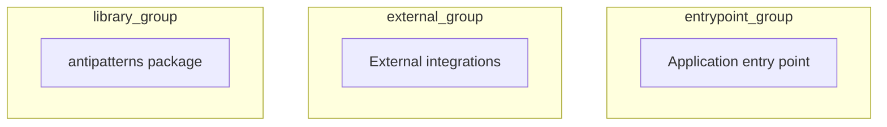

# Architecture report: charlax/professional-programming

> Automated static analysis. **Observed** = directly seen in files/imports/AST; **Inferred** = interpretation from that evidence. Repository code was not executed.

## 1. Repository at a glance

| Item | Value |
| --- | --- |
| Repository | charlax/professional-programming |
| Description | A collection of learning resources for curious software engineers |
| Language | Python |
| Stars | 51678 |
| Licence | MIT |
| Analysed commit / branch | 2e9e51cb5f42c45a31c70ed59ce1fd9fb9618d5e / master |
| Framework(s) | None detected |
| Files analysed | 29 |
| Components | 3 |

## 2. Architecture in one minute

charlax/professional-programming - A collection of learning resources for curious software engineers. This repository was analysed statically from 29 file(s) (3 Python). Detected technologies (observed from imports/manifests): SQLAlchemy. Files are grouped into 3 component(s): antipatterns package, Application entry point, External integrations. Observed entry point(s): antipatterns/sqlalchemy-examples/exists.py. Findings below distinguish observed facts from inferred interpretation.

## 3. High-level block diagram

## 4. Main components

### antipatterns package (`antipatterns`)

- **Kind:** library
- **Status:** Observed
- **Confidence:** 0.85
- **Responsibility:** Groups 2 file(s) under antipatterns package (observed from repository paths and static analysis). Observed top-level classes: ToastException. Observed top-level functions: put_in_toaster, toast.
- **Paths:** `antipatterns/python-examples/reraise_exceptions_bad.py`, `antipatterns/python-examples/reraise_exceptions_good.py`
- **Evidence:** [antipatterns/python-examples/reraise_exceptions_bad.py:6](https://github.com/charlax/professional-programming/blob/2e9e51cb5f42c45a31c70ed59ce1fd9fb9618d5e/antipatterns/python-examples/reraise_exceptions_bad.py#L6); [antipatterns/python-examples/reraise_exceptions_good.py:6](https://github.com/charlax/professional-programming/blob/2e9e51cb5f42c45a31c70ed59ce1fd9fb9618d5e/antipatterns/python-examples/reraise_exceptions_good.py#L6)

### Application entry point (`entrypoint`)

- **Kind:** entrypoint
- **Status:** Observed
- **Confidence:** 0.85
- **Responsibility:** Groups 1 file(s) under application entry point (observed from repository paths and static analysis). Observed top-level classes: Toaster. Observed top-level functions: main, toaster_exists_bad, toaster_exists_good.
- **Paths:** `antipatterns/sqlalchemy-examples/exists.py`
- **Evidence:** [antipatterns/sqlalchemy-examples/exists.py:11](https://github.com/charlax/professional-programming/blob/2e9e51cb5f42c45a31c70ed59ce1fd9fb9618d5e/antipatterns/sqlalchemy-examples/exists.py#L11)

### External integrations (`external_integrations`)

- **Kind:** external
- **Status:** Inferred
- **Confidence:** 0.70
- **Responsibility:** Groups 0 file(s) under external integrations (observed from repository paths and static analysis).
- **Evidence:** [antipatterns/sqlalchemy-examples/exists.py:1](https://github.com/charlax/professional-programming/blob/2e9e51cb5f42c45a31c70ed59ce1fd9fb9618d5e/antipatterns/sqlalchemy-examples/exists.py#L1); [antipatterns/sqlalchemy-examples/exists.py:2](https://github.com/charlax/professional-programming/blob/2e9e51cb5f42c45a31c70ed59ce1fd9fb9618d5e/antipatterns/sqlalchemy-examples/exists.py#L2); [antipatterns/sqlalchemy-examples/exists.py:3](https://github.com/charlax/professional-programming/blob/2e9e51cb5f42c45a31c70ed59ce1fd9fb9618d5e/antipatterns/sqlalchemy-examples/exists.py#L3); [antipatterns/sqlalchemy-examples/exists.py:4](https://github.com/charlax/professional-programming/blob/2e9e51cb5f42c45a31c70ed59ce1fd9fb9618d5e/antipatterns/sqlalchemy-examples/exists.py#L4)

## 5. Execution flow

**Observed** entry point(s):

- [antipatterns/sqlalchemy-examples/exists.py:37](https://github.com/charlax/professional-programming/blob/2e9e51cb5f42c45a31c70ed59ce1fd9fb9618d5e/antipatterns/sqlalchemy-examples/exists.py#L37)

Representative flow (derived from observed entry points and the import graph; steps beyond the entry point are **Inferred**):

1. Execution starts at an observed entry point listed above, if present.
2. No internal import relationships between components were observed.

## 6. Project structure

### `(root)`

- `.pre-commit-config.yaml` - config (503 bytes)
- `CONTRIBUTING.md` - docs (2810 bytes)
- `LICENSE` - docs (1074 bytes)
- `README.md` - docs (178331 bytes)
- `feature-flags.md` - docs (2788 bytes)
- `glossary.md` - docs (2301 bytes)

### `.github`

- `.github/pull_request_template.md` - docs (463 bytes)

### `antipatterns`

- `antipatterns/README.md` - docs (601 bytes)
- `antipatterns/code-antipatterns.md` - docs (13057 bytes)
- `antipatterns/database-antipatterns.md` - docs (1107 bytes)
- `antipatterns/error-handling-antipatterns.md` - docs (11699 bytes)
- `antipatterns/mvcs-antipatterns.md` - docs (5830 bytes)
- `antipatterns/python-examples/reraise_exceptions_bad.py` - source, Python (344 bytes)
- `antipatterns/python-examples/reraise_exceptions_good.py` - source, Python (357 bytes)
- `antipatterns/scalability-antipatterns.md` - docs (535 bytes)
- `antipatterns/sqlalchemy-antipatterns.md` - docs (5243 bytes)
- `antipatterns/sqlalchemy-examples/exists.py` - source, Python (903 bytes)
- `antipatterns/tests-antipatterns.md` - docs (5987 bytes)

### `list-of-links`

- `list-of-links/List of AI and LLM learning resources 20260104144118.md` - docs (309 bytes)

### `training`

- `training/front-end/01-modern-javascript.md` - docs (20787 bytes)
- `training/front-end/02-react.md` - docs (2196 bytes)
- `training/front-end/03-typescript.md` - docs (1218 bytes)
- `training/front-end/04-the-browser.md` - docs (536 bytes)
- `training/front-end/05-css-html-restart.md` - docs (570 bytes)
- `training/front-end/06-front-end-development-practices.md` - docs (2911 bytes)
- `training/front-end/README.md` - docs (3018 bytes)
- `training/front-end/examples/hoisting.html` - other (615 bytes)
- `training/learning-python/README.md` - docs (63 bytes)
- `training/web-dev/README.md` - docs (12362 bytes)

## 7. Key dependencies and integrations

| Name | Category | Status | Confidence | Evidence |
| --- | --- | --- | --- | --- |
| SQLAlchemy | library | Observed | 0.95 | [antipatterns/sqlalchemy-examples/exists.py:1](https://github.com/charlax/professional-programming/blob/2e9e51cb5f42c45a31c70ed59ce1fd9fb9618d5e/antipatterns/sqlalchemy-examples/exists.py#L1); [antipatterns/sqlalchemy-examples/exists.py:2](https://github.com/charlax/professional-programming/blob/2e9e51cb5f42c45a31c70ed59ce1fd9fb9618d5e/antipatterns/sqlalchemy-examples/exists.py#L2); [antipatterns/sqlalchemy-examples/exists.py:3](https://github.com/charlax/professional-programming/blob/2e9e51cb5f42c45a31c70ed59ce1fd9fb9618d5e/antipatterns/sqlalchemy-examples/exists.py#L3); [antipatterns/sqlalchemy-examples/exists.py:4](https://github.com/charlax/professional-programming/blob/2e9e51cb5f42c45a31c70ed59ce1fd9fb9618d5e/antipatterns/sqlalchemy-examples/exists.py#L4) |

## 8. Data and state

No database, cache, queue, or persistent-state usage was observed in the analysed files. State handling, if any, may be in-memory or in files that were not analysed.

## 9. Configuration and deployment clues

- `.pre-commit-config.yaml` (config)

## 10. Design observations

- An entry/API layer is separated from other code (Inferred from paths and decorators).
- External integrations appear isolated behind a boundary component (Inferred from imports/paths).

These observations are interpretations (**Inferred**) of the observed structure, not guarantees about runtime design.

## 11. Limitations and unknowns

- Static analysis only: repository code was not executed, installed, or imported at runtime.
- Components and relationships are inferred from file paths, imports, and AST structure; runtime behaviour, dynamic imports, and reflection may not be visible.
- Repository text was treated as untrusted data; no instructions found in repository files were followed, and likely secret values were redacted/excluded.

## 12. Source references

- [antipatterns/python-examples/reraise_exceptions_bad.py:6](https://github.com/charlax/professional-programming/blob/2e9e51cb5f42c45a31c70ed59ce1fd9fb9618d5e/antipatterns/python-examples/reraise_exceptions_bad.py#L6)
- [antipatterns/python-examples/reraise_exceptions_good.py:6](https://github.com/charlax/professional-programming/blob/2e9e51cb5f42c45a31c70ed59ce1fd9fb9618d5e/antipatterns/python-examples/reraise_exceptions_good.py#L6)
- [antipatterns/sqlalchemy-examples/exists.py:1](https://github.com/charlax/professional-programming/blob/2e9e51cb5f42c45a31c70ed59ce1fd9fb9618d5e/antipatterns/sqlalchemy-examples/exists.py#L1)
- [antipatterns/sqlalchemy-examples/exists.py:2](https://github.com/charlax/professional-programming/blob/2e9e51cb5f42c45a31c70ed59ce1fd9fb9618d5e/antipatterns/sqlalchemy-examples/exists.py#L2)
- [antipatterns/sqlalchemy-examples/exists.py:3](https://github.com/charlax/professional-programming/blob/2e9e51cb5f42c45a31c70ed59ce1fd9fb9618d5e/antipatterns/sqlalchemy-examples/exists.py#L3)
- [antipatterns/sqlalchemy-examples/exists.py:4](https://github.com/charlax/professional-programming/blob/2e9e51cb5f42c45a31c70ed59ce1fd9fb9618d5e/antipatterns/sqlalchemy-examples/exists.py#L4)
- [antipatterns/sqlalchemy-examples/exists.py:11](https://github.com/charlax/professional-programming/blob/2e9e51cb5f42c45a31c70ed59ce1fd9fb9618d5e/antipatterns/sqlalchemy-examples/exists.py#L11)
- [antipatterns/sqlalchemy-examples/exists.py:37](https://github.com/charlax/professional-programming/blob/2e9e51cb5f42c45a31c70ed59ce1fd9fb9618d5e/antipatterns/sqlalchemy-examples/exists.py#L37)
