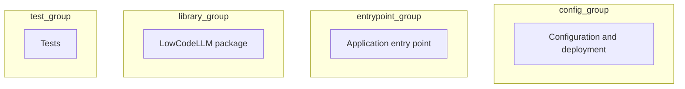

# Architecture report: chenfei-wu/TaskMatrix

> Automated static analysis. **Observed** = directly seen in files/imports/AST; **Inferred** = interpretation from that evidence. Repository code was not executed.

## 1. Repository at a glance

| Item | Value |
| --- | --- |
| Repository | chenfei-wu/TaskMatrix |
| Description | Not provided |
| Language | Python |
| Stars | 33896 |
| Licence | Other |
| Analysed commit / branch | 4b7664f8d3a23804ac1b795d75a73efd162769f0 / main |
| Framework(s) | Flask |
| Files analysed | 25 |
| Components | 4 |

## 2. Architecture in one minute

chenfei-wu/TaskMatrix. This repository was analysed statically from 25 file(s) (9 Python). Detected technologies (observed from imports/manifests): Flask, Gunicorn, NumPy, Docker. Files are grouped into 4 component(s): Configuration and deployment, Application entry point, LowCodeLLM package, Tests. Observed entry point(s): LowCodeLLM/src/app.py, visual_chatgpt.py. Findings below distinguish observed facts from inferred interpretation.

## 3. High-level block diagram

## 4. Main components

### Configuration and deployment (`config`)

- **Kind:** config
- **Status:** Observed
- **Confidence:** 0.85
- **Responsibility:** Groups 3 file(s) under configuration and deployment (observed from repository paths and static analysis).
- **Paths:** `LowCodeLLM/Dockerfile`, `LowCodeLLM/src/requirements.txt`, `requirements.txt`
- **Evidence:** [LowCodeLLM/Dockerfile](https://github.com/chenfei-wu/TaskMatrix/blob/4b7664f8d3a23804ac1b795d75a73efd162769f0/LowCodeLLM/Dockerfile); [LowCodeLLM/src/requirements.txt](https://github.com/chenfei-wu/TaskMatrix/blob/4b7664f8d3a23804ac1b795d75a73efd162769f0/LowCodeLLM/src/requirements.txt); [requirements.txt](https://github.com/chenfei-wu/TaskMatrix/blob/4b7664f8d3a23804ac1b795d75a73efd162769f0/requirements.txt)

### Application entry point (`entrypoint`)

- **Kind:** entrypoint
- **Status:** Observed
- **Confidence:** 0.85
- **Responsibility:** Groups 2 file(s) under application entry point (observed from repository paths and static analysis). Observed application object created via Flask. Observed routes: ROUTE /, ROUTE /api/get_workflow, ROUTE /api/extend_workflow, ROUTE /api/execute. Observed top-level classes: BackgroundRemoving, CannyText2Image, ConversationBot, DepthText2Image, HedText2Image, Image2Canny. Observed top-level functions: blend_gt2pt, cut_dialogue_history, execute, extend_workflow, get_new_image_name, get_workflow.
- **Paths:** `LowCodeLLM/src/app.py`, `visual_chatgpt.py`
- **Evidence:** [LowCodeLLM/src/app.py:11](https://github.com/chenfei-wu/TaskMatrix/blob/4b7664f8d3a23804ac1b795d75a73efd162769f0/LowCodeLLM/src/app.py#L11); [visual_chatgpt.py:141](https://github.com/chenfei-wu/TaskMatrix/blob/4b7664f8d3a23804ac1b795d75a73efd162769f0/visual_chatgpt.py#L141)

### LowCodeLLM package (`lowcodellm`)

- **Kind:** library
- **Status:** Observed
- **Confidence:** 0.85
- **Responsibility:** Groups 4 file(s) under lowcodellm package (observed from repository paths and static analysis). Observed top-level classes: OpenAIWrapper, executingLLM, lowCodeLLM, planningLLM.
- **Paths:** `LowCodeLLM/src/executingLLM.py`, `LowCodeLLM/src/lowCodeLLM.py`, `LowCodeLLM/src/openAIWrapper.py`, `LowCodeLLM/src/planningLLM.py`
- **Evidence:** [LowCodeLLM/src/executingLLM.py:26](https://github.com/chenfei-wu/TaskMatrix/blob/4b7664f8d3a23804ac1b795d75a73efd162769f0/LowCodeLLM/src/executingLLM.py#L26); [LowCodeLLM/src/lowCodeLLM.py:8](https://github.com/chenfei-wu/TaskMatrix/blob/4b7664f8d3a23804ac1b795d75a73efd162769f0/LowCodeLLM/src/lowCodeLLM.py#L8); [LowCodeLLM/src/openAIWrapper.py:7](https://github.com/chenfei-wu/TaskMatrix/blob/4b7664f8d3a23804ac1b795d75a73efd162769f0/LowCodeLLM/src/openAIWrapper.py#L7); [LowCodeLLM/src/planningLLM.py:46](https://github.com/chenfei-wu/TaskMatrix/blob/4b7664f8d3a23804ac1b795d75a73efd162769f0/LowCodeLLM/src/planningLLM.py#L46)

### Tests (`tests`)

- **Kind:** test
- **Status:** Observed
- **Confidence:** 0.85
- **Responsibility:** Groups 6 file(s) under tests (observed from repository paths and static analysis). Observed top-level functions: test_extend_workflow, test_get_workflow.
- **Paths:** `LowCodeLLM/src/test/test_execute.py`, `LowCodeLLM/src/test/test_extend_workflow.py`, `LowCodeLLM/src/test/test_get_workflow.py`, `LowCodeLLM/src/test/testcases/execute_test_cases.json`, `LowCodeLLM/src/test/testcases/extend_workflow_test_cases.json`, `LowCodeLLM/src/test/testcases/get_workflow_test_cases.json`
- **Evidence:** [LowCodeLLM/src/test/test_execute.py:10](https://github.com/chenfei-wu/TaskMatrix/blob/4b7664f8d3a23804ac1b795d75a73efd162769f0/LowCodeLLM/src/test/test_execute.py#L10); [LowCodeLLM/src/test/test_extend_workflow.py:10](https://github.com/chenfei-wu/TaskMatrix/blob/4b7664f8d3a23804ac1b795d75a73efd162769f0/LowCodeLLM/src/test/test_extend_workflow.py#L10); [LowCodeLLM/src/test/test_get_workflow.py:9](https://github.com/chenfei-wu/TaskMatrix/blob/4b7664f8d3a23804ac1b795d75a73efd162769f0/LowCodeLLM/src/test/test_get_workflow.py#L9); [LowCodeLLM/src/test/testcases/execute_test_cases.json](https://github.com/chenfei-wu/TaskMatrix/blob/4b7664f8d3a23804ac1b795d75a73efd162769f0/LowCodeLLM/src/test/testcases/execute_test_cases.json); [LowCodeLLM/src/test/testcases/extend_workflow_test_cases.json](https://github.com/chenfei-wu/TaskMatrix/blob/4b7664f8d3a23804ac1b795d75a73efd162769f0/LowCodeLLM/src/test/testcases/extend_workflow_test_cases.json); [LowCodeLLM/src/test/testcases/get_workflow_test_cases.json](https://github.com/chenfei-wu/TaskMatrix/blob/4b7664f8d3a23804ac1b795d75a73efd162769f0/LowCodeLLM/src/test/testcases/get_workflow_test_cases.json)

## 5. Execution flow

**Observed** entry point(s):

- [LowCodeLLM/src/app.py:11](https://github.com/chenfei-wu/TaskMatrix/blob/4b7664f8d3a23804ac1b795d75a73efd162769f0/LowCodeLLM/src/app.py#L11)
- [visual_chatgpt.py:1555](https://github.com/chenfei-wu/TaskMatrix/blob/4b7664f8d3a23804ac1b795d75a73efd162769f0/visual_chatgpt.py#L1555)

**Observed** routes (from decorators):

- `ROUTE /` -> `index` in `LowCodeLLM/src/app.py:21`
- `ROUTE /api/get_workflow` -> `get_workflow` in `LowCodeLLM/src/app.py:26`
- `ROUTE /api/extend_workflow` -> `extend_workflow` in `LowCodeLLM/src/app.py:39`
- `ROUTE /api/execute` -> `execute` in `LowCodeLLM/src/app.py:54`

Representative flow (derived from observed entry points and the import graph; steps beyond the entry point are **Inferred**):

1. Execution starts at an observed entry point listed above, if present.
2. No internal import relationships between components were observed.

## 6. Project structure

### `(root)`

- `CODE_OF_CONDUCT.md` - docs (443 bytes)
- `CONTRIBUTING.md` - docs (1711 bytes)
- `LICENSE.txt` - docs (1953 bytes)
- `README.md` - docs (8749 bytes)
- `SECURITY.md` - docs (2756 bytes)
- `requirements.txt` - manifest (337 bytes)
- `visual_chatgpt.py` - source, Python (81041 bytes)

### `LowCodeLLM`

- `LowCodeLLM/Dockerfile` - container (396 bytes)
- `LowCodeLLM/README.md` - docs (4168 bytes)
- `LowCodeLLM/config.template` - other (153 bytes)
- `LowCodeLLM/src/app.py` - source, Python (2493 bytes)
- `LowCodeLLM/src/executingLLM.py` - source, Python (1988 bytes)
- `LowCodeLLM/src/index.html` - other (22957 bytes)
- `LowCodeLLM/src/lowCodeLLM.py` - source, Python (2021 bytes)
- `LowCodeLLM/src/openAIWrapper.py` - source, Python (2180 bytes)
- `LowCodeLLM/src/planningLLM.py` - source, Python (5657 bytes)
- `LowCodeLLM/src/requirements.txt` - manifest (84 bytes)
- `LowCodeLLM/src/supervisord.conf` - other (325 bytes)
- `LowCodeLLM/src/test/test_execute.py` - test, Python (692 bytes)
- `LowCodeLLM/src/test/test_extend_workflow.py` - test, Python (620 bytes)
- `LowCodeLLM/src/test/test_get_workflow.py` - test, Python (475 bytes)
- `LowCodeLLM/src/test/testcases/execute_test_cases.json` - test (3941 bytes)
- `LowCodeLLM/src/test/testcases/extend_workflow_test_cases.json` - test (3705 bytes)
- `LowCodeLLM/src/test/testcases/get_workflow_test_cases.json` - test (241 bytes)

### `TaskMatrix.AI`

- `TaskMatrix.AI/README.md` - docs (861 bytes)

## 7. Key dependencies and integrations

| Name | Category | Status | Confidence | Evidence |
| --- | --- | --- | --- | --- |
| Flask | framework | Observed | 0.95 | [LowCodeLLM/src/app.py:5](https://github.com/chenfei-wu/TaskMatrix/blob/4b7664f8d3a23804ac1b795d75a73efd162769f0/LowCodeLLM/src/app.py#L5); [LowCodeLLM/src/app.py:8](https://github.com/chenfei-wu/TaskMatrix/blob/4b7664f8d3a23804ac1b795d75a73efd162769f0/LowCodeLLM/src/app.py#L8); [LowCodeLLM/src/requirements.txt:1](https://github.com/chenfei-wu/TaskMatrix/blob/4b7664f8d3a23804ac1b795d75a73efd162769f0/LowCodeLLM/src/requirements.txt#L1) |
| Gunicorn | library | Observed | 0.85 | [LowCodeLLM/src/requirements.txt:4](https://github.com/chenfei-wu/TaskMatrix/blob/4b7664f8d3a23804ac1b795d75a73efd162769f0/LowCodeLLM/src/requirements.txt#L4) |
| NumPy | library | Observed | 0.95 | [requirements.txt:17](https://github.com/chenfei-wu/TaskMatrix/blob/4b7664f8d3a23804ac1b795d75a73efd162769f0/requirements.txt#L17); [visual_chatgpt.py:14](https://github.com/chenfei-wu/TaskMatrix/blob/4b7664f8d3a23804ac1b795d75a73efd162769f0/visual_chatgpt.py#L14); [visual_chatgpt.py:44](https://github.com/chenfei-wu/TaskMatrix/blob/4b7664f8d3a23804ac1b795d75a73efd162769f0/visual_chatgpt.py#L44) |
| Docker | tooling | Observed | 0.85 | [LowCodeLLM/Dockerfile](https://github.com/chenfei-wu/TaskMatrix/blob/4b7664f8d3a23804ac1b795d75a73efd162769f0/LowCodeLLM/Dockerfile) |

## 8. Data and state

No database, cache, queue, or persistent-state usage was observed in the analysed files. State handling, if any, may be in-memory or in files that were not analysed.

## 9. Configuration and deployment clues

- `LowCodeLLM/Dockerfile` (container)
- `LowCodeLLM/src/requirements.txt` (manifest)
- `requirements.txt` (manifest)

## 10. Design observations

- An entry/API layer is separated from other code (Inferred from paths and decorators).
- Tests are present alongside source code (Observed from test file paths).

These observations are interpretations (**Inferred**) of the observed structure, not guarantees about runtime design.

## 11. Limitations and unknowns

- Static analysis only: repository code was not executed, installed, or imported at runtime.
- Components and relationships are inferred from file paths, imports, and AST structure; runtime behaviour, dynamic imports, and reflection may not be visible.
- Repository text was treated as untrusted data; no instructions found in repository files were followed, and likely secret values were redacted/excluded.

## 12. Source references

- [LowCodeLLM/Dockerfile](https://github.com/chenfei-wu/TaskMatrix/blob/4b7664f8d3a23804ac1b795d75a73efd162769f0/LowCodeLLM/Dockerfile)
- [LowCodeLLM/src/app.py:5](https://github.com/chenfei-wu/TaskMatrix/blob/4b7664f8d3a23804ac1b795d75a73efd162769f0/LowCodeLLM/src/app.py#L5)
- [LowCodeLLM/src/app.py:8](https://github.com/chenfei-wu/TaskMatrix/blob/4b7664f8d3a23804ac1b795d75a73efd162769f0/LowCodeLLM/src/app.py#L8)
- [LowCodeLLM/src/app.py:11](https://github.com/chenfei-wu/TaskMatrix/blob/4b7664f8d3a23804ac1b795d75a73efd162769f0/LowCodeLLM/src/app.py#L11)
- [LowCodeLLM/src/executingLLM.py:26](https://github.com/chenfei-wu/TaskMatrix/blob/4b7664f8d3a23804ac1b795d75a73efd162769f0/LowCodeLLM/src/executingLLM.py#L26)
- [LowCodeLLM/src/lowCodeLLM.py:8](https://github.com/chenfei-wu/TaskMatrix/blob/4b7664f8d3a23804ac1b795d75a73efd162769f0/LowCodeLLM/src/lowCodeLLM.py#L8)
- [LowCodeLLM/src/openAIWrapper.py:7](https://github.com/chenfei-wu/TaskMatrix/blob/4b7664f8d3a23804ac1b795d75a73efd162769f0/LowCodeLLM/src/openAIWrapper.py#L7)
- [LowCodeLLM/src/planningLLM.py:46](https://github.com/chenfei-wu/TaskMatrix/blob/4b7664f8d3a23804ac1b795d75a73efd162769f0/LowCodeLLM/src/planningLLM.py#L46)
- [LowCodeLLM/src/requirements.txt](https://github.com/chenfei-wu/TaskMatrix/blob/4b7664f8d3a23804ac1b795d75a73efd162769f0/LowCodeLLM/src/requirements.txt)
- [LowCodeLLM/src/requirements.txt:1](https://github.com/chenfei-wu/TaskMatrix/blob/4b7664f8d3a23804ac1b795d75a73efd162769f0/LowCodeLLM/src/requirements.txt#L1)
- [LowCodeLLM/src/requirements.txt:4](https://github.com/chenfei-wu/TaskMatrix/blob/4b7664f8d3a23804ac1b795d75a73efd162769f0/LowCodeLLM/src/requirements.txt#L4)
- [LowCodeLLM/src/test/test_execute.py:10](https://github.com/chenfei-wu/TaskMatrix/blob/4b7664f8d3a23804ac1b795d75a73efd162769f0/LowCodeLLM/src/test/test_execute.py#L10)
- [LowCodeLLM/src/test/test_extend_workflow.py:10](https://github.com/chenfei-wu/TaskMatrix/blob/4b7664f8d3a23804ac1b795d75a73efd162769f0/LowCodeLLM/src/test/test_extend_workflow.py#L10)
- [LowCodeLLM/src/test/test_get_workflow.py:9](https://github.com/chenfei-wu/TaskMatrix/blob/4b7664f8d3a23804ac1b795d75a73efd162769f0/LowCodeLLM/src/test/test_get_workflow.py#L9)
- [LowCodeLLM/src/test/testcases/execute_test_cases.json](https://github.com/chenfei-wu/TaskMatrix/blob/4b7664f8d3a23804ac1b795d75a73efd162769f0/LowCodeLLM/src/test/testcases/execute_test_cases.json)
- [LowCodeLLM/src/test/testcases/extend_workflow_test_cases.json](https://github.com/chenfei-wu/TaskMatrix/blob/4b7664f8d3a23804ac1b795d75a73efd162769f0/LowCodeLLM/src/test/testcases/extend_workflow_test_cases.json)
- [LowCodeLLM/src/test/testcases/get_workflow_test_cases.json](https://github.com/chenfei-wu/TaskMatrix/blob/4b7664f8d3a23804ac1b795d75a73efd162769f0/LowCodeLLM/src/test/testcases/get_workflow_test_cases.json)
- [requirements.txt](https://github.com/chenfei-wu/TaskMatrix/blob/4b7664f8d3a23804ac1b795d75a73efd162769f0/requirements.txt)
- [requirements.txt:17](https://github.com/chenfei-wu/TaskMatrix/blob/4b7664f8d3a23804ac1b795d75a73efd162769f0/requirements.txt#L17)
- [visual_chatgpt.py:14](https://github.com/chenfei-wu/TaskMatrix/blob/4b7664f8d3a23804ac1b795d75a73efd162769f0/visual_chatgpt.py#L14)
- [visual_chatgpt.py:44](https://github.com/chenfei-wu/TaskMatrix/blob/4b7664f8d3a23804ac1b795d75a73efd162769f0/visual_chatgpt.py#L44)
- [visual_chatgpt.py:141](https://github.com/chenfei-wu/TaskMatrix/blob/4b7664f8d3a23804ac1b795d75a73efd162769f0/visual_chatgpt.py#L141)
- [visual_chatgpt.py:1555](https://github.com/chenfei-wu/TaskMatrix/blob/4b7664f8d3a23804ac1b795d75a73efd162769f0/visual_chatgpt.py#L1555)
