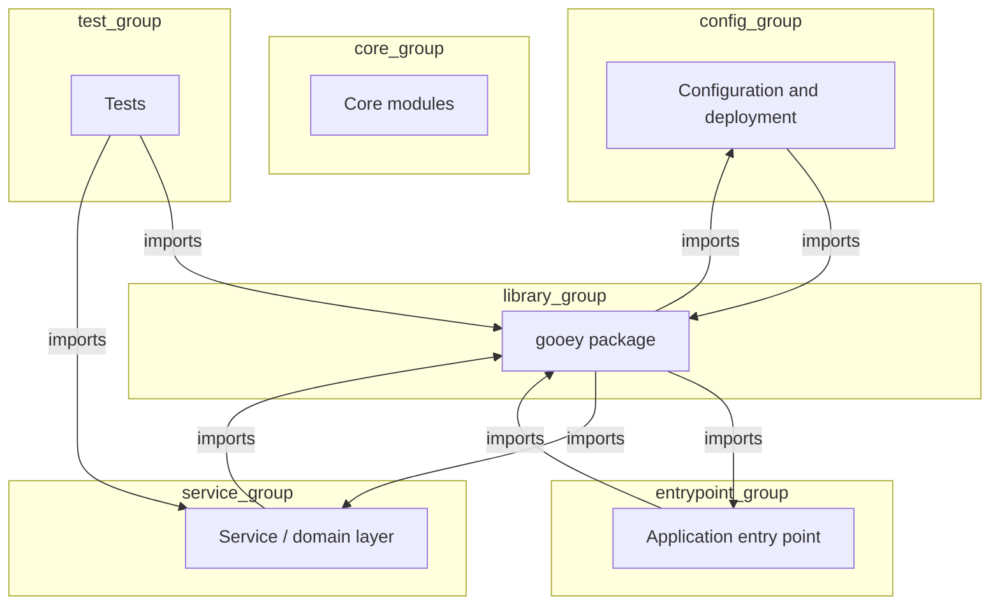

# Architecture report: chriskiehl/Gooey

> Automated static analysis. **Observed** = directly seen in files/imports/AST; **Inferred** = interpretation from that evidence. Repository code was not executed.

## 1. Repository at a glance

| Item | Value |
| --- | --- |
| Repository | chriskiehl/Gooey |
| Description | Turn (almost) any Python command line program into a full GUI application with one line |
| Language | Python |
| Stars | 21897 |
| Licence | MIT |
| Analysed commit / branch | c541920465c7bcaaefa47a15a858eb477d2666fd / master |
| Framework(s) | None detected |
| Files analysed | 221 |
| Components | 6 |

## 2. Architecture in one minute

chriskiehl/Gooey - Turn (almost) any Python command line program into a full GUI application with one line. This repository was analysed statically from 221 file(s) (158 Python). Detected technologies (observed from imports/manifests): GitHub Actions, setuptools, unittest. Files are grouped into 6 component(s): Configuration and deployment, Core modules, Application entry point, gooey package, Service / domain layer, Tests. Observed entry point(s): gooey/gui/components/options/validators.py, gooey/gui/imageutil.py, gooey/python_bindings/parser_exceptions.py. Findings below distinguish observed facts from inferred interpretation.

## 3. High-level block diagram

## 4. Main components

### Configuration and deployment (`config`)

- **Kind:** config
- **Status:** Observed
- **Confidence:** 0.85
- **Responsibility:** Groups 29 file(s) under configuration and deployment (observed from repository paths and static analysis). Observed top-level classes: ConfigPage, TabbedConfigPage.
- **Paths:** `MANIFEST.in`, `gooey/gui/components/config.py`, `gooey/languages/Hindi.json`, `gooey/languages/bengali.json`, `gooey/languages/bosnian.json`, `gooey/languages/chinese.json`, `gooey/languages/croatian.json`, `gooey/languages/czech.json`, `gooey/languages/dutch.json`, `gooey/languages/english.json`, `gooey/languages/french.json`, `gooey/languages/german.json`, `gooey/languages/greek.json`, `gooey/languages/hebrew.json`, `gooey/languages/italian.json`, `gooey/languages/japanese.json`, `gooey/languages/korean.json`, `gooey/languages/polish.json`, `gooey/languages/portuguese.json`, `gooey/languages/russian.json`, `gooey/languages/serbian.json`, `gooey/languages/spanish.json`, `gooey/languages/tamil.json`, `gooey/languages/traditional-chinese.json`, `gooey/languages/turkish.json`, `gooey/languages/ukrainian.json`, `gooey/languages/vietnamese.json`, `requirements.txt`, `setup.py`
- **Evidence:** [MANIFEST.in](https://github.com/chriskiehl/Gooey/blob/c541920465c7bcaaefa47a15a858eb477d2666fd/MANIFEST.in); [gooey/gui/components/config.py:14](https://github.com/chriskiehl/Gooey/blob/c541920465c7bcaaefa47a15a858eb477d2666fd/gooey/gui/components/config.py#L14); [gooey/languages/Hindi.json](https://github.com/chriskiehl/Gooey/blob/c541920465c7bcaaefa47a15a858eb477d2666fd/gooey/languages/Hindi.json); [gooey/languages/bengali.json](https://github.com/chriskiehl/Gooey/blob/c541920465c7bcaaefa47a15a858eb477d2666fd/gooey/languages/bengali.json); [gooey/languages/bosnian.json](https://github.com/chriskiehl/Gooey/blob/c541920465c7bcaaefa47a15a858eb477d2666fd/gooey/languages/bosnian.json); [gooey/languages/chinese.json](https://github.com/chriskiehl/Gooey/blob/c541920465c7bcaaefa47a15a858eb477d2666fd/gooey/languages/chinese.json); [gooey/languages/croatian.json](https://github.com/chriskiehl/Gooey/blob/c541920465c7bcaaefa47a15a858eb477d2666fd/gooey/languages/croatian.json); [gooey/languages/czech.json](https://github.com/chriskiehl/Gooey/blob/c541920465c7bcaaefa47a15a858eb477d2666fd/gooey/languages/czech.json)

### Core modules (`core`)

- **Kind:** core
- **Status:** Observed
- **Confidence:** 0.85
- **Responsibility:** Groups 1 file(s) under core modules (observed from repository paths and static analysis).
- **Paths:** `pip_deploy.py`
- **Evidence:** [pip_deploy.py](https://github.com/chriskiehl/Gooey/blob/c541920465c7bcaaefa47a15a858eb477d2666fd/pip_deploy.py)

### Application entry point (`entrypoint`)

- **Kind:** entrypoint
- **Status:** Observed
- **Confidence:** 0.85
- **Responsibility:** Groups 5 file(s) under application entry point (observed from repository paths and static analysis). Observed top-level classes: ArgumentError, ParserError, SuperBool. Observed top-level functions: buildCliString, buildSuccessCmd, cliCmd, cmdOrPlaceholderOrNone, collect_errors, formValidationCmd.
- **Paths:** `gooey/__main__.py`, `gooey/gui/cli.py`, `gooey/gui/components/options/validators.py`, `gooey/gui/imageutil.py`, `gooey/python_bindings/parser_exceptions.py`
- **Evidence:** [gooey/__main__.py](https://github.com/chriskiehl/Gooey/blob/c541920465c7bcaaefa47a15a858eb477d2666fd/gooey/__main__.py); [gooey/gui/cli.py:26](https://github.com/chriskiehl/Gooey/blob/c541920465c7bcaaefa47a15a858eb477d2666fd/gooey/gui/cli.py#L26); [gooey/gui/components/options/validators.py:7](https://github.com/chriskiehl/Gooey/blob/c541920465c7bcaaefa47a15a858eb477d2666fd/gooey/gui/components/options/validators.py#L7); [gooey/gui/imageutil.py:14](https://github.com/chriskiehl/Gooey/blob/c541920465c7bcaaefa47a15a858eb477d2666fd/gooey/gui/imageutil.py#L14); [gooey/python_bindings/parser_exceptions.py:8](https://github.com/chriskiehl/Gooey/blob/c541920465c7bcaaefa47a15a858eb477d2666fd/gooey/python_bindings/parser_exceptions.py#L8)

### gooey package (`gooey`)

- **Kind:** library
- **Status:** Observed
- **Confidence:** 0.85
- **Responsibility:** Groups 90 file(s) under gooey package (observed from repository paths and static analysis). Observed top-level classes: AutoWrappedStaticText, BaseChooser, BaseDialog, BaseWidget, BasicField, BasicTextConsole. Observed top-level functions: AboutBox, AboutDialog, ArgumentGroup, BlockCheckBox, CheckBox, Counter.
- **Paths:** `gooey/__init__.py`, `gooey/gui/__init__.py`, `gooey/gui/application/__init__.py`, `gooey/gui/application/application.py`, `gooey/gui/application/components.py`, `gooey/gui/bootstrap.py`, `gooey/gui/components/__init__.py`, `gooey/gui/components/console.py`, `gooey/gui/components/dialogs.py`, `gooey/gui/components/filtering/__init__.py`, `gooey/gui/components/filtering/prefix_filter.py`, `gooey/gui/components/footer.py`, `gooey/gui/components/header.py`, `gooey/gui/components/layouts/__init__.py`, `gooey/gui/components/layouts/layouts.py`, `gooey/gui/components/menubar.py`, `gooey/gui/components/modals.py`, `gooey/gui/components/mouse.py`, `gooey/gui/components/options/__init__.py`, `gooey/gui/components/options/options.py`, `gooey/gui/components/sidebar.py`, `gooey/gui/components/tabbar.py`, `gooey/gui/components/util/__init__.py`, `gooey/gui/components/util/wrapped_static_text.py`, `gooey/gui/components/widgets/__init__.py`, `gooey/gui/components/widgets/bases.py`, `gooey/gui/components/widgets/basictextconsole.py`, `gooey/gui/components/widgets/checkbox.py`, `gooey/gui/components/widgets/choosers.py`, `gooey/gui/components/widgets/command.py`, `gooey/gui/components/widgets/counter.py`, `gooey/gui/components/widgets/dialogs/__init__.py`, `gooey/gui/components/widgets/dialogs/base_dialog.py`, `gooey/gui/components/widgets/dialogs/calender_dialog.py`, `gooey/gui/components/widgets/dialogs/time_dialog.py`, `gooey/gui/components/widgets/dropdown.py`, `gooey/gui/components/widgets/dropdown_filterable.py`, `gooey/gui/components/widgets/listbox.py`, `gooey/gui/components/widgets/numeric_fields.py`, `gooey/gui/components/widgets/password.py`, `gooey/gui/components/widgets/radio_group.py`, `gooey/gui/components/widgets/richtextconsole.py`, `gooey/gui/components/widgets/slider.py`, `gooey/gui/components/widgets/textarea.py`, `gooey/gui/components/widgets/textfield.py`, `gooey/gui/constants.py`, `gooey/gui/containers/__init__.py`, `gooey/gui/containers/application.py`, `gooey/gui/events.py`, `gooey/gui/formatters.py`, `gooey/gui/host.py`, `gooey/gui/image_repository.py`, `gooey/gui/lang/__init__.py`, `gooey/gui/lang/i18n.py`, `gooey/gui/lang/i18n_config.py`, `gooey/gui/processor.py`, `gooey/gui/pubsub.py`, `gooey/gui/seeder.py`, `gooey/gui/state.py`, `gooey/gui/three_to_four.py`, `gooey/gui/util/__init__.py`, `gooey/gui/util/casting.py`, `gooey/gui/util/filedrop.py`, `gooey/gui/util/freeze.py`, `gooey/gui/util/functional.py`, `gooey/gui/util/quoting.py`, `gooey/gui/util/time.py`, `gooey/gui/util/wx_util.py`, `gooey/gui/validation.py`, `gooey/gui/validators.py`, `gooey/images/__init__.py`, `gooey/languages/__init__.py`, `gooey/python_bindings/__init__.py`, `gooey/python_bindings/argparse_to_json.py`, `gooey/python_bindings/cmd_args.py`, `gooey/python_bindings/coms.py`, `gooey/python_bindings/config_generator.py`, `gooey/python_bindings/constants.py`, `gooey/python_bindings/constraints.py`, `gooey/python_bindings/control.py`, `gooey/python_bindings/dynamics.py`, `gooey/python_bindings/gooey_decorator.py`, `gooey/python_bindings/gooey_parser.py`, `gooey/python_bindings/parameters.py`, `gooey/python_bindings/parser/gooey_parser.py`, `gooey/python_bindings/schema.py`, `gooey/python_bindings/signal_support.py`, `gooey/python_bindings/types.py`, `gooey/util/__init__.py`, `gooey/util/functional.py`
- **Evidence:** [gooey/__init__.py](https://github.com/chriskiehl/Gooey/blob/c541920465c7bcaaefa47a15a858eb477d2666fd/gooey/__init__.py); [gooey/gui/__init__.py](https://github.com/chriskiehl/Gooey/blob/c541920465c7bcaaefa47a15a858eb477d2666fd/gooey/gui/__init__.py); [gooey/gui/application/__init__.py](https://github.com/chriskiehl/Gooey/blob/c541920465c7bcaaefa47a15a858eb477d2666fd/gooey/gui/application/__init__.py); [gooey/gui/application/application.py:36](https://github.com/chriskiehl/Gooey/blob/c541920465c7bcaaefa47a15a858eb477d2666fd/gooey/gui/application/application.py#L36); [gooey/gui/application/components.py:24](https://github.com/chriskiehl/Gooey/blob/c541920465c7bcaaefa47a15a858eb477d2666fd/gooey/gui/application/components.py#L24); [gooey/gui/bootstrap.py:22](https://github.com/chriskiehl/Gooey/blob/c541920465c7bcaaefa47a15a858eb477d2666fd/gooey/gui/bootstrap.py#L22); [gooey/gui/components/__init__.py](https://github.com/chriskiehl/Gooey/blob/c541920465c7bcaaefa47a15a858eb477d2666fd/gooey/gui/components/__init__.py); [gooey/gui/components/console.py:9](https://github.com/chriskiehl/Gooey/blob/c541920465c7bcaaefa47a15a858eb477d2666fd/gooey/gui/components/console.py#L9)

### Service / domain layer (`service_layer`)

- **Kind:** service
- **Status:** Observed
- **Confidence:** 0.85
- **Responsibility:** Groups 3 file(s) under service / domain layer (observed from repository paths and static analysis). Observed top-level classes: Chooser, ColourChooser, DateChooser, DirChooser, FileChooser, FileSaver. Observed top-level functions: MultilineTextInput, PasswordInput.
- **Paths:** `gooey/gui/components/widgets/core/__init__.py`, `gooey/gui/components/widgets/core/chooser.py`, `gooey/gui/components/widgets/core/text_input.py`
- **Evidence:** [gooey/gui/components/widgets/core/__init__.py](https://github.com/chriskiehl/Gooey/blob/c541920465c7bcaaefa47a15a858eb477d2666fd/gooey/gui/components/widgets/core/__init__.py); [gooey/gui/components/widgets/core/chooser.py:14](https://github.com/chriskiehl/Gooey/blob/c541920465c7bcaaefa47a15a858eb477d2666fd/gooey/gui/components/widgets/core/chooser.py#L14); [gooey/gui/components/widgets/core/text_input.py:8](https://github.com/chriskiehl/Gooey/blob/c541920465c7bcaaefa47a15a858eb477d2666fd/gooey/gui/components/widgets/core/text_input.py#L8)

### Tests (`tests`)

- **Kind:** test
- **Status:** Observed
- **Confidence:** 0.85
- **Responsibility:** Groups 66 file(s) under tests (observed from repository paths and static analysis). Observed routes: PATCH gui.containers.application.modals.confirmForceStop. Observed top-level classes: MockWxMDD, TestApp, TestArgparse, TestCheckbox, TestChooserResults, TestCliStringCreation. Observed top-level functions: custom_type, get_by_id, get_parser, handle_error, handle_success, ignored_it.
- **Paths:** `gooey/tests/__init__.py`, `gooey/tests/all_widgets.py`, `gooey/tests/all_widgets_subparser.py`, `gooey/tests/auto_start.py`, `gooey/tests/dynamics/__init__.py`, `gooey/tests/dynamics/files/__init__.py`, `gooey/tests/dynamics/files/basic.py`, `gooey/tests/dynamics/files/lifecycles.py`, `gooey/tests/dynamics/files/tmp.txt`, `gooey/tests/dynamics/test_dynamics.py`, `gooey/tests/dynamics/test_live_updates.py`, `gooey/tests/dynamics/tmp.txt`, `gooey/tests/gooey_config__autostart.json`, `gooey/tests/gooey_config__normal.json`, `gooey/tests/gooey_config__subparser.json`, `gooey/tests/gooey_config__validation.json`, `gooey/tests/harness.py`, `gooey/tests/integration/README.md`, `gooey/tests/integration/__init__.py`, `gooey/tests/integration/integ_autostart.py`, `gooey/tests/integration/integ_subparser_demo.py`, `gooey/tests/integration/integ_validations.py`, `gooey/tests/integration/integ_widget_demo.py`, `gooey/tests/integration/programs/__init__.py`, `gooey/tests/integration/programs/all_widgets.py`, `gooey/tests/integration/programs/all_widgets_subparser.py`, `gooey/tests/integration/programs/auto_start.py`, `gooey/tests/integration/programs/gooey_config.json`, `gooey/tests/integration/programs/validations.py`, `gooey/tests/integration/runner.py`, `gooey/tests/processor/__init__.py`, `gooey/tests/processor/files/__init__.py`, `gooey/tests/processor/files/ignore_break.py`, `gooey/tests/processor/files/ignore_interrupt.py`, `gooey/tests/processor/files/infinite_loop.py`, `gooey/tests/processor/test_processor.py`, `gooey/tests/test_application.py`, `gooey/tests/test_argparse_to_json.py`, `gooey/tests/test_checkbox.py`, `gooey/tests/test_chooser_results.py`, `gooey/tests/test_cli.py`, `gooey/tests/test_cmd_args.py`, `gooey/tests/test_common.py`, `gooey/tests/test_config_generator.py`, `gooey/tests/test_constraints.py`, `gooey/tests/test_control.py`, `gooey/tests/test_counter.py`, `gooey/tests/test_decoration.py`, `gooey/tests/test_dropdown.py`, `gooey/tests/test_filterable_dropdown.py`, `gooey/tests/test_filtering.py`, `gooey/tests/test_formatters.py`, `gooey/tests/test_header.py`, `gooey/tests/test_listbox.py`, `gooey/tests/test_numeric_inputs.py`, `gooey/tests/test_options.py`, `gooey/tests/test_parent_inheritance.py`, `gooey/tests/test_password.py`, `gooey/tests/test_radiogroup.py`, `gooey/tests/test_slider.py`, `gooey/tests/test_textarea.py`, `gooey/tests/test_textfield.py`, `gooey/tests/test_time_remaining.py`, `gooey/tests/test_util.py`, `gooey/tests/tmmmmp.py`, `gooey/tests/tmp.txt`
- **Evidence:** [gooey/tests/__init__.py:37](https://github.com/chriskiehl/Gooey/blob/c541920465c7bcaaefa47a15a858eb477d2666fd/gooey/tests/__init__.py#L37); [gooey/tests/all_widgets.py](https://github.com/chriskiehl/Gooey/blob/c541920465c7bcaaefa47a15a858eb477d2666fd/gooey/tests/all_widgets.py); [gooey/tests/all_widgets_subparser.py:15](https://github.com/chriskiehl/Gooey/blob/c541920465c7bcaaefa47a15a858eb477d2666fd/gooey/tests/all_widgets_subparser.py#L15); [gooey/tests/auto_start.py:14](https://github.com/chriskiehl/Gooey/blob/c541920465c7bcaaefa47a15a858eb477d2666fd/gooey/tests/auto_start.py#L14); [gooey/tests/dynamics/__init__.py](https://github.com/chriskiehl/Gooey/blob/c541920465c7bcaaefa47a15a858eb477d2666fd/gooey/tests/dynamics/__init__.py); [gooey/tests/dynamics/files/__init__.py](https://github.com/chriskiehl/Gooey/blob/c541920465c7bcaaefa47a15a858eb477d2666fd/gooey/tests/dynamics/files/__init__.py); [gooey/tests/dynamics/files/basic.py:10](https://github.com/chriskiehl/Gooey/blob/c541920465c7bcaaefa47a15a858eb477d2666fd/gooey/tests/dynamics/files/basic.py#L10); [gooey/tests/dynamics/files/lifecycles.py:13](https://github.com/chriskiehl/Gooey/blob/c541920465c7bcaaefa47a15a858eb477d2666fd/gooey/tests/dynamics/files/lifecycles.py#L13)

## 5. Execution flow

**Observed** entry point(s):

- [gooey/gui/components/options/validators.py:176](https://github.com/chriskiehl/Gooey/blob/c541920465c7bcaaefa47a15a858eb477d2666fd/gooey/gui/components/options/validators.py#L176)
- [gooey/gui/imageutil.py:33](https://github.com/chriskiehl/Gooey/blob/c541920465c7bcaaefa47a15a858eb477d2666fd/gooey/gui/imageutil.py#L33)
- [gooey/python_bindings/parser_exceptions.py:18](https://github.com/chriskiehl/Gooey/blob/c541920465c7bcaaefa47a15a858eb477d2666fd/gooey/python_bindings/parser_exceptions.py#L18)

**Observed** routes (from decorators):

- `PATCH gui.containers.application.modals.confirmForceStop` -> `testGooeyRequestsConfirmationWhenShowStopWarningModalTrue` in `gooey/tests/test_application.py:29`

Representative flow (derived from observed entry points and the import graph; steps beyond the entry point are **Inferred**):

1. Execution starts at an observed entry point listed above, if present.
2. `config` imports `gooey` (Configuration and deployment -> gooey package).
3. `entrypoint` imports `gooey` (Application entry point -> gooey package).
4. `gooey` imports `config` (gooey package -> Configuration and deployment).
5. `gooey` imports `entrypoint` (gooey package -> Application entry point).
6. `gooey` imports `service_layer` (gooey package -> Service / domain layer).
7. `service_layer` imports `gooey` (Service / domain layer -> gooey package).
8. `tests` imports `gooey` (Tests -> gooey package).
9. `tests` imports `service_layer` (Tests -> Service / domain layer).

## 6. Project structure

### `(root)`

- `.gitignore` - other (414 bytes)
- `.gitmodules` - other (89 bytes)
- `CONTRIBUTING.md` - docs (4922 bytes)
- `ISSUE_TEMPLATE.md` - docs (884 bytes)
- `LICENSE.txt` - docs (1097 bytes)
- `MANIFEST.in` - manifest (195 bytes)
- `README.md` - docs (41774 bytes)
- `TODO.md` - docs (1438 bytes)
- `pip_deploy.py` - source, Python (163 bytes)
- `requirements.txt` - manifest (150 bytes)
- `setup.py` - manifest, Python (2192 bytes)

### `.github`

- `.github/workflows/block-pr-to-master.yml` - ci, YAML (906 bytes)

### `docs`

- `docs/Gooey-Options.md` - docs (8287 bytes)
- `docs/Gracefully-Stopping.md` - docs (2787 bytes)
- `docs/Using-Richtext-Controls.md` - docs (9501 bytes)
- `docs/packaging/Packaging-Custom-Images.md` - docs (2151 bytes)
- `docs/packaging/Packaging-Gooey.md` - docs (5920 bytes)
- `docs/packaging/build-osx.spec` - docs (1512 bytes)
- `docs/packaging/build-win.spec` - docs (999 bytes)
- `docs/pull_request_template.md` - docs (758 bytes)
- `docs/releases/1.0.3-release-notes.md` - docs (4730 bytes)
- `docs/releases/1.0.4-release-notes.md` - docs (3153 bytes)
- `docs/releases/1.0.5-release-notes.md` - docs (2820 bytes)
- `docs/releases/1.0.6-release-notes.md` - docs (1979 bytes)
- `docs/releases/1.0.7-release-notes.md` - docs (6447 bytes)
- `docs/releases/1.0.8-release-notes.md` - docs (2159 bytes)
- `docs/releases/1.0.8.1-release-notes.md` - docs (250 bytes)
- `docs/releases/1.0.8.2-release-notes.md` - docs (2847 bytes)
- `docs/releases/1.2.0-ALPHA-release-notes.md` - docs (2424 bytes)
- `docs/releases/pypi-distribution.md` - docs (876 bytes)
- `docs/releases/release-checklist.md` - docs (1138 bytes)

### `gooey`

- `gooey/__init__.py` - source, Python (511 bytes)
- `gooey/__main__.py` - source, Python (234 bytes)
- `gooey/gui/__init__.py` - source, Python (22 bytes)
- `gooey/gui/application/__init__.py` - source, Python (0 bytes)
- `gooey/gui/application/application.py` - source, Python (14039 bytes)
- `gooey/gui/application/components.py` - source, Python (11381 bytes)
- `gooey/gui/bootstrap.py` - source, Python (1426 bytes)
- `gooey/gui/cli.py` - source, Python (4166 bytes)
- `gooey/gui/components/__init__.py` - source, Python (0 bytes)
- `gooey/gui/components/config.py` - source, Python (11036 bytes)
- `gooey/gui/components/console.py` - source, Python (3303 bytes)
- `gooey/gui/components/dialogs.py` - source, Python (1254 bytes)
- `gooey/gui/components/filtering/__init__.py` - source, Python (0 bytes)
- `gooey/gui/components/filtering/prefix_filter.py` - source, Python (3562 bytes)
- `gooey/gui/components/footer.py` - source, Python (5712 bytes)
- `gooey/gui/components/header.py` - source, Python (4061 bytes)
- `gooey/gui/components/layouts/__init__.py` - source, Python (0 bytes)
- `gooey/gui/components/layouts/layouts.py` - source, Python (390 bytes)
- `gooey/gui/components/menubar.py` - source, Python (2805 bytes)
- `gooey/gui/components/modals.py` - source, Python (1350 bytes)
- `gooey/gui/components/mouse.py` - source, Python (1035 bytes)
- `gooey/gui/components/options/__init__.py` - source, Python (0 bytes)
- `gooey/gui/components/options/options.py` - source, Python (11134 bytes)
- `gooey/gui/components/options/validators.py` - source, Python (5358 bytes)
- `gooey/gui/components/sidebar.py` - source, Python (2913 bytes)
- `gooey/gui/components/tabbar.py` - source, Python (1171 bytes)
- `gooey/gui/components/util/__init__.py` - source, Python (0 bytes)
- `gooey/gui/components/util/wrapped_static_text.py` - source, Python (3833 bytes)
- `gooey/gui/components/widgets/__init__.py` - source, Python (540 bytes)
- `gooey/gui/components/widgets/bases.py` - source, Python (9873 bytes)
- `gooey/gui/components/widgets/basictextconsole.py` - source, Python (230 bytes)
- `gooey/gui/components/widgets/checkbox.py` - source, Python (3982 bytes)
- `gooey/gui/components/widgets/choosers.py` - source, Python (1171 bytes)
- `gooey/gui/components/widgets/command.py` - source, Python (287 bytes)
- `gooey/gui/components/widgets/core/__init__.py` - source, Python (214 bytes)
- `gooey/gui/components/widgets/core/chooser.py` - source, Python (7422 bytes)
- `gooey/gui/components/widgets/core/text_input.py` - source, Python (1470 bytes)
- `gooey/gui/components/widgets/counter.py` - source, Python (840 bytes)
- `gooey/gui/components/widgets/dialogs/__init__.py` - source, Python (0 bytes)
- `gooey/gui/components/widgets/dialogs/base_dialog.py` - source, Python (1656 bytes)
- `gooey/gui/components/widgets/dialogs/calender_dialog.py` - source, Python (425 bytes)
- `gooey/gui/components/widgets/dialogs/time_dialog.py` - source, Python (369 bytes)
- `gooey/gui/components/widgets/dropdown.py` - source, Python (3053 bytes)
- `gooey/gui/components/widgets/dropdown_filterable.py` - source, Python (14025 bytes)
- `gooey/gui/components/widgets/listbox.py` - source, Python (1797 bytes)
- `gooey/gui/components/widgets/numeric_fields.py` - source, Python (2344 bytes)
- `gooey/gui/components/widgets/password.py` - source, Python (537 bytes)
- `gooey/gui/components/widgets/radio_group.py` - source, Python (8014 bytes)
- `gooey/gui/components/widgets/richtextconsole.py` - source, Python (6957 bytes)
- `gooey/gui/components/widgets/slider.py` - source, Python (1260 bytes)
- `gooey/gui/components/widgets/textarea.py` - source, Python (1981 bytes)
- `gooey/gui/components/widgets/textfield.py` - source, Python (1071 bytes)
- `gooey/gui/constants.py` - source, Python (92 bytes)
- `gooey/gui/containers/__init__.py` - source, Python (0 bytes)
- `gooey/gui/containers/application.py` - source, Python (17149 bytes)
- `gooey/gui/events.py` - source, Python (840 bytes)
- `gooey/gui/formatters.py` - source, Python (5383 bytes)
- `gooey/gui/host.py` - source, Python (1272 bytes)
- `gooey/gui/image_repository.py` - source, Python (1426 bytes)
- `gooey/gui/imageutil.py` - source, Python (710 bytes)
- `gooey/gui/lang/__init__.py` - source, Python (22 bytes)
- `gooey/gui/lang/i18n.py` - source, Python (861 bytes)
- `gooey/gui/lang/i18n_config.py` - source, Python (174 bytes)
- `gooey/gui/processor.py` - source, Python (5665 bytes)
- `gooey/gui/pubsub.py` - source, Python (1133 bytes)
- `gooey/gui/seeder.py` - source, Python (1282 bytes)
- `gooey/gui/state.py` - source, Python (13527 bytes)
- `gooey/gui/three_to_four.py` - source, Python (1529 bytes)
- `gooey/gui/util/__init__.py` - source, Python (22 bytes)
- `gooey/gui/util/casting.py` - source, Python (209 bytes)
- `gooey/gui/util/filedrop.py` - source, Python (500 bytes)
- `gooey/gui/util/freeze.py` - source, Python (1689 bytes)
- `gooey/gui/util/functional.py` - source, Python (830 bytes)
- `gooey/gui/util/quoting.py` - source, Python (259 bytes)
- `gooey/gui/util/time.py` - source, Python (2933 bytes)
- `gooey/gui/util/wx_util.py` - source, Python (2323 bytes)
- `gooey/gui/validation.py` - source, Python (1036 bytes)
- `gooey/gui/validators.py` - source, Python (245 bytes)
- `gooey/images/__init__.py` - source, Python (0 bytes)
- `gooey/languages/Hindi.json` - config (3636 bytes)
- `gooey/languages/__init__.py` - source, Python (0 bytes)
- `gooey/languages/bengali.json` - config (4068 bytes)
- `gooey/languages/bosnian.json` - config (1962 bytes)
- `gooey/languages/chinese.json` - config (1989 bytes)
- `gooey/languages/croatian.json` - config (1942 bytes)
- `gooey/languages/czech.json` - config (1565 bytes)
- `gooey/languages/dutch.json` - config (2102 bytes)
- `gooey/languages/english.json` - config (2043 bytes)
- `gooey/languages/french.json` - config (2300 bytes)
- `gooey/languages/german.json` - config (2227 bytes)
- `gooey/languages/greek.json` - config (2481 bytes)
- `gooey/languages/hebrew.json` - config (1923 bytes)
- `gooey/languages/italian.json` - config (2097 bytes)
- `gooey/languages/japanese.json` - config (2622 bytes)
- `gooey/languages/korean.json` - config (1841 bytes)
- `gooey/languages/polish.json` - config (1685 bytes)
- `gooey/languages/portuguese.json` - config (2292 bytes)
- `gooey/languages/russian.json` - config (2436 bytes)
- `gooey/languages/serbian.json` - config (2200 bytes)
- `gooey/languages/spanish.json` - config (1769 bytes)
- `gooey/languages/tamil.json` - config (4456 bytes)
- `gooey/languages/traditional-chinese.json` - config (2029 bytes)
- `gooey/languages/turkish.json` - config (2004 bytes)
- `gooey/languages/ukrainian.json` - config (3046 bytes)
- `gooey/languages/vietnamese.json` - config (1906 bytes)
- `gooey/python_bindings/__init__.py` - source, Python (22 bytes)
- `gooey/python_bindings/argparse_to_json.py` - source, Python (23886 bytes)
- `gooey/python_bindings/cmd_args.py` - source, Python (2746 bytes)
- `gooey/python_bindings/coms.py` - source, Python (1484 bytes)
- `gooey/python_bindings/config_generator.py` - source, Python (1691 bytes)
- `gooey/python_bindings/constants.py` - source, Python (629 bytes)
- `gooey/python_bindings/constraints.py` - source, Python (1767 bytes)
- `gooey/python_bindings/control.py` - source, Python (7696 bytes)
- `gooey/python_bindings/dynamics.py` - source, Python (11488 bytes)
- `gooey/python_bindings/gooey_decorator.py` - source, Python (1691 bytes)
- `gooey/python_bindings/gooey_parser.py` - source, Python (9194 bytes)
- `gooey/python_bindings/parameters.py` - source, Python (6539 bytes)
- `gooey/python_bindings/parser/gooey_parser.py` - source, Python (0 bytes)
- `gooey/python_bindings/parser_exceptions.py` - source, Python (335 bytes)
- `gooey/python_bindings/schema.py` - source, Python (760 bytes)
- `gooey/python_bindings/signal_support.py` - source, Python (3483 bytes)
- `gooey/python_bindings/types.py` - source, Python (7599 bytes)
- `gooey/tests/__init__.py` - test, Python (2557 bytes)
- `gooey/tests/all_widgets.py` - test, Python (1864 bytes)
- `gooey/tests/all_widgets_subparser.py` - test, Python (5811 bytes)
- `gooey/tests/auto_start.py` - test, Python (568 bytes)
- `gooey/tests/dynamics/__init__.py` - test, Python (0 bytes)
- `gooey/tests/dynamics/files/__init__.py` - test, Python (0 bytes)
- `gooey/tests/dynamics/files/basic.py` - test, Python (426 bytes)
- `gooey/tests/dynamics/files/lifecycles.py` - test, Python (913 bytes)
- `gooey/tests/dynamics/files/tmp.txt` - test (102 bytes)
- `gooey/tests/dynamics/test_dynamics.py` - test, Python (2588 bytes)
- `gooey/tests/dynamics/test_live_updates.py` - test, Python (5014 bytes)
- `gooey/tests/dynamics/tmp.txt` - test (109 bytes)
- `gooey/tests/gooey_config__autostart.json` - test (1606 bytes)
- `gooey/tests/gooey_config__normal.json` - test (15618 bytes)
- `gooey/tests/gooey_config__subparser.json` - test (29609 bytes)
- `gooey/tests/gooey_config__validation.json` - test (15662 bytes)
- `gooey/tests/harness.py` - test, Python (2288 bytes)
- `gooey/tests/integration/README.md` - test (158 bytes)
- `gooey/tests/integration/__init__.py` - test, Python (239 bytes)
- `gooey/tests/integration/integ_autostart.py` - test, Python (2380 bytes)
- `gooey/tests/integration/integ_subparser_demo.py` - test, Python (2171 bytes)
- `gooey/tests/integration/integ_validations.py` - test, Python (1421 bytes)
- `gooey/tests/integration/integ_widget_demo.py` - test, Python (2142 bytes)
- `gooey/tests/integration/programs/__init__.py` - test, Python (0 bytes)
- `gooey/tests/integration/programs/all_widgets.py` - test, Python (3211 bytes)
- `gooey/tests/integration/programs/all_widgets_subparser.py` - test, Python (5658 bytes)
- `gooey/tests/integration/programs/auto_start.py` - test, Python (550 bytes)
- `gooey/tests/integration/programs/gooey_config.json` - test (20374 bytes)
- `gooey/tests/integration/programs/validations.py` - test, Python (794 bytes)
- `gooey/tests/integration/runner.py` - test, Python (1692 bytes)
- `gooey/tests/processor/__init__.py` - test, Python (0 bytes)
- `gooey/tests/processor/files/__init__.py` - test, Python (0 bytes)
- `gooey/tests/processor/files/ignore_break.py` - test, Python (312 bytes)
- `gooey/tests/processor/files/ignore_interrupt.py` - test, Python (507 bytes)
- `gooey/tests/processor/files/infinite_loop.py` - test, Python (327 bytes)
- `gooey/tests/processor/test_processor.py` - test, Python (5283 bytes)
- `gooey/tests/test_application.py` - test, Python (8553 bytes)
- `gooey/tests/test_argparse_to_json.py` - test, Python (12621 bytes)
- `gooey/tests/test_checkbox.py` - test, Python (1723 bytes)
- `gooey/tests/test_chooser_results.py` - test, Python (1161 bytes)
- `gooey/tests/test_cli.py` - test, Python (729 bytes)
- `gooey/tests/test_cmd_args.py` - test, Python (2826 bytes)
- `gooey/tests/test_common.py` - test, Python (1822 bytes)
- `gooey/tests/test_config_generator.py` - test, Python (2501 bytes)
- `gooey/tests/test_constraints.py` - test, Python (3116 bytes)
- `gooey/tests/test_control.py` - test, Python (9529 bytes)
- `gooey/tests/test_counter.py` - test, Python (1376 bytes)
- `gooey/tests/test_decoration.py` - test, Python (1476 bytes)
- `gooey/tests/test_dropdown.py` - test, Python (4228 bytes)
- `gooey/tests/test_filterable_dropdown.py` - test, Python (4043 bytes)
- `gooey/tests/test_filtering.py` - test, Python (4108 bytes)
- `gooey/tests/test_formatters.py` - test, Python (3697 bytes)
- `gooey/tests/test_header.py` - test, Python (2250 bytes)
- `gooey/tests/test_listbox.py` - test, Python (1782 bytes)
- `gooey/tests/test_numeric_inputs.py` - test, Python (5157 bytes)
- `gooey/tests/test_options.py` - test, Python (1872 bytes)
- `gooey/tests/test_parent_inheritance.py` - test, Python (4987 bytes)
- `gooey/tests/test_password.py` - test, Python (1027 bytes)
- `gooey/tests/test_radiogroup.py` - test, Python (7331 bytes)
- `gooey/tests/test_slider.py` - test, Python (2406 bytes)
- `gooey/tests/test_textarea.py` - test, Python (1010 bytes)
- `gooey/tests/test_textfield.py` - test, Python (2198 bytes)
- `gooey/tests/test_time_remaining.py` - test, Python (4452 bytes)
- `gooey/tests/test_util.py` - test, Python (1202 bytes)
- `gooey/tests/tmmmmp.py` - test, Python (376 bytes)
- `gooey/tests/tmp.txt` - test (109 bytes)
- `gooey/util/__init__.py` - source, Python (0 bytes)
- `gooey/util/functional.py` - source, Python (3149 bytes)

## 7. Key dependencies and integrations

| Name | Category | Status | Confidence | Evidence |
| --- | --- | --- | --- | --- |
| GitHub Actions | ci | Observed | 0.85 | [.github/workflows/block-pr-to-master.yml](https://github.com/chriskiehl/Gooey/blob/c541920465c7bcaaefa47a15a858eb477d2666fd/.github/workflows/block-pr-to-master.yml) |
| setuptools | packaging | Observed | 0.90 | [setup.py:2](https://github.com/chriskiehl/Gooey/blob/c541920465c7bcaaefa47a15a858eb477d2666fd/setup.py#L2) |
| unittest | tooling | Observed | 0.95 | [gooey/tests/dynamics/test_dynamics.py:1](https://github.com/chriskiehl/Gooey/blob/c541920465c7bcaaefa47a15a858eb477d2666fd/gooey/tests/dynamics/test_dynamics.py#L1); [gooey/tests/dynamics/test_dynamics.py:4](https://github.com/chriskiehl/Gooey/blob/c541920465c7bcaaefa47a15a858eb477d2666fd/gooey/tests/dynamics/test_dynamics.py#L4); [gooey/tests/dynamics/test_live_updates.py:2](https://github.com/chriskiehl/Gooey/blob/c541920465c7bcaaefa47a15a858eb477d2666fd/gooey/tests/dynamics/test_live_updates.py#L2); [gooey/tests/integration/integ_autostart.py:2](https://github.com/chriskiehl/Gooey/blob/c541920465c7bcaaefa47a15a858eb477d2666fd/gooey/tests/integration/integ_autostart.py#L2) |

## 8. Data and state

No database, cache, queue, or persistent-state usage was observed in the analysed files. State handling, if any, may be in-memory or in files that were not analysed.

## 9. Configuration and deployment clues

- `.github/workflows/block-pr-to-master.yml` (ci)
- `MANIFEST.in` (manifest)
- `gooey/languages/Hindi.json` (config)
- `gooey/languages/bengali.json` (config)
- `gooey/languages/bosnian.json` (config)
- `gooey/languages/chinese.json` (config)
- `gooey/languages/croatian.json` (config)
- `gooey/languages/czech.json` (config)
- `gooey/languages/dutch.json` (config)
- `gooey/languages/english.json` (config)
- `gooey/languages/french.json` (config)
- `gooey/languages/german.json` (config)
- `gooey/languages/greek.json` (config)
- `gooey/languages/hebrew.json` (config)
- `gooey/languages/italian.json` (config)
- `gooey/languages/japanese.json` (config)
- `gooey/languages/korean.json` (config)
- `gooey/languages/polish.json` (config)
- `gooey/languages/portuguese.json` (config)
- `gooey/languages/russian.json` (config)
- `gooey/languages/serbian.json` (config)
- `gooey/languages/spanish.json` (config)
- `gooey/languages/tamil.json` (config)
- `gooey/languages/traditional-chinese.json` (config)
- `gooey/languages/turkish.json` (config)
- `gooey/languages/ukrainian.json` (config)
- `gooey/languages/vietnamese.json` (config)
- `requirements.txt` (manifest)
- `setup.py` (manifest)

## 10. Design observations

- An entry/API layer is separated from other code (Inferred from paths and decorators).
- Service/domain code is distinct from entry and data code, suggesting layered separation (Inferred).
- Tests are present alongside source code (Observed from test file paths).

These observations are interpretations (**Inferred**) of the observed structure, not guarantees about runtime design.

## 11. Limitations and unknowns

- Static analysis only: repository code was not executed, installed, or imported at runtime.
- Components and relationships are inferred from file paths, imports, and AST structure; runtime behaviour, dynamic imports, and reflection may not be visible.
- Repository text was treated as untrusted data; no instructions found in repository files were followed, and likely secret values were redacted/excluded.

## 12. Source references

- [.github/workflows/block-pr-to-master.yml](https://github.com/chriskiehl/Gooey/blob/c541920465c7bcaaefa47a15a858eb477d2666fd/.github/workflows/block-pr-to-master.yml)
- [MANIFEST.in](https://github.com/chriskiehl/Gooey/blob/c541920465c7bcaaefa47a15a858eb477d2666fd/MANIFEST.in)
- [gooey/__init__.py](https://github.com/chriskiehl/Gooey/blob/c541920465c7bcaaefa47a15a858eb477d2666fd/gooey/__init__.py)
- [gooey/__main__.py](https://github.com/chriskiehl/Gooey/blob/c541920465c7bcaaefa47a15a858eb477d2666fd/gooey/__main__.py)
- [gooey/gui/__init__.py](https://github.com/chriskiehl/Gooey/blob/c541920465c7bcaaefa47a15a858eb477d2666fd/gooey/gui/__init__.py)
- [gooey/gui/application/__init__.py](https://github.com/chriskiehl/Gooey/blob/c541920465c7bcaaefa47a15a858eb477d2666fd/gooey/gui/application/__init__.py)
- [gooey/gui/application/application.py:36](https://github.com/chriskiehl/Gooey/blob/c541920465c7bcaaefa47a15a858eb477d2666fd/gooey/gui/application/application.py#L36)
- [gooey/gui/application/components.py:24](https://github.com/chriskiehl/Gooey/blob/c541920465c7bcaaefa47a15a858eb477d2666fd/gooey/gui/application/components.py#L24)
- [gooey/gui/bootstrap.py:22](https://github.com/chriskiehl/Gooey/blob/c541920465c7bcaaefa47a15a858eb477d2666fd/gooey/gui/bootstrap.py#L22)
- [gooey/gui/cli.py:26](https://github.com/chriskiehl/Gooey/blob/c541920465c7bcaaefa47a15a858eb477d2666fd/gooey/gui/cli.py#L26)
- [gooey/gui/components/__init__.py](https://github.com/chriskiehl/Gooey/blob/c541920465c7bcaaefa47a15a858eb477d2666fd/gooey/gui/components/__init__.py)
- [gooey/gui/components/config.py:14](https://github.com/chriskiehl/Gooey/blob/c541920465c7bcaaefa47a15a858eb477d2666fd/gooey/gui/components/config.py#L14)
- [gooey/gui/components/console.py:9](https://github.com/chriskiehl/Gooey/blob/c541920465c7bcaaefa47a15a858eb477d2666fd/gooey/gui/components/console.py#L9)
- [gooey/gui/components/options/validators.py:7](https://github.com/chriskiehl/Gooey/blob/c541920465c7bcaaefa47a15a858eb477d2666fd/gooey/gui/components/options/validators.py#L7)
- [gooey/gui/components/options/validators.py:176](https://github.com/chriskiehl/Gooey/blob/c541920465c7bcaaefa47a15a858eb477d2666fd/gooey/gui/components/options/validators.py#L176)
- [gooey/gui/components/widgets/core/__init__.py](https://github.com/chriskiehl/Gooey/blob/c541920465c7bcaaefa47a15a858eb477d2666fd/gooey/gui/components/widgets/core/__init__.py)
- [gooey/gui/components/widgets/core/chooser.py:14](https://github.com/chriskiehl/Gooey/blob/c541920465c7bcaaefa47a15a858eb477d2666fd/gooey/gui/components/widgets/core/chooser.py#L14)
- [gooey/gui/components/widgets/core/text_input.py:8](https://github.com/chriskiehl/Gooey/blob/c541920465c7bcaaefa47a15a858eb477d2666fd/gooey/gui/components/widgets/core/text_input.py#L8)
- [gooey/gui/imageutil.py:14](https://github.com/chriskiehl/Gooey/blob/c541920465c7bcaaefa47a15a858eb477d2666fd/gooey/gui/imageutil.py#L14)
- [gooey/gui/imageutil.py:33](https://github.com/chriskiehl/Gooey/blob/c541920465c7bcaaefa47a15a858eb477d2666fd/gooey/gui/imageutil.py#L33)
- [gooey/languages/Hindi.json](https://github.com/chriskiehl/Gooey/blob/c541920465c7bcaaefa47a15a858eb477d2666fd/gooey/languages/Hindi.json)
- [gooey/languages/bengali.json](https://github.com/chriskiehl/Gooey/blob/c541920465c7bcaaefa47a15a858eb477d2666fd/gooey/languages/bengali.json)
- [gooey/languages/bosnian.json](https://github.com/chriskiehl/Gooey/blob/c541920465c7bcaaefa47a15a858eb477d2666fd/gooey/languages/bosnian.json)
- [gooey/languages/chinese.json](https://github.com/chriskiehl/Gooey/blob/c541920465c7bcaaefa47a15a858eb477d2666fd/gooey/languages/chinese.json)
- [gooey/languages/croatian.json](https://github.com/chriskiehl/Gooey/blob/c541920465c7bcaaefa47a15a858eb477d2666fd/gooey/languages/croatian.json)
- [gooey/languages/czech.json](https://github.com/chriskiehl/Gooey/blob/c541920465c7bcaaefa47a15a858eb477d2666fd/gooey/languages/czech.json)
- [gooey/python_bindings/parser_exceptions.py:8](https://github.com/chriskiehl/Gooey/blob/c541920465c7bcaaefa47a15a858eb477d2666fd/gooey/python_bindings/parser_exceptions.py#L8)
- [gooey/python_bindings/parser_exceptions.py:18](https://github.com/chriskiehl/Gooey/blob/c541920465c7bcaaefa47a15a858eb477d2666fd/gooey/python_bindings/parser_exceptions.py#L18)
- [gooey/tests/__init__.py:37](https://github.com/chriskiehl/Gooey/blob/c541920465c7bcaaefa47a15a858eb477d2666fd/gooey/tests/__init__.py#L37)
- [gooey/tests/all_widgets.py](https://github.com/chriskiehl/Gooey/blob/c541920465c7bcaaefa47a15a858eb477d2666fd/gooey/tests/all_widgets.py)
- [gooey/tests/all_widgets_subparser.py:15](https://github.com/chriskiehl/Gooey/blob/c541920465c7bcaaefa47a15a858eb477d2666fd/gooey/tests/all_widgets_subparser.py#L15)
- [gooey/tests/auto_start.py:14](https://github.com/chriskiehl/Gooey/blob/c541920465c7bcaaefa47a15a858eb477d2666fd/gooey/tests/auto_start.py#L14)
- [gooey/tests/dynamics/__init__.py](https://github.com/chriskiehl/Gooey/blob/c541920465c7bcaaefa47a15a858eb477d2666fd/gooey/tests/dynamics/__init__.py)
- [gooey/tests/dynamics/files/__init__.py](https://github.com/chriskiehl/Gooey/blob/c541920465c7bcaaefa47a15a858eb477d2666fd/gooey/tests/dynamics/files/__init__.py)
- [gooey/tests/dynamics/files/basic.py:10](https://github.com/chriskiehl/Gooey/blob/c541920465c7bcaaefa47a15a858eb477d2666fd/gooey/tests/dynamics/files/basic.py#L10)
- [gooey/tests/dynamics/files/lifecycles.py:13](https://github.com/chriskiehl/Gooey/blob/c541920465c7bcaaefa47a15a858eb477d2666fd/gooey/tests/dynamics/files/lifecycles.py#L13)
- [gooey/tests/dynamics/test_dynamics.py:1](https://github.com/chriskiehl/Gooey/blob/c541920465c7bcaaefa47a15a858eb477d2666fd/gooey/tests/dynamics/test_dynamics.py#L1)
- [gooey/tests/dynamics/test_dynamics.py:4](https://github.com/chriskiehl/Gooey/blob/c541920465c7bcaaefa47a15a858eb477d2666fd/gooey/tests/dynamics/test_dynamics.py#L4)
- [gooey/tests/dynamics/test_live_updates.py:2](https://github.com/chriskiehl/Gooey/blob/c541920465c7bcaaefa47a15a858eb477d2666fd/gooey/tests/dynamics/test_live_updates.py#L2)
- [gooey/tests/integration/integ_autostart.py:2](https://github.com/chriskiehl/Gooey/blob/c541920465c7bcaaefa47a15a858eb477d2666fd/gooey/tests/integration/integ_autostart.py#L2)
- [gooey/tests/integration/integ_subparser_demo.py:3](https://github.com/chriskiehl/Gooey/blob/c541920465c7bcaaefa47a15a858eb477d2666fd/gooey/tests/integration/integ_subparser_demo.py#L3)
- [gooey/tests/integration/integ_validations.py:2](https://github.com/chriskiehl/Gooey/blob/c541920465c7bcaaefa47a15a858eb477d2666fd/gooey/tests/integration/integ_validations.py#L2)
- [gooey/tests/integration/integ_widget_demo.py:2](https://github.com/chriskiehl/Gooey/blob/c541920465c7bcaaefa47a15a858eb477d2666fd/gooey/tests/integration/integ_widget_demo.py#L2)
- [gooey/tests/processor/test_processor.py:5](https://github.com/chriskiehl/Gooey/blob/c541920465c7bcaaefa47a15a858eb477d2666fd/gooey/tests/processor/test_processor.py#L5)
- [pip_deploy.py](https://github.com/chriskiehl/Gooey/blob/c541920465c7bcaaefa47a15a858eb477d2666fd/pip_deploy.py)
- [setup.py:2](https://github.com/chriskiehl/Gooey/blob/c541920465c7bcaaefa47a15a858eb477d2666fd/setup.py#L2)
