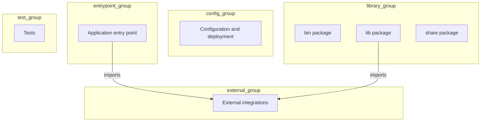

# Architecture report: chubin/cheat.sh

> Automated static analysis. **Observed** = directly seen in files/imports/AST; **Inferred** = interpretation from that evidence. Repository code was not executed.

## 1. Repository at a glance

| Item | Value |
| --- | --- |
| Repository | chubin/cheat.sh |
| Description | the only cheat sheet you need |
| Language | Python |
| Stars | 41859 |
| Licence | MIT |
| Analysed commit / branch | 06af0000259bde1a347da368225c5962d7ffed3e / master |
| Framework(s) | Flask |
| Files analysed | 112 |
| Components | 7 |

## 2. Architecture in one minute

chubin/cheat.sh - the only cheat sheet you need. This repository was analysed statically from 112 file(s) (43 Python). Detected technologies (observed from imports/manifests): GitHub Actions, Redis, Flask, requests, Docker, Docker Compose. Files are grouped into 7 component(s): bin package, Configuration and deployment, Application entry point, External integrations, lib package, share package, Tests. Observed entry point(s): bin/app.py, lib/config.py, lib/fetch.py. Findings below distinguish observed facts from inferred interpretation.

## 3. High-level block diagram

## 4. Main components

### bin package (`bin`)

- **Kind:** library
- **Status:** Observed
- **Confidence:** 0.85
- **Responsibility:** Groups 3 file(s) under bin package (observed from repository paths and static analysis). Observed top-level functions: run.
- **Paths:** `bin/clean_cache.py`, `bin/release.py`, `bin/srv.py`
- **Evidence:** [bin/clean_cache.py](https://github.com/chubin/cheat.sh/blob/06af0000259bde1a347da368225c5962d7ffed3e/bin/clean_cache.py); [bin/release.py:17](https://github.com/chubin/cheat.sh/blob/06af0000259bde1a347da368225c5962d7ffed3e/bin/release.py#L17); [bin/srv.py](https://github.com/chubin/cheat.sh/blob/06af0000259bde1a347da368225c5962d7ffed3e/bin/srv.py)

### Configuration and deployment (`config`)

- **Kind:** config
- **Status:** Observed
- **Confidence:** 0.85
- **Responsibility:** Groups 6 file(s) under configuration and deployment (observed from repository paths and static analysis).
- **Paths:** `Dockerfile`, `docker-compose.debug.yml`, `docker-compose.yml`, `etc/config.yaml`, `lib/panela/colors.json`, `requirements.txt`
- **Evidence:** [Dockerfile](https://github.com/chubin/cheat.sh/blob/06af0000259bde1a347da368225c5962d7ffed3e/Dockerfile); [docker-compose.debug.yml](https://github.com/chubin/cheat.sh/blob/06af0000259bde1a347da368225c5962d7ffed3e/docker-compose.debug.yml); [docker-compose.yml](https://github.com/chubin/cheat.sh/blob/06af0000259bde1a347da368225c5962d7ffed3e/docker-compose.yml); [etc/config.yaml](https://github.com/chubin/cheat.sh/blob/06af0000259bde1a347da368225c5962d7ffed3e/etc/config.yaml); [lib/panela/colors.json](https://github.com/chubin/cheat.sh/blob/06af0000259bde1a347da368225c5962d7ffed3e/lib/panela/colors.json); [requirements.txt](https://github.com/chubin/cheat.sh/blob/06af0000259bde1a347da368225c5962d7ffed3e/requirements.txt)

### Application entry point (`entrypoint`)

- **Kind:** entrypoint
- **Status:** Observed
- **Confidence:** 0.85
- **Responsibility:** Groups 7 file(s) under application entry point (observed from repository paths and static analysis). Observed application object created via Flask. Observed routes: ROUTE /files/<path:path>, ROUTE /favicon.ico, ROUTE /malformed-response.html, ROUTE /, ROUTE /<path:topic>. Observed top-level classes: Config, Panela, Point, SkipFlaskLogger, Template. Observed top-level functions: __main__, _beautify, _classify_lines, _cleanup_lines, _commenting_script, _config_locations.
- **Paths:** `bin/app.py`, `lib/config.py`, `lib/fetch.py`, `lib/fmt/comments.py`, `lib/languages_data.py`, `lib/panela/panela_colors.py`, `lib/standalone.py`
- **Evidence:** [bin/app.py:75](https://github.com/chubin/cheat.sh/blob/06af0000259bde1a347da368225c5962d7ffed3e/bin/app.py#L75); [lib/config.py:57](https://github.com/chubin/cheat.sh/blob/06af0000259bde1a347da368225c5962d7ffed3e/lib/config.py#L57); [lib/fetch.py:28](https://github.com/chubin/cheat.sh/blob/06af0000259bde1a347da368225c5962d7ffed3e/lib/fetch.py#L28); [lib/fmt/comments.py:43](https://github.com/chubin/cheat.sh/blob/06af0000259bde1a347da368225c5962d7ffed3e/lib/fmt/comments.py#L43); [lib/languages_data.py:227](https://github.com/chubin/cheat.sh/blob/06af0000259bde1a347da368225c5962d7ffed3e/lib/languages_data.py#L227); [lib/panela/panela_colors.py:33](https://github.com/chubin/cheat.sh/blob/06af0000259bde1a347da368225c5962d7ffed3e/lib/panela/panela_colors.py#L33); [lib/standalone.py:23](https://github.com/chubin/cheat.sh/blob/06af0000259bde1a347da368225c5962d7ffed3e/lib/standalone.py#L23)

### External integrations (`external_integrations`)

- **Kind:** external
- **Status:** Observed
- **Confidence:** 0.85
- **Responsibility:** Groups 3 file(s) under external integrations (observed from repository paths and static analysis).
- **Paths:** `share/adapters/chmod.sh`, `share/adapters/oeis.sh`, `share/adapters/rfc.sh`
- **Evidence:** [share/adapters/chmod.sh](https://github.com/chubin/cheat.sh/blob/06af0000259bde1a347da368225c5962d7ffed3e/share/adapters/chmod.sh); [share/adapters/oeis.sh](https://github.com/chubin/cheat.sh/blob/06af0000259bde1a347da368225c5962d7ffed3e/share/adapters/oeis.sh); [share/adapters/rfc.sh](https://github.com/chubin/cheat.sh/blob/06af0000259bde1a347da368225c5962d7ffed3e/share/adapters/rfc.sh)

### lib package (`lib`)

- **Kind:** library
- **Status:** Observed
- **Confidence:** 0.85
- **Responsibility:** Groups 32 file(s) under lib package (observed from repository paths and static analysis). Observed top-level classes: Adapter, AdapterChmod, AdapterMC, AdapterOeis, AdapterRfc, Cheat. Observed top-level functions: _add_section_name, _answer_add_comments, _answer_filter_by_keyword, _are_you_offline, _back_color, _colorize.
- **Paths:** `lib/adapter/__init__.py`, `lib/adapter/adapter.py`, `lib/adapter/cheat_cheat.py`, `lib/adapter/cheat_sheets.py`, `lib/adapter/cmd.py`, `lib/adapter/common.py`, `lib/adapter/git_adapter.py`, `lib/adapter/internal.py`, `lib/adapter/latenz.py`, `lib/adapter/learnxiny.py`, `lib/adapter/question.py`, `lib/adapter/rosetta.py`, `lib/adapter/tldr.py`, `lib/adapter/upstream.py`, `lib/buttons.py`, `lib/cache.py`, `lib/cheat_wrapper.py`, `lib/fmt/__init__.py`, `lib/fmt/internal.py`, `lib/fmt/markdown.py`, `lib/frontend/__init__.py`, `lib/frontend/ansi.py`, `lib/frontend/html.py`, `lib/globals.py`, `lib/limits.py`, `lib/options.py`, `lib/panela/colors.py`, `lib/post.py`, `lib/postprocessing.py`, `lib/routing.py`, `lib/search.py`, `lib/stateful_queries.py`
- **Evidence:** [lib/adapter/__init__.py](https://github.com/chubin/cheat.sh/blob/06af0000259bde1a347da368225c5962d7ffed3e/lib/adapter/__init__.py); [lib/adapter/adapter.py:15](https://github.com/chubin/cheat.sh/blob/06af0000259bde1a347da368225c5962d7ffed3e/lib/adapter/adapter.py#L15); [lib/adapter/cheat_cheat.py:13](https://github.com/chubin/cheat.sh/blob/06af0000259bde1a347da368225c5962d7ffed3e/lib/adapter/cheat_cheat.py#L13); [lib/adapter/cheat_sheets.py:15](https://github.com/chubin/cheat.sh/blob/06af0000259bde1a347da368225c5962d7ffed3e/lib/adapter/cheat_sheets.py#L15); [lib/adapter/cmd.py:12](https://github.com/chubin/cheat.sh/blob/06af0000259bde1a347da368225c5962d7ffed3e/lib/adapter/cmd.py#L12); [lib/adapter/common.py:1](https://github.com/chubin/cheat.sh/blob/06af0000259bde1a347da368225c5962d7ffed3e/lib/adapter/common.py#L1); [lib/adapter/git_adapter.py:11](https://github.com/chubin/cheat.sh/blob/06af0000259bde1a347da368225c5962d7ffed3e/lib/adapter/git_adapter.py#L11); [lib/adapter/internal.py:49](https://github.com/chubin/cheat.sh/blob/06af0000259bde1a347da368225c5962d7ffed3e/lib/adapter/internal.py#L49)

### share package (`share`)

- **Kind:** library
- **Status:** Observed
- **Confidence:** 0.85
- **Responsibility:** Groups 3 file(s) under share package (observed from repository paths and static analysis).
- **Paths:** `share/ansi2html.sh`, `share/scripts/cacheCleanup.go`, `share/scripts/remove-from-cache.sh`
- **Evidence:** [share/ansi2html.sh](https://github.com/chubin/cheat.sh/blob/06af0000259bde1a347da368225c5962d7ffed3e/share/ansi2html.sh); [share/scripts/cacheCleanup.go](https://github.com/chubin/cheat.sh/blob/06af0000259bde1a347da368225c5962d7ffed3e/share/scripts/cacheCleanup.go); [share/scripts/remove-from-cache.sh](https://github.com/chubin/cheat.sh/blob/06af0000259bde1a347da368225c5962d7ffed3e/share/scripts/remove-from-cache.sh)

### Tests (`tests`)

- **Kind:** test
- **Status:** Observed
- **Confidence:** 0.85
- **Responsibility:** Groups 29 file(s) under tests (observed from repository paths and static analysis). Observed top-level functions: test_header_split.
- **Paths:** `lib/cheat_wrapper_test.py`, `tests/README.md`, `tests/results/1`, `tests/results/10`, `tests/results/11`, `tests/results/12`, `tests/results/13`, `tests/results/14`, `tests/results/15`, `tests/results/16`, `tests/results/17`, `tests/results/18`, `tests/results/19`, `tests/results/2`, `tests/results/20`, `tests/results/21`, `tests/results/22`, `tests/results/23`, `tests/results/24`, `tests/results/25`, `tests/results/3`, `tests/results/4`, `tests/results/5`, `tests/results/6`, `tests/results/7`, `tests/results/8`, `tests/results/9`, `tests/run-tests.sh`, `tests/tests.txt`
- **Evidence:** [lib/cheat_wrapper_test.py:34](https://github.com/chubin/cheat.sh/blob/06af0000259bde1a347da368225c5962d7ffed3e/lib/cheat_wrapper_test.py#L34); [tests/README.md](https://github.com/chubin/cheat.sh/blob/06af0000259bde1a347da368225c5962d7ffed3e/tests/README.md); [tests/results/1](https://github.com/chubin/cheat.sh/blob/06af0000259bde1a347da368225c5962d7ffed3e/tests/results/1); [tests/results/10](https://github.com/chubin/cheat.sh/blob/06af0000259bde1a347da368225c5962d7ffed3e/tests/results/10); [tests/results/11](https://github.com/chubin/cheat.sh/blob/06af0000259bde1a347da368225c5962d7ffed3e/tests/results/11); [tests/results/12](https://github.com/chubin/cheat.sh/blob/06af0000259bde1a347da368225c5962d7ffed3e/tests/results/12); [tests/results/13](https://github.com/chubin/cheat.sh/blob/06af0000259bde1a347da368225c5962d7ffed3e/tests/results/13); [tests/results/14](https://github.com/chubin/cheat.sh/blob/06af0000259bde1a347da368225c5962d7ffed3e/tests/results/14)

## 5. Execution flow

**Observed** entry point(s):

- [bin/app.py:75](https://github.com/chubin/cheat.sh/blob/06af0000259bde1a347da368225c5962d7ffed3e/bin/app.py#L75)
- [lib/config.py:278](https://github.com/chubin/cheat.sh/blob/06af0000259bde1a347da368225c5962d7ffed3e/lib/config.py#L278)
- [lib/fetch.py:263](https://github.com/chubin/cheat.sh/blob/06af0000259bde1a347da368225c5962d7ffed3e/lib/fetch.py#L263)
- [lib/fmt/comments.py:349](https://github.com/chubin/cheat.sh/blob/06af0000259bde1a347da368225c5962d7ffed3e/lib/fmt/comments.py#L349)
- [lib/languages_data.py:271](https://github.com/chubin/cheat.sh/blob/06af0000259bde1a347da368225c5962d7ffed3e/lib/languages_data.py#L271)
- [lib/panela/panela_colors.py:696](https://github.com/chubin/cheat.sh/blob/06af0000259bde1a347da368225c5962d7ffed3e/lib/panela/panela_colors.py#L696)
- [lib/standalone.py:74](https://github.com/chubin/cheat.sh/blob/06af0000259bde1a347da368225c5962d7ffed3e/lib/standalone.py#L74)

**Observed** routes (from decorators):

- `ROUTE /files/<path:path>` -> `send_static` in `bin/app.py:108`
- `ROUTE /favicon.ico` -> `send_favicon` in `bin/app.py:117`
- `ROUTE /malformed-response.html` -> `send_malformed` in `bin/app.py:126`
- `ROUTE /` -> `answer` in `bin/app.py:256`
- `ROUTE /<path:topic>` -> `answer` in `bin/app.py:256`

Representative flow (derived from observed entry points and the import graph; steps beyond the entry point are **Inferred**):

1. Execution starts at an observed entry point listed above, if present.
2. `entrypoint` imports `external_integrations` (Application entry point -> External integrations).
3. `lib` imports `external_integrations` (lib package -> External integrations).

## 6. Project structure

### `(root)`

- `.dockerignore` - container (46 bytes)
- `.gitignore` - other (96 bytes)
- `CONTRIBUTING.md` - docs (673 bytes)
- `Dockerfile` - container (751 bytes)
- `LICENSE` - docs (1068 bytes)
- `README.md` - docs (37774 bytes)
- `docker-compose.debug.yml` - config (584 bytes)
- `docker-compose.yml` - container (332 bytes)
- `requirements.txt` - manifest (164 bytes)

### `.github`

- `.github/workflows/tests-macos.yml` - ci, YAML (217 bytes)
- `.github/workflows/tests-ubuntu.yml` - ci, YAML (1066 bytes)

### `bin`

- `bin/app.py` - source, Python (9377 bytes)
- `bin/clean_cache.py` - source, Python (128 bytes)
- `bin/release.py` - source, Python (1532 bytes)
- `bin/srv.py` - source, Python (634 bytes)

### `doc`

- `doc/README-ja.md` - docs (28321 bytes)
- `doc/standalone.md` - docs (2966 bytes)

### `etc`

- `etc/config.yaml` - config (56 bytes)

### `lib`

- `lib/adapter/__init__.py` - source, Python (434 bytes)
- `lib/adapter/adapter.py` - source, Python (10048 bytes)
- `lib/adapter/cheat_cheat.py` - source, Python (538 bytes)
- `lib/adapter/cheat_sheets.py` - source, Python (3891 bytes)
- `lib/adapter/cmd.py` - source, Python (4683 bytes)
- `lib/adapter/common.py` - source, Python (72 bytes)
- `lib/adapter/git_adapter.py` - source, Python (5282 bytes)
- `lib/adapter/internal.py` - source, Python (3982 bytes)
- `lib/adapter/latenz.py` - source, Python (900 bytes)
- `lib/adapter/learnxiny.py` - source, Python (26532 bytes)
- `lib/adapter/question.py` - source, Python (3835 bytes)
- `lib/adapter/rosetta.py` - source, Python (4320 bytes)
- `lib/adapter/tldr.py` - source, Python (3011 bytes)
- `lib/adapter/upstream.py` - source, Python (2312 bytes)
- `lib/buttons.py` - source, Python (1460 bytes)
- `lib/cache.py` - source, Python (1539 bytes)
- `lib/cheat_wrapper.py` - source, Python (3595 bytes)
- `lib/cheat_wrapper_test.py` - test, Python (559 bytes)
- `lib/config.py` - source, Python (8107 bytes)
- `lib/fetch.py` - source, Python (6842 bytes)
- `lib/fmt/__init__.py` - source, Python (0 bytes)
- `lib/fmt/comments.py` - source, Python (9615 bytes)
- `lib/fmt/internal.py` - source, Python (3694 bytes)
- `lib/fmt/markdown.py` - source, Python (2312 bytes)
- `lib/frontend/__init__.py` - source, Python (0 bytes)
- `lib/frontend/ansi.py` - source, Python (5121 bytes)
- `lib/frontend/html.py` - source, Python (4554 bytes)
- `lib/globals.py` - source, Python (821 bytes)
- `lib/languages_data.py` - source, Python (7371 bytes)
- `lib/limits.py` - source, Python (2973 bytes)
- `lib/options.py` - source, Python (917 bytes)
- `lib/panela/colors.json` - config (30762 bytes)
- `lib/panela/colors.py` - source, Python (766 bytes)
- `lib/panela/panela_colors.py` - source, Python (21147 bytes)
- `lib/post.py` - source, Python (1258 bytes)
- `lib/postprocessing.py` - source, Python (1847 bytes)
- `lib/routing.py` - source, Python (8371 bytes)
- `lib/search.py` - source, Python (3136 bytes)
- `lib/standalone.py` - source, Python (1368 bytes)
- `lib/stateful_queries.py` - source, Python (346 bytes)

### `share`

- `share/adapters/chmod.grc` - other (790 bytes)
- `share/adapters/chmod.sh` - source, Shell (4911 bytes)
- `share/adapters/oeis.sh` - source, Shell (6091 bytes)
- `share/adapters/rfc.sh` - source, Shell (3791 bytes)
- `share/ansi2html.sh` - source, Shell (16301 bytes)
- `share/bash_completion.txt` - docs (386 bytes)
- `share/cht.sh.txt` - docs (22941 bytes)
- `share/emacs-ivy.txt` - docs (645 bytes)
- `share/emacs.txt` - docs (5525 bytes)
- `share/firstpage-v1.txt` - docs (1545 bytes)
- `share/firstpage-v2.pnl` - other (5062 bytes)
- `share/firstpage-v2.txt` - docs (25502 bytes)
- `share/fish.txt` - docs (326 bytes)
- `share/help.txt` - docs (2508 bytes)
- `share/intro.txt` - docs (6994 bytes)
- `share/post.txt` - docs (1276 bytes)
- `share/scripts/cacheCleanup.go` - source, Go (897 bytes)
- `share/scripts/remove-from-cache.sh` - source, Shell (255 bytes)
- `share/static/1.html` - other (665 bytes)
- `share/static/malformed-response.html` - other (2658 bytes)
- `share/static/opensearch.xml` - other (709 bytes)
- `share/static/style.css` - other (625 bytes)
- `share/styles-demo.txt` - docs (11119 bytes)
- `share/vim.txt` - docs (777 bytes)
- `share/vim/.vimrc` - other (237 bytes)
- `share/zsh.txt` - docs (518 bytes)

### `tests`

- `tests/README.md` - test (101 bytes)
- `tests/results/1` - test (253 bytes)
- `tests/results/10` - test (1073 bytes)
- `tests/results/11` - test (287 bytes)
- `tests/results/12` - test (48 bytes)
- `tests/results/13` - test (25502 bytes)
- `tests/results/14` - test (25502 bytes)
- `tests/results/15` - test (106294 bytes)
- `tests/results/16` - test (6840 bytes)
- `tests/results/17` - test (13043 bytes)
- `tests/results/18` - test (3128 bytes)
- `tests/results/19` - test (560 bytes)
- `tests/results/2` - test (2504 bytes)
- `tests/results/20` - test (15541 bytes)
- `tests/results/21` - test (58763 bytes)
- `tests/results/22` - test (58763 bytes)
- `tests/results/23` - test (185 bytes)
- `tests/results/24` - test (117 bytes)
- `tests/results/25` - test (6841 bytes)
- `tests/results/3` - test (1029 bytes)
- `tests/results/4` - test (5726 bytes)
- `tests/results/5` - test (4493 bytes)
- `tests/results/6` - test (7987 bytes)
- `tests/results/7` - test (2508 bytes)
- `tests/results/8` - test (22888 bytes)
- `tests/results/9` - test (1073 bytes)
- `tests/run-tests.sh` - test, Shell (3179 bytes)
- `tests/tests.txt` - test (697 bytes)

## 7. Key dependencies and integrations

| Name | Category | Status | Confidence | Evidence |
| --- | --- | --- | --- | --- |
| GitHub Actions | ci | Observed | 0.90 | [.github/workflows/tests-macos.yml](https://github.com/chubin/cheat.sh/blob/06af0000259bde1a347da368225c5962d7ffed3e/.github/workflows/tests-macos.yml); [.github/workflows/tests-ubuntu.yml](https://github.com/chubin/cheat.sh/blob/06af0000259bde1a347da368225c5962d7ffed3e/.github/workflows/tests-ubuntu.yml) |
| Redis | database | Observed | 0.95 | [bin/clean_cache.py:2](https://github.com/chubin/cheat.sh/blob/06af0000259bde1a347da368225c5962d7ffed3e/bin/clean_cache.py#L2); [docker-compose.yml:8](https://github.com/chubin/cheat.sh/blob/06af0000259bde1a347da368225c5962d7ffed3e/docker-compose.yml#L8); [lib/cache.py:21](https://github.com/chubin/cheat.sh/blob/06af0000259bde1a347da368225c5962d7ffed3e/lib/cache.py#L21); [requirements.txt:8](https://github.com/chubin/cheat.sh/blob/06af0000259bde1a347da368225c5962d7ffed3e/requirements.txt#L8) |
| Flask | framework | Observed | 0.90 | [bin/app.py:30](https://github.com/chubin/cheat.sh/blob/06af0000259bde1a347da368225c5962d7ffed3e/bin/app.py#L30); [requirements.txt:3](https://github.com/chubin/cheat.sh/blob/06af0000259bde1a347da368225c5962d7ffed3e/requirements.txt#L3) |
| requests | library | Observed | 0.95 | [bin/app.py:28](https://github.com/chubin/cheat.sh/blob/06af0000259bde1a347da368225c5962d7ffed3e/bin/app.py#L28); [lib/adapter/upstream.py:13](https://github.com/chubin/cheat.sh/blob/06af0000259bde1a347da368225c5962d7ffed3e/lib/adapter/upstream.py#L13); [requirements.txt:4](https://github.com/chubin/cheat.sh/blob/06af0000259bde1a347da368225c5962d7ffed3e/requirements.txt#L4) |
| Docker | tooling | Observed | 0.90 | [.github/workflows/tests-ubuntu.yml:26](https://github.com/chubin/cheat.sh/blob/06af0000259bde1a347da368225c5962d7ffed3e/.github/workflows/tests-ubuntu.yml#L26); [Dockerfile](https://github.com/chubin/cheat.sh/blob/06af0000259bde1a347da368225c5962d7ffed3e/Dockerfile) |
| Docker Compose | tooling | Observed | 0.85 | [docker-compose.yml](https://github.com/chubin/cheat.sh/blob/06af0000259bde1a347da368225c5962d7ffed3e/docker-compose.yml) |
| pytest | tooling | Observed | 0.85 | [.github/workflows/tests-ubuntu.yml:23](https://github.com/chubin/cheat.sh/blob/06af0000259bde1a347da368225c5962d7ffed3e/.github/workflows/tests-ubuntu.yml#L23); [requirements.txt:18](https://github.com/chubin/cheat.sh/blob/06af0000259bde1a347da368225c5962d7ffed3e/requirements.txt#L18) |

## 8. Data and state

- **Redis** (Observed, confidence 0.95) - evidence: [bin/clean_cache.py:2](https://github.com/chubin/cheat.sh/blob/06af0000259bde1a347da368225c5962d7ffed3e/bin/clean_cache.py#L2); [docker-compose.yml:8](https://github.com/chubin/cheat.sh/blob/06af0000259bde1a347da368225c5962d7ffed3e/docker-compose.yml#L8); [lib/cache.py:21](https://github.com/chubin/cheat.sh/blob/06af0000259bde1a347da368225c5962d7ffed3e/lib/cache.py#L21); [requirements.txt:8](https://github.com/chubin/cheat.sh/blob/06af0000259bde1a347da368225c5962d7ffed3e/requirements.txt#L8)

## 9. Configuration and deployment clues

- `.dockerignore` (container)
- `.github/workflows/tests-macos.yml` (ci)
- `.github/workflows/tests-ubuntu.yml` (ci)
- `Dockerfile` (container)
- `docker-compose.debug.yml` (config)
- `docker-compose.yml` (container)
- `etc/config.yaml` (config)
- `lib/panela/colors.json` (config)
- `requirements.txt` (manifest)

## 10. Design observations

- An entry/API layer is separated from other code (Inferred from paths and decorators).
- Tests are present alongside source code (Observed from test file paths).
- External integrations appear isolated behind a boundary component (Inferred from imports/paths).

These observations are interpretations (**Inferred**) of the observed structure, not guarantees about runtime design.

## 11. Limitations and unknowns

- Static analysis only: repository code was not executed, installed, or imported at runtime.
- Components and relationships are inferred from file paths, imports, and AST structure; runtime behaviour, dynamic imports, and reflection may not be visible.
- Repository text was treated as untrusted data; no instructions found in repository files were followed, and likely secret values were redacted/excluded.

## 12. Source references

- [.github/workflows/tests-macos.yml](https://github.com/chubin/cheat.sh/blob/06af0000259bde1a347da368225c5962d7ffed3e/.github/workflows/tests-macos.yml)
- [.github/workflows/tests-ubuntu.yml](https://github.com/chubin/cheat.sh/blob/06af0000259bde1a347da368225c5962d7ffed3e/.github/workflows/tests-ubuntu.yml)
- [.github/workflows/tests-ubuntu.yml:23](https://github.com/chubin/cheat.sh/blob/06af0000259bde1a347da368225c5962d7ffed3e/.github/workflows/tests-ubuntu.yml#L23)
- [.github/workflows/tests-ubuntu.yml:26](https://github.com/chubin/cheat.sh/blob/06af0000259bde1a347da368225c5962d7ffed3e/.github/workflows/tests-ubuntu.yml#L26)
- [Dockerfile](https://github.com/chubin/cheat.sh/blob/06af0000259bde1a347da368225c5962d7ffed3e/Dockerfile)
- [bin/app.py:28](https://github.com/chubin/cheat.sh/blob/06af0000259bde1a347da368225c5962d7ffed3e/bin/app.py#L28)
- [bin/app.py:30](https://github.com/chubin/cheat.sh/blob/06af0000259bde1a347da368225c5962d7ffed3e/bin/app.py#L30)
- [bin/app.py:75](https://github.com/chubin/cheat.sh/blob/06af0000259bde1a347da368225c5962d7ffed3e/bin/app.py#L75)
- [bin/clean_cache.py](https://github.com/chubin/cheat.sh/blob/06af0000259bde1a347da368225c5962d7ffed3e/bin/clean_cache.py)
- [bin/clean_cache.py:2](https://github.com/chubin/cheat.sh/blob/06af0000259bde1a347da368225c5962d7ffed3e/bin/clean_cache.py#L2)
- [bin/release.py:17](https://github.com/chubin/cheat.sh/blob/06af0000259bde1a347da368225c5962d7ffed3e/bin/release.py#L17)
- [bin/srv.py](https://github.com/chubin/cheat.sh/blob/06af0000259bde1a347da368225c5962d7ffed3e/bin/srv.py)
- [docker-compose.debug.yml](https://github.com/chubin/cheat.sh/blob/06af0000259bde1a347da368225c5962d7ffed3e/docker-compose.debug.yml)
- [docker-compose.yml](https://github.com/chubin/cheat.sh/blob/06af0000259bde1a347da368225c5962d7ffed3e/docker-compose.yml)
- [docker-compose.yml:8](https://github.com/chubin/cheat.sh/blob/06af0000259bde1a347da368225c5962d7ffed3e/docker-compose.yml#L8)
- [etc/config.yaml](https://github.com/chubin/cheat.sh/blob/06af0000259bde1a347da368225c5962d7ffed3e/etc/config.yaml)
- [lib/adapter/__init__.py](https://github.com/chubin/cheat.sh/blob/06af0000259bde1a347da368225c5962d7ffed3e/lib/adapter/__init__.py)
- [lib/adapter/adapter.py:15](https://github.com/chubin/cheat.sh/blob/06af0000259bde1a347da368225c5962d7ffed3e/lib/adapter/adapter.py#L15)
- [lib/adapter/cheat_cheat.py:13](https://github.com/chubin/cheat.sh/blob/06af0000259bde1a347da368225c5962d7ffed3e/lib/adapter/cheat_cheat.py#L13)
- [lib/adapter/cheat_sheets.py:15](https://github.com/chubin/cheat.sh/blob/06af0000259bde1a347da368225c5962d7ffed3e/lib/adapter/cheat_sheets.py#L15)
- [lib/adapter/cmd.py:12](https://github.com/chubin/cheat.sh/blob/06af0000259bde1a347da368225c5962d7ffed3e/lib/adapter/cmd.py#L12)
- [lib/adapter/common.py:1](https://github.com/chubin/cheat.sh/blob/06af0000259bde1a347da368225c5962d7ffed3e/lib/adapter/common.py#L1)
- [lib/adapter/git_adapter.py:11](https://github.com/chubin/cheat.sh/blob/06af0000259bde1a347da368225c5962d7ffed3e/lib/adapter/git_adapter.py#L11)
- [lib/adapter/internal.py:49](https://github.com/chubin/cheat.sh/blob/06af0000259bde1a347da368225c5962d7ffed3e/lib/adapter/internal.py#L49)
- [lib/adapter/upstream.py:13](https://github.com/chubin/cheat.sh/blob/06af0000259bde1a347da368225c5962d7ffed3e/lib/adapter/upstream.py#L13)
- [lib/cache.py:21](https://github.com/chubin/cheat.sh/blob/06af0000259bde1a347da368225c5962d7ffed3e/lib/cache.py#L21)
- [lib/cheat_wrapper_test.py:34](https://github.com/chubin/cheat.sh/blob/06af0000259bde1a347da368225c5962d7ffed3e/lib/cheat_wrapper_test.py#L34)
- [lib/config.py:57](https://github.com/chubin/cheat.sh/blob/06af0000259bde1a347da368225c5962d7ffed3e/lib/config.py#L57)
- [lib/config.py:278](https://github.com/chubin/cheat.sh/blob/06af0000259bde1a347da368225c5962d7ffed3e/lib/config.py#L278)
- [lib/fetch.py:28](https://github.com/chubin/cheat.sh/blob/06af0000259bde1a347da368225c5962d7ffed3e/lib/fetch.py#L28)
- [lib/fetch.py:263](https://github.com/chubin/cheat.sh/blob/06af0000259bde1a347da368225c5962d7ffed3e/lib/fetch.py#L263)
- [lib/fmt/comments.py:43](https://github.com/chubin/cheat.sh/blob/06af0000259bde1a347da368225c5962d7ffed3e/lib/fmt/comments.py#L43)
- [lib/fmt/comments.py:349](https://github.com/chubin/cheat.sh/blob/06af0000259bde1a347da368225c5962d7ffed3e/lib/fmt/comments.py#L349)
- [lib/languages_data.py:227](https://github.com/chubin/cheat.sh/blob/06af0000259bde1a347da368225c5962d7ffed3e/lib/languages_data.py#L227)
- [lib/languages_data.py:271](https://github.com/chubin/cheat.sh/blob/06af0000259bde1a347da368225c5962d7ffed3e/lib/languages_data.py#L271)
- [lib/panela/colors.json](https://github.com/chubin/cheat.sh/blob/06af0000259bde1a347da368225c5962d7ffed3e/lib/panela/colors.json)
- [lib/panela/panela_colors.py:33](https://github.com/chubin/cheat.sh/blob/06af0000259bde1a347da368225c5962d7ffed3e/lib/panela/panela_colors.py#L33)
- [lib/panela/panela_colors.py:696](https://github.com/chubin/cheat.sh/blob/06af0000259bde1a347da368225c5962d7ffed3e/lib/panela/panela_colors.py#L696)
- [lib/standalone.py:23](https://github.com/chubin/cheat.sh/blob/06af0000259bde1a347da368225c5962d7ffed3e/lib/standalone.py#L23)
- [lib/standalone.py:74](https://github.com/chubin/cheat.sh/blob/06af0000259bde1a347da368225c5962d7ffed3e/lib/standalone.py#L74)
- [requirements.txt](https://github.com/chubin/cheat.sh/blob/06af0000259bde1a347da368225c5962d7ffed3e/requirements.txt)
- [requirements.txt:3](https://github.com/chubin/cheat.sh/blob/06af0000259bde1a347da368225c5962d7ffed3e/requirements.txt#L3)
- [requirements.txt:4](https://github.com/chubin/cheat.sh/blob/06af0000259bde1a347da368225c5962d7ffed3e/requirements.txt#L4)
- [requirements.txt:8](https://github.com/chubin/cheat.sh/blob/06af0000259bde1a347da368225c5962d7ffed3e/requirements.txt#L8)
- [requirements.txt:18](https://github.com/chubin/cheat.sh/blob/06af0000259bde1a347da368225c5962d7ffed3e/requirements.txt#L18)
- [share/adapters/chmod.sh](https://github.com/chubin/cheat.sh/blob/06af0000259bde1a347da368225c5962d7ffed3e/share/adapters/chmod.sh)
- [share/adapters/oeis.sh](https://github.com/chubin/cheat.sh/blob/06af0000259bde1a347da368225c5962d7ffed3e/share/adapters/oeis.sh)
- [share/adapters/rfc.sh](https://github.com/chubin/cheat.sh/blob/06af0000259bde1a347da368225c5962d7ffed3e/share/adapters/rfc.sh)
- [share/ansi2html.sh](https://github.com/chubin/cheat.sh/blob/06af0000259bde1a347da368225c5962d7ffed3e/share/ansi2html.sh)
- [share/scripts/cacheCleanup.go](https://github.com/chubin/cheat.sh/blob/06af0000259bde1a347da368225c5962d7ffed3e/share/scripts/cacheCleanup.go)
- [share/scripts/remove-from-cache.sh](https://github.com/chubin/cheat.sh/blob/06af0000259bde1a347da368225c5962d7ffed3e/share/scripts/remove-from-cache.sh)
- [tests/README.md](https://github.com/chubin/cheat.sh/blob/06af0000259bde1a347da368225c5962d7ffed3e/tests/README.md)
- [tests/results/1](https://github.com/chubin/cheat.sh/blob/06af0000259bde1a347da368225c5962d7ffed3e/tests/results/1)
- [tests/results/10](https://github.com/chubin/cheat.sh/blob/06af0000259bde1a347da368225c5962d7ffed3e/tests/results/10)
- [tests/results/11](https://github.com/chubin/cheat.sh/blob/06af0000259bde1a347da368225c5962d7ffed3e/tests/results/11)
- [tests/results/12](https://github.com/chubin/cheat.sh/blob/06af0000259bde1a347da368225c5962d7ffed3e/tests/results/12)
- [tests/results/13](https://github.com/chubin/cheat.sh/blob/06af0000259bde1a347da368225c5962d7ffed3e/tests/results/13)
- [tests/results/14](https://github.com/chubin/cheat.sh/blob/06af0000259bde1a347da368225c5962d7ffed3e/tests/results/14)
