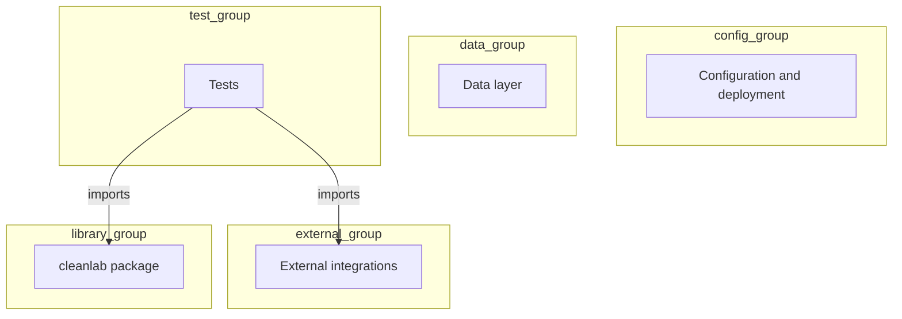

# Architecture report: cleanlab/cleanlab

> Automated static analysis. **Observed** = directly seen in files/imports/AST; **Inferred** = interpretation from that evidence. Repository code was not executed.

## 1. Repository at a glance

| Item | Value |
| --- | --- |
| Repository | cleanlab/cleanlab |
| Description | Cleanlab's open-source library is the standard data-centric AI package for data quality and machine learning with messy, real-world data and labels. |
| Language | Python |
| Stars | 11742 |
| Licence | Apache-2.0 |
| Analysed commit / branch | 750625747de1b26d8530954f51f0530bd0b51d3c / master |
| Framework(s) | None detected |
| Files analysed | 304 |
| Components | 5 |

## 2. Architecture in one minute

cleanlab/cleanlab - Cleanlab's open-source library is the standard data-centric AI package for data quality and machine learning with messy, real-world data and labels.. This repository was analysed statically from 304 file(s) (154 Python). Detected technologies (observed from imports/manifests): GitHub Actions, NumPy, pandas, requests, Poetry, setuptools. Files are grouped into 5 component(s): cleanlab package, Configuration and deployment, Data layer, External integrations, Tests. Observed entry point(s): .github/get_min_dependencies.py. Findings below distinguish observed facts from inferred interpretation.

## 3. High-level block diagram

## 4. Main components

### cleanlab package (`cleanlab`)

- **Kind:** library
- **Status:** Observed
- **Confidence:** 0.85
- **Responsibility:** Groups 90 file(s) under cleanlab package (observed from repository paths and static analysis). Observed top-level classes: Aggregator, CNN, ClassImbalanceIssueManager, ClassLabelScorer, ClassificationRepresentation, CleanLearning. Observed top-level functions: _batch_check, _calculate_ap_per_class, _calculate_average_precision, _calculate_true_positives_false_positives, _calibrate_confident_joint_multilabel, _check_input.
- **Paths:** `cleanlab/__init__.py`, `cleanlab/benchmarking/__init__.py`, `cleanlab/benchmarking/noise_generation.py`, `cleanlab/classification.py`, `cleanlab/count.py`, `cleanlab/data_valuation.py`, `cleanlab/datalab/__init__.py`, `cleanlab/datalab/datalab.py`, `cleanlab/datalab/internal/__init__.py`, `cleanlab/datalab/internal/adapter/__init__.py`, `cleanlab/datalab/internal/adapter/constants.py`, `cleanlab/datalab/internal/adapter/imagelab.py`, `cleanlab/datalab/internal/data.py`, `cleanlab/datalab/internal/data_issues.py`, `cleanlab/datalab/internal/display.py`, `cleanlab/datalab/internal/helper_factory.py`, `cleanlab/datalab/internal/issue_finder.py`, `cleanlab/datalab/internal/issue_manager/__init__.py`, `cleanlab/datalab/internal/issue_manager/data_valuation.py`, `cleanlab/datalab/internal/issue_manager/duplicate.py`, `cleanlab/datalab/internal/issue_manager/identifier_column.py`, `cleanlab/datalab/internal/issue_manager/imbalance.py`, `cleanlab/datalab/internal/issue_manager/issue_manager.py`, `cleanlab/datalab/internal/issue_manager/knn_graph_helpers.py`, `cleanlab/datalab/internal/issue_manager/label.py`, `cleanlab/datalab/internal/issue_manager/multilabel/__init__.py`, `cleanlab/datalab/internal/issue_manager/multilabel/label.py`, `cleanlab/datalab/internal/issue_manager/noniid.py`, `cleanlab/datalab/internal/issue_manager/null.py`, `cleanlab/datalab/internal/issue_manager/outlier.py`, `cleanlab/datalab/internal/issue_manager/regression/__init__.py`, `cleanlab/datalab/internal/issue_manager/regression/label.py`, `cleanlab/datalab/internal/issue_manager/underperforming_group.py`, `cleanlab/datalab/internal/issue_manager_factory.py`, `cleanlab/datalab/internal/model_outputs.py`, `cleanlab/datalab/internal/report.py`, `cleanlab/datalab/internal/serialize.py`, `cleanlab/datalab/internal/spurious_correlation.py`, `cleanlab/datalab/internal/task.py`, `cleanlab/dataset.py`, `cleanlab/experimental/__init__.py`, `cleanlab/experimental/cifar_cnn.py`, `cleanlab/experimental/coteaching.py`, `cleanlab/experimental/label_issues_batched.py`, `cleanlab/experimental/mnist_pytorch.py`, `cleanlab/experimental/span_classification.py`, `cleanlab/filter.py`, `cleanlab/internal/__init__.py`, `cleanlab/internal/constants.py`, `cleanlab/internal/label_quality_utils.py`, `cleanlab/internal/latent_algebra.py`, `cleanlab/internal/multiannotator_utils.py`, `cleanlab/internal/multilabel_scorer.py`, `cleanlab/internal/multilabel_utils.py`, `cleanlab/internal/neighbor/__init__.py`, `cleanlab/internal/neighbor/knn_graph.py`, `cleanlab/internal/neighbor/metric.py`, `cleanlab/internal/neighbor/search.py`, `cleanlab/internal/numerics.py`, `cleanlab/internal/object_detection_utils.py`, `cleanlab/internal/outlier.py`, `cleanlab/internal/regression_utils.py`, `cleanlab/internal/segmentation_utils.py`, `cleanlab/internal/token_classification_utils.py`, `cleanlab/internal/util.py`, `cleanlab/internal/validation.py`, `cleanlab/multiannotator.py`, `cleanlab/multilabel_classification/__init__.py`, `cleanlab/multilabel_classification/dataset.py`, `cleanlab/multilabel_classification/filter.py`, `cleanlab/multilabel_classification/rank.py`, `cleanlab/object_detection/__init__.py`, `cleanlab/object_detection/filter.py`, `cleanlab/object_detection/rank.py`, `cleanlab/object_detection/summary.py`, `cleanlab/outlier.py`, `cleanlab/rank.py`, `cleanlab/regression/__init__.py`, `cleanlab/regression/learn.py`, `cleanlab/regression/rank.py`, `cleanlab/segmentation/__init__.py`, `cleanlab/segmentation/filter.py`, `cleanlab/segmentation/rank.py`, `cleanlab/segmentation/summary.py`, `cleanlab/token_classification/__init__.py`, `cleanlab/token_classification/filter.py`, `cleanlab/token_classification/rank.py`, `cleanlab/token_classification/summary.py`, `cleanlab/typing.py`, `cleanlab/version.py`
- **Evidence:** [cleanlab/__init__.py:17](https://github.com/cleanlab/cleanlab/blob/750625747de1b26d8530954f51f0530bd0b51d3c/cleanlab/__init__.py#L17); [cleanlab/benchmarking/__init__.py](https://github.com/cleanlab/cleanlab/blob/750625747de1b26d8530954f51f0530bd0b51d3c/cleanlab/benchmarking/__init__.py); [cleanlab/benchmarking/noise_generation.py:15](https://github.com/cleanlab/cleanlab/blob/750625747de1b26d8530954f51f0530bd0b51d3c/cleanlab/benchmarking/noise_generation.py#L15); [cleanlab/classification.py:139](https://github.com/cleanlab/cleanlab/blob/750625747de1b26d8530954f51f0530bd0b51d3c/cleanlab/classification.py#L139); [cleanlab/count.py:50](https://github.com/cleanlab/cleanlab/blob/750625747de1b26d8530954f51f0530bd0b51d3c/cleanlab/count.py#L50); [cleanlab/data_valuation.py:14](https://github.com/cleanlab/cleanlab/blob/750625747de1b26d8530954f51f0530bd0b51d3c/cleanlab/data_valuation.py#L14); [cleanlab/datalab/__init__.py](https://github.com/cleanlab/cleanlab/blob/750625747de1b26d8530954f51f0530bd0b51d3c/cleanlab/datalab/__init__.py); [cleanlab/datalab/datalab.py:44](https://github.com/cleanlab/cleanlab/blob/750625747de1b26d8530954f51f0530bd0b51d3c/cleanlab/datalab/datalab.py#L44)

### Configuration and deployment (`config`)

- **Kind:** config
- **Status:** Observed
- **Confidence:** 0.85
- **Responsibility:** Groups 6 file(s) under configuration and deployment (observed from repository paths and static analysis). Observed top-level classes: egg_info_ex.
- **Paths:** `MANIFEST.in`, `pyproject.toml`, `requirements-dev.txt`, `requirements-test-core.txt`, `setup.cfg`, `setup.py`
- **Evidence:** [MANIFEST.in](https://github.com/cleanlab/cleanlab/blob/750625747de1b26d8530954f51f0530bd0b51d3c/MANIFEST.in); [pyproject.toml](https://github.com/cleanlab/cleanlab/blob/750625747de1b26d8530954f51f0530bd0b51d3c/pyproject.toml); [requirements-dev.txt](https://github.com/cleanlab/cleanlab/blob/750625747de1b26d8530954f51f0530bd0b51d3c/requirements-dev.txt); [requirements-test-core.txt](https://github.com/cleanlab/cleanlab/blob/750625747de1b26d8530954f51f0530bd0b51d3c/requirements-test-core.txt); [setup.cfg](https://github.com/cleanlab/cleanlab/blob/750625747de1b26d8530954f51f0530bd0b51d3c/setup.cfg); [setup.py:8](https://github.com/cleanlab/cleanlab/blob/750625747de1b26d8530954f51f0530bd0b51d3c/setup.py#L8)

### Data layer (`data_layer`)

- **Kind:** data
- **Status:** Observed
- **Confidence:** 0.85
- **Responsibility:** Groups 1 file(s) under data layer (observed from repository paths and static analysis).
- **Paths:** `cleanlab/models/__init__.py`
- **Evidence:** [cleanlab/models/__init__.py](https://github.com/cleanlab/cleanlab/blob/750625747de1b26d8530954f51f0530bd0b51d3c/cleanlab/models/__init__.py)

### External integrations (`external_integrations`)

- **Kind:** external
- **Status:** Inferred
- **Confidence:** 0.70
- **Responsibility:** Groups 0 file(s) under external integrations (observed from repository paths and static analysis).
- **Evidence:** [tests/test_dataset.py:1](https://github.com/cleanlab/cleanlab/blob/750625747de1b26d8530954f51f0530bd0b51d3c/tests/test_dataset.py#L1)

### Tests (`tests`)

- **Kind:** test
- **Status:** Observed
- **Confidence:** 0.85
- **Responsibility:** Groups 60 file(s) under tests (observed from repository paths and static analysis). Observed routes: PATCH cleanvision.utils.viz_manager.VizManager.individual_images, PATCH cleanvision.utils.viz_manager.VizManager.individual_images, PATCH matplotlib.pyplot.figure, PATCH matplotlib.pyplot.show. Observed top-level classes: FeatureFactory, LogisticRegressionWithValidationData, ReshapingLogisticRegression, TestAggregator, TestAllIdenticalExamplesDataset, TestClassImbalanceIssueManager. Observed top-level functions: _get_pred_probs_labels_from_labelerrors_datasets, add_noise, apply_background, app…
- **Paths:** `tests/conftest.py`, `tests/datalab/conftest.py`, `tests/datalab/datalab/__init__.py`, `tests/datalab/datalab/end_to_end_tests/__init__.py`, `tests/datalab/datalab/end_to_end_tests/issue_types/__init__.py`, `tests/datalab/datalab/end_to_end_tests/issue_types/test_null.py`, `tests/datalab/datalab/end_to_end_tests/test_all_identical_examples.py`, `tests/datalab/datalab/test_datalab.py`, `tests/datalab/datalab/test_multilabel.py`, `tests/datalab/datalab/test_regression.py`, `tests/datalab/issue_manager/__init__.py`, `tests/datalab/issue_manager/conftest.py`, `tests/datalab/issue_manager/multilabel/test_label.py`, `tests/datalab/issue_manager/regression/__init__.py`, `tests/datalab/issue_manager/regression/test_label.py`, `tests/datalab/issue_manager/test_data_valuation.py`, `tests/datalab/issue_manager/test_duplicate.py`, `tests/datalab/issue_manager/test_identifier_column.py`, `tests/datalab/issue_manager/test_imbalance.py`, `tests/datalab/issue_manager/test_knn_graph.py`, `tests/datalab/issue_manager/test_knn_graph_helpers.py`, `tests/datalab/issue_manager/test_label.py`, `tests/datalab/issue_manager/test_noniid.py`, `tests/datalab/issue_manager/test_null.py`, `tests/datalab/issue_manager/test_outlier.py`, `tests/datalab/issue_manager/test_underperforming_group.py`, `tests/datalab/test_cleanvision_integration.py`, `tests/datalab/test_data.py`, `tests/datalab/test_data_issues.py`, `tests/datalab/test_factory.py`, `tests/datalab/test_imagelab_adapter.py`, `tests/datalab/test_init.py`, `tests/datalab/test_issue_finder.py`, `tests/datalab/test_issue_manager.py`, `tests/datalab/test_report.py`, `tests/internal/neighbor/test_metric.py`, `tests/internal/neighbor/test_neighbor.py`, `tests/internal/test_numerics.py`, `tests/spurious_correlation/__init__.py`, `tests/spurious_correlation/test_correlation_visualizer.py`, `tests/spurious_correlation/test_spurious_correlation.py`, `tests/test_classification.py`, `tests/test_data_valuation.py`, `tests/test_dataset.py`, `tests/test_filter_count.py`, `tests/test_frameworks.py`, `tests/test_latent_algebra.py`, `tests/test_model_pytorch_cnn.py`, `tests/test_multiannotator.py`, `tests/test_multilabel_classification.py`, `tests/test_noise_generation.py`, `tests/test_object_detection.py`, `tests/test_outlier.py`, `tests/test_rank.py`, `tests/test_regression.py`, `tests/test_segmentation.py`, `tests/test_span_classification.py`, `tests/test_token_classification.py`, `tests/test_util.py`, `tests/test_validation.py`
- **Evidence:** [tests/conftest.py:1](https://github.com/cleanlab/cleanlab/blob/750625747de1b26d8530954f51f0530bd0b51d3c/tests/conftest.py#L1); [tests/datalab/conftest.py:16](https://github.com/cleanlab/cleanlab/blob/750625747de1b26d8530954f51f0530bd0b51d3c/tests/datalab/conftest.py#L16); [tests/datalab/datalab/__init__.py](https://github.com/cleanlab/cleanlab/blob/750625747de1b26d8530954f51f0530bd0b51d3c/tests/datalab/datalab/__init__.py); [tests/datalab/datalab/end_to_end_tests/__init__.py](https://github.com/cleanlab/cleanlab/blob/750625747de1b26d8530954f51f0530bd0b51d3c/tests/datalab/datalab/end_to_end_tests/__init__.py); [tests/datalab/datalab/end_to_end_tests/issue_types/__init__.py](https://github.com/cleanlab/cleanlab/blob/750625747de1b26d8530954f51f0530bd0b51d3c/tests/datalab/datalab/end_to_end_tests/issue_types/__init__.py); [tests/datalab/datalab/end_to_end_tests/issue_types/test_null.py:9](https://github.com/cleanlab/cleanlab/blob/750625747de1b26d8530954f51f0530bd0b51d3c/tests/datalab/datalab/end_to_end_tests/issue_types/test_null.py#L9); [tests/datalab/datalab/end_to_end_tests/test_all_identical_examples.py:7](https://github.com/cleanlab/cleanlab/blob/750625747de1b26d8530954f51f0530bd0b51d3c/tests/datalab/datalab/end_to_end_tests/test_all_identical_examples.py#L7); [tests/datalab/datalab/test_datalab.py:30](https://github.com/cleanlab/cleanlab/blob/750625747de1b26d8530954f51f0530bd0b51d3c/tests/datalab/datalab/test_datalab.py#L30)

## 5. Execution flow

**Observed** entry point(s):

- [.github/get_min_dependencies.py:6](https://github.com/cleanlab/cleanlab/blob/750625747de1b26d8530954f51f0530bd0b51d3c/.github/get_min_dependencies.py#L6)

**Observed** routes (from decorators):

- `PATCH cleanvision.utils.viz_manager.VizManager.individual_images` -> `test_report` in `tests/spurious_correlation/test_spurious_correlation.py:482`
- `PATCH cleanvision.utils.viz_manager.VizManager.individual_images` -> `test_report_image_key` in `tests/spurious_correlation/test_spurious_correlation.py:509`
- `PATCH matplotlib.pyplot.figure` -> `test_display_issues_figure` in `tests/test_segmentation.py:411`
- `PATCH matplotlib.pyplot.show` -> `test_display_issues_show` in `tests/test_segmentation.py:419`

Representative flow (derived from observed entry points and the import graph; steps beyond the entry point are **Inferred**):

1. Execution starts at an observed entry point listed above, if present.
2. `tests` imports `cleanlab` (Tests -> cleanlab package).
3. `tests` imports `external_integrations` (Tests -> External integrations).

## 6. Project structure

### `(root)`

- `.coveragerc` - other (1024 bytes)
- `.editorconfig` - config (219 bytes)
- `.gitignore` - other (1872 bytes)
- `.mypy.ini` - config (526 bytes)
- `.pre-commit-config.yaml` - config (92 bytes)
- `CODE_OF_CONDUCT.md` - docs (5373 bytes)
- `CONTRIBUTING.md` - docs (3222 bytes)
- `DEVELOPMENT.md` - docs (22012 bytes)
- `LICENSE` - docs (11357 bytes)
- `MANIFEST.in` - manifest (230 bytes)
- `README.md` - docs (15189 bytes)
- `pyproject.toml` - manifest (2819 bytes)
- `requirements-dev.txt` - manifest (254 bytes)
- `requirements-test-core.txt` - manifest (190 bytes)
- `setup.cfg` - manifest (502 bytes)
- `setup.py` - manifest, Python (1154 bytes)

### `.github`

- `.github/ISSUE_TEMPLATE/1-bug-report.md` - docs (1283 bytes)
- `.github/ISSUE_TEMPLATE/2-feature-request.md` - docs (942 bytes)
- `.github/ISSUE_TEMPLATE/3-help.md` - docs (421 bytes)
- `.github/ISSUE_TEMPLATE/4-other.md` - docs (293 bytes)
- `.github/get_min_dependencies.py` - source, Python (608 bytes)
- `.github/pull_request_template.md` - docs (2479 bytes)
- `.github/workflows/bleeding-edge.yml` - ci, YAML (1418 bytes)
- `.github/workflows/ci.yml` - ci, YAML (5642 bytes)
- `.github/workflows/gh-pages.yaml` - ci, YAML (8065 bytes)
- `.github/workflows/links.yml` - ci, YAML (1098 bytes)
- `.github/workflows/manual-testpypi.yml` - ci, YAML (4551 bytes)
- `.github/workflows/release-build-publish.yml` - ci, YAML (8685 bytes)

### `cleanlab`

- `cleanlab/__init__.py` - source, Python (1627 bytes)
- `cleanlab/benchmarking/__init__.py` - source, Python (31 bytes)
- `cleanlab/benchmarking/noise_generation.py` - source, Python (16929 bytes)
- `cleanlab/classification.py` - source, Python (52479 bytes)
- `cleanlab/count.py` - source, Python (69097 bytes)
- `cleanlab/data_valuation.py` - source, Python (6175 bytes)
- `cleanlab/datalab/__init__.py` - source, Python (0 bytes)
- `cleanlab/datalab/datalab.py` - source, Python (28695 bytes)
- `cleanlab/datalab/internal/__init__.py` - source, Python (0 bytes)
- `cleanlab/datalab/internal/adapter/__init__.py` - source, Python (0 bytes)
- `cleanlab/datalab/internal/adapter/constants.py` - source, Python (518 bytes)
- `cleanlab/datalab/internal/adapter/imagelab.py` - source, Python (17345 bytes)
- `cleanlab/datalab/internal/data.py` - source, Python (15372 bytes)
- `cleanlab/datalab/internal/data_issues.py` - source, Python (16630 bytes)
- `cleanlab/datalab/internal/display.py` - source, Python (4801 bytes)
- `cleanlab/datalab/internal/helper_factory.py` - source, Python (2977 bytes)
- `cleanlab/datalab/internal/issue_finder.py` - source, Python (20290 bytes)
- `cleanlab/datalab/internal/issue_manager/__init__.py` - source, Python (487 bytes)
- `cleanlab/datalab/internal/issue_manager/data_valuation.py` - source, Python (6221 bytes)
- `cleanlab/datalab/internal/issue_manager/duplicate.py` - source, Python (8351 bytes)
- `cleanlab/datalab/internal/issue_manager/identifier_column.py` - source, Python (5212 bytes)
- `cleanlab/datalab/internal/issue_manager/imbalance.py` - source, Python (2703 bytes)
- `cleanlab/datalab/internal/issue_manager/issue_manager.py` - source, Python (11867 bytes)
- `cleanlab/datalab/internal/issue_manager/knn_graph_helpers.py` - source, Python (2734 bytes)
- `cleanlab/datalab/internal/issue_manager/label.py` - source, Python (10258 bytes)
- `cleanlab/datalab/internal/issue_manager/multilabel/__init__.py` - source, Python (42 bytes)
- `cleanlab/datalab/internal/issue_manager/multilabel/label.py` - source, Python (4437 bytes)
- `cleanlab/datalab/internal/issue_manager/noniid.py` - source, Python (17266 bytes)
- `cleanlab/datalab/internal/issue_manager/null.py` - source, Python (8328 bytes)
- `cleanlab/datalab/internal/issue_manager/outlier.py` - source, Python (11785 bytes)
- `cleanlab/datalab/internal/issue_manager/regression/__init__.py` - source, Python (47 bytes)
- `cleanlab/datalab/internal/issue_manager/regression/label.py` - source, Python (8583 bytes)
- `cleanlab/datalab/internal/issue_manager/underperforming_group.py` - source, Python (13486 bytes)
- `cleanlab/datalab/internal/issue_manager_factory.py` - source, Python (10475 bytes)
- `cleanlab/datalab/internal/model_outputs.py` - source, Python (3881 bytes)
- `cleanlab/datalab/internal/report.py` - source, Python (7546 bytes)
- `cleanlab/datalab/internal/serialize.py` - source, Python (4280 bytes)
- `cleanlab/datalab/internal/spurious_correlation.py` - source, Python (4188 bytes)
- `cleanlab/datalab/internal/task.py` - source, Python (3281 bytes)
- `cleanlab/dataset.py` - source, Python (23435 bytes)
- `cleanlab/experimental/README.md` - docs (918 bytes)
- `cleanlab/experimental/__init__.py` - source, Python (0 bytes)
- `cleanlab/experimental/cifar_cnn.py` - source, Python (3950 bytes)
- `cleanlab/experimental/coteaching.py` - source, Python (7948 bytes)
- `cleanlab/experimental/label_issues_batched.py` - source, Python (35258 bytes)
- `cleanlab/experimental/mnist_pytorch.py` - source, Python (13392 bytes)
- `cleanlab/experimental/span_classification.py` - source, Python (4037 bytes)
- `cleanlab/filter.py` - source, Python (42738 bytes)
- `cleanlab/internal/__init__.py` - source, Python (0 bytes)
- `cleanlab/internal/constants.py` - source, Python (3367 bytes)
- `cleanlab/internal/label_quality_utils.py` - source, Python (5228 bytes)
- `cleanlab/internal/latent_algebra.py` - source, Python (13923 bytes)
- `cleanlab/internal/multiannotator_utils.py` - source, Python (15439 bytes)
- `cleanlab/internal/multilabel_scorer.py` - source, Python (22813 bytes)
- `cleanlab/internal/multilabel_utils.py` - source, Python (3085 bytes)
- `cleanlab/internal/neighbor/__init__.py` - source, Python (39 bytes)
- `cleanlab/internal/neighbor/knn_graph.py` - source, Python (24264 bytes)
- `cleanlab/internal/neighbor/metric.py` - source, Python (3849 bytes)
- `cleanlab/internal/neighbor/search.py` - source, Python (3617 bytes)
- `cleanlab/internal/numerics.py` - source, Python (1105 bytes)
- `cleanlab/internal/object_detection_utils.py` - source, Python (3234 bytes)
- `cleanlab/internal/outlier.py` - source, Python (4305 bytes)
- `cleanlab/internal/regression_utils.py` - source, Python (3504 bytes)
- `cleanlab/internal/segmentation_utils.py` - source, Python (1981 bytes)
- `cleanlab/internal/token_classification_utils.py` - source, Python (8243 bytes)
- `cleanlab/internal/util.py` - source, Python (23424 bytes)
- `cleanlab/internal/validation.py` - source, Python (7866 bytes)
- `cleanlab/models/README.md` - docs (606 bytes)
- `cleanlab/models/__init__.py` - source, Python (0 bytes)
- `cleanlab/multiannotator.py` - source, Python (90544 bytes)
- `cleanlab/multilabel_classification/__init__.py` - source, Python (105 bytes)
- `cleanlab/multilabel_classification/dataset.py` - source, Python (15337 bytes)
- `cleanlab/multilabel_classification/filter.py` - source, Python (16566 bytes)
- `cleanlab/multilabel_classification/rank.py` - source, Python (9083 bytes)
- `cleanlab/object_detection/__init__.py` - source, Python (62 bytes)
- `cleanlab/object_detection/filter.py` - source, Python (18908 bytes)
- `cleanlab/object_detection/rank.py` - source, Python (48349 bytes)
- `cleanlab/object_detection/summary.py` - source, Python (33844 bytes)
- `cleanlab/outlier.py` - source, Python (29718 bytes)
- `cleanlab/rank.py` - source, Python (25102 bytes)
- `cleanlab/regression/__init__.py` - source, Python (39 bytes)
- `cleanlab/regression/learn.py` - source, Python (38554 bytes)
- `cleanlab/regression/rank.py` - source, Python (6950 bytes)
- `cleanlab/segmentation/__init__.py` - source, Python (62 bytes)
- `cleanlab/segmentation/filter.py` - source, Python (9314 bytes)
- `cleanlab/segmentation/rank.py` - source, Python (10040 bytes)
- `cleanlab/segmentation/summary.py` - source, Python (14091 bytes)
- `cleanlab/token_classification/__init__.py` - source, Python (62 bytes)
- `cleanlab/token_classification/filter.py` - source, Python (4327 bytes)
- `cleanlab/token_classification/rank.py` - source, Python (11510 bytes)
- `cleanlab/token_classification/summary.py` - source, Python (13462 bytes)
- `cleanlab/typing.py` - source, Python (1119 bytes)
- `cleanlab/version.py` - source, Python (9561 bytes)

### `docs`

- `docs/.nojekyll` - docs (1 bytes)
- `docs/Makefile` - docs (638 bytes)
- `docs/README.md` - docs (17888 bytes)
- `docs/make.bat` - docs (769 bytes)
- `docs/requirements.txt` - manifest (790 bytes)
- `docs/source/_static/.gitkeep` - docs (204 bytes)
- `docs/source/_static/css/custom.css` - docs (448 bytes)
- `docs/source/_templates/brand.html` - docs (1143 bytes)
- `docs/source/_templates/page.html` - docs (2995 bytes)
- `docs/source/_templates/redirect-to-stable.html` - docs (280 bytes)
- `docs/source/_templates/versioning.html` - docs (1744 bytes)
- `docs/source/_templates/versioning.js` - docs (108 bytes)
- `docs/source/cleanlab/benchmarking/index.rst` - docs (172 bytes)
- `docs/source/cleanlab/benchmarking/noise_generation.rst` - docs (161 bytes)
- `docs/source/cleanlab/classification.rst` - docs (141 bytes)
- `docs/source/cleanlab/count.rst` - docs (114 bytes)
- `docs/source/cleanlab/data_valuation.rst` - docs (141 bytes)
- `docs/source/cleanlab/datalab/datalab.rst` - docs (151 bytes)
- `docs/source/cleanlab/datalab/guide/_templates/issue_types_tip.rst` - docs (377 bytes)
- `docs/source/cleanlab/datalab/guide/custom_issue_manager.rst` - docs (8167 bytes)
- `docs/source/cleanlab/datalab/guide/generating_cluster_ids.rst` - docs (1076 bytes)
- `docs/source/cleanlab/datalab/guide/index.rst` - docs (2084 bytes)
- `docs/source/cleanlab/datalab/guide/issue_type_description.rst` - docs (51729 bytes)
- `docs/source/cleanlab/datalab/guide/table.rst` - docs (7070 bytes)
- `docs/source/cleanlab/datalab/index.rst` - docs (349 bytes)
- `docs/source/cleanlab/datalab/internal/adapter/imagelab.rst` - docs (159 bytes)
- `docs/source/cleanlab/datalab/internal/adapter/index.rst` - docs (248 bytes)
- `docs/source/cleanlab/datalab/internal/data.rst` - docs (151 bytes)
- `docs/source/cleanlab/datalab/internal/data_issues.rst` - docs (172 bytes)
- `docs/source/cleanlab/datalab/internal/factory.rst` - docs (174 bytes)
- `docs/source/cleanlab/datalab/internal/index.rst` - docs (482 bytes)
- `docs/source/cleanlab/datalab/internal/issue_finder.rst` - docs (423 bytes)
- `docs/source/cleanlab/datalab/internal/issue_manager/_notices/not_registered.rst` - docs (168 bytes)
- `docs/source/cleanlab/datalab/internal/issue_manager/data_valuation.rst` - docs (175 bytes)
- `docs/source/cleanlab/datalab/internal/issue_manager/duplicate.rst` - docs (163 bytes)
- `docs/source/cleanlab/datalab/internal/issue_manager/imbalance.rst` - docs (163 bytes)
- `docs/source/cleanlab/datalab/internal/issue_manager/index.rst` - docs (620 bytes)
- `docs/source/cleanlab/datalab/internal/issue_manager/issue_manager.rst` - docs (174 bytes)
- `docs/source/cleanlab/datalab/internal/issue_manager/label.rst` - docs (150 bytes)
- `docs/source/cleanlab/datalab/internal/issue_manager/multilabel/index.rst` - docs (223 bytes)
- `docs/source/cleanlab/datalab/internal/issue_manager/multilabel/label.rst` - docs (161 bytes)
- `docs/source/cleanlab/datalab/internal/issue_manager/noniid.rst` - docs (155 bytes)
- `docs/source/cleanlab/datalab/internal/issue_manager/null.rst` - docs (189 bytes)
- `docs/source/cleanlab/datalab/internal/issue_manager/outlier.rst` - docs (157 bytes)
- `docs/source/cleanlab/datalab/internal/issue_manager/regression/index.rst` - docs (223 bytes)
- `docs/source/cleanlab/datalab/internal/issue_manager/regression/label.rst` - docs (161 bytes)
- `docs/source/cleanlab/datalab/internal/issue_manager/underperforming_group.rst` - docs (187 bytes)
- `docs/source/cleanlab/datalab/internal/model_outputs.rst` - docs (141 bytes)
- `docs/source/cleanlab/datalab/internal/report.rst` - docs (395 bytes)
- `docs/source/cleanlab/datalab/internal/task.rst` - docs (278 bytes)
- `docs/source/cleanlab/datalab/optional_dependencies.rst` - docs (359 bytes)
- `docs/source/cleanlab/dataset.rst` - docs (2033 bytes)
- `docs/source/cleanlab/experimental/cifar_cnn.rst` - docs (140 bytes)
- `docs/source/cleanlab/experimental/coteaching.rst` - docs (142 bytes)
- `docs/source/cleanlab/experimental/index.rst` - docs (795 bytes)
- `docs/source/cleanlab/experimental/label_issues_batched.rst` - docs (173 bytes)
- `docs/source/cleanlab/experimental/mnist_pytorch.rst` - docs (151 bytes)
- `docs/source/cleanlab/experimental/span_classification.rst` - docs (170 bytes)
- `docs/source/cleanlab/filter.rst` - docs (118 bytes)
- `docs/source/cleanlab/internal/index.rst` - docs (492 bytes)
- `docs/source/cleanlab/internal/label_quality_utils.rst` - docs (169 bytes)
- `docs/source/cleanlab/internal/latent_algebra.rst` - docs (150 bytes)
- `docs/source/cleanlab/internal/multiannotator_utils.rst` - docs (178 bytes)
- `docs/source/cleanlab/internal/multilabel_scorer.rst` - docs (163 bytes)
- `docs/source/cleanlab/internal/multilabel_utils.rst` - docs (161 bytes)
- `docs/source/cleanlab/internal/neighbor/index.rst` - docs (711 bytes)
- `docs/source/cleanlab/internal/neighbor/knn_graph.rst` - docs (148 bytes)
- `docs/source/cleanlab/internal/neighbor/metric.rst` - docs (139 bytes)
- `docs/source/cleanlab/internal/neighbor/search.rst` - docs (139 bytes)
- `docs/source/cleanlab/internal/outlier.rst` - docs (134 bytes)
- `docs/source/cleanlab/internal/token_classification_utils.rst` - docs (190 bytes)
- `docs/source/cleanlab/internal/util.rst` - docs (124 bytes)
- `docs/source/cleanlab/internal/validation.rst` - docs (138 bytes)
- `docs/source/cleanlab/models/index.rst` - docs (606 bytes)
- `docs/source/cleanlab/multiannotator.rst` - docs (141 bytes)
- `docs/source/cleanlab/multilabel_classification/dataset.rst` - docs (150 bytes)
- `docs/source/cleanlab/multilabel_classification/filter.rst` - docs (147 bytes)
- `docs/source/cleanlab/multilabel_classification/index.rst` - docs (668 bytes)
- `docs/source/cleanlab/multilabel_classification/rank.rst` - docs (141 bytes)
- `docs/source/cleanlab/object_detection/filter.rst` - docs (138 bytes)
- `docs/source/cleanlab/object_detection/index.rst` - docs (265 bytes)
- `docs/source/cleanlab/object_detection/rank.rst` - docs (134 bytes)
- `docs/source/cleanlab/object_detection/summary.rst` - docs (140 bytes)
- `docs/source/cleanlab/outlier.rst` - docs (181 bytes)
- `docs/source/cleanlab/rank.rst` - docs (111 bytes)
- `docs/source/cleanlab/regression/index.rst` - docs (242 bytes)
- `docs/source/cleanlab/regression/learn.rst` - docs (151 bytes)
- `docs/source/cleanlab/regression/rank.rst` - docs (148 bytes)
- `docs/source/cleanlab/segmentation/filter.rst` - docs (133 bytes)
- `docs/source/cleanlab/segmentation/index.rst` - docs (245 bytes)
- `docs/source/cleanlab/segmentation/rank.rst` - docs (129 bytes)
- `docs/source/cleanlab/segmentation/summary.rst` - docs (138 bytes)
- `docs/source/cleanlab/token_classification/filter.rst` - docs (142 bytes)
- `docs/source/cleanlab/token_classification/index.rst` - docs (285 bytes)
- `docs/source/cleanlab/token_classification/rank.rst` - docs (136 bytes)
- `docs/source/cleanlab/token_classification/summary.rst` - docs (145 bytes)
- `docs/source/conf.py` - docs (9667 bytes)
- `docs/source/index.rst` - docs (9519 bytes)
- `docs/source/migrating/migrate_v2.rst` - docs (4071 bytes)
- `docs/source/tutorials/.gitignore` - docs (43 bytes)
- `docs/source/tutorials/clean_learning/index.rst` - docs (167 bytes)
- `docs/source/tutorials/clean_learning/tabular.ipynb` - docs (17709 bytes)
- `docs/source/tutorials/clean_learning/text.ipynb` - docs (21112 bytes)
- `docs/source/tutorials/datalab/audio.ipynb` - docs (26433 bytes)
- `docs/source/tutorials/datalab/datalab_advanced.ipynb` - docs (31459 bytes)
- `docs/source/tutorials/datalab/datalab_quickstart.ipynb` - docs (35372 bytes)
- `docs/source/tutorials/datalab/image.ipynb` - docs (49531 bytes)
- `docs/source/tutorials/datalab/index.rst` - docs (436 bytes)
- `docs/source/tutorials/datalab/tabular.ipynb` - docs (20630 bytes)
- `docs/source/tutorials/datalab/text.ipynb` - docs (22126 bytes)
- `docs/source/tutorials/datalab/workflows.ipynb` - docs (62586 bytes)
- `docs/source/tutorials/dataset_health.ipynb` - docs (38222 bytes)
- `docs/source/tutorials/faq.ipynb` - docs (42884 bytes)
- `docs/source/tutorials/improving_ml_performance.ipynb` - docs (49203 bytes)
- `docs/source/tutorials/indepth_overview.ipynb` - docs (43350 bytes)
- `docs/source/tutorials/index.rst` - docs (312 bytes)
- `docs/source/tutorials/multiannotator.ipynb` - docs (31306 bytes)
- `docs/source/tutorials/multilabel_classification.ipynb` - docs (28030 bytes)
- `docs/source/tutorials/object_detection.ipynb` - docs (33521 bytes)
- `docs/source/tutorials/outliers.ipynb` - docs (29279 bytes)
- `docs/source/tutorials/pred_probs_cross_val.rst` - docs (5196 bytes)
- `docs/source/tutorials/regression.ipynb` - docs (28537 bytes)
- `docs/source/tutorials/token_classification.ipynb` - docs (22634 bytes)

### `tests`

- `tests/conftest.py` - test, Python (543 bytes)
- `tests/datalab/conftest.py` - test, Python (4430 bytes)
- `tests/datalab/datalab/__init__.py` - test, Python (0 bytes)
- `tests/datalab/datalab/end_to_end_tests/__init__.py` - test, Python (0 bytes)
- `tests/datalab/datalab/end_to_end_tests/issue_types/__init__.py` - test, Python (0 bytes)
- `tests/datalab/datalab/end_to_end_tests/issue_types/test_null.py` - test, Python (2902 bytes)
- `tests/datalab/datalab/end_to_end_tests/test_all_identical_examples.py` - test, Python (15133 bytes)
- `tests/datalab/datalab/test_datalab.py` - test, Python (95905 bytes)
- `tests/datalab/datalab/test_multilabel.py` - test, Python (5979 bytes)
- `tests/datalab/datalab/test_regression.py` - test, Python (26421 bytes)
- `tests/datalab/issue_manager/__init__.py` - test, Python (0 bytes)
- `tests/datalab/issue_manager/conftest.py` - test, Python (3296 bytes)
- `tests/datalab/issue_manager/multilabel/test_label.py` - test, Python (2111 bytes)
- `tests/datalab/issue_manager/regression/__init__.py` - test, Python (0 bytes)
- `tests/datalab/issue_manager/regression/test_label.py` - test, Python (5975 bytes)
- `tests/datalab/issue_manager/test_data_valuation.py` - test, Python (3674 bytes)
- `tests/datalab/issue_manager/test_duplicate.py` - test, Python (9811 bytes)
- `tests/datalab/issue_manager/test_identifier_column.py` - test, Python (5348 bytes)
- `tests/datalab/issue_manager/test_imbalance.py` - test, Python (4483 bytes)
- `tests/datalab/issue_manager/test_knn_graph.py` - test, Python (2858 bytes)
- `tests/datalab/issue_manager/test_knn_graph_helpers.py` - test, Python (13036 bytes)
- `tests/datalab/issue_manager/test_label.py` - test, Python (4896 bytes)
- `tests/datalab/issue_manager/test_noniid.py` - test, Python (11923 bytes)
- `tests/datalab/issue_manager/test_null.py` - test, Python (7748 bytes)
- `tests/datalab/issue_manager/test_outlier.py` - test, Python (7656 bytes)
- `tests/datalab/issue_manager/test_underperforming_group.py` - test, Python (11894 bytes)
- `tests/datalab/test_cleanvision_integration.py` - test, Python (11201 bytes)
- `tests/datalab/test_data.py` - test, Python (9822 bytes)
- `tests/datalab/test_data_issues.py` - test, Python (2182 bytes)
- `tests/datalab/test_factory.py` - test, Python (1169 bytes)
- `tests/datalab/test_imagelab_adapter.py` - test, Python (850 bytes)
- `tests/datalab/test_init.py` - test, Python (511 bytes)
- `tests/datalab/test_issue_finder.py` - test, Python (10561 bytes)
- `tests/datalab/test_issue_manager.py` - test, Python (3175 bytes)
- `tests/datalab/test_report.py` - test, Python (9165 bytes)
- `tests/internal/neighbor/test_metric.py` - test, Python (976 bytes)
- `tests/internal/neighbor/test_neighbor.py` - test, Python (17835 bytes)
- `tests/internal/test_numerics.py` - test, Python (2555 bytes)
- `tests/spurious_correlation/__init__.py` - test, Python (0 bytes)
- `tests/spurious_correlation/test_correlation_visualizer.py` - test, Python (1675 bytes)
- `tests/spurious_correlation/test_spurious_correlation.py` - test, Python (22366 bytes)
- `tests/test_classification.py` - test, Python (33840 bytes)
- `tests/test_data_valuation.py` - test, Python (3047 bytes)
- `tests/test_dataset.py` - test, Python (14519 bytes)
- `tests/test_filter_count.py` - test, Python (49433 bytes)
- `tests/test_frameworks.py` - test, Python (4353 bytes)
- `tests/test_latent_algebra.py` - test, Python (3636 bytes)
- `tests/test_model_pytorch_cnn.py` - test, Python (3653 bytes)
- `tests/test_multiannotator.py` - test, Python (29235 bytes)
- `tests/test_multilabel_classification.py` - test, Python (28062 bytes)
- `tests/test_noise_generation.py` - test, Python (6828 bytes)
- `tests/test_object_detection.py` - test, Python (38335 bytes)
- `tests/test_outlier.py` - test, Python (26918 bytes)
- `tests/test_rank.py` - test, Python (15449 bytes)
- `tests/test_regression.py` - test, Python (8908 bytes)
- `tests/test_segmentation.py` - test, Python (18545 bytes)
- `tests/test_span_classification.py` - test, Python (1707 bytes)
- `tests/test_token_classification.py` - test, Python (11848 bytes)
- `tests/test_util.py` - test, Python (6257 bytes)
- `tests/test_validation.py` - test, Python (925 bytes)

## 7. Key dependencies and integrations

| Name | Category | Status | Confidence | Evidence |
| --- | --- | --- | --- | --- |
| GitHub Actions | ci | Observed | 0.90 | [.github/workflows/bleeding-edge.yml](https://github.com/cleanlab/cleanlab/blob/750625747de1b26d8530954f51f0530bd0b51d3c/.github/workflows/bleeding-edge.yml); [.github/workflows/ci.yml](https://github.com/cleanlab/cleanlab/blob/750625747de1b26d8530954f51f0530bd0b51d3c/.github/workflows/ci.yml); [.github/workflows/gh-pages.yaml](https://github.com/cleanlab/cleanlab/blob/750625747de1b26d8530954f51f0530bd0b51d3c/.github/workflows/gh-pages.yaml); [.github/workflows/links.yml](https://github.com/cleanlab/cleanlab/blob/750625747de1b26d8530954f51f0530bd0b51d3c/.github/workflows/links.yml) |
| NumPy | library | Observed | 0.95 | [cleanlab/benchmarking/noise_generation.py:10](https://github.com/cleanlab/cleanlab/blob/750625747de1b26d8530954f51f0530bd0b51d3c/cleanlab/benchmarking/noise_generation.py#L10); [cleanlab/classification.py:103](https://github.com/cleanlab/cleanlab/blob/750625747de1b26d8530954f51f0530bd0b51d3c/cleanlab/classification.py#L103); [cleanlab/count.py:18](https://github.com/cleanlab/cleanlab/blob/750625747de1b26d8530954f51f0530bd0b51d3c/cleanlab/count.py#L18); [cleanlab/data_valuation.py:8](https://github.com/cleanlab/cleanlab/blob/750625747de1b26d8530954f51f0530bd0b51d3c/cleanlab/data_valuation.py#L8) |
| pandas | library | Observed | 0.95 | [cleanlab/classification.py:104](https://github.com/cleanlab/cleanlab/blob/750625747de1b26d8530954f51f0530bd0b51d3c/cleanlab/classification.py#L104); [cleanlab/datalab/datalab.py:14](https://github.com/cleanlab/cleanlab/blob/750625747de1b26d8530954f51f0530bd0b51d3c/cleanlab/datalab/datalab.py#L14); [cleanlab/datalab/internal/adapter/imagelab.py:11](https://github.com/cleanlab/cleanlab/blob/750625747de1b26d8530954f51f0530bd0b51d3c/cleanlab/datalab/internal/adapter/imagelab.py#L11); [cleanlab/datalab/internal/data.py:18](https://github.com/cleanlab/cleanlab/blob/750625747de1b26d8530954f51f0530bd0b51d3c/cleanlab/datalab/internal/data.py#L18) |
| requests | library | Observed | 0.90 | [docs/requirements.txt:18](https://github.com/cleanlab/cleanlab/blob/750625747de1b26d8530954f51f0530bd0b51d3c/docs/requirements.txt#L18); [requirements-test-core.txt:8](https://github.com/cleanlab/cleanlab/blob/750625747de1b26d8530954f51f0530bd0b51d3c/requirements-test-core.txt#L8); [tests/test_dataset.py:1](https://github.com/cleanlab/cleanlab/blob/750625747de1b26d8530954f51f0530bd0b51d3c/tests/test_dataset.py#L1) |
| Poetry | packaging | Observed | 0.85 | [pyproject.toml](https://github.com/cleanlab/cleanlab/blob/750625747de1b26d8530954f51f0530bd0b51d3c/pyproject.toml) |
| setuptools | packaging | Observed | 0.95 | [pyproject.toml:2](https://github.com/cleanlab/cleanlab/blob/750625747de1b26d8530954f51f0530bd0b51d3c/pyproject.toml#L2); [setup.py:1](https://github.com/cleanlab/cleanlab/blob/750625747de1b26d8530954f51f0530bd0b51d3c/setup.py#L1); [setup.py:2](https://github.com/cleanlab/cleanlab/blob/750625747de1b26d8530954f51f0530bd0b51d3c/setup.py#L2) |
| pytest | tooling | Observed | 0.95 | [.github/workflows/bleeding-edge.yml:35](https://github.com/cleanlab/cleanlab/blob/750625747de1b26d8530954f51f0530bd0b51d3c/.github/workflows/bleeding-edge.yml#L35); [.github/workflows/ci.yml:43](https://github.com/cleanlab/cleanlab/blob/750625747de1b26d8530954f51f0530bd0b51d3c/.github/workflows/ci.yml#L43); [requirements-test-core.txt:6](https://github.com/cleanlab/cleanlab/blob/750625747de1b26d8530954f51f0530bd0b51d3c/requirements-test-core.txt#L6); [tests/datalab/conftest.py:3](https://github.com/cleanlab/cleanlab/blob/750625747de1b26d8530954f51f0530bd0b51d3c/tests/datalab/conftest.py#L3) |
| unittest | tooling | Observed | 0.95 | [tests/datalab/datalab/test_datalab.py:7](https://github.com/cleanlab/cleanlab/blob/750625747de1b26d8530954f51f0530bd0b51d3c/tests/datalab/datalab/test_datalab.py#L7); [tests/datalab/test_data.py:2](https://github.com/cleanlab/cleanlab/blob/750625747de1b26d8530954f51f0530bd0b51d3c/tests/datalab/test_data.py#L2); [tests/datalab/test_init.py:3](https://github.com/cleanlab/cleanlab/blob/750625747de1b26d8530954f51f0530bd0b51d3c/tests/datalab/test_init.py#L3); [tests/datalab/test_report.py:1](https://github.com/cleanlab/cleanlab/blob/750625747de1b26d8530954f51f0530bd0b51d3c/tests/datalab/test_report.py#L1) |

## 8. Data and state

- Data component `data_layer` (Observed): Groups 1 file(s) under data layer (observed from repository paths and static analysis).

## 9. Configuration and deployment clues

- `.editorconfig` (config)
- `.github/workflows/bleeding-edge.yml` (ci)
- `.github/workflows/ci.yml` (ci)
- `.github/workflows/gh-pages.yaml` (ci)
- `.github/workflows/links.yml` (ci)
- `.github/workflows/manual-testpypi.yml` (ci)
- `.github/workflows/release-build-publish.yml` (ci)
- `.mypy.ini` (config)
- `.pre-commit-config.yaml` (config)
- `MANIFEST.in` (manifest)
- `docs/requirements.txt` (manifest)
- `pyproject.toml` (manifest)
- `requirements-dev.txt` (manifest)
- `requirements-test-core.txt` (manifest)
- `setup.cfg` (manifest)
- `setup.py` (manifest)

## 10. Design observations

- Data-related code is grouped separately, suggesting a data-layer boundary (Inferred).
- Tests are present alongside source code (Observed from test file paths).
- External integrations appear isolated behind a boundary component (Inferred from imports/paths).

These observations are interpretations (**Inferred**) of the observed structure, not guarantees about runtime design.

## 11. Limitations and unknowns

- Static analysis only: repository code was not executed, installed, or imported at runtime.
- Components and relationships are inferred from file paths, imports, and AST structure; runtime behaviour, dynamic imports, and reflection may not be visible.
- Repository text was treated as untrusted data; no instructions found in repository files were followed, and likely secret values were redacted/excluded.

## 12. Source references

- [.github/get_min_dependencies.py:6](https://github.com/cleanlab/cleanlab/blob/750625747de1b26d8530954f51f0530bd0b51d3c/.github/get_min_dependencies.py#L6)
- [.github/workflows/bleeding-edge.yml](https://github.com/cleanlab/cleanlab/blob/750625747de1b26d8530954f51f0530bd0b51d3c/.github/workflows/bleeding-edge.yml)
- [.github/workflows/bleeding-edge.yml:35](https://github.com/cleanlab/cleanlab/blob/750625747de1b26d8530954f51f0530bd0b51d3c/.github/workflows/bleeding-edge.yml#L35)
- [.github/workflows/ci.yml](https://github.com/cleanlab/cleanlab/blob/750625747de1b26d8530954f51f0530bd0b51d3c/.github/workflows/ci.yml)
- [.github/workflows/ci.yml:43](https://github.com/cleanlab/cleanlab/blob/750625747de1b26d8530954f51f0530bd0b51d3c/.github/workflows/ci.yml#L43)
- [.github/workflows/gh-pages.yaml](https://github.com/cleanlab/cleanlab/blob/750625747de1b26d8530954f51f0530bd0b51d3c/.github/workflows/gh-pages.yaml)
- [.github/workflows/links.yml](https://github.com/cleanlab/cleanlab/blob/750625747de1b26d8530954f51f0530bd0b51d3c/.github/workflows/links.yml)
- [.github/workflows/manual-testpypi.yml](https://github.com/cleanlab/cleanlab/blob/750625747de1b26d8530954f51f0530bd0b51d3c/.github/workflows/manual-testpypi.yml)
- [.github/workflows/release-build-publish.yml](https://github.com/cleanlab/cleanlab/blob/750625747de1b26d8530954f51f0530bd0b51d3c/.github/workflows/release-build-publish.yml)
- [MANIFEST.in](https://github.com/cleanlab/cleanlab/blob/750625747de1b26d8530954f51f0530bd0b51d3c/MANIFEST.in)
- [cleanlab/__init__.py:17](https://github.com/cleanlab/cleanlab/blob/750625747de1b26d8530954f51f0530bd0b51d3c/cleanlab/__init__.py#L17)
- [cleanlab/benchmarking/__init__.py](https://github.com/cleanlab/cleanlab/blob/750625747de1b26d8530954f51f0530bd0b51d3c/cleanlab/benchmarking/__init__.py)
- [cleanlab/benchmarking/noise_generation.py:10](https://github.com/cleanlab/cleanlab/blob/750625747de1b26d8530954f51f0530bd0b51d3c/cleanlab/benchmarking/noise_generation.py#L10)
- [cleanlab/benchmarking/noise_generation.py:15](https://github.com/cleanlab/cleanlab/blob/750625747de1b26d8530954f51f0530bd0b51d3c/cleanlab/benchmarking/noise_generation.py#L15)
- [cleanlab/classification.py:103](https://github.com/cleanlab/cleanlab/blob/750625747de1b26d8530954f51f0530bd0b51d3c/cleanlab/classification.py#L103)
- [cleanlab/classification.py:104](https://github.com/cleanlab/cleanlab/blob/750625747de1b26d8530954f51f0530bd0b51d3c/cleanlab/classification.py#L104)
- [cleanlab/classification.py:139](https://github.com/cleanlab/cleanlab/blob/750625747de1b26d8530954f51f0530bd0b51d3c/cleanlab/classification.py#L139)
- [cleanlab/count.py:18](https://github.com/cleanlab/cleanlab/blob/750625747de1b26d8530954f51f0530bd0b51d3c/cleanlab/count.py#L18)
- [cleanlab/count.py:50](https://github.com/cleanlab/cleanlab/blob/750625747de1b26d8530954f51f0530bd0b51d3c/cleanlab/count.py#L50)
- [cleanlab/data_valuation.py:8](https://github.com/cleanlab/cleanlab/blob/750625747de1b26d8530954f51f0530bd0b51d3c/cleanlab/data_valuation.py#L8)
- [cleanlab/data_valuation.py:14](https://github.com/cleanlab/cleanlab/blob/750625747de1b26d8530954f51f0530bd0b51d3c/cleanlab/data_valuation.py#L14)
- [cleanlab/datalab/__init__.py](https://github.com/cleanlab/cleanlab/blob/750625747de1b26d8530954f51f0530bd0b51d3c/cleanlab/datalab/__init__.py)
- [cleanlab/datalab/datalab.py:13](https://github.com/cleanlab/cleanlab/blob/750625747de1b26d8530954f51f0530bd0b51d3c/cleanlab/datalab/datalab.py#L13)
- [cleanlab/datalab/datalab.py:14](https://github.com/cleanlab/cleanlab/blob/750625747de1b26d8530954f51f0530bd0b51d3c/cleanlab/datalab/datalab.py#L14)
- [cleanlab/datalab/datalab.py:34](https://github.com/cleanlab/cleanlab/blob/750625747de1b26d8530954f51f0530bd0b51d3c/cleanlab/datalab/datalab.py#L34)
- [cleanlab/datalab/datalab.py:44](https://github.com/cleanlab/cleanlab/blob/750625747de1b26d8530954f51f0530bd0b51d3c/cleanlab/datalab/datalab.py#L44)
- [cleanlab/datalab/internal/adapter/imagelab.py:9](https://github.com/cleanlab/cleanlab/blob/750625747de1b26d8530954f51f0530bd0b51d3c/cleanlab/datalab/internal/adapter/imagelab.py#L9)
- [cleanlab/datalab/internal/adapter/imagelab.py:10](https://github.com/cleanlab/cleanlab/blob/750625747de1b26d8530954f51f0530bd0b51d3c/cleanlab/datalab/internal/adapter/imagelab.py#L10)
- [cleanlab/datalab/internal/adapter/imagelab.py:11](https://github.com/cleanlab/cleanlab/blob/750625747de1b26d8530954f51f0530bd0b51d3c/cleanlab/datalab/internal/adapter/imagelab.py#L11)
- [cleanlab/datalab/internal/data.py:18](https://github.com/cleanlab/cleanlab/blob/750625747de1b26d8530954f51f0530bd0b51d3c/cleanlab/datalab/internal/data.py#L18)
- [cleanlab/datalab/internal/data_issues.py:22](https://github.com/cleanlab/cleanlab/blob/750625747de1b26d8530954f51f0530bd0b51d3c/cleanlab/datalab/internal/data_issues.py#L22)
- [cleanlab/datalab/internal/issue_manager/data_valuation.py:16](https://github.com/cleanlab/cleanlab/blob/750625747de1b26d8530954f51f0530bd0b51d3c/cleanlab/datalab/internal/issue_manager/data_valuation.py#L16)
- [cleanlab/datalab/internal/issue_manager/data_valuation.py:28](https://github.com/cleanlab/cleanlab/blob/750625747de1b26d8530954f51f0530bd0b51d3c/cleanlab/datalab/internal/issue_manager/data_valuation.py#L28)
- [cleanlab/datalab/internal/issue_manager/duplicate.py:7](https://github.com/cleanlab/cleanlab/blob/750625747de1b26d8530954f51f0530bd0b51d3c/cleanlab/datalab/internal/issue_manager/duplicate.py#L7)
- [cleanlab/models/__init__.py](https://github.com/cleanlab/cleanlab/blob/750625747de1b26d8530954f51f0530bd0b51d3c/cleanlab/models/__init__.py)
- [docs/requirements.txt:18](https://github.com/cleanlab/cleanlab/blob/750625747de1b26d8530954f51f0530bd0b51d3c/docs/requirements.txt#L18)
- [pyproject.toml](https://github.com/cleanlab/cleanlab/blob/750625747de1b26d8530954f51f0530bd0b51d3c/pyproject.toml)
- [pyproject.toml:2](https://github.com/cleanlab/cleanlab/blob/750625747de1b26d8530954f51f0530bd0b51d3c/pyproject.toml#L2)
- [requirements-dev.txt](https://github.com/cleanlab/cleanlab/blob/750625747de1b26d8530954f51f0530bd0b51d3c/requirements-dev.txt)
- [requirements-test-core.txt](https://github.com/cleanlab/cleanlab/blob/750625747de1b26d8530954f51f0530bd0b51d3c/requirements-test-core.txt)
- [requirements-test-core.txt:6](https://github.com/cleanlab/cleanlab/blob/750625747de1b26d8530954f51f0530bd0b51d3c/requirements-test-core.txt#L6)
- [requirements-test-core.txt:8](https://github.com/cleanlab/cleanlab/blob/750625747de1b26d8530954f51f0530bd0b51d3c/requirements-test-core.txt#L8)
- [setup.cfg](https://github.com/cleanlab/cleanlab/blob/750625747de1b26d8530954f51f0530bd0b51d3c/setup.cfg)
- [setup.py:1](https://github.com/cleanlab/cleanlab/blob/750625747de1b26d8530954f51f0530bd0b51d3c/setup.py#L1)
- [setup.py:2](https://github.com/cleanlab/cleanlab/blob/750625747de1b26d8530954f51f0530bd0b51d3c/setup.py#L2)
- [setup.py:8](https://github.com/cleanlab/cleanlab/blob/750625747de1b26d8530954f51f0530bd0b51d3c/setup.py#L8)
- [tests/conftest.py:1](https://github.com/cleanlab/cleanlab/blob/750625747de1b26d8530954f51f0530bd0b51d3c/tests/conftest.py#L1)
- [tests/datalab/conftest.py:3](https://github.com/cleanlab/cleanlab/blob/750625747de1b26d8530954f51f0530bd0b51d3c/tests/datalab/conftest.py#L3)
- [tests/datalab/conftest.py:16](https://github.com/cleanlab/cleanlab/blob/750625747de1b26d8530954f51f0530bd0b51d3c/tests/datalab/conftest.py#L16)
- [tests/datalab/datalab/__init__.py](https://github.com/cleanlab/cleanlab/blob/750625747de1b26d8530954f51f0530bd0b51d3c/tests/datalab/datalab/__init__.py)
- [tests/datalab/datalab/end_to_end_tests/__init__.py](https://github.com/cleanlab/cleanlab/blob/750625747de1b26d8530954f51f0530bd0b51d3c/tests/datalab/datalab/end_to_end_tests/__init__.py)
- [tests/datalab/datalab/end_to_end_tests/issue_types/__init__.py](https://github.com/cleanlab/cleanlab/blob/750625747de1b26d8530954f51f0530bd0b51d3c/tests/datalab/datalab/end_to_end_tests/issue_types/__init__.py)
- [tests/datalab/datalab/end_to_end_tests/issue_types/test_null.py:3](https://github.com/cleanlab/cleanlab/blob/750625747de1b26d8530954f51f0530bd0b51d3c/tests/datalab/datalab/end_to_end_tests/issue_types/test_null.py#L3)
- [tests/datalab/datalab/end_to_end_tests/issue_types/test_null.py:9](https://github.com/cleanlab/cleanlab/blob/750625747de1b26d8530954f51f0530bd0b51d3c/tests/datalab/datalab/end_to_end_tests/issue_types/test_null.py#L9)
- [tests/datalab/datalab/end_to_end_tests/test_all_identical_examples.py:3](https://github.com/cleanlab/cleanlab/blob/750625747de1b26d8530954f51f0530bd0b51d3c/tests/datalab/datalab/end_to_end_tests/test_all_identical_examples.py#L3)
- [tests/datalab/datalab/end_to_end_tests/test_all_identical_examples.py:7](https://github.com/cleanlab/cleanlab/blob/750625747de1b26d8530954f51f0530bd0b51d3c/tests/datalab/datalab/end_to_end_tests/test_all_identical_examples.py#L7)
- [tests/datalab/datalab/test_datalab.py:7](https://github.com/cleanlab/cleanlab/blob/750625747de1b26d8530954f51f0530bd0b51d3c/tests/datalab/datalab/test_datalab.py#L7)
- [tests/datalab/datalab/test_datalab.py:11](https://github.com/cleanlab/cleanlab/blob/750625747de1b26d8530954f51f0530bd0b51d3c/tests/datalab/datalab/test_datalab.py#L11)
- [tests/datalab/datalab/test_datalab.py:30](https://github.com/cleanlab/cleanlab/blob/750625747de1b26d8530954f51f0530bd0b51d3c/tests/datalab/datalab/test_datalab.py#L30)
- [tests/datalab/datalab/test_multilabel.py:2](https://github.com/cleanlab/cleanlab/blob/750625747de1b26d8530954f51f0530bd0b51d3c/tests/datalab/datalab/test_multilabel.py#L2)
- [tests/datalab/test_data.py:2](https://github.com/cleanlab/cleanlab/blob/750625747de1b26d8530954f51f0530bd0b51d3c/tests/datalab/test_data.py#L2)
- [tests/datalab/test_init.py:3](https://github.com/cleanlab/cleanlab/blob/750625747de1b26d8530954f51f0530bd0b51d3c/tests/datalab/test_init.py#L3)
- [tests/datalab/test_report.py:1](https://github.com/cleanlab/cleanlab/blob/750625747de1b26d8530954f51f0530bd0b51d3c/tests/datalab/test_report.py#L1)
- [tests/spurious_correlation/test_correlation_visualizer.py:1](https://github.com/cleanlab/cleanlab/blob/750625747de1b26d8530954f51f0530bd0b51d3c/tests/spurious_correlation/test_correlation_visualizer.py#L1)
- [tests/spurious_correlation/test_spurious_correlation.py:27](https://github.com/cleanlab/cleanlab/blob/750625747de1b26d8530954f51f0530bd0b51d3c/tests/spurious_correlation/test_spurious_correlation.py#L27)
- [tests/test_dataset.py:1](https://github.com/cleanlab/cleanlab/blob/750625747de1b26d8530954f51f0530bd0b51d3c/tests/test_dataset.py#L1)
- [tests/test_segmentation.py:10](https://github.com/cleanlab/cleanlab/blob/750625747de1b26d8530954f51f0530bd0b51d3c/tests/test_segmentation.py#L10)
