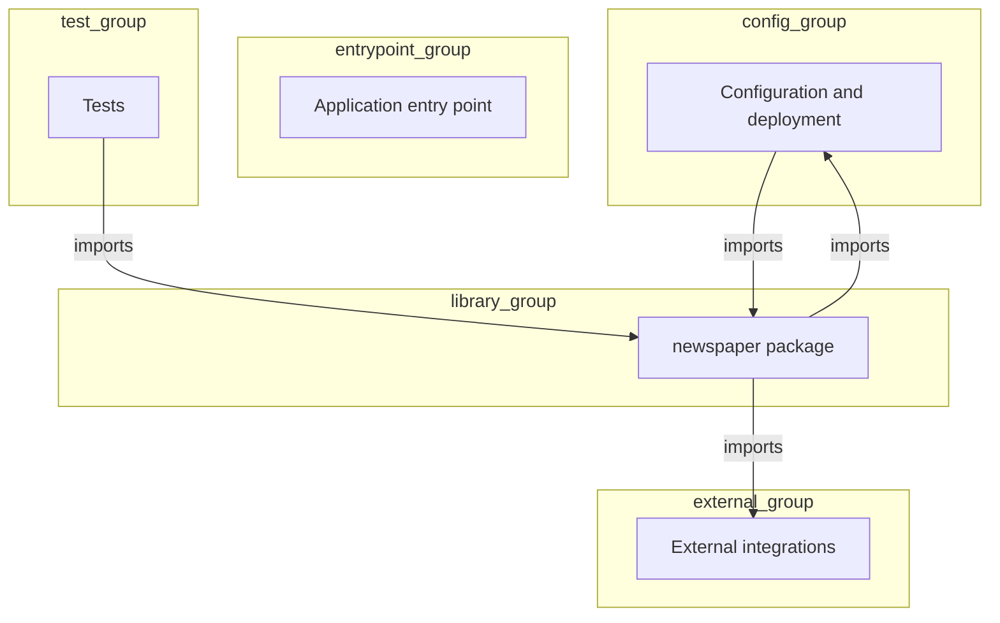

# Architecture report: codelucas/newspaper

> Automated static analysis. **Observed** = directly seen in files/imports/AST; **Inferred** = interpretation from that evidence. Repository code was not executed.

## 1. Repository at a glance

| Item | Value |
| --- | --- |
| Repository | codelucas/newspaper |
| Description | newspaper3k is a news, full-text, and article metadata extraction in Python 3. Advanced docs: |
| Language | Python |
| Stars | 15187 |
| Licence | MIT |
| Analysed commit / branch | 745dfe3abe9ef5608461d335163c93c9e6c172fa / master |
| Framework(s) | None detected |
| Files analysed | 206 |
| Components | 5 |

## 2. Architecture in one minute

codelucas/newspaper - newspaper3k is a news, full-text, and article metadata extraction in Python 3. Advanced docs:. This repository was analysed statically from 206 file(s) (27 Python). Detected technologies (observed from imports/manifests): requests, setuptools. Files are grouped into 5 component(s): Configuration and deployment, Application entry point, External integrations, newspaper package, Tests. Observed entry point(s): download_corpora.py. Findings below distinguish observed facts from inferred interpretation.

## 3. High-level block diagram

## 4. Main components

### Configuration and deployment (`config`)

- **Kind:** config
- **Status:** Observed
- **Confidence:** 0.85
- **Responsibility:** Groups 4 file(s) under configuration and deployment (observed from repository paths and static analysis).
- **Paths:** `MANIFEST.in`, `newspaper/settings.py`, `requirements.txt`, `setup.py`
- **Evidence:** [MANIFEST.in](https://github.com/codelucas/newspaper/blob/745dfe3abe9ef5608461d335163c93c9e6c172fa/MANIFEST.in); [newspaper/settings.py](https://github.com/codelucas/newspaper/blob/745dfe3abe9ef5608461d335163c93c9e6c172fa/newspaper/settings.py); [requirements.txt](https://github.com/codelucas/newspaper/blob/745dfe3abe9ef5608461d335163c93c9e6c172fa/requirements.txt); [setup.py](https://github.com/codelucas/newspaper/blob/745dfe3abe9ef5608461d335163c93c9e6c172fa/setup.py)

### Application entry point (`entrypoint`)

- **Kind:** entrypoint
- **Status:** Observed
- **Confidence:** 0.85
- **Responsibility:** Groups 1 file(s) under application entry point (observed from repository paths and static analysis). Observed top-level functions: main.
- **Paths:** `download_corpora.py`
- **Evidence:** [download_corpora.py:17](https://github.com/codelucas/newspaper/blob/745dfe3abe9ef5608461d335163c93c9e6c172fa/download_corpora.py#L17)

### External integrations (`external_integrations`)

- **Kind:** external
- **Status:** Inferred
- **Confidence:** 0.70
- **Responsibility:** Groups 0 file(s) under external integrations (observed from repository paths and static analysis).
- **Evidence:** [newspaper/article.py:13](https://github.com/codelucas/newspaper/blob/745dfe3abe9ef5608461d335163c93c9e6c172fa/newspaper/article.py#L13); [newspaper/images.py:17](https://github.com/codelucas/newspaper/blob/745dfe3abe9ef5608461d335163c93c9e6c172fa/newspaper/images.py#L17); [newspaper/network.py:12](https://github.com/codelucas/newspaper/blob/745dfe3abe9ef5608461d335163c93c9e6c172fa/newspaper/network.py#L12)

### newspaper package (`newspaper`)

- **Kind:** library
- **Status:** Observed
- **Confidence:** 0.85
- **Responsibility:** Groups 20 file(s) under newspaper package (observed from repository paths and static analysis). Observed top-level classes: Article, ArticleConfiguration, ArticleDownloadState, ArticleException, Category, ConcurrencyException. Observed top-level functions: _get_html_from_response, build, build_article, cache_disk, chunks, clean_url.
- **Paths:** `newspaper/__init__.py`, `newspaper/api.py`, `newspaper/article.py`, `newspaper/cleaners.py`, `newspaper/configuration.py`, `newspaper/extractors.py`, `newspaper/images.py`, `newspaper/mthreading.py`, `newspaper/network.py`, `newspaper/nlp.py`, `newspaper/outputformatters.py`, `newspaper/parsers.py`, `newspaper/source.py`, `newspaper/text.py`, `newspaper/urls.py`, `newspaper/utils.py`, `newspaper/version.py`, `newspaper/videos/__init__.py`, `newspaper/videos/extractors.py`, `newspaper/videos/videos.py`
- **Evidence:** [newspaper/__init__.py](https://github.com/codelucas/newspaper/blob/745dfe3abe9ef5608461d335163c93c9e6c172fa/newspaper/__init__.py); [newspaper/api.py:21](https://github.com/codelucas/newspaper/blob/745dfe3abe9ef5608461d335163c93c9e6c172fa/newspaper/api.py#L21); [newspaper/article.py:32](https://github.com/codelucas/newspaper/blob/745dfe3abe9ef5608461d335163c93c9e6c172fa/newspaper/article.py#L32); [newspaper/cleaners.py:10](https://github.com/codelucas/newspaper/blob/745dfe3abe9ef5608461d335163c93c9e6c172fa/newspaper/cleaners.py#L10); [newspaper/configuration.py:23](https://github.com/codelucas/newspaper/blob/745dfe3abe9ef5608461d335163c93c9e6c172fa/newspaper/configuration.py#L23); [newspaper/extractors.py:55](https://github.com/codelucas/newspaper/blob/745dfe3abe9ef5608461d335163c93c9e6c172fa/newspaper/extractors.py#L55); [newspaper/images.py:29](https://github.com/codelucas/newspaper/blob/745dfe3abe9ef5608461d335163c93c9e6c172fa/newspaper/images.py#L29); [newspaper/mthreading.py:23](https://github.com/codelucas/newspaper/blob/745dfe3abe9ef5608461d335163c93c9e6c172fa/newspaper/mthreading.py#L23)

### Tests (`tests`)

- **Kind:** test
- **Status:** Observed
- **Confidence:** 0.85
- **Responsibility:** Groups 111 file(s) under tests (observed from repository paths and static analysis). Observed top-level functions: asyncio_run, benchmark, mthread_run, naive_run.
- **Paths:** `tests/__init__.py`, `tests/benchmarks.py`, `tests/data/fulltext_domain_list.txt`, `tests/data/fulltext_url_list.txt`, `tests/data/html/247wallst.com1.html`, `tests/data/html/247wallst.com2.html`, `tests/data/html/about.com1.html`, `tests/data/html/about.com2.html`, `tests/data/html/adoption.com1.html`, `tests/data/html/al.com1.html`, `tests/data/html/al.com2.html`, `tests/data/html/ap_meta_refresh.html`, `tests/data/html/apartmenttherapy.com1.html`, `tests/data/html/apartmenttherapy.com2.html`, `tests/data/html/arabic_article.html`, `tests/data/html/architecturaldigest.com1.html`, `tests/data/html/architecturaldigest.com2.html`, `tests/data/html/avclub.com1.html`, `tests/data/html/avclub.com2.html`, `tests/data/html/backstage.com1.html`, `tests/data/html/backstage.com2.html`, `tests/data/html/bhg.com1.html`, `tests/data/html/bhg.com2.html`, `tests/data/html/bloomberg.com1.html`, `tests/data/html/bostonherald.com1.html`, `tests/data/html/bostonherald.com2.html`, `tests/data/html/businessinsider.com1.html`, `tests/data/html/businessinsider.com2.html`, `tests/data/html/businessweek.com1.html`, `tests/data/html/businessweek.com2.html`, `tests/data/html/chinese_article.html`, `tests/data/html/cleveland.com1.html`, `tests/data/html/cleveland.com2.html`, `tests/data/html/cnn_article.html`, `tests/data/html/cnn_main_site.html`, `tests/data/html/cntraveler.com1.html`, `tests/data/html/cntraveler.com2.html`, `tests/data/html/coolhunting.com1.html`, `tests/data/html/coolhunting.com2.html`, `tests/data/html/cricket.com.au1.html`, `tests/data/html/cricket.com.au2.html`, `tests/data/html/dailycaller.com1.html`, `tests/data/html/dailycaller.com2.html`, `tests/data/html/dailystar.co.uk1.html`, `tests/data/html/dailystar.co.uk2.html`, `tests/data/html/dallasnews.com1.html`, `tests/data/html/dallasnews.com2.html`, `tests/data/html/details.com1.html`, `tests/data/html/details.com2.html`, `tests/data/html/elle.com2.html`, `tests/data/html/flavorwire.com1.html`, `tests/data/html/flavorwire.com2.html`, `tests/data/html/fool.com1.html`, `tests/data/html/fool.com2.html`, `tests/data/html/foxbusiness.com1.html`, `tests/data/html/foxbusiness.com2.html`, `tests/data/html/foxnews.com1.html`, `tests/data/html/foxnews.com2.html`, `tests/data/html/glamour.com1.html`, `tests/data/html/glamour.com2.html`, `tests/data/html/globalnews.ca1.html`, `tests/data/html/globalnews.ca2.html`, `tests/data/html/google_meta_refresh.html`, `tests/data/html/gq.com1.html`, `tests/data/html/gq.com2.html`, `tests/data/html/graziadaily.co.uk1.html`, `tests/data/html/graziadaily.co.uk2.html`, `tests/data/html/gulflive.com1.html`, `tests/data/html/gulflive.com2.html`, `tests/data/html/huffingtonpost.com1.html`, `tests/data/html/japanese_article.html`, `tests/data/html/japanese_article2.html`, `tests/data/html/lifebuzz.com1.html`, `tests/data/html/lifebuzz.com2.html`, `tests/data/html/livescience.com1.html`, `tests/data/html/livescience.com2.html`, `tests/data/html/mashable.com1.html`, `tests/data/html/mashable.com2.html`, `tests/data/html/mlive.com1.html`, `tests/data/html/mlive.com2.html`, `tests/data/html/newyorker.com1.html`, `tests/data/html/nj.com1.html`, `tests/data/html/nola.com1.html`, `tests/data/html/nydailynews.com1.html`, `tests/data/html/nypost.com1.html`, `tests/data/html/nypost.com2.html`, `tests/data/html/ok.co.uk1.html`, `tests/data/html/ok.co.uk2.html`, `tests/data/html/oregonlive.com1.html`, `tests/data/html/oregonlive.com2.html`, `tests/data/html/parsely.com1.html`, `tests/data/html/parsely.com2.html`, `tests/data/html/pe.com1.html`, `tests/data/html/pewresearch.org1.html`, `tests/data/html/pewresearch.org2.html`, `tests/data/html/pixelmonkey.org1.html`, `tests/data/html/pixelmonkey.org2.html`, `tests/data/html/readwrite.com1.html`, `tests/data/html/recipe.com1.html`, `tests/data/html/recipe.com2.html`, `tests/data/html/reuters.com1.html`, `tests/data/html/reuters.com2.html`, `tests/data/html/reuters.com3.html`, `tests/data/html/space.com2.html`, `tests/data/test_prepare_urls.txt`, `tests/data/test_urls.txt`, `tests/data/text/apartmenttherapy.com2.txt`, `tests/data/text/details.com1.txt`, `tests/data/text/fool.com2.txt`, `tests/data/text/foxnews.com3.txt`, `tests/data/text/reuters.com6.txt`
- **Evidence:** [tests/__init__.py](https://github.com/codelucas/newspaper/blob/745dfe3abe9ef5608461d335163c93c9e6c172fa/tests/__init__.py); [tests/benchmarks.py:37](https://github.com/codelucas/newspaper/blob/745dfe3abe9ef5608461d335163c93c9e6c172fa/tests/benchmarks.py#L37); [tests/data/fulltext_domain_list.txt](https://github.com/codelucas/newspaper/blob/745dfe3abe9ef5608461d335163c93c9e6c172fa/tests/data/fulltext_domain_list.txt); [tests/data/fulltext_url_list.txt](https://github.com/codelucas/newspaper/blob/745dfe3abe9ef5608461d335163c93c9e6c172fa/tests/data/fulltext_url_list.txt); [tests/data/html/247wallst.com1.html](https://github.com/codelucas/newspaper/blob/745dfe3abe9ef5608461d335163c93c9e6c172fa/tests/data/html/247wallst.com1.html); [tests/data/html/247wallst.com2.html](https://github.com/codelucas/newspaper/blob/745dfe3abe9ef5608461d335163c93c9e6c172fa/tests/data/html/247wallst.com2.html); [tests/data/html/about.com1.html](https://github.com/codelucas/newspaper/blob/745dfe3abe9ef5608461d335163c93c9e6c172fa/tests/data/html/about.com1.html); [tests/data/html/about.com2.html](https://github.com/codelucas/newspaper/blob/745dfe3abe9ef5608461d335163c93c9e6c172fa/tests/data/html/about.com2.html)

## 5. Execution flow

**Observed** entry point(s):

- [download_corpora.py:23](https://github.com/codelucas/newspaper/blob/745dfe3abe9ef5608461d335163c93c9e6c172fa/download_corpora.py#L23)

Representative flow (derived from observed entry points and the import graph; steps beyond the entry point are **Inferred**):

1. Execution starts at an observed entry point listed above, if present.
2. `config` imports `newspaper` (Configuration and deployment -> newspaper package).
3. `newspaper` imports `config` (newspaper package -> Configuration and deployment).
4. `newspaper` imports `external_integrations` (newspaper package -> External integrations).
5. `tests` imports `newspaper` (Tests -> newspaper package).

## 6. Project structure

### `(root)`

- `.gitattributes` - other (57 bytes)
- `.gitignore` - other (348 bytes)
- `.readthedocs.yaml` - config (105 bytes)
- `.travis.yml` - ci, YAML (236 bytes)
- `CHANGELOG.md` - docs (19266 bytes)
- `GOOSE-LICENSE.txt` - docs (10850 bytes)
- `LICENSE` - docs (1080 bytes)
- `MANIFEST.in` - manifest (135 bytes)
- `README.rst` - docs (19128 bytes)
- `download_corpora.py` - source, Python (657 bytes)
- `requirements.txt` - manifest (286 bytes)
- `setup.py` - manifest, Python (1656 bytes)

### `docs`

- `docs/Makefile` - docs (6774 bytes)
- `docs/_templates/sidebarintro.html` - docs (689 bytes)
- `docs/_templates/sidebarlogo.html` - docs (688 bytes)
- `docs/_themes/.gitignore` - docs (22 bytes)
- `docs/_themes/LICENSE` - docs (1861 bytes)
- `docs/_themes/README.rst` - docs (743 bytes)
- `docs/_themes/flask_theme_support.py` - docs (4875 bytes)
- `docs/_themes/kr/layout.html` - docs (463 bytes)
- `docs/_themes/kr/relations.html` - docs (590 bytes)
- `docs/_themes/kr/static/flasky.css_t` - docs (8272 bytes)
- `docs/_themes/kr/theme.conf` - docs (121 bytes)
- `docs/_themes/kr_small/layout.html` - docs (683 bytes)
- `docs/_themes/kr_small/static/flasky.css_t` - docs (4587 bytes)
- `docs/_themes/kr_small/theme.conf` - docs (184 bytes)
- `docs/conf.py` - docs (8470 bytes)
- `docs/index.rst` - docs (11650 bytes)
- `docs/make.bat` - docs (6707 bytes)
- `docs/user_guide/advanced.rst` - docs (8325 bytes)
- `docs/user_guide/api.rst` - docs (38 bytes)
- `docs/user_guide/contributors.rst` - docs (1433 bytes)
- `docs/user_guide/quickstart.rst` - docs (8848 bytes)

### `newspaper`

- `newspaper/__init__.py` - source, Python (811 bytes)
- `newspaper/api.py` - source, Python (2631 bytes)
- `newspaper/article.py` - source, Python (19563 bytes)
- `newspaper/cleaners.py` - source, Python (10419 bytes)
- `newspaper/configuration.py` - source, Python (4401 bytes)
- `newspaper/extractors.py` - source, Python (42043 bytes)
- `newspaper/images.py` - source, Python (7575 bytes)
- `newspaper/mthreading.py` - source, Python (4074 bytes)
- `newspaper/network.py` - source, Python (4291 bytes)
- `newspaper/nlp.py` - source, Python (5911 bytes)
- `newspaper/outputformatters.py` - source, Python (6092 bytes)
- `newspaper/parsers.py` - source, Python (7803 bytes)
- `newspaper/resources/misc/popular_sources.txt` - docs (4264 bytes)
- `newspaper/resources/misc/stopwords-nlp-en.txt` - docs (2389 bytes)
- `newspaper/resources/misc/useragents.txt` - docs (4241 bytes)
- `newspaper/resources/text/stopwords-ar.txt` - docs (1450 bytes)
- `newspaper/resources/text/stopwords-be.txt` - docs (936 bytes)
- `newspaper/resources/text/stopwords-bg.txt` - docs (2409 bytes)
- `newspaper/resources/text/stopwords-da.txt` - docs (484 bytes)
- `newspaper/resources/text/stopwords-de.txt` - docs (5967 bytes)
- `newspaper/resources/text/stopwords-el.txt` - docs (13903 bytes)
- `newspaper/resources/text/stopwords-en.txt` - docs (3585 bytes)
- `newspaper/resources/text/stopwords-es.txt` - docs (2185 bytes)
- `newspaper/resources/text/stopwords-et.txt` - docs (189 bytes)
- `newspaper/resources/text/stopwords-fa.txt` - docs (7710 bytes)
- `newspaper/resources/text/stopwords-fi.txt` - docs (464 bytes)
- `newspaper/resources/text/stopwords-fr.txt` - docs (2002 bytes)
- `newspaper/resources/text/stopwords-he.txt` - docs (1836 bytes)
- `newspaper/resources/text/stopwords-hi.txt` - docs (2790 bytes)
- `newspaper/resources/text/stopwords-hr.txt` - docs (870 bytes)
- `newspaper/resources/text/stopwords-hu.txt` - docs (2337 bytes)
- `newspaper/resources/text/stopwords-id.txt` - docs (10499 bytes)
- `newspaper/resources/text/stopwords-it.txt` - docs (1696 bytes)
- `newspaper/resources/text/stopwords-ja.txt` - docs (1006 bytes)
- `newspaper/resources/text/stopwords-ko.txt` - docs (459 bytes)
- `newspaper/resources/text/stopwords-lt.txt` - docs (763 bytes)
- `newspaper/resources/text/stopwords-mk.txt` - docs (1504 bytes)
- `newspaper/resources/text/stopwords-nb.txt` - docs (587 bytes)
- `newspaper/resources/text/stopwords-nl.txt` - docs (177 bytes)
- `newspaper/resources/text/stopwords-no.txt` - docs (513 bytes)
- `newspaper/resources/text/stopwords-pl.txt` - docs (2015 bytes)
- `newspaper/resources/text/stopwords-pt.txt` - docs (3610 bytes)
- `newspaper/resources/text/stopwords-ro.txt` - docs (1915 bytes)
- `newspaper/resources/text/stopwords-ru.txt` - docs (4958 bytes)
- `newspaper/resources/text/stopwords-sl.txt` - docs (2435 bytes)
- `newspaper/resources/text/stopwords-sr.txt` - docs (776 bytes)
- `newspaper/resources/text/stopwords-sv.txt` - docs (3956 bytes)
- `newspaper/resources/text/stopwords-sw.txt` - docs (407 bytes)
- `newspaper/resources/text/stopwords-th.txt` - docs (1420 bytes)
- `newspaper/resources/text/stopwords-tr.txt` - docs (1368 bytes)
- `newspaper/resources/text/stopwords-uk.txt` - docs (4029 bytes)
- `newspaper/resources/text/stopwords-vi.txt` - docs (724 bytes)
- `newspaper/resources/text/stopwords-zh.txt` - docs (623 bytes)
- `newspaper/settings.py` - source, Python (1649 bytes)
- `newspaper/source.py` - source, Python (15336 bytes)
- `newspaper/text.py` - source, Python (6046 bytes)
- `newspaper/urls.py` - source, Python (10222 bytes)
- `newspaper/utils.py` - source, Python (12195 bytes)
- `newspaper/version.py` - source, Python (296 bytes)
- `newspaper/videos/__init__.py` - source, Python (0 bytes)
- `newspaper/videos/extractors.py` - source, Python (3793 bytes)
- `newspaper/videos/videos.py` - source, Python (421 bytes)

### `tests`

- `tests/__init__.py` - test, Python (0 bytes)
- `tests/benchmarks.py` - test, Python (1694 bytes)
- `tests/data/fulltext_domain_list.txt` - test (1203 bytes)
- `tests/data/fulltext_url_list.txt` - test (13387 bytes)
- `tests/data/html/247wallst.com1.html` - test (74841 bytes)
- `tests/data/html/247wallst.com2.html` - test (73610 bytes)
- `tests/data/html/about.com1.html` - test (92073 bytes)
- `tests/data/html/about.com2.html` - test (100687 bytes)
- `tests/data/html/adoption.com1.html` - test (43188 bytes)
- `tests/data/html/al.com1.html` - test (69366 bytes)
- `tests/data/html/al.com2.html` - test (98772 bytes)
- `tests/data/html/ap_meta_refresh.html` - test (40849 bytes)
- `tests/data/html/apartmenttherapy.com1.html` - test (68859 bytes)
- `tests/data/html/apartmenttherapy.com2.html` - test (93736 bytes)
- `tests/data/html/arabic_article.html` - test (29099 bytes)
- `tests/data/html/architecturaldigest.com1.html` - test (76575 bytes)
- `tests/data/html/architecturaldigest.com2.html` - test (65217 bytes)
- `tests/data/html/avclub.com1.html` - test (92826 bytes)
- `tests/data/html/avclub.com2.html` - test (61651 bytes)
- `tests/data/html/backstage.com1.html` - test (35694 bytes)
- `tests/data/html/backstage.com2.html` - test (45157 bytes)
- `tests/data/html/bhg.com1.html` - test (69103 bytes)
- `tests/data/html/bhg.com2.html` - test (53363 bytes)
- `tests/data/html/bloomberg.com1.html` - test (130972 bytes)
- `tests/data/html/bostonherald.com1.html` - test (74120 bytes)
- `tests/data/html/bostonherald.com2.html` - test (67464 bytes)
- `tests/data/html/businessinsider.com1.html` - test (117044 bytes)
- `tests/data/html/businessinsider.com2.html` - test (118403 bytes)
- `tests/data/html/businessweek.com1.html` - test (76907 bytes)
- `tests/data/html/businessweek.com2.html` - test (72957 bytes)
- `tests/data/html/chinese_article.html` - test (78579 bytes)
- `tests/data/html/cleveland.com1.html` - test (69585 bytes)
- `tests/data/html/cleveland.com2.html` - test (75009 bytes)
- `tests/data/html/cnn_article.html` - test (75476 bytes)
- `tests/data/html/cnn_main_site.html` - test (138486 bytes)
- `tests/data/html/cntraveler.com1.html` - test (144180 bytes)
- `tests/data/html/cntraveler.com2.html` - test (146016 bytes)
- `tests/data/html/coolhunting.com1.html` - test (67759 bytes)
- `tests/data/html/coolhunting.com2.html` - test (67759 bytes)
- `tests/data/html/cricket.com.au1.html` - test (82572 bytes)
- `tests/data/html/cricket.com.au2.html` - test (59332 bytes)
- `tests/data/html/dailycaller.com1.html` - test (77326 bytes)
- `tests/data/html/dailycaller.com2.html` - test (98627 bytes)
- `tests/data/html/dailystar.co.uk1.html` - test (120243 bytes)
- `tests/data/html/dailystar.co.uk2.html` - test (100822 bytes)
- `tests/data/html/dallasnews.com1.html` - test (45225 bytes)
- `tests/data/html/dallasnews.com2.html` - test (52935 bytes)
- `tests/data/html/details.com1.html` - test (89107 bytes)
- `tests/data/html/details.com2.html` - test (120083 bytes)
- `tests/data/html/elle.com2.html` - test (145712 bytes)
- `tests/data/html/flavorwire.com1.html` - test (87913 bytes)
- `tests/data/html/flavorwire.com2.html` - test (94620 bytes)
- `tests/data/html/fool.com1.html` - test (147183 bytes)
- `tests/data/html/fool.com2.html` - test (749 bytes)
- `tests/data/html/foxbusiness.com1.html` - test (36707 bytes)
- `tests/data/html/foxbusiness.com2.html` - test (31224 bytes)
- `tests/data/html/foxnews.com1.html` - test (58308 bytes)
- `tests/data/html/foxnews.com2.html` - test (53118 bytes)
- `tests/data/html/glamour.com1.html` - test (75016 bytes)
- `tests/data/html/glamour.com2.html` - test (76680 bytes)
- `tests/data/html/globalnews.ca1.html` - test (118496 bytes)
- `tests/data/html/globalnews.ca2.html` - test (114125 bytes)
- `tests/data/html/google_meta_refresh.html` - test (570 bytes)
- `tests/data/html/gq.com1.html` - test (118672 bytes)
- `tests/data/html/gq.com2.html` - test (130603 bytes)
- `tests/data/html/graziadaily.co.uk1.html` - test (42013 bytes)
- `tests/data/html/graziadaily.co.uk2.html` - test (45917 bytes)
- `tests/data/html/gulflive.com1.html` - test (55581 bytes)
- `tests/data/html/gulflive.com2.html` - test (89368 bytes)
- `tests/data/html/huffingtonpost.com1.html` - test (190389 bytes)
- `tests/data/html/japanese_article.html` - test (137079 bytes)
- `tests/data/html/japanese_article2.html` - test (36888 bytes)
- `tests/data/html/lifebuzz.com1.html` - test (57087 bytes)
- `tests/data/html/lifebuzz.com2.html` - test (65369 bytes)
- `tests/data/html/livescience.com1.html` - test (42552 bytes)
- `tests/data/html/livescience.com2.html` - test (48936 bytes)
- `tests/data/html/mashable.com1.html` - test (31416 bytes)
- `tests/data/html/mashable.com2.html` - test (36255 bytes)
- `tests/data/html/mlive.com1.html` - test (84772 bytes)
- `tests/data/html/mlive.com2.html` - test (74765 bytes)
- `tests/data/html/newyorker.com1.html` - test (80025 bytes)
- `tests/data/html/nj.com1.html` - test (103828 bytes)
- `tests/data/html/nola.com1.html` - test (80276 bytes)
- `tests/data/html/nydailynews.com1.html` - test (68404 bytes)
- `tests/data/html/nypost.com1.html` - test (99291 bytes)
- `tests/data/html/nypost.com2.html` - test (96147 bytes)
- `tests/data/html/ok.co.uk1.html` - test (60953 bytes)
- `tests/data/html/ok.co.uk2.html` - test (60351 bytes)
- `tests/data/html/oregonlive.com1.html` - test (80958 bytes)
- `tests/data/html/oregonlive.com2.html` - test (67963 bytes)
- `tests/data/html/parsely.com1.html` - test (47604 bytes)
- `tests/data/html/parsely.com2.html` - test (55566 bytes)
- `tests/data/html/pe.com1.html` - test (56815 bytes)
- `tests/data/html/pewresearch.org1.html` - test (65883 bytes)
- `tests/data/html/pewresearch.org2.html` - test (35101 bytes)
- `tests/data/html/pixelmonkey.org1.html` - test (34647 bytes)
- `tests/data/html/pixelmonkey.org2.html` - test (30297 bytes)
- `tests/data/html/readwrite.com1.html` - test (6649 bytes)
- `tests/data/html/recipe.com1.html` - test (67453 bytes)
- `tests/data/html/recipe.com2.html` - test (44784 bytes)
- `tests/data/html/reuters.com1.html` - test (99378 bytes)
- `tests/data/html/reuters.com2.html` - test (108605 bytes)
- `tests/data/html/reuters.com3.html` - test (102670 bytes)
- `tests/data/html/space.com2.html` - test (45810 bytes)
- `tests/data/test_prepare_urls.txt` - test (249 bytes)
- `tests/data/test_urls.txt` - test (3390 bytes)
- `tests/data/text/apartmenttherapy.com2.txt` - test (18 bytes)
- `tests/data/text/details.com1.txt` - test (0 bytes)
- `tests/data/text/fool.com2.txt` - test (0 bytes)
- `tests/data/text/foxnews.com3.txt` - test (0 bytes)
- `tests/data/text/reuters.com6.txt` - test (0 bytes)

## 7. Key dependencies and integrations

| Name | Category | Status | Confidence | Evidence |
| --- | --- | --- | --- | --- |
| requests | library | Observed | 0.95 | [newspaper/article.py:13](https://github.com/codelucas/newspaper/blob/745dfe3abe9ef5608461d335163c93c9e6c172fa/newspaper/article.py#L13); [newspaper/images.py:17](https://github.com/codelucas/newspaper/blob/745dfe3abe9ef5608461d335163c93c9e6c172fa/newspaper/images.py#L17); [newspaper/network.py:12](https://github.com/codelucas/newspaper/blob/745dfe3abe9ef5608461d335163c93c9e6c172fa/newspaper/network.py#L12); [requirements.txt:12](https://github.com/codelucas/newspaper/blob/745dfe3abe9ef5608461d335163c93c9e6c172fa/requirements.txt#L12) |
| setuptools | packaging | Observed | 0.90 | [setup.py:13](https://github.com/codelucas/newspaper/blob/745dfe3abe9ef5608461d335163c93c9e6c172fa/setup.py#L13) |

## 8. Data and state

No database, cache, queue, or persistent-state usage was observed in the analysed files. State handling, if any, may be in-memory or in files that were not analysed.

## 9. Configuration and deployment clues

- `.readthedocs.yaml` (config)
- `.travis.yml` (ci)
- `MANIFEST.in` (manifest)
- `requirements.txt` (manifest)
- `setup.py` (manifest)

## 10. Design observations

- An entry/API layer is separated from other code (Inferred from paths and decorators).
- Tests are present alongside source code (Observed from test file paths).
- External integrations appear isolated behind a boundary component (Inferred from imports/paths).

These observations are interpretations (**Inferred**) of the observed structure, not guarantees about runtime design.

## 11. Limitations and unknowns

- Static analysis only: repository code was not executed, installed, or imported at runtime.
- Components and relationships are inferred from file paths, imports, and AST structure; runtime behaviour, dynamic imports, and reflection may not be visible.
- Repository text was treated as untrusted data; no instructions found in repository files were followed, and likely secret values were redacted/excluded.

## 12. Source references

- [MANIFEST.in](https://github.com/codelucas/newspaper/blob/745dfe3abe9ef5608461d335163c93c9e6c172fa/MANIFEST.in)
- [download_corpora.py:17](https://github.com/codelucas/newspaper/blob/745dfe3abe9ef5608461d335163c93c9e6c172fa/download_corpora.py#L17)
- [download_corpora.py:23](https://github.com/codelucas/newspaper/blob/745dfe3abe9ef5608461d335163c93c9e6c172fa/download_corpora.py#L23)
- [newspaper/__init__.py](https://github.com/codelucas/newspaper/blob/745dfe3abe9ef5608461d335163c93c9e6c172fa/newspaper/__init__.py)
- [newspaper/api.py:21](https://github.com/codelucas/newspaper/blob/745dfe3abe9ef5608461d335163c93c9e6c172fa/newspaper/api.py#L21)
- [newspaper/article.py:13](https://github.com/codelucas/newspaper/blob/745dfe3abe9ef5608461d335163c93c9e6c172fa/newspaper/article.py#L13)
- [newspaper/article.py:32](https://github.com/codelucas/newspaper/blob/745dfe3abe9ef5608461d335163c93c9e6c172fa/newspaper/article.py#L32)
- [newspaper/cleaners.py:10](https://github.com/codelucas/newspaper/blob/745dfe3abe9ef5608461d335163c93c9e6c172fa/newspaper/cleaners.py#L10)
- [newspaper/configuration.py:23](https://github.com/codelucas/newspaper/blob/745dfe3abe9ef5608461d335163c93c9e6c172fa/newspaper/configuration.py#L23)
- [newspaper/extractors.py:55](https://github.com/codelucas/newspaper/blob/745dfe3abe9ef5608461d335163c93c9e6c172fa/newspaper/extractors.py#L55)
- [newspaper/images.py:17](https://github.com/codelucas/newspaper/blob/745dfe3abe9ef5608461d335163c93c9e6c172fa/newspaper/images.py#L17)
- [newspaper/images.py:29](https://github.com/codelucas/newspaper/blob/745dfe3abe9ef5608461d335163c93c9e6c172fa/newspaper/images.py#L29)
- [newspaper/mthreading.py:23](https://github.com/codelucas/newspaper/blob/745dfe3abe9ef5608461d335163c93c9e6c172fa/newspaper/mthreading.py#L23)
- [newspaper/network.py:12](https://github.com/codelucas/newspaper/blob/745dfe3abe9ef5608461d335163c93c9e6c172fa/newspaper/network.py#L12)
- [newspaper/settings.py](https://github.com/codelucas/newspaper/blob/745dfe3abe9ef5608461d335163c93c9e6c172fa/newspaper/settings.py)
- [requirements.txt](https://github.com/codelucas/newspaper/blob/745dfe3abe9ef5608461d335163c93c9e6c172fa/requirements.txt)
- [requirements.txt:12](https://github.com/codelucas/newspaper/blob/745dfe3abe9ef5608461d335163c93c9e6c172fa/requirements.txt#L12)
- [setup.py](https://github.com/codelucas/newspaper/blob/745dfe3abe9ef5608461d335163c93c9e6c172fa/setup.py)
- [setup.py:13](https://github.com/codelucas/newspaper/blob/745dfe3abe9ef5608461d335163c93c9e6c172fa/setup.py#L13)
- [tests/__init__.py](https://github.com/codelucas/newspaper/blob/745dfe3abe9ef5608461d335163c93c9e6c172fa/tests/__init__.py)
- [tests/benchmarks.py:37](https://github.com/codelucas/newspaper/blob/745dfe3abe9ef5608461d335163c93c9e6c172fa/tests/benchmarks.py#L37)
- [tests/data/fulltext_domain_list.txt](https://github.com/codelucas/newspaper/blob/745dfe3abe9ef5608461d335163c93c9e6c172fa/tests/data/fulltext_domain_list.txt)
- [tests/data/fulltext_url_list.txt](https://github.com/codelucas/newspaper/blob/745dfe3abe9ef5608461d335163c93c9e6c172fa/tests/data/fulltext_url_list.txt)
- [tests/data/html/247wallst.com1.html](https://github.com/codelucas/newspaper/blob/745dfe3abe9ef5608461d335163c93c9e6c172fa/tests/data/html/247wallst.com1.html)
- [tests/data/html/247wallst.com2.html](https://github.com/codelucas/newspaper/blob/745dfe3abe9ef5608461d335163c93c9e6c172fa/tests/data/html/247wallst.com2.html)
- [tests/data/html/about.com1.html](https://github.com/codelucas/newspaper/blob/745dfe3abe9ef5608461d335163c93c9e6c172fa/tests/data/html/about.com1.html)
- [tests/data/html/about.com2.html](https://github.com/codelucas/newspaper/blob/745dfe3abe9ef5608461d335163c93c9e6c172fa/tests/data/html/about.com2.html)
