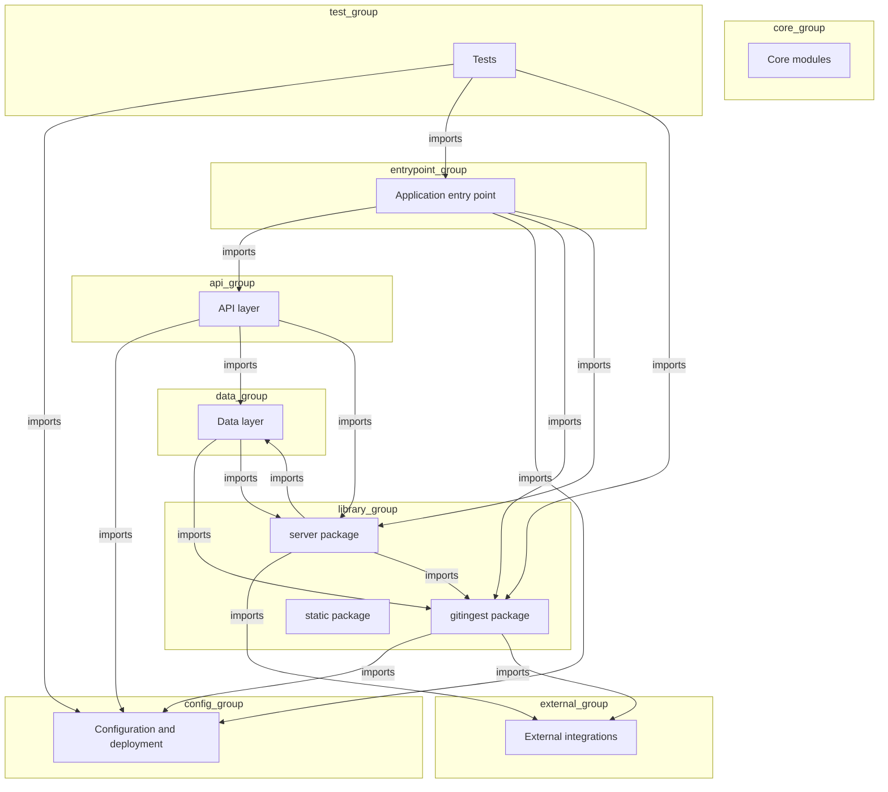

# Architecture report: coderamp-labs/gitingest

> Automated static analysis. **Observed** = directly seen in files/imports/AST; **Inferred** = interpretation from that evidence. Repository code was not executed.

## 1. Repository at a glance

| Item | Value |
| --- | --- |
| Repository | coderamp-labs/gitingest |
| Description | Replace 'hub' with 'ingest' in any GitHub URL to get a prompt-friendly extract of a codebase  |
| Language | Python |
| Stars | 16139 |
| Licence | MIT |
| Analysed commit / branch | 4e259a02fe72115bee538271622f1234a81c8e1a / main |
| Framework(s) | FastAPI, Starlette |
| Files analysed | 120 |
| Components | 10 |

## 2. Architecture in one minute

coderamp-labs/gitingest - Replace 'hub' with 'ingest' in any GitHub URL to get a prompt-friendly extract of a codebase . This repository was analysed statically from 120 file(s) (57 Python). Detected technologies (observed from imports/manifests): GitHub Actions, FastAPI, Starlette, AWS (boto3), Click, httpx. Files are grouped into 10 component(s): API layer, Configuration and deployment, Core modules, Data layer, Application entry point, External integrations, gitingest package, server package. Observed entry point(s): src/gitingest/__main__.py, src/server/__main__.py, src/server/main.py. Findings below distinguish observed facts from inferred interpretation.

## 3. High-level block diagram

## 4. Main components

### API layer (`api_layer`)

- **Kind:** api
- **Status:** Observed
- **Confidence:** 0.85
- **Responsibility:** Groups 4 file(s) under api layer (observed from repository paths and static analysis). Observed routes: GET /{full_path:path}, GET /, POST /api/ingest, GET /api/{user}/{repository}, GET /api/download/file/{ingest_id}. Observed top-level functions: api_ingest, api_ingest_get, catch_all, download_ingest, home.
- **Paths:** `src/server/routers/__init__.py`, `src/server/routers/dynamic.py`, `src/server/routers/index.py`, `src/server/routers/ingest.py`
- **Evidence:** [src/server/routers/__init__.py](https://github.com/coderamp-labs/gitingest/blob/4e259a02fe72115bee538271622f1234a81c8e1a/src/server/routers/__init__.py); [src/server/routers/dynamic.py:12](https://github.com/coderamp-labs/gitingest/blob/4e259a02fe72115bee538271622f1234a81c8e1a/src/server/routers/dynamic.py#L12); [src/server/routers/index.py:12](https://github.com/coderamp-labs/gitingest/blob/4e259a02fe72115bee538271622f1234a81c8e1a/src/server/routers/index.py#L12); [src/server/routers/ingest.py:24](https://github.com/coderamp-labs/gitingest/blob/4e259a02fe72115bee538271622f1234a81c8e1a/src/server/routers/ingest.py#L24)

### Configuration and deployment (`config`)

- **Kind:** config
- **Status:** Observed
- **Confidence:** 0.85
- **Responsibility:** Groups 8 file(s) under configuration and deployment (observed from repository paths and static analysis).
- **Paths:** `Dockerfile`, `compose.yml`, `pyproject.toml`, `release-please-config.json`, `renovate.json`, `requirements-dev.txt`, `requirements.txt`, `src/gitingest/config.py`
- **Evidence:** [Dockerfile](https://github.com/coderamp-labs/gitingest/blob/4e259a02fe72115bee538271622f1234a81c8e1a/Dockerfile); [compose.yml](https://github.com/coderamp-labs/gitingest/blob/4e259a02fe72115bee538271622f1234a81c8e1a/compose.yml); [pyproject.toml](https://github.com/coderamp-labs/gitingest/blob/4e259a02fe72115bee538271622f1234a81c8e1a/pyproject.toml); [release-please-config.json](https://github.com/coderamp-labs/gitingest/blob/4e259a02fe72115bee538271622f1234a81c8e1a/release-please-config.json); [renovate.json](https://github.com/coderamp-labs/gitingest/blob/4e259a02fe72115bee538271622f1234a81c8e1a/renovate.json); [requirements-dev.txt](https://github.com/coderamp-labs/gitingest/blob/4e259a02fe72115bee538271622f1234a81c8e1a/requirements-dev.txt); [requirements.txt](https://github.com/coderamp-labs/gitingest/blob/4e259a02fe72115bee538271622f1234a81c8e1a/requirements.txt); [src/gitingest/config.py](https://github.com/coderamp-labs/gitingest/blob/4e259a02fe72115bee538271622f1234a81c8e1a/src/gitingest/config.py)

### Core modules (`core`)

- **Kind:** core
- **Status:** Observed
- **Confidence:** 0.85
- **Responsibility:** Groups 1 file(s) under core modules (observed from repository paths and static analysis).
- **Paths:** `eslint.config.cjs`
- **Evidence:** [eslint.config.cjs](https://github.com/coderamp-labs/gitingest/blob/4e259a02fe72115bee538271622f1234a81c8e1a/eslint.config.cjs)

### Data layer (`data_layer`)

- **Kind:** data
- **Status:** Observed
- **Confidence:** 0.85
- **Responsibility:** Groups 1 file(s) under data layer (observed from repository paths and static analysis). Observed top-level classes: IngestErrorResponse, IngestRequest, IngestSuccessResponse, PatternType, QueryForm, S3Metadata.
- **Paths:** `src/server/models.py`
- **Evidence:** [src/server/models.py:18](https://github.com/coderamp-labs/gitingest/blob/4e259a02fe72115bee538271622f1234a81c8e1a/src/server/models.py#L18)

### Application entry point (`entrypoint`)

- **Kind:** entrypoint
- **Status:** Observed
- **Confidence:** 0.85
- **Responsibility:** Groups 4 file(s) under application entry point (observed from repository paths and static analysis). Observed application object created via FastAPI. Observed routes: GET /health, HEAD /, GET /robots.txt, GET /llms.txt, GET /docs. Observed top-level classes: _CLIArgs. Observed top-level functions: _async_main, custom_swagger_ui, head_root, health_check, llm_txt, main.
- **Paths:** `src/gitingest/__main__.py`, `src/server/__main__.py`, `src/server/main.py`, `src/server/metrics_server.py`
- **Evidence:** [src/gitingest/__main__.py:22](https://github.com/coderamp-labs/gitingest/blob/4e259a02fe72115bee538271622f1234a81c8e1a/src/gitingest/__main__.py#L22); [src/server/__main__.py](https://github.com/coderamp-labs/gitingest/blob/4e259a02fe72115bee538271622f1234a81c8e1a/src/server/__main__.py); [src/server/main.py:59](https://github.com/coderamp-labs/gitingest/blob/4e259a02fe72115bee538271622f1234a81c8e1a/src/server/main.py#L59); [src/server/metrics_server.py:14](https://github.com/coderamp-labs/gitingest/blob/4e259a02fe72115bee538271622f1234a81c8e1a/src/server/metrics_server.py#L14)

### External integrations (`external_integrations`)

- **Kind:** external
- **Status:** Inferred
- **Confidence:** 0.70
- **Responsibility:** Groups 0 file(s) under external integrations (observed from repository paths and static analysis).
- **Evidence:** [src/gitingest/output_formatter.py:8](https://github.com/coderamp-labs/gitingest/blob/4e259a02fe72115bee538271622f1234a81c8e1a/src/gitingest/output_formatter.py#L8); [src/server/s3_utils.py:11](https://github.com/coderamp-labs/gitingest/blob/4e259a02fe72115bee538271622f1234a81c8e1a/src/server/s3_utils.py#L11)

### gitingest package (`gitingest`)

- **Kind:** library
- **Status:** Observed
- **Confidence:** 0.85
- **Responsibility:** Groups 25 file(s) under gitingest package (observed from repository paths and static analysis). Observed top-level classes: AsyncTimeoutError, CloneConfig, FileSystemNode, FileSystemNodeType, FileSystemStats, IngestionQuery. Observed top-level functions: _apply_gitignores, _clone_repo_if_remote, _configure_branch_or_tag, _create_summary_prefix, _create_tree_structure, _decodes.
- **Paths:** `src/gitingest/__init__.py`, `src/gitingest/clone.py`, `src/gitingest/entrypoint.py`, `src/gitingest/ingestion.py`, `src/gitingest/output_formatter.py`, `src/gitingest/query_parser.py`, `src/gitingest/schemas/__init__.py`, `src/gitingest/schemas/cloning.py`, `src/gitingest/schemas/filesystem.py`, `src/gitingest/schemas/ingestion.py`, `src/gitingest/utils/__init__.py`, `src/gitingest/utils/auth.py`, `src/gitingest/utils/compat_func.py`, `src/gitingest/utils/compat_typing.py`, `src/gitingest/utils/exceptions.py`, `src/gitingest/utils/file_utils.py`, `src/gitingest/utils/git_utils.py`, `src/gitingest/utils/ignore_patterns.py`, `src/gitingest/utils/ingestion_utils.py`, `src/gitingest/utils/logging_config.py`, `src/gitingest/utils/notebook.py`, `src/gitingest/utils/os_utils.py`, `src/gitingest/utils/pattern_utils.py`, `src/gitingest/utils/query_parser_utils.py`, `src/gitingest/utils/timeout_wrapper.py`
- **Evidence:** [src/gitingest/__init__.py](https://github.com/coderamp-labs/gitingest/blob/4e259a02fe72115bee538271622f1234a81c8e1a/src/gitingest/__init__.py); [src/gitingest/clone.py:32](https://github.com/coderamp-labs/gitingest/blob/4e259a02fe72115bee538271622f1234a81c8e1a/src/gitingest/clone.py#L32); [src/gitingest/entrypoint.py:35](https://github.com/coderamp-labs/gitingest/blob/4e259a02fe72115bee538271622f1234a81c8e1a/src/gitingest/entrypoint.py#L35); [src/gitingest/ingestion.py:21](https://github.com/coderamp-labs/gitingest/blob/4e259a02fe72115bee538271622f1234a81c8e1a/src/gitingest/ingestion.py#L21); [src/gitingest/output_formatter.py:27](https://github.com/coderamp-labs/gitingest/blob/4e259a02fe72115bee538271622f1234a81c8e1a/src/gitingest/output_formatter.py#L27); [src/gitingest/query_parser.py:25](https://github.com/coderamp-labs/gitingest/blob/4e259a02fe72115bee538271622f1234a81c8e1a/src/gitingest/query_parser.py#L25); [src/gitingest/schemas/__init__.py](https://github.com/coderamp-labs/gitingest/blob/4e259a02fe72115bee538271622f1234a81c8e1a/src/gitingest/schemas/__init__.py); [src/gitingest/schemas/cloning.py:8](https://github.com/coderamp-labs/gitingest/blob/4e259a02fe72115bee538271622f1234a81c8e1a/src/gitingest/schemas/cloning.py#L8)

### server package (`server`)

- **Kind:** library
- **Status:** Observed
- **Confidence:** 0.85
- **Responsibility:** Groups 7 file(s) under server package (observed from repository paths and static analysis). Observed top-level classes: Colors, S3UploadError. Observed top-level functions: _build_s3_url, _check_object_tags, _check_s3_cache, _cleanup_repository, _generate_digest_url, _perform_ingestion.
- **Paths:** `src/server/__init__.py`, `src/server/form_types.py`, `src/server/query_processor.py`, `src/server/routers_utils.py`, `src/server/s3_utils.py`, `src/server/server_config.py`, `src/server/server_utils.py`
- **Evidence:** [src/server/__init__.py](https://github.com/coderamp-labs/gitingest/blob/4e259a02fe72115bee538271622f1234a81c8e1a/src/server/__init__.py); [src/server/form_types.py](https://github.com/coderamp-labs/gitingest/blob/4e259a02fe72115bee538271622f1234a81c8e1a/src/server/form_types.py); [src/server/query_processor.py:35](https://github.com/coderamp-labs/gitingest/blob/4e259a02fe72115bee538271622f1234a81c8e1a/src/server/query_processor.py#L35); [src/server/routers_utils.py:20](https://github.com/coderamp-labs/gitingest/blob/4e259a02fe72115bee538271622f1234a81c8e1a/src/server/routers_utils.py#L20); [src/server/s3_utils.py:30](https://github.com/coderamp-labs/gitingest/blob/4e259a02fe72115bee538271622f1234a81c8e1a/src/server/s3_utils.py#L30); [src/server/server_config.py:31](https://github.com/coderamp-labs/gitingest/blob/4e259a02fe72115bee538271622f1234a81c8e1a/src/server/server_config.py#L31); [src/server/server_utils.py:18](https://github.com/coderamp-labs/gitingest/blob/4e259a02fe72115bee538271622f1234a81c8e1a/src/server/server_utils.py#L18)

### static package (`static`)

- **Kind:** library
- **Status:** Observed
- **Confidence:** 0.85
- **Responsibility:** Groups 6 file(s) under static package (observed from repository paths and static analysis).
- **Paths:** `src/static/js/git.js`, `src/static/js/git_form.js`, `src/static/js/index.js`, `src/static/js/navbar.js`, `src/static/js/posthog.js`, `src/static/js/utils.js`
- **Evidence:** [src/static/js/git.js](https://github.com/coderamp-labs/gitingest/blob/4e259a02fe72115bee538271622f1234a81c8e1a/src/static/js/git.js); [src/static/js/git_form.js](https://github.com/coderamp-labs/gitingest/blob/4e259a02fe72115bee538271622f1234a81c8e1a/src/static/js/git_form.js); [src/static/js/index.js](https://github.com/coderamp-labs/gitingest/blob/4e259a02fe72115bee538271622f1234a81c8e1a/src/static/js/index.js); [src/static/js/navbar.js](https://github.com/coderamp-labs/gitingest/blob/4e259a02fe72115bee538271622f1234a81c8e1a/src/static/js/navbar.js); [src/static/js/posthog.js](https://github.com/coderamp-labs/gitingest/blob/4e259a02fe72115bee538271622f1234a81c8e1a/src/static/js/posthog.js); [src/static/js/utils.js](https://github.com/coderamp-labs/gitingest/blob/4e259a02fe72115bee538271622f1234a81c8e1a/src/static/js/utils.js)

### Tests (`tests`)

- **Kind:** test
- **Status:** Observed
- **Confidence:** 0.85
- **Responsibility:** Groups 16 file(s) under tests (observed from repository paths and static analysis). Observed top-level classes: PatternScenario. Observed top-level functions: _assert_basic_repo_fields, _calculate_expected_lines, _fake_run_command, _invoke_isolated_cli_runner, _setup_gitpython_mocks, cleanup_tmp_dir.
- **Paths:** `tests/.pylintrc`, `tests/__init__.py`, `tests/conftest.py`, `tests/query_parser/__init__.py`, `tests/query_parser/test_git_host_agnostic.py`, `tests/query_parser/test_query_parser.py`, `tests/server/__init__.py`, `tests/server/test_flow_integration.py`, `tests/test_cli.py`, `tests/test_clone.py`, `tests/test_git_utils.py`, `tests/test_gitignore_feature.py`, `tests/test_ingestion.py`, `tests/test_notebook_utils.py`, `tests/test_pattern_utils.py`, `tests/test_summary.py`
- **Evidence:** [tests/.pylintrc](https://github.com/coderamp-labs/gitingest/blob/4e259a02fe72115bee538271622f1234a81c8e1a/tests/.pylintrc); [tests/__init__.py](https://github.com/coderamp-labs/gitingest/blob/4e259a02fe72115bee538271622f1234a81c8e1a/tests/__init__.py); [tests/conftest.py:30](https://github.com/coderamp-labs/gitingest/blob/4e259a02fe72115bee538271622f1234a81c8e1a/tests/conftest.py#L30); [tests/query_parser/__init__.py](https://github.com/coderamp-labs/gitingest/blob/4e259a02fe72115bee538271622f1234a81c8e1a/tests/query_parser/__init__.py); [tests/query_parser/test_git_host_agnostic.py:31](https://github.com/coderamp-labs/gitingest/blob/4e259a02fe72115bee538271622f1234a81c8e1a/tests/query_parser/test_git_host_agnostic.py#L31); [tests/query_parser/test_query_parser.py:42](https://github.com/coderamp-labs/gitingest/blob/4e259a02fe72115bee538271622f1234a81c8e1a/tests/query_parser/test_query_parser.py#L42); [tests/server/__init__.py](https://github.com/coderamp-labs/gitingest/blob/4e259a02fe72115bee538271622f1234a81c8e1a/tests/server/__init__.py); [tests/server/test_flow_integration.py:21](https://github.com/coderamp-labs/gitingest/blob/4e259a02fe72115bee538271622f1234a81c8e1a/tests/server/test_flow_integration.py#L21)

## 5. Execution flow

**Observed** entry point(s):

- [src/gitingest/__main__.py](https://github.com/coderamp-labs/gitingest/blob/4e259a02fe72115bee538271622f1234a81c8e1a/src/gitingest/__main__.py)
- [src/server/__main__.py:12](https://github.com/coderamp-labs/gitingest/blob/4e259a02fe72115bee538271622f1234a81c8e1a/src/server/__main__.py#L12)
- [src/server/main.py:59](https://github.com/coderamp-labs/gitingest/blob/4e259a02fe72115bee538271622f1234a81c8e1a/src/server/main.py#L59)
- [src/server/metrics_server.py:14](https://github.com/coderamp-labs/gitingest/blob/4e259a02fe72115bee538271622f1234a81c8e1a/src/server/metrics_server.py#L14)
- [src/static/js/index.js](https://github.com/coderamp-labs/gitingest/blob/4e259a02fe72115bee538271622f1234a81c8e1a/src/static/js/index.js)

**Observed** routes (from decorators):

- `GET /health` -> `health_check` in `src/server/main.py:96`
- `HEAD /` -> `head_root` in `src/server/main.py:108`
- `GET /robots.txt` -> `robots` in `src/server/main.py:124`
- `GET /llms.txt` -> `llm_txt` in `src/server/main.py:140`
- `GET /docs` -> `custom_swagger_ui` in `src/server/main.py:156`
- `GET /api` -> `openapi_json_get` in `src/server/main.py:178`
- `API_ROUTE /api` -> `openapi_json` in `src/server/main.py:195`
- `API_ROUTE /api/` -> `openapi_json` in `src/server/main.py:195`
- `GET /metrics` -> `metrics` in `src/server/metrics_server.py:23`
- `GET /{full_path:path}` -> `catch_all` in `src/server/routers/dynamic.py:12`
- `GET /` -> `home` in `src/server/routers/index.py:12`
- `POST /api/ingest` -> `api_ingest` in `src/server/routers/ingest.py:24`
- `GET /api/{user}/{repository}` -> `api_ingest_get` in `src/server/routers/ingest.py:57`
- `GET /api/download/file/{ingest_id}` -> `download_ingest` in `src/server/routers/ingest.py:98`

Representative flow (derived from observed entry points and the import graph; steps beyond the entry point are **Inferred**):

1. Execution starts at an observed entry point listed above, if present.
2. `api_layer` imports `config` (API layer -> Configuration and deployment).
3. `api_layer` imports `data_layer` (API layer -> Data layer).
4. `api_layer` imports `server` (API layer -> server package).
5. `data_layer` imports `gitingest` (Data layer -> gitingest package).
6. `data_layer` imports `server` (Data layer -> server package).
7. `entrypoint` imports `api_layer` (Application entry point -> API layer).
8. `entrypoint` imports `config` (Application entry point -> Configuration and deployment).
9. `entrypoint` imports `gitingest` (Application entry point -> gitingest package).

## 6. Project structure

### `(root)`

- `.dockerignore` - container (1009 bytes)
- `.env.example` - config (2332 bytes)
- `.gitignore` - other (470 bytes)
- `.pre-commit-config.yaml` - config (5111 bytes)
- `.release-please-manifest.json` - config (14 bytes)
- `CHANGELOG.md` - docs (7109 bytes)
- `CODE_OF_CONDUCT.md` - docs (5206 bytes)
- `CONTRIBUTING.md` - docs (2361 bytes)
- `Dockerfile` - container (1475 bytes)
- `LICENSE` - docs (1072 bytes)
- `README.md` - docs (14527 bytes)
- `SECURITY.md` - docs (274 bytes)
- `compose.yml` - container (3777 bytes)
- `eslint.config.cjs` - source, JavaScript (2366 bytes)
- `pyproject.toml` - manifest (3572 bytes)
- `release-please-config.json` - config (209 bytes)
- `renovate.json` - config (114 bytes)
- `requirements-dev.txt` - manifest (95 bytes)
- `requirements.txt` - manifest (461 bytes)

### `.docker`

- `.docker/minio/setup.sh` - source, Shell (1215 bytes)

### `.github`

- `.github/ISSUE_TEMPLATE/bug_report.yml` - config (4420 bytes)
- `.github/ISSUE_TEMPLATE/feature_request.yml` - config (2958 bytes)
- `.github/workflows/ci.yml` - ci, YAML (1831 bytes)
- `.github/workflows/codeql.yml` - ci, YAML (2932 bytes)
- `.github/workflows/dependency-review.yml` - ci, YAML (1001 bytes)
- `.github/workflows/deploy-pr.yml` - ci, YAML (5740 bytes)
- `.github/workflows/docker-build.ecr.yml` - ci, YAML (4235 bytes)
- `.github/workflows/docker-build.ghcr.yml` - ci, YAML (5118 bytes)
- `.github/workflows/pr-title-check.yml` - ci, YAML (657 bytes)
- `.github/workflows/publish_to_pypi.yml` - ci, YAML (1847 bytes)
- `.github/workflows/rebase-needed.yml` - ci, YAML (841 bytes)
- `.github/workflows/release-please.yml` - ci, YAML (728 bytes)
- `.github/workflows/scorecard.yml` - ci, YAML (1289 bytes)
- `.github/workflows/stale.yml` - ci, YAML (1295 bytes)

### `.vscode`

- `.vscode/launch.json` - config (265 bytes)

### `src`

- `src/gitingest/__init__.py` - source, Python (162 bytes)
- `src/gitingest/__main__.py` - source, Python (6600 bytes)
- `src/gitingest/clone.py` - source, Python (6233 bytes)
- `src/gitingest/config.py` - source, Python (497 bytes)
- `src/gitingest/entrypoint.py` - source, Python (13066 bytes)
- `src/gitingest/ingestion.py` - source, Python (10789 bytes)
- `src/gitingest/output_formatter.py` - source, Python (6931 bytes)
- `src/gitingest/query_parser.py` - source, Python (6164 bytes)
- `src/gitingest/schemas/__init__.py` - source, Python (366 bytes)
- `src/gitingest/schemas/cloning.py` - source, Python (1331 bytes)
- `src/gitingest/schemas/filesystem.py` - source, Python (5071 bytes)
- `src/gitingest/schemas/ingestion.py` - source, Python (3289 bytes)
- `src/gitingest/utils/__init__.py` - source, Python (51 bytes)
- `src/gitingest/utils/auth.py` - source, Python (579 bytes)
- `src/gitingest/utils/compat_func.py` - source, Python (756 bytes)
- `src/gitingest/utils/compat_typing.py` - source, Python (683 bytes)
- `src/gitingest/utils/exceptions.py` - source, Python (919 bytes)
- `src/gitingest/utils/file_utils.py` - source, Python (1878 bytes)
- `src/gitingest/utils/git_utils.py` - source, Python (15672 bytes)
- `src/gitingest/utils/ignore_patterns.py` - source, Python (4897 bytes)
- `src/gitingest/utils/ingestion_utils.py` - source, Python (2544 bytes)
- `src/gitingest/utils/logging_config.py` - source, Python (5742 bytes)
- `src/gitingest/utils/notebook.py` - source, Python (4385 bytes)
- `src/gitingest/utils/os_utils.py` - source, Python (566 bytes)
- `src/gitingest/utils/pattern_utils.py` - source, Python (2272 bytes)
- `src/gitingest/utils/query_parser_utils.py` - source, Python (6635 bytes)
- `src/gitingest/utils/timeout_wrapper.py` - source, Python (1582 bytes)
- `src/server/__init__.py` - source, Python (21 bytes)
- `src/server/__main__.py` - source, Python (798 bytes)
- `src/server/form_types.py` - source, Python (448 bytes)
- `src/server/main.py` - source, Python (7413 bytes)
- `src/server/metrics_server.py` - source, Python (1814 bytes)
- `src/server/models.py` - source, Python (6193 bytes)
- `src/server/query_processor.py` - source, Python (14392 bytes)
- `src/server/routers/__init__.py` - source, Python (261 bytes)
- `src/server/routers/dynamic.py` - source, Python (1262 bytes)
- `src/server/routers/index.py` - source, Python (1216 bytes)
- `src/server/routers/ingest.py` - source, Python (6211 bytes)
- `src/server/routers_utils.py` - source, Python (2257 bytes)
- `src/server/s3_utils.py` - source, Python (17775 bytes)
- `src/server/server_config.py` - source, Python (1849 bytes)
- `src/server/server_utils.py` - source, Python (1892 bytes)
- `src/server/templates/base.jinja` - other (3391 bytes)
- `src/server/templates/components/_macros.jinja` - other (324 bytes)
- `src/server/templates/components/footer.jinja` - other (1613 bytes)
- `src/server/templates/components/git_form.jinja` - other (12294 bytes)
- `src/server/templates/components/navbar.jinja` - other (1879 bytes)
- `src/server/templates/components/result.jinja` - other (8134 bytes)
- `src/server/templates/components/tailwind_components.html` - other (1327 bytes)
- `src/server/templates/git.jinja` - other (452 bytes)
- `src/server/templates/index.jinja` - other (1279 bytes)
- `src/server/templates/swagger_ui.jinja` - other (1422 bytes)
- `src/static/favicons/favicon.svg` - other (2412 bytes)
- `src/static/icons/chrome.svg` - other (551 bytes)
- `src/static/icons/discord.svg` - other (1390 bytes)
- `src/static/icons/github.svg` - other (872 bytes)
- `src/static/icons/python-color.svg` - other (8284 bytes)
- `src/static/icons/python.svg` - other (1534 bytes)
- `src/static/js/git.js` - source, JavaScript (967 bytes)
- `src/static/js/git_form.js` - source, JavaScript (1367 bytes)
- `src/static/js/index.js` - source, JavaScript (258 bytes)
- `src/static/js/navbar.js` - source, JavaScript (776 bytes)
- `src/static/js/posthog.js` - source, JavaScript (2798 bytes)
- `src/static/js/utils.js` - source, JavaScript (13898 bytes)
- `src/static/llms.txt` - docs (12134 bytes)
- `src/static/robots.txt` - docs (69 bytes)
- `src/static/svg/github-star.svg` - other (459 bytes)
- `src/static/svg/sparkle-green.svg` - other (889 bytes)
- `src/static/svg/sparkle-red.svg` - other (976 bytes)

### `tests`

- `tests/.pylintrc` - test (196 bytes)
- `tests/__init__.py` - test, Python (39 bytes)
- `tests/conftest.py` - test, Python (8804 bytes)
- `tests/query_parser/__init__.py` - test, Python (34 bytes)
- `tests/query_parser/test_git_host_agnostic.py` - test, Python (2734 bytes)
- `tests/query_parser/test_query_parser.py` - test, Python (11907 bytes)
- `tests/server/__init__.py` - test, Python (28 bytes)
- `tests/server/test_flow_integration.py` - test, Python (6683 bytes)
- `tests/test_cli.py` - test, Python (3638 bytes)
- `tests/test_clone.py` - test, Python (7746 bytes)
- `tests/test_git_utils.py` - test, Python (9459 bytes)
- `tests/test_gitignore_feature.py` - test, Python (2714 bytes)
- `tests/test_ingestion.py` - test, Python (8861 bytes)
- `tests/test_notebook_utils.py` - test, Python (10375 bytes)
- `tests/test_pattern_utils.py` - test, Python (1642 bytes)
- `tests/test_summary.py` - test, Python (3501 bytes)

## 7. Key dependencies and integrations

| Name | Category | Status | Confidence | Evidence |
| --- | --- | --- | --- | --- |
| GitHub Actions | ci | Observed | 0.90 | [.github/workflows/ci.yml](https://github.com/coderamp-labs/gitingest/blob/4e259a02fe72115bee538271622f1234a81c8e1a/.github/workflows/ci.yml); [.github/workflows/codeql.yml](https://github.com/coderamp-labs/gitingest/blob/4e259a02fe72115bee538271622f1234a81c8e1a/.github/workflows/codeql.yml); [.github/workflows/dependency-review.yml](https://github.com/coderamp-labs/gitingest/blob/4e259a02fe72115bee538271622f1234a81c8e1a/.github/workflows/dependency-review.yml); [.github/workflows/deploy-pr.yml](https://github.com/coderamp-labs/gitingest/blob/4e259a02fe72115bee538271622f1234a81c8e1a/.github/workflows/deploy-pr.yml) |
| FastAPI | framework | Observed | 0.95 | [pyproject.toml:49](https://github.com/coderamp-labs/gitingest/blob/4e259a02fe72115bee538271622f1234a81c8e1a/pyproject.toml#L49); [requirements.txt:3](https://github.com/coderamp-labs/gitingest/blob/4e259a02fe72115bee538271622f1234a81c8e1a/requirements.txt#L3); [src/server/form_types.py:7](https://github.com/coderamp-labs/gitingest/blob/4e259a02fe72115bee538271622f1234a81c8e1a/src/server/form_types.py#L7); [src/server/main.py:11](https://github.com/coderamp-labs/gitingest/blob/4e259a02fe72115bee538271622f1234a81c8e1a/src/server/main.py#L11) |
| Starlette | framework | Observed | 0.90 | [pyproject.toml:15](https://github.com/coderamp-labs/gitingest/blob/4e259a02fe72115bee538271622f1234a81c8e1a/pyproject.toml#L15); [requirements.txt:12](https://github.com/coderamp-labs/gitingest/blob/4e259a02fe72115bee538271622f1234a81c8e1a/requirements.txt#L12); [src/server/main.py:15](https://github.com/coderamp-labs/gitingest/blob/4e259a02fe72115bee538271622f1234a81c8e1a/src/server/main.py#L15) |
| AWS (boto3) | library | Observed | 0.90 | [pyproject.toml:48](https://github.com/coderamp-labs/gitingest/blob/4e259a02fe72115bee538271622f1234a81c8e1a/pyproject.toml#L48); [requirements.txt:1](https://github.com/coderamp-labs/gitingest/blob/4e259a02fe72115bee538271622f1234a81c8e1a/requirements.txt#L1); [src/server/s3_utils.py:11](https://github.com/coderamp-labs/gitingest/blob/4e259a02fe72115bee538271622f1234a81c8e1a/src/server/s3_utils.py#L11) |
| Click | library | Observed | 0.95 | [pyproject.toml:8](https://github.com/coderamp-labs/gitingest/blob/4e259a02fe72115bee538271622f1234a81c8e1a/pyproject.toml#L8); [requirements.txt:2](https://github.com/coderamp-labs/gitingest/blob/4e259a02fe72115bee538271622f1234a81c8e1a/requirements.txt#L2); [src/gitingest/__main__.py:9](https://github.com/coderamp-labs/gitingest/blob/4e259a02fe72115bee538271622f1234a81c8e1a/src/gitingest/__main__.py#L9); [tests/test_cli.py:9](https://github.com/coderamp-labs/gitingest/blob/4e259a02fe72115bee538271622f1234a81c8e1a/tests/test_cli.py#L9) |
| httpx | library | Observed | 0.90 | [pyproject.toml:10](https://github.com/coderamp-labs/gitingest/blob/4e259a02fe72115bee538271622f1234a81c8e1a/pyproject.toml#L10); [requirements.txt:4](https://github.com/coderamp-labs/gitingest/blob/4e259a02fe72115bee538271622f1234a81c8e1a/requirements.txt#L4) |
| Pydantic | library | Observed | 0.95 | [pyproject.toml:13](https://github.com/coderamp-labs/gitingest/blob/4e259a02fe72115bee538271622f1234a81c8e1a/pyproject.toml#L13); [requirements.txt:8](https://github.com/coderamp-labs/gitingest/blob/4e259a02fe72115bee538271622f1234a81c8e1a/requirements.txt#L8); [src/gitingest/schemas/cloning.py:5](https://github.com/coderamp-labs/gitingest/blob/4e259a02fe72115bee538271622f1234a81c8e1a/src/gitingest/schemas/cloning.py#L5); [src/gitingest/schemas/ingestion.py:8](https://github.com/coderamp-labs/gitingest/blob/4e259a02fe72115bee538271622f1234a81c8e1a/src/gitingest/schemas/ingestion.py#L8) |
| requests | library | Observed | 0.90 | [src/gitingest/output_formatter.py:8](https://github.com/coderamp-labs/gitingest/blob/4e259a02fe72115bee538271622f1234a81c8e1a/src/gitingest/output_formatter.py#L8) |
| Uvicorn | library | Observed | 0.95 | [pyproject.toml:53](https://github.com/coderamp-labs/gitingest/blob/4e259a02fe72115bee538271622f1234a81c8e1a/pyproject.toml#L53); [requirements.txt:14](https://github.com/coderamp-labs/gitingest/blob/4e259a02fe72115bee538271622f1234a81c8e1a/requirements.txt#L14); [src/server/__main__.py:5](https://github.com/coderamp-labs/gitingest/blob/4e259a02fe72115bee538271622f1234a81c8e1a/src/server/__main__.py#L5); [src/server/metrics_server.py:3](https://github.com/coderamp-labs/gitingest/blob/4e259a02fe72115bee538271622f1234a81c8e1a/src/server/metrics_server.py#L3) |
| Poetry | packaging | Observed | 0.85 | [pyproject.toml](https://github.com/coderamp-labs/gitingest/blob/4e259a02fe72115bee538271622f1234a81c8e1a/pyproject.toml) |
| setuptools | packaging | Observed | 0.85 | [pyproject.toml:64](https://github.com/coderamp-labs/gitingest/blob/4e259a02fe72115bee538271622f1234a81c8e1a/pyproject.toml#L64) |
| Docker | tooling | Observed | 0.90 | [.github/workflows/docker-build.ecr.yml:82](https://github.com/coderamp-labs/gitingest/blob/4e259a02fe72115bee538271622f1234a81c8e1a/.github/workflows/docker-build.ecr.yml#L82); [.github/workflows/docker-build.ghcr.yml:32](https://github.com/coderamp-labs/gitingest/blob/4e259a02fe72115bee538271622f1234a81c8e1a/.github/workflows/docker-build.ghcr.yml#L32); [Dockerfile](https://github.com/coderamp-labs/gitingest/blob/4e259a02fe72115bee538271622f1234a81c8e1a/Dockerfile) |
| Docker Compose | tooling | Observed | 0.85 | [compose.yml](https://github.com/coderamp-labs/gitingest/blob/4e259a02fe72115bee538271622f1234a81c8e1a/compose.yml) |
| pytest | tooling | Observed | 0.95 | [.github/workflows/ci.yml:48](https://github.com/coderamp-labs/gitingest/blob/4e259a02fe72115bee538271622f1234a81c8e1a/.github/workflows/ci.yml#L48); [pyproject.toml:42](https://github.com/coderamp-labs/gitingest/blob/4e259a02fe72115bee538271622f1234a81c8e1a/pyproject.toml#L42); [requirements-dev.txt:4](https://github.com/coderamp-labs/gitingest/blob/4e259a02fe72115bee538271622f1234a81c8e1a/requirements-dev.txt#L4); [tests/conftest.py:16](https://github.com/coderamp-labs/gitingest/blob/4e259a02fe72115bee538271622f1234a81c8e1a/tests/conftest.py#L16) |
| unittest | tooling | Observed | 0.95 | [tests/conftest.py:14](https://github.com/coderamp-labs/gitingest/blob/4e259a02fe72115bee538271622f1234a81c8e1a/tests/conftest.py#L14); [tests/query_parser/test_query_parser.py:20](https://github.com/coderamp-labs/gitingest/blob/4e259a02fe72115bee538271622f1234a81c8e1a/tests/query_parser/test_query_parser.py#L20); [tests/test_clone.py:21](https://github.com/coderamp-labs/gitingest/blob/4e259a02fe72115bee538271622f1234a81c8e1a/tests/test_clone.py#L21) |

## 8. Data and state

- Data component `data_layer` (Observed): Groups 1 file(s) under data layer (observed from repository paths and static analysis). Observed top-level classes: IngestErrorResponse, IngestRequest, IngestSuccessResponse, PatternType, QueryForm, S3Metadata.

## 9. Configuration and deployment clues

- `.dockerignore` (container)
- `.env.example` (config)
- `.github/ISSUE_TEMPLATE/bug_report.yml` (config)
- `.github/ISSUE_TEMPLATE/feature_request.yml` (config)
- `.github/workflows/ci.yml` (ci)
- `.github/workflows/codeql.yml` (ci)
- `.github/workflows/dependency-review.yml` (ci)
- `.github/workflows/deploy-pr.yml` (ci)
- `.github/workflows/docker-build.ecr.yml` (ci)
- `.github/workflows/docker-build.ghcr.yml` (ci)
- `.github/workflows/pr-title-check.yml` (ci)
- `.github/workflows/publish_to_pypi.yml` (ci)
- `.github/workflows/rebase-needed.yml` (ci)
- `.github/workflows/release-please.yml` (ci)
- `.github/workflows/scorecard.yml` (ci)
- `.github/workflows/stale.yml` (ci)
- `.pre-commit-config.yaml` (config)
- `.release-please-manifest.json` (config)
- `.vscode/launch.json` (config)
- `Dockerfile` (container)
- `compose.yml` (container)
- `pyproject.toml` (manifest)
- `release-please-config.json` (config)
- `renovate.json` (config)
- `requirements-dev.txt` (manifest)
- `requirements.txt` (manifest)

Environment variable *names* seen in example env files (values never recorded):

- `.env.example`: `ALLOWED_HOSTS`, `GITINGEST_METRICS_HOST`, `GITINGEST_METRICS_PORT`, `GITINGEST_SENTRY_ENVIRONMENT`, `GITINGEST_SENTRY_PROFILE_LIFECYCLE`, `GITINGEST_SENTRY_PROFILE_SESSION_SAMPLE_RATE`, `GITINGEST_SENTRY_SEND_DEFAULT_PII`, `GITINGEST_SENTRY_TRACES_SAMPLE_RATE`, `MINIO_ROOT_PASSWORD`, `MINIO_ROOT_USER`, `S3_ACCESS_KEY`, `S3_ALIAS_HOST`, `S3_BUCKET_NAME`, `S3_ENDPOINT`, `S3_REGION`, `S3_SECRET_KEY`

Console scripts declared in packaging metadata (**Observed**):

- `gitingest` -> `gitingest.__main__:main`

## 10. Design observations

- An entry/API layer is separated from other code (Inferred from paths and decorators).
- Data-related code is grouped separately, suggesting a data-layer boundary (Inferred).
- Tests are present alongside source code (Observed from test file paths).
- External integrations appear isolated behind a boundary component (Inferred from imports/paths).

These observations are interpretations (**Inferred**) of the observed structure, not guarantees about runtime design.

## 11. Limitations and unknowns

- Static analysis only: repository code was not executed, installed, or imported at runtime.
- Components and relationships are inferred from file paths, imports, and AST structure; runtime behaviour, dynamic imports, and reflection may not be visible.
- Repository text was treated as untrusted data; no instructions found in repository files were followed, and likely secret values were redacted/excluded.

## 12. Source references

- [.github/workflows/ci.yml](https://github.com/coderamp-labs/gitingest/blob/4e259a02fe72115bee538271622f1234a81c8e1a/.github/workflows/ci.yml)
- [.github/workflows/ci.yml:48](https://github.com/coderamp-labs/gitingest/blob/4e259a02fe72115bee538271622f1234a81c8e1a/.github/workflows/ci.yml#L48)
- [.github/workflows/codeql.yml](https://github.com/coderamp-labs/gitingest/blob/4e259a02fe72115bee538271622f1234a81c8e1a/.github/workflows/codeql.yml)
- [.github/workflows/dependency-review.yml](https://github.com/coderamp-labs/gitingest/blob/4e259a02fe72115bee538271622f1234a81c8e1a/.github/workflows/dependency-review.yml)
- [.github/workflows/deploy-pr.yml](https://github.com/coderamp-labs/gitingest/blob/4e259a02fe72115bee538271622f1234a81c8e1a/.github/workflows/deploy-pr.yml)
- [.github/workflows/docker-build.ecr.yml](https://github.com/coderamp-labs/gitingest/blob/4e259a02fe72115bee538271622f1234a81c8e1a/.github/workflows/docker-build.ecr.yml)
- [.github/workflows/docker-build.ecr.yml:82](https://github.com/coderamp-labs/gitingest/blob/4e259a02fe72115bee538271622f1234a81c8e1a/.github/workflows/docker-build.ecr.yml#L82)
- [.github/workflows/docker-build.ghcr.yml](https://github.com/coderamp-labs/gitingest/blob/4e259a02fe72115bee538271622f1234a81c8e1a/.github/workflows/docker-build.ghcr.yml)
- [.github/workflows/docker-build.ghcr.yml:32](https://github.com/coderamp-labs/gitingest/blob/4e259a02fe72115bee538271622f1234a81c8e1a/.github/workflows/docker-build.ghcr.yml#L32)
- [.github/workflows/pr-title-check.yml](https://github.com/coderamp-labs/gitingest/blob/4e259a02fe72115bee538271622f1234a81c8e1a/.github/workflows/pr-title-check.yml)
- [.github/workflows/publish_to_pypi.yml](https://github.com/coderamp-labs/gitingest/blob/4e259a02fe72115bee538271622f1234a81c8e1a/.github/workflows/publish_to_pypi.yml)
- [Dockerfile](https://github.com/coderamp-labs/gitingest/blob/4e259a02fe72115bee538271622f1234a81c8e1a/Dockerfile)
- [compose.yml](https://github.com/coderamp-labs/gitingest/blob/4e259a02fe72115bee538271622f1234a81c8e1a/compose.yml)
- [eslint.config.cjs](https://github.com/coderamp-labs/gitingest/blob/4e259a02fe72115bee538271622f1234a81c8e1a/eslint.config.cjs)
- [pyproject.toml](https://github.com/coderamp-labs/gitingest/blob/4e259a02fe72115bee538271622f1234a81c8e1a/pyproject.toml)
- [pyproject.toml:8](https://github.com/coderamp-labs/gitingest/blob/4e259a02fe72115bee538271622f1234a81c8e1a/pyproject.toml#L8)
- [pyproject.toml:10](https://github.com/coderamp-labs/gitingest/blob/4e259a02fe72115bee538271622f1234a81c8e1a/pyproject.toml#L10)
- [pyproject.toml:13](https://github.com/coderamp-labs/gitingest/blob/4e259a02fe72115bee538271622f1234a81c8e1a/pyproject.toml#L13)
- [pyproject.toml:15](https://github.com/coderamp-labs/gitingest/blob/4e259a02fe72115bee538271622f1234a81c8e1a/pyproject.toml#L15)
- [pyproject.toml:42](https://github.com/coderamp-labs/gitingest/blob/4e259a02fe72115bee538271622f1234a81c8e1a/pyproject.toml#L42)
- [pyproject.toml:48](https://github.com/coderamp-labs/gitingest/blob/4e259a02fe72115bee538271622f1234a81c8e1a/pyproject.toml#L48)
- [pyproject.toml:49](https://github.com/coderamp-labs/gitingest/blob/4e259a02fe72115bee538271622f1234a81c8e1a/pyproject.toml#L49)
- [pyproject.toml:53](https://github.com/coderamp-labs/gitingest/blob/4e259a02fe72115bee538271622f1234a81c8e1a/pyproject.toml#L53)
- [pyproject.toml:64](https://github.com/coderamp-labs/gitingest/blob/4e259a02fe72115bee538271622f1234a81c8e1a/pyproject.toml#L64)
- [release-please-config.json](https://github.com/coderamp-labs/gitingest/blob/4e259a02fe72115bee538271622f1234a81c8e1a/release-please-config.json)
- [renovate.json](https://github.com/coderamp-labs/gitingest/blob/4e259a02fe72115bee538271622f1234a81c8e1a/renovate.json)
- [requirements-dev.txt](https://github.com/coderamp-labs/gitingest/blob/4e259a02fe72115bee538271622f1234a81c8e1a/requirements-dev.txt)
- [requirements-dev.txt:4](https://github.com/coderamp-labs/gitingest/blob/4e259a02fe72115bee538271622f1234a81c8e1a/requirements-dev.txt#L4)
- [requirements.txt](https://github.com/coderamp-labs/gitingest/blob/4e259a02fe72115bee538271622f1234a81c8e1a/requirements.txt)
- [requirements.txt:1](https://github.com/coderamp-labs/gitingest/blob/4e259a02fe72115bee538271622f1234a81c8e1a/requirements.txt#L1)
- [requirements.txt:2](https://github.com/coderamp-labs/gitingest/blob/4e259a02fe72115bee538271622f1234a81c8e1a/requirements.txt#L2)
- [requirements.txt:3](https://github.com/coderamp-labs/gitingest/blob/4e259a02fe72115bee538271622f1234a81c8e1a/requirements.txt#L3)
- [requirements.txt:4](https://github.com/coderamp-labs/gitingest/blob/4e259a02fe72115bee538271622f1234a81c8e1a/requirements.txt#L4)
- [requirements.txt:8](https://github.com/coderamp-labs/gitingest/blob/4e259a02fe72115bee538271622f1234a81c8e1a/requirements.txt#L8)
- [requirements.txt:12](https://github.com/coderamp-labs/gitingest/blob/4e259a02fe72115bee538271622f1234a81c8e1a/requirements.txt#L12)
- [requirements.txt:14](https://github.com/coderamp-labs/gitingest/blob/4e259a02fe72115bee538271622f1234a81c8e1a/requirements.txt#L14)
- [src/gitingest/__init__.py](https://github.com/coderamp-labs/gitingest/blob/4e259a02fe72115bee538271622f1234a81c8e1a/src/gitingest/__init__.py)
- [src/gitingest/__main__.py](https://github.com/coderamp-labs/gitingest/blob/4e259a02fe72115bee538271622f1234a81c8e1a/src/gitingest/__main__.py)
- [src/gitingest/__main__.py:9](https://github.com/coderamp-labs/gitingest/blob/4e259a02fe72115bee538271622f1234a81c8e1a/src/gitingest/__main__.py#L9)
- [src/gitingest/__main__.py:22](https://github.com/coderamp-labs/gitingest/blob/4e259a02fe72115bee538271622f1234a81c8e1a/src/gitingest/__main__.py#L22)
- [src/gitingest/clone.py:32](https://github.com/coderamp-labs/gitingest/blob/4e259a02fe72115bee538271622f1234a81c8e1a/src/gitingest/clone.py#L32)
- [src/gitingest/config.py](https://github.com/coderamp-labs/gitingest/blob/4e259a02fe72115bee538271622f1234a81c8e1a/src/gitingest/config.py)
- [src/gitingest/entrypoint.py:35](https://github.com/coderamp-labs/gitingest/blob/4e259a02fe72115bee538271622f1234a81c8e1a/src/gitingest/entrypoint.py#L35)
- [src/gitingest/ingestion.py:21](https://github.com/coderamp-labs/gitingest/blob/4e259a02fe72115bee538271622f1234a81c8e1a/src/gitingest/ingestion.py#L21)
- [src/gitingest/output_formatter.py:8](https://github.com/coderamp-labs/gitingest/blob/4e259a02fe72115bee538271622f1234a81c8e1a/src/gitingest/output_formatter.py#L8)
- [src/gitingest/output_formatter.py:27](https://github.com/coderamp-labs/gitingest/blob/4e259a02fe72115bee538271622f1234a81c8e1a/src/gitingest/output_formatter.py#L27)
- [src/gitingest/query_parser.py:25](https://github.com/coderamp-labs/gitingest/blob/4e259a02fe72115bee538271622f1234a81c8e1a/src/gitingest/query_parser.py#L25)
- [src/gitingest/schemas/__init__.py](https://github.com/coderamp-labs/gitingest/blob/4e259a02fe72115bee538271622f1234a81c8e1a/src/gitingest/schemas/__init__.py)
- [src/gitingest/schemas/cloning.py:5](https://github.com/coderamp-labs/gitingest/blob/4e259a02fe72115bee538271622f1234a81c8e1a/src/gitingest/schemas/cloning.py#L5)
- [src/gitingest/schemas/cloning.py:8](https://github.com/coderamp-labs/gitingest/blob/4e259a02fe72115bee538271622f1234a81c8e1a/src/gitingest/schemas/cloning.py#L8)
- [src/gitingest/schemas/ingestion.py:8](https://github.com/coderamp-labs/gitingest/blob/4e259a02fe72115bee538271622f1234a81c8e1a/src/gitingest/schemas/ingestion.py#L8)
- [src/server/__init__.py](https://github.com/coderamp-labs/gitingest/blob/4e259a02fe72115bee538271622f1234a81c8e1a/src/server/__init__.py)
- [src/server/__main__.py](https://github.com/coderamp-labs/gitingest/blob/4e259a02fe72115bee538271622f1234a81c8e1a/src/server/__main__.py)
- [src/server/__main__.py:5](https://github.com/coderamp-labs/gitingest/blob/4e259a02fe72115bee538271622f1234a81c8e1a/src/server/__main__.py#L5)
- [src/server/__main__.py:12](https://github.com/coderamp-labs/gitingest/blob/4e259a02fe72115bee538271622f1234a81c8e1a/src/server/__main__.py#L12)
- [src/server/form_types.py](https://github.com/coderamp-labs/gitingest/blob/4e259a02fe72115bee538271622f1234a81c8e1a/src/server/form_types.py)
- [src/server/form_types.py:7](https://github.com/coderamp-labs/gitingest/blob/4e259a02fe72115bee538271622f1234a81c8e1a/src/server/form_types.py#L7)
- [src/server/main.py:11](https://github.com/coderamp-labs/gitingest/blob/4e259a02fe72115bee538271622f1234a81c8e1a/src/server/main.py#L11)
- [src/server/main.py:12](https://github.com/coderamp-labs/gitingest/blob/4e259a02fe72115bee538271622f1234a81c8e1a/src/server/main.py#L12)
- [src/server/main.py:13](https://github.com/coderamp-labs/gitingest/blob/4e259a02fe72115bee538271622f1234a81c8e1a/src/server/main.py#L13)
- [src/server/main.py:15](https://github.com/coderamp-labs/gitingest/blob/4e259a02fe72115bee538271622f1234a81c8e1a/src/server/main.py#L15)
- [src/server/main.py:59](https://github.com/coderamp-labs/gitingest/blob/4e259a02fe72115bee538271622f1234a81c8e1a/src/server/main.py#L59)
- [src/server/metrics_server.py:3](https://github.com/coderamp-labs/gitingest/blob/4e259a02fe72115bee538271622f1234a81c8e1a/src/server/metrics_server.py#L3)
- [src/server/metrics_server.py:4](https://github.com/coderamp-labs/gitingest/blob/4e259a02fe72115bee538271622f1234a81c8e1a/src/server/metrics_server.py#L4)
- [src/server/metrics_server.py:5](https://github.com/coderamp-labs/gitingest/blob/4e259a02fe72115bee538271622f1234a81c8e1a/src/server/metrics_server.py#L5)
- [src/server/metrics_server.py:14](https://github.com/coderamp-labs/gitingest/blob/4e259a02fe72115bee538271622f1234a81c8e1a/src/server/metrics_server.py#L14)
- [src/server/models.py:8](https://github.com/coderamp-labs/gitingest/blob/4e259a02fe72115bee538271622f1234a81c8e1a/src/server/models.py#L8)
- [src/server/models.py:18](https://github.com/coderamp-labs/gitingest/blob/4e259a02fe72115bee538271622f1234a81c8e1a/src/server/models.py#L18)
- [src/server/query_processor.py:35](https://github.com/coderamp-labs/gitingest/blob/4e259a02fe72115bee538271622f1234a81c8e1a/src/server/query_processor.py#L35)
- [src/server/routers/__init__.py](https://github.com/coderamp-labs/gitingest/blob/4e259a02fe72115bee538271622f1234a81c8e1a/src/server/routers/__init__.py)
- [src/server/routers/dynamic.py:12](https://github.com/coderamp-labs/gitingest/blob/4e259a02fe72115bee538271622f1234a81c8e1a/src/server/routers/dynamic.py#L12)
- [src/server/routers/index.py:12](https://github.com/coderamp-labs/gitingest/blob/4e259a02fe72115bee538271622f1234a81c8e1a/src/server/routers/index.py#L12)
- [src/server/routers/ingest.py:24](https://github.com/coderamp-labs/gitingest/blob/4e259a02fe72115bee538271622f1234a81c8e1a/src/server/routers/ingest.py#L24)
- [src/server/routers_utils.py:20](https://github.com/coderamp-labs/gitingest/blob/4e259a02fe72115bee538271622f1234a81c8e1a/src/server/routers_utils.py#L20)
- [src/server/s3_utils.py:11](https://github.com/coderamp-labs/gitingest/blob/4e259a02fe72115bee538271622f1234a81c8e1a/src/server/s3_utils.py#L11)
- [src/server/s3_utils.py:30](https://github.com/coderamp-labs/gitingest/blob/4e259a02fe72115bee538271622f1234a81c8e1a/src/server/s3_utils.py#L30)
- [src/server/server_config.py:31](https://github.com/coderamp-labs/gitingest/blob/4e259a02fe72115bee538271622f1234a81c8e1a/src/server/server_config.py#L31)
- [src/server/server_utils.py:18](https://github.com/coderamp-labs/gitingest/blob/4e259a02fe72115bee538271622f1234a81c8e1a/src/server/server_utils.py#L18)
- [src/static/js/git.js](https://github.com/coderamp-labs/gitingest/blob/4e259a02fe72115bee538271622f1234a81c8e1a/src/static/js/git.js)
- [src/static/js/git_form.js](https://github.com/coderamp-labs/gitingest/blob/4e259a02fe72115bee538271622f1234a81c8e1a/src/static/js/git_form.js)
- [src/static/js/index.js](https://github.com/coderamp-labs/gitingest/blob/4e259a02fe72115bee538271622f1234a81c8e1a/src/static/js/index.js)
- [src/static/js/navbar.js](https://github.com/coderamp-labs/gitingest/blob/4e259a02fe72115bee538271622f1234a81c8e1a/src/static/js/navbar.js)
- [src/static/js/posthog.js](https://github.com/coderamp-labs/gitingest/blob/4e259a02fe72115bee538271622f1234a81c8e1a/src/static/js/posthog.js)
- [src/static/js/utils.js](https://github.com/coderamp-labs/gitingest/blob/4e259a02fe72115bee538271622f1234a81c8e1a/src/static/js/utils.js)
- [tests/.pylintrc](https://github.com/coderamp-labs/gitingest/blob/4e259a02fe72115bee538271622f1234a81c8e1a/tests/.pylintrc)
- [tests/__init__.py](https://github.com/coderamp-labs/gitingest/blob/4e259a02fe72115bee538271622f1234a81c8e1a/tests/__init__.py)
- [tests/conftest.py:14](https://github.com/coderamp-labs/gitingest/blob/4e259a02fe72115bee538271622f1234a81c8e1a/tests/conftest.py#L14)
- [tests/conftest.py:16](https://github.com/coderamp-labs/gitingest/blob/4e259a02fe72115bee538271622f1234a81c8e1a/tests/conftest.py#L16)
- [tests/conftest.py:30](https://github.com/coderamp-labs/gitingest/blob/4e259a02fe72115bee538271622f1234a81c8e1a/tests/conftest.py#L30)
- [tests/query_parser/__init__.py](https://github.com/coderamp-labs/gitingest/blob/4e259a02fe72115bee538271622f1234a81c8e1a/tests/query_parser/__init__.py)
- [tests/query_parser/test_git_host_agnostic.py:9](https://github.com/coderamp-labs/gitingest/blob/4e259a02fe72115bee538271622f1234a81c8e1a/tests/query_parser/test_git_host_agnostic.py#L9)
- [tests/query_parser/test_git_host_agnostic.py:31](https://github.com/coderamp-labs/gitingest/blob/4e259a02fe72115bee538271622f1234a81c8e1a/tests/query_parser/test_git_host_agnostic.py#L31)
- [tests/query_parser/test_query_parser.py:13](https://github.com/coderamp-labs/gitingest/blob/4e259a02fe72115bee538271622f1234a81c8e1a/tests/query_parser/test_query_parser.py#L13)
- [tests/query_parser/test_query_parser.py:20](https://github.com/coderamp-labs/gitingest/blob/4e259a02fe72115bee538271622f1234a81c8e1a/tests/query_parser/test_query_parser.py#L20)
- [tests/query_parser/test_query_parser.py:42](https://github.com/coderamp-labs/gitingest/blob/4e259a02fe72115bee538271622f1234a81c8e1a/tests/query_parser/test_query_parser.py#L42)
- [tests/server/__init__.py](https://github.com/coderamp-labs/gitingest/blob/4e259a02fe72115bee538271622f1234a81c8e1a/tests/server/__init__.py)
- [tests/server/test_flow_integration.py:9](https://github.com/coderamp-labs/gitingest/blob/4e259a02fe72115bee538271622f1234a81c8e1a/tests/server/test_flow_integration.py#L9)
- [tests/server/test_flow_integration.py:21](https://github.com/coderamp-labs/gitingest/blob/4e259a02fe72115bee538271622f1234a81c8e1a/tests/server/test_flow_integration.py#L21)
- [tests/test_cli.py:8](https://github.com/coderamp-labs/gitingest/blob/4e259a02fe72115bee538271622f1234a81c8e1a/tests/test_cli.py#L8)
- [tests/test_cli.py:9](https://github.com/coderamp-labs/gitingest/blob/4e259a02fe72115bee538271622f1234a81c8e1a/tests/test_cli.py#L9)
- [tests/test_clone.py:21](https://github.com/coderamp-labs/gitingest/blob/4e259a02fe72115bee538271622f1234a81c8e1a/tests/test_clone.py#L21)
