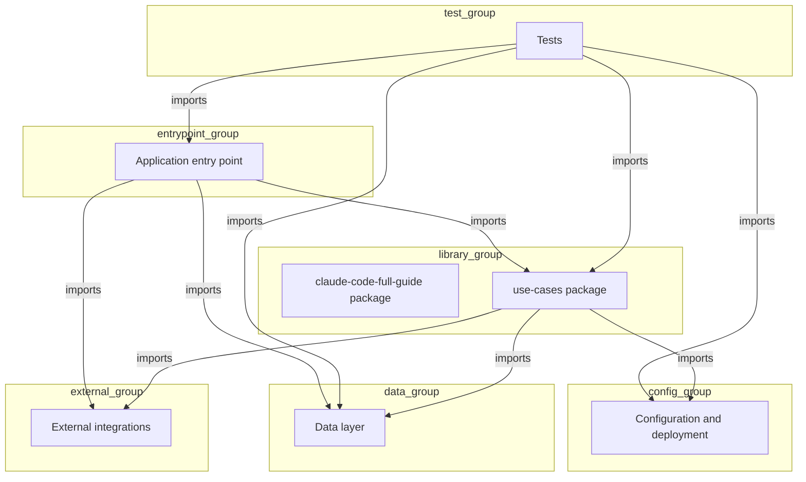

# Architecture report: coleam00/context-engineering-intro

> Automated static analysis. **Observed** = directly seen in files/imports/AST; **Inferred** = interpretation from that evidence. Repository code was not executed.

## 1. Repository at a glance

| Item | Value |
| --- | --- |
| Repository | coleam00/context-engineering-intro |
| Description | Context engineering is the new vibe coding - it's the way to actually make AI coding assistants work. Claude Code is the best for this so that's what this repo is centered around, but you can apply this strategy with any AI coding assistant! |
| Language | Python |
| Stars | 13913 |
| Licence | MIT |
| Analysed commit / branch | a2d84b021cee1e2f4e77ba854bba0be8cb319035 / main |
| Framework(s) | None detected |
| Files analysed | 242 |
| Components | 7 |

## 2. Architecture in one minute

coleam00/context-engineering-intro - Context engineering is the new vibe coding - it's the way to actually make AI coding assistants work. Claude Code is the best for this so that's what this repo is centered around, but you can apply t…. This repository was analysed statically from 242 file(s) (51 Python). Detected technologies (observed from imports/manifests): Database (unspecified), PostgreSQL, aiohttp, Click, httpx, Pydantic. Files are grouped into 7 component(s): claude-code-full-guide package, Configuration and deployment, Data layer, Application entry point, External integrations, Tests, use-cases package. Observed entry point(s): use-cases/agent-factory-with-subagents/agents/rag_agent/cli.py, use-cases/agent-factory-with-subagents/agents/rag_agent/ingestion/chunker.py, use-cases/agent-factory-with-subagents/agents/rag_agent/ingestion/embedder.py. Findings below distinguish obse…

## 3. High-level block diagram

## 4. Main components

### claude-code-full-guide package (`claude_code_full_guide`)

- **Kind:** library
- **Status:** Observed
- **Confidence:** 0.85
- **Responsibility:** Groups 2 file(s) under claude-code-full-guide package (observed from repository paths and static analysis).
- **Paths:** `claude-code-full-guide/.claude/hooks/log-tool-usage.sh`, `claude-code-full-guide/.devcontainer/init-firewall.sh`
- **Evidence:** [claude-code-full-guide/.claude/hooks/log-tool-usage.sh](https://github.com/coleam00/context-engineering-intro/blob/a2d84b021cee1e2f4e77ba854bba0be8cb319035/claude-code-full-guide/.claude/hooks/log-tool-usage.sh); [claude-code-full-guide/.devcontainer/init-firewall.sh](https://github.com/coleam00/context-engineering-intro/blob/a2d84b021cee1e2f4e77ba854bba0be8cb319035/claude-code-full-guide/.devcontainer/init-firewall.sh)

### Configuration and deployment (`config`)

- **Kind:** config
- **Status:** Observed
- **Confidence:** 0.85
- **Responsibility:** Groups 17 file(s) under configuration and deployment (observed from repository paths and static analysis). Observed top-level classes: Settings. Observed top-level functions: load_settings.
- **Paths:** `claude-code-full-guide/.claude/hooks/example-hook-config.json`, `claude-code-full-guide/.claude/settings.local.json`, `claude-code-full-guide/.devcontainer/Dockerfile`, `claude-code-full-guide/.devcontainer/devcontainer.json`, `use-cases/agent-factory-with-subagents/.claude/settings.local.json`, `use-cases/agent-factory-with-subagents/agents/rag_agent/.env.example`, `use-cases/agent-factory-with-subagents/agents/rag_agent/settings.py`, `use-cases/agent-factory-with-subagents/examples/main_agent_reference/.env.example`, `use-cases/agent-factory-with-subagents/examples/main_agent_reference/settings.py`, `use-cases/agent-factory-with-subagents/examples/testing_examples/pytest.ini`, `use-cases/mcp-server/.claude/settings.local.json`, `use-cases/mcp-server/package.json`, `use-cases/mcp-server/tsconfig.json`, `use-cases/pydantic-ai/examples/main_agent_reference/.env.example`, `use-cases/pydantic-ai/examples/main_agent_reference/settings.py`, `use-cases/pydantic-ai/examples/testing_examples/pytest.ini`, `use-cases/template-generator/.claude/settings.local.json`
- **Evidence:** [claude-code-full-guide/.claude/hooks/example-hook-config.json](https://github.com/coleam00/context-engineering-intro/blob/a2d84b021cee1e2f4e77ba854bba0be8cb319035/claude-code-full-guide/.claude/hooks/example-hook-config.json); [claude-code-full-guide/.claude/settings.local.json](https://github.com/coleam00/context-engineering-intro/blob/a2d84b021cee1e2f4e77ba854bba0be8cb319035/claude-code-full-guide/.claude/settings.local.json); [claude-code-full-guide/.devcontainer/Dockerfile](https://github.com/coleam00/context-engineering-intro/blob/a2d84b021cee1e2f4e77ba854bba0be8cb319035/claude-code-full-guide/.devcontainer/Dockerfile); [claude-code-full-guide/.devcontainer/devcontainer.json](https://github.com/coleam00/context-engineering-intro/blob/a2d84b021cee1e2f4e77ba854bba0be8cb319035/claude-code-full-guide/.devcontainer/devcontainer.json); [use-cases/agent-factory-with-subagents/.claude/settings.local.json](https://github.com/coleam00/context-engineering-intro/blob/a2d84b021cee1e2f4e77ba854bba0be8cb319035/use-cases/agent-factory-with-subagents/.claude/settings.local.json); [use-cases/agent-factory-with-subagents/agents/rag_agent/.env.example](https://github.com/coleam00/context-engineering-intro/blob/a2d84b021cee1e2f4e77ba854bba0be8cb319035/use-cases/agent-factory-with-subagents/agents/rag_agent/.env.example); [use-cases/agent-factory-with-subagents/agents/rag_agent/settings.py:12](https://github.com/coleam00/context-engineering-intro/blob/a2d84b021cee1e2f4e77ba854bba0be8cb319035/use-cases/agent-factory-with-subagents/agents/rag_agent/settings.py#L12); [use-cases/agent-factory-with-subagents/examples/main_agent_reference/.env.example](https://github.com/coleam00/context-engineering-intro/blob/a2d84b021cee1e2f4e77ba854bba0be8cb319035/use-cases/agent-factory-with-subagents/examples/main_agent_reference/.env.example)

### Data layer (`data_layer`)

- **Kind:** data
- **Status:** Observed
- **Confidence:** 0.85
- **Responsibility:** Groups 7 file(s) under data layer (observed from repository paths and static analysis). Observed top-level classes: AgentContext, AgentDependencies, AgentResponse, BraveSearchResult, ChatMessage, ChatResponse.
- **Paths:** `use-cases/agent-factory-with-subagents/agents/rag_agent/utils/models.py`, `use-cases/agent-factory-with-subagents/examples/main_agent_reference/models.py`, `use-cases/agent-factory-with-subagents/examples/rag_pipeline/utils/models.py`, `use-cases/mcp-server/src/database/connection.ts`, `use-cases/mcp-server/src/database/security.ts`, `use-cases/mcp-server/src/database/utils.ts`, `use-cases/pydantic-ai/examples/main_agent_reference/models.py`
- **Evidence:** [use-cases/agent-factory-with-subagents/agents/rag_agent/utils/models.py:12](https://github.com/coleam00/context-engineering-intro/blob/a2d84b021cee1e2f4e77ba854bba0be8cb319035/use-cases/agent-factory-with-subagents/agents/rag_agent/utils/models.py#L12); [use-cases/agent-factory-with-subagents/examples/main_agent_reference/models.py:10](https://github.com/coleam00/context-engineering-intro/blob/a2d84b021cee1e2f4e77ba854bba0be8cb319035/use-cases/agent-factory-with-subagents/examples/main_agent_reference/models.py#L10); [use-cases/agent-factory-with-subagents/examples/rag_pipeline/utils/models.py:12](https://github.com/coleam00/context-engineering-intro/blob/a2d84b021cee1e2f4e77ba854bba0be8cb319035/use-cases/agent-factory-with-subagents/examples/rag_pipeline/utils/models.py#L12); [use-cases/mcp-server/src/database/connection.ts](https://github.com/coleam00/context-engineering-intro/blob/a2d84b021cee1e2f4e77ba854bba0be8cb319035/use-cases/mcp-server/src/database/connection.ts); [use-cases/mcp-server/src/database/security.ts](https://github.com/coleam00/context-engineering-intro/blob/a2d84b021cee1e2f4e77ba854bba0be8cb319035/use-cases/mcp-server/src/database/security.ts); [use-cases/mcp-server/src/database/utils.ts](https://github.com/coleam00/context-engineering-intro/blob/a2d84b021cee1e2f4e77ba854bba0be8cb319035/use-cases/mcp-server/src/database/utils.ts); [use-cases/pydantic-ai/examples/main_agent_reference/models.py:10](https://github.com/coleam00/context-engineering-intro/blob/a2d84b021cee1e2f4e77ba854bba0be8cb319035/use-cases/pydantic-ai/examples/main_agent_reference/models.py#L10)

### Application entry point (`entrypoint`)

- **Kind:** entrypoint
- **Status:** Observed
- **Confidence:** 0.85
- **Responsibility:** Groups 17 file(s) under application entry point (observed from repository paths and static analysis). Observed top-level classes: AnalysisDependencies, ChunkingConfig, ConversationContext, DataAnalysisReport, DataInsight, DocumentChunk. Observed top-level functions: analyze_data, analyze_data_sync, analyze_numerical_data, ask_agent, ask_agent_sync, calculate.
- **Paths:** `use-cases/agent-factory-with-subagents/agents/rag_agent/cli.py`, `use-cases/agent-factory-with-subagents/agents/rag_agent/ingestion/chunker.py`, `use-cases/agent-factory-with-subagents/agents/rag_agent/ingestion/embedder.py`, `use-cases/agent-factory-with-subagents/agents/rag_agent/ingestion/ingest.py`, `use-cases/agent-factory-with-subagents/examples/basic_chat_agent/agent.py`, `use-cases/agent-factory-with-subagents/examples/main_agent_reference/cli.py`, `use-cases/agent-factory-with-subagents/examples/rag_pipeline/ingestion/chunker.py`, `use-cases/agent-factory-with-subagents/examples/rag_pipeline/ingestion/embedder.py`, `use-cases/agent-factory-with-subagents/examples/rag_pipeline/ingestion/ingest.py`, `use-cases/agent-factory-with-subagents/examples/structured_output_agent/agent.py`, `use-cases/agent-factory-with-subagents/examples/tool_enabled_agent/agent.py`, `use-cases/mcp-server/copy_template.py`, `use-cases/pydantic-ai/copy_template.py`, `use-cases/pydantic-ai/examples/basic_chat_agent/agent.py`, `use-cases/pydantic-ai/examples/main_agent_reference/cli.py`, `use-cases/pydantic-ai/examples/structured_output_agent/agent.py`, `use-cases/pydantic-ai/examples/tool_enabled_agent/agent.py`
- **Evidence:** [use-cases/agent-factory-with-subagents/agents/rag_agent/cli.py:22](https://github.com/coleam00/context-engineering-intro/blob/a2d84b021cee1e2f4e77ba854bba0be8cb319035/use-cases/agent-factory-with-subagents/agents/rag_agent/cli.py#L22); [use-cases/agent-factory-with-subagents/agents/rag_agent/ingestion/chunker.py:35](https://github.com/coleam00/context-engineering-intro/blob/a2d84b021cee1e2f4e77ba854bba0be8cb319035/use-cases/agent-factory-with-subagents/agents/rag_agent/ingestion/chunker.py#L35); [use-cases/agent-factory-with-subagents/agents/rag_agent/ingestion/embedder.py:37](https://github.com/coleam00/context-engineering-intro/blob/a2d84b021cee1e2f4e77ba854bba0be8cb319035/use-cases/agent-factory-with-subagents/agents/rag_agent/ingestion/embedder.py#L37); [use-cases/agent-factory-with-subagents/agents/rag_agent/ingestion/ingest.py:39](https://github.com/coleam00/context-engineering-intro/blob/a2d84b021cee1e2f4e77ba854bba0be8cb319035/use-cases/agent-factory-with-subagents/agents/rag_agent/ingestion/ingest.py#L39); [use-cases/agent-factory-with-subagents/examples/basic_chat_agent/agent.py:27](https://github.com/coleam00/context-engineering-intro/blob/a2d84b021cee1e2f4e77ba854bba0be8cb319035/use-cases/agent-factory-with-subagents/examples/basic_chat_agent/agent.py#L27); [use-cases/agent-factory-with-subagents/examples/main_agent_reference/cli.py:26](https://github.com/coleam00/context-engineering-intro/blob/a2d84b021cee1e2f4e77ba854bba0be8cb319035/use-cases/agent-factory-with-subagents/examples/main_agent_reference/cli.py#L26); [use-cases/agent-factory-with-subagents/examples/rag_pipeline/ingestion/chunker.py:35](https://github.com/coleam00/context-engineering-intro/blob/a2d84b021cee1e2f4e77ba854bba0be8cb319035/use-cases/agent-factory-with-subagents/examples/rag_pipeline/ingestion/chunker.py#L35); [use-cases/agent-factory-with-subagents/examples/rag_pipeline/ingestion/embedder.py:37](https://github.com/coleam00/context-engineering-intro/blob/a2d84b021cee1e2f4e77ba854bba0be8cb319035/use-cases/agent-factory-with-subagents/examples/rag_pipeline/ingestion/embedder.py#L37)

### External integrations (`external_integrations`)

- **Kind:** external
- **Status:** Inferred
- **Confidence:** 0.70
- **Responsibility:** Groups 0 file(s) under external integrations (observed from repository paths and static analysis).
- **Evidence:** [use-cases/agent-factory-with-subagents/agents/rag_agent/dependencies.py:5](https://github.com/coleam00/context-engineering-intro/blob/a2d84b021cee1e2f4e77ba854bba0be8cb319035/use-cases/agent-factory-with-subagents/agents/rag_agent/dependencies.py#L5); [use-cases/agent-factory-with-subagents/agents/rag_agent/ingestion/ingest.py:15](https://github.com/coleam00/context-engineering-intro/blob/a2d84b021cee1e2f4e77ba854bba0be8cb319035/use-cases/agent-factory-with-subagents/agents/rag_agent/ingestion/ingest.py#L15); [use-cases/agent-factory-with-subagents/agents/rag_agent/tests/test_dependencies.py:5](https://github.com/coleam00/context-engineering-intro/blob/a2d84b021cee1e2f4e77ba854bba0be8cb319035/use-cases/agent-factory-with-subagents/agents/rag_agent/tests/test_dependencies.py#L5); [use-cases/agent-factory-with-subagents/agents/rag_agent/tools.py:6](https://github.com/coleam00/context-engineering-intro/blob/a2d84b021cee1e2f4e77ba854bba0be8cb319035/use-cases/agent-factory-with-subagents/agents/rag_agent/tools.py#L6); [use-cases/agent-factory-with-subagents/agents/rag_agent/utils/db_utils.py:14](https://github.com/coleam00/context-engineering-intro/blob/a2d84b021cee1e2f4e77ba854bba0be8cb319035/use-cases/agent-factory-with-subagents/agents/rag_agent/utils/db_utils.py#L14); [use-cases/agent-factory-with-subagents/agents/rag_agent/utils/db_utils.py:15](https://github.com/coleam00/context-engineering-intro/blob/a2d84b021cee1e2f4e77ba854bba0be8cb319035/use-cases/agent-factory-with-subagents/agents/rag_agent/utils/db_utils.py#L15)

### Tests (`tests`)

- **Kind:** test
- **Status:** Observed
- **Confidence:** 0.85
- **Responsibility:** Groups 22 file(s) under tests (observed from repository paths and static analysis). Observed top-level classes: TestAgentBasicFunctionality, TestAgentBasics, TestAgentDependencies, TestAgentErrorHandling, TestAgentErrorRecovery, TestAgentInitialization. Observed top-level functions: assert_hybrid_result_valid, assert_search_result_valid, create_mock_agent_response, create_search_function_model, event_loop, function_model_with_search.
- **Paths:** `use-cases/agent-factory-with-subagents/agents/rag_agent/tests/VALIDATION_REPORT.md`, `use-cases/agent-factory-with-subagents/agents/rag_agent/tests/conftest.py`, `use-cases/agent-factory-with-subagents/agents/rag_agent/tests/test_agent.py`, `use-cases/agent-factory-with-subagents/agents/rag_agent/tests/test_cli.py`, `use-cases/agent-factory-with-subagents/agents/rag_agent/tests/test_dependencies.py`, `use-cases/agent-factory-with-subagents/agents/rag_agent/tests/test_integration.py`, `use-cases/agent-factory-with-subagents/agents/rag_agent/tests/test_requirements.py`, `use-cases/agent-factory-with-subagents/agents/rag_agent/tests/test_tools.py`, `use-cases/agent-factory-with-subagents/examples/testing_examples/test_agent_patterns.py`, `use-cases/mcp-server/tests/fixtures/auth.fixtures.ts`, `use-cases/mcp-server/tests/fixtures/database.fixtures.ts`, `use-cases/mcp-server/tests/fixtures/mcp.fixtures.ts`, `use-cases/mcp-server/tests/mocks/crypto.mock.ts`, `use-cases/mcp-server/tests/mocks/database.mock.ts`, `use-cases/mcp-server/tests/mocks/github.mock.ts`, `use-cases/mcp-server/tests/mocks/oauth.mock.ts`, `use-cases/mcp-server/tests/setup.ts`, `use-cases/mcp-server/tests/unit/database/security.test.ts`, `use-cases/mcp-server/tests/unit/database/utils.test.ts`, `use-cases/mcp-server/tests/unit/tools/database-tools.test.ts`, `use-cases/mcp-server/tests/unit/utils/response-helpers.test.ts`, `use-cases/pydantic-ai/examples/testing_examples/test_agent_patterns.py`
- **Evidence:** [use-cases/agent-factory-with-subagents/agents/rag_agent/tests/VALIDATION_REPORT.md](https://github.com/coleam00/context-engineering-intro/blob/a2d84b021cee1e2f4e77ba854bba0be8cb319035/use-cases/agent-factory-with-subagents/agents/rag_agent/tests/VALIDATION_REPORT.md); [use-cases/agent-factory-with-subagents/agents/rag_agent/tests/conftest.py:19](https://github.com/coleam00/context-engineering-intro/blob/a2d84b021cee1e2f4e77ba854bba0be8cb319035/use-cases/agent-factory-with-subagents/agents/rag_agent/tests/conftest.py#L19); [use-cases/agent-factory-with-subagents/agents/rag_agent/tests/test_agent.py:13](https://github.com/coleam00/context-engineering-intro/blob/a2d84b021cee1e2f4e77ba854bba0be8cb319035/use-cases/agent-factory-with-subagents/agents/rag_agent/tests/test_agent.py#L13); [use-cases/agent-factory-with-subagents/agents/rag_agent/tests/test_cli.py:14](https://github.com/coleam00/context-engineering-intro/blob/a2d84b021cee1e2f4e77ba854bba0be8cb319035/use-cases/agent-factory-with-subagents/agents/rag_agent/tests/test_cli.py#L14); [use-cases/agent-factory-with-subagents/agents/rag_agent/tests/test_dependencies.py:12](https://github.com/coleam00/context-engineering-intro/blob/a2d84b021cee1e2f4e77ba854bba0be8cb319035/use-cases/agent-factory-with-subagents/agents/rag_agent/tests/test_dependencies.py#L12); [use-cases/agent-factory-with-subagents/agents/rag_agent/tests/test_integration.py:16](https://github.com/coleam00/context-engineering-intro/blob/a2d84b021cee1e2f4e77ba854bba0be8cb319035/use-cases/agent-factory-with-subagents/agents/rag_agent/tests/test_integration.py#L16); [use-cases/agent-factory-with-subagents/agents/rag_agent/tests/test_requirements.py:16](https://github.com/coleam00/context-engineering-intro/blob/a2d84b021cee1e2f4e77ba854bba0be8cb319035/use-cases/agent-factory-with-subagents/agents/rag_agent/tests/test_requirements.py#L16); [use-cases/agent-factory-with-subagents/agents/rag_agent/tests/test_tools.py:11](https://github.com/coleam00/context-engineering-intro/blob/a2d84b021cee1e2f4e77ba854bba0be8cb319035/use-cases/agent-factory-with-subagents/agents/rag_agent/tests/test_tools.py#L11)

### use-cases package (`use_cases`)

- **Kind:** library
- **Status:** Observed
- **Confidence:** 0.85
- **Responsibility:** Groups 27 file(s) under use-cases package (observed from repository paths and static analysis). Observed top-level classes: AgentDependencies, DatabasePool, ResearchAgentDependencies, SearchResult. Observed top-level functions: close_database, create_email_draft, create_research_agent, execute_query, get_document, get_dynamic_prompt.
- **Paths:** `use-cases/agent-factory-with-subagents/agents/rag_agent/__init__.py`, `use-cases/agent-factory-with-subagents/agents/rag_agent/agent.py`, `use-cases/agent-factory-with-subagents/agents/rag_agent/dependencies.py`, `use-cases/agent-factory-with-subagents/agents/rag_agent/ingestion/__init__.py`, `use-cases/agent-factory-with-subagents/agents/rag_agent/prompts.py`, `use-cases/agent-factory-with-subagents/agents/rag_agent/providers.py`, `use-cases/agent-factory-with-subagents/agents/rag_agent/tools.py`, `use-cases/agent-factory-with-subagents/agents/rag_agent/utils/db_utils.py`, `use-cases/agent-factory-with-subagents/agents/rag_agent/utils/providers.py`, `use-cases/agent-factory-with-subagents/examples/main_agent_reference/providers.py`, `use-cases/agent-factory-with-subagents/examples/main_agent_reference/research_agent.py`, `use-cases/agent-factory-with-subagents/examples/main_agent_reference/tools.py`, `use-cases/agent-factory-with-subagents/examples/rag_pipeline/ingestion/__init__.py`, `use-cases/agent-factory-with-subagents/examples/rag_pipeline/utils/db_utils.py`, `use-cases/agent-factory-with-subagents/examples/rag_pipeline/utils/providers.py`, `use-cases/mcp-server/examples/database-tools-sentry.ts`, `use-cases/mcp-server/examples/database-tools.ts`, `use-cases/mcp-server/src/auth/github-handler.ts`, `use-cases/mcp-server/src/auth/oauth-utils.ts`, `use-cases/mcp-server/src/index.ts`, `use-cases/mcp-server/src/index_sentry.ts`, `use-cases/mcp-server/src/tools/register-tools.ts`, `use-cases/mcp-server/src/types.ts`, `use-cases/mcp-server/vitest.config.js`, `use-cases/pydantic-ai/examples/main_agent_reference/providers.py`, `use-cases/pydantic-ai/examples/main_agent_reference/research_agent.py`, `use-cases/pydantic-ai/examples/main_agent_reference/tools.py`
- **Evidence:** [use-cases/agent-factory-with-subagents/agents/rag_agent/__init__.py](https://github.com/coleam00/context-engineering-intro/blob/a2d84b021cee1e2f4e77ba854bba0be8cb319035/use-cases/agent-factory-with-subagents/agents/rag_agent/__init__.py); [use-cases/agent-factory-with-subagents/agents/rag_agent/agent.py](https://github.com/coleam00/context-engineering-intro/blob/a2d84b021cee1e2f4e77ba854bba0be8cb319035/use-cases/agent-factory-with-subagents/agents/rag_agent/agent.py); [use-cases/agent-factory-with-subagents/agents/rag_agent/dependencies.py:11](https://github.com/coleam00/context-engineering-intro/blob/a2d84b021cee1e2f4e77ba854bba0be8cb319035/use-cases/agent-factory-with-subagents/agents/rag_agent/dependencies.py#L11); [use-cases/agent-factory-with-subagents/agents/rag_agent/ingestion/__init__.py](https://github.com/coleam00/context-engineering-intro/blob/a2d84b021cee1e2f4e77ba854bba0be8cb319035/use-cases/agent-factory-with-subagents/agents/rag_agent/ingestion/__init__.py); [use-cases/agent-factory-with-subagents/agents/rag_agent/prompts.py:38](https://github.com/coleam00/context-engineering-intro/blob/a2d84b021cee1e2f4e77ba854bba0be8cb319035/use-cases/agent-factory-with-subagents/agents/rag_agent/prompts.py#L38); [use-cases/agent-factory-with-subagents/agents/rag_agent/providers.py:9](https://github.com/coleam00/context-engineering-intro/blob/a2d84b021cee1e2f4e77ba854bba0be8cb319035/use-cases/agent-factory-with-subagents/agents/rag_agent/providers.py#L9); [use-cases/agent-factory-with-subagents/agents/rag_agent/tools.py:11](https://github.com/coleam00/context-engineering-intro/blob/a2d84b021cee1e2f4e77ba854bba0be8cb319035/use-cases/agent-factory-with-subagents/agents/rag_agent/tools.py#L11); [use-cases/agent-factory-with-subagents/agents/rag_agent/utils/db_utils.py:24](https://github.com/coleam00/context-engineering-intro/blob/a2d84b021cee1e2f4e77ba854bba0be8cb319035/use-cases/agent-factory-with-subagents/agents/rag_agent/utils/db_utils.py#L24)

## 5. Execution flow

**Observed** entry point(s):

- [use-cases/agent-factory-with-subagents/agents/rag_agent/cli.py:288](https://github.com/coleam00/context-engineering-intro/blob/a2d84b021cee1e2f4e77ba854bba0be8cb319035/use-cases/agent-factory-with-subagents/agents/rag_agent/cli.py#L288)
- [use-cases/agent-factory-with-subagents/agents/rag_agent/ingestion/chunker.py:517](https://github.com/coleam00/context-engineering-intro/blob/a2d84b021cee1e2f4e77ba854bba0be8cb319035/use-cases/agent-factory-with-subagents/agents/rag_agent/ingestion/chunker.py#L517)
- [use-cases/agent-factory-with-subagents/agents/rag_agent/ingestion/embedder.py:417](https://github.com/coleam00/context-engineering-intro/blob/a2d84b021cee1e2f4e77ba854bba0be8cb319035/use-cases/agent-factory-with-subagents/agents/rag_agent/ingestion/embedder.py#L417)
- [use-cases/agent-factory-with-subagents/agents/rag_agent/ingestion/ingest.py:433](https://github.com/coleam00/context-engineering-intro/blob/a2d84b021cee1e2f4e77ba854bba0be8cb319035/use-cases/agent-factory-with-subagents/agents/rag_agent/ingestion/ingest.py#L433)
- [use-cases/mcp-server/copy_template.py:361](https://github.com/coleam00/context-engineering-intro/blob/a2d84b021cee1e2f4e77ba854bba0be8cb319035/use-cases/mcp-server/copy_template.py#L361)
- [use-cases/mcp-server/src/index.ts](https://github.com/coleam00/context-engineering-intro/blob/a2d84b021cee1e2f4e77ba854bba0be8cb319035/use-cases/mcp-server/src/index.ts)
- [use-cases/pydantic-ai/copy_template.py:290](https://github.com/coleam00/context-engineering-intro/blob/a2d84b021cee1e2f4e77ba854bba0be8cb319035/use-cases/pydantic-ai/copy_template.py#L290)

Representative flow (derived from observed entry points and the import graph; steps beyond the entry point are **Inferred**):

1. Execution starts at an observed entry point listed above, if present.
2. `entrypoint` imports `data_layer` (Application entry point -> Data layer).
3. `entrypoint` imports `external_integrations` (Application entry point -> External integrations).
4. `entrypoint` imports `use_cases` (Application entry point -> use-cases package).
5. `tests` imports `config` (Tests -> Configuration and deployment).
6. `tests` imports `data_layer` (Tests -> Data layer).
7. `tests` imports `entrypoint` (Tests -> Application entry point).
8. `tests` imports `use_cases` (Tests -> use-cases package).
9. `use_cases` imports `config` (use-cases package -> Configuration and deployment).

## 6. Project structure

### `(root)`

- `.gitattributes` - other (66 bytes)
- `.gitignore` - other (53 bytes)
- `CLAUDE.md` - docs (3051 bytes)
- `INITIAL.md` - docs (465 bytes)
- `INITIAL_EXAMPLE.md` - docs (1296 bytes)
- `LICENSE` - docs (1067 bytes)
- `README.md` - docs (9600 bytes)

### `.claude`

- `.claude/commands/execute-prp.md` - docs (1264 bytes)
- `.claude/commands/generate-prp.md` - docs (2639 bytes)
- `.claude/settings.local.json` - config (508 bytes)

### `PRPs`

- `PRPs/EXAMPLE_multi_agent_prp.md` - docs (13304 bytes)
- `PRPs/templates/prp_base.md` - docs (6124 bytes)

### `claude-code-full-guide`

- `claude-code-full-guide/.claude/agents/documentation-manager.md` - docs (3445 bytes)
- `claude-code-full-guide/.claude/agents/validation-gates.md` - docs (4531 bytes)
- `claude-code-full-guide/.claude/commands/execute-parallel.md` - docs (1227 bytes)
- `claude-code-full-guide/.claude/commands/execute-prp.md` - docs (1264 bytes)
- `claude-code-full-guide/.claude/commands/fix-github-issue.md` - docs (486 bytes)
- `claude-code-full-guide/.claude/commands/generate-prp.md` - docs (2639 bytes)
- `claude-code-full-guide/.claude/commands/prep-parallel.md` - docs (512 bytes)
- `claude-code-full-guide/.claude/commands/primer.md` - docs (473 bytes)
- `claude-code-full-guide/.claude/hooks/README.md` - docs (3066 bytes)
- `claude-code-full-guide/.claude/hooks/example-hook-config.json` - config (1816 bytes)
- `claude-code-full-guide/.claude/hooks/log-tool-usage.sh` - source, Shell (404 bytes)
- `claude-code-full-guide/.claude/settings.local.json` - config (553 bytes)
- `claude-code-full-guide/.devcontainer/Dockerfile` - container (2140 bytes)
- `claude-code-full-guide/.devcontainer/devcontainer.json` - config (1543 bytes)
- `claude-code-full-guide/.devcontainer/init-firewall.sh` - source, Shell (3805 bytes)
- `claude-code-full-guide/CLAUDE.md` - docs (20099 bytes)
- `claude-code-full-guide/INITIAL.md` - docs (465 bytes)
- `claude-code-full-guide/PRPs/EXAMPLE_multi_agent_prp.md` - docs (13304 bytes)
- `claude-code-full-guide/PRPs/templates/prp_base.md` - docs (6124 bytes)
- `claude-code-full-guide/README.md` - docs (18192 bytes)
- `claude-code-full-guide/install_claude_code_windows.md` - docs (1146 bytes)

### `examples`

- `examples/.gitkeep` - other (0 bytes)

### `use-cases`

- `use-cases/agent-factory-with-subagents/.claude/agents/pydantic-ai-dependency-manager.md` - docs (16533 bytes)
- `use-cases/agent-factory-with-subagents/.claude/agents/pydantic-ai-planner.md` - docs (7133 bytes)
- `use-cases/agent-factory-with-subagents/.claude/agents/pydantic-ai-prompt-engineer.md` - docs (8416 bytes)
- `use-cases/agent-factory-with-subagents/.claude/agents/pydantic-ai-tool-integrator.md` - docs (10629 bytes)
- `use-cases/agent-factory-with-subagents/.claude/agents/pydantic-ai-validator.md` - docs (8828 bytes)
- `use-cases/agent-factory-with-subagents/.claude/settings.local.json` - config (566 bytes)
- `use-cases/agent-factory-with-subagents/.gitignore` - other (143 bytes)
- `use-cases/agent-factory-with-subagents/CLAUDE.md` - docs (26395 bytes)
- `use-cases/agent-factory-with-subagents/PRPs/INITIAL.md` - docs (2337 bytes)
- `use-cases/agent-factory-with-subagents/PRPs/templates/prp_pydantic_ai_base.md` - docs (16202 bytes)
- `use-cases/agent-factory-with-subagents/README.md` - docs (10214 bytes)
- `use-cases/agent-factory-with-subagents/SAMPLE_PROMPT.md` - docs (952 bytes)
- `use-cases/agent-factory-with-subagents/agents/rag_agent/.env.example` - config (733 bytes)
- `use-cases/agent-factory-with-subagents/agents/rag_agent/README.md` - docs (4076 bytes)
- `use-cases/agent-factory-with-subagents/agents/rag_agent/__init__.py` - source, Python (381 bytes)
- `use-cases/agent-factory-with-subagents/agents/rag_agent/agent.py` - source, Python (536 bytes)
- `use-cases/agent-factory-with-subagents/agents/rag_agent/cli.py` - source, Python (12930 bytes)
- `use-cases/agent-factory-with-subagents/agents/rag_agent/dependencies.py` - source, Python (2403 bytes)
- `use-cases/agent-factory-with-subagents/agents/rag_agent/documents/doc10_apple_ai_struggles.md` - docs (9058 bytes)
- `use-cases/agent-factory-with-subagents/agents/rag_agent/documents/doc11_investment_funding_trends.md` - docs (12499 bytes)
- `use-cases/agent-factory-with-subagents/agents/rag_agent/documents/doc12_executive_moves.md` - docs (10329 bytes)
- `use-cases/agent-factory-with-subagents/agents/rag_agent/documents/doc13_regulatory_landscape.md` - docs (11897 bytes)
- `use-cases/agent-factory-with-subagents/agents/rag_agent/documents/doc14_patent_innovation.md` - docs (19625 bytes)
- `use-cases/agent-factory-with-subagents/agents/rag_agent/documents/doc15_competitive_analysis.md` - docs (13003 bytes)
- `use-cases/agent-factory-with-subagents/agents/rag_agent/documents/doc16_startup_ecosystem.md` - docs (9900 bytes)
- `use-cases/agent-factory-with-subagents/agents/rag_agent/documents/doc17_cloud_wars.md` - docs (14833 bytes)
- `use-cases/agent-factory-with-subagents/agents/rag_agent/documents/doc18_future_predictions.md` - docs (21136 bytes)
- `use-cases/agent-factory-with-subagents/agents/rag_agent/documents/doc19_acquisition_targets.md` - docs (15227 bytes)
- `use-cases/agent-factory-with-subagents/agents/rag_agent/documents/doc1_openai_funding.md` - docs (2275 bytes)
- `use-cases/agent-factory-with-subagents/agents/rag_agent/documents/doc20_international_competition.md` - docs (22362 bytes)
- `use-cases/agent-factory-with-subagents/agents/rag_agent/documents/doc21_enterprise_adoption.md` - docs (14835 bytes)
- `use-cases/agent-factory-with-subagents/agents/rag_agent/documents/doc2_anthropic_amazon.md` - docs (2941 bytes)
- `use-cases/agent-factory-with-subagents/agents/rag_agent/documents/doc3_meta_scale_acquisition.md` - docs (3556 bytes)
- `use-cases/agent-factory-with-subagents/agents/rag_agent/documents/doc4_databricks_funding.md` - docs (4146 bytes)
- `use-cases/agent-factory-with-subagents/agents/rag_agent/documents/doc5_microsoft_openai_tensions.md` - docs (4318 bytes)
- `use-cases/agent-factory-with-subagents/agents/rag_agent/documents/doc6_google_ai_strategy.md` - docs (5989 bytes)
- `use-cases/agent-factory-with-subagents/agents/rag_agent/documents/doc7_sam_altman_profile.md` - docs (7433 bytes)
- `use-cases/agent-factory-with-subagents/agents/rag_agent/documents/doc8_nvidia_dominance.md` - docs (7950 bytes)
- `use-cases/agent-factory-with-subagents/agents/rag_agent/documents/doc9_ai_market_analysis.md` - docs (9581 bytes)
- `use-cases/agent-factory-with-subagents/agents/rag_agent/ingestion/__init__.py` - source, Python (107 bytes)
- `use-cases/agent-factory-with-subagents/agents/rag_agent/ingestion/chunker.py` - source, Python (16017 bytes)
- `use-cases/agent-factory-with-subagents/agents/rag_agent/ingestion/embedder.py` - source, Python (14228 bytes)
- `use-cases/agent-factory-with-subagents/agents/rag_agent/ingestion/ingest.py` - source, Python (15438 bytes)
- `use-cases/agent-factory-with-subagents/agents/rag_agent/planning/INITIAL.md` - docs (6865 bytes)
- `use-cases/agent-factory-with-subagents/agents/rag_agent/planning/dependencies.md` - docs (9891 bytes)
- `use-cases/agent-factory-with-subagents/agents/rag_agent/planning/prompts.md` - docs (6742 bytes)
- `use-cases/agent-factory-with-subagents/agents/rag_agent/planning/tools.md` - docs (6646 bytes)
- `use-cases/agent-factory-with-subagents/agents/rag_agent/prompts.py` - source, Python (2863 bytes)
- `use-cases/agent-factory-with-subagents/agents/rag_agent/providers.py` - source, Python (2171 bytes)
- `use-cases/agent-factory-with-subagents/agents/rag_agent/settings.py` - source, Python (2760 bytes)
- `use-cases/agent-factory-with-subagents/agents/rag_agent/sql/schema.sql` - data, SQL (5056 bytes)
- `use-cases/agent-factory-with-subagents/agents/rag_agent/tests/VALIDATION_REPORT.md` - test (17125 bytes)
- `use-cases/agent-factory-with-subagents/agents/rag_agent/tests/conftest.py` - test, Python (8329 bytes)
- `use-cases/agent-factory-with-subagents/agents/rag_agent/tests/test_agent.py` - test, Python (13143 bytes)
- `use-cases/agent-factory-with-subagents/agents/rag_agent/tests/test_cli.py` - test, Python (27143 bytes)
- `use-cases/agent-factory-with-subagents/agents/rag_agent/tests/test_dependencies.py` - test, Python (22169 bytes)
- `use-cases/agent-factory-with-subagents/agents/rag_agent/tests/test_integration.py` - test, Python (30323 bytes)
- `use-cases/agent-factory-with-subagents/agents/rag_agent/tests/test_requirements.py` - test, Python (40196 bytes)
- `use-cases/agent-factory-with-subagents/agents/rag_agent/tests/test_tools.py` - test, Python (21069 bytes)
- `use-cases/agent-factory-with-subagents/agents/rag_agent/tools.py` - source, Python (4899 bytes)
- `use-cases/agent-factory-with-subagents/agents/rag_agent/utils/db_utils.py` - source, Python (5860 bytes)
- `use-cases/agent-factory-with-subagents/agents/rag_agent/utils/models.py` - source, Python (5661 bytes)
- `use-cases/agent-factory-with-subagents/agents/rag_agent/utils/providers.py` - source, Python (2406 bytes)
- `use-cases/agent-factory-with-subagents/examples/basic_chat_agent/agent.py` - source, Python (5569 bytes)
- `use-cases/agent-factory-with-subagents/examples/main_agent_reference/.env.example` - config (366 bytes)
- `use-cases/agent-factory-with-subagents/examples/main_agent_reference/cli.py` - source, Python (9739 bytes)
- `use-cases/agent-factory-with-subagents/examples/main_agent_reference/models.py` - source, Python (4736 bytes)
- `use-cases/agent-factory-with-subagents/examples/main_agent_reference/providers.py` - source, Python (1625 bytes)
- `use-cases/agent-factory-with-subagents/examples/main_agent_reference/research_agent.py` - source, Python (7740 bytes)
- `use-cases/agent-factory-with-subagents/examples/main_agent_reference/settings.py` - source, Python (1637 bytes)
- `use-cases/agent-factory-with-subagents/examples/main_agent_reference/tools.py` - source, Python (3694 bytes)
- `use-cases/agent-factory-with-subagents/examples/rag_pipeline/documents/doc10_apple_ai_struggles.md` - docs (9058 bytes)
- `use-cases/agent-factory-with-subagents/examples/rag_pipeline/documents/doc11_investment_funding_trends.md` - docs (12499 bytes)
- `use-cases/agent-factory-with-subagents/examples/rag_pipeline/documents/doc12_executive_moves.md` - docs (10329 bytes)
- `use-cases/agent-factory-with-subagents/examples/rag_pipeline/documents/doc13_regulatory_landscape.md` - docs (11897 bytes)
- `use-cases/agent-factory-with-subagents/examples/rag_pipeline/documents/doc14_patent_innovation.md` - docs (19625 bytes)
- `use-cases/agent-factory-with-subagents/examples/rag_pipeline/documents/doc15_competitive_analysis.md` - docs (13003 bytes)
- `use-cases/agent-factory-with-subagents/examples/rag_pipeline/documents/doc16_startup_ecosystem.md` - docs (9900 bytes)
- `use-cases/agent-factory-with-subagents/examples/rag_pipeline/documents/doc17_cloud_wars.md` - docs (14833 bytes)
- `use-cases/agent-factory-with-subagents/examples/rag_pipeline/documents/doc18_future_predictions.md` - docs (21136 bytes)
- `use-cases/agent-factory-with-subagents/examples/rag_pipeline/documents/doc19_acquisition_targets.md` - docs (15227 bytes)
- `use-cases/agent-factory-with-subagents/examples/rag_pipeline/documents/doc1_openai_funding.md` - docs (2275 bytes)
- `use-cases/agent-factory-with-subagents/examples/rag_pipeline/documents/doc20_international_competition.md` - docs (22362 bytes)
- `use-cases/agent-factory-with-subagents/examples/rag_pipeline/documents/doc21_enterprise_adoption.md` - docs (14835 bytes)
- `use-cases/agent-factory-with-subagents/examples/rag_pipeline/documents/doc2_anthropic_amazon.md` - docs (2941 bytes)
- `use-cases/agent-factory-with-subagents/examples/rag_pipeline/documents/doc3_meta_scale_acquisition.md` - docs (3556 bytes)
- `use-cases/agent-factory-with-subagents/examples/rag_pipeline/documents/doc4_databricks_funding.md` - docs (4146 bytes)
- `use-cases/agent-factory-with-subagents/examples/rag_pipeline/documents/doc5_microsoft_openai_tensions.md` - docs (4318 bytes)
- `use-cases/agent-factory-with-subagents/examples/rag_pipeline/documents/doc6_google_ai_strategy.md` - docs (5989 bytes)
- `use-cases/agent-factory-with-subagents/examples/rag_pipeline/documents/doc7_sam_altman_profile.md` - docs (7433 bytes)
- `use-cases/agent-factory-with-subagents/examples/rag_pipeline/documents/doc8_nvidia_dominance.md` - docs (7950 bytes)
- `use-cases/agent-factory-with-subagents/examples/rag_pipeline/documents/doc9_ai_market_analysis.md` - docs (9581 bytes)
- `use-cases/agent-factory-with-subagents/examples/rag_pipeline/ingestion/__init__.py` - source, Python (107 bytes)
- `use-cases/agent-factory-with-subagents/examples/rag_pipeline/ingestion/chunker.py` - source, Python (16017 bytes)
- `use-cases/agent-factory-with-subagents/examples/rag_pipeline/ingestion/embedder.py` - source, Python (14228 bytes)
- `use-cases/agent-factory-with-subagents/examples/rag_pipeline/ingestion/ingest.py` - source, Python (15438 bytes)
- `use-cases/agent-factory-with-subagents/examples/rag_pipeline/sql/schema.sql` - data, SQL (5032 bytes)
- `use-cases/agent-factory-with-subagents/examples/rag_pipeline/utils/db_utils.py` - source, Python (5860 bytes)
- `use-cases/agent-factory-with-subagents/examples/rag_pipeline/utils/models.py` - source, Python (5661 bytes)
- `use-cases/agent-factory-with-subagents/examples/rag_pipeline/utils/providers.py` - source, Python (2406 bytes)
- `use-cases/agent-factory-with-subagents/examples/structured_output_agent/agent.py` - source, Python (9655 bytes)
- `use-cases/agent-factory-with-subagents/examples/testing_examples/pytest.ini` - config (383 bytes)
- `use-cases/agent-factory-with-subagents/examples/testing_examples/test_agent_patterns.py` - test, Python (14057 bytes)
- `use-cases/agent-factory-with-subagents/examples/tool_enabled_agent/agent.py` - source, Python (11642 bytes)
- `use-cases/ai-coding-wisc-framework/.claude/commands/commit.md` - docs (2513 bytes)
- `use-cases/ai-coding-wisc-framework/.claude/commands/execute.md` - docs (4708 bytes)
- `use-cases/ai-coding-wisc-framework/.claude/commands/handoff.md` - docs (4509 bytes)
- `use-cases/ai-coding-wisc-framework/.claude/commands/plan-feature.md` - docs (5633 bytes)
- `use-cases/ai-coding-wisc-framework/.claude/commands/prime-backend.md` - docs (3262 bytes)
- `use-cases/ai-coding-wisc-framework/.claude/commands/prime-frontend.md` - docs (2716 bytes)
- `use-cases/ai-coding-wisc-framework/.claude/commands/prime-isolation.md` - docs (3780 bytes)
- `use-cases/ai-coding-wisc-framework/.claude/commands/prime-workflows.md` - docs (3528 bytes)
- `use-cases/ai-coding-wisc-framework/.claude/commands/prime.md` - docs (2625 bytes)
- `use-cases/ai-coding-wisc-framework/.claude/docs-example/adapter-implementation-guide.md` - docs (11290 bytes)
- `use-cases/ai-coding-wisc-framework/.claude/docs-example/architecture-deep-dive.md` - docs (14638 bytes)
- `use-cases/ai-coding-wisc-framework/.claude/docs-example/isolation-and-worktree-guide.md` - docs (9796 bytes)
- `use-cases/ai-coding-wisc-framework/.claude/docs-example/workflow-yaml-reference.md` - docs (10357 bytes)
- `use-cases/ai-coding-wisc-framework/.claude/rules-example/adapters.md` - docs (2788 bytes)
- `use-cases/ai-coding-wisc-framework/.claude/rules-example/cli.md` - docs (3085 bytes)
- `use-cases/ai-coding-wisc-framework/.claude/rules-example/database.md` - docs (3578 bytes)
- `use-cases/ai-coding-wisc-framework/.claude/rules-example/isolation.md` - docs (3626 bytes)
- `use-cases/ai-coding-wisc-framework/.claude/rules-example/orchestrator.md` - docs (6146 bytes)
- `use-cases/ai-coding-wisc-framework/.claude/rules-example/server-api.md` - docs (3536 bytes)
- `use-cases/ai-coding-wisc-framework/.claude/rules-example/testing.md` - docs (3670 bytes)
- `use-cases/ai-coding-wisc-framework/.claude/rules-example/web-frontend.md` - docs (3300 bytes)
- `use-cases/ai-coding-wisc-framework/.claude/rules-example/workflows.md` - docs (4027 bytes)
- `use-cases/ai-coding-wisc-framework/README.md` - docs (6810 bytes)
- `use-cases/ai-coding-workflows-foundation/README.md` - docs (3312 bytes)
- `use-cases/ai-coding-workflows-foundation/agents/codebase-analyst.md` - docs (3411 bytes)
- `use-cases/ai-coding-workflows-foundation/agents/validator.md` - docs (5313 bytes)
- `use-cases/ai-coding-workflows-foundation/commands/create-plan.md` - docs (6319 bytes)
- `use-cases/ai-coding-workflows-foundation/commands/execute-plan.md` - docs (5388 bytes)
- `use-cases/ai-coding-workflows-foundation/commands/primer.md` - docs (526 bytes)
- `use-cases/build-with-agent-team/README.md` - docs (4708 bytes)
- `use-cases/build-with-agent-team/SKILL.md` - docs (14002 bytes)
- `use-cases/build-with-agent-team/example-plan/session-manager-plan.md` - docs (17825 bytes)
- `use-cases/mcp-server/.claude/commands/prp-mcp-create.md` - docs (4696 bytes)
- `use-cases/mcp-server/.claude/commands/prp-mcp-execute.md` - docs (1887 bytes)
- `use-cases/mcp-server/.claude/settings.local.json` - config (190 bytes)
- `use-cases/mcp-server/.dev.vars.example` - other (1099 bytes)
- `use-cases/mcp-server/.gitignore` - other (2148 bytes)
- `use-cases/mcp-server/.prettierrc` - other (205 bytes)
- `use-cases/mcp-server/CLAUDE.md` - docs (25154 bytes)
- `use-cases/mcp-server/PRPs/INITIAL.md` - docs (1388 bytes)
- `use-cases/mcp-server/PRPs/README.md` - docs (2567 bytes)
- `use-cases/mcp-server/PRPs/ai_docs/claude_api_usage.md` - docs (763 bytes)
- `use-cases/mcp-server/PRPs/ai_docs/mcp_patterns.md` - docs (11112 bytes)
- `use-cases/mcp-server/PRPs/templates/prp_mcp_base.md` - docs (18601 bytes)
- `use-cases/mcp-server/README.md` - docs (8820 bytes)
- `use-cases/mcp-server/copy_template.py` - source, Python (10649 bytes)
- `use-cases/mcp-server/examples/database-tools-sentry.ts` - source, TypeScript (7713 bytes)
- `use-cases/mcp-server/examples/database-tools.ts` - source, TypeScript (5543 bytes)
- `use-cases/mcp-server/package.json` - manifest (963 bytes)
- `use-cases/mcp-server/src/auth/github-handler.ts` - source, TypeScript (3752 bytes)
- `use-cases/mcp-server/src/auth/oauth-utils.ts` - source, TypeScript (20263 bytes)
- `use-cases/mcp-server/src/database/connection.ts` - source, TypeScript (963 bytes)
- `use-cases/mcp-server/src/database/security.ts` - source, TypeScript (2159 bytes)
- `use-cases/mcp-server/src/database/utils.ts` - source, TypeScript (1002 bytes)
- `use-cases/mcp-server/src/index.ts` - source, TypeScript (1353 bytes)
- `use-cases/mcp-server/src/index_sentry.ts` - source, TypeScript (1914 bytes)
- `use-cases/mcp-server/src/tools/register-tools.ts` - source, TypeScript (472 bytes)
- `use-cases/mcp-server/src/types.ts` - source, TypeScript (2891 bytes)
- `use-cases/mcp-server/tests/fixtures/auth.fixtures.ts` - test, TypeScript (1090 bytes)
- `use-cases/mcp-server/tests/fixtures/database.fixtures.ts` - test, TypeScript (1787 bytes)
- `use-cases/mcp-server/tests/fixtures/mcp.fixtures.ts` - test, TypeScript (1232 bytes)
- `use-cases/mcp-server/tests/mocks/crypto.mock.ts` - test, TypeScript (1372 bytes)
- `use-cases/mcp-server/tests/mocks/database.mock.ts` - test, TypeScript (1599 bytes)
- `use-cases/mcp-server/tests/mocks/github.mock.ts` - test, TypeScript (1656 bytes)
- `use-cases/mcp-server/tests/mocks/oauth.mock.ts` - test, TypeScript (1307 bytes)
- `use-cases/mcp-server/tests/setup.ts` - test, TypeScript (356 bytes)
- `use-cases/mcp-server/tests/unit/database/security.test.ts` - test, TypeScript (5112 bytes)
- `use-cases/mcp-server/tests/unit/database/utils.test.ts` - test, TypeScript (2658 bytes)
- `use-cases/mcp-server/tests/unit/tools/database-tools.test.ts` - test, TypeScript (9798 bytes)
- `use-cases/mcp-server/tests/unit/utils/response-helpers.test.ts` - test, TypeScript (6326 bytes)
- `use-cases/mcp-server/tsconfig.json` - config (1836 bytes)
- `use-cases/mcp-server/vitest.config.js` - source, JavaScript (175 bytes)
- `use-cases/mcp-server/wrangler.jsonc` - other (1876 bytes)
- `use-cases/pydantic-ai/.claude/commands/execute-pydantic-ai-prp.md` - docs (2380 bytes)
- `use-cases/pydantic-ai/.claude/commands/generate-pydantic-ai-prp.md` - docs (4027 bytes)
- `use-cases/pydantic-ai/CLAUDE.md` - docs (10073 bytes)
- `use-cases/pydantic-ai/PRPs/INITIAL.md` - docs (2337 bytes)
- `use-cases/pydantic-ai/PRPs/templates/prp_pydantic_ai_base.md` - docs (16202 bytes)
- `use-cases/pydantic-ai/README.md` - docs (7786 bytes)
- `use-cases/pydantic-ai/copy_template.py` - source, Python (8766 bytes)
- `use-cases/pydantic-ai/examples/basic_chat_agent/agent.py` - source, Python (5569 bytes)
- `use-cases/pydantic-ai/examples/main_agent_reference/.env.example` - config (366 bytes)
- `use-cases/pydantic-ai/examples/main_agent_reference/cli.py` - source, Python (9739 bytes)
- `use-cases/pydantic-ai/examples/main_agent_reference/models.py` - source, Python (4736 bytes)
- `use-cases/pydantic-ai/examples/main_agent_reference/providers.py` - source, Python (1625 bytes)
- `use-cases/pydantic-ai/examples/main_agent_reference/research_agent.py` - source, Python (7740 bytes)
- `use-cases/pydantic-ai/examples/main_agent_reference/settings.py` - source, Python (1637 bytes)
- `use-cases/pydantic-ai/examples/main_agent_reference/tools.py` - source, Python (3694 bytes)
- `use-cases/pydantic-ai/examples/structured_output_agent/agent.py` - source, Python (9655 bytes)
- `use-cases/pydantic-ai/examples/testing_examples/pytest.ini` - config (383 bytes)
- `use-cases/pydantic-ai/examples/testing_examples/test_agent_patterns.py` - test, Python (14057 bytes)
- `use-cases/pydantic-ai/examples/tool_enabled_agent/agent.py` - source, Python (11642 bytes)
- `use-cases/template-generator/.claude/commands/execute-template-prp.md` - docs (7352 bytes)
- `use-cases/template-generator/.claude/commands/generate-template-prp.md` - docs (4404 bytes)
- `use-cases/template-generator/.claude/settings.local.json` - config (364 bytes)
- `use-cases/template-generator/CLAUDE.md` - docs (3714 bytes)
- `use-cases/template-generator/PRPs/INITIAL.md` - docs (7791 bytes)
- `use-cases/template-generator/PRPs/INITIAL_PYDANTIC_AI.md` - docs (2723 bytes)
- `use-cases/template-generator/PRPs/template-pydantic-ai.md` - docs (24602 bytes)
- `use-cases/template-generator/PRPs/templates/prp_template_base.md` - docs (20971 bytes)
- `use-cases/template-generator/README.md` - docs (6800 bytes)

### `validation`

- `validation/README.md` - docs (3229 bytes)
- `validation/example-validate.md` - docs (1963 bytes)
- `validation/ultimate_validate_command.md` - docs (4667 bytes)

## 7. Key dependencies and integrations

| Name | Category | Status | Confidence | Evidence |
| --- | --- | --- | --- | --- |
| Database (unspecified) | database | Inferred | 0.45 | [use-cases/agent-factory-with-subagents/agents/rag_agent/.env.example:4](https://github.com/coleam00/context-engineering-intro/blob/a2d84b021cee1e2f4e77ba854bba0be8cb319035/use-cases/agent-factory-with-subagents/agents/rag_agent/.env.example#L4) |
| PostgreSQL | database | Observed | 0.95 | [use-cases/agent-factory-with-subagents/agents/rag_agent/dependencies.py:5](https://github.com/coleam00/context-engineering-intro/blob/a2d84b021cee1e2f4e77ba854bba0be8cb319035/use-cases/agent-factory-with-subagents/agents/rag_agent/dependencies.py#L5); [use-cases/agent-factory-with-subagents/agents/rag_agent/ingestion/ingest.py:15](https://github.com/coleam00/context-engineering-intro/blob/a2d84b021cee1e2f4e77ba854bba0be8cb319035/use-cases/agent-factory-with-subagents/agents/rag_agent/ingestion/ingest.py#L15); [use-cases/agent-factory-with-subagents/agents/rag_agent/tests/test_dependencies.py:5](https://github.com/coleam00/context-engineering-intro/blob/a2d84b021cee1e2f4e77ba854bba0be8cb319035/use-cases/agent-factory-with-subagents/agents/rag_agent/tests/test_dependencies.py#L5); [use-cases/agent-factory-with-subagents/agents/rag_agent/tools.py:6](https://github.com/coleam00/context-engineering-intro/blob/a2d84b021cee1e2f4e77ba854bba0be8cb319035/use-cases/agent-factory-with-subagents/agents/rag_agent/tools.py#L6) |
| aiohttp | library | Observed | 0.95 | [use-cases/agent-factory-with-subagents/examples/tool_enabled_agent/agent.py:20](https://github.com/coleam00/context-engineering-intro/blob/a2d84b021cee1e2f4e77ba854bba0be8cb319035/use-cases/agent-factory-with-subagents/examples/tool_enabled_agent/agent.py#L20); [use-cases/pydantic-ai/examples/tool_enabled_agent/agent.py:20](https://github.com/coleam00/context-engineering-intro/blob/a2d84b021cee1e2f4e77ba854bba0be8cb319035/use-cases/pydantic-ai/examples/tool_enabled_agent/agent.py#L20) |
| Click | library | Observed | 0.90 | [use-cases/agent-factory-with-subagents/agents/rag_agent/tests/test_cli.py:6](https://github.com/coleam00/context-engineering-intro/blob/a2d84b021cee1e2f4e77ba854bba0be8cb319035/use-cases/agent-factory-with-subagents/agents/rag_agent/tests/test_cli.py#L6) |
| httpx | library | Observed | 0.95 | [use-cases/agent-factory-with-subagents/examples/main_agent_reference/tools.py:9](https://github.com/coleam00/context-engineering-intro/blob/a2d84b021cee1e2f4e77ba854bba0be8cb319035/use-cases/agent-factory-with-subagents/examples/main_agent_reference/tools.py#L9); [use-cases/pydantic-ai/examples/main_agent_reference/tools.py:9](https://github.com/coleam00/context-engineering-intro/blob/a2d84b021cee1e2f4e77ba854bba0be8cb319035/use-cases/pydantic-ai/examples/main_agent_reference/tools.py#L9) |
| Pydantic | library | Observed | 0.95 | [use-cases/agent-factory-with-subagents/agents/rag_agent/settings.py:4](https://github.com/coleam00/context-engineering-intro/blob/a2d84b021cee1e2f4e77ba854bba0be8cb319035/use-cases/agent-factory-with-subagents/agents/rag_agent/settings.py#L4); [use-cases/agent-factory-with-subagents/agents/rag_agent/tools.py:5](https://github.com/coleam00/context-engineering-intro/blob/a2d84b021cee1e2f4e77ba854bba0be8cb319035/use-cases/agent-factory-with-subagents/agents/rag_agent/tools.py#L5); [use-cases/agent-factory-with-subagents/agents/rag_agent/utils/models.py:8](https://github.com/coleam00/context-engineering-intro/blob/a2d84b021cee1e2f4e77ba854bba0be8cb319035/use-cases/agent-factory-with-subagents/agents/rag_agent/utils/models.py#L8); [use-cases/agent-factory-with-subagents/examples/basic_chat_agent/agent.py:15](https://github.com/coleam00/context-engineering-intro/blob/a2d84b021cee1e2f4e77ba854bba0be8cb319035/use-cases/agent-factory-with-subagents/examples/basic_chat_agent/agent.py#L15) |
| Docker | tooling | Observed | 0.85 | [claude-code-full-guide/.devcontainer/Dockerfile](https://github.com/coleam00/context-engineering-intro/blob/a2d84b021cee1e2f4e77ba854bba0be8cb319035/claude-code-full-guide/.devcontainer/Dockerfile) |
| pytest | tooling | Observed | 0.95 | [use-cases/agent-factory-with-subagents/agents/rag_agent/tests/conftest.py:3](https://github.com/coleam00/context-engineering-intro/blob/a2d84b021cee1e2f4e77ba854bba0be8cb319035/use-cases/agent-factory-with-subagents/agents/rag_agent/tests/conftest.py#L3); [use-cases/agent-factory-with-subagents/agents/rag_agent/tests/test_agent.py:3](https://github.com/coleam00/context-engineering-intro/blob/a2d84b021cee1e2f4e77ba854bba0be8cb319035/use-cases/agent-factory-with-subagents/agents/rag_agent/tests/test_agent.py#L3); [use-cases/agent-factory-with-subagents/agents/rag_agent/tests/test_cli.py:3](https://github.com/coleam00/context-engineering-intro/blob/a2d84b021cee1e2f4e77ba854bba0be8cb319035/use-cases/agent-factory-with-subagents/agents/rag_agent/tests/test_cli.py#L3); [use-cases/agent-factory-with-subagents/agents/rag_agent/tests/test_dependencies.py:3](https://github.com/coleam00/context-engineering-intro/blob/a2d84b021cee1e2f4e77ba854bba0be8cb319035/use-cases/agent-factory-with-subagents/agents/rag_agent/tests/test_dependencies.py#L3) |
| TypeScript | tooling | Observed | 0.85 | [use-cases/mcp-server/package.json:33](https://github.com/coleam00/context-engineering-intro/blob/a2d84b021cee1e2f4e77ba854bba0be8cb319035/use-cases/mcp-server/package.json#L33) |
| unittest | tooling | Observed | 0.95 | [use-cases/agent-factory-with-subagents/agents/rag_agent/tests/conftest.py:6](https://github.com/coleam00/context-engineering-intro/blob/a2d84b021cee1e2f4e77ba854bba0be8cb319035/use-cases/agent-factory-with-subagents/agents/rag_agent/tests/conftest.py#L6); [use-cases/agent-factory-with-subagents/agents/rag_agent/tests/test_agent.py:4](https://github.com/coleam00/context-engineering-intro/blob/a2d84b021cee1e2f4e77ba854bba0be8cb319035/use-cases/agent-factory-with-subagents/agents/rag_agent/tests/test_agent.py#L4); [use-cases/agent-factory-with-subagents/agents/rag_agent/tests/test_cli.py:4](https://github.com/coleam00/context-engineering-intro/blob/a2d84b021cee1e2f4e77ba854bba0be8cb319035/use-cases/agent-factory-with-subagents/agents/rag_agent/tests/test_cli.py#L4); [use-cases/agent-factory-with-subagents/agents/rag_agent/tests/test_dependencies.py:4](https://github.com/coleam00/context-engineering-intro/blob/a2d84b021cee1e2f4e77ba854bba0be8cb319035/use-cases/agent-factory-with-subagents/agents/rag_agent/tests/test_dependencies.py#L4) |
| Vitest | tooling | Observed | 0.85 | [use-cases/mcp-server/package.json:12](https://github.com/coleam00/context-engineering-intro/blob/a2d84b021cee1e2f4e77ba854bba0be8cb319035/use-cases/mcp-server/package.json#L12) |

## 8. Data and state

- **Database (unspecified)** (Inferred, confidence 0.45) - evidence: [use-cases/agent-factory-with-subagents/agents/rag_agent/.env.example:4](https://github.com/coleam00/context-engineering-intro/blob/a2d84b021cee1e2f4e77ba854bba0be8cb319035/use-cases/agent-factory-with-subagents/agents/rag_agent/.env.example#L4)
- **PostgreSQL** (Observed, confidence 0.95) - evidence: [use-cases/agent-factory-with-subagents/agents/rag_agent/dependencies.py:5](https://github.com/coleam00/context-engineering-intro/blob/a2d84b021cee1e2f4e77ba854bba0be8cb319035/use-cases/agent-factory-with-subagents/agents/rag_agent/dependencies.py#L5); [use-cases/agent-factory-with-subagents/agents/rag_agent/ingestion/ingest.py:15](https://github.com/coleam00/context-engineering-intro/blob/a2d84b021cee1e2f4e77ba854bba0be8cb319035/use-cases/agent-factory-with-subagents/agents/rag_agent/ingestion/ingest.py#L15); [use-cases/agent-factory-with-subagents/agents/rag_agent/tests/test_dependencies.py:5](https://github.com/coleam00/context-engineering-intro/blob/a2d84b021cee1e2f4e77ba854bba0be8cb319035/use-cases/agent-factory-with-subagents/agents/rag_agent/tests/test_dependencies.py#L5); [use-cases/agent-factory-with-subagents/agents/rag_agent/tools.py:6](https://github.com/coleam00/context-engineering-intro/blob/a2d84b021cee1e2f4e77ba854bba0be8cb319035/use-cases/agent-factory-with-subagents/agents/rag_agent/tools.py#L6)
- Data component `data_layer` (Observed): Groups 7 file(s) under data layer (observed from repository paths and static analysis). Observed top-level classes: AgentContext, AgentDependencies, AgentResponse, BraveSearchResult, ChatMessage, ChatResponse.

## 9. Configuration and deployment clues

- `.claude/settings.local.json` (config)
- `claude-code-full-guide/.claude/hooks/example-hook-config.json` (config)
- `claude-code-full-guide/.claude/settings.local.json` (config)
- `claude-code-full-guide/.devcontainer/Dockerfile` (container)
- `claude-code-full-guide/.devcontainer/devcontainer.json` (config)
- `use-cases/agent-factory-with-subagents/.claude/settings.local.json` (config)
- `use-cases/agent-factory-with-subagents/agents/rag_agent/.env.example` (config)
- `use-cases/agent-factory-with-subagents/examples/main_agent_reference/.env.example` (config)
- `use-cases/agent-factory-with-subagents/examples/testing_examples/pytest.ini` (config)
- `use-cases/mcp-server/.claude/settings.local.json` (config)
- `use-cases/mcp-server/package.json` (manifest)
- `use-cases/mcp-server/tsconfig.json` (config)
- `use-cases/pydantic-ai/examples/main_agent_reference/.env.example` (config)
- `use-cases/pydantic-ai/examples/testing_examples/pytest.ini` (config)
- `use-cases/template-generator/.claude/settings.local.json` (config)

Environment variable *names* seen in example env files (values never recorded):

- `use-cases/agent-factory-with-subagents/agents/rag_agent/.env.example`: `DATABASE_URL`, `EMBEDDING_MODEL`, `LLM_API_KEY`, `LLM_BASE_URL`, `LLM_MODEL`, `LLM_PROVIDER`
- `use-cases/agent-factory-with-subagents/examples/main_agent_reference/.env.example`: `LLM_API_KEY`, `LLM_BASE_URL`, `LLM_CHOICE`, `LLM_PROVIDER`
- `use-cases/pydantic-ai/examples/main_agent_reference/.env.example`: `LLM_API_KEY`, `LLM_BASE_URL`, `LLM_CHOICE`, `LLM_PROVIDER`

## 10. Design observations

- An entry/API layer is separated from other code (Inferred from paths and decorators).
- Data-related code is grouped separately, suggesting a data-layer boundary (Inferred).
- Tests are present alongside source code (Observed from test file paths).
- External integrations appear isolated behind a boundary component (Inferred from imports/paths).

These observations are interpretations (**Inferred**) of the observed structure, not guarantees about runtime design.

## 11. Limitations and unknowns

- Static analysis only: repository code was not executed, installed, or imported at runtime.
- Components and relationships are inferred from file paths, imports, and AST structure; runtime behaviour, dynamic imports, and reflection may not be visible.
- Repository text was treated as untrusted data; no instructions found in repository files were followed, and likely secret values were redacted/excluded.

## 12. Source references

- [claude-code-full-guide/.claude/hooks/example-hook-config.json](https://github.com/coleam00/context-engineering-intro/blob/a2d84b021cee1e2f4e77ba854bba0be8cb319035/claude-code-full-guide/.claude/hooks/example-hook-config.json)
- [claude-code-full-guide/.claude/hooks/log-tool-usage.sh](https://github.com/coleam00/context-engineering-intro/blob/a2d84b021cee1e2f4e77ba854bba0be8cb319035/claude-code-full-guide/.claude/hooks/log-tool-usage.sh)
- [claude-code-full-guide/.claude/settings.local.json](https://github.com/coleam00/context-engineering-intro/blob/a2d84b021cee1e2f4e77ba854bba0be8cb319035/claude-code-full-guide/.claude/settings.local.json)
- [claude-code-full-guide/.devcontainer/Dockerfile](https://github.com/coleam00/context-engineering-intro/blob/a2d84b021cee1e2f4e77ba854bba0be8cb319035/claude-code-full-guide/.devcontainer/Dockerfile)
- [claude-code-full-guide/.devcontainer/devcontainer.json](https://github.com/coleam00/context-engineering-intro/blob/a2d84b021cee1e2f4e77ba854bba0be8cb319035/claude-code-full-guide/.devcontainer/devcontainer.json)
- [claude-code-full-guide/.devcontainer/init-firewall.sh](https://github.com/coleam00/context-engineering-intro/blob/a2d84b021cee1e2f4e77ba854bba0be8cb319035/claude-code-full-guide/.devcontainer/init-firewall.sh)
- [use-cases/agent-factory-with-subagents/.claude/settings.local.json](https://github.com/coleam00/context-engineering-intro/blob/a2d84b021cee1e2f4e77ba854bba0be8cb319035/use-cases/agent-factory-with-subagents/.claude/settings.local.json)
- [use-cases/agent-factory-with-subagents/agents/rag_agent/.env.example](https://github.com/coleam00/context-engineering-intro/blob/a2d84b021cee1e2f4e77ba854bba0be8cb319035/use-cases/agent-factory-with-subagents/agents/rag_agent/.env.example)
- [use-cases/agent-factory-with-subagents/agents/rag_agent/.env.example:4](https://github.com/coleam00/context-engineering-intro/blob/a2d84b021cee1e2f4e77ba854bba0be8cb319035/use-cases/agent-factory-with-subagents/agents/rag_agent/.env.example#L4)
- [use-cases/agent-factory-with-subagents/agents/rag_agent/__init__.py](https://github.com/coleam00/context-engineering-intro/blob/a2d84b021cee1e2f4e77ba854bba0be8cb319035/use-cases/agent-factory-with-subagents/agents/rag_agent/__init__.py)
- [use-cases/agent-factory-with-subagents/agents/rag_agent/agent.py](https://github.com/coleam00/context-engineering-intro/blob/a2d84b021cee1e2f4e77ba854bba0be8cb319035/use-cases/agent-factory-with-subagents/agents/rag_agent/agent.py)
- [use-cases/agent-factory-with-subagents/agents/rag_agent/cli.py:22](https://github.com/coleam00/context-engineering-intro/blob/a2d84b021cee1e2f4e77ba854bba0be8cb319035/use-cases/agent-factory-with-subagents/agents/rag_agent/cli.py#L22)
- [use-cases/agent-factory-with-subagents/agents/rag_agent/cli.py:288](https://github.com/coleam00/context-engineering-intro/blob/a2d84b021cee1e2f4e77ba854bba0be8cb319035/use-cases/agent-factory-with-subagents/agents/rag_agent/cli.py#L288)
- [use-cases/agent-factory-with-subagents/agents/rag_agent/dependencies.py:5](https://github.com/coleam00/context-engineering-intro/blob/a2d84b021cee1e2f4e77ba854bba0be8cb319035/use-cases/agent-factory-with-subagents/agents/rag_agent/dependencies.py#L5)
- [use-cases/agent-factory-with-subagents/agents/rag_agent/dependencies.py:11](https://github.com/coleam00/context-engineering-intro/blob/a2d84b021cee1e2f4e77ba854bba0be8cb319035/use-cases/agent-factory-with-subagents/agents/rag_agent/dependencies.py#L11)
- [use-cases/agent-factory-with-subagents/agents/rag_agent/ingestion/__init__.py](https://github.com/coleam00/context-engineering-intro/blob/a2d84b021cee1e2f4e77ba854bba0be8cb319035/use-cases/agent-factory-with-subagents/agents/rag_agent/ingestion/__init__.py)
- [use-cases/agent-factory-with-subagents/agents/rag_agent/ingestion/chunker.py:35](https://github.com/coleam00/context-engineering-intro/blob/a2d84b021cee1e2f4e77ba854bba0be8cb319035/use-cases/agent-factory-with-subagents/agents/rag_agent/ingestion/chunker.py#L35)
- [use-cases/agent-factory-with-subagents/agents/rag_agent/ingestion/chunker.py:517](https://github.com/coleam00/context-engineering-intro/blob/a2d84b021cee1e2f4e77ba854bba0be8cb319035/use-cases/agent-factory-with-subagents/agents/rag_agent/ingestion/chunker.py#L517)
- [use-cases/agent-factory-with-subagents/agents/rag_agent/ingestion/embedder.py:37](https://github.com/coleam00/context-engineering-intro/blob/a2d84b021cee1e2f4e77ba854bba0be8cb319035/use-cases/agent-factory-with-subagents/agents/rag_agent/ingestion/embedder.py#L37)
- [use-cases/agent-factory-with-subagents/agents/rag_agent/ingestion/embedder.py:417](https://github.com/coleam00/context-engineering-intro/blob/a2d84b021cee1e2f4e77ba854bba0be8cb319035/use-cases/agent-factory-with-subagents/agents/rag_agent/ingestion/embedder.py#L417)
- [use-cases/agent-factory-with-subagents/agents/rag_agent/ingestion/ingest.py:15](https://github.com/coleam00/context-engineering-intro/blob/a2d84b021cee1e2f4e77ba854bba0be8cb319035/use-cases/agent-factory-with-subagents/agents/rag_agent/ingestion/ingest.py#L15)
- [use-cases/agent-factory-with-subagents/agents/rag_agent/ingestion/ingest.py:39](https://github.com/coleam00/context-engineering-intro/blob/a2d84b021cee1e2f4e77ba854bba0be8cb319035/use-cases/agent-factory-with-subagents/agents/rag_agent/ingestion/ingest.py#L39)
- [use-cases/agent-factory-with-subagents/agents/rag_agent/ingestion/ingest.py:433](https://github.com/coleam00/context-engineering-intro/blob/a2d84b021cee1e2f4e77ba854bba0be8cb319035/use-cases/agent-factory-with-subagents/agents/rag_agent/ingestion/ingest.py#L433)
- [use-cases/agent-factory-with-subagents/agents/rag_agent/prompts.py:38](https://github.com/coleam00/context-engineering-intro/blob/a2d84b021cee1e2f4e77ba854bba0be8cb319035/use-cases/agent-factory-with-subagents/agents/rag_agent/prompts.py#L38)
- [use-cases/agent-factory-with-subagents/agents/rag_agent/providers.py:9](https://github.com/coleam00/context-engineering-intro/blob/a2d84b021cee1e2f4e77ba854bba0be8cb319035/use-cases/agent-factory-with-subagents/agents/rag_agent/providers.py#L9)
- [use-cases/agent-factory-with-subagents/agents/rag_agent/settings.py:4](https://github.com/coleam00/context-engineering-intro/blob/a2d84b021cee1e2f4e77ba854bba0be8cb319035/use-cases/agent-factory-with-subagents/agents/rag_agent/settings.py#L4)
- [use-cases/agent-factory-with-subagents/agents/rag_agent/settings.py:12](https://github.com/coleam00/context-engineering-intro/blob/a2d84b021cee1e2f4e77ba854bba0be8cb319035/use-cases/agent-factory-with-subagents/agents/rag_agent/settings.py#L12)
- [use-cases/agent-factory-with-subagents/agents/rag_agent/tests/VALIDATION_REPORT.md](https://github.com/coleam00/context-engineering-intro/blob/a2d84b021cee1e2f4e77ba854bba0be8cb319035/use-cases/agent-factory-with-subagents/agents/rag_agent/tests/VALIDATION_REPORT.md)
- [use-cases/agent-factory-with-subagents/agents/rag_agent/tests/conftest.py:3](https://github.com/coleam00/context-engineering-intro/blob/a2d84b021cee1e2f4e77ba854bba0be8cb319035/use-cases/agent-factory-with-subagents/agents/rag_agent/tests/conftest.py#L3)
- [use-cases/agent-factory-with-subagents/agents/rag_agent/tests/conftest.py:6](https://github.com/coleam00/context-engineering-intro/blob/a2d84b021cee1e2f4e77ba854bba0be8cb319035/use-cases/agent-factory-with-subagents/agents/rag_agent/tests/conftest.py#L6)
- [use-cases/agent-factory-with-subagents/agents/rag_agent/tests/conftest.py:19](https://github.com/coleam00/context-engineering-intro/blob/a2d84b021cee1e2f4e77ba854bba0be8cb319035/use-cases/agent-factory-with-subagents/agents/rag_agent/tests/conftest.py#L19)
- [use-cases/agent-factory-with-subagents/agents/rag_agent/tests/test_agent.py:3](https://github.com/coleam00/context-engineering-intro/blob/a2d84b021cee1e2f4e77ba854bba0be8cb319035/use-cases/agent-factory-with-subagents/agents/rag_agent/tests/test_agent.py#L3)
- [use-cases/agent-factory-with-subagents/agents/rag_agent/tests/test_agent.py:4](https://github.com/coleam00/context-engineering-intro/blob/a2d84b021cee1e2f4e77ba854bba0be8cb319035/use-cases/agent-factory-with-subagents/agents/rag_agent/tests/test_agent.py#L4)
- [use-cases/agent-factory-with-subagents/agents/rag_agent/tests/test_agent.py:13](https://github.com/coleam00/context-engineering-intro/blob/a2d84b021cee1e2f4e77ba854bba0be8cb319035/use-cases/agent-factory-with-subagents/agents/rag_agent/tests/test_agent.py#L13)
- [use-cases/agent-factory-with-subagents/agents/rag_agent/tests/test_cli.py:3](https://github.com/coleam00/context-engineering-intro/blob/a2d84b021cee1e2f4e77ba854bba0be8cb319035/use-cases/agent-factory-with-subagents/agents/rag_agent/tests/test_cli.py#L3)
- [use-cases/agent-factory-with-subagents/agents/rag_agent/tests/test_cli.py:4](https://github.com/coleam00/context-engineering-intro/blob/a2d84b021cee1e2f4e77ba854bba0be8cb319035/use-cases/agent-factory-with-subagents/agents/rag_agent/tests/test_cli.py#L4)
- [use-cases/agent-factory-with-subagents/agents/rag_agent/tests/test_cli.py:6](https://github.com/coleam00/context-engineering-intro/blob/a2d84b021cee1e2f4e77ba854bba0be8cb319035/use-cases/agent-factory-with-subagents/agents/rag_agent/tests/test_cli.py#L6)
- [use-cases/agent-factory-with-subagents/agents/rag_agent/tests/test_cli.py:14](https://github.com/coleam00/context-engineering-intro/blob/a2d84b021cee1e2f4e77ba854bba0be8cb319035/use-cases/agent-factory-with-subagents/agents/rag_agent/tests/test_cli.py#L14)
- [use-cases/agent-factory-with-subagents/agents/rag_agent/tests/test_dependencies.py:3](https://github.com/coleam00/context-engineering-intro/blob/a2d84b021cee1e2f4e77ba854bba0be8cb319035/use-cases/agent-factory-with-subagents/agents/rag_agent/tests/test_dependencies.py#L3)
- [use-cases/agent-factory-with-subagents/agents/rag_agent/tests/test_dependencies.py:4](https://github.com/coleam00/context-engineering-intro/blob/a2d84b021cee1e2f4e77ba854bba0be8cb319035/use-cases/agent-factory-with-subagents/agents/rag_agent/tests/test_dependencies.py#L4)
- [use-cases/agent-factory-with-subagents/agents/rag_agent/tests/test_dependencies.py:5](https://github.com/coleam00/context-engineering-intro/blob/a2d84b021cee1e2f4e77ba854bba0be8cb319035/use-cases/agent-factory-with-subagents/agents/rag_agent/tests/test_dependencies.py#L5)
- [use-cases/agent-factory-with-subagents/agents/rag_agent/tests/test_dependencies.py:12](https://github.com/coleam00/context-engineering-intro/blob/a2d84b021cee1e2f4e77ba854bba0be8cb319035/use-cases/agent-factory-with-subagents/agents/rag_agent/tests/test_dependencies.py#L12)
- [use-cases/agent-factory-with-subagents/agents/rag_agent/tests/test_integration.py:3](https://github.com/coleam00/context-engineering-intro/blob/a2d84b021cee1e2f4e77ba854bba0be8cb319035/use-cases/agent-factory-with-subagents/agents/rag_agent/tests/test_integration.py#L3)
- [use-cases/agent-factory-with-subagents/agents/rag_agent/tests/test_integration.py:4](https://github.com/coleam00/context-engineering-intro/blob/a2d84b021cee1e2f4e77ba854bba0be8cb319035/use-cases/agent-factory-with-subagents/agents/rag_agent/tests/test_integration.py#L4)
- [use-cases/agent-factory-with-subagents/agents/rag_agent/tests/test_integration.py:16](https://github.com/coleam00/context-engineering-intro/blob/a2d84b021cee1e2f4e77ba854bba0be8cb319035/use-cases/agent-factory-with-subagents/agents/rag_agent/tests/test_integration.py#L16)
- [use-cases/agent-factory-with-subagents/agents/rag_agent/tests/test_requirements.py:3](https://github.com/coleam00/context-engineering-intro/blob/a2d84b021cee1e2f4e77ba854bba0be8cb319035/use-cases/agent-factory-with-subagents/agents/rag_agent/tests/test_requirements.py#L3)
- [use-cases/agent-factory-with-subagents/agents/rag_agent/tests/test_requirements.py:4](https://github.com/coleam00/context-engineering-intro/blob/a2d84b021cee1e2f4e77ba854bba0be8cb319035/use-cases/agent-factory-with-subagents/agents/rag_agent/tests/test_requirements.py#L4)
- [use-cases/agent-factory-with-subagents/agents/rag_agent/tests/test_requirements.py:16](https://github.com/coleam00/context-engineering-intro/blob/a2d84b021cee1e2f4e77ba854bba0be8cb319035/use-cases/agent-factory-with-subagents/agents/rag_agent/tests/test_requirements.py#L16)
- [use-cases/agent-factory-with-subagents/agents/rag_agent/tests/test_tools.py:3](https://github.com/coleam00/context-engineering-intro/blob/a2d84b021cee1e2f4e77ba854bba0be8cb319035/use-cases/agent-factory-with-subagents/agents/rag_agent/tests/test_tools.py#L3)
- [use-cases/agent-factory-with-subagents/agents/rag_agent/tests/test_tools.py:4](https://github.com/coleam00/context-engineering-intro/blob/a2d84b021cee1e2f4e77ba854bba0be8cb319035/use-cases/agent-factory-with-subagents/agents/rag_agent/tests/test_tools.py#L4)
- [use-cases/agent-factory-with-subagents/agents/rag_agent/tests/test_tools.py:11](https://github.com/coleam00/context-engineering-intro/blob/a2d84b021cee1e2f4e77ba854bba0be8cb319035/use-cases/agent-factory-with-subagents/agents/rag_agent/tests/test_tools.py#L11)
- [use-cases/agent-factory-with-subagents/agents/rag_agent/tools.py:5](https://github.com/coleam00/context-engineering-intro/blob/a2d84b021cee1e2f4e77ba854bba0be8cb319035/use-cases/agent-factory-with-subagents/agents/rag_agent/tools.py#L5)
- [use-cases/agent-factory-with-subagents/agents/rag_agent/tools.py:6](https://github.com/coleam00/context-engineering-intro/blob/a2d84b021cee1e2f4e77ba854bba0be8cb319035/use-cases/agent-factory-with-subagents/agents/rag_agent/tools.py#L6)
- [use-cases/agent-factory-with-subagents/agents/rag_agent/tools.py:11](https://github.com/coleam00/context-engineering-intro/blob/a2d84b021cee1e2f4e77ba854bba0be8cb319035/use-cases/agent-factory-with-subagents/agents/rag_agent/tools.py#L11)
- [use-cases/agent-factory-with-subagents/agents/rag_agent/utils/db_utils.py:14](https://github.com/coleam00/context-engineering-intro/blob/a2d84b021cee1e2f4e77ba854bba0be8cb319035/use-cases/agent-factory-with-subagents/agents/rag_agent/utils/db_utils.py#L14)
- [use-cases/agent-factory-with-subagents/agents/rag_agent/utils/db_utils.py:15](https://github.com/coleam00/context-engineering-intro/blob/a2d84b021cee1e2f4e77ba854bba0be8cb319035/use-cases/agent-factory-with-subagents/agents/rag_agent/utils/db_utils.py#L15)
- [use-cases/agent-factory-with-subagents/agents/rag_agent/utils/db_utils.py:24](https://github.com/coleam00/context-engineering-intro/blob/a2d84b021cee1e2f4e77ba854bba0be8cb319035/use-cases/agent-factory-with-subagents/agents/rag_agent/utils/db_utils.py#L24)
- [use-cases/agent-factory-with-subagents/agents/rag_agent/utils/models.py:8](https://github.com/coleam00/context-engineering-intro/blob/a2d84b021cee1e2f4e77ba854bba0be8cb319035/use-cases/agent-factory-with-subagents/agents/rag_agent/utils/models.py#L8)
- [use-cases/agent-factory-with-subagents/agents/rag_agent/utils/models.py:12](https://github.com/coleam00/context-engineering-intro/blob/a2d84b021cee1e2f4e77ba854bba0be8cb319035/use-cases/agent-factory-with-subagents/agents/rag_agent/utils/models.py#L12)
- [use-cases/agent-factory-with-subagents/examples/basic_chat_agent/agent.py:15](https://github.com/coleam00/context-engineering-intro/blob/a2d84b021cee1e2f4e77ba854bba0be8cb319035/use-cases/agent-factory-with-subagents/examples/basic_chat_agent/agent.py#L15)
- [use-cases/agent-factory-with-subagents/examples/basic_chat_agent/agent.py:27](https://github.com/coleam00/context-engineering-intro/blob/a2d84b021cee1e2f4e77ba854bba0be8cb319035/use-cases/agent-factory-with-subagents/examples/basic_chat_agent/agent.py#L27)
- [use-cases/agent-factory-with-subagents/examples/main_agent_reference/.env.example](https://github.com/coleam00/context-engineering-intro/blob/a2d84b021cee1e2f4e77ba854bba0be8cb319035/use-cases/agent-factory-with-subagents/examples/main_agent_reference/.env.example)
- [use-cases/agent-factory-with-subagents/examples/main_agent_reference/cli.py:26](https://github.com/coleam00/context-engineering-intro/blob/a2d84b021cee1e2f4e77ba854bba0be8cb319035/use-cases/agent-factory-with-subagents/examples/main_agent_reference/cli.py#L26)
- [use-cases/agent-factory-with-subagents/examples/main_agent_reference/models.py:5](https://github.com/coleam00/context-engineering-intro/blob/a2d84b021cee1e2f4e77ba854bba0be8cb319035/use-cases/agent-factory-with-subagents/examples/main_agent_reference/models.py#L5)
- [use-cases/agent-factory-with-subagents/examples/main_agent_reference/models.py:10](https://github.com/coleam00/context-engineering-intro/blob/a2d84b021cee1e2f4e77ba854bba0be8cb319035/use-cases/agent-factory-with-subagents/examples/main_agent_reference/models.py#L10)
- [use-cases/agent-factory-with-subagents/examples/main_agent_reference/settings.py:8](https://github.com/coleam00/context-engineering-intro/blob/a2d84b021cee1e2f4e77ba854bba0be8cb319035/use-cases/agent-factory-with-subagents/examples/main_agent_reference/settings.py#L8)
- [use-cases/agent-factory-with-subagents/examples/main_agent_reference/tools.py:9](https://github.com/coleam00/context-engineering-intro/blob/a2d84b021cee1e2f4e77ba854bba0be8cb319035/use-cases/agent-factory-with-subagents/examples/main_agent_reference/tools.py#L9)
- [use-cases/agent-factory-with-subagents/examples/rag_pipeline/ingestion/chunker.py:35](https://github.com/coleam00/context-engineering-intro/blob/a2d84b021cee1e2f4e77ba854bba0be8cb319035/use-cases/agent-factory-with-subagents/examples/rag_pipeline/ingestion/chunker.py#L35)
- [use-cases/agent-factory-with-subagents/examples/rag_pipeline/ingestion/embedder.py:37](https://github.com/coleam00/context-engineering-intro/blob/a2d84b021cee1e2f4e77ba854bba0be8cb319035/use-cases/agent-factory-with-subagents/examples/rag_pipeline/ingestion/embedder.py#L37)
- [use-cases/agent-factory-with-subagents/examples/rag_pipeline/ingestion/ingest.py:15](https://github.com/coleam00/context-engineering-intro/blob/a2d84b021cee1e2f4e77ba854bba0be8cb319035/use-cases/agent-factory-with-subagents/examples/rag_pipeline/ingestion/ingest.py#L15)
- [use-cases/agent-factory-with-subagents/examples/rag_pipeline/utils/db_utils.py:14](https://github.com/coleam00/context-engineering-intro/blob/a2d84b021cee1e2f4e77ba854bba0be8cb319035/use-cases/agent-factory-with-subagents/examples/rag_pipeline/utils/db_utils.py#L14)
- [use-cases/agent-factory-with-subagents/examples/rag_pipeline/utils/models.py:8](https://github.com/coleam00/context-engineering-intro/blob/a2d84b021cee1e2f4e77ba854bba0be8cb319035/use-cases/agent-factory-with-subagents/examples/rag_pipeline/utils/models.py#L8)
- [use-cases/agent-factory-with-subagents/examples/rag_pipeline/utils/models.py:12](https://github.com/coleam00/context-engineering-intro/blob/a2d84b021cee1e2f4e77ba854bba0be8cb319035/use-cases/agent-factory-with-subagents/examples/rag_pipeline/utils/models.py#L12)
- [use-cases/agent-factory-with-subagents/examples/structured_output_agent/agent.py:15](https://github.com/coleam00/context-engineering-intro/blob/a2d84b021cee1e2f4e77ba854bba0be8cb319035/use-cases/agent-factory-with-subagents/examples/structured_output_agent/agent.py#L15)
- [use-cases/agent-factory-with-subagents/examples/testing_examples/test_agent_patterns.py:12](https://github.com/coleam00/context-engineering-intro/blob/a2d84b021cee1e2f4e77ba854bba0be8cb319035/use-cases/agent-factory-with-subagents/examples/testing_examples/test_agent_patterns.py#L12)
- [use-cases/agent-factory-with-subagents/examples/testing_examples/test_agent_patterns.py:14](https://github.com/coleam00/context-engineering-intro/blob/a2d84b021cee1e2f4e77ba854bba0be8cb319035/use-cases/agent-factory-with-subagents/examples/testing_examples/test_agent_patterns.py#L14)
- [use-cases/agent-factory-with-subagents/examples/tool_enabled_agent/agent.py:20](https://github.com/coleam00/context-engineering-intro/blob/a2d84b021cee1e2f4e77ba854bba0be8cb319035/use-cases/agent-factory-with-subagents/examples/tool_enabled_agent/agent.py#L20)
- [use-cases/mcp-server/copy_template.py:361](https://github.com/coleam00/context-engineering-intro/blob/a2d84b021cee1e2f4e77ba854bba0be8cb319035/use-cases/mcp-server/copy_template.py#L361)
- [use-cases/mcp-server/package.json:12](https://github.com/coleam00/context-engineering-intro/blob/a2d84b021cee1e2f4e77ba854bba0be8cb319035/use-cases/mcp-server/package.json#L12)
- [use-cases/mcp-server/package.json:33](https://github.com/coleam00/context-engineering-intro/blob/a2d84b021cee1e2f4e77ba854bba0be8cb319035/use-cases/mcp-server/package.json#L33)
- [use-cases/mcp-server/src/database/connection.ts](https://github.com/coleam00/context-engineering-intro/blob/a2d84b021cee1e2f4e77ba854bba0be8cb319035/use-cases/mcp-server/src/database/connection.ts)
- [use-cases/mcp-server/src/database/security.ts](https://github.com/coleam00/context-engineering-intro/blob/a2d84b021cee1e2f4e77ba854bba0be8cb319035/use-cases/mcp-server/src/database/security.ts)
- [use-cases/mcp-server/src/database/utils.ts](https://github.com/coleam00/context-engineering-intro/blob/a2d84b021cee1e2f4e77ba854bba0be8cb319035/use-cases/mcp-server/src/database/utils.ts)
- [use-cases/mcp-server/src/index.ts](https://github.com/coleam00/context-engineering-intro/blob/a2d84b021cee1e2f4e77ba854bba0be8cb319035/use-cases/mcp-server/src/index.ts)
- [use-cases/pydantic-ai/copy_template.py:290](https://github.com/coleam00/context-engineering-intro/blob/a2d84b021cee1e2f4e77ba854bba0be8cb319035/use-cases/pydantic-ai/copy_template.py#L290)
- [use-cases/pydantic-ai/examples/main_agent_reference/models.py:10](https://github.com/coleam00/context-engineering-intro/blob/a2d84b021cee1e2f4e77ba854bba0be8cb319035/use-cases/pydantic-ai/examples/main_agent_reference/models.py#L10)
- [use-cases/pydantic-ai/examples/main_agent_reference/tools.py:9](https://github.com/coleam00/context-engineering-intro/blob/a2d84b021cee1e2f4e77ba854bba0be8cb319035/use-cases/pydantic-ai/examples/main_agent_reference/tools.py#L9)
- [use-cases/pydantic-ai/examples/tool_enabled_agent/agent.py:20](https://github.com/coleam00/context-engineering-intro/blob/a2d84b021cee1e2f4e77ba854bba0be8cb319035/use-cases/pydantic-ai/examples/tool_enabled_agent/agent.py#L20)
