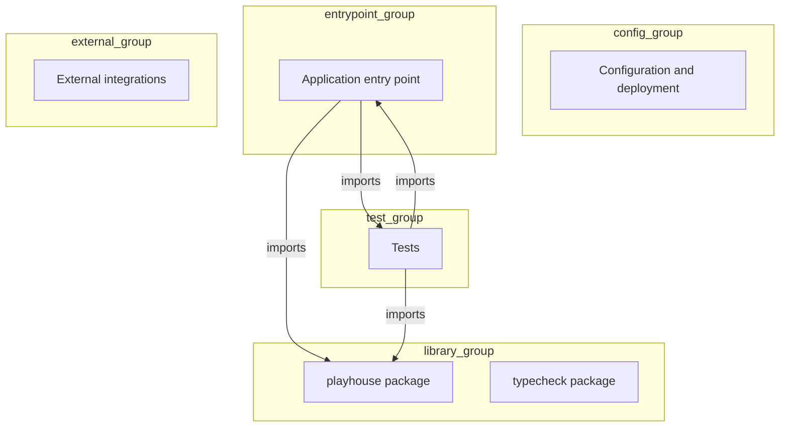

# Architecture report: coleifer/peewee

> Automated static analysis. **Observed** = directly seen in files/imports/AST; **Inferred** = interpretation from that evidence. Repository code was not executed.

## 1. Repository at a glance

| Item | Value |
| --- | --- |
| Repository | coleifer/peewee |
| Description | a small, expressive orm -- supports postgresql, mysql, sqlite, now with asyncio |
| Language | Python |
| Stars | 12006 |
| Licence | MIT |
| Analysed commit / branch | dc0637b30f696d512d35aa10ccd78170f5776251 / master |
| Framework(s) | FastAPI, Flask |
| Files analysed | 176 |
| Components | 6 |

## 2. Architecture in one minute

coleifer/peewee - a small, expressive orm -- supports postgresql, mysql, sqlite, now with asyncio. This repository was analysed statically from 176 file(s) (96 Python). Detected technologies (observed from imports/manifests): GitHub Actions, MySQL, PostgreSQL, SQLite, FastAPI, Flask. Files are grouped into 6 component(s): Configuration and deployment, Application entry point, External integrations, playhouse package, Tests, typecheck package. Observed entry point(s): bench.py, playhouse/migrations.py, pwiz.py. Findings below distinguish observed facts from inferred interpretation.

## 3. High-level block diagram

## 4. Main components

### Configuration and deployment (`config`)

- **Kind:** config
- **Status:** Observed
- **Confidence:** 0.85
- **Responsibility:** Groups 3 file(s) under configuration and deployment (observed from repository paths and static analysis).
- **Paths:** `MANIFEST.in`, `pyproject.toml`, `setup.py`
- **Evidence:** [MANIFEST.in](https://github.com/coleifer/peewee/blob/dc0637b30f696d512d35aa10ccd78170f5776251/MANIFEST.in); [pyproject.toml](https://github.com/coleifer/peewee/blob/dc0637b30f696d512d35aa10ccd78170f5776251/pyproject.toml); [setup.py](https://github.com/coleifer/peewee/blob/dc0637b30f696d512d35aa10ccd78170f5776251/setup.py)

### Application entry point (`entrypoint`)

- **Kind:** entrypoint
- **Status:** Observed
- **Confidence:** 0.85
- **Responsibility:** Groups 4 file(s) under application entry point (observed from repository paths and static analysis). Observed top-level classes: Base, Collection, Item, Migration, MigrationError, Register. Observed top-level functions: _block, _build_add_index, _build_field, _build_field_args, _build_model, _build_stub.
- **Paths:** `bench.py`, `playhouse/migrations.py`, `pwiz.py`, `runtests.py`
- **Evidence:** [bench.py:12](https://github.com/coleifer/peewee/blob/dc0637b30f696d512d35aa10ccd78170f5776251/bench.py#L12); [playhouse/migrations.py:65](https://github.com/coleifer/peewee/blob/dc0637b30f696d512d35aa10ccd78170f5776251/playhouse/migrations.py#L65); [pwiz.py:42](https://github.com/coleifer/peewee/blob/dc0637b30f696d512d35aa10ccd78170f5776251/pwiz.py#L42); [runtests.py:11](https://github.com/coleifer/peewee/blob/dc0637b30f696d512d35aa10ccd78170f5776251/runtests.py#L11)

### External integrations (`external_integrations`)

- **Kind:** external
- **Status:** Inferred
- **Confidence:** 0.70
- **Responsibility:** Groups 0 file(s) under external integrations (observed from repository paths and static analysis).
- **Evidence:** [playhouse/postgres_ext.py:24](https://github.com/coleifer/peewee/blob/dc0637b30f696d512d35aa10ccd78170f5776251/playhouse/postgres_ext.py#L24); [playhouse/postgres_ext.py:29](https://github.com/coleifer/peewee/blob/dc0637b30f696d512d35aa10ccd78170f5776251/playhouse/postgres_ext.py#L29); [playhouse/postgres_ext.py:30](https://github.com/coleifer/peewee/blob/dc0637b30f696d512d35aa10ccd78170f5776251/playhouse/postgres_ext.py#L30); [playhouse/pwasyncio.py:20](https://github.com/coleifer/peewee/blob/dc0637b30f696d512d35aa10ccd78170f5776251/playhouse/pwasyncio.py#L20); [playhouse/pwasyncio.py:25](https://github.com/coleifer/peewee/blob/dc0637b30f696d512d35aa10ccd78170f5776251/playhouse/pwasyncio.py#L25); [playhouse/pwasyncio.py:30](https://github.com/coleifer/peewee/blob/dc0637b30f696d512d35aa10ccd78170f5776251/playhouse/pwasyncio.py#L30)

### playhouse package (`playhouse`)

- **Kind:** library
- **Status:** Observed
- **Confidence:** 0.85
- **Responsibility:** Groups 26 file(s) under playhouse package (observed from repository paths and static analysis). Observed top-level classes: APSWDatabase, ArrayField, ArrayValue, AsyncConnectionWrapper, AsyncCursor, AsyncDatabaseMixin. Observed top-level functions: Match, ServerSide, __dbstatus__, __status__, _aio_database, _check_table_name.
- **Paths:** `playhouse/__init__.py`, `playhouse/apsw_ext.py`, `playhouse/cockroachdb.py`, `playhouse/cysqlite_ext.py`, `playhouse/dataset.py`, `playhouse/db_url.py`, `playhouse/fields.py`, `playhouse/flask_utils.py`, `playhouse/fts_parser.py`, `playhouse/hybrid.py`, `playhouse/kv.py`, `playhouse/migrate.py`, `playhouse/mysql_ext.py`, `playhouse/pool.py`, `playhouse/postgres_ext.py`, `playhouse/pwasyncio.py`, `playhouse/pydantic_utils.py`, `playhouse/reflection.py`, `playhouse/schema_diff.py`, `playhouse/shortcuts.py`, `playhouse/signals.py`, `playhouse/sqlcipher_ext.py`, `playhouse/sqlite_changelog.py`, `playhouse/sqlite_ext.py`, `playhouse/sqlite_udf.py`, `playhouse/sqliteq.py`
- **Evidence:** [playhouse/__init__.py](https://github.com/coleifer/peewee/blob/dc0637b30f696d512d35aa10ccd78170f5776251/playhouse/__init__.py); [playhouse/apsw_ext.py:63](https://github.com/coleifer/peewee/blob/dc0637b30f696d512d35aa10ccd78170f5776251/playhouse/apsw_ext.py#L63); [playhouse/cockroachdb.py:28](https://github.com/coleifer/peewee/blob/dc0637b30f696d512d35aa10ccd78170f5776251/playhouse/cockroachdb.py#L28); [playhouse/cysqlite_ext.py:36](https://github.com/coleifer/peewee/blob/dc0637b30f696d512d35aa10ccd78170f5776251/playhouse/cysqlite_ext.py#L36); [playhouse/dataset.py:19](https://github.com/coleifer/peewee/blob/dc0637b30f696d512d35aa10ccd78170f5776251/playhouse/dataset.py#L19); [playhouse/db_url.py:20](https://github.com/coleifer/peewee/blob/dc0637b30f696d512d35aa10ccd78170f5776251/playhouse/db_url.py#L20); [playhouse/fields.py:16](https://github.com/coleifer/peewee/blob/dc0637b30f696d512d35aa10ccd78170f5776251/playhouse/fields.py#L16); [playhouse/flask_utils.py:15](https://github.com/coleifer/peewee/blob/dc0637b30f696d512d35aa10ccd78170f5776251/playhouse/flask_utils.py#L15)

### Tests (`tests`)

- **Kind:** test
- **Status:** Observed
- **Confidence:** 0.85
- **Responsibility:** Groups 46 file(s) under tests (observed from repository paths and static analysis). Observed application object created via Flask. Observed top-level classes: A, AComposite, ADirty, AFModel, ANoLazy, APIResponse. Observed top-level functions: __sql__, _cmp, _make_lazy_cursor, add_column_mig, collate_case_insensitive, collate_reverse.
- **Paths:** `playhouse/test_utils.py`, `tests/__init__.py`, `tests/__main__.py`, `tests/apsw_ext.py`, `tests/base.py`, `tests/base_models.py`, `tests/cockroachdb.py`, `tests/cysqlite_ext.py`, `tests/dataset.py`, `tests/db_tests.py`, `tests/db_url.py`, `tests/extra_fields.py`, `tests/fields.py`, `tests/flask_utils.py`, `tests/fts_parser.py`, `tests/hybrid.py`, `tests/json_field.py`, `tests/kv.py`, `tests/manytomany.py`, `tests/migrations.py`, `tests/model_sql.py`, `tests/mysql_ext.py`, `tests/pool.py`, `tests/postgres.py`, `tests/postgres_helpers.py`, `tests/prefetch_tests.py`, `tests/pwasyncio.py`, `tests/pwasyncio_stress.py`, `tests/pwiz_integration.py`, `tests/pydantic_utils.py`, `tests/reflection.py`, `tests/results.py`, `tests/schema.py`, `tests/schema_diff.py`, `tests/shortcuts.py`, `tests/signals.py`, `tests/sql.py`, `tests/sqlcipher_ext.py`, `tests/sqlite.py`, `tests/sqlite_changelog.py`, `tests/sqlite_helpers.py`, `tests/sqlite_udf.py`, `tests/sqliteq.py`, `tests/test_utils.py`, `tests/transactions.py`, `tests/with_related_tests.py`
- **Evidence:** [playhouse/test_utils.py:8](https://github.com/coleifer/peewee/blob/dc0637b30f696d512d35aa10ccd78170f5776251/playhouse/test_utils.py#L8); [tests/__init__.py:130](https://github.com/coleifer/peewee/blob/dc0637b30f696d512d35aa10ccd78170f5776251/tests/__init__.py#L130); [tests/__main__.py](https://github.com/coleifer/peewee/blob/dc0637b30f696d512d35aa10ccd78170f5776251/tests/__main__.py); [tests/apsw_ext.py:14](https://github.com/coleifer/peewee/blob/dc0637b30f696d512d35aa10ccd78170f5776251/tests/apsw_ext.py#L14); [tests/base.py:25](https://github.com/coleifer/peewee/blob/dc0637b30f696d512d35aa10ccd78170f5776251/tests/base.py#L25); [tests/base_models.py:8](https://github.com/coleifer/peewee/blob/dc0637b30f696d512d35aa10ccd78170f5776251/tests/base_models.py#L8); [tests/cockroachdb.py:17](https://github.com/coleifer/peewee/blob/dc0637b30f696d512d35aa10ccd78170f5776251/tests/cockroachdb.py#L17); [tests/cysqlite_ext.py:16](https://github.com/coleifer/peewee/blob/dc0637b30f696d512d35aa10ccd78170f5776251/tests/cysqlite_ext.py#L16)

### typecheck package (`typecheck`)

- **Kind:** library
- **Status:** Observed
- **Confidence:** 0.85
- **Responsibility:** Groups 1 file(s) under typecheck package (observed from repository paths and static analysis). Observed top-level classes: Event, Tweet, User. Observed top-level functions: bound, enqueue.
- **Paths:** `typecheck/check_stub.py`
- **Evidence:** [typecheck/check_stub.py:27](https://github.com/coleifer/peewee/blob/dc0637b30f696d512d35aa10ccd78170f5776251/typecheck/check_stub.py#L27)

## 5. Execution flow

**Observed** entry point(s):

- [bench.py:141](https://github.com/coleifer/peewee/blob/dc0637b30f696d512d35aa10ccd78170f5776251/bench.py#L141)
- [playhouse/migrations.py](https://github.com/coleifer/peewee/blob/dc0637b30f696d512d35aa10ccd78170f5776251/playhouse/migrations.py)
- [pwiz.py](https://github.com/coleifer/peewee/blob/dc0637b30f696d512d35aa10ccd78170f5776251/pwiz.py)
- [runtests.py:95](https://github.com/coleifer/peewee/blob/dc0637b30f696d512d35aa10ccd78170f5776251/runtests.py#L95)

**Observed** routes (from decorators):

- `ROUTE /a.gif` -> `analyze` in `examples/analytics/app.py:94`
- `ROUTE /a.js` -> `script` in `examples/analytics/app.py:119`
- `ROUTE /login/` -> `login` in `examples/blog/app.py:144`
- `ROUTE /logout/` -> `logout` in `examples/blog/app.py:160`
- `ROUTE /` -> `index` in `examples/blog/app.py:167`
- `ROUTE /create/` -> `create` in `examples/blog/app.py:209`
- `ROUTE /drafts/` -> `drafts` in `examples/blog/app.py:214`
- `ROUTE /<slug>/` -> `detail` in `examples/blog/app.py:219`
- `ROUTE /<slug>/edit/` -> `edit` in `examples/blog/app.py:229`
- `GET /users` -> `list_users` in `examples/fastapi_example.py:40`
- `POST /users` -> `create_user` in `examples/fastapi_example.py:45`
- `GET /users/{user_id}` -> `get_user` in `examples/fastapi_example.py:50`
- `ROUTE /` -> `homepage` in `examples/twitter/app.py:149`
- `ROUTE /private/` -> `private_timeline` in `examples/twitter/app.py:158`
- `ROUTE /public/` -> `public_timeline` in `examples/twitter/app.py:170`
- `ROUTE /join/` -> `join` in `examples/twitter/app.py:176`
- `ROUTE /login/` -> `login` in `examples/twitter/app.py:201`
- `ROUTE /logout/` -> `logout` in `examples/twitter/app.py:219`
- `ROUTE /following/` -> `following` in `examples/twitter/app.py:226`
- `ROUTE /followers/` -> `followers` in `examples/twitter/app.py:232`
- `ROUTE /users/` -> `user_list` in `examples/twitter/app.py:237`
- `ROUTE /users/<username>/` -> `user_detail` in `examples/twitter/app.py:242`
- `ROUTE /users/<username>/follow/` -> `user_follow` in `examples/twitter/app.py:253`
- `ROUTE /users/<username>/unfollow/` -> `user_unfollow` in `examples/twitter/app.py:268`
- `ROUTE /create/` -> `create` in `examples/twitter/app.py:281`

Representative flow (derived from observed entry points and the import graph; steps beyond the entry point are **Inferred**):

1. Execution starts at an observed entry point listed above, if present.
2. `entrypoint` imports `playhouse` (Application entry point -> playhouse package).
3. `entrypoint` imports `tests` (Application entry point -> Tests).
4. `tests` imports `entrypoint` (Tests -> Application entry point).
5. `tests` imports `playhouse` (Tests -> playhouse package).

## 6. Project structure

### `(root)`

- `.gitignore` - other (164 bytes)
- `.readthedocs.yaml` - config (164 bytes)
- `.travis.yml` - ci, YAML (1862 bytes)
- `.travis_deps.sh` - source, Shell (1033 bytes)
- `CHANGELOG.md` - docs (168003 bytes)
- `LICENSE` - docs (1058 bytes)
- `MANIFEST.in` - manifest (264 bytes)
- `README.rst` - docs (9077 bytes)
- `bench.py` - source, Python (4131 bytes)
- `pwiz.py` - source, Python (8431 bytes)
- `pyproject.toml` - manifest (1579 bytes)
- `runtests.py` - source, Python (4907 bytes)
- `setup.py` - manifest, Python (953 bytes)

### `.github`

- `.github/workflows/tests.yaml` - ci, YAML (4054 bytes)
- `.github/workflows/wheels.yaml` - ci, YAML (975 bytes)

### `docs`

- `docs/Makefile` - docs (4590 bytes)
- `docs/_themes/flask/layout.html` - docs (750 bytes)
- `docs/_themes/flask/relations.html` - docs (590 bytes)
- `docs/_themes/flask/static/flasky.css_t` - docs (6436 bytes)
- `docs/_themes/flask/static/small_flask.css` - docs (976 bytes)
- `docs/_themes/flask/theme.conf` - docs (164 bytes)
- `docs/clubdata.sql` - docs (169937 bytes)
- `docs/conf.py` - docs (7702 bytes)
- `docs/extras/llms.txt` - docs (2680 bytes)
- `docs/index.rst` - docs (2208 bytes)
- `docs/make.bat` - docs (4106 bytes)
- `docs/peewee/asyncio.rst` - docs (40262 bytes)
- `docs/peewee/contributing.rst` - docs (4783 bytes)
- `docs/peewee/database.rst` - docs (24213 bytes)
- `docs/peewee/db_tools.rst` - docs (51892 bytes)
- `docs/peewee/example.rst` - docs (13739 bytes)
- `docs/peewee/framework_integration.rst` - docs (20854 bytes)
- `docs/peewee/installation.rst` - docs (4012 bytes)
- `docs/peewee/interactive.rst` - docs (3835 bytes)
- `docs/peewee/models.rst` - docs (53558 bytes)
- `docs/peewee/mysql.rst` - docs (1801 bytes)
- `docs/peewee/orm_utils.rst` - docs (46905 bytes)
- `docs/peewee/pool-snippet.rst` - docs (742 bytes)
- `docs/peewee/postgres.rst` - docs (38930 bytes)
- `docs/peewee/query_builder.rst` - docs (12399 bytes)
- `docs/peewee/query_library.rst` - docs (60736 bytes)
- `docs/peewee/query_operators.rst` - docs (15084 bytes)
- `docs/peewee/querying.rst` - docs (35954 bytes)
- `docs/peewee/quickstart.rst` - docs (5159 bytes)
- `docs/peewee/recipes.rst` - docs (18712 bytes)
- `docs/peewee/relationships.rst` - docs (42018 bytes)
- `docs/peewee/schema.rst` - docs (7653 bytes)
- `docs/peewee/sqlite.rst` - docs (92902 bytes)
- `docs/peewee/transactions.rst` - docs (10071 bytes)
- `docs/peewee/writing.rst` - docs (23219 bytes)
- `docs/requirements.txt` - manifest (31 bytes)

### `examples`

- `examples/adjacency_list.py` - source, Python (1515 bytes)
- `examples/analytics/app.py` - source, Python (4348 bytes)
- `examples/analytics/reports.py` - source, Python (4400 bytes)
- `examples/analytics/requirements.txt` - manifest (22 bytes)
- `examples/analytics/run_example.py` - source, Python (103 bytes)
- `examples/anomaly_detection.py` - source, Python (1697 bytes)
- `examples/blog/.pwmigrate` - other (37 bytes)
- `examples/blog/app.py` - source, Python (9406 bytes)
- `examples/blog/migrations/0001_initial.py` - source, Python (854 bytes)
- `examples/blog/requirements.txt` - manifest (55 bytes)
- `examples/blog/static/css/hilite.css` - other (1713 bytes)
- `examples/blog/static/fonts/glyphicons-halflings-regular.svg` - other (62927 bytes)
- `examples/blog/static/robots.txt` - docs (14 bytes)
- `examples/blog/templates/base.html` - other (2825 bytes)
- `examples/blog/templates/create.html` - other (1408 bytes)
- `examples/blog/templates/detail.html` - other (429 bytes)
- `examples/blog/templates/edit.html` - other (250 bytes)
- `examples/blog/templates/includes/pagination.html` - other (778 bytes)
- `examples/blog/templates/index.html` - other (636 bytes)
- `examples/blog/templates/login.html` - other (663 bytes)
- `examples/blog/templates/logout.html` - other (363 bytes)
- `examples/diary.py` - source, Python (2450 bytes)
- `examples/fastapi_example.py` - source, Python (1953 bytes)
- `examples/graph.py` - source, Python (2131 bytes)
- `examples/hexastore.py` - source, Python (5022 bytes)
- `examples/query_library.py` - source, Python (1393 bytes)
- `examples/reddit_ranking.py` - source, Python (1413 bytes)
- `examples/sqlite_fts_compression.py` - source, Python (1730 bytes)
- `examples/twitter/.pwmigrate` - other (37 bytes)
- `examples/twitter/app.py` - source, Python (10434 bytes)
- `examples/twitter/migrations/0001_initial.py` - source, Python (1087 bytes)
- `examples/twitter/requirements.txt` - manifest (13 bytes)
- `examples/twitter/run_example.py` - source, Python (124 bytes)
- `examples/twitter/static/style.css` - other (797 bytes)
- `examples/twitter/templates/create.html` - other (291 bytes)
- `examples/twitter/templates/homepage.html` - other (106 bytes)
- `examples/twitter/templates/includes/message.html` - other (198 bytes)
- `examples/twitter/templates/includes/pagination.html` - other (178 bytes)
- `examples/twitter/templates/join.html` - other (487 bytes)
- `examples/twitter/templates/layout.html` - other (696 bytes)
- `examples/twitter/templates/login.html` - other (407 bytes)
- `examples/twitter/templates/private_messages.html` - other (254 bytes)
- `examples/twitter/templates/public_messages.html` - other (253 bytes)
- `examples/twitter/templates/user_detail.html` - other (780 bytes)
- `examples/twitter/templates/user_followers.html` - other (305 bytes)
- `examples/twitter/templates/user_following.html` - other (305 bytes)
- `examples/twitter/templates/user_list.html` - other (286 bytes)

### `peewee-stubs`

- `peewee-stubs/__init__.pyi` - other (81090 bytes)

### `playhouse`

- `playhouse/README.md` - docs (3383 bytes)
- `playhouse/__init__.py` - source, Python (0 bytes)
- `playhouse/_sqlite_udf.pyx` - other (11346 bytes)
- `playhouse/apsw_ext.py` - source, Python (6187 bytes)
- `playhouse/cockroachdb.py` - source, Python (8965 bytes)
- `playhouse/cysqlite_ext.py` - source, Python (10604 bytes)
- `playhouse/dataset.py` - source, Python (15720 bytes)
- `playhouse/db_url.py` - source, Python (5163 bytes)
- `playhouse/fields.py` - source, Python (2849 bytes)
- `playhouse/flask_utils.py` - source, Python (7863 bytes)
- `playhouse/fts_parser.py` - source, Python (8290 bytes)
- `playhouse/hybrid.py` - source, Python (1528 bytes)
- `playhouse/kv.py` - source, Python (5622 bytes)
- `playhouse/migrate.py` - source, Python (38576 bytes)
- `playhouse/migrations.py` - source, Python (31850 bytes)
- `playhouse/mysql_ext.py` - source, Python (3588 bytes)
- `playhouse/pool.py` - source, Python (10933 bytes)
- `playhouse/postgres_ext.py` - source, Python (24436 bytes)
- `playhouse/pwasyncio.py` - source, Python (45156 bytes)
- `playhouse/pydantic_utils.py` - source, Python (5920 bytes)
- `playhouse/reflection.py` - source, Python (34216 bytes)
- `playhouse/schema_diff.py` - source, Python (6117 bytes)
- `playhouse/shortcuts.py` - source, Python (12680 bytes)
- `playhouse/signals.py` - source, Python (2507 bytes)
- `playhouse/sqlcipher_ext.py` - source, Python (2062 bytes)
- `playhouse/sqlite_changelog.py` - source, Python (4793 bytes)
- `playhouse/sqlite_ext.py` - source, Python (29688 bytes)
- `playhouse/sqlite_udf.py` - source, Python (16244 bytes)
- `playhouse/sqliteq.py` - source, Python (10608 bytes)
- `playhouse/test_utils.py` - test, Python (1926 bytes)

### `tests`

- `tests/__init__.py` - test, Python (3690 bytes)
- `tests/__main__.py` - test, Python (1251 bytes)
- `tests/apsw_ext.py` - test, Python (7893 bytes)
- `tests/base.py` - test, Python (11285 bytes)
- `tests/base_models.py` - test, Python (3671 bytes)
- `tests/cockroachdb.py` - test, Python (13785 bytes)
- `tests/cysqlite_ext.py` - test, Python (9407 bytes)
- `tests/dataset.py` - test, Python (26088 bytes)
- `tests/db_tests.py` - test, Python (70748 bytes)
- `tests/db_url.py` - test, Python (3684 bytes)
- `tests/extra_fields.py` - test, Python (3802 bytes)
- `tests/fields.py` - test, Python (106204 bytes)
- `tests/flask_utils.py` - test, Python (10994 bytes)
- `tests/fts_parser.py` - test, Python (7364 bytes)
- `tests/hybrid.py` - test, Python (5143 bytes)
- `tests/json_field.py` - test, Python (45403 bytes)
- `tests/kv.py` - test, Python (3933 bytes)
- `tests/manytomany.py` - test, Python (26807 bytes)
- `tests/migrations.py` - test, Python (88428 bytes)
- `tests/model_sql.py` - test, Python (94622 bytes)
- `tests/mysql_ext.py` - test, Python (4515 bytes)
- `tests/pool.py` - test, Python (33146 bytes)
- `tests/postgres.py` - test, Python (45276 bytes)
- `tests/postgres_helpers.py` - test, Python (15952 bytes)
- `tests/prefetch_tests.py` - test, Python (29508 bytes)
- `tests/pwasyncio.py` - test, Python (96102 bytes)
- `tests/pwasyncio_stress.py` - test, Python (8674 bytes)
- `tests/pwiz_integration.py` - test, Python (8886 bytes)
- `tests/pydantic_utils.py` - test, Python (20376 bytes)
- `tests/reflection.py` - test, Python (34745 bytes)
- `tests/results.py` - test, Python (24168 bytes)
- `tests/schema.py` - test, Python (53243 bytes)
- `tests/schema_diff.py` - test, Python (31268 bytes)
- `tests/shortcuts.py` - test, Python (34885 bytes)
- `tests/signals.py` - test, Python (6466 bytes)
- `tests/sql.py` - test, Python (161565 bytes)
- `tests/sqlcipher_ext.py` - test, Python (5421 bytes)
- `tests/sqlite.py` - test, Python (67456 bytes)
- `tests/sqlite_changelog.py` - test, Python (5895 bytes)
- `tests/sqlite_helpers.py` - test, Python (534 bytes)
- `tests/sqlite_udf.py` - test, Python (13772 bytes)
- `tests/sqliteq.py` - test, Python (7519 bytes)
- `tests/test_utils.py` - test, Python (2319 bytes)
- `tests/transactions.py` - test, Python (29124 bytes)
- `tests/with_related_tests.py` - test, Python (60772 bytes)

### `typecheck`

- `typecheck/check_stub.py` - source, Python (4103 bytes)
- `typecheck/stubtest_allowlist.txt` - docs (1299 bytes)

## 7. Key dependencies and integrations

| Name | Category | Status | Confidence | Evidence |
| --- | --- | --- | --- | --- |
| GitHub Actions | ci | Observed | 0.90 | [.github/workflows/tests.yaml](https://github.com/coleifer/peewee/blob/dc0637b30f696d512d35aa10ccd78170f5776251/.github/workflows/tests.yaml); [.github/workflows/wheels.yaml](https://github.com/coleifer/peewee/blob/dc0637b30f696d512d35aa10ccd78170f5776251/.github/workflows/wheels.yaml) |
| MySQL | database | Observed | 0.95 | [playhouse/mysql_ext.py:2](https://github.com/coleifer/peewee/blob/dc0637b30f696d512d35aa10ccd78170f5776251/playhouse/mysql_ext.py#L2); [playhouse/pwasyncio.py:30](https://github.com/coleifer/peewee/blob/dc0637b30f696d512d35aa10ccd78170f5776251/playhouse/pwasyncio.py#L30); [pyproject.toml:39](https://github.com/coleifer/peewee/blob/dc0637b30f696d512d35aa10ccd78170f5776251/pyproject.toml#L39); [pyproject.toml:44](https://github.com/coleifer/peewee/blob/dc0637b30f696d512d35aa10ccd78170f5776251/pyproject.toml#L44) |
| PostgreSQL | database | Observed | 0.95 | [examples/analytics/requirements.txt:3](https://github.com/coleifer/peewee/blob/dc0637b30f696d512d35aa10ccd78170f5776251/examples/analytics/requirements.txt#L3); [playhouse/postgres_ext.py:24](https://github.com/coleifer/peewee/blob/dc0637b30f696d512d35aa10ccd78170f5776251/playhouse/postgres_ext.py#L24); [playhouse/postgres_ext.py:29](https://github.com/coleifer/peewee/blob/dc0637b30f696d512d35aa10ccd78170f5776251/playhouse/postgres_ext.py#L29); [playhouse/postgres_ext.py:30](https://github.com/coleifer/peewee/blob/dc0637b30f696d512d35aa10ccd78170f5776251/playhouse/postgres_ext.py#L30) |
| SQLite | database | Observed | 0.95 | [playhouse/pwasyncio.py:20](https://github.com/coleifer/peewee/blob/dc0637b30f696d512d35aa10ccd78170f5776251/playhouse/pwasyncio.py#L20); [pyproject.toml:43](https://github.com/coleifer/peewee/blob/dc0637b30f696d512d35aa10ccd78170f5776251/pyproject.toml#L43); [runtests.py:84](https://github.com/coleifer/peewee/blob/dc0637b30f696d512d35aa10ccd78170f5776251/runtests.py#L84); [tests/fields.py:9](https://github.com/coleifer/peewee/blob/dc0637b30f696d512d35aa10ccd78170f5776251/tests/fields.py#L9) |
| FastAPI | framework | Observed | 0.90 | [examples/fastapi_example.py:1](https://github.com/coleifer/peewee/blob/dc0637b30f696d512d35aa10ccd78170f5776251/examples/fastapi_example.py#L1) |
| Flask | framework | Observed | 0.95 | [examples/analytics/app.py:29](https://github.com/coleifer/peewee/blob/dc0637b30f696d512d35aa10ccd78170f5776251/examples/analytics/app.py#L29); [examples/analytics/requirements.txt:2](https://github.com/coleifer/peewee/blob/dc0637b30f696d512d35aa10ccd78170f5776251/examples/analytics/requirements.txt#L2); [examples/blog/app.py:7](https://github.com/coleifer/peewee/blob/dc0637b30f696d512d35aa10ccd78170f5776251/examples/blog/app.py#L7); [examples/blog/requirements.txt:1](https://github.com/coleifer/peewee/blob/dc0637b30f696d512d35aa10ccd78170f5776251/examples/blog/requirements.txt#L1) |
| Peewee | library | Observed | 0.95 | [bench.py:1](https://github.com/coleifer/peewee/blob/dc0637b30f696d512d35aa10ccd78170f5776251/bench.py#L1); [docs/conf.py:55](https://github.com/coleifer/peewee/blob/dc0637b30f696d512d35aa10ccd78170f5776251/docs/conf.py#L55); [examples/adjacency_list.py:1](https://github.com/coleifer/peewee/blob/dc0637b30f696d512d35aa10ccd78170f5776251/examples/adjacency_list.py#L1); [examples/analytics/app.py:30](https://github.com/coleifer/peewee/blob/dc0637b30f696d512d35aa10ccd78170f5776251/examples/analytics/app.py#L30) |
| Pydantic | library | Observed | 0.95 | [playhouse/pydantic_utils.py:13](https://github.com/coleifer/peewee/blob/dc0637b30f696d512d35aa10ccd78170f5776251/playhouse/pydantic_utils.py#L13); [playhouse/pydantic_utils.py:14](https://github.com/coleifer/peewee/blob/dc0637b30f696d512d35aa10ccd78170f5776251/playhouse/pydantic_utils.py#L14); [playhouse/pydantic_utils.py:15](https://github.com/coleifer/peewee/blob/dc0637b30f696d512d35aa10ccd78170f5776251/playhouse/pydantic_utils.py#L15); [tests/pydantic_utils.py:13](https://github.com/coleifer/peewee/blob/dc0637b30f696d512d35aa10ccd78170f5776251/tests/pydantic_utils.py#L13) |
| Poetry | packaging | Observed | 0.85 | [pyproject.toml](https://github.com/coleifer/peewee/blob/dc0637b30f696d512d35aa10ccd78170f5776251/pyproject.toml) |
| setuptools | packaging | Observed | 0.95 | [pyproject.toml:2](https://github.com/coleifer/peewee/blob/dc0637b30f696d512d35aa10ccd78170f5776251/pyproject.toml#L2); [setup.py:3](https://github.com/coleifer/peewee/blob/dc0637b30f696d512d35aa10ccd78170f5776251/setup.py#L3); [setup.py:4](https://github.com/coleifer/peewee/blob/dc0637b30f696d512d35aa10ccd78170f5776251/setup.py#L4) |
| unittest | tooling | Observed | 0.95 | [runtests.py:5](https://github.com/coleifer/peewee/blob/dc0637b30f696d512d35aa10ccd78170f5776251/runtests.py#L5); [tests/__init__.py:1](https://github.com/coleifer/peewee/blob/dc0637b30f696d512d35aa10ccd78170f5776251/tests/__init__.py#L1); [tests/__main__.py:3](https://github.com/coleifer/peewee/blob/dc0637b30f696d512d35aa10ccd78170f5776251/tests/__main__.py#L3); [tests/base.py:8](https://github.com/coleifer/peewee/blob/dc0637b30f696d512d35aa10ccd78170f5776251/tests/base.py#L8) |

## 8. Data and state

- **MySQL** (Observed, confidence 0.95) - evidence: [playhouse/mysql_ext.py:2](https://github.com/coleifer/peewee/blob/dc0637b30f696d512d35aa10ccd78170f5776251/playhouse/mysql_ext.py#L2); [playhouse/pwasyncio.py:30](https://github.com/coleifer/peewee/blob/dc0637b30f696d512d35aa10ccd78170f5776251/playhouse/pwasyncio.py#L30); [pyproject.toml:39](https://github.com/coleifer/peewee/blob/dc0637b30f696d512d35aa10ccd78170f5776251/pyproject.toml#L39); [pyproject.toml:44](https://github.com/coleifer/peewee/blob/dc0637b30f696d512d35aa10ccd78170f5776251/pyproject.toml#L44)
- **PostgreSQL** (Observed, confidence 0.95) - evidence: [examples/analytics/requirements.txt:3](https://github.com/coleifer/peewee/blob/dc0637b30f696d512d35aa10ccd78170f5776251/examples/analytics/requirements.txt#L3); [playhouse/postgres_ext.py:24](https://github.com/coleifer/peewee/blob/dc0637b30f696d512d35aa10ccd78170f5776251/playhouse/postgres_ext.py#L24); [playhouse/postgres_ext.py:29](https://github.com/coleifer/peewee/blob/dc0637b30f696d512d35aa10ccd78170f5776251/playhouse/postgres_ext.py#L29); [playhouse/postgres_ext.py:30](https://github.com/coleifer/peewee/blob/dc0637b30f696d512d35aa10ccd78170f5776251/playhouse/postgres_ext.py#L30)
- **SQLite** (Observed, confidence 0.95) - evidence: [playhouse/pwasyncio.py:20](https://github.com/coleifer/peewee/blob/dc0637b30f696d512d35aa10ccd78170f5776251/playhouse/pwasyncio.py#L20); [pyproject.toml:43](https://github.com/coleifer/peewee/blob/dc0637b30f696d512d35aa10ccd78170f5776251/pyproject.toml#L43); [runtests.py:84](https://github.com/coleifer/peewee/blob/dc0637b30f696d512d35aa10ccd78170f5776251/runtests.py#L84); [tests/fields.py:9](https://github.com/coleifer/peewee/blob/dc0637b30f696d512d35aa10ccd78170f5776251/tests/fields.py#L9)

## 9. Configuration and deployment clues

- `.github/workflows/tests.yaml` (ci)
- `.github/workflows/wheels.yaml` (ci)
- `.readthedocs.yaml` (config)
- `.travis.yml` (ci)
- `MANIFEST.in` (manifest)
- `docs/requirements.txt` (manifest)
- `examples/analytics/requirements.txt` (manifest)
- `examples/blog/requirements.txt` (manifest)
- `examples/twitter/requirements.txt` (manifest)
- `pyproject.toml` (manifest)
- `setup.py` (manifest)

Console scripts declared in packaging metadata (**Observed**):

- `pwiz` -> `pwiz:main`
- `pwmigrate` -> `playhouse.migrations:main`

## 10. Design observations

- An entry/API layer is separated from other code (Inferred from paths and decorators).
- Tests are present alongside source code (Observed from test file paths).
- External integrations appear isolated behind a boundary component (Inferred from imports/paths).

These observations are interpretations (**Inferred**) of the observed structure, not guarantees about runtime design.

## 11. Limitations and unknowns

- Static analysis only: repository code was not executed, installed, or imported at runtime.
- Components and relationships are inferred from file paths, imports, and AST structure; runtime behaviour, dynamic imports, and reflection may not be visible.
- 1 file(s) were skipped during inventory (1 x generated/minified file excluded).
- Repository text was treated as untrusted data; no instructions found in repository files were followed, and likely secret values were redacted/excluded.

## 12. Source references

- [.github/workflows/tests.yaml](https://github.com/coleifer/peewee/blob/dc0637b30f696d512d35aa10ccd78170f5776251/.github/workflows/tests.yaml)
- [.github/workflows/wheels.yaml](https://github.com/coleifer/peewee/blob/dc0637b30f696d512d35aa10ccd78170f5776251/.github/workflows/wheels.yaml)
- [MANIFEST.in](https://github.com/coleifer/peewee/blob/dc0637b30f696d512d35aa10ccd78170f5776251/MANIFEST.in)
- [bench.py:1](https://github.com/coleifer/peewee/blob/dc0637b30f696d512d35aa10ccd78170f5776251/bench.py#L1)
- [bench.py:12](https://github.com/coleifer/peewee/blob/dc0637b30f696d512d35aa10ccd78170f5776251/bench.py#L12)
- [bench.py:141](https://github.com/coleifer/peewee/blob/dc0637b30f696d512d35aa10ccd78170f5776251/bench.py#L141)
- [docs/conf.py:55](https://github.com/coleifer/peewee/blob/dc0637b30f696d512d35aa10ccd78170f5776251/docs/conf.py#L55)
- [examples/adjacency_list.py:1](https://github.com/coleifer/peewee/blob/dc0637b30f696d512d35aa10ccd78170f5776251/examples/adjacency_list.py#L1)
- [examples/analytics/app.py:29](https://github.com/coleifer/peewee/blob/dc0637b30f696d512d35aa10ccd78170f5776251/examples/analytics/app.py#L29)
- [examples/analytics/app.py:30](https://github.com/coleifer/peewee/blob/dc0637b30f696d512d35aa10ccd78170f5776251/examples/analytics/app.py#L30)
- [examples/analytics/reports.py:1](https://github.com/coleifer/peewee/blob/dc0637b30f696d512d35aa10ccd78170f5776251/examples/analytics/reports.py#L1)
- [examples/analytics/requirements.txt:1](https://github.com/coleifer/peewee/blob/dc0637b30f696d512d35aa10ccd78170f5776251/examples/analytics/requirements.txt#L1)
- [examples/analytics/requirements.txt:2](https://github.com/coleifer/peewee/blob/dc0637b30f696d512d35aa10ccd78170f5776251/examples/analytics/requirements.txt#L2)
- [examples/analytics/requirements.txt:3](https://github.com/coleifer/peewee/blob/dc0637b30f696d512d35aa10ccd78170f5776251/examples/analytics/requirements.txt#L3)
- [examples/anomaly_detection.py:2](https://github.com/coleifer/peewee/blob/dc0637b30f696d512d35aa10ccd78170f5776251/examples/anomaly_detection.py#L2)
- [examples/blog/app.py:7](https://github.com/coleifer/peewee/blob/dc0637b30f696d512d35aa10ccd78170f5776251/examples/blog/app.py#L7)
- [examples/blog/app.py:15](https://github.com/coleifer/peewee/blob/dc0637b30f696d512d35aa10ccd78170f5776251/examples/blog/app.py#L15)
- [examples/blog/requirements.txt:1](https://github.com/coleifer/peewee/blob/dc0637b30f696d512d35aa10ccd78170f5776251/examples/blog/requirements.txt#L1)
- [examples/fastapi_example.py:1](https://github.com/coleifer/peewee/blob/dc0637b30f696d512d35aa10ccd78170f5776251/examples/fastapi_example.py#L1)
- [examples/twitter/app.py:3](https://github.com/coleifer/peewee/blob/dc0637b30f696d512d35aa10ccd78170f5776251/examples/twitter/app.py#L3)
- [examples/twitter/app.py:4](https://github.com/coleifer/peewee/blob/dc0637b30f696d512d35aa10ccd78170f5776251/examples/twitter/app.py#L4)
- [examples/twitter/app.py:5](https://github.com/coleifer/peewee/blob/dc0637b30f696d512d35aa10ccd78170f5776251/examples/twitter/app.py#L5)
- [examples/twitter/app.py:6](https://github.com/coleifer/peewee/blob/dc0637b30f696d512d35aa10ccd78170f5776251/examples/twitter/app.py#L6)
- [playhouse/__init__.py](https://github.com/coleifer/peewee/blob/dc0637b30f696d512d35aa10ccd78170f5776251/playhouse/__init__.py)
- [playhouse/apsw_ext.py:63](https://github.com/coleifer/peewee/blob/dc0637b30f696d512d35aa10ccd78170f5776251/playhouse/apsw_ext.py#L63)
- [playhouse/cockroachdb.py:28](https://github.com/coleifer/peewee/blob/dc0637b30f696d512d35aa10ccd78170f5776251/playhouse/cockroachdb.py#L28)
- [playhouse/cysqlite_ext.py:36](https://github.com/coleifer/peewee/blob/dc0637b30f696d512d35aa10ccd78170f5776251/playhouse/cysqlite_ext.py#L36)
- [playhouse/dataset.py:19](https://github.com/coleifer/peewee/blob/dc0637b30f696d512d35aa10ccd78170f5776251/playhouse/dataset.py#L19)
- [playhouse/db_url.py:20](https://github.com/coleifer/peewee/blob/dc0637b30f696d512d35aa10ccd78170f5776251/playhouse/db_url.py#L20)
- [playhouse/fields.py:16](https://github.com/coleifer/peewee/blob/dc0637b30f696d512d35aa10ccd78170f5776251/playhouse/fields.py#L16)
- [playhouse/flask_utils.py:15](https://github.com/coleifer/peewee/blob/dc0637b30f696d512d35aa10ccd78170f5776251/playhouse/flask_utils.py#L15)
- [playhouse/migrations.py](https://github.com/coleifer/peewee/blob/dc0637b30f696d512d35aa10ccd78170f5776251/playhouse/migrations.py)
- [playhouse/migrations.py:65](https://github.com/coleifer/peewee/blob/dc0637b30f696d512d35aa10ccd78170f5776251/playhouse/migrations.py#L65)
- [playhouse/mysql_ext.py:2](https://github.com/coleifer/peewee/blob/dc0637b30f696d512d35aa10ccd78170f5776251/playhouse/mysql_ext.py#L2)
- [playhouse/postgres_ext.py:24](https://github.com/coleifer/peewee/blob/dc0637b30f696d512d35aa10ccd78170f5776251/playhouse/postgres_ext.py#L24)
- [playhouse/postgres_ext.py:29](https://github.com/coleifer/peewee/blob/dc0637b30f696d512d35aa10ccd78170f5776251/playhouse/postgres_ext.py#L29)
- [playhouse/postgres_ext.py:30](https://github.com/coleifer/peewee/blob/dc0637b30f696d512d35aa10ccd78170f5776251/playhouse/postgres_ext.py#L30)
- [playhouse/pwasyncio.py:20](https://github.com/coleifer/peewee/blob/dc0637b30f696d512d35aa10ccd78170f5776251/playhouse/pwasyncio.py#L20)
- [playhouse/pwasyncio.py:25](https://github.com/coleifer/peewee/blob/dc0637b30f696d512d35aa10ccd78170f5776251/playhouse/pwasyncio.py#L25)
- [playhouse/pwasyncio.py:30](https://github.com/coleifer/peewee/blob/dc0637b30f696d512d35aa10ccd78170f5776251/playhouse/pwasyncio.py#L30)
- [playhouse/pydantic_utils.py:13](https://github.com/coleifer/peewee/blob/dc0637b30f696d512d35aa10ccd78170f5776251/playhouse/pydantic_utils.py#L13)
- [playhouse/pydantic_utils.py:14](https://github.com/coleifer/peewee/blob/dc0637b30f696d512d35aa10ccd78170f5776251/playhouse/pydantic_utils.py#L14)
- [playhouse/pydantic_utils.py:15](https://github.com/coleifer/peewee/blob/dc0637b30f696d512d35aa10ccd78170f5776251/playhouse/pydantic_utils.py#L15)
- [playhouse/test_utils.py:8](https://github.com/coleifer/peewee/blob/dc0637b30f696d512d35aa10ccd78170f5776251/playhouse/test_utils.py#L8)
- [pwiz.py](https://github.com/coleifer/peewee/blob/dc0637b30f696d512d35aa10ccd78170f5776251/pwiz.py)
- [pwiz.py:42](https://github.com/coleifer/peewee/blob/dc0637b30f696d512d35aa10ccd78170f5776251/pwiz.py#L42)
- [pyproject.toml](https://github.com/coleifer/peewee/blob/dc0637b30f696d512d35aa10ccd78170f5776251/pyproject.toml)
- [pyproject.toml:2](https://github.com/coleifer/peewee/blob/dc0637b30f696d512d35aa10ccd78170f5776251/pyproject.toml#L2)
- [pyproject.toml:39](https://github.com/coleifer/peewee/blob/dc0637b30f696d512d35aa10ccd78170f5776251/pyproject.toml#L39)
- [pyproject.toml:40](https://github.com/coleifer/peewee/blob/dc0637b30f696d512d35aa10ccd78170f5776251/pyproject.toml#L40)
- [pyproject.toml:43](https://github.com/coleifer/peewee/blob/dc0637b30f696d512d35aa10ccd78170f5776251/pyproject.toml#L43)
- [pyproject.toml:44](https://github.com/coleifer/peewee/blob/dc0637b30f696d512d35aa10ccd78170f5776251/pyproject.toml#L44)
- [pyproject.toml:45](https://github.com/coleifer/peewee/blob/dc0637b30f696d512d35aa10ccd78170f5776251/pyproject.toml#L45)
- [runtests.py:5](https://github.com/coleifer/peewee/blob/dc0637b30f696d512d35aa10ccd78170f5776251/runtests.py#L5)
- [runtests.py:11](https://github.com/coleifer/peewee/blob/dc0637b30f696d512d35aa10ccd78170f5776251/runtests.py#L11)
- [runtests.py:84](https://github.com/coleifer/peewee/blob/dc0637b30f696d512d35aa10ccd78170f5776251/runtests.py#L84)
- [runtests.py:95](https://github.com/coleifer/peewee/blob/dc0637b30f696d512d35aa10ccd78170f5776251/runtests.py#L95)
- [setup.py](https://github.com/coleifer/peewee/blob/dc0637b30f696d512d35aa10ccd78170f5776251/setup.py)
- [setup.py:3](https://github.com/coleifer/peewee/blob/dc0637b30f696d512d35aa10ccd78170f5776251/setup.py#L3)
- [setup.py:4](https://github.com/coleifer/peewee/blob/dc0637b30f696d512d35aa10ccd78170f5776251/setup.py#L4)
- [tests/__init__.py:1](https://github.com/coleifer/peewee/blob/dc0637b30f696d512d35aa10ccd78170f5776251/tests/__init__.py#L1)
- [tests/__init__.py:130](https://github.com/coleifer/peewee/blob/dc0637b30f696d512d35aa10ccd78170f5776251/tests/__init__.py#L130)
- [tests/__main__.py](https://github.com/coleifer/peewee/blob/dc0637b30f696d512d35aa10ccd78170f5776251/tests/__main__.py)
- [tests/__main__.py:3](https://github.com/coleifer/peewee/blob/dc0637b30f696d512d35aa10ccd78170f5776251/tests/__main__.py#L3)
- [tests/apsw_ext.py:14](https://github.com/coleifer/peewee/blob/dc0637b30f696d512d35aa10ccd78170f5776251/tests/apsw_ext.py#L14)
- [tests/base.py:8](https://github.com/coleifer/peewee/blob/dc0637b30f696d512d35aa10ccd78170f5776251/tests/base.py#L8)
- [tests/base.py:25](https://github.com/coleifer/peewee/blob/dc0637b30f696d512d35aa10ccd78170f5776251/tests/base.py#L25)
- [tests/base.py:77](https://github.com/coleifer/peewee/blob/dc0637b30f696d512d35aa10ccd78170f5776251/tests/base.py#L77)
- [tests/base.py:85](https://github.com/coleifer/peewee/blob/dc0637b30f696d512d35aa10ccd78170f5776251/tests/base.py#L85)
- [tests/base_models.py:8](https://github.com/coleifer/peewee/blob/dc0637b30f696d512d35aa10ccd78170f5776251/tests/base_models.py#L8)
- [tests/cockroachdb.py:17](https://github.com/coleifer/peewee/blob/dc0637b30f696d512d35aa10ccd78170f5776251/tests/cockroachdb.py#L17)
- [tests/cysqlite_ext.py:16](https://github.com/coleifer/peewee/blob/dc0637b30f696d512d35aa10ccd78170f5776251/tests/cysqlite_ext.py#L16)
- [tests/db_tests.py:6](https://github.com/coleifer/peewee/blob/dc0637b30f696d512d35aa10ccd78170f5776251/tests/db_tests.py#L6)
- [tests/fields.py:9](https://github.com/coleifer/peewee/blob/dc0637b30f696d512d35aa10ccd78170f5776251/tests/fields.py#L9)
- [tests/mysql_ext.py:25](https://github.com/coleifer/peewee/blob/dc0637b30f696d512d35aa10ccd78170f5776251/tests/mysql_ext.py#L25)
- [tests/pwasyncio.py:10](https://github.com/coleifer/peewee/blob/dc0637b30f696d512d35aa10ccd78170f5776251/tests/pwasyncio.py#L10)
- [tests/pwasyncio.py:11](https://github.com/coleifer/peewee/blob/dc0637b30f696d512d35aa10ccd78170f5776251/tests/pwasyncio.py#L11)
- [tests/pwasyncio.py:29](https://github.com/coleifer/peewee/blob/dc0637b30f696d512d35aa10ccd78170f5776251/tests/pwasyncio.py#L29)
- [tests/pwasyncio.py:33](https://github.com/coleifer/peewee/blob/dc0637b30f696d512d35aa10ccd78170f5776251/tests/pwasyncio.py#L33)
- [tests/pwiz_integration.py:5](https://github.com/coleifer/peewee/blob/dc0637b30f696d512d35aa10ccd78170f5776251/tests/pwiz_integration.py#L5)
- [tests/pydantic_utils.py:13](https://github.com/coleifer/peewee/blob/dc0637b30f696d512d35aa10ccd78170f5776251/tests/pydantic_utils.py#L13)
- [typecheck/check_stub.py:27](https://github.com/coleifer/peewee/blob/dc0637b30f696d512d35aa10ccd78170f5776251/typecheck/check_stub.py#L27)
