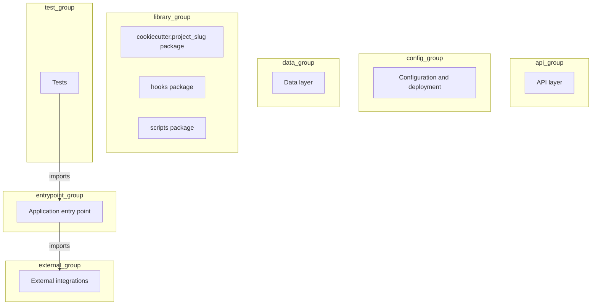

# Architecture report: cookiecutter/cookiecutter-django

> Automated static analysis. **Observed** = directly seen in files/imports/AST; **Inferred** = interpretation from that evidence. Repository code was not executed.

## 1. Repository at a glance

| Item | Value |
| --- | --- |
| Repository | cookiecutter/cookiecutter-django |
| Description | Cookiecutter Django is a framework for jumpstarting production-ready Django projects quickly. |
| Language | Python |
| Stars | 13636 |
| Licence | BSD-3-Clause |
| Analysed commit / branch | adcbd39660c1fc5d40086ad8837099bdbc8b0b54 / main |
| Framework(s) | Django |
| Files analysed | 250 |
| Components | 9 |

## 2. Architecture in one minute

cookiecutter/cookiecutter-django - Cookiecutter Django is a framework for jumpstarting production-ready Django projects quickly.. This repository was analysed statically from 250 file(s) (72 Python). Detected technologies (observed from imports/manifests): GitHub Actions, Django, Celery, requests, Poetry, Docker. Files are grouped into 9 component(s): API layer, Configuration and deployment, {{cookiecutter.project_slug}} package, Data layer, Application entry point, External integrations, hooks package, scripts package. Observed entry point(s): hooks/post_gen_project.py, scripts/create_django_issue.py, scripts/node_version.py. Findings below distinguish observed facts from inferred interpretation.

## 3. High-level block diagram

## 4. Main components

### API layer (`api_layer`)

- **Kind:** api
- **Status:** Observed
- **Confidence:** 0.85
- **Responsibility:** Groups 4 file(s) under api layer (observed from repository paths and static analysis).
- **Paths:** `{{cookiecutter.project_slug}}/{{cookiecutter.project_slug}}/users/api/__init__.py`, `{{cookiecutter.project_slug}}/{{cookiecutter.project_slug}}/users/api/schema.py`, `{{cookiecutter.project_slug}}/{{cookiecutter.project_slug}}/users/api/serializers.py`, `{{cookiecutter.project_slug}}/{{cookiecutter.project_slug}}/users/api/views.py`
- **Evidence:** [{{cookiecutter.project_slug}}/{{cookiecutter.project_slug}}/users/api/__init__.py](https://github.com/cookiecutter/cookiecutter-django/blob/adcbd39660c1fc5d40086ad8837099bdbc8b0b54/%7B%7Bcookiecutter.project_slug%7D%7D/%7B%7Bcookiecutter.project_slug%7D%7D/users/api/__init__.py); [{{cookiecutter.project_slug}}/{{cookiecutter.project_slug}}/users/api/schema.py](https://github.com/cookiecutter/cookiecutter-django/blob/adcbd39660c1fc5d40086ad8837099bdbc8b0b54/%7B%7Bcookiecutter.project_slug%7D%7D/%7B%7Bcookiecutter.project_slug%7D%7D/users/api/schema.py); [{{cookiecutter.project_slug}}/{{cookiecutter.project_slug}}/users/api/serializers.py](https://github.com/cookiecutter/cookiecutter-django/blob/adcbd39660c1fc5d40086ad8837099bdbc8b0b54/%7B%7Bcookiecutter.project_slug%7D%7D/%7B%7Bcookiecutter.project_slug%7D%7D/users/api/serializers.py); [{{cookiecutter.project_slug}}/{{cookiecutter.project_slug}}/users/api/views.py](https://github.com/cookiecutter/cookiecutter-django/blob/adcbd39660c1fc5d40086ad8837099bdbc8b0b54/%7B%7Bcookiecutter.project_slug%7D%7D/%7B%7Bcookiecutter.project_slug%7D%7D/users/api/views.py)

### Configuration and deployment (`config`)

- **Kind:** config
- **Status:** Observed
- **Confidence:** 0.85
- **Responsibility:** Groups 38 file(s) under configuration and deployment (observed from repository paths and static analysis). Observed top-level functions: websocket_application.
- **Paths:** `cookiecutter.json`, `pyproject.toml`, `tox.ini`, `{{cookiecutter.project_slug}}/.devcontainer/devcontainer.json`, `{{cookiecutter.project_slug}}/.dockerignore`, `{{cookiecutter.project_slug}}/.drone.yml`, `{{cookiecutter.project_slug}}/.editorconfig`, `{{cookiecutter.project_slug}}/.github/dependabot.yml`, `{{cookiecutter.project_slug}}/.github/workflows/ci.yml`, `{{cookiecutter.project_slug}}/.gitlab-ci.yml`, `{{cookiecutter.project_slug}}/.pre-commit-config.yaml`, `{{cookiecutter.project_slug}}/.readthedocs.yml`, `{{cookiecutter.project_slug}}/.travis.yml`, `{{cookiecutter.project_slug}}/compose/local/django/Dockerfile`, `{{cookiecutter.project_slug}}/compose/local/docs/Dockerfile`, `{{cookiecutter.project_slug}}/compose/local/node/Dockerfile`, `{{cookiecutter.project_slug}}/compose/local/uv/Dockerfile`, `{{cookiecutter.project_slug}}/compose/production/aws/Dockerfile`, `{{cookiecutter.project_slug}}/compose/production/django/Dockerfile`, `{{cookiecutter.project_slug}}/compose/production/nginx/Dockerfile`, `{{cookiecutter.project_slug}}/compose/production/postgres/Dockerfile`, `{{cookiecutter.project_slug}}/compose/production/traefik/Dockerfile`, `{{cookiecutter.project_slug}}/compose/production/traefik/traefik.yml`, `{{cookiecutter.project_slug}}/config/__init__.py`, `{{cookiecutter.project_slug}}/config/api.py`, `{{cookiecutter.project_slug}}/config/api_router.py`, `{{cookiecutter.project_slug}}/config/settings/__init__.py`, `{{cookiecutter.project_slug}}/config/settings/base.py`, `{{cookiecutter.project_slug}}/config/settings/local.py`, `{{cookiecutter.project_slug}}/config/settings/production.py`, `{{cookiecutter.project_slug}}/config/settings/test.py`, `{{cookiecutter.project_slug}}/config/urls.py`, `{{cookiecutter.project_slug}}/config/websocket.py`, `{{cookiecutter.project_slug}}/docker-compose.docs.yml`, `{{cookiecutter.project_slug}}/docker-compose.local.yml`, `{{cookiecutter.project_slug}}/docker-compose.production.yml`, `{{cookiecutter.project_slug}}/package.json`, `{{cookiecutter.project_slug}}/pyproject.toml`
- **Evidence:** [cookiecutter.json](https://github.com/cookiecutter/cookiecutter-django/blob/adcbd39660c1fc5d40086ad8837099bdbc8b0b54/cookiecutter.json); [pyproject.toml](https://github.com/cookiecutter/cookiecutter-django/blob/adcbd39660c1fc5d40086ad8837099bdbc8b0b54/pyproject.toml); [tox.ini](https://github.com/cookiecutter/cookiecutter-django/blob/adcbd39660c1fc5d40086ad8837099bdbc8b0b54/tox.ini); [{{cookiecutter.project_slug}}/.devcontainer/devcontainer.json](https://github.com/cookiecutter/cookiecutter-django/blob/adcbd39660c1fc5d40086ad8837099bdbc8b0b54/%7B%7Bcookiecutter.project_slug%7D%7D/.devcontainer/devcontainer.json); [{{cookiecutter.project_slug}}/.dockerignore](https://github.com/cookiecutter/cookiecutter-django/blob/adcbd39660c1fc5d40086ad8837099bdbc8b0b54/%7B%7Bcookiecutter.project_slug%7D%7D/.dockerignore); [{{cookiecutter.project_slug}}/.drone.yml](https://github.com/cookiecutter/cookiecutter-django/blob/adcbd39660c1fc5d40086ad8837099bdbc8b0b54/%7B%7Bcookiecutter.project_slug%7D%7D/.drone.yml); [{{cookiecutter.project_slug}}/.editorconfig](https://github.com/cookiecutter/cookiecutter-django/blob/adcbd39660c1fc5d40086ad8837099bdbc8b0b54/%7B%7Bcookiecutter.project_slug%7D%7D/.editorconfig); [{{cookiecutter.project_slug}}/.github/dependabot.yml](https://github.com/cookiecutter/cookiecutter-django/blob/adcbd39660c1fc5d40086ad8837099bdbc8b0b54/%7B%7Bcookiecutter.project_slug%7D%7D/.github/dependabot.yml)

### {{cookiecutter.project_slug}} package (`cookiecutter_project_slug`)

- **Kind:** library
- **Status:** Observed
- **Confidence:** 0.85
- **Responsibility:** Groups 35 file(s) under {{cookiecutter.project_slug}} package (observed from repository paths and static analysis). Observed top-level classes: Migration, UserManager, UsersConfig. Observed top-level functions: _update_or_create_site_with_sequence, allauth_settings, get_users_count, update_site_backward, update_site_forward.
- **Paths:** `{{cookiecutter.project_slug}}/.devcontainer/bashrc.override.sh`, `{{cookiecutter.project_slug}}/compose/production/postgres/maintenance/_sourced/constants.sh`, `{{cookiecutter.project_slug}}/compose/production/postgres/maintenance/_sourced/countdown.sh`, `{{cookiecutter.project_slug}}/compose/production/postgres/maintenance/_sourced/messages.sh`, `{{cookiecutter.project_slug}}/compose/production/postgres/maintenance/_sourced/yes_no.sh`, `{{cookiecutter.project_slug}}/docs/__init__.py`, `{{cookiecutter.project_slug}}/docs/conf.py`, `{{cookiecutter.project_slug}}/gulpfile.mjs`, `{{cookiecutter.project_slug}}/utility/install_os_dependencies.sh`, `{{cookiecutter.project_slug}}/utility/install_python_dependencies.sh`, `{{cookiecutter.project_slug}}/webpack/common.config.js`, `{{cookiecutter.project_slug}}/webpack/dev.config.js`, `{{cookiecutter.project_slug}}/webpack/prod.config.js`, `{{cookiecutter.project_slug}}/{{cookiecutter.project_slug}}/__init__.py`, `{{cookiecutter.project_slug}}/{{cookiecutter.project_slug}}/contrib/__init__.py`, `{{cookiecutter.project_slug}}/{{cookiecutter.project_slug}}/contrib/sites/__init__.py`, `{{cookiecutter.project_slug}}/{{cookiecutter.project_slug}}/contrib/sites/migrations/0001_initial.py`, `{{cookiecutter.project_slug}}/{{cookiecutter.project_slug}}/contrib/sites/migrations/0002_alter_domain_unique.py`, `{{cookiecutter.project_slug}}/{{cookiecutter.project_slug}}/contrib/sites/migrations/0003_set_site_domain_and_name.py`, `{{cookiecutter.project_slug}}/{{cookiecutter.project_slug}}/contrib/sites/migrations/0004_alter_options_ordering_domain.py`, `{{cookiecutter.project_slug}}/{{cookiecutter.project_slug}}/contrib/sites/migrations/__init__.py`, `{{cookiecutter.project_slug}}/{{cookiecutter.project_slug}}/static/js/project.js`, `{{cookiecutter.project_slug}}/{{cookiecutter.project_slug}}/static/js/vendors.js`, `{{cookiecutter.project_slug}}/{{cookiecutter.project_slug}}/users/__init__.py`, `{{cookiecutter.project_slug}}/{{cookiecutter.project_slug}}/users/adapters.py`, `{{cookiecutter.project_slug}}/{{cookiecutter.project_slug}}/users/admin.py`, `{{cookiecutter.project_slug}}/{{cookiecutter.project_slug}}/users/apps.py`, `{{cookiecutter.project_slug}}/{{cookiecutter.project_slug}}/users/context_processors.py`, `{{cookiecutter.project_slug}}/{{cookiecutter.project_slug}}/users/forms.py`, `{{cookiecutter.project_slug}}/{{cookiecutter.project_slug}}/users/managers.py`, `{{cookiecutter.project_slug}}/{{cookiecutter.project_slug}}/users/migrations/0001_initial.py`, `{{cookiecutter.project_slug}}/{{cookiecutter.project_slug}}/users/migrations/__init__.py`, `{{cookiecutter.project_slug}}/{{cookiecutter.project_slug}}/users/tasks.py`, `{{cookiecutter.project_slug}}/{{cookiecutter.project_slug}}/users/urls.py`, `{{cookiecutter.project_slug}}/{{cookiecutter.project_slug}}/users/views.py`
- **Evidence:** [{{cookiecutter.project_slug}}/.devcontainer/bashrc.override.sh](https://github.com/cookiecutter/cookiecutter-django/blob/adcbd39660c1fc5d40086ad8837099bdbc8b0b54/%7B%7Bcookiecutter.project_slug%7D%7D/.devcontainer/bashrc.override.sh); [{{cookiecutter.project_slug}}/compose/production/postgres/maintenance/_sourced/constants.sh](https://github.com/cookiecutter/cookiecutter-django/blob/adcbd39660c1fc5d40086ad8837099bdbc8b0b54/%7B%7Bcookiecutter.project_slug%7D%7D/compose/production/postgres/maintenance/_sourced/constants.sh); [{{cookiecutter.project_slug}}/compose/production/postgres/maintenance/_sourced/countdown.sh](https://github.com/cookiecutter/cookiecutter-django/blob/adcbd39660c1fc5d40086ad8837099bdbc8b0b54/%7B%7Bcookiecutter.project_slug%7D%7D/compose/production/postgres/maintenance/_sourced/countdown.sh); [{{cookiecutter.project_slug}}/compose/production/postgres/maintenance/_sourced/messages.sh](https://github.com/cookiecutter/cookiecutter-django/blob/adcbd39660c1fc5d40086ad8837099bdbc8b0b54/%7B%7Bcookiecutter.project_slug%7D%7D/compose/production/postgres/maintenance/_sourced/messages.sh); [{{cookiecutter.project_slug}}/compose/production/postgres/maintenance/_sourced/yes_no.sh](https://github.com/cookiecutter/cookiecutter-django/blob/adcbd39660c1fc5d40086ad8837099bdbc8b0b54/%7B%7Bcookiecutter.project_slug%7D%7D/compose/production/postgres/maintenance/_sourced/yes_no.sh); [{{cookiecutter.project_slug}}/docs/__init__.py](https://github.com/cookiecutter/cookiecutter-django/blob/adcbd39660c1fc5d40086ad8837099bdbc8b0b54/%7B%7Bcookiecutter.project_slug%7D%7D/docs/__init__.py); [{{cookiecutter.project_slug}}/docs/conf.py](https://github.com/cookiecutter/cookiecutter-django/blob/adcbd39660c1fc5d40086ad8837099bdbc8b0b54/%7B%7Bcookiecutter.project_slug%7D%7D/docs/conf.py); [{{cookiecutter.project_slug}}/gulpfile.mjs](https://github.com/cookiecutter/cookiecutter-django/blob/adcbd39660c1fc5d40086ad8837099bdbc8b0b54/%7B%7Bcookiecutter.project_slug%7D%7D/gulpfile.mjs)

### Data layer (`data_layer`)

- **Kind:** data
- **Status:** Observed
- **Confidence:** 0.85
- **Responsibility:** Groups 1 file(s) under data layer (observed from repository paths and static analysis).
- **Paths:** `{{cookiecutter.project_slug}}/{{cookiecutter.project_slug}}/users/models.py`
- **Evidence:** [{{cookiecutter.project_slug}}/{{cookiecutter.project_slug}}/users/models.py](https://github.com/cookiecutter/cookiecutter-django/blob/adcbd39660c1fc5d40086ad8837099bdbc8b0b54/%7B%7Bcookiecutter.project_slug%7D%7D/%7B%7Bcookiecutter.project_slug%7D%7D/users/models.py)

### Application entry point (`entrypoint`)

- **Kind:** entrypoint
- **Status:** Observed
- **Confidence:** 0.85
- **Responsibility:** Groups 11 file(s) under application entry point (observed from repository paths and static analysis). Observed application object created via Celery. Observed top-level classes: ContributorsJSONFile, DjVersion, GitHubManager. Observed top-level functions: append_to_gitignore_file, application, config_loggers, generate_md, generate_postgres_user, generate_random_string.
- **Paths:** `hooks/post_gen_project.py`, `scripts/create_django_issue.py`, `scripts/node_version.py`, `scripts/python_dependency_version.py`, `scripts/update_changelog.py`, `scripts/update_contributors.py`, `{{cookiecutter.project_slug}}/config/asgi.py`, `{{cookiecutter.project_slug}}/config/celery_app.py`, `{{cookiecutter.project_slug}}/config/wsgi.py`, `{{cookiecutter.project_slug}}/manage.py`, `{{cookiecutter.project_slug}}/merge_production_dotenvs_in_dotenv.py`
- **Evidence:** [hooks/post_gen_project.py:28](https://github.com/cookiecutter/cookiecutter-django/blob/adcbd39660c1fc5d40086ad8837099bdbc8b0b54/hooks/post_gen_project.py#L28); [scripts/create_django_issue.py:35](https://github.com/cookiecutter/cookiecutter-django/blob/adcbd39660c1fc5d40086ad8837099bdbc8b0b54/scripts/create_django_issue.py#L35); [scripts/node_version.py:13](https://github.com/cookiecutter/cookiecutter-django/blob/adcbd39660c1fc5d40086ad8837099bdbc8b0b54/scripts/node_version.py#L13); [scripts/python_dependency_version.py:23](https://github.com/cookiecutter/cookiecutter-django/blob/adcbd39660c1fc5d40086ad8837099bdbc8b0b54/scripts/python_dependency_version.py#L23); [scripts/update_changelog.py:21](https://github.com/cookiecutter/cookiecutter-django/blob/adcbd39660c1fc5d40086ad8837099bdbc8b0b54/scripts/update_changelog.py#L21); [scripts/update_contributors.py:16](https://github.com/cookiecutter/cookiecutter-django/blob/adcbd39660c1fc5d40086ad8837099bdbc8b0b54/scripts/update_contributors.py#L16); [{{cookiecutter.project_slug}}/config/asgi.py:32](https://github.com/cookiecutter/cookiecutter-django/blob/adcbd39660c1fc5d40086ad8837099bdbc8b0b54/%7B%7Bcookiecutter.project_slug%7D%7D/config/asgi.py#L32); [{{cookiecutter.project_slug}}/config/celery_app.py:9](https://github.com/cookiecutter/cookiecutter-django/blob/adcbd39660c1fc5d40086ad8837099bdbc8b0b54/%7B%7Bcookiecutter.project_slug%7D%7D/config/celery_app.py#L9)

### External integrations (`external_integrations`)

- **Kind:** external
- **Status:** Inferred
- **Confidence:** 0.70
- **Responsibility:** Groups 0 file(s) under external integrations (observed from repository paths and static analysis).
- **Evidence:** [scripts/create_django_issue.py:20](https://github.com/cookiecutter/cookiecutter-django/blob/adcbd39660c1fc5d40086ad8837099bdbc8b0b54/scripts/create_django_issue.py#L20)

### hooks package (`hooks`)

- **Kind:** library
- **Status:** Observed
- **Confidence:** 0.85
- **Responsibility:** Groups 2 file(s) under hooks package (observed from repository paths and static analysis).
- **Paths:** `hooks/__init__.py`, `hooks/pre_gen_project.py`
- **Evidence:** [hooks/__init__.py](https://github.com/cookiecutter/cookiecutter-django/blob/adcbd39660c1fc5d40086ad8837099bdbc8b0b54/hooks/__init__.py); [hooks/pre_gen_project.py](https://github.com/cookiecutter/cookiecutter-django/blob/adcbd39660c1fc5d40086ad8837099bdbc8b0b54/hooks/pre_gen_project.py)

### scripts package (`scripts`)

- **Kind:** library
- **Status:** Observed
- **Confidence:** 0.85
- **Responsibility:** Groups 1 file(s) under scripts package (observed from repository paths and static analysis).
- **Paths:** `scripts/__init__.py`
- **Evidence:** [scripts/__init__.py](https://github.com/cookiecutter/cookiecutter-django/blob/adcbd39660c1fc5d40086ad8837099bdbc8b0b54/scripts/__init__.py)

### Tests (`tests`)

- **Kind:** test
- **Status:** Observed
- **Confidence:** 0.85
- **Responsibility:** Groups 22 file(s) under tests (observed from repository paths and static analysis). Observed top-level functions: _fixture_id, build_files_list, check_paths, context, test_append_to_gitignore_file, test_django_upgrade_passes.
- **Paths:** `tests/__init__.py`, `tests/test_bare.sh`, `tests/test_cookiecutter_generation.py`, `tests/test_docker.sh`, `tests/test_generate.ps1`, `tests/test_hooks.py`, `{{cookiecutter.project_slug}}/tests/__init__.py`, `{{cookiecutter.project_slug}}/tests/test_merge_production_dotenvs_in_dotenv.py`, `{{cookiecutter.project_slug}}/{{cookiecutter.project_slug}}/conftest.py`, `{{cookiecutter.project_slug}}/{{cookiecutter.project_slug}}/users/tests/__init__.py`, `{{cookiecutter.project_slug}}/{{cookiecutter.project_slug}}/users/tests/api/__init__.py`, `{{cookiecutter.project_slug}}/{{cookiecutter.project_slug}}/users/tests/api/test_openapi.py`, `{{cookiecutter.project_slug}}/{{cookiecutter.project_slug}}/users/tests/api/test_urls.py`, `{{cookiecutter.project_slug}}/{{cookiecutter.project_slug}}/users/tests/api/test_views.py`, `{{cookiecutter.project_slug}}/{{cookiecutter.project_slug}}/users/tests/factories.py`, `{{cookiecutter.project_slug}}/{{cookiecutter.project_slug}}/users/tests/test_admin.py`, `{{cookiecutter.project_slug}}/{{cookiecutter.project_slug}}/users/tests/test_forms.py`, `{{cookiecutter.project_slug}}/{{cookiecutter.project_slug}}/users/tests/test_managers.py`, `{{cookiecutter.project_slug}}/{{cookiecutter.project_slug}}/users/tests/test_models.py`, `{{cookiecutter.project_slug}}/{{cookiecutter.project_slug}}/users/tests/test_tasks.py`, `{{cookiecutter.project_slug}}/{{cookiecutter.project_slug}}/users/tests/test_urls.py`, `{{cookiecutter.project_slug}}/{{cookiecutter.project_slug}}/users/tests/test_views.py`
- **Evidence:** [tests/__init__.py](https://github.com/cookiecutter/cookiecutter-django/blob/adcbd39660c1fc5d40086ad8837099bdbc8b0b54/tests/__init__.py); [tests/test_bare.sh](https://github.com/cookiecutter/cookiecutter-django/blob/adcbd39660c1fc5d40086ad8837099bdbc8b0b54/tests/test_bare.sh); [tests/test_cookiecutter_generation.py:35](https://github.com/cookiecutter/cookiecutter-django/blob/adcbd39660c1fc5d40086ad8837099bdbc8b0b54/tests/test_cookiecutter_generation.py#L35); [tests/test_docker.sh](https://github.com/cookiecutter/cookiecutter-django/blob/adcbd39660c1fc5d40086ad8837099bdbc8b0b54/tests/test_docker.sh); [tests/test_generate.ps1](https://github.com/cookiecutter/cookiecutter-django/blob/adcbd39660c1fc5d40086ad8837099bdbc8b0b54/tests/test_generate.ps1); [tests/test_hooks.py:17](https://github.com/cookiecutter/cookiecutter-django/blob/adcbd39660c1fc5d40086ad8837099bdbc8b0b54/tests/test_hooks.py#L17); [{{cookiecutter.project_slug}}/tests/__init__.py](https://github.com/cookiecutter/cookiecutter-django/blob/adcbd39660c1fc5d40086ad8837099bdbc8b0b54/%7B%7Bcookiecutter.project_slug%7D%7D/tests/__init__.py); [{{cookiecutter.project_slug}}/tests/test_merge_production_dotenvs_in_dotenv.py:24](https://github.com/cookiecutter/cookiecutter-django/blob/adcbd39660c1fc5d40086ad8837099bdbc8b0b54/%7B%7Bcookiecutter.project_slug%7D%7D/tests/test_merge_production_dotenvs_in_dotenv.py#L24)

## 5. Execution flow

**Observed** entry point(s):

- [hooks/post_gen_project.py:597](https://github.com/cookiecutter/cookiecutter-django/blob/adcbd39660c1fc5d40086ad8837099bdbc8b0b54/hooks/post_gen_project.py#L597)
- [scripts/create_django_issue.py:303](https://github.com/cookiecutter/cookiecutter-django/blob/adcbd39660c1fc5d40086ad8837099bdbc8b0b54/scripts/create_django_issue.py#L303)
- [scripts/node_version.py:57](https://github.com/cookiecutter/cookiecutter-django/blob/adcbd39660c1fc5d40086ad8837099bdbc8b0b54/scripts/node_version.py#L57)
- [scripts/python_dependency_version.py:72](https://github.com/cookiecutter/cookiecutter-django/blob/adcbd39660c1fc5d40086ad8837099bdbc8b0b54/scripts/python_dependency_version.py#L72)
- [scripts/update_changelog.py:163](https://github.com/cookiecutter/cookiecutter-django/blob/adcbd39660c1fc5d40086ad8837099bdbc8b0b54/scripts/update_changelog.py#L163)
- [scripts/update_contributors.py:99](https://github.com/cookiecutter/cookiecutter-django/blob/adcbd39660c1fc5d40086ad8837099bdbc8b0b54/scripts/update_contributors.py#L99)
- [{{cookiecutter.project_slug}}/config/celery_app.py:9](https://github.com/cookiecutter/cookiecutter-django/blob/adcbd39660c1fc5d40086ad8837099bdbc8b0b54/%7B%7Bcookiecutter.project_slug%7D%7D/config/celery_app.py#L9)
- [{{cookiecutter.project_slug}}/manage.py:30](https://github.com/cookiecutter/cookiecutter-django/blob/adcbd39660c1fc5d40086ad8837099bdbc8b0b54/%7B%7Bcookiecutter.project_slug%7D%7D/manage.py#L30)
- [{{cookiecutter.project_slug}}/merge_production_dotenvs_in_dotenv.py:29](https://github.com/cookiecutter/cookiecutter-django/blob/adcbd39660c1fc5d40086ad8837099bdbc8b0b54/%7B%7Bcookiecutter.project_slug%7D%7D/merge_production_dotenvs_in_dotenv.py#L29)

Representative flow (derived from observed entry points and the import graph; steps beyond the entry point are **Inferred**):

1. Execution starts at an observed entry point listed above, if present.
2. `entrypoint` imports `external_integrations` (Application entry point -> External integrations).
3. `tests` imports `entrypoint` (Tests -> Application entry point).

## 6. Project structure

### `(root)`

- `.editorconfig` - config (391 bytes)
- `.gitattributes` - other (12 bytes)
- `.gitignore` - other (3338 bytes)
- `.pre-commit-config.yaml` - config (1106 bytes)
- `.pyup.yml` - config (519 bytes)
- `.readthedocs.yaml` - config (303 bytes)
- `AGENTS.md` - docs (4346 bytes)
- `CODE_OF_CONDUCT.md` - docs (214 bytes)
- `CONTRIBUTING.md` - docs (3201 bytes)
- `CONTRIBUTORS.md` - docs (50945 bytes)
- `LICENSE` - docs (1502 bytes)
- `README.md` - docs (14111 bytes)
- `SECURITY.md` - docs (415 bytes)
- `cookiecutter.json` - config (1379 bytes)
- `pyproject.toml` - manifest (3197 bytes)
- `tox.ini` - config (135 bytes)

### `.github`

- `.github/CONTRIBUTORS-template.md` - docs (1194 bytes)
- `.github/FUNDING.yml` - config (141 bytes)
- `.github/ISSUE_TEMPLATE/bug.md` - docs (1387 bytes)
- `.github/ISSUE_TEMPLATE/feature.md` - docs (210 bytes)
- `.github/ISSUE_TEMPLATE/paid-support.md` - docs (740 bytes)
- `.github/ISSUE_TEMPLATE/question.md` - docs (775 bytes)
- `.github/PULL_REQUEST_TEMPLATE.md` - docs (545 bytes)
- `.github/changelog-template.md` - docs (264 bytes)
- `.github/contributors.json` - config (37191 bytes)
- `.github/dependabot.yml` - config (1680 bytes)
- `.github/workflows/align-versions.yml` - ci, YAML (1590 bytes)
- `.github/workflows/ci.yml` - ci, YAML (3719 bytes)
- `.github/workflows/dependabot-uv-lock.yml` - ci, YAML (903 bytes)
- `.github/workflows/django-issue-checker.yml` - ci, YAML (775 bytes)
- `.github/workflows/issue-manager.yml` - ci, YAML (1502 bytes)
- `.github/workflows/pre-commit-autoupdate.yml` - ci, YAML (1825 bytes)
- `.github/workflows/update-changelog.yml` - ci, YAML (752 bytes)
- `.github/workflows/update-contributors.yml` - ci, YAML (871 bytes)

### `docs`

- `docs/1-getting-started/project-generation-options.rst` - docs (6057 bytes)
- `docs/1-getting-started/settings.rst` - docs (9270 bytes)
- `docs/2-local-development/developing-locally-docker.rst` - docs (15551 bytes)
- `docs/2-local-development/developing-locally.rst` - docs (10051 bytes)
- `docs/2-local-development/generate-project-block.rst` - docs (188 bytes)
- `docs/3-deployment/cloud-storage.rst` - docs (6369 bytes)
- `docs/3-deployment/deployment-on-heroku.rst` - docs (3911 bytes)
- `docs/3-deployment/deployment-on-pythonanywhere.rst` - docs (6541 bytes)
- `docs/3-deployment/deployment-with-docker.rst` - docs (7508 bytes)
- `docs/4-guides/docker-postgres-backups.rst` - docs (5277 bytes)
- `docs/4-guides/document.rst` - docs (1749 bytes)
- `docs/4-guides/linters.rst` - docs (1214 bytes)
- `docs/4-guides/testing.rst` - docs (2480 bytes)
- `docs/4-guides/websocket.rst` - docs (754 bytes)
- `docs/5-help/faq.rst` - docs (1526 bytes)
- `docs/5-help/troubleshooting.rst` - docs (3582 bytes)
- `docs/6-about/contributing.md` - docs (40 bytes)
- `docs/6-about/generative-ai.md` - docs (1942 bytes)
- `docs/6-about/maintainer-guide.md` - docs (5617 bytes)
- `docs/Makefile` - docs (1164 bytes)
- `docs/__init__.py` - docs (81 bytes)
- `docs/_static/.gitkeep` - docs (0 bytes)
- `docs/conf.py` - docs (8222 bytes)
- `docs/includes/mailgun.rst` - docs (676 bytes)
- `docs/index.rst` - docs (1578 bytes)
- `docs/make.bat` - docs (1350 bytes)

### `hooks`

- `hooks/__init__.py` - source, Python (0 bytes)
- `hooks/post_gen_project.py` - source, Python (18654 bytes)
- `hooks/pre_gen_project.py` - source, Python (1930 bytes)

### `scripts`

- `scripts/__init__.py` - source, Python (0 bytes)
- `scripts/create_django_issue.py` - source, Python (11857 bytes)
- `scripts/node_version.py` - source, Python (1953 bytes)
- `scripts/python_dependency_version.py` - source, Python (2789 bytes)
- `scripts/update_changelog.py` - source, Python (5538 bytes)
- `scripts/update_contributors.py` - source, Python (3501 bytes)

### `tests`

- `tests/__init__.py` - test, Python (0 bytes)
- `tests/test_bare.sh` - test, Shell (882 bytes)
- `tests/test_cookiecutter_generation.py` - test, Python (19365 bytes)
- `tests/test_docker.sh` - test, Shell (3006 bytes)
- `tests/test_generate.ps1` - test (623 bytes)
- `tests/test_hooks.py` - test, Python (2059 bytes)

### `{{cookiecutter.project_slug}}`

- `{{cookiecutter.project_slug}}/.devcontainer/bash_history` - other (0 bytes)
- `{{cookiecutter.project_slug}}/.devcontainer/bashrc.override.sh` - source, Shell (352 bytes)
- `{{cookiecutter.project_slug}}/.devcontainer/devcontainer.json` - config (2835 bytes)
- `{{cookiecutter.project_slug}}/.dockerignore` - container (162 bytes)
- `{{cookiecutter.project_slug}}/.drone.yml` - config (1372 bytes)
- `{{cookiecutter.project_slug}}/.editorconfig` - config (393 bytes)
- `{{cookiecutter.project_slug}}/.envs/.local/.django` - other (511 bytes)
- `{{cookiecutter.project_slug}}/.envs/.local/.postgres` - other (264 bytes)
- `{{cookiecutter.project_slug}}/.envs/.production/.django` - other (2635 bytes)
- `{{cookiecutter.project_slug}}/.envs/.production/.postgres` - other (264 bytes)
- `{{cookiecutter.project_slug}}/.gitattributes` - other (391 bytes)
- `{{cookiecutter.project_slug}}/.github/dependabot.yml` - config (2338 bytes)
- `{{cookiecutter.project_slug}}/.github/workflows/ci.yml` - ci, YAML (4475 bytes)
- `{{cookiecutter.project_slug}}/.gitignore` - other (5981 bytes)
- `{{cookiecutter.project_slug}}/.gitlab-ci.yml` - ci, YAML (1419 bytes)
- `{{cookiecutter.project_slug}}/.pre-commit-config.yaml` - config (1602 bytes)
- `{{cookiecutter.project_slug}}/.python-version` - other (5 bytes)
- `{{cookiecutter.project_slug}}/.readthedocs.yml` - config (535 bytes)
- `{{cookiecutter.project_slug}}/.travis.yml` - ci, YAML (1644 bytes)
- `{{cookiecutter.project_slug}}/CONTRIBUTORS.txt` - docs (31 bytes)
- `{{cookiecutter.project_slug}}/COPYING` - other (35147 bytes)
- `{{cookiecutter.project_slug}}/LICENSE` - docs (14375 bytes)
- `{{cookiecutter.project_slug}}/Procfile` - other (419 bytes)
- `{{cookiecutter.project_slug}}/README.md` - docs (7376 bytes)
- `{{cookiecutter.project_slug}}/bin/post_compile` - other (433 bytes)
- `{{cookiecutter.project_slug}}/compose/local/django/Dockerfile` - container (2398 bytes)
- `{{cookiecutter.project_slug}}/compose/local/django/celery/beat/start` - other (166 bytes)
- `{{cookiecutter.project_slug}}/compose/local/django/celery/flower/start` - other (369 bytes)
- `{{cookiecutter.project_slug}}/compose/local/django/celery/worker/start` - other (143 bytes)
- `{{cookiecutter.project_slug}}/compose/local/django/start` - other (288 bytes)
- `{{cookiecutter.project_slug}}/compose/local/docs/Dockerfile` - container (1792 bytes)
- `{{cookiecutter.project_slug}}/compose/local/docs/start` - docs (79 bytes)
- `{{cookiecutter.project_slug}}/compose/local/node/Dockerfile` - container (160 bytes)
- `{{cookiecutter.project_slug}}/compose/local/uv/Dockerfile` - container (101 bytes)
- `{{cookiecutter.project_slug}}/compose/production/aws/Dockerfile` - container (451 bytes)
- `{{cookiecutter.project_slug}}/compose/production/aws/maintenance/download` - other (675 bytes)
- `{{cookiecutter.project_slug}}/compose/production/aws/maintenance/upload` - other (823 bytes)
- `{{cookiecutter.project_slug}}/compose/production/django/Dockerfile` - container (3546 bytes)
- `{{cookiecutter.project_slug}}/compose/production/django/celery/beat/start` - other (107 bytes)
- `{{cookiecutter.project_slug}}/compose/production/django/celery/flower/start` - other (328 bytes)
- `{{cookiecutter.project_slug}}/compose/production/django/celery/worker/start` - other (109 bytes)
- `{{cookiecutter.project_slug}}/compose/production/django/entrypoint` - other (311 bytes)
- `{{cookiecutter.project_slug}}/compose/production/django/start` - other (751 bytes)
- `{{cookiecutter.project_slug}}/compose/production/nginx/Dockerfile` - container (111 bytes)
- `{{cookiecutter.project_slug}}/compose/production/nginx/default.conf` - other (116 bytes)
- `{{cookiecutter.project_slug}}/compose/production/postgres/Dockerfile` - container (272 bytes)
- `{{cookiecutter.project_slug}}/compose/production/postgres/maintenance/_sourced/constants.sh` - source, Shell (77 bytes)
- `{{cookiecutter.project_slug}}/compose/production/postgres/maintenance/_sourced/countdown.sh` - source, Shell (322 bytes)
- `{{cookiecutter.project_slug}}/compose/production/postgres/maintenance/_sourced/messages.sh` - source, Shell (458 bytes)
- `{{cookiecutter.project_slug}}/compose/production/postgres/maintenance/_sourced/yes_no.sh` - source, Shell (293 bytes)
- `{{cookiecutter.project_slug}}/compose/production/postgres/maintenance/backup` - other (1009 bytes)
- `{{cookiecutter.project_slug}}/compose/production/postgres/maintenance/backups` - other (392 bytes)
- `{{cookiecutter.project_slug}}/compose/production/postgres/maintenance/restore` - other (1635 bytes)
- `{{cookiecutter.project_slug}}/compose/production/postgres/maintenance/rmbackup` - other (977 bytes)
- `{{cookiecutter.project_slug}}/compose/production/traefik/Dockerfile` - container (207 bytes)
- `{{cookiecutter.project_slug}}/compose/production/traefik/traefik.yml` - config (2788 bytes)
- `{{cookiecutter.project_slug}}/config/__init__.py` - source, Python (232 bytes)
- `{{cookiecutter.project_slug}}/config/api.py` - source, Python (334 bytes)
- `{{cookiecutter.project_slug}}/config/api_router.py` - source, Python (351 bytes)
- `{{cookiecutter.project_slug}}/config/asgi.py` - source, Python (1329 bytes)
- `{{cookiecutter.project_slug}}/config/celery_app.py` - source, Python (846 bytes)
- `{{cookiecutter.project_slug}}/config/settings/__init__.py` - source, Python (0 bytes)
- `{{cookiecutter.project_slug}}/config/settings/base.py` - source, Python (17894 bytes)
- `{{cookiecutter.project_slug}}/config/settings/local.py` - source, Python (5628 bytes)
- `{{cookiecutter.project_slug}}/config/settings/production.py` - source, Python (17656 bytes)
- `{{cookiecutter.project_slug}}/config/settings/test.py` - source, Python (1685 bytes)
- `{{cookiecutter.project_slug}}/config/urls.py` - source, Python (3010 bytes)
- `{{cookiecutter.project_slug}}/config/websocket.py` - source, Python (439 bytes)
- `{{cookiecutter.project_slug}}/config/wsgi.py` - source, Python (1304 bytes)
- `{{cookiecutter.project_slug}}/docker-compose.docs.yml` - config (492 bytes)
- `{{cookiecutter.project_slug}}/docker-compose.local.yml` - config (4289 bytes)
- `{{cookiecutter.project_slug}}/docker-compose.production.yml` - config (2932 bytes)
- `{{cookiecutter.project_slug}}/docs/Makefile` - docs (1124 bytes)
- `{{cookiecutter.project_slug}}/docs/__init__.py` - docs (81 bytes)
- `{{cookiecutter.project_slug}}/docs/conf.py` - docs (2504 bytes)
- `{{cookiecutter.project_slug}}/docs/howto.rst` - docs (1562 bytes)
- `{{cookiecutter.project_slug}}/docs/index.rst` - docs (588 bytes)
- `{{cookiecutter.project_slug}}/docs/make.bat` - docs (1037 bytes)
- `{{cookiecutter.project_slug}}/docs/pycharm/configuration.rst` - docs (2606 bytes)
- `{{cookiecutter.project_slug}}/docs/users.rst` - docs (446 bytes)
- `{{cookiecutter.project_slug}}/gulpfile.mjs` - source, JavaScript (5341 bytes)
- `{{cookiecutter.project_slug}}/justfile` - other (1188 bytes)
- `{{cookiecutter.project_slug}}/locale/README.md` - docs (1727 bytes)
- `{{cookiecutter.project_slug}}/locale/en_US/LC_MESSAGES/django.po` - other (419 bytes)
- `{{cookiecutter.project_slug}}/locale/fr_FR/LC_MESSAGES/django.po` - other (13145 bytes)
- `{{cookiecutter.project_slug}}/locale/pt_BR/LC_MESSAGES/django.po` - other (12811 bytes)
- `{{cookiecutter.project_slug}}/manage.py` - source, Python (982 bytes)
- `{{cookiecutter.project_slug}}/merge_production_dotenvs_in_dotenv.py` - source, Python (747 bytes)
- `{{cookiecutter.project_slug}}/package.json` - manifest (1234 bytes)
- `{{cookiecutter.project_slug}}/pyproject.toml` - manifest (2949 bytes)
- `{{cookiecutter.project_slug}}/requirements/base.txt` - docs (2448 bytes)
- `{{cookiecutter.project_slug}}/requirements/local.txt` - docs (2014 bytes)
- `{{cookiecutter.project_slug}}/requirements/production.txt` - docs (2272 bytes)
- `{{cookiecutter.project_slug}}/tests/__init__.py` - test, Python (0 bytes)
- `{{cookiecutter.project_slug}}/tests/test_merge_production_dotenvs_in_dotenv.py` - test, Python (974 bytes)
- `{{cookiecutter.project_slug}}/utility/install_os_dependencies.sh` - source, Shell (2470 bytes)
- `{{cookiecutter.project_slug}}/utility/install_python_dependencies.sh` - source, Shell (318 bytes)
- `{{cookiecutter.project_slug}}/utility/requirements-bionic.apt` - other (420 bytes)
- `{{cookiecutter.project_slug}}/utility/requirements-bookworm.apt` - other (428 bytes)
- `{{cookiecutter.project_slug}}/utility/requirements-bullseye.apt` - other (428 bytes)
- `{{cookiecutter.project_slug}}/utility/requirements-buster.apt` - other (426 bytes)
- `{{cookiecutter.project_slug}}/utility/requirements-focal.apt` - other (416 bytes)
- `{{cookiecutter.project_slug}}/utility/requirements-jammy.apt` - other (416 bytes)
- `{{cookiecutter.project_slug}}/utility/requirements-jessie.apt` - other (422 bytes)
- `{{cookiecutter.project_slug}}/utility/requirements-noble.apt` - other (428 bytes)
- `{{cookiecutter.project_slug}}/utility/requirements-stretch.apt` - other (422 bytes)
- `{{cookiecutter.project_slug}}/utility/requirements-trusty.apt` - other (417 bytes)
- `{{cookiecutter.project_slug}}/utility/requirements-xenial.apt` - other (417 bytes)
- `{{cookiecutter.project_slug}}/webpack/common.config.js` - source, JavaScript (1539 bytes)
- `{{cookiecutter.project_slug}}/webpack/dev.config.js` - source, JavaScript (679 bytes)
- `{{cookiecutter.project_slug}}/webpack/prod.config.js` - source, JavaScript (239 bytes)
- `{{cookiecutter.project_slug}}/{{cookiecutter.project_slug}}/__init__.py` - source, Python (169 bytes)
- `{{cookiecutter.project_slug}}/{{cookiecutter.project_slug}}/conftest.py` - test, Python (439 bytes)
- `{{cookiecutter.project_slug}}/{{cookiecutter.project_slug}}/contrib/__init__.py` - source, Python (197 bytes)
- `{{cookiecutter.project_slug}}/{{cookiecutter.project_slug}}/contrib/sites/__init__.py` - source, Python (197 bytes)
- `{{cookiecutter.project_slug}}/{{cookiecutter.project_slug}}/contrib/sites/migrations/0001_initial.py` - source, Python (1353 bytes)
- `{{cookiecutter.project_slug}}/{{cookiecutter.project_slug}}/contrib/sites/migrations/0002_alter_domain_unique.py` - source, Python (555 bytes)
- `{{cookiecutter.project_slug}}/{{cookiecutter.project_slug}}/contrib/sites/migrations/0003_set_site_domain_and_name.py` - source, Python (2233 bytes)
- `{{cookiecutter.project_slug}}/{{cookiecutter.project_slug}}/contrib/sites/migrations/0004_alter_options_ordering_domain.py` - source, Python (468 bytes)
- `{{cookiecutter.project_slug}}/{{cookiecutter.project_slug}}/contrib/sites/migrations/__init__.py` - source, Python (197 bytes)
- `{{cookiecutter.project_slug}}/{{cookiecutter.project_slug}}/static/css/project.css` - other (228 bytes)
- `{{cookiecutter.project_slug}}/{{cookiecutter.project_slug}}/static/fonts/.gitkeep` - other (0 bytes)
- `{{cookiecutter.project_slug}}/{{cookiecutter.project_slug}}/static/js/project.js` - source, JavaScript (145 bytes)
- `{{cookiecutter.project_slug}}/{{cookiecutter.project_slug}}/static/js/vendors.js` - source, JavaScript (45 bytes)
- `{{cookiecutter.project_slug}}/{{cookiecutter.project_slug}}/static/sass/custom_bootstrap_vars.scss` - other (0 bytes)
- `{{cookiecutter.project_slug}}/{{cookiecutter.project_slug}}/static/sass/project.scss` - other (603 bytes)
- `{{cookiecutter.project_slug}}/{{cookiecutter.project_slug}}/templates/403.html` - other (308 bytes)
- `{{cookiecutter.project_slug}}/{{cookiecutter.project_slug}}/templates/403_csrf.html` - other (308 bytes)
- `{{cookiecutter.project_slug}}/{{cookiecutter.project_slug}}/templates/404.html` - other (309 bytes)
- `{{cookiecutter.project_slug}}/{{cookiecutter.project_slug}}/templates/500.html` - other (351 bytes)
- `{{cookiecutter.project_slug}}/{{cookiecutter.project_slug}}/templates/account/base_manage_password.html` - other (225 bytes)
- `{{cookiecutter.project_slug}}/{{cookiecutter.project_slug}}/templates/allauth/elements/alert.html` - other (131 bytes)
- `{{cookiecutter.project_slug}}/{{cookiecutter.project_slug}}/templates/allauth/elements/badge.html` - other (369 bytes)
- `{{cookiecutter.project_slug}}/{{cookiecutter.project_slug}}/templates/allauth/elements/button.html` - other (836 bytes)
- `{{cookiecutter.project_slug}}/{{cookiecutter.project_slug}}/templates/allauth/elements/field.html` - other (2597 bytes)
- `{{cookiecutter.project_slug}}/{{cookiecutter.project_slug}}/templates/allauth/elements/fields.html` - other (75 bytes)
- `{{cookiecutter.project_slug}}/{{cookiecutter.project_slug}}/templates/allauth/elements/panel.html` - other (382 bytes)
- `{{cookiecutter.project_slug}}/{{cookiecutter.project_slug}}/templates/allauth/elements/table.html` - other (99 bytes)
- `{{cookiecutter.project_slug}}/{{cookiecutter.project_slug}}/templates/allauth/layouts/entrance.html` - other (973 bytes)
- `{{cookiecutter.project_slug}}/{{cookiecutter.project_slug}}/templates/allauth/layouts/manage.html` - other (225 bytes)
- `{{cookiecutter.project_slug}}/{{cookiecutter.project_slug}}/templates/base.html` - other (7483 bytes)
- `{{cookiecutter.project_slug}}/{{cookiecutter.project_slug}}/templates/pages/about.html` - other (49 bytes)
- `{{cookiecutter.project_slug}}/{{cookiecutter.project_slug}}/templates/pages/home.html` - other (49 bytes)
- `{{cookiecutter.project_slug}}/{{cookiecutter.project_slug}}/templates/users/user_detail.html` - other (1456 bytes)
- `{{cookiecutter.project_slug}}/{{cookiecutter.project_slug}}/templates/users/user_form.html` - other (822 bytes)
- `{{cookiecutter.project_slug}}/{{cookiecutter.project_slug}}/users/__init__.py` - source, Python (0 bytes)
- `{{cookiecutter.project_slug}}/{{cookiecutter.project_slug}}/users/adapters.py` - source, Python (1568 bytes)
- `{{cookiecutter.project_slug}}/{{cookiecutter.project_slug}}/users/admin.py` - source, Python (1883 bytes)
- `{{cookiecutter.project_slug}}/{{cookiecutter.project_slug}}/users/api/__init__.py` - source, Python (0 bytes)
- `{{cookiecutter.project_slug}}/{{cookiecutter.project_slug}}/users/api/schema.py` - source, Python (919 bytes)
- `{{cookiecutter.project_slug}}/{{cookiecutter.project_slug}}/users/api/serializers.py` - source, Python (601 bytes)
- `{{cookiecutter.project_slug}}/{{cookiecutter.project_slug}}/users/api/views.py` - source, Python (3450 bytes)
- `{{cookiecutter.project_slug}}/{{cookiecutter.project_slug}}/users/apps.py` - source, Python (323 bytes)
- `{{cookiecutter.project_slug}}/{{cookiecutter.project_slug}}/users/context_processors.py` - source, Python (225 bytes)
- `{{cookiecutter.project_slug}}/{{cookiecutter.project_slug}}/users/forms.py` - source, Python (1713 bytes)
- `{{cookiecutter.project_slug}}/{{cookiecutter.project_slug}}/users/managers.py` - source, Python (1652 bytes)
- `{{cookiecutter.project_slug}}/{{cookiecutter.project_slug}}/users/migrations/0001_initial.py` - source, Python (5183 bytes)
- `{{cookiecutter.project_slug}}/{{cookiecutter.project_slug}}/users/migrations/__init__.py` - source, Python (0 bytes)
- `{{cookiecutter.project_slug}}/{{cookiecutter.project_slug}}/users/models.py` - source, Python (1607 bytes)
- `{{cookiecutter.project_slug}}/{{cookiecutter.project_slug}}/users/tasks.py` - source, Python (185 bytes)
- `{{cookiecutter.project_slug}}/{{cookiecutter.project_slug}}/users/tests/__init__.py` - test, Python (0 bytes)
- `{{cookiecutter.project_slug}}/{{cookiecutter.project_slug}}/users/tests/api/__init__.py` - test, Python (0 bytes)
- `{{cookiecutter.project_slug}}/{{cookiecutter.project_slug}}/users/tests/api/test_openapi.py` - test, Python (1501 bytes)
- `{{cookiecutter.project_slug}}/{{cookiecutter.project_slug}}/users/tests/api/test_urls.py` - test, Python (2384 bytes)
- `{{cookiecutter.project_slug}}/{{cookiecutter.project_slug}}/users/tests/api/test_views.py` - test, Python (6685 bytes)
- `{{cookiecutter.project_slug}}/{{cookiecutter.project_slug}}/users/tests/factories.py` - test, Python (1097 bytes)
- `{{cookiecutter.project_slug}}/{{cookiecutter.project_slug}}/users/tests/test_admin.py` - test, Python (2915 bytes)
- `{{cookiecutter.project_slug}}/{{cookiecutter.project_slug}}/users/tests/test_forms.py` - test, Python (1654 bytes)
- `{{cookiecutter.project_slug}}/{{cookiecutter.project_slug}}/users/tests/test_managers.py` - test, Python (1679 bytes)
- `{{cookiecutter.project_slug}}/{{cookiecutter.project_slug}}/users/tests/test_models.py` - test, Python (409 bytes)
- `{{cookiecutter.project_slug}}/{{cookiecutter.project_slug}}/users/tests/test_tasks.py` - test, Python (578 bytes)
- `{{cookiecutter.project_slug}}/{{cookiecutter.project_slug}}/users/tests/test_urls.py` - test, Python (983 bytes)
- `{{cookiecutter.project_slug}}/{{cookiecutter.project_slug}}/users/tests/test_views.py` - test, Python (4363 bytes)
- `{{cookiecutter.project_slug}}/{{cookiecutter.project_slug}}/users/urls.py` - source, Python (517 bytes)
- `{{cookiecutter.project_slug}}/{{cookiecutter.project_slug}}/users/views.py` - source, Python (1823 bytes)

## 7. Key dependencies and integrations

| Name | Category | Status | Confidence | Evidence |
| --- | --- | --- | --- | --- |
| GitHub Actions | ci | Observed | 0.90 | [.github/workflows/align-versions.yml](https://github.com/cookiecutter/cookiecutter-django/blob/adcbd39660c1fc5d40086ad8837099bdbc8b0b54/.github/workflows/align-versions.yml); [.github/workflows/ci.yml](https://github.com/cookiecutter/cookiecutter-django/blob/adcbd39660c1fc5d40086ad8837099bdbc8b0b54/.github/workflows/ci.yml); [.github/workflows/dependabot-uv-lock.yml](https://github.com/cookiecutter/cookiecutter-django/blob/adcbd39660c1fc5d40086ad8837099bdbc8b0b54/.github/workflows/dependabot-uv-lock.yml); [.github/workflows/django-issue-checker.yml](https://github.com/cookiecutter/cookiecutter-django/blob/adcbd39660c1fc5d40086ad8837099bdbc8b0b54/.github/workflows/django-issue-checker.yml) |
| Django | framework | Observed | 0.95 | [{{cookiecutter.project_slug}}/config/api.py:1](https://github.com/cookiecutter/cookiecutter-django/blob/adcbd39660c1fc5d40086ad8837099bdbc8b0b54/%7B%7Bcookiecutter.project_slug%7D%7D/config/api.py#L1); [{{cookiecutter.project_slug}}/config/asgi.py:15](https://github.com/cookiecutter/cookiecutter-django/blob/adcbd39660c1fc5d40086ad8837099bdbc8b0b54/%7B%7Bcookiecutter.project_slug%7D%7D/config/asgi.py#L15); [{{cookiecutter.project_slug}}/config/celery_app.py:22](https://github.com/cookiecutter/cookiecutter-django/blob/adcbd39660c1fc5d40086ad8837099bdbc8b0b54/%7B%7Bcookiecutter.project_slug%7D%7D/config/celery_app.py#L22); [{{cookiecutter.project_slug}}/config/wsgi.py:21](https://github.com/cookiecutter/cookiecutter-django/blob/adcbd39660c1fc5d40086ad8837099bdbc8b0b54/%7B%7Bcookiecutter.project_slug%7D%7D/config/wsgi.py#L21) |
| Celery | library | Observed | 0.95 | [{{cookiecutter.project_slug}}/config/celery_app.py:3](https://github.com/cookiecutter/cookiecutter-django/blob/adcbd39660c1fc5d40086ad8837099bdbc8b0b54/%7B%7Bcookiecutter.project_slug%7D%7D/config/celery_app.py#L3); [{{cookiecutter.project_slug}}/config/celery_app.py:4](https://github.com/cookiecutter/cookiecutter-django/blob/adcbd39660c1fc5d40086ad8837099bdbc8b0b54/%7B%7Bcookiecutter.project_slug%7D%7D/config/celery_app.py#L4); [{{cookiecutter.project_slug}}/{{cookiecutter.project_slug}}/users/tasks.py:1](https://github.com/cookiecutter/cookiecutter-django/blob/adcbd39660c1fc5d40086ad8837099bdbc8b0b54/%7B%7Bcookiecutter.project_slug%7D%7D/%7B%7Bcookiecutter.project_slug%7D%7D/users/tasks.py#L1) |
| requests | library | Observed | 0.90 | [pyproject.toml:45](https://github.com/cookiecutter/cookiecutter-django/blob/adcbd39660c1fc5d40086ad8837099bdbc8b0b54/pyproject.toml#L45); [scripts/create_django_issue.py:20](https://github.com/cookiecutter/cookiecutter-django/blob/adcbd39660c1fc5d40086ad8837099bdbc8b0b54/scripts/create_django_issue.py#L20) |
| Poetry | packaging | Observed | 0.85 | [pyproject.toml](https://github.com/cookiecutter/cookiecutter-django/blob/adcbd39660c1fc5d40086ad8837099bdbc8b0b54/pyproject.toml) |
| Docker | tooling | Observed | 0.90 | [.github/workflows/align-versions.yml:7](https://github.com/cookiecutter/cookiecutter-django/blob/adcbd39660c1fc5d40086ad8837099bdbc8b0b54/.github/workflows/align-versions.yml#L7); [.github/workflows/ci.yml:33](https://github.com/cookiecutter/cookiecutter-django/blob/adcbd39660c1fc5d40086ad8837099bdbc8b0b54/.github/workflows/ci.yml#L33); [{{cookiecutter.project_slug}}/.github/workflows/ci.yml:37](https://github.com/cookiecutter/cookiecutter-django/blob/adcbd39660c1fc5d40086ad8837099bdbc8b0b54/%7B%7Bcookiecutter.project_slug%7D%7D/.github/workflows/ci.yml#L37); [{{cookiecutter.project_slug}}/compose/local/django/Dockerfile](https://github.com/cookiecutter/cookiecutter-django/blob/adcbd39660c1fc5d40086ad8837099bdbc8b0b54/%7B%7Bcookiecutter.project_slug%7D%7D/compose/local/django/Dockerfile) |
| pytest | tooling | Observed | 0.95 | [.github/workflows/ci.yml:22](https://github.com/cookiecutter/cookiecutter-django/blob/adcbd39660c1fc5d40086ad8837099bdbc8b0b54/.github/workflows/ci.yml#L22); [pyproject.toml:40](https://github.com/cookiecutter/cookiecutter-django/blob/adcbd39660c1fc5d40086ad8837099bdbc8b0b54/pyproject.toml#L40); [tests/test_cookiecutter_generation.py:8](https://github.com/cookiecutter/cookiecutter-django/blob/adcbd39660c1fc5d40086ad8837099bdbc8b0b54/tests/test_cookiecutter_generation.py#L8); [tests/test_hooks.py:9](https://github.com/cookiecutter/cookiecutter-django/blob/adcbd39660c1fc5d40086ad8837099bdbc8b0b54/tests/test_hooks.py#L9) |
| webpack | tooling | Observed | 0.85 | [{{cookiecutter.project_slug}}/package.json:30](https://github.com/cookiecutter/cookiecutter-django/blob/adcbd39660c1fc5d40086ad8837099bdbc8b0b54/%7B%7Bcookiecutter.project_slug%7D%7D/package.json#L30) |

## 8. Data and state

- Data component `data_layer` (Observed): Groups 1 file(s) under data layer (observed from repository paths and static analysis).

## 9. Configuration and deployment clues

- `.editorconfig` (config)
- `.github/FUNDING.yml` (config)
- `.github/contributors.json` (config)
- `.github/dependabot.yml` (config)
- `.github/workflows/align-versions.yml` (ci)
- `.github/workflows/ci.yml` (ci)
- `.github/workflows/dependabot-uv-lock.yml` (ci)
- `.github/workflows/django-issue-checker.yml` (ci)
- `.github/workflows/issue-manager.yml` (ci)
- `.github/workflows/pre-commit-autoupdate.yml` (ci)
- `.github/workflows/update-changelog.yml` (ci)
- `.github/workflows/update-contributors.yml` (ci)
- `.pre-commit-config.yaml` (config)
- `.pyup.yml` (config)
- `.readthedocs.yaml` (config)
- `cookiecutter.json` (config)
- `pyproject.toml` (manifest)
- `tox.ini` (config)
- `{{cookiecutter.project_slug}}/.devcontainer/devcontainer.json` (config)
- `{{cookiecutter.project_slug}}/.dockerignore` (container)
- `{{cookiecutter.project_slug}}/.drone.yml` (config)
- `{{cookiecutter.project_slug}}/.editorconfig` (config)
- `{{cookiecutter.project_slug}}/.github/dependabot.yml` (config)
- `{{cookiecutter.project_slug}}/.github/workflows/ci.yml` (ci)
- `{{cookiecutter.project_slug}}/.gitlab-ci.yml` (ci)
- `{{cookiecutter.project_slug}}/.pre-commit-config.yaml` (config)
- `{{cookiecutter.project_slug}}/.readthedocs.yml` (config)
- `{{cookiecutter.project_slug}}/.travis.yml` (ci)
- `{{cookiecutter.project_slug}}/compose/local/django/Dockerfile` (container)
- `{{cookiecutter.project_slug}}/compose/local/docs/Dockerfile` (container)
- `{{cookiecutter.project_slug}}/compose/local/node/Dockerfile` (container)
- `{{cookiecutter.project_slug}}/compose/local/uv/Dockerfile` (container)
- `{{cookiecutter.project_slug}}/compose/production/aws/Dockerfile` (container)
- `{{cookiecutter.project_slug}}/compose/production/django/Dockerfile` (container)
- `{{cookiecutter.project_slug}}/compose/production/nginx/Dockerfile` (container)
- `{{cookiecutter.project_slug}}/compose/production/postgres/Dockerfile` (container)
- `{{cookiecutter.project_slug}}/compose/production/traefik/Dockerfile` (container)
- `{{cookiecutter.project_slug}}/compose/production/traefik/traefik.yml` (config)
- `{{cookiecutter.project_slug}}/docker-compose.docs.yml` (config)
- `{{cookiecutter.project_slug}}/docker-compose.local.yml` (config)
- `{{cookiecutter.project_slug}}/docker-compose.production.yml` (config)
- `{{cookiecutter.project_slug}}/package.json` (manifest)
- `{{cookiecutter.project_slug}}/pyproject.toml` (manifest)

## 10. Design observations

- An entry/API layer is separated from other code (Inferred from paths and decorators).
- Data-related code is grouped separately, suggesting a data-layer boundary (Inferred).
- Tests are present alongside source code (Observed from test file paths).
- External integrations appear isolated behind a boundary component (Inferred from imports/paths).

These observations are interpretations (**Inferred**) of the observed structure, not guarantees about runtime design.

## 11. Limitations and unknowns

- Static analysis only: repository code was not executed, installed, or imported at runtime.
- Components and relationships are inferred from file paths, imports, and AST structure; runtime behaviour, dynamic imports, and reflection may not be visible.
- 16 file(s) were skipped during inventory (2 x lockfile excluded; 14 x vendored/generated directory excluded).
- File {{cookiecutter.project_slug}}/config/__init__.py could not be parsed as Python (possible SyntaxError) and was skipped for AST analysis.
- File {{cookiecutter.project_slug}}/config/api_router.py could not be parsed as Python (possible SyntaxError) and was skipped for AST analysis.
- File {{cookiecutter.project_slug}}/config/settings/base.py could not be parsed as Python (possible SyntaxError) and was skipped for AST analysis.
- File {{cookiecutter.project_slug}}/config/settings/local.py could not be parsed as Python (possible SyntaxError) and was skipped for AST analysis.
- File {{cookiecutter.project_slug}}/config/settings/production.py could not be parsed as Python (possible SyntaxError) and was skipped for AST analysis.
- File {{cookiecutter.project_slug}}/config/settings/test.py could not be parsed as Python (possible SyntaxError) and was skipped for AST analysis.
- File {{cookiecutter.project_slug}}/config/urls.py could not be parsed as Python (possible SyntaxError) and was skipped for AST analysis.
- File {{cookiecutter.project_slug}}/docs/conf.py could not be parsed as Python (possible SyntaxError) and was skipped for AST analysis.
- File {{cookiecutter.project_slug}}/{{cookiecutter.project_slug}}/conftest.py could not be parsed as Python (possible SyntaxError) and was skipped for AST analysis.
- File {{cookiecutter.project_slug}}/{{cookiecutter.project_slug}}/users/adapters.py could not be parsed as Python (possible SyntaxError) and was skipped for AST analysis.
- File {{cookiecutter.project_slug}}/{{cookiecutter.project_slug}}/users/admin.py could not be parsed as Python (possible SyntaxError) and was skipped for AST analysis.
- File {{cookiecutter.project_slug}}/{{cookiecutter.project_slug}}/users/api/schema.py could not be parsed as Python (possible SyntaxError) and was skipped for AST analysis.
- File {{cookiecutter.project_slug}}/{{cookiecutter.project_slug}}/users/api/serializers.py could not be parsed as Python (possible SyntaxError) and was skipped for AST analysis.
- File {{cookiecutter.project_slug}}/{{cookiecutter.project_slug}}/users/api/views.py could not be parsed as Python (possible SyntaxError) and was skipped for AST analysis.
- File {{cookiecutter.project_slug}}/{{cookiecutter.project_slug}}/users/forms.py could not be parsed as Python (possible SyntaxError) and was skipped for AST analysis.
- File {{cookiecutter.project_slug}}/{{cookiecutter.project_slug}}/users/migrations/0001_initial.py could not be parsed as Python (possible SyntaxError) and was skipped for AST analysis.
- File {{cookiecutter.project_slug}}/{{cookiecutter.project_slug}}/users/models.py could not be parsed as Python (possible SyntaxError) and was skipped for AST analysis.
- File {{cookiecutter.project_slug}}/{{cookiecutter.project_slug}}/users/tests/api/test_openapi.py could not be parsed as Python (possible SyntaxError) and was skipped for AST analysis.
- File {{cookiecutter.project_slug}}/{{cookiecutter.project_slug}}/users/tests/api/test_urls.py could not be parsed as Python (possible SyntaxError) and was skipped for AST analysis.
- File {{cookiecutter.project_slug}}/{{cookiecutter.project_slug}}/users/tests/api/test_views.py could not be parsed as Python (possible SyntaxError) and was skipped for AST analysis.
- File {{cookiecutter.project_slug}}/{{cookiecutter.project_slug}}/users/tests/factories.py could not be parsed as Python (possible SyntaxError) and was skipped for AST analysis.
- File {{cookiecutter.project_slug}}/{{cookiecutter.project_slug}}/users/tests/test_admin.py could not be parsed as Python (possible SyntaxError) and was skipped for AST analysis.
- File {{cookiecutter.project_slug}}/{{cookiecutter.project_slug}}/users/tests/test_forms.py could not be parsed as Python (possible SyntaxError) and was skipped for AST analysis.
- File {{cookiecutter.project_slug}}/{{cookiecutter.project_slug}}/users/tests/test_managers.py could not be parsed as Python (possible SyntaxError) and was skipped for AST analysis.
- File {{cookiecutter.project_slug}}/{{cookiecutter.project_slug}}/users/tests/test_models.py could not be parsed as Python (possible SyntaxError) and was skipped for AST analysis.
- File {{cookiecutter.project_slug}}/{{cookiecutter.project_slug}}/users/tests/test_tasks.py could not be parsed as Python (possible SyntaxError) and was skipped for AST analysis.
- File {{cookiecutter.project_slug}}/{{cookiecutter.project_slug}}/users/tests/test_urls.py could not be parsed as Python (possible SyntaxError) and was skipped for AST analysis.
- File {{cookiecutter.project_slug}}/{{cookiecutter.project_slug}}/users/tests/test_views.py could not be parsed as Python (possible SyntaxError) and was skipped for AST analysis.
- File {{cookiecutter.project_slug}}/{{cookiecutter.project_slug}}/users/urls.py could not be parsed as Python (possible SyntaxError) and was skipped for AST analysis.
- File {{cookiecutter.project_slug}}/{{cookiecutter.project_slug}}/users/views.py could not be parsed as Python (possible SyntaxError) and was skipped for AST analysis.
- Repository text was treated as untrusted data; no instructions found in repository files were followed, and likely secret values were redacted/excluded.

## 12. Source references

- [.github/workflows/align-versions.yml](https://github.com/cookiecutter/cookiecutter-django/blob/adcbd39660c1fc5d40086ad8837099bdbc8b0b54/.github/workflows/align-versions.yml)
- [.github/workflows/align-versions.yml:7](https://github.com/cookiecutter/cookiecutter-django/blob/adcbd39660c1fc5d40086ad8837099bdbc8b0b54/.github/workflows/align-versions.yml#L7)
- [.github/workflows/ci.yml](https://github.com/cookiecutter/cookiecutter-django/blob/adcbd39660c1fc5d40086ad8837099bdbc8b0b54/.github/workflows/ci.yml)
- [.github/workflows/ci.yml:22](https://github.com/cookiecutter/cookiecutter-django/blob/adcbd39660c1fc5d40086ad8837099bdbc8b0b54/.github/workflows/ci.yml#L22)
- [.github/workflows/ci.yml:33](https://github.com/cookiecutter/cookiecutter-django/blob/adcbd39660c1fc5d40086ad8837099bdbc8b0b54/.github/workflows/ci.yml#L33)
- [.github/workflows/dependabot-uv-lock.yml](https://github.com/cookiecutter/cookiecutter-django/blob/adcbd39660c1fc5d40086ad8837099bdbc8b0b54/.github/workflows/dependabot-uv-lock.yml)
- [.github/workflows/django-issue-checker.yml](https://github.com/cookiecutter/cookiecutter-django/blob/adcbd39660c1fc5d40086ad8837099bdbc8b0b54/.github/workflows/django-issue-checker.yml)
- [.github/workflows/issue-manager.yml](https://github.com/cookiecutter/cookiecutter-django/blob/adcbd39660c1fc5d40086ad8837099bdbc8b0b54/.github/workflows/issue-manager.yml)
- [.github/workflows/pre-commit-autoupdate.yml](https://github.com/cookiecutter/cookiecutter-django/blob/adcbd39660c1fc5d40086ad8837099bdbc8b0b54/.github/workflows/pre-commit-autoupdate.yml)
- [.github/workflows/update-changelog.yml](https://github.com/cookiecutter/cookiecutter-django/blob/adcbd39660c1fc5d40086ad8837099bdbc8b0b54/.github/workflows/update-changelog.yml)
- [.github/workflows/update-contributors.yml](https://github.com/cookiecutter/cookiecutter-django/blob/adcbd39660c1fc5d40086ad8837099bdbc8b0b54/.github/workflows/update-contributors.yml)
- [cookiecutter.json](https://github.com/cookiecutter/cookiecutter-django/blob/adcbd39660c1fc5d40086ad8837099bdbc8b0b54/cookiecutter.json)
- [hooks/__init__.py](https://github.com/cookiecutter/cookiecutter-django/blob/adcbd39660c1fc5d40086ad8837099bdbc8b0b54/hooks/__init__.py)
- [hooks/post_gen_project.py:28](https://github.com/cookiecutter/cookiecutter-django/blob/adcbd39660c1fc5d40086ad8837099bdbc8b0b54/hooks/post_gen_project.py#L28)
- [hooks/post_gen_project.py:597](https://github.com/cookiecutter/cookiecutter-django/blob/adcbd39660c1fc5d40086ad8837099bdbc8b0b54/hooks/post_gen_project.py#L597)
- [hooks/pre_gen_project.py](https://github.com/cookiecutter/cookiecutter-django/blob/adcbd39660c1fc5d40086ad8837099bdbc8b0b54/hooks/pre_gen_project.py)
- [pyproject.toml](https://github.com/cookiecutter/cookiecutter-django/blob/adcbd39660c1fc5d40086ad8837099bdbc8b0b54/pyproject.toml)
- [pyproject.toml:40](https://github.com/cookiecutter/cookiecutter-django/blob/adcbd39660c1fc5d40086ad8837099bdbc8b0b54/pyproject.toml#L40)
- [pyproject.toml:45](https://github.com/cookiecutter/cookiecutter-django/blob/adcbd39660c1fc5d40086ad8837099bdbc8b0b54/pyproject.toml#L45)
- [scripts/__init__.py](https://github.com/cookiecutter/cookiecutter-django/blob/adcbd39660c1fc5d40086ad8837099bdbc8b0b54/scripts/__init__.py)
- [scripts/create_django_issue.py:20](https://github.com/cookiecutter/cookiecutter-django/blob/adcbd39660c1fc5d40086ad8837099bdbc8b0b54/scripts/create_django_issue.py#L20)
- [scripts/create_django_issue.py:35](https://github.com/cookiecutter/cookiecutter-django/blob/adcbd39660c1fc5d40086ad8837099bdbc8b0b54/scripts/create_django_issue.py#L35)
- [scripts/create_django_issue.py:303](https://github.com/cookiecutter/cookiecutter-django/blob/adcbd39660c1fc5d40086ad8837099bdbc8b0b54/scripts/create_django_issue.py#L303)
- [scripts/node_version.py:13](https://github.com/cookiecutter/cookiecutter-django/blob/adcbd39660c1fc5d40086ad8837099bdbc8b0b54/scripts/node_version.py#L13)
- [scripts/node_version.py:57](https://github.com/cookiecutter/cookiecutter-django/blob/adcbd39660c1fc5d40086ad8837099bdbc8b0b54/scripts/node_version.py#L57)
- [scripts/python_dependency_version.py:23](https://github.com/cookiecutter/cookiecutter-django/blob/adcbd39660c1fc5d40086ad8837099bdbc8b0b54/scripts/python_dependency_version.py#L23)
- [scripts/python_dependency_version.py:72](https://github.com/cookiecutter/cookiecutter-django/blob/adcbd39660c1fc5d40086ad8837099bdbc8b0b54/scripts/python_dependency_version.py#L72)
- [scripts/update_changelog.py:21](https://github.com/cookiecutter/cookiecutter-django/blob/adcbd39660c1fc5d40086ad8837099bdbc8b0b54/scripts/update_changelog.py#L21)
- [scripts/update_changelog.py:163](https://github.com/cookiecutter/cookiecutter-django/blob/adcbd39660c1fc5d40086ad8837099bdbc8b0b54/scripts/update_changelog.py#L163)
- [scripts/update_contributors.py:16](https://github.com/cookiecutter/cookiecutter-django/blob/adcbd39660c1fc5d40086ad8837099bdbc8b0b54/scripts/update_contributors.py#L16)
- [scripts/update_contributors.py:99](https://github.com/cookiecutter/cookiecutter-django/blob/adcbd39660c1fc5d40086ad8837099bdbc8b0b54/scripts/update_contributors.py#L99)
- [tests/__init__.py](https://github.com/cookiecutter/cookiecutter-django/blob/adcbd39660c1fc5d40086ad8837099bdbc8b0b54/tests/__init__.py)
- [tests/test_bare.sh](https://github.com/cookiecutter/cookiecutter-django/blob/adcbd39660c1fc5d40086ad8837099bdbc8b0b54/tests/test_bare.sh)
- [tests/test_cookiecutter_generation.py:8](https://github.com/cookiecutter/cookiecutter-django/blob/adcbd39660c1fc5d40086ad8837099bdbc8b0b54/tests/test_cookiecutter_generation.py#L8)
- [tests/test_cookiecutter_generation.py:35](https://github.com/cookiecutter/cookiecutter-django/blob/adcbd39660c1fc5d40086ad8837099bdbc8b0b54/tests/test_cookiecutter_generation.py#L35)
- [tests/test_docker.sh](https://github.com/cookiecutter/cookiecutter-django/blob/adcbd39660c1fc5d40086ad8837099bdbc8b0b54/tests/test_docker.sh)
- [tests/test_generate.ps1](https://github.com/cookiecutter/cookiecutter-django/blob/adcbd39660c1fc5d40086ad8837099bdbc8b0b54/tests/test_generate.ps1)
- [tests/test_hooks.py:9](https://github.com/cookiecutter/cookiecutter-django/blob/adcbd39660c1fc5d40086ad8837099bdbc8b0b54/tests/test_hooks.py#L9)
- [tests/test_hooks.py:17](https://github.com/cookiecutter/cookiecutter-django/blob/adcbd39660c1fc5d40086ad8837099bdbc8b0b54/tests/test_hooks.py#L17)
- [tox.ini](https://github.com/cookiecutter/cookiecutter-django/blob/adcbd39660c1fc5d40086ad8837099bdbc8b0b54/tox.ini)
- [{{cookiecutter.project_slug}}/.devcontainer/bashrc.override.sh](https://github.com/cookiecutter/cookiecutter-django/blob/adcbd39660c1fc5d40086ad8837099bdbc8b0b54/%7B%7Bcookiecutter.project_slug%7D%7D/.devcontainer/bashrc.override.sh)
- [{{cookiecutter.project_slug}}/.devcontainer/devcontainer.json](https://github.com/cookiecutter/cookiecutter-django/blob/adcbd39660c1fc5d40086ad8837099bdbc8b0b54/%7B%7Bcookiecutter.project_slug%7D%7D/.devcontainer/devcontainer.json)
- [{{cookiecutter.project_slug}}/.dockerignore](https://github.com/cookiecutter/cookiecutter-django/blob/adcbd39660c1fc5d40086ad8837099bdbc8b0b54/%7B%7Bcookiecutter.project_slug%7D%7D/.dockerignore)
- [{{cookiecutter.project_slug}}/.drone.yml](https://github.com/cookiecutter/cookiecutter-django/blob/adcbd39660c1fc5d40086ad8837099bdbc8b0b54/%7B%7Bcookiecutter.project_slug%7D%7D/.drone.yml)
- [{{cookiecutter.project_slug}}/.editorconfig](https://github.com/cookiecutter/cookiecutter-django/blob/adcbd39660c1fc5d40086ad8837099bdbc8b0b54/%7B%7Bcookiecutter.project_slug%7D%7D/.editorconfig)
- [{{cookiecutter.project_slug}}/.github/dependabot.yml](https://github.com/cookiecutter/cookiecutter-django/blob/adcbd39660c1fc5d40086ad8837099bdbc8b0b54/%7B%7Bcookiecutter.project_slug%7D%7D/.github/dependabot.yml)
- [{{cookiecutter.project_slug}}/.github/workflows/ci.yml:35](https://github.com/cookiecutter/cookiecutter-django/blob/adcbd39660c1fc5d40086ad8837099bdbc8b0b54/%7B%7Bcookiecutter.project_slug%7D%7D/.github/workflows/ci.yml#L35)
- [{{cookiecutter.project_slug}}/.github/workflows/ci.yml:37](https://github.com/cookiecutter/cookiecutter-django/blob/adcbd39660c1fc5d40086ad8837099bdbc8b0b54/%7B%7Bcookiecutter.project_slug%7D%7D/.github/workflows/ci.yml#L37)
- [{{cookiecutter.project_slug}}/compose/local/django/Dockerfile](https://github.com/cookiecutter/cookiecutter-django/blob/adcbd39660c1fc5d40086ad8837099bdbc8b0b54/%7B%7Bcookiecutter.project_slug%7D%7D/compose/local/django/Dockerfile)
- [{{cookiecutter.project_slug}}/compose/local/docs/Dockerfile](https://github.com/cookiecutter/cookiecutter-django/blob/adcbd39660c1fc5d40086ad8837099bdbc8b0b54/%7B%7Bcookiecutter.project_slug%7D%7D/compose/local/docs/Dockerfile)
- [{{cookiecutter.project_slug}}/compose/local/node/Dockerfile](https://github.com/cookiecutter/cookiecutter-django/blob/adcbd39660c1fc5d40086ad8837099bdbc8b0b54/%7B%7Bcookiecutter.project_slug%7D%7D/compose/local/node/Dockerfile)
- [{{cookiecutter.project_slug}}/compose/local/uv/Dockerfile](https://github.com/cookiecutter/cookiecutter-django/blob/adcbd39660c1fc5d40086ad8837099bdbc8b0b54/%7B%7Bcookiecutter.project_slug%7D%7D/compose/local/uv/Dockerfile)
- [{{cookiecutter.project_slug}}/compose/production/aws/Dockerfile](https://github.com/cookiecutter/cookiecutter-django/blob/adcbd39660c1fc5d40086ad8837099bdbc8b0b54/%7B%7Bcookiecutter.project_slug%7D%7D/compose/production/aws/Dockerfile)
- [{{cookiecutter.project_slug}}/compose/production/postgres/maintenance/_sourced/constants.sh](https://github.com/cookiecutter/cookiecutter-django/blob/adcbd39660c1fc5d40086ad8837099bdbc8b0b54/%7B%7Bcookiecutter.project_slug%7D%7D/compose/production/postgres/maintenance/_sourced/constants.sh)
- [{{cookiecutter.project_slug}}/compose/production/postgres/maintenance/_sourced/countdown.sh](https://github.com/cookiecutter/cookiecutter-django/blob/adcbd39660c1fc5d40086ad8837099bdbc8b0b54/%7B%7Bcookiecutter.project_slug%7D%7D/compose/production/postgres/maintenance/_sourced/countdown.sh)
- [{{cookiecutter.project_slug}}/compose/production/postgres/maintenance/_sourced/messages.sh](https://github.com/cookiecutter/cookiecutter-django/blob/adcbd39660c1fc5d40086ad8837099bdbc8b0b54/%7B%7Bcookiecutter.project_slug%7D%7D/compose/production/postgres/maintenance/_sourced/messages.sh)
- [{{cookiecutter.project_slug}}/compose/production/postgres/maintenance/_sourced/yes_no.sh](https://github.com/cookiecutter/cookiecutter-django/blob/adcbd39660c1fc5d40086ad8837099bdbc8b0b54/%7B%7Bcookiecutter.project_slug%7D%7D/compose/production/postgres/maintenance/_sourced/yes_no.sh)
- [{{cookiecutter.project_slug}}/config/api.py:1](https://github.com/cookiecutter/cookiecutter-django/blob/adcbd39660c1fc5d40086ad8837099bdbc8b0b54/%7B%7Bcookiecutter.project_slug%7D%7D/config/api.py#L1)
- [{{cookiecutter.project_slug}}/config/asgi.py:15](https://github.com/cookiecutter/cookiecutter-django/blob/adcbd39660c1fc5d40086ad8837099bdbc8b0b54/%7B%7Bcookiecutter.project_slug%7D%7D/config/asgi.py#L15)
- [{{cookiecutter.project_slug}}/config/asgi.py:32](https://github.com/cookiecutter/cookiecutter-django/blob/adcbd39660c1fc5d40086ad8837099bdbc8b0b54/%7B%7Bcookiecutter.project_slug%7D%7D/config/asgi.py#L32)
- [{{cookiecutter.project_slug}}/config/celery_app.py:3](https://github.com/cookiecutter/cookiecutter-django/blob/adcbd39660c1fc5d40086ad8837099bdbc8b0b54/%7B%7Bcookiecutter.project_slug%7D%7D/config/celery_app.py#L3)
- [{{cookiecutter.project_slug}}/config/celery_app.py:4](https://github.com/cookiecutter/cookiecutter-django/blob/adcbd39660c1fc5d40086ad8837099bdbc8b0b54/%7B%7Bcookiecutter.project_slug%7D%7D/config/celery_app.py#L4)
- [{{cookiecutter.project_slug}}/config/celery_app.py:9](https://github.com/cookiecutter/cookiecutter-django/blob/adcbd39660c1fc5d40086ad8837099bdbc8b0b54/%7B%7Bcookiecutter.project_slug%7D%7D/config/celery_app.py#L9)
- [{{cookiecutter.project_slug}}/config/celery_app.py:22](https://github.com/cookiecutter/cookiecutter-django/blob/adcbd39660c1fc5d40086ad8837099bdbc8b0b54/%7B%7Bcookiecutter.project_slug%7D%7D/config/celery_app.py#L22)
- [{{cookiecutter.project_slug}}/config/wsgi.py:21](https://github.com/cookiecutter/cookiecutter-django/blob/adcbd39660c1fc5d40086ad8837099bdbc8b0b54/%7B%7Bcookiecutter.project_slug%7D%7D/config/wsgi.py#L21)
- [{{cookiecutter.project_slug}}/docs/__init__.py](https://github.com/cookiecutter/cookiecutter-django/blob/adcbd39660c1fc5d40086ad8837099bdbc8b0b54/%7B%7Bcookiecutter.project_slug%7D%7D/docs/__init__.py)
- [{{cookiecutter.project_slug}}/docs/conf.py](https://github.com/cookiecutter/cookiecutter-django/blob/adcbd39660c1fc5d40086ad8837099bdbc8b0b54/%7B%7Bcookiecutter.project_slug%7D%7D/docs/conf.py)
- [{{cookiecutter.project_slug}}/gulpfile.mjs](https://github.com/cookiecutter/cookiecutter-django/blob/adcbd39660c1fc5d40086ad8837099bdbc8b0b54/%7B%7Bcookiecutter.project_slug%7D%7D/gulpfile.mjs)
- [{{cookiecutter.project_slug}}/manage.py:14](https://github.com/cookiecutter/cookiecutter-django/blob/adcbd39660c1fc5d40086ad8837099bdbc8b0b54/%7B%7Bcookiecutter.project_slug%7D%7D/manage.py#L14)
- [{{cookiecutter.project_slug}}/manage.py:30](https://github.com/cookiecutter/cookiecutter-django/blob/adcbd39660c1fc5d40086ad8837099bdbc8b0b54/%7B%7Bcookiecutter.project_slug%7D%7D/manage.py#L30)
- [{{cookiecutter.project_slug}}/merge_production_dotenvs_in_dotenv.py:29](https://github.com/cookiecutter/cookiecutter-django/blob/adcbd39660c1fc5d40086ad8837099bdbc8b0b54/%7B%7Bcookiecutter.project_slug%7D%7D/merge_production_dotenvs_in_dotenv.py#L29)
- [{{cookiecutter.project_slug}}/package.json:30](https://github.com/cookiecutter/cookiecutter-django/blob/adcbd39660c1fc5d40086ad8837099bdbc8b0b54/%7B%7Bcookiecutter.project_slug%7D%7D/package.json#L30)
- [{{cookiecutter.project_slug}}/pyproject.toml:17](https://github.com/cookiecutter/cookiecutter-django/blob/adcbd39660c1fc5d40086ad8837099bdbc8b0b54/%7B%7Bcookiecutter.project_slug%7D%7D/pyproject.toml#L17)
- [{{cookiecutter.project_slug}}/pyproject.toml:23](https://github.com/cookiecutter/cookiecutter-django/blob/adcbd39660c1fc5d40086ad8837099bdbc8b0b54/%7B%7Bcookiecutter.project_slug%7D%7D/pyproject.toml#L23)
- [{{cookiecutter.project_slug}}/tests/__init__.py](https://github.com/cookiecutter/cookiecutter-django/blob/adcbd39660c1fc5d40086ad8837099bdbc8b0b54/%7B%7Bcookiecutter.project_slug%7D%7D/tests/__init__.py)
- [{{cookiecutter.project_slug}}/tests/test_merge_production_dotenvs_in_dotenv.py:5](https://github.com/cookiecutter/cookiecutter-django/blob/adcbd39660c1fc5d40086ad8837099bdbc8b0b54/%7B%7Bcookiecutter.project_slug%7D%7D/tests/test_merge_production_dotenvs_in_dotenv.py#L5)
- [{{cookiecutter.project_slug}}/tests/test_merge_production_dotenvs_in_dotenv.py:24](https://github.com/cookiecutter/cookiecutter-django/blob/adcbd39660c1fc5d40086ad8837099bdbc8b0b54/%7B%7Bcookiecutter.project_slug%7D%7D/tests/test_merge_production_dotenvs_in_dotenv.py#L24)
- [{{cookiecutter.project_slug}}/{{cookiecutter.project_slug}}/contrib/sites/migrations/0001_initial.py:1](https://github.com/cookiecutter/cookiecutter-django/blob/adcbd39660c1fc5d40086ad8837099bdbc8b0b54/%7B%7Bcookiecutter.project_slug%7D%7D/%7B%7Bcookiecutter.project_slug%7D%7D/contrib/sites/migrations/0001_initial.py#L1)
- [{{cookiecutter.project_slug}}/{{cookiecutter.project_slug}}/contrib/sites/migrations/0001_initial.py:2](https://github.com/cookiecutter/cookiecutter-django/blob/adcbd39660c1fc5d40086ad8837099bdbc8b0b54/%7B%7Bcookiecutter.project_slug%7D%7D/%7B%7Bcookiecutter.project_slug%7D%7D/contrib/sites/migrations/0001_initial.py#L2)
- [{{cookiecutter.project_slug}}/{{cookiecutter.project_slug}}/users/api/__init__.py](https://github.com/cookiecutter/cookiecutter-django/blob/adcbd39660c1fc5d40086ad8837099bdbc8b0b54/%7B%7Bcookiecutter.project_slug%7D%7D/%7B%7Bcookiecutter.project_slug%7D%7D/users/api/__init__.py)
- [{{cookiecutter.project_slug}}/{{cookiecutter.project_slug}}/users/api/schema.py](https://github.com/cookiecutter/cookiecutter-django/blob/adcbd39660c1fc5d40086ad8837099bdbc8b0b54/%7B%7Bcookiecutter.project_slug%7D%7D/%7B%7Bcookiecutter.project_slug%7D%7D/users/api/schema.py)
- [{{cookiecutter.project_slug}}/{{cookiecutter.project_slug}}/users/api/serializers.py](https://github.com/cookiecutter/cookiecutter-django/blob/adcbd39660c1fc5d40086ad8837099bdbc8b0b54/%7B%7Bcookiecutter.project_slug%7D%7D/%7B%7Bcookiecutter.project_slug%7D%7D/users/api/serializers.py)
- [{{cookiecutter.project_slug}}/{{cookiecutter.project_slug}}/users/api/views.py](https://github.com/cookiecutter/cookiecutter-django/blob/adcbd39660c1fc5d40086ad8837099bdbc8b0b54/%7B%7Bcookiecutter.project_slug%7D%7D/%7B%7Bcookiecutter.project_slug%7D%7D/users/api/views.py)
- [{{cookiecutter.project_slug}}/{{cookiecutter.project_slug}}/users/models.py](https://github.com/cookiecutter/cookiecutter-django/blob/adcbd39660c1fc5d40086ad8837099bdbc8b0b54/%7B%7Bcookiecutter.project_slug%7D%7D/%7B%7Bcookiecutter.project_slug%7D%7D/users/models.py)
- [{{cookiecutter.project_slug}}/{{cookiecutter.project_slug}}/users/tasks.py:1](https://github.com/cookiecutter/cookiecutter-django/blob/adcbd39660c1fc5d40086ad8837099bdbc8b0b54/%7B%7Bcookiecutter.project_slug%7D%7D/%7B%7Bcookiecutter.project_slug%7D%7D/users/tasks.py#L1)
