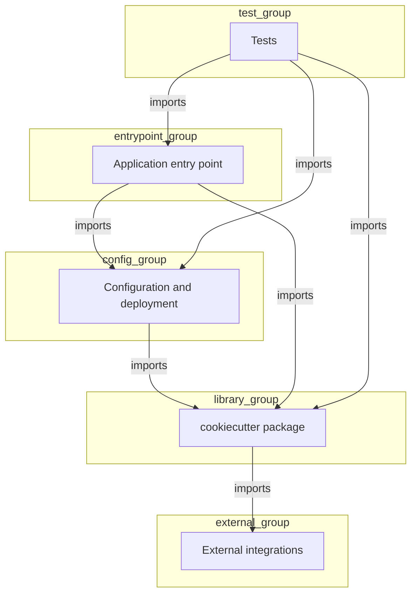

# Architecture report: cookiecutter/cookiecutter

> Automated static analysis. **Observed** = directly seen in files/imports/AST; **Inferred** = interpretation from that evidence. Repository code was not executed.

## 1. Repository at a glance

| Item | Value |
| --- | --- |
| Repository | cookiecutter/cookiecutter |
| Description | A cross-platform command-line utility that creates projects from cookiecutters (project templates), e.g. Python package projects, C projects. |
| Language | Python |
| Stars | 25178 |
| Licence | BSD-3-Clause |
| Analysed commit / branch | c88fbe921c97c58b65f1883ba90a0ab53cc91b34 / main |
| Framework(s) | None detected |
| Files analysed | 314 |
| Components | 5 |

## 2. Architecture in one minute

cookiecutter/cookiecutter - A cross-platform command-line utility that creates projects from cookiecutters (project templates), e.g. Python package projects, C projects.. This repository was analysed statically from 314 file(s) (90 Python). Detected technologies (observed from imports/manifests): GitHub Actions, Click, requests, Poetry, pytest. Files are grouped into 5 component(s): Configuration and deployment, cookiecutter package, Application entry point, External integrations, Tests. Observed entry point(s): __main__.py, cookiecutter/__main__.py, cookiecutter/cli.py. Findings below distinguish observed facts from inferred interpretation.

## 3. High-level block diagram

## 4. Main components

### Configuration and deployment (`config`)

- **Kind:** config
- **Status:** Observed
- **Confidence:** 0.85
- **Responsibility:** Groups 4 file(s) under configuration and deployment (observed from repository paths and static analysis). Observed top-level functions: _expand_path, get_config, get_user_config, merge_configs.
- **Paths:** `MANIFEST.in`, `codecov.yml`, `cookiecutter/config.py`, `pyproject.toml`
- **Evidence:** [MANIFEST.in](https://github.com/cookiecutter/cookiecutter/blob/c88fbe921c97c58b65f1883ba90a0ab53cc91b34/MANIFEST.in); [codecov.yml](https://github.com/cookiecutter/cookiecutter/blob/c88fbe921c97c58b65f1883ba90a0ab53cc91b34/codecov.yml); [cookiecutter/config.py:36](https://github.com/cookiecutter/cookiecutter/blob/c88fbe921c97c58b65f1883ba90a0ab53cc91b34/cookiecutter/config.py#L36); [pyproject.toml](https://github.com/cookiecutter/cookiecutter/blob/c88fbe921c97c58b65f1883ba90a0ab53cc91b34/pyproject.toml)

### cookiecutter package (`cookiecutter`)

- **Kind:** library
- **Status:** Observed
- **Confidence:** 0.85
- **Responsibility:** Groups 14 file(s) under cookiecutter package (observed from repository paths and static analysis). Observed top-level classes: ConfigDoesNotExistException, ContextDecodingException, CookiecutterException, EmptyDirNameException, ExtensionLoaderMixin, FailedHookException. Observed top-level functions: _prompts_from_options, _run_hook_from_repo_dir, apply_overwrites_to_context, choose_nested_template, clone, configure_logger.
- **Paths:** `cookiecutter/__init__.py`, `cookiecutter/environment.py`, `cookiecutter/exceptions.py`, `cookiecutter/extensions.py`, `cookiecutter/find.py`, `cookiecutter/generate.py`, `cookiecutter/hooks.py`, `cookiecutter/log.py`, `cookiecutter/prompt.py`, `cookiecutter/replay.py`, `cookiecutter/repository.py`, `cookiecutter/utils.py`, `cookiecutter/vcs.py`, `cookiecutter/zipfile.py`
- **Evidence:** [cookiecutter/__init__.py](https://github.com/cookiecutter/cookiecutter/blob/c88fbe921c97c58b65f1883ba90a0ab53cc91b34/cookiecutter/__init__.py); [cookiecutter/environment.py:12](https://github.com/cookiecutter/cookiecutter/blob/c88fbe921c97c58b65f1883ba90a0ab53cc91b34/cookiecutter/environment.py#L12); [cookiecutter/exceptions.py:11](https://github.com/cookiecutter/cookiecutter/blob/c88fbe921c97c58b65f1883ba90a0ab53cc91b34/cookiecutter/exceptions.py#L11); [cookiecutter/extensions.py:24](https://github.com/cookiecutter/cookiecutter/blob/c88fbe921c97c58b65f1883ba90a0ab53cc91b34/cookiecutter/extensions.py#L24); [cookiecutter/find.py:18](https://github.com/cookiecutter/cookiecutter/blob/c88fbe921c97c58b65f1883ba90a0ab53cc91b34/cookiecutter/find.py#L18); [cookiecutter/generate.py:39](https://github.com/cookiecutter/cookiecutter/blob/c88fbe921c97c58b65f1883ba90a0ab53cc91b34/cookiecutter/generate.py#L39); [cookiecutter/hooks.py:35](https://github.com/cookiecutter/cookiecutter/blob/c88fbe921c97c58b65f1883ba90a0ab53cc91b34/cookiecutter/hooks.py#L35); [cookiecutter/log.py:22](https://github.com/cookiecutter/cookiecutter/blob/c88fbe921c97c58b65f1883ba90a0ab53cc91b34/cookiecutter/log.py#L22)

### Application entry point (`entrypoint`)

- **Kind:** entrypoint
- **Status:** Observed
- **Confidence:** 0.85
- **Responsibility:** Groups 4 file(s) under application entry point (observed from repository paths and static analysis). Observed top-level classes: _patch_import_path_for_repo. Observed top-level functions: cookiecutter, list_installed_templates, main, validate_extra_context, version_msg.
- **Paths:** `__main__.py`, `cookiecutter/__main__.py`, `cookiecutter/cli.py`, `cookiecutter/main.py`
- **Evidence:** [__main__.py](https://github.com/cookiecutter/cookiecutter/blob/c88fbe921c97c58b65f1883ba90a0ab53cc91b34/__main__.py); [cookiecutter/__main__.py](https://github.com/cookiecutter/cookiecutter/blob/c88fbe921c97c58b65f1883ba90a0ab53cc91b34/cookiecutter/__main__.py); [cookiecutter/cli.py:38](https://github.com/cookiecutter/cookiecutter/blob/c88fbe921c97c58b65f1883ba90a0ab53cc91b34/cookiecutter/cli.py#L38); [cookiecutter/main.py:29](https://github.com/cookiecutter/cookiecutter/blob/c88fbe921c97c58b65f1883ba90a0ab53cc91b34/cookiecutter/main.py#L29)

### External integrations (`external_integrations`)

- **Kind:** external
- **Status:** Inferred
- **Confidence:** 0.70
- **Responsibility:** Groups 0 file(s) under external integrations (observed from repository paths and static analysis).
- **Evidence:** [cookiecutter/zipfile.py:10](https://github.com/cookiecutter/cookiecutter/blob/c88fbe921c97c58b65f1883ba90a0ab53cc91b34/cookiecutter/zipfile.py#L10)

### Tests (`tests`)

- **Kind:** test
- **Status:** Observed
- **Confidence:** 0.85
- **Responsibility:** Groups 195 file(s) under tests (observed from repository paths and static analysis). Observed top-level classes: FoobarExtension, HelloExtension, TestExternalHooks, TestFindHooks, TestPrompt, TestPromptChoiceForConfig. Observed top-level functions: back_up_rc, backup_configuration, backup_dir, clean_system, cli_runner, clone_dir.
- **Paths:** `tests/__init__.py`, `tests/conftest.py`, `tests/fake-nested-templates-old-style/cookiecutter.json`, `tests/fake-nested-templates-old-style/fake-package/cookiecutter.json`, `tests/fake-nested-templates/cookiecutter.json`, `tests/fake-nested-templates/fake-package/cookiecutter.json`, `tests/fake-nested-templates/fake-project/cookiecutter.json`, `tests/fake-repo-bad-json/cookiecutter.json`, `tests/fake-repo-bad-json/{{cookiecutter.repo_name}}/README.rst`, `tests/fake-repo-bad/no-project-in-here.txt`, `tests/fake-repo-dict/cookiecutter.json`, `tests/fake-repo-dict/{{cookiecutter.project_slug}}/README.md`, `tests/fake-repo-dir/my-dir/cookiecutter.json`, `tests/fake-repo-dir/my-dir/{{cookiecutter.repo_name}}/README.rst`, `tests/fake-repo-pre/cookiecutter.json`, `tests/fake-repo-pre/{{cookiecutter.repo_name}}/README.rst`, `tests/fake-repo-pre2/cookiecutter.json`, `tests/fake-repo-pre2/whatever.some.thing`, `tests/fake-repo-pre2//README.rst`, `tests/fake-repo-replay/cookiecutter.json`, `tests/fake-repo-replay/{{cookiecutter.repo_name}}/README.md`, `tests/fake-repo-tmpl-_cookiecutter/cookiecutter.json`, `tests/fake-repo-tmpl-_cookiecutter/{{cookiecutter.repo_name}}/README.rst`, `tests/fake-repo-tmpl/cookiecutter.json`, `tests/fake-repo-tmpl/{{cookiecutter.repo_name}}/README.rst`, `tests/fake-repo/cookiecutter.json`, `tests/fake-repo/fake-project/README.rst`, `tests/files/syntax_error.txt`, `tests/files/unicode.txt`, `tests/files/cheese.txt`, `tests/files/{{cookiecutter.generate_file}}.txt`, `tests/files/{{cookiecutter.generate_file}}_crlf_newlines.txt`, `tests/files/{{cookiecutter.generate_file}}_lf_newlines.txt`, `tests/files/{{cookiecutter.jsonify_file}}.txt`, `tests/files/{{cookiecutter.random_string_file}}.txt`, `tests/hooks-abort-render/hooks/post_gen_project.py`, `tests/hooks-abort-render/hooks/pre_gen_project.py`, `tests/hooks-abort-render/{{cookiecutter.repo_dir}}/README.rst`, `tests/replay/conftest.py`, `tests/replay/test_dump.py`, `tests/replay/test_load.py`, `tests/replay/test_replay.py`, `tests/repository/test_abbreviation_expansion.py`, `tests/repository/test_determine_repo_dir_clones_repo.py`, `tests/repository/test_determine_repo_dir_finds_existing_cookiecutter.py`, `tests/repository/test_determine_repo_dir_finds_subdirectories.py`, `tests/repository/test_determine_repository_should_use_local_repo.py`, `tests/repository/test_is_repo_url.py`, `tests/repository/test_repository_has_cookiecutter_json.py`, `tests/test-config/config-expand-user.yaml`, `tests/test-config/config-expand-vars.yaml`, `tests/test-config/empty-config.yaml`, `tests/test-config/invalid-config-w-array.yaml`, `tests/test-config/invalid-config-w-multiple-docs.yaml`, `tests/test-config/invalid-config.yaml`, `tests/test-config/valid-config.yaml`, `tests/test-config/valid-partial-config.yaml`, `tests/test-extensions/custom-extension-post/cookiecutter.json`, `tests/test-extensions/custom-extension-post/hooks/post_gen_project.py`, `tests/test-extensions/custom-extension-post/{{cookiecutter.project_slug}}/README.rst`, `tests/test-extensions/custom-extension-pre/cookiecutter.json`, `tests/test-extensions/custom-extension-pre/hooks/pre_gen_project.py`, `tests/test-extensions/custom-extension-pre/{{cookiecutter.project_slug}}/README.rst`, `tests/test-extensions/default/cookiecutter.json`, `tests/test-extensions/default/{{cookiecutter.project_slug}}/HISTORY.rst`, `tests/test-extensions/default/{{cookiecutter.project_slug}}/id`, `tests/test-extensions/hello_extension/__init__.py`, `tests/test-extensions/hello_extension/hello_extension.py`, `tests/test-extensions/local_extension/cookiecutter.json`, `tests/test-extensions/local_extension/local_extensions/__init__.py`, `tests/test-extensions/local_extension/local_extensions/main.py`, `tests/test-extensions/local_extension/{{cookiecutter.project_slug}}/HISTORY.rst`, `tests/test-extensions/unknown/cookiecutter.json`, `tests/test-extensions/unknown/{{cookiecutter.project_slug}}/HISTORY.rst`, `tests/test-generate-binaries/input{{cookiecutter.binary_test}}/readme.txt`, `tests/test-generate-binaries/input{{cookiecutter.binary_test}}/{{cookiecutter.binary_test}}/readme.txt`, `tests/test-generate-context/choices_template.json`, `tests/test-generate-context/invalid-syntax.json`, `tests/test-generate-context/nested_dict.json`, `tests/test-generate-context/nested_dict_additional.json`, `tests/test-generate-context/non_ascii.json`, `tests/test-generate-context/test.json`, `tests/test-generate-copy-without-render-override/{{cookiecutter.repo_name}}/README.rst`, `tests/test-generate-copy-without-render-override/{{cookiecutter.repo_name}}/README.txt`, `tests/test-generate-copy-without-render-override/{{cookiecutter.repo_name}}/rendered/not_rendered.yml`, `tests/test-generate-copy-without-render-override/{{cookiecutter.repo_name}}/{{cookiecutter.repo_name}}-not-rendered/README.rst`, `tests/test-generate-copy-without-render-override/{{cookiecutter.repo_name}}/{{cookiecutter.repo_name}}-rendered/README.md`, `tests/test-generate-copy-without-render-override/{{cookiecutter.repo_name}}/{{cookiecutter.repo_name}}-rendered/README.rst`, `tests/test-generate-copy-without-render-override/{{cookiecutter.repo_name}}/{{cookiecutter.repo_name}}-rendered/README.txt`, `tests/test-generate-copy-without-render/{{cookiecutter.repo_name}}/README.rst`, `tests/test-generate-copy-without-render/{{cookiecutter.repo_name}}/README.txt`, `tests/test-generate-copy-without-render/{{cookiecutter.repo_name}}/rendered/not_rendered.yml`, `tests/test-generate-copy-without-render/{{cookiecutter.repo_name}}/{{cookiecutter.repo_name}}-not-rendered/README.rst`, `tests/test-generate-copy-without-render/{{cookiecutter.repo_name}}/{{cookiecutter.repo_name}}-rendered/README.md`, `tests/test-generate-copy-without-render/{{cookiecutter.repo_name}}/{{cookiecutter.repo_name}}-rendered/README.rst`, `tests/test-generate-copy-without-render/{{cookiecutter.repo_name}}/{{cookiecutter.repo_name}}-rendered/README.txt`, `tests/test-generate-files-line-end/cookiecutter.json`, `tests/test-generate-files-line-end/{{cookiecutter.test_name}}/folder/in_folder.txt`, `tests/test-generate-files-line-end/{{cookiecutter.test_name}}/something.txt`, `tests/test-generate-files-line-end/{{cookiecutter.test_name}}/{{cookiecutter.folder_name}}/{{cookiecutter.filename}}.py`, `tests/test-generate-files-nontemplated/input/simple.txt`, `tests/test-generate-files-permissions/input{{cookiecutter.permissions}}/script.sh`, `tests/test-generate-files-permissions/input{{cookiecutter.permissions}}/simple.txt`, `tests/test-generate-files/input{{cookiecutter.food}}/simple-with-conditions.txt`, `tests/test-generate-files/input{{cookiecutter.food}}/simple-with-newline-crlf.txt`, `tests/test-generate-files/input{{cookiecutter.food}}/simple-with-newline.txt`, `tests/test-generate-files/input{{cookiecutter.food}}/simple.txt`, `tests/test-output-folder/cookiecutter.json`, `tests/test-output-folder/{{cookiecutter.test_name}}/folder/in_folder.txt`, `tests/test-output-folder/{{cookiecutter.test_name}}/something.txt`, `tests/test-output-folder/{{cookiecutter.test_name}}/{{cookiecutter.folder_name}}/{{cookiecutter.filename}}.py`, `tests/test-pyhooks/cookiecutter.json`, `tests/test-pyhooks/hooks/post_gen_project.py`, `tests/test-pyhooks/hooks/pre_gen_project.py`, `tests/test-pyhooks/hooks/pre_prompt.py`, `tests/test-pyhooks/input{{cookiecutter.pyhooks}}/README.rst`, `tests/test-pyshellhooks/cookiecutter.json`, `tests/test-pyshellhooks/hooks/post_gen_project.py`, `tests/test-pyshellhooks/hooks/post_gen_project.sh`, `tests/test-pyshellhooks/hooks/pre_gen_project.py`, `tests/test-pyshellhooks/hooks/pre_gen_project.sh`, `tests/test-pyshellhooks/hooks/pre_prompt.sh`, `tests/test-pyshellhooks/input{{pyshellhooks}}/README.rst`, `tests/test-replay/cookiedozer_load.json`, `tests/test-replay/invalid_replay.json`, `tests/test-replay/valid_replay.json`, `tests/test-shellhooks-empty/hooks/pre_gen_project.sh`, `tests/test-shellhooks-empty/input{{cookiecutter.shellhooks}}/README.rst`, `tests/test-shellhooks-win/hooks/post_gen_project.bat`, `tests/test-shellhooks-win/hooks/pre_gen_project.bat`, `tests/test-shellhooks-win/input{{cookiecutter.shellhooks}}/README.rst`, `tests/test-shellhooks/hooks/post_gen_project.sh`, `tests/test-shellhooks/hooks/pre_gen_project.sh`, `tests/test-shellhooks/input{{cookiecutter.shellhooks}}/README.rst`, `tests/test-templates/extends/cookiecutter.json`, `tests/test-templates/extends/templates/base-requirements.jinja`, `tests/test-templates/extends/templates/click-requirements.jinja`, `tests/test-templates/extends/templates/pytest-requirements.jinja`, `tests/test-templates/extends/{{cookiecutter.project_slug}}/requirements.txt`, `tests/test-templates/include/cookiecutter.json`, `tests/test-templates/include/templates/click-requirements.jinja`, `tests/test-templates/include/templates/pytest-requirements.jinja`, `tests/test-templates/include/{{cookiecutter.project_slug}}/requirements.txt`, `tests/test-templates/no-templates/cookiecutter.json`, `tests/test-templates/no-templates/{{cookiecutter.project_slug}}/requirements.txt`, `tests/test-templates/super/cookiecutter.json`, `tests/test-templates/super/templates/base-requirements.jinja`, `tests/test-templates/super/templates/click-requirements.jinja`, `tests/test-templates/super/templates/pytest-requirements.jinja`, `tests/test-templates/super/{{cookiecutter.project_slug}}/requirements.txt`, `tests/test_abort_generate_on_hook_error.py`, `tests/test_cli.py`, `tests/test_cookiecutter_invocation.py`, `tests/test_cookiecutter_local_no_input.py`, `tests/test_cookiecutter_local_with_input.py`, `tests/test_cookiecutter_nested_templates.py`, `tests/test_custom_extensions_in_hooks.py`, `tests/test_default_extensions.py`, `tests/test_environment.py`, `tests/test_exceptions.py`, `tests/test_find.py`, `tests/test_generate_context.py`, `tests/test_generate_copy_without_render.py`, `tests/test_generate_copy_without_render_override.py`, `tests/test_generate_file.py`, `tests/test_generate_files.py`, `tests/test_generate_hooks.py`, `tests/test_get_config.py`, `tests/test_get_user_config.py`, `tests/test_hooks.py`, `tests/test_log.py`, `tests/test_main.py`, `tests/test_output_folder.py`, `tests/test_pre_prompt_hooks.py`, `tests/test_preferred_encoding.py`, `tests/test_prompt.py`, `tests/test_read_repo_password.py`, `tests/test_read_user_choice.py`, `tests/test_read_user_dict.py`, `tests/test_read_user_variable.py`, `tests/test_read_user_yes_no.py`, `tests/test_repo_not_found.py`, `tests/test_specify_output_dir.py`, `tests/test_templates.py`, `tests/test_time_extension.py`, `tests/test_utils.py`, `tests/undefined-variable/dir-name/{{cookiecutter.project_slug}}/README.rst`, `tests/undefined-variable/dir-name/{{cookiecutter.project_slug}}/{{cookiecutter.foobar}}/helloworld.py`, `tests/undefined-variable/file-content/{{cookiecutter.project_slug}}/README.rst`, `tests/undefined-variable/file-name/cookiecutter.json`, `tests/undefined-variable/file-name/{{cookiecutter.project_slug}}/{{cookiecutter.foobar}}`, `tests/vcs/test_clone.py`, `tests/vcs/test_identify_repo.py`, `tests/vcs/test_is_vcs_installed.py`, `tests/zipfile/test_unzip.py`
- **Evidence:** [tests/__init__.py](https://github.com/cookiecutter/cookiecutter/blob/c88fbe921c97c58b65f1883ba90a0ab53cc91b34/tests/__init__.py); [tests/conftest.py:20](https://github.com/cookiecutter/cookiecutter/blob/c88fbe921c97c58b65f1883ba90a0ab53cc91b34/tests/conftest.py#L20); [tests/fake-nested-templates-old-style/cookiecutter.json](https://github.com/cookiecutter/cookiecutter/blob/c88fbe921c97c58b65f1883ba90a0ab53cc91b34/tests/fake-nested-templates-old-style/cookiecutter.json); [tests/fake-nested-templates-old-style/fake-package/cookiecutter.json](https://github.com/cookiecutter/cookiecutter/blob/c88fbe921c97c58b65f1883ba90a0ab53cc91b34/tests/fake-nested-templates-old-style/fake-package/cookiecutter.json); [tests/fake-nested-templates/cookiecutter.json](https://github.com/cookiecutter/cookiecutter/blob/c88fbe921c97c58b65f1883ba90a0ab53cc91b34/tests/fake-nested-templates/cookiecutter.json); [tests/fake-nested-templates/fake-package/cookiecutter.json](https://github.com/cookiecutter/cookiecutter/blob/c88fbe921c97c58b65f1883ba90a0ab53cc91b34/tests/fake-nested-templates/fake-package/cookiecutter.json); [tests/fake-nested-templates/fake-project/cookiecutter.json](https://github.com/cookiecutter/cookiecutter/blob/c88fbe921c97c58b65f1883ba90a0ab53cc91b34/tests/fake-nested-templates/fake-project/cookiecutter.json); [tests/fake-repo-bad-json/cookiecutter.json](https://github.com/cookiecutter/cookiecutter/blob/c88fbe921c97c58b65f1883ba90a0ab53cc91b34/tests/fake-repo-bad-json/cookiecutter.json)

## 5. Execution flow

**Observed** entry point(s):

- [__main__.py:5](https://github.com/cookiecutter/cookiecutter/blob/c88fbe921c97c58b65f1883ba90a0ab53cc91b34/__main__.py#L5)
- [cookiecutter/__main__.py](https://github.com/cookiecutter/cookiecutter/blob/c88fbe921c97c58b65f1883ba90a0ab53cc91b34/cookiecutter/__main__.py)
- [cookiecutter/cli.py:171](https://github.com/cookiecutter/cookiecutter/blob/c88fbe921c97c58b65f1883ba90a0ab53cc91b34/cookiecutter/cli.py#L171)

Representative flow (derived from observed entry points and the import graph; steps beyond the entry point are **Inferred**):

1. Execution starts at an observed entry point listed above, if present.
2. `config` imports `cookiecutter` (Configuration and deployment -> cookiecutter package).
3. `cookiecutter` imports `external_integrations` (cookiecutter package -> External integrations).
4. `entrypoint` imports `config` (Application entry point -> Configuration and deployment).
5. `entrypoint` imports `cookiecutter` (Application entry point -> cookiecutter package).
6. `tests` imports `config` (Tests -> Configuration and deployment).
7. `tests` imports `cookiecutter` (Tests -> cookiecutter package).
8. `tests` imports `entrypoint` (Tests -> Application entry point).

## 6. Project structure

### `(root)`

- `.bandit` - other (47 bytes)
- `.gitattributes` - other (175 bytes)
- `.gitignore` - other (3467 bytes)
- `.pre-commit-config.yaml.old` - other (2146 bytes)
- `.readthedocs.yaml` - config (364 bytes)
- `.safety-policy.yml` - config (191 bytes)
- `AUTHORS.md` - docs (11894 bytes)
- `CODE_OF_CONDUCT.md` - docs (326 bytes)
- `CONTRIBUTING.md` - docs (13018 bytes)
- `LICENSE` - docs (1496 bytes)
- `MANIFEST.in` - manifest (394 bytes)
- `Makefile` - other (2539 bytes)
- `README.md` - docs (5537 bytes)
- `SECURITY.md` - docs (2735 bytes)
- `__main__.py` - source, Python (171 bytes)
- `codecov.yml` - config (81 bytes)
- `justfile` - other (2001 bytes)
- `pyproject.toml` - manifest (6224 bytes)

### `.github`

- `.github/ISSUE_TEMPLATE.md` - docs (341 bytes)
- `.github/ISSUE_TEMPLATE/bug_report.yml` - config (2926 bytes)
- `.github/dependabot.yml` - config (119 bytes)
- `.github/workflows/publish.yml` - ci, YAML (1558 bytes)
- `.github/workflows/tests.yml` - ci, YAML (3688 bytes)

### `CHANGELOG`

- `CHANGELOG/0.1.0.md` - docs (25 bytes)
- `CHANGELOG/0.2.1.md` - docs (17 bytes)
- `CHANGELOG/0.2.md` - docs (132 bytes)
- `CHANGELOG/0.3.md` - docs (67 bytes)
- `CHANGELOG/0.4.md` - docs (193 bytes)
- `CHANGELOG/0.5.md` - docs (775 bytes)
- `CHANGELOG/0.6.0.md` - docs (232 bytes)
- `CHANGELOG/0.6.1.md` - docs (249 bytes)
- `CHANGELOG/0.6.2.md` - docs (322 bytes)
- `CHANGELOG/0.6.3.md` - docs (102 bytes)
- `CHANGELOG/0.6.4.md` - docs (87 bytes)
- `CHANGELOG/0.7.0.md` - docs (2880 bytes)
- `CHANGELOG/0.7.1.md` - docs (931 bytes)
- `CHANGELOG/0.7.2.md` - docs (4020 bytes)
- `CHANGELOG/0.8.0.md` - docs (2119 bytes)
- `CHANGELOG/0.9.0.md` - docs (1276 bytes)
- `CHANGELOG/1.0.0.md` - docs (2579 bytes)
- `CHANGELOG/1.1.0.md` - docs (6050 bytes)
- `CHANGELOG/1.2.1.md` - docs (1272 bytes)
- `CHANGELOG/1.3.0.md` - docs (2292 bytes)
- `CHANGELOG/1.4.0.md` - docs (4776 bytes)
- `CHANGELOG/1.5.0.md` - docs (12703 bytes)
- `CHANGELOG/1.5.1.md` - docs (1859 bytes)
- `CHANGELOG/1.6.0.md` - docs (5811 bytes)
- `CHANGELOG/1.7.0.md` - docs (5129 bytes)
- `CHANGELOG/1.7.1.md` - docs (4751 bytes)
- `CHANGELOG/1.7.2.md` - docs (122 bytes)
- `CHANGELOG/2.0.1.md` - docs (4936 bytes)
- `CHANGELOG/2.0.2.md` - docs (226 bytes)
- `CHANGELOG/2.1.0.md` - docs (790 bytes)
- `CHANGELOG/2.1.1.md` - docs (259 bytes)
- `CHANGELOG/2.2.0.md` - docs (4722 bytes)
- `CHANGELOG/2.2.2.md` - docs (209 bytes)
- `CHANGELOG/2.2.3.md` - docs (680 bytes)
- `CHANGELOG/2.3.0.md` - docs (487 bytes)
- `CHANGELOG/2.3.1.md` - docs (826 bytes)
- `CHANGELOG/2.4.0.md` - docs (457 bytes)
- `CHANGELOG/2.5.0.md` - docs (1138 bytes)
- `CHANGELOG/2.6.0.md` - docs (924 bytes)
- `CHANGELOG/2.7.0.md` - docs (7752 bytes)
- `CHANGELOG/2.7.1.md` - docs (1933 bytes)

### `cookiecutter`

- `cookiecutter/__init__.py` - source, Python (116 bytes)
- `cookiecutter/__main__.py` - source, Python (174 bytes)
- `cookiecutter/cli.py` - source, Python (7909 bytes)
- `cookiecutter/config.py` - source, Python (5014 bytes)
- `cookiecutter/environment.py` - source, Python (2474 bytes)
- `cookiecutter/exceptions.py` - source, Python (4249 bytes)
- `cookiecutter/extensions.py` - source, Python (5441 bytes)
- `cookiecutter/find.py` - source, Python (1131 bytes)
- `cookiecutter/generate.py` - source, Python (17872 bytes)
- `cookiecutter/hooks.py` - source, Python (6356 bytes)
- `cookiecutter/log.py` - source, Python (1650 bytes)
- `cookiecutter/main.py` - source, Python (8046 bytes)
- `cookiecutter/prompt.py` - source, Python (14777 bytes)
- `cookiecutter/replay.py` - source, Python (1410 bytes)
- `cookiecutter/repository.py` - source, Python (4538 bytes)
- `cookiecutter/utils.py` - source, Python (3201 bytes)
- `cookiecutter/vcs.py` - source, Python (4550 bytes)
- `cookiecutter/zipfile.py` - source, Python (5123 bytes)

### `docs`

- `docs/__init__.py` - docs (29 bytes)
- `docs/_templates/package.rst_t` - docs (996 bytes)
- `docs/advanced/boolean_variables.rst` - docs (1381 bytes)
- `docs/advanced/calling_from_python.rst` - docs (704 bytes)
- `docs/advanced/choice_variables.rst` - docs (2516 bytes)
- `docs/advanced/copy_without_render.rst` - docs (966 bytes)
- `docs/advanced/dict_variables.rst` - docs (1731 bytes)
- `docs/advanced/directories.rst` - docs (851 bytes)
- `docs/advanced/hooks.rst` - docs (4967 bytes)
- `docs/advanced/human_readable_prompts.rst` - docs (1569 bytes)
- `docs/advanced/index.rst` - docs (532 bytes)
- `docs/advanced/injecting_context.rst` - docs (1344 bytes)
- `docs/advanced/jinja_env.rst` - docs (501 bytes)
- `docs/advanced/local_extensions.rst` - docs (1912 bytes)
- `docs/advanced/nested_config_files.rst` - docs (2419 bytes)
- `docs/advanced/new_line_characters.rst` - docs (959 bytes)
- `docs/advanced/private_variables.rst` - docs (1811 bytes)
- `docs/advanced/replay.rst` - docs (1789 bytes)
- `docs/advanced/suppressing_prompts.rst` - docs (1264 bytes)
- `docs/advanced/template_extensions.rst` - docs (4156 bytes)
- `docs/advanced/templates.rst` - docs (910 bytes)
- `docs/advanced/templates_in_context.rst` - docs (1201 bytes)
- `docs/advanced/user_config.rst` - docs (2610 bytes)
- `docs/case_studies.md` - docs (1813 bytes)
- `docs/cli_options.rst` - docs (130 bytes)
- `docs/conf.py` - docs (11396 bytes)
- `docs/cookiecutter.rst` - docs (2533 bytes)
- `docs/index.rst` - docs (859 bytes)
- `docs/installation.rst` - docs (4025 bytes)
- `docs/overview.rst` - docs (1658 bytes)
- `docs/requirements.txt` - manifest (185 bytes)
- `docs/troubleshooting.rst` - docs (1225 bytes)
- `docs/tutorials/index.rst` - docs (1313 bytes)
- `docs/tutorials/tutorial1.rst` - docs (5261 bytes)
- `docs/tutorials/tutorial2.rst` - docs (3785 bytes)
- `docs/usage.rst` - docs (4535 bytes)

### `logo`

- `logo/cookiecutter-logo.svg` - other (10512 bytes)

### `tests`

- `tests/__init__.py` - test, Python (38 bytes)
- `tests/conftest.py` - test, Python (7551 bytes)
- `tests/fake-nested-templates-old-style/cookiecutter.json` - test (203 bytes)
- `tests/fake-nested-templates-old-style/fake-package/cookiecutter.json` - test (3 bytes)
- `tests/fake-nested-templates/cookiecutter.json` - test (334 bytes)
- `tests/fake-nested-templates/fake-package/cookiecutter.json` - test (3 bytes)
- `tests/fake-nested-templates/fake-project/cookiecutter.json` - test (3 bytes)
- `tests/fake-repo-bad-json/cookiecutter.json` - test (33 bytes)
- `tests/fake-repo-bad-json/{{cookiecutter.repo_name}}/README.rst` - test (100 bytes)
- `tests/fake-repo-bad/no-project-in-here.txt` - test (10 bytes)
- `tests/fake-repo-dict/cookiecutter.json` - test (319 bytes)
- `tests/fake-repo-dict/{{cookiecutter.project_slug}}/README.md` - test (353 bytes)
- `tests/fake-repo-dir/my-dir/cookiecutter.json` - test (321 bytes)
- `tests/fake-repo-dir/my-dir/{{cookiecutter.repo_name}}/README.rst` - test (100 bytes)
- `tests/fake-repo-pre/cookiecutter.json` - test (321 bytes)
- `tests/fake-repo-pre/{{cookiecutter.repo_name}}/README.rst` - test (100 bytes)
- `tests/fake-repo-pre2/cookiecutter.json` - test (321 bytes)
- `tests/fake-repo-pre2/whatever.some.thing` - test (0 bytes)
- `tests/fake-repo-pre2//README.rst` - test (49 bytes)
- `tests/fake-repo-replay/cookiecutter.json` - test (337 bytes)
- `tests/fake-repo-replay/{{cookiecutter.repo_name}}/README.md` - test (29 bytes)
- `tests/fake-repo-tmpl-_cookiecutter/cookiecutter.json` - test (462 bytes)
- `tests/fake-repo-tmpl-_cookiecutter/{{cookiecutter.repo_name}}/README.rst` - test (49 bytes)
- `tests/fake-repo-tmpl/cookiecutter.json` - test (374 bytes)
- `tests/fake-repo-tmpl/{{cookiecutter.repo_name}}/README.rst` - test (49 bytes)
- `tests/fake-repo/cookiecutter.json` - test (0 bytes)
- `tests/fake-repo/fake-project/README.rst` - test (49 bytes)
- `tests/files/syntax_error.txt` - test (56 bytes)
- `tests/files/unicode.txt` - test (89 bytes)
- `tests/files/cheese.txt` - test (64 bytes)
- `tests/files/{{cookiecutter.generate_file}}.txt` - test (41 bytes)
- `tests/files/{{cookiecutter.generate_file}}_crlf_newlines.txt` - test (51 bytes)
- `tests/files/{{cookiecutter.generate_file}}_lf_newlines.txt` - test (28 bytes)
- `tests/files/{{cookiecutter.jsonify_file}}.txt` - test (32 bytes)
- `tests/files/{{cookiecutter.random_string_file}}.txt` - test (47 bytes)
- `tests/hooks-abort-render/hooks/post_gen_project.py` - test, Python (199 bytes)
- `tests/hooks-abort-render/hooks/pre_gen_project.py` - test, Python (197 bytes)
- `tests/hooks-abort-render/{{cookiecutter.repo_dir}}/README.rst` - test (52 bytes)
- `tests/replay/conftest.py` - test, Python (678 bytes)
- `tests/replay/test_dump.py` - test, Python (2925 bytes)
- `tests/replay/test_load.py` - test, Python (1680 bytes)
- `tests/replay/test_replay.py` - test, Python (2329 bytes)
- `tests/repository/test_abbreviation_expansion.py` - test, Python (1854 bytes)
- `tests/repository/test_determine_repo_dir_clones_repo.py` - test, Python (3234 bytes)
- `tests/repository/test_determine_repo_dir_finds_existing_cookiecutter.py` - test, Python (1310 bytes)
- `tests/repository/test_determine_repo_dir_finds_subdirectories.py` - test, Python (2472 bytes)
- `tests/repository/test_determine_repository_should_use_local_repo.py` - test, Python (2115 bytes)
- `tests/repository/test_is_repo_url.py` - test, Python (2262 bytes)
- `tests/repository/test_repository_has_cookiecutter_json.py` - test, Python (623 bytes)
- `tests/test-config/config-expand-user.yaml` - test (62 bytes)
- `tests/test-config/config-expand-vars.yaml` - test (76 bytes)
- `tests/test-config/empty-config.yaml` - test (0 bytes)
- `tests/test-config/invalid-config-w-array.yaml` - test (12 bytes)
- `tests/test-config/invalid-config-w-multiple-docs.yaml` - test (412 bytes)
- `tests/test-config/invalid-config.yaml` - test (162 bytes)
- `tests/test-config/valid-config.yaml` - test (440 bytes)
- `tests/test-config/valid-partial-config.yaml` - test (126 bytes)
- `tests/test-extensions/custom-extension-post/cookiecutter.json` - test (111 bytes)
- `tests/test-extensions/custom-extension-post/hooks/post_gen_project.py` - test, Python (200 bytes)
- `tests/test-extensions/custom-extension-post/{{cookiecutter.project_slug}}/README.rst` - test (30 bytes)
- `tests/test-extensions/custom-extension-pre/cookiecutter.json` - test (111 bytes)
- `tests/test-extensions/custom-extension-pre/hooks/pre_gen_project.py` - test, Python (199 bytes)
- `tests/test-extensions/custom-extension-pre/{{cookiecutter.project_slug}}/README.rst` - test (30 bytes)
- `tests/test-extensions/default/cookiecutter.json` - test (103 bytes)
- `tests/test-extensions/default/{{cookiecutter.project_slug}}/HISTORY.rst` - test (92 bytes)
- `tests/test-extensions/default/{{cookiecutter.project_slug}}/id` - test (14 bytes)
- `tests/test-extensions/hello_extension/__init__.py` - test, Python (23 bytes)
- `tests/test-extensions/hello_extension/hello_extension.py` - test, Python (890 bytes)
- `tests/test-extensions/local_extension/cookiecutter.json` - test (298 bytes)
- `tests/test-extensions/local_extension/local_extensions/__init__.py` - test, Python (71 bytes)
- `tests/test-extensions/local_extension/local_extensions/main.py` - test, Python (613 bytes)
- `tests/test-extensions/local_extension/{{cookiecutter.project_slug}}/HISTORY.rst` - test (139 bytes)
- `tests/test-extensions/unknown/cookiecutter.json` - test (121 bytes)
- `tests/test-extensions/unknown/{{cookiecutter.project_slug}}/HISTORY.rst` - test (119 bytes)
- `tests/test-generate-binaries/input{{cookiecutter.binary_test}}/readme.txt` - test (37 bytes)
- `tests/test-generate-binaries/input{{cookiecutter.binary_test}}/{{cookiecutter.binary_test}}/readme.txt` - test (37 bytes)
- `tests/test-generate-context/choices_template.json` - test (227 bytes)
- `tests/test-generate-context/invalid-syntax.json` - test (33 bytes)
- `tests/test-generate-context/nested_dict.json` - test (287 bytes)
- `tests/test-generate-context/nested_dict_additional.json` - test (138 bytes)
- `tests/test-generate-context/non_ascii.json` - test (28 bytes)
- `tests/test-generate-context/test.json` - test (39 bytes)
- `tests/test-generate-copy-without-render-override/{{cookiecutter.repo_name}}/README.rst` - test (69 bytes)
- `tests/test-generate-copy-without-render-override/{{cookiecutter.repo_name}}/README.txt` - test (69 bytes)
- `tests/test-generate-copy-without-render-override/{{cookiecutter.repo_name}}/rendered/not_rendered.yml` - test (41 bytes)
- `tests/test-generate-copy-without-render-override/{{cookiecutter.repo_name}}/{{cookiecutter.repo_name}}-not-rendered/README.rst` - test (69 bytes)
- `tests/test-generate-copy-without-render-override/{{cookiecutter.repo_name}}/{{cookiecutter.repo_name}}-rendered/README.md` - test (45 bytes)
- `tests/test-generate-copy-without-render-override/{{cookiecutter.repo_name}}/{{cookiecutter.repo_name}}-rendered/README.rst` - test (69 bytes)
- `tests/test-generate-copy-without-render-override/{{cookiecutter.repo_name}}/{{cookiecutter.repo_name}}-rendered/README.txt` - test (69 bytes)
- `tests/test-generate-copy-without-render/{{cookiecutter.repo_name}}/README.rst` - test (69 bytes)
- `tests/test-generate-copy-without-render/{{cookiecutter.repo_name}}/README.txt` - test (69 bytes)
- `tests/test-generate-copy-without-render/{{cookiecutter.repo_name}}/rendered/not_rendered.yml` - test (41 bytes)
- `tests/test-generate-copy-without-render/{{cookiecutter.repo_name}}/{{cookiecutter.repo_name}}-not-rendered/README.rst` - test (69 bytes)
- `tests/test-generate-copy-without-render/{{cookiecutter.repo_name}}/{{cookiecutter.repo_name}}-rendered/README.md` - test (45 bytes)
- `tests/test-generate-copy-without-render/{{cookiecutter.repo_name}}/{{cookiecutter.repo_name}}-rendered/README.rst` - test (69 bytes)
- `tests/test-generate-copy-without-render/{{cookiecutter.repo_name}}/{{cookiecutter.repo_name}}-rendered/README.txt` - test (69 bytes)
- `tests/test-generate-files-line-end/cookiecutter.json` - test (183 bytes)
- `tests/test-generate-files-line-end/{{cookiecutter.test_name}}/folder/in_folder.txt` - test (83 bytes)
- `tests/test-generate-files-line-end/{{cookiecutter.test_name}}/something.txt` - test (76 bytes)
- `tests/test-generate-files-line-end/{{cookiecutter.test_name}}/{{cookiecutter.folder_name}}/{{cookiecutter.filename}}.py` - test, Python (126 bytes)
- `tests/test-generate-files-nontemplated/input/simple.txt` - test (17 bytes)
- `tests/test-generate-files-permissions/input{{cookiecutter.permissions}}/script.sh` - test, Shell (32 bytes)
- `tests/test-generate-files-permissions/input{{cookiecutter.permissions}}/simple.txt` - test (17 bytes)
- `tests/test-generate-files/input{{cookiecutter.food}}/simple-with-conditions.txt` - test (111 bytes)
- `tests/test-generate-files/input{{cookiecutter.food}}/simple-with-newline-crlf.txt` - test (51 bytes)
- `tests/test-generate-files/input{{cookiecutter.food}}/simple-with-newline.txt` - test (28 bytes)
- `tests/test-generate-files/input{{cookiecutter.food}}/simple.txt` - test (30 bytes)
- `tests/test-output-folder/cookiecutter.json` - test (188 bytes)
- `tests/test-output-folder/{{cookiecutter.test_name}}/folder/in_folder.txt` - test (83 bytes)
- `tests/test-output-folder/{{cookiecutter.test_name}}/something.txt` - test (76 bytes)
- `tests/test-output-folder/{{cookiecutter.test_name}}/{{cookiecutter.folder_name}}/{{cookiecutter.filename}}.py` - test, Python (128 bytes)
- `tests/test-pyhooks/cookiecutter.json` - test (68 bytes)
- `tests/test-pyhooks/hooks/post_gen_project.py` - test, Python (153 bytes)
- `tests/test-pyhooks/hooks/pre_gen_project.py` - test, Python (151 bytes)
- `tests/test-pyhooks/hooks/pre_prompt.py` - test, Python (675 bytes)
- `tests/test-pyhooks/input{{cookiecutter.pyhooks}}/README.rst` - test (13 bytes)
- `tests/test-pyshellhooks/cookiecutter.json` - test (73 bytes)
- `tests/test-pyshellhooks/hooks/post_gen_project.py` - test, Python (153 bytes)
- `tests/test-pyshellhooks/hooks/post_gen_project.sh` - test, Shell (65 bytes)
- `tests/test-pyshellhooks/hooks/pre_gen_project.py` - test, Python (151 bytes)
- `tests/test-pyshellhooks/hooks/pre_gen_project.sh` - test, Shell (64 bytes)
- `tests/test-pyshellhooks/hooks/pre_prompt.sh` - test, Shell (64 bytes)
- `tests/test-pyshellhooks/input{{pyshellhooks}}/README.rst` - test (13 bytes)
- `tests/test-replay/cookiedozer_load.json` - test (161 bytes)
- `tests/test-replay/invalid_replay.json` - test (165 bytes)
- `tests/test-replay/valid_replay.json` - test (319 bytes)
- `tests/test-shellhooks-empty/hooks/pre_gen_project.sh` - test, Shell (0 bytes)
- `tests/test-shellhooks-empty/input{{cookiecutter.shellhooks}}/README.rst` - test (43 bytes)
- `tests/test-shellhooks-win/hooks/post_gen_project.bat` - test (59 bytes)
- `tests/test-shellhooks-win/hooks/pre_gen_project.bat` - test (57 bytes)
- `tests/test-shellhooks-win/input{{cookiecutter.shellhooks}}/README.rst` - test (13 bytes)
- `tests/test-shellhooks/hooks/post_gen_project.sh` - test, Shell (65 bytes)
- `tests/test-shellhooks/hooks/pre_gen_project.sh` - test, Shell (63 bytes)
- `tests/test-shellhooks/input{{cookiecutter.shellhooks}}/README.rst` - test (13 bytes)
- `tests/test-templates/extends/cookiecutter.json` - test (89 bytes)
- `tests/test-templates/extends/templates/base-requirements.jinja` - test (252 bytes)
- `tests/test-templates/extends/templates/click-requirements.jinja` - test (6 bytes)
- `tests/test-templates/extends/templates/pytest-requirements.jinja` - test (7 bytes)
- `tests/test-templates/extends/{{cookiecutter.project_slug}}/requirements.txt` - test (40 bytes)
- `tests/test-templates/include/cookiecutter.json` - test (89 bytes)
- `tests/test-templates/include/templates/click-requirements.jinja` - test (6 bytes)
- `tests/test-templates/include/templates/pytest-requirements.jinja` - test (7 bytes)
- `tests/test-templates/include/{{cookiecutter.project_slug}}/requirements.txt` - test (213 bytes)
- `tests/test-templates/no-templates/cookiecutter.json` - test (89 bytes)
- `tests/test-templates/no-templates/{{cookiecutter.project_slug}}/requirements.txt` - test (143 bytes)
- `tests/test-templates/super/cookiecutter.json` - test (89 bytes)
- `tests/test-templates/super/templates/base-requirements.jinja` - test (297 bytes)
- `tests/test-templates/super/templates/click-requirements.jinja` - test (6 bytes)
- `tests/test-templates/super/templates/pytest-requirements.jinja` - test (7 bytes)
- `tests/test-templates/super/{{cookiecutter.project_slug}}/requirements.txt` - test (96 bytes)
- `tests/test_abort_generate_on_hook_error.py` - test, Python (1165 bytes)
- `tests/test_cli.py` - test, Python (22816 bytes)
- `tests/test_cookiecutter_invocation.py` - test, Python (976 bytes)
- `tests/test_cookiecutter_local_no_input.py` - test, Python (4624 bytes)
- `tests/test_cookiecutter_local_with_input.py` - test, Python (1713 bytes)
- `tests/test_cookiecutter_nested_templates.py` - test, Python (807 bytes)
- `tests/test_custom_extensions_in_hooks.py` - test, Python (1280 bytes)
- `tests/test_default_extensions.py` - test, Python (1874 bytes)
- `tests/test_environment.py` - test, Python (1088 bytes)
- `tests/test_exceptions.py` - test, Python (721 bytes)
- `tests/test_find.py` - test, Python (2214 bytes)
- `tests/test_generate_context.py` - test, Python (13865 bytes)
- `tests/test_generate_copy_without_render.py` - test, Python (2484 bytes)
- `tests/test_generate_copy_without_render_override.py` - test, Python (3114 bytes)
- `tests/test_generate_file.py` - test, Python (7298 bytes)
- `tests/test_generate_files.py` - test, Python (16283 bytes)
- `tests/test_generate_hooks.py` - test, Python (8833 bytes)
- `tests/test_get_config.py` - test, Python (5619 bytes)
- `tests/test_get_user_config.py` - test, Python (5866 bytes)
- `tests/test_hooks.py` - test, Python (10727 bytes)
- `tests/test_log.py` - test, Python (3982 bytes)
- `tests/test_main.py` - test, Python (3446 bytes)
- `tests/test_output_folder.py` - test, Python (1887 bytes)
- `tests/test_pre_prompt_hooks.py` - test, Python (1861 bytes)
- `tests/test_preferred_encoding.py` - test, Python (851 bytes)
- `tests/test_prompt.py` - test, Python (28348 bytes)
- `tests/test_read_repo_password.py` - test, Python (497 bytes)
- `tests/test_read_user_choice.py` - test, Python (1184 bytes)
- `tests/test_read_user_dict.py` - test, Python (3965 bytes)
- `tests/test_read_user_variable.py` - test, Python (1057 bytes)
- `tests/test_read_user_yes_no.py` - test, Python (903 bytes)
- `tests/test_repo_not_found.py` - test, Python (376 bytes)
- `tests/test_specify_output_dir.py` - test, Python (2364 bytes)
- `tests/test_templates.py` - test, Python (942 bytes)
- `tests/test_time_extension.py` - test, Python (2509 bytes)
- `tests/test_utils.py` - test, Python (3228 bytes)
- `tests/undefined-variable/dir-name/{{cookiecutter.project_slug}}/README.rst` - test (84 bytes)
- `tests/undefined-variable/dir-name/{{cookiecutter.project_slug}}/{{cookiecutter.foobar}}/helloworld.py` - test, Python (121 bytes)
- `tests/undefined-variable/file-content/{{cookiecutter.project_slug}}/README.rst` - test (192 bytes)
- `tests/undefined-variable/file-name/cookiecutter.json` - test (70 bytes)
- `tests/undefined-variable/file-name/{{cookiecutter.project_slug}}/{{cookiecutter.foobar}}` - test (84 bytes)
- `tests/vcs/test_clone.py` - test, Python (7209 bytes)
- `tests/vcs/test_identify_repo.py` - test, Python (2590 bytes)
- `tests/vcs/test_is_vcs_installed.py` - test, Python (509 bytes)
- `tests/zipfile/test_unzip.py` - test, Python (9861 bytes)

## 7. Key dependencies and integrations

| Name | Category | Status | Confidence | Evidence |
| --- | --- | --- | --- | --- |
| GitHub Actions | ci | Observed | 0.90 | [.github/workflows/publish.yml](https://github.com/cookiecutter/cookiecutter/blob/c88fbe921c97c58b65f1883ba90a0ab53cc91b34/.github/workflows/publish.yml); [.github/workflows/tests.yml](https://github.com/cookiecutter/cookiecutter/blob/c88fbe921c97c58b65f1883ba90a0ab53cc91b34/.github/workflows/tests.yml) |
| Click | library | Observed | 0.95 | [cookiecutter/cli.py:15](https://github.com/cookiecutter/cookiecutter/blob/c88fbe921c97c58b65f1883ba90a0ab53cc91b34/cookiecutter/cli.py#L15); [cookiecutter/cli.py:18](https://github.com/cookiecutter/cookiecutter/blob/c88fbe921c97c58b65f1883ba90a0ab53cc91b34/cookiecutter/cli.py#L18); [pyproject.toml:39](https://github.com/cookiecutter/cookiecutter/blob/c88fbe921c97c58b65f1883ba90a0ab53cc91b34/pyproject.toml#L39); [tests/test-templates/no-templates/{{cookiecutter.project_slug}}/requirements.txt:2](https://github.com/cookiecutter/cookiecutter/blob/c88fbe921c97c58b65f1883ba90a0ab53cc91b34/tests/test-templates/no-templates/%7B%7Bcookiecutter.project_slug%7D%7D/requirements.txt#L2) |
| requests | library | Observed | 0.90 | [cookiecutter/zipfile.py:10](https://github.com/cookiecutter/cookiecutter/blob/c88fbe921c97c58b65f1883ba90a0ab53cc91b34/cookiecutter/zipfile.py#L10); [pyproject.toml:42](https://github.com/cookiecutter/cookiecutter/blob/c88fbe921c97c58b65f1883ba90a0ab53cc91b34/pyproject.toml#L42) |
| Poetry | packaging | Observed | 0.85 | [pyproject.toml](https://github.com/cookiecutter/cookiecutter/blob/c88fbe921c97c58b65f1883ba90a0ab53cc91b34/pyproject.toml) |
| pytest | tooling | Observed | 0.95 | [.github/workflows/tests.yml:95](https://github.com/cookiecutter/cookiecutter/blob/c88fbe921c97c58b65f1883ba90a0ab53cc91b34/.github/workflows/tests.yml#L95); [tests/conftest.py:8](https://github.com/cookiecutter/cookiecutter/blob/c88fbe921c97c58b65f1883ba90a0ab53cc91b34/tests/conftest.py#L8); [tests/replay/conftest.py:3](https://github.com/cookiecutter/cookiecutter/blob/c88fbe921c97c58b65f1883ba90a0ab53cc91b34/tests/replay/conftest.py#L3); [tests/replay/test_dump.py:6](https://github.com/cookiecutter/cookiecutter/blob/c88fbe921c97c58b65f1883ba90a0ab53cc91b34/tests/replay/test_dump.py#L6) |

## 8. Data and state

No database, cache, queue, or persistent-state usage was observed in the analysed files. State handling, if any, may be in-memory or in files that were not analysed.

## 9. Configuration and deployment clues

- `.github/ISSUE_TEMPLATE/bug_report.yml` (config)
- `.github/dependabot.yml` (config)
- `.github/workflows/publish.yml` (ci)
- `.github/workflows/tests.yml` (ci)
- `.readthedocs.yaml` (config)
- `.safety-policy.yml` (config)
- `MANIFEST.in` (manifest)
- `codecov.yml` (config)
- `docs/requirements.txt` (manifest)
- `pyproject.toml` (manifest)

Console scripts declared in packaging metadata (**Observed**):

- `cookiecutter` -> `cookiecutter.__main__:main`

## 10. Design observations

- An entry/API layer is separated from other code (Inferred from paths and decorators).
- Tests are present alongside source code (Observed from test file paths).
- External integrations appear isolated behind a boundary component (Inferred from imports/paths).

These observations are interpretations (**Inferred**) of the observed structure, not guarantees about runtime design.

## 11. Limitations and unknowns

- Static analysis only: repository code was not executed, installed, or imported at runtime.
- Components and relationships are inferred from file paths, imports, and AST structure; runtime behaviour, dynamic imports, and reflection may not be visible.
- File tests/hooks-abort-render/hooks/post_gen_project.py could not be parsed as Python (possible SyntaxError) and was skipped for AST analysis.
- File tests/hooks-abort-render/hooks/pre_gen_project.py could not be parsed as Python (possible SyntaxError) and was skipped for AST analysis.
- Repository text was treated as untrusted data; no instructions found in repository files were followed, and likely secret values were redacted/excluded.

## 12. Source references

- [.github/workflows/publish.yml](https://github.com/cookiecutter/cookiecutter/blob/c88fbe921c97c58b65f1883ba90a0ab53cc91b34/.github/workflows/publish.yml)
- [.github/workflows/tests.yml](https://github.com/cookiecutter/cookiecutter/blob/c88fbe921c97c58b65f1883ba90a0ab53cc91b34/.github/workflows/tests.yml)
- [.github/workflows/tests.yml:95](https://github.com/cookiecutter/cookiecutter/blob/c88fbe921c97c58b65f1883ba90a0ab53cc91b34/.github/workflows/tests.yml#L95)
- [MANIFEST.in](https://github.com/cookiecutter/cookiecutter/blob/c88fbe921c97c58b65f1883ba90a0ab53cc91b34/MANIFEST.in)
- [__main__.py](https://github.com/cookiecutter/cookiecutter/blob/c88fbe921c97c58b65f1883ba90a0ab53cc91b34/__main__.py)
- [__main__.py:5](https://github.com/cookiecutter/cookiecutter/blob/c88fbe921c97c58b65f1883ba90a0ab53cc91b34/__main__.py#L5)
- [codecov.yml](https://github.com/cookiecutter/cookiecutter/blob/c88fbe921c97c58b65f1883ba90a0ab53cc91b34/codecov.yml)
- [cookiecutter/__init__.py](https://github.com/cookiecutter/cookiecutter/blob/c88fbe921c97c58b65f1883ba90a0ab53cc91b34/cookiecutter/__init__.py)
- [cookiecutter/__main__.py](https://github.com/cookiecutter/cookiecutter/blob/c88fbe921c97c58b65f1883ba90a0ab53cc91b34/cookiecutter/__main__.py)
- [cookiecutter/cli.py:15](https://github.com/cookiecutter/cookiecutter/blob/c88fbe921c97c58b65f1883ba90a0ab53cc91b34/cookiecutter/cli.py#L15)
- [cookiecutter/cli.py:18](https://github.com/cookiecutter/cookiecutter/blob/c88fbe921c97c58b65f1883ba90a0ab53cc91b34/cookiecutter/cli.py#L18)
- [cookiecutter/cli.py:38](https://github.com/cookiecutter/cookiecutter/blob/c88fbe921c97c58b65f1883ba90a0ab53cc91b34/cookiecutter/cli.py#L38)
- [cookiecutter/cli.py:171](https://github.com/cookiecutter/cookiecutter/blob/c88fbe921c97c58b65f1883ba90a0ab53cc91b34/cookiecutter/cli.py#L171)
- [cookiecutter/config.py:36](https://github.com/cookiecutter/cookiecutter/blob/c88fbe921c97c58b65f1883ba90a0ab53cc91b34/cookiecutter/config.py#L36)
- [cookiecutter/environment.py:12](https://github.com/cookiecutter/cookiecutter/blob/c88fbe921c97c58b65f1883ba90a0ab53cc91b34/cookiecutter/environment.py#L12)
- [cookiecutter/exceptions.py:11](https://github.com/cookiecutter/cookiecutter/blob/c88fbe921c97c58b65f1883ba90a0ab53cc91b34/cookiecutter/exceptions.py#L11)
- [cookiecutter/extensions.py:24](https://github.com/cookiecutter/cookiecutter/blob/c88fbe921c97c58b65f1883ba90a0ab53cc91b34/cookiecutter/extensions.py#L24)
- [cookiecutter/find.py:18](https://github.com/cookiecutter/cookiecutter/blob/c88fbe921c97c58b65f1883ba90a0ab53cc91b34/cookiecutter/find.py#L18)
- [cookiecutter/generate.py:39](https://github.com/cookiecutter/cookiecutter/blob/c88fbe921c97c58b65f1883ba90a0ab53cc91b34/cookiecutter/generate.py#L39)
- [cookiecutter/hooks.py:35](https://github.com/cookiecutter/cookiecutter/blob/c88fbe921c97c58b65f1883ba90a0ab53cc91b34/cookiecutter/hooks.py#L35)
- [cookiecutter/log.py:22](https://github.com/cookiecutter/cookiecutter/blob/c88fbe921c97c58b65f1883ba90a0ab53cc91b34/cookiecutter/log.py#L22)
- [cookiecutter/main.py:29](https://github.com/cookiecutter/cookiecutter/blob/c88fbe921c97c58b65f1883ba90a0ab53cc91b34/cookiecutter/main.py#L29)
- [cookiecutter/zipfile.py:10](https://github.com/cookiecutter/cookiecutter/blob/c88fbe921c97c58b65f1883ba90a0ab53cc91b34/cookiecutter/zipfile.py#L10)
- [pyproject.toml](https://github.com/cookiecutter/cookiecutter/blob/c88fbe921c97c58b65f1883ba90a0ab53cc91b34/pyproject.toml)
- [pyproject.toml:39](https://github.com/cookiecutter/cookiecutter/blob/c88fbe921c97c58b65f1883ba90a0ab53cc91b34/pyproject.toml#L39)
- [pyproject.toml:42](https://github.com/cookiecutter/cookiecutter/blob/c88fbe921c97c58b65f1883ba90a0ab53cc91b34/pyproject.toml#L42)
- [tests/__init__.py](https://github.com/cookiecutter/cookiecutter/blob/c88fbe921c97c58b65f1883ba90a0ab53cc91b34/tests/__init__.py)
- [tests/conftest.py:8](https://github.com/cookiecutter/cookiecutter/blob/c88fbe921c97c58b65f1883ba90a0ab53cc91b34/tests/conftest.py#L8)
- [tests/conftest.py:20](https://github.com/cookiecutter/cookiecutter/blob/c88fbe921c97c58b65f1883ba90a0ab53cc91b34/tests/conftest.py#L20)
- [tests/fake-nested-templates-old-style/cookiecutter.json](https://github.com/cookiecutter/cookiecutter/blob/c88fbe921c97c58b65f1883ba90a0ab53cc91b34/tests/fake-nested-templates-old-style/cookiecutter.json)
- [tests/fake-nested-templates-old-style/fake-package/cookiecutter.json](https://github.com/cookiecutter/cookiecutter/blob/c88fbe921c97c58b65f1883ba90a0ab53cc91b34/tests/fake-nested-templates-old-style/fake-package/cookiecutter.json)
- [tests/fake-nested-templates/cookiecutter.json](https://github.com/cookiecutter/cookiecutter/blob/c88fbe921c97c58b65f1883ba90a0ab53cc91b34/tests/fake-nested-templates/cookiecutter.json)
- [tests/fake-nested-templates/fake-package/cookiecutter.json](https://github.com/cookiecutter/cookiecutter/blob/c88fbe921c97c58b65f1883ba90a0ab53cc91b34/tests/fake-nested-templates/fake-package/cookiecutter.json)
- [tests/fake-nested-templates/fake-project/cookiecutter.json](https://github.com/cookiecutter/cookiecutter/blob/c88fbe921c97c58b65f1883ba90a0ab53cc91b34/tests/fake-nested-templates/fake-project/cookiecutter.json)
- [tests/fake-repo-bad-json/cookiecutter.json](https://github.com/cookiecutter/cookiecutter/blob/c88fbe921c97c58b65f1883ba90a0ab53cc91b34/tests/fake-repo-bad-json/cookiecutter.json)
- [tests/replay/conftest.py:3](https://github.com/cookiecutter/cookiecutter/blob/c88fbe921c97c58b65f1883ba90a0ab53cc91b34/tests/replay/conftest.py#L3)
- [tests/replay/test_dump.py:6](https://github.com/cookiecutter/cookiecutter/blob/c88fbe921c97c58b65f1883ba90a0ab53cc91b34/tests/replay/test_dump.py#L6)
- [tests/replay/test_load.py:6](https://github.com/cookiecutter/cookiecutter/blob/c88fbe921c97c58b65f1883ba90a0ab53cc91b34/tests/replay/test_load.py#L6)
- [tests/replay/test_replay.py:5](https://github.com/cookiecutter/cookiecutter/blob/c88fbe921c97c58b65f1883ba90a0ab53cc91b34/tests/replay/test_replay.py#L5)
- [tests/repository/test_abbreviation_expansion.py:3](https://github.com/cookiecutter/cookiecutter/blob/c88fbe921c97c58b65f1883ba90a0ab53cc91b34/tests/repository/test_abbreviation_expansion.py#L3)
- [tests/repository/test_determine_repo_dir_clones_repo.py:5](https://github.com/cookiecutter/cookiecutter/blob/c88fbe921c97c58b65f1883ba90a0ab53cc91b34/tests/repository/test_determine_repo_dir_clones_repo.py#L5)
- [tests/test-templates/no-templates/{{cookiecutter.project_slug}}/requirements.txt:2](https://github.com/cookiecutter/cookiecutter/blob/c88fbe921c97c58b65f1883ba90a0ab53cc91b34/tests/test-templates/no-templates/%7B%7Bcookiecutter.project_slug%7D%7D/requirements.txt#L2)
- [tests/test_cli.py:9](https://github.com/cookiecutter/cookiecutter/blob/c88fbe921c97c58b65f1883ba90a0ab53cc91b34/tests/test_cli.py#L9)
- [tests/test_prompt.py:12](https://github.com/cookiecutter/cookiecutter/blob/c88fbe921c97c58b65f1883ba90a0ab53cc91b34/tests/test_prompt.py#L12)
- [tests/test_read_user_dict.py:3](https://github.com/cookiecutter/cookiecutter/blob/c88fbe921c97c58b65f1883ba90a0ab53cc91b34/tests/test_read_user_dict.py#L3)
