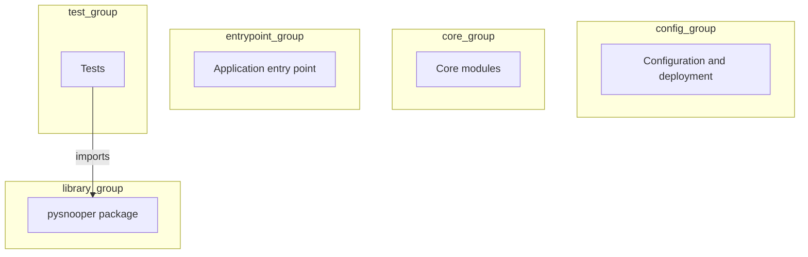

# Architecture report: cool-RR/PySnooper

> Automated static analysis. **Observed** = directly seen in files/imports/AST; **Inferred** = interpretation from that evidence. Repository code was not executed.

## 1. Repository at a glance

| Item | Value |
| --- | --- |
| Repository | cool-RR/PySnooper |
| Description | Never use print for debugging again |
| Language | Python |
| Stars | 16576 |
| Licence | MIT |
| Analysed commit / branch | 4be5c156ffc3315011c42ba521c4d8487052d289 / master |
| Framework(s) | None detected |
| Files analysed | 44 |
| Components | 5 |

## 2. Architecture in one minute

cool-RR/PySnooper - Never use print for debugging again. This repository was analysed statically from 44 file(s) (29 Python). Detected technologies (observed from imports/manifests): Poetry, setuptools, pytest, unittest. Files are grouped into 5 component(s): Configuration and deployment, Core modules, Application entry point, pysnooper package, Tests. Observed entry point(s): misc/generate_authors.py. Findings below distinguish observed facts from inferred interpretation.

## 3. High-level block diagram

## 4. Main components

### Configuration and deployment (`config`)

- **Kind:** config
- **Status:** Observed
- **Confidence:** 0.85
- **Responsibility:** Groups 6 file(s) under configuration and deployment (observed from repository paths and static analysis). Observed top-level functions: read_file.
- **Paths:** `MANIFEST.in`, `pyproject.toml`, `requirements.txt`, `setup.cfg`, `setup.py`, `tox.ini`
- **Evidence:** [MANIFEST.in](https://github.com/cool-RR/PySnooper/blob/4be5c156ffc3315011c42ba521c4d8487052d289/MANIFEST.in); [pyproject.toml](https://github.com/cool-RR/PySnooper/blob/4be5c156ffc3315011c42ba521c4d8487052d289/pyproject.toml); [requirements.txt](https://github.com/cool-RR/PySnooper/blob/4be5c156ffc3315011c42ba521c4d8487052d289/requirements.txt); [setup.cfg](https://github.com/cool-RR/PySnooper/blob/4be5c156ffc3315011c42ba521c4d8487052d289/setup.cfg); [setup.py:7](https://github.com/cool-RR/PySnooper/blob/4be5c156ffc3315011c42ba521c4d8487052d289/setup.py#L7); [tox.ini](https://github.com/cool-RR/PySnooper/blob/4be5c156ffc3315011c42ba521c4d8487052d289/tox.ini)

### Core modules (`core`)

- **Kind:** core
- **Status:** Observed
- **Confidence:** 0.85
- **Responsibility:** Groups 1 file(s) under core modules (observed from repository paths and static analysis).
- **Paths:** `make_release.sh`
- **Evidence:** [make_release.sh](https://github.com/cool-RR/PySnooper/blob/4be5c156ffc3315011c42ba521c4d8487052d289/make_release.sh)

### Application entry point (`entrypoint`)

- **Kind:** entrypoint
- **Status:** Observed
- **Confidence:** 0.85
- **Responsibility:** Groups 1 file(s) under application entry point (observed from repository paths and static analysis). Observed top-level functions: drop_recurrences, iterate_authors_by_chronological_order, print_authors.
- **Paths:** `misc/generate_authors.py`
- **Evidence:** [misc/generate_authors.py:28](https://github.com/cool-RR/PySnooper/blob/4be5c156ffc3315011c42ba521c4d8487052d289/misc/generate_authors.py#L28)

### pysnooper package (`pysnooper`)

- **Kind:** library
- **Status:** Observed
- **Confidence:** 0.85
- **Responsibility:** Groups 5 file(s) under pysnooper package (observed from repository paths and static analysis). Observed top-level classes: Attrs, BaseVariable, CommonVariable, Exploding, FileWriter, Indices. Observed top-level functions: _check_methods, call_ended_by_exception, ensure_tuple, format_exception, get_local_reprs, get_path_and_source_from_frame.
- **Paths:** `pysnooper/__init__.py`, `pysnooper/pycompat.py`, `pysnooper/tracer.py`, `pysnooper/utils.py`, `pysnooper/variables.py`
- **Evidence:** [pysnooper/__init__.py](https://github.com/cool-RR/PySnooper/blob/4be5c156ffc3315011c42ba521c4d8487052d289/pysnooper/__init__.py); [pysnooper/pycompat.py:86](https://github.com/cool-RR/PySnooper/blob/4be5c156ffc3315011c42ba521c4d8487052d289/pysnooper/pycompat.py#L86); [pysnooper/tracer.py:32](https://github.com/cool-RR/PySnooper/blob/4be5c156ffc3315011c42ba521c4d8487052d289/pysnooper/tracer.py#L32); [pysnooper/utils.py:11](https://github.com/cool-RR/PySnooper/blob/4be5c156ffc3315011c42ba521c4d8487052d289/pysnooper/utils.py#L11); [pysnooper/variables.py:13](https://github.com/cool-RR/PySnooper/blob/4be5c156ffc3315011c42ba521c4d8487052d289/pysnooper/variables.py#L13)

### Tests (`tests`)

- **Kind:** test
- **Status:** Observed
- **Confidence:** 0.85
- **Responsibility:** Groups 22 file(s) under tests (observed from repository paths and static analysis). Observed top-level classes: CallEndedByExceptionEntry, CallEntry, ContextDecorator, ContextStack, ElapsedTimeEntry, ExceptionEntry. Observed top-level functions: BlankContextManager, _frame, _is_wildcard_pattern, _make_selector, _py2_fsencode, _try_except_fileexistserror.
- **Paths:** `tests/__init__.py`, `tests/mini_toolbox/__init__.py`, `tests/mini_toolbox/contextlib.py`, `tests/mini_toolbox/pathlib.py`, `tests/samples/__init__.py`, `tests/samples/exception.py`, `tests/samples/indentation.py`, `tests/samples/recursion.py`, `tests/test_chinese.py`, `tests/test_ended_by_exception.py`, `tests/test_mini_toolbox.py`, `tests/test_multiple_files/__init__.py`, `tests/test_multiple_files/multiple_files/__init__.py`, `tests/test_multiple_files/multiple_files/bar.py`, `tests/test_multiple_files/multiple_files/foo.py`, `tests/test_multiple_files/test_multiple_files.py`, `tests/test_not_implemented.py`, `tests/test_pysnooper.py`, `tests/test_utils/__init__.py`, `tests/test_utils/test_ensure_tuple.py`, `tests/test_utils/test_regex.py`, `tests/utils.py`
- **Evidence:** [tests/__init__.py](https://github.com/cool-RR/PySnooper/blob/4be5c156ffc3315011c42ba521c4d8487052d289/tests/__init__.py); [tests/mini_toolbox/__init__.py:14](https://github.com/cool-RR/PySnooper/blob/4be5c156ffc3315011c42ba521c4d8487052d289/tests/mini_toolbox/__init__.py#L14); [tests/mini_toolbox/contextlib.py:14](https://github.com/cool-RR/PySnooper/blob/4be5c156ffc3315011c42ba521c4d8487052d289/tests/mini_toolbox/contextlib.py#L14); [tests/mini_toolbox/pathlib.py:61](https://github.com/cool-RR/PySnooper/blob/4be5c156ffc3315011c42ba521c4d8487052d289/tests/mini_toolbox/pathlib.py#L61); [tests/samples/__init__.py](https://github.com/cool-RR/PySnooper/blob/4be5c156ffc3315011c42ba521c4d8487052d289/tests/samples/__init__.py); [tests/samples/exception.py:4](https://github.com/cool-RR/PySnooper/blob/4be5c156ffc3315011c42ba521c4d8487052d289/tests/samples/exception.py#L4); [tests/samples/indentation.py:5](https://github.com/cool-RR/PySnooper/blob/4be5c156ffc3315011c42ba521c4d8487052d289/tests/samples/indentation.py#L5); [tests/samples/recursion.py:5](https://github.com/cool-RR/PySnooper/blob/4be5c156ffc3315011c42ba521c4d8487052d289/tests/samples/recursion.py#L5)

## 5. Execution flow

**Observed** entry point(s):

- [misc/generate_authors.py:57](https://github.com/cool-RR/PySnooper/blob/4be5c156ffc3315011c42ba521c4d8487052d289/misc/generate_authors.py#L57)

Representative flow (derived from observed entry points and the import graph; steps beyond the entry point are **Inferred**):

1. Execution starts at an observed entry point listed above, if present.
2. `tests` imports `pysnooper` (Tests -> pysnooper package).

## 6. Project structure

### `(root)`

- `.gitignore` - other (116 bytes)
- `.travis.yml` - ci, YAML (817 bytes)
- `ADVANCED_USAGE.md` - docs (2712 bytes)
- `AUTHORS` - other (416 bytes)
- `CITATION.cff` - other (517 bytes)
- `LICENSE` - docs (1085 bytes)
- `MANIFEST.in` - manifest (144 bytes)
- `README.md` - docs (4299 bytes)
- `make_release.sh` - source, Shell (113 bytes)
- `pyproject.toml` - manifest (81 bytes)
- `requirements.in` - other (37 bytes)
- `requirements.txt` - manifest (132 bytes)
- `setup.cfg` - manifest (1194 bytes)
- `setup.py` - manifest, Python (1875 bytes)
- `tox.ini` - config (1217 bytes)

### `misc`

- `misc/IDE files/PySnooper.wpr` - other (1483 bytes)
- `misc/generate_authors.py` - source, Python (1477 bytes)

### `pysnooper`

- `pysnooper/__init__.py` - source, Python (812 bytes)
- `pysnooper/pycompat.py` - source, Python (2677 bytes)
- `pysnooper/tracer.py` - source, Python (23874 bytes)
- `pysnooper/utils.py` - source, Python (2864 bytes)
- `pysnooper/variables.py` - source, Python (3656 bytes)

### `tests`

- `tests/__init__.py` - test, Python (61 bytes)
- `tests/mini_toolbox/__init__.py` - test, Python (8316 bytes)
- `tests/mini_toolbox/contextlib.py` - test, Python (14828 bytes)
- `tests/mini_toolbox/pathlib.py` - test, Python (54849 bytes)
- `tests/samples/__init__.py` - test, Python (0 bytes)
- `tests/samples/exception.py` - test, Python (1296 bytes)
- `tests/samples/indentation.py` - test, Python (1022 bytes)
- `tests/samples/recursion.py` - test, Python (2345 bytes)
- `tests/test_chinese.py` - test, Python (1509 bytes)
- `tests/test_ended_by_exception.py` - test, Python (1850 bytes)
- `tests/test_mini_toolbox.py` - test, Python (304 bytes)
- `tests/test_multiple_files/__init__.py` - test, Python (0 bytes)
- `tests/test_multiple_files/multiple_files/__init__.py` - test, Python (0 bytes)
- `tests/test_multiple_files/multiple_files/bar.py` - test, Python (149 bytes)
- `tests/test_multiple_files/multiple_files/foo.py` - test, Python (245 bytes)
- `tests/test_multiple_files/test_multiple_files.py` - test, Python (1572 bytes)
- `tests/test_not_implemented.py` - test, Python (1583 bytes)
- `tests/test_pysnooper.py` - test, Python (64835 bytes)
- `tests/test_utils/__init__.py` - test, Python (0 bytes)
- `tests/test_utils/test_ensure_tuple.py` - test, Python (476 bytes)
- `tests/test_utils/test_regex.py` - test, Python (3890 bytes)
- `tests/utils.py` - test, Python (14305 bytes)

## 7. Key dependencies and integrations

| Name | Category | Status | Confidence | Evidence |
| --- | --- | --- | --- | --- |
| Poetry | packaging | Observed | 0.85 | [pyproject.toml](https://github.com/cool-RR/PySnooper/blob/4be5c156ffc3315011c42ba521c4d8487052d289/pyproject.toml) |
| setuptools | packaging | Observed | 0.90 | [pyproject.toml:2](https://github.com/cool-RR/PySnooper/blob/4be5c156ffc3315011c42ba521c4d8487052d289/pyproject.toml#L2); [setup.py:3](https://github.com/cool-RR/PySnooper/blob/4be5c156ffc3315011c42ba521c4d8487052d289/setup.py#L3) |
| pytest | tooling | Observed | 0.95 | [setup.py:27](https://github.com/cool-RR/PySnooper/blob/4be5c156ffc3315011c42ba521c4d8487052d289/setup.py#L27); [tests/__init__.py:1](https://github.com/cool-RR/PySnooper/blob/4be5c156ffc3315011c42ba521c4d8487052d289/tests/__init__.py#L1); [tests/test_chinese.py:12](https://github.com/cool-RR/PySnooper/blob/4be5c156ffc3315011c42ba521c4d8487052d289/tests/test_chinese.py#L12); [tests/test_mini_toolbox.py:4](https://github.com/cool-RR/PySnooper/blob/4be5c156ffc3315011c42ba521c4d8487052d289/tests/test_mini_toolbox.py#L4) |
| unittest | tooling | Observed | 0.90 | [tests/test_ended_by_exception.py:10](https://github.com/cool-RR/PySnooper/blob/4be5c156ffc3315011c42ba521c4d8487052d289/tests/test_ended_by_exception.py#L10) |

## 8. Data and state

No database, cache, queue, or persistent-state usage was observed in the analysed files. State handling, if any, may be in-memory or in files that were not analysed.

## 9. Configuration and deployment clues

- `.travis.yml` (ci)
- `MANIFEST.in` (manifest)
- `pyproject.toml` (manifest)
- `requirements.txt` (manifest)
- `setup.cfg` (manifest)
- `setup.py` (manifest)
- `tox.ini` (config)

## 10. Design observations

- An entry/API layer is separated from other code (Inferred from paths and decorators).
- Tests are present alongside source code (Observed from test file paths).

These observations are interpretations (**Inferred**) of the observed structure, not guarantees about runtime design.

## 11. Limitations and unknowns

- Static analysis only: repository code was not executed, installed, or imported at runtime.
- Components and relationships are inferred from file paths, imports, and AST structure; runtime behaviour, dynamic imports, and reflection may not be visible.
- Repository text was treated as untrusted data; no instructions found in repository files were followed, and likely secret values were redacted/excluded.

## 12. Source references

- [MANIFEST.in](https://github.com/cool-RR/PySnooper/blob/4be5c156ffc3315011c42ba521c4d8487052d289/MANIFEST.in)
- [make_release.sh](https://github.com/cool-RR/PySnooper/blob/4be5c156ffc3315011c42ba521c4d8487052d289/make_release.sh)
- [misc/generate_authors.py:28](https://github.com/cool-RR/PySnooper/blob/4be5c156ffc3315011c42ba521c4d8487052d289/misc/generate_authors.py#L28)
- [misc/generate_authors.py:57](https://github.com/cool-RR/PySnooper/blob/4be5c156ffc3315011c42ba521c4d8487052d289/misc/generate_authors.py#L57)
- [pyproject.toml](https://github.com/cool-RR/PySnooper/blob/4be5c156ffc3315011c42ba521c4d8487052d289/pyproject.toml)
- [pyproject.toml:2](https://github.com/cool-RR/PySnooper/blob/4be5c156ffc3315011c42ba521c4d8487052d289/pyproject.toml#L2)
- [pysnooper/__init__.py](https://github.com/cool-RR/PySnooper/blob/4be5c156ffc3315011c42ba521c4d8487052d289/pysnooper/__init__.py)
- [pysnooper/pycompat.py:86](https://github.com/cool-RR/PySnooper/blob/4be5c156ffc3315011c42ba521c4d8487052d289/pysnooper/pycompat.py#L86)
- [pysnooper/tracer.py:32](https://github.com/cool-RR/PySnooper/blob/4be5c156ffc3315011c42ba521c4d8487052d289/pysnooper/tracer.py#L32)
- [pysnooper/utils.py:11](https://github.com/cool-RR/PySnooper/blob/4be5c156ffc3315011c42ba521c4d8487052d289/pysnooper/utils.py#L11)
- [pysnooper/variables.py:13](https://github.com/cool-RR/PySnooper/blob/4be5c156ffc3315011c42ba521c4d8487052d289/pysnooper/variables.py#L13)
- [requirements.txt](https://github.com/cool-RR/PySnooper/blob/4be5c156ffc3315011c42ba521c4d8487052d289/requirements.txt)
- [setup.cfg](https://github.com/cool-RR/PySnooper/blob/4be5c156ffc3315011c42ba521c4d8487052d289/setup.cfg)
- [setup.py:3](https://github.com/cool-RR/PySnooper/blob/4be5c156ffc3315011c42ba521c4d8487052d289/setup.py#L3)
- [setup.py:7](https://github.com/cool-RR/PySnooper/blob/4be5c156ffc3315011c42ba521c4d8487052d289/setup.py#L7)
- [setup.py:27](https://github.com/cool-RR/PySnooper/blob/4be5c156ffc3315011c42ba521c4d8487052d289/setup.py#L27)
- [tests/__init__.py](https://github.com/cool-RR/PySnooper/blob/4be5c156ffc3315011c42ba521c4d8487052d289/tests/__init__.py)
- [tests/__init__.py:1](https://github.com/cool-RR/PySnooper/blob/4be5c156ffc3315011c42ba521c4d8487052d289/tests/__init__.py#L1)
- [tests/mini_toolbox/__init__.py:14](https://github.com/cool-RR/PySnooper/blob/4be5c156ffc3315011c42ba521c4d8487052d289/tests/mini_toolbox/__init__.py#L14)
- [tests/mini_toolbox/contextlib.py:14](https://github.com/cool-RR/PySnooper/blob/4be5c156ffc3315011c42ba521c4d8487052d289/tests/mini_toolbox/contextlib.py#L14)
- [tests/mini_toolbox/pathlib.py:61](https://github.com/cool-RR/PySnooper/blob/4be5c156ffc3315011c42ba521c4d8487052d289/tests/mini_toolbox/pathlib.py#L61)
- [tests/samples/__init__.py](https://github.com/cool-RR/PySnooper/blob/4be5c156ffc3315011c42ba521c4d8487052d289/tests/samples/__init__.py)
- [tests/samples/exception.py:4](https://github.com/cool-RR/PySnooper/blob/4be5c156ffc3315011c42ba521c4d8487052d289/tests/samples/exception.py#L4)
- [tests/samples/indentation.py:5](https://github.com/cool-RR/PySnooper/blob/4be5c156ffc3315011c42ba521c4d8487052d289/tests/samples/indentation.py#L5)
- [tests/samples/recursion.py:5](https://github.com/cool-RR/PySnooper/blob/4be5c156ffc3315011c42ba521c4d8487052d289/tests/samples/recursion.py#L5)
- [tests/test_chinese.py:12](https://github.com/cool-RR/PySnooper/blob/4be5c156ffc3315011c42ba521c4d8487052d289/tests/test_chinese.py#L12)
- [tests/test_ended_by_exception.py:10](https://github.com/cool-RR/PySnooper/blob/4be5c156ffc3315011c42ba521c4d8487052d289/tests/test_ended_by_exception.py#L10)
- [tests/test_mini_toolbox.py:4](https://github.com/cool-RR/PySnooper/blob/4be5c156ffc3315011c42ba521c4d8487052d289/tests/test_mini_toolbox.py#L4)
- [tests/test_multiple_files/test_multiple_files.py:12](https://github.com/cool-RR/PySnooper/blob/4be5c156ffc3315011c42ba521c4d8487052d289/tests/test_multiple_files/test_multiple_files.py#L12)
- [tests/test_not_implemented.py:13](https://github.com/cool-RR/PySnooper/blob/4be5c156ffc3315011c42ba521c4d8487052d289/tests/test_not_implemented.py#L13)
- [tests/test_pysnooper.py:14](https://github.com/cool-RR/PySnooper/blob/4be5c156ffc3315011c42ba521c4d8487052d289/tests/test_pysnooper.py#L14)
- [tox.ini](https://github.com/cool-RR/PySnooper/blob/4be5c156ffc3315011c42ba521c4d8487052d289/tox.ini)
