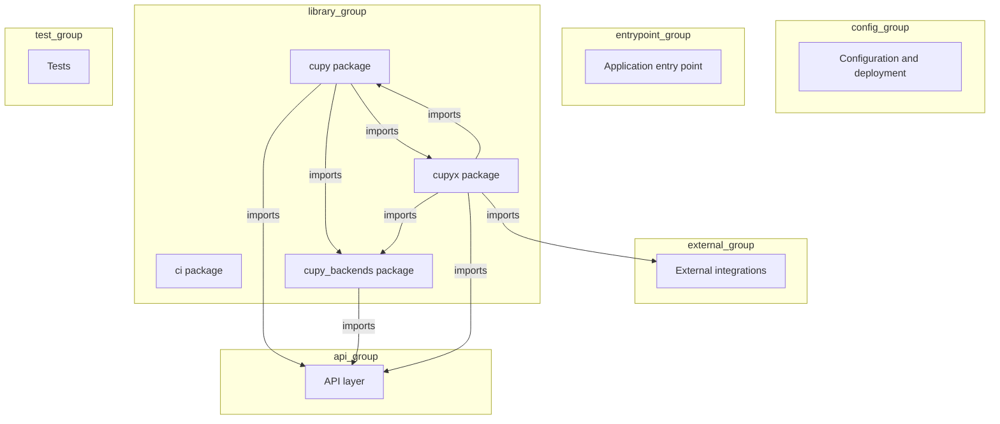

# Architecture report: cupy/cupy

> Automated static analysis. **Observed** = directly seen in files/imports/AST; **Inferred** = interpretation from that evidence. Repository code was not executed.

## 1. Repository at a glance

| Item | Value |
| --- | --- |
| Repository | cupy/cupy |
| Description | NumPy & SciPy for GPU |
| Language | Python |
| Stars | 12408 |
| Licence | MIT |
| Analysed commit / branch | e41e2961f74ee2b1c2b50265f3104f0885e74623 / main |
| Framework(s) | None detected |
| Files analysed | 800 |
| Components | 9 |

## 2. Architecture in one minute

cupy/cupy - NumPy & SciPy for GPU. This repository was analysed statically from 800 file(s) (355 Python). Detected technologies (observed from imports/manifests): GitHub Actions, NumPy, setuptools, Docker, pytest, unittest. Files are grouped into 9 component(s): API layer, ci package, Configuration and deployment, cupy package, cupy_backends package, cupyx package, Application entry point, External integrations. Observed entry point(s): .github/workflows/scripts/backport_reminder.py, .github/workflows/scripts/flexci_dispatcher.py, .pfnci/flexci_notify.py. Findings below distinguish observed facts from inferred interpretation.

## 3. High-level block diagram

## 4. Main components

### API layer (`api_layer`)

- **Kind:** api
- **Status:** Observed
- **Confidence:** 0.85
- **Responsibility:** Groups 1 file(s) under api layer (observed from repository paths and static analysis).
- **Paths:** `cupy_backends/cuda/api/__init__.py`
- **Evidence:** [cupy_backends/cuda/api/__init__.py](https://github.com/cupy/cupy/blob/e41e2961f74ee2b1c2b50265f3104f0885e74623/cupy_backends/cuda/api/__init__.py)

### ci package (`ci`)

- **Kind:** library
- **Status:** Observed
- **Confidence:** 0.85
- **Responsibility:** Groups 2 file(s) under ci package (observed from repository paths and static analysis).
- **Paths:** `ci/tools/ci-guard.sh`, `ci/tools/wheel_configs.py`
- **Evidence:** [ci/tools/ci-guard.sh](https://github.com/cupy/cupy/blob/e41e2961f74ee2b1c2b50265f3104f0885e74623/ci/tools/ci-guard.sh); [ci/tools/wheel_configs.py](https://github.com/cupy/cupy/blob/e41e2961f74ee2b1c2b50265f3104f0885e74623/ci/tools/wheel_configs.py)

### Configuration and deployment (`config`)

- **Kind:** config
- **Status:** Observed
- **Confidence:** 0.85
- **Responsibility:** Groups 5 file(s) under configuration and deployment (observed from repository paths and static analysis).
- **Paths:** `MANIFEST.in`, `ci/versions.yml`, `codecov.yml`, `docker/python3/Dockerfile`, `docker/rocm/Dockerfile`
- **Evidence:** [MANIFEST.in](https://github.com/cupy/cupy/blob/e41e2961f74ee2b1c2b50265f3104f0885e74623/MANIFEST.in); [ci/versions.yml](https://github.com/cupy/cupy/blob/e41e2961f74ee2b1c2b50265f3104f0885e74623/ci/versions.yml); [codecov.yml](https://github.com/cupy/cupy/blob/e41e2961f74ee2b1c2b50265f3104f0885e74623/codecov.yml); [docker/python3/Dockerfile](https://github.com/cupy/cupy/blob/e41e2961f74ee2b1c2b50265f3104f0885e74623/docker/python3/Dockerfile); [docker/rocm/Dockerfile](https://github.com/cupy/cupy/blob/e41e2961f74ee2b1c2b50265f3104f0885e74623/docker/rocm/Dockerfile)

### cupy package (`cupy`)

- **Kind:** library
- **Status:** Observed
- **Confidence:** 0.85
- **Responsibility:** Groups 159 file(s) under cupy package (observed from repository paths and static analysis). Observed top-level classes: AxisConcatenator, CClass, CodeBlock, CompileException, DebugPrintHook, DeviceSynchronized. Observed top-level functions: __getattr__, _align_real_input, _as_int, _as_pairs, _assemble_complex_evs, _assert_2d.
- **Paths:** `cupy/__init__.py`, `cupy/_binary/__init__.py`, `cupy/_binary/elementwise.py`, `cupy/_binary/packing.py`, `cupy/_core/__init__.py`, `cupy/_core/_codeblock.py`, `cupy/_core/_cuda_compute_histogram.py`, `cupy/_core/_fusion_interface.py`, `cupy/_core/_fusion_op.py`, `cupy/_core/_fusion_optimization.py`, `cupy/_core/_gufuncs.py`, `cupy/_core/_ufuncs.py`, `cupy/_core/include/cupy/complex/arithmetic.h`, `cupy/_core/include/cupy/complex/catrig.h`, `cupy/_core/include/cupy/complex/catrigf.h`, `cupy/_core/include/cupy/complex/ccosh.h`, `cupy/_core/include/cupy/complex/ccoshf.h`, `cupy/_core/include/cupy/complex/cexp.h`, `cupy/_core/include/cupy/complex/cexpf.h`, `cupy/_core/include/cupy/complex/clog.h`, `cupy/_core/include/cupy/complex/clogf.h`, `cupy/_core/include/cupy/complex/complex.h`, `cupy/_core/include/cupy/complex/complex_inl.h`, `cupy/_core/include/cupy/complex/cpow.h`, `cupy/_core/include/cupy/complex/cproj.h`, `cupy/_core/include/cupy/complex/csinh.h`, `cupy/_core/include/cupy/complex/csinhf.h`, `cupy/_core/include/cupy/complex/csqrt.h`, `cupy/_core/include/cupy/complex/csqrtf.h`, `cupy/_core/include/cupy/complex/ctanh.h`, `cupy/_core/include/cupy/complex/ctanhf.h`, `cupy/_core/include/cupy/complex/math_private.h`, `cupy/_core/include/cupy/complex/namespace.h`, `cupy/_core/include/cupy/cuComplex_bridge.h`, `cupy/_core/include/cupy/cuda_workaround.h`, `cupy/_core/include/cupy/math_constants.h`, `cupy/_core/syncdetect.py`, `cupy/_creation/__init__.py`, `cupy/_creation/basic.py`, `cupy/_creation/from_data.py`, `cupy/_creation/matrix.py`, `cupy/_creation/ranges.py`, `cupy/_environment.py`, `cupy/_functional/__init__.py`, `cupy/_functional/piecewise.py`, `cupy/_functional/vectorize.py`, `cupy/_indexing/__init__.py`, `cupy/_indexing/generate.py`, `cupy/_indexing/indexing.py`, `cupy/_indexing/insert.py`, `cupy/_indexing/iterate.py`, `cupy/_io/__init__.py`, `cupy/_io/formatting.py`, `cupy/_io/npz.py`, `cupy/_io/text.py`, `cupy/_logic/__init__.py`, `cupy/_logic/comparison.py`, `cupy/_logic/content.py`, `cupy/_logic/ops.py`, `cupy/_logic/truth.py`, `cupy/_logic/type_testing.py`, `cupy/_manipulation/__init__.py`, `cupy/_manipulation/add_remove.py`, `cupy/_manipulation/basic.py`, `cupy/_manipulation/dims.py`, `cupy/_manipulation/join.py`, `cupy/_manipulation/kind.py`, `cupy/_manipulation/rearrange.py`, `cupy/_manipulation/shape.py`, `cupy/_manipulation/split.py`, `cupy/_manipulation/tiling.py`, `cupy/_manipulation/transpose.py`, `cupy/_math/__init__.py`, `cupy/_math/arithmetic.py`, `cupy/_math/explog.py`, `cupy/_math/floating.py`, `cupy/_math/hyperbolic.py`, `cupy/_math/misc.py`, `cupy/_math/rational.py`, `cupy/_math/rounding.py`, `cupy/_math/special.py`, `cupy/_math/sumprod.py`, `cupy/_math/trigonometric.py`, `cupy/_math/ufunc.py`, `cupy/_math/window.py`, `cupy/_misc/__init__.py`, `cupy/_misc/byte_bounds.py`, `cupy/_misc/memory_ranges.py`, `cupy/_misc/who.py`, `cupy/_padding/__init__.py`, `cupy/_padding/pad.py`, `cupy/_sorting/__init__.py`, `cupy/_sorting/count.py`, `cupy/_sorting/search.py`, `cupy/_sorting/sort.py`, `cupy/_statistics/__init__.py`, `cupy/_statistics/correlation.py`, `cupy/_statistics/histogram.py`, `cupy/_statistics/meanvar.py`, `cupy/_statistics/order.py`, `cupy/_version.py`, `cupy/cublas.py`, `cupy/cuda/__init__.py`, `cupy/cuda/_compiler_cache.py`, `cupy/cuda/compiler.py`, `cupy/cuda/cupy_cub.h`, `cupy/cuda/cupy_cufft.h`, `cupy/cuda/cupy_cufftXt.h`, `cupy/cuda/cupy_jitify.h`, `cupy/cuda/cupy_thrust.h`, `cupy/cuda/cutensor.py`, `cupy/cuda/memory_hooks/__init__.py`, `cupy/cuda/memory_hooks/debug_print.py`, `cupy/cuda/memory_hooks/line_profile.py`, `cupy/cuda/nccl.py`, `cupy/cuda/nvtx.py`, `cupy/cuda/profiler.py`, `cupy/cuda/runtime.py`, `cupy/exceptions/__init__.py`, `cupy/fft/__init__.py`, `cupy/fft/_config.py`, `cupy/fft/_fft.py`, `cupy/lib/__init__.py`, `cupy/lib/_routines_poly.py`, `cupy/lib/_shape_base.py`, `cupy/lib/stride_tricks.py`, `cupy/linalg/__init__.py`, `cupy/linalg/_decomposition.py`, `cupy/linalg/_eigenvalue.py`, `cupy/linalg/_einsum.py`, `cupy/linalg/_einsum_cutn.py`, `cupy/linalg/_einsum_opt.py`, `cupy/linalg/_norms.py`, `cupy/linalg/_product.py`, `cupy/linalg/_solve.py`, `cupy/linalg/_util.py`, `cupy/polynomial/__init__.py`, `cupy/polynomial/polynomial.py`, `cupy/polynomial/polyutils.py`, `cupy/random/__init__.py`, `cupy/random/_distributions.py`, `cupy/random/_generator.py`, `cupy/random/_kernels.py`, `cupy/random/_permutations.py`, `cupy/random/_sample.py`, `cupy/testing/__init__.py`, `cupy/testing/_array.py`, `cupy/testing/_attr.py`, `cupy/testing/_bundle.py`, `cupy/testing/_condition.py`, `cupy/testing/_helper.py`, `cupy/testing/_hypothesis.py`, `cupy/testing/_loops.py`, `cupy/testing/_parameterized.py`, `cupy/testing/_protocol_helpers.py`, `cupy/testing/_pytest_impl.py`, `cupy/testing/_random.py`, `cupy/typing/__init__.py`, `cupy/typing/_types.py`
- **Evidence:** [cupy/__init__.py:32](https://github.com/cupy/cupy/blob/e41e2961f74ee2b1c2b50265f3104f0885e74623/cupy/__init__.py#L32); [cupy/_binary/__init__.py](https://github.com/cupy/cupy/blob/e41e2961f74ee2b1c2b50265f3104f0885e74623/cupy/_binary/__init__.py); [cupy/_binary/elementwise.py](https://github.com/cupy/cupy/blob/e41e2961f74ee2b1c2b50265f3104f0885e74623/cupy/_binary/elementwise.py); [cupy/_binary/packing.py:39](https://github.com/cupy/cupy/blob/e41e2961f74ee2b1c2b50265f3104f0885e74623/cupy/_binary/packing.py#L39); [cupy/_core/__init__.py](https://github.com/cupy/cupy/blob/e41e2961f74ee2b1c2b50265f3104f0885e74623/cupy/_core/__init__.py); [cupy/_core/_codeblock.py:8](https://github.com/cupy/cupy/blob/e41e2961f74ee2b1c2b50265f3104f0885e74623/cupy/_core/_codeblock.py#L8); [cupy/_core/_cuda_compute_histogram.py:11](https://github.com/cupy/cupy/blob/e41e2961f74ee2b1c2b50265f3104f0885e74623/cupy/_core/_cuda_compute_histogram.py#L11); [cupy/_core/_fusion_interface.py:18](https://github.com/cupy/cupy/blob/e41e2961f74ee2b1c2b50265f3104f0885e74623/cupy/_core/_fusion_interface.py#L18)

### cupy_backends package (`cupy_backends`)

- **Kind:** library
- **Status:** Observed
- **Confidence:** 0.85
- **Responsibility:** Groups 36 file(s) under cupy_backends package (observed from repository paths and static analysis). Observed top-level functions: __getattr__.
- **Paths:** `cupy_backends/__init__.py`, `cupy_backends/cuda/__init__.py`, `cupy_backends/cuda/cupy_cublas.h`, `cupy_backends/cuda/cupy_cuda.h`, `cupy_backends/cuda/cupy_cuda_profiler_api.h`, `cupy_backends/cuda/cupy_cuda_runtime.h`, `cupy_backends/cuda/cupy_cusolver.h`, `cupy_backends/cuda/cupy_cusparse.h`, `cupy_backends/cuda/cupy_cutensor.h`, `cupy_backends/cuda/cupy_nccl.h`, `cupy_backends/cuda/libs/__init__.py`, `cupy_backends/cupy_backend.h`, `cupy_backends/cupy_backend_runtime.h`, `cupy_backends/cupy_blas.h`, `cupy_backends/cupy_complex.h`, `cupy_backends/cupy_cusparselt.h`, `cupy_backends/cupy_cutensor.h`, `cupy_backends/cupy_lapack.h`, `cupy_backends/cupy_nccl.h`, `cupy_backends/cupy_profiler.h`, `cupy_backends/cupy_rand.h`, `cupy_backends/cupy_sparse.h`, `cupy_backends/cupy_tx.h`, `cupy_backends/hip/cupy_cuComplex.h`, `cupy_backends/hip/cupy_cusparselt.h`, `cupy_backends/hip/cupy_cutensor.h`, `cupy_backends/hip/cupy_hip.h`, `cupy_backends/hip/cupy_hip_common.h`, `cupy_backends/hip/cupy_hip_runtime.h`, `cupy_backends/hip/cupy_hipblas.h`, `cupy_backends/hip/cupy_hiprand.h`, `cupy_backends/hip/cupy_nvtx.h`, `cupy_backends/hip/cupy_profiler.h`, `cupy_backends/hip/cupy_rccl.h`, `cupy_backends/hip/cupy_rocsolver.h`, `cupy_backends/hip/cupy_roctx.h`
- **Evidence:** [cupy_backends/__init__.py](https://github.com/cupy/cupy/blob/e41e2961f74ee2b1c2b50265f3104f0885e74623/cupy_backends/__init__.py); [cupy_backends/cuda/__init__.py](https://github.com/cupy/cupy/blob/e41e2961f74ee2b1c2b50265f3104f0885e74623/cupy_backends/cuda/__init__.py); [cupy_backends/cuda/cupy_cublas.h](https://github.com/cupy/cupy/blob/e41e2961f74ee2b1c2b50265f3104f0885e74623/cupy_backends/cuda/cupy_cublas.h); [cupy_backends/cuda/cupy_cuda.h](https://github.com/cupy/cupy/blob/e41e2961f74ee2b1c2b50265f3104f0885e74623/cupy_backends/cuda/cupy_cuda.h); [cupy_backends/cuda/cupy_cuda_profiler_api.h](https://github.com/cupy/cupy/blob/e41e2961f74ee2b1c2b50265f3104f0885e74623/cupy_backends/cuda/cupy_cuda_profiler_api.h); [cupy_backends/cuda/cupy_cuda_runtime.h](https://github.com/cupy/cupy/blob/e41e2961f74ee2b1c2b50265f3104f0885e74623/cupy_backends/cuda/cupy_cuda_runtime.h); [cupy_backends/cuda/cupy_cusolver.h](https://github.com/cupy/cupy/blob/e41e2961f74ee2b1c2b50265f3104f0885e74623/cupy_backends/cuda/cupy_cusolver.h); [cupy_backends/cuda/cupy_cusparse.h](https://github.com/cupy/cupy/blob/e41e2961f74ee2b1c2b50265f3104f0885e74623/cupy_backends/cuda/cupy_cusparse.h)

### cupyx package (`cupyx`)

- **Kind:** library
- **Status:** Observed
- **Confidence:** 0.85
- **Responsibility:** Groups 210 file(s) under cupyx package (observed from repository paths and static analysis). Observed top-level classes: ActTriMode, ActionError, Actions, Akima1DInterpolator, ArrayBase, AtomicOp. Observed top-level functions: _KNV0, _KNV0_loop, _YT_complex, _YT_loop, _YT_real, __getattr__.
- **Paths:** `cupyx/__init__.py`, `cupyx/_gufunc.py`, `cupyx/_pinned_array.py`, `cupyx/_rsqrt.py`, `cupyx/_runtime.py`, `cupyx/_scatter.py`, `cupyx/_texture.py`, `cupyx/_ufunc_config.py`, `cupyx/cusolver.py`, `cupyx/cusparse.py`, `cupyx/cutensor.py`, `cupyx/distributed/__init__.py`, `cupyx/distributed/_comm.py`, `cupyx/distributed/_init.py`, `cupyx/distributed/_klv_utils.py`, `cupyx/distributed/_nccl_comm.py`, `cupyx/distributed/_store.py`, `cupyx/distributed/_store_actions.py`, `cupyx/distributed/array/__init__.py`, `cupyx/distributed/array/_array.py`, `cupyx/distributed/array/_chunk.py`, `cupyx/distributed/array/_data_transfer.py`, `cupyx/distributed/array/_elementwise.py`, `cupyx/distributed/array/_index_arith.py`, `cupyx/distributed/array/_linalg.py`, `cupyx/distributed/array/_modes.py`, `cupyx/distributed/array/_reduction.py`, `cupyx/jit/__init__.py`, `cupyx/jit/_builtin_funcs.py`, `cupyx/jit/_compile.py`, `cupyx/jit/_cuda_typerules.py`, `cupyx/jit/_cuda_types.py`, `cupyx/jit/_interface.py`, `cupyx/jit/_internal_types.py`, `cupyx/jit/cg.py`, `cupyx/jit/cub.py`, `cupyx/jit/thrust.py`, `cupyx/lapack.py`, `cupyx/linalg/__init__.py`, `cupyx/linalg/_solve.py`, `cupyx/linalg/sparse/__init__.py`, `cupyx/linalg/sparse/_solve.py`, `cupyx/optimizing/__init__.py`, `cupyx/optimizing/_optimize.py`, `cupyx/profiler/__init__.py`, `cupyx/profiler/_time.py`, `cupyx/profiler/_time_range.py`, `cupyx/profiler/_timeit_magic.py`, `cupyx/scipy/__init__.py`, `cupyx/scipy/_lib/__init__.py`, `cupyx/scipy/_lib/_util.py`, `cupyx/scipy/fft/__init__.py`, `cupyx/scipy/fft/_fft.py`, `cupyx/scipy/fft/_fftlog.py`, `cupyx/scipy/fft/_helper.py`, `cupyx/scipy/fft/_realtransforms.py`, `cupyx/scipy/fftpack/__init__.py`, `cupyx/scipy/fftpack/_fft.py`, `cupyx/scipy/interpolate/__init__.py`, `cupyx/scipy/interpolate/_bspline.py`, `cupyx/scipy/interpolate/_bspline2.py`, `cupyx/scipy/interpolate/_cubic.py`, `cupyx/scipy/interpolate/_fitpack_repro.py`, `cupyx/scipy/interpolate/_interpnd.py`, `cupyx/scipy/interpolate/_interpolate.py`, `cupyx/scipy/interpolate/_ndbspline.py`, `cupyx/scipy/interpolate/_ndgriddata.py`, `cupyx/scipy/interpolate/_polyint.py`, `cupyx/scipy/interpolate/_rbfinterp.py`, `cupyx/scipy/interpolate/_rgi.py`, `cupyx/scipy/linalg/__init__.py`, `cupyx/scipy/linalg/_array_utils.py`, `cupyx/scipy/linalg/_decomp_lu.py`, `cupyx/scipy/linalg/_matfuncs.py`, `cupyx/scipy/linalg/_solve_triangular.py`, `cupyx/scipy/linalg/_special_matrices.py`, `cupyx/scipy/linalg/_uarray.py`, `cupyx/scipy/ndimage/__init__.py`, `cupyx/scipy/ndimage/_distance_transform.py`, `cupyx/scipy/ndimage/_filters.py`, `cupyx/scipy/ndimage/_filters_core.py`, `cupyx/scipy/ndimage/_filters_generic.py`, `cupyx/scipy/ndimage/_fourier.py`, `cupyx/scipy/ndimage/_interp_kernels.py`, `cupyx/scipy/ndimage/_interpolation.py`, `cupyx/scipy/ndimage/_measurements.py`, `cupyx/scipy/ndimage/_morphology.py`, `cupyx/scipy/ndimage/_pba_2d.py`, `cupyx/scipy/ndimage/_pba_3d.py`, `cupyx/scipy/ndimage/_spline_kernel_weights.py`, `cupyx/scipy/ndimage/_spline_prefilter_core.py`, `cupyx/scipy/ndimage/_util.py`, `cupyx/scipy/ndimage/cuda/pba_kernels_2d.h`, `cupyx/scipy/ndimage/cuda/pba_kernels_3d.h`, `cupyx/scipy/signal/__init__.py`, `cupyx/scipy/signal/_arraytools.py`, `cupyx/scipy/signal/_bsplines.py`, `cupyx/scipy/signal/_czt.py`, `cupyx/scipy/signal/_filter_design.py`, `cupyx/scipy/signal/_fir_filter_design.py`, `cupyx/scipy/signal/_iir_filter_conversions.py`, `cupyx/scipy/signal/_iir_filter_design.py`, `cupyx/scipy/signal/_iir_utils.py`, `cupyx/scipy/signal/_lti_conversion.py`, `cupyx/scipy/signal/_ltisys.py`, `cupyx/scipy/signal/_max_len_seq.py`, `cupyx/scipy/signal/_optimize.py`, `cupyx/scipy/signal/_peak_finding.py`, `cupyx/scipy/signal/_polyutils.py`, `cupyx/scipy/signal/_resample.py`, `cupyx/scipy/signal/_savitzky_golay.py`, `cupyx/scipy/signal/_signaltools.py`, `cupyx/scipy/signal/_signaltools_core.py`, `cupyx/scipy/signal/_spectral.py`, `cupyx/scipy/signal/_spectral_impl.py`, `cupyx/scipy/signal/_splines.py`, `cupyx/scipy/signal/_upfirdn.py`, `cupyx/scipy/signal/_waveforms.py`, `cupyx/scipy/signal/_wavelets.py`, `cupyx/scipy/signal/windows/__init__.py`, `cupyx/scipy/signal/windows/_windows.py`, `cupyx/scipy/sparse/__init__.py`, `cupyx/scipy/sparse/_base.py`, `cupyx/scipy/sparse/_compressed.py`, `cupyx/scipy/sparse/_construct.py`, `cupyx/scipy/sparse/_coo.py`, `cupyx/scipy/sparse/_csc.py`, `cupyx/scipy/sparse/_csr.py`, `cupyx/scipy/sparse/_data.py`, `cupyx/scipy/sparse/_dia.py`, `cupyx/scipy/sparse/_extract.py`, `cupyx/scipy/sparse/_index.py`, `cupyx/scipy/sparse/_sputils.py`, `cupyx/scipy/sparse/_util.py`, `cupyx/scipy/sparse/csgraph/__init__.py`, `cupyx/scipy/sparse/csgraph/_traversal.py`, `cupyx/scipy/sparse/linalg/__init__.py`, `cupyx/scipy/sparse/linalg/_eigen.py`, `cupyx/scipy/sparse/linalg/_interface.py`, `cupyx/scipy/sparse/linalg/_iterative.py`, `cupyx/scipy/sparse/linalg/_lobpcg.py`, `cupyx/scipy/sparse/linalg/_matfuncs.py`, `cupyx/scipy/sparse/linalg/_norm.py`, `cupyx/scipy/sparse/linalg/_solve.py`, `cupyx/scipy/spatial/__init__.py`, `cupyx/scipy/spatial/_delaunay.py`, `cupyx/scipy/spatial/_kdtree.py`, `cupyx/scipy/spatial/_kdtree_utils.py`, `cupyx/scipy/spatial/delaunay_2d/__init__.py`, `cupyx/scipy/spatial/delaunay_2d/_kernels.py`, `cupyx/scipy/spatial/delaunay_2d/_schewchuk.py`, `cupyx/scipy/spatial/delaunay_2d/_tri.py`, `cupyx/scipy/spatial/distance.py`, `cupyx/scipy/special/__init__.py`, `cupyx/scipy/special/_basic.py`, `cupyx/scipy/special/_bessel.py`, `cupyx/scipy/special/_beta.py`, `cupyx/scipy/special/_binom.py`, `cupyx/scipy/special/_complexstuff.py`, `cupyx/scipy/special/_convex_analysis.py`, `cupyx/scipy/special/_dawsn.py`, `cupyx/scipy/special/_digamma.py`, `cupyx/scipy/special/_ellip.py`, `cupyx/scipy/special/_erf.py`, `cupyx/scipy/special/_erfi.py`, `cupyx/scipy/special/_exp1.py`, `cupyx/scipy/special/_expi.py`, `cupyx/scipy/special/_expn.py`, `cupyx/scipy/special/_gamma.py`, `cupyx/scipy/special/_gammainc.py`, `cupyx/scipy/special/_gammaln.py`, `cupyx/scipy/special/_gammasgn.py`, `cupyx/scipy/special/_lambertw.py`, `cupyx/scipy/special/_loggamma.py`, `cupyx/scipy/special/_logsoftmax.py`, `cupyx/scipy/special/_logsumexp.py`, `cupyx/scipy/special/_lpmv.py`, `cupyx/scipy/special/_poch.py`, `cupyx/scipy/special/_polygamma.py`, `cupyx/scipy/special/_sici.py`, `cupyx/scipy/special/_softmax.py`, `cupyx/scipy/special/_spfun_stats.py`, `cupyx/scipy/special/_sph_harm.py`, `cupyx/scipy/special/_spherical_bessel.py`, `cupyx/scipy/special/_statistics.py`, `cupyx/scipy/special/_stats_distributions.py`, `cupyx/scipy/special/_trig.py`, `cupyx/scipy/special/_voigt_profile.py`, `cupyx/scipy/special/_wofz.py`, `cupyx/scipy/special/_wright_bessel.py`, `cupyx/scipy/special/_xlogy.py`, `cupyx/scipy/special/_zeta.py`, `cupyx/scipy/special/_zetac.py`, `cupyx/scipy/stats/__init__.py`, `cupyx/scipy/stats/_distributions.py`, `cupyx/scipy/stats/_morestats.py`, `cupyx/scipy/stats/_stats.py`, `cupyx/scipy/stats/_stats_py.py`, `cupyx/signal/__init__.py`, `cupyx/signal/_acoustics/__init__.py`, `cupyx/signal/_acoustics/_cepstrum.py`, `cupyx/signal/_convolution/__init__.py`, `cupyx/signal/_convolution/_convolve.py`, `cupyx/signal/_filtering/__init__.py`, `cupyx/signal/_filtering/_filtering.py`, `cupyx/signal/_radartools/__init__.py`, `cupyx/signal/_radartools/_beamformers.py`, `cupyx/signal/_radartools/_radartools.py`, `cupyx/time.py`, `cupyx/tools/__init__.py`
- **Evidence:** [cupyx/__init__.py:29](https://github.com/cupy/cupy/blob/e41e2961f74ee2b1c2b50265f3104f0885e74623/cupyx/__init__.py#L29); [cupyx/_gufunc.py:6](https://github.com/cupy/cupy/blob/e41e2961f74ee2b1c2b50265f3104f0885e74623/cupyx/_gufunc.py#L6); [cupyx/_pinned_array.py:9](https://github.com/cupy/cupy/blob/e41e2961f74ee2b1c2b50265f3104f0885e74623/cupyx/_pinned_array.py#L9); [cupyx/_rsqrt.py](https://github.com/cupy/cupy/blob/e41e2961f74ee2b1c2b50265f3104f0885e74623/cupyx/_rsqrt.py); [cupyx/_runtime.py:20](https://github.com/cupy/cupy/blob/e41e2961f74ee2b1c2b50265f3104f0885e74623/cupyx/_runtime.py#L20); [cupyx/_scatter.py:4](https://github.com/cupy/cupy/blob/e41e2961f74ee2b1c2b50265f3104f0885e74623/cupyx/_scatter.py#L4); [cupyx/_texture.py:55](https://github.com/cupy/cupy/blob/e41e2961f74ee2b1c2b50265f3104f0885e74623/cupyx/_texture.py#L55); [cupyx/_ufunc_config.py:10](https://github.com/cupy/cupy/blob/e41e2961f74ee2b1c2b50265f3104f0885e74623/cupyx/_ufunc_config.py#L10)

### Application entry point (`entrypoint`)

- **Kind:** entrypoint
- **Status:** Observed
- **Confidence:** 0.85
- **Responsibility:** Groups 5 file(s) under application entry point (observed from repository paths and static analysis). Observed top-level functions: __make_cutensor_record, _apply_prefix, _generate_wheel_metadata, _get_records, _make_cutensor_record, _make_cutensor_url.
- **Paths:** `ci/tools/fetch_ctk_redistrib.py`, `ci/tools/prepare_sdist_build.py`, `ci/tools/prepare_wheel_build.py`, `cupyx/tools/_generate_wheel_metadata.py`, `cupyx/tools/install_library.py`
- **Evidence:** [ci/tools/fetch_ctk_redistrib.py:27](https://github.com/cupy/cupy/blob/e41e2961f74ee2b1c2b50265f3104f0885e74623/ci/tools/fetch_ctk_redistrib.py#L27); [ci/tools/prepare_sdist_build.py:26](https://github.com/cupy/cupy/blob/e41e2961f74ee2b1c2b50265f3104f0885e74623/ci/tools/prepare_sdist_build.py#L26); [ci/tools/prepare_wheel_build.py:54](https://github.com/cupy/cupy/blob/e41e2961f74ee2b1c2b50265f3104f0885e74623/ci/tools/prepare_wheel_build.py#L54); [cupyx/tools/_generate_wheel_metadata.py:21](https://github.com/cupy/cupy/blob/e41e2961f74ee2b1c2b50265f3104f0885e74623/cupyx/tools/_generate_wheel_metadata.py#L21); [cupyx/tools/install_library.py:53](https://github.com/cupy/cupy/blob/e41e2961f74ee2b1c2b50265f3104f0885e74623/cupyx/tools/install_library.py#L53)

### External integrations (`external_integrations`)

- **Kind:** external
- **Status:** Inferred
- **Confidence:** 0.70
- **Responsibility:** Groups 0 file(s) under external integrations (observed from repository paths and static analysis).
- **Evidence:** [cupyx/distributed/_store.py:7](https://github.com/cupy/cupy/blob/e41e2961f74ee2b1c2b50265f3104f0885e74623/cupyx/distributed/_store.py#L7)

### Tests (`tests`)

- **Kind:** test
- **Status:** Observed
- **Confidence:** 0.85
- **Responsibility:** Groups 90 file(s) under tests (observed from repository paths and static analysis).
- **Paths:** `.pfnci/linux/tests/actions/_environment.sh`, `.pfnci/linux/tests/actions/array-api.sh`, `.pfnci/linux/tests/actions/benchmark.sh`, `.pfnci/linux/tests/actions/build.sh`, `.pfnci/linux/tests/actions/cleanup.sh`, `.pfnci/linux/tests/actions/example.sh`, `.pfnci/linux/tests/actions/fetch-wheel.sh`, `.pfnci/linux/tests/actions/unittest.sh`, `.pfnci/linux/tests/array-api.Dockerfile`, `.pfnci/linux/tests/array-api.sh`, `.pfnci/linux/tests/benchmark.Dockerfile`, `.pfnci/linux/tests/benchmark.head.Dockerfile`, `.pfnci/linux/tests/benchmark.head.sh`, `.pfnci/linux/tests/benchmark.sh`, `.pfnci/linux/tests/cuda-example.Dockerfile`, `.pfnci/linux/tests/cuda-example.sh`, `.pfnci/linux/tests/cuda-head.Dockerfile`, `.pfnci/linux/tests/cuda-head.sh`, `.pfnci/linux/tests/cuda-rapids.Dockerfile`, `.pfnci/linux/tests/cuda-rapids.sh`, `.pfnci/linux/tests/cuda-slow.Dockerfile`, `.pfnci/linux/tests/cuda-slow.sh`, `.pfnci/linux/tests/cuda120.Dockerfile`, `.pfnci/linux/tests/cuda120.multi.Dockerfile`, `.pfnci/linux/tests/cuda120.multi.sh`, `.pfnci/linux/tests/cuda120.sh`, `.pfnci/linux/tests/cuda121.Dockerfile`, `.pfnci/linux/tests/cuda121.multi.Dockerfile`, `.pfnci/linux/tests/cuda121.multi.sh`, `.pfnci/linux/tests/cuda121.sh`, `.pfnci/linux/tests/cuda122.Dockerfile`, `.pfnci/linux/tests/cuda122.multi.Dockerfile`, `.pfnci/linux/tests/cuda122.multi.sh`, `.pfnci/linux/tests/cuda122.sh`, `.pfnci/linux/tests/cuda123.Dockerfile`, `.pfnci/linux/tests/cuda123.multi.Dockerfile`, `.pfnci/linux/tests/cuda123.multi.sh`, `.pfnci/linux/tests/cuda123.sh`, `.pfnci/linux/tests/cuda124.Dockerfile`, `.pfnci/linux/tests/cuda124.multi.Dockerfile`, `.pfnci/linux/tests/cuda124.multi.sh`, `.pfnci/linux/tests/cuda124.sh`, `.pfnci/linux/tests/cuda125.Dockerfile`, `.pfnci/linux/tests/cuda125.multi.Dockerfile`, `.pfnci/linux/tests/cuda125.multi.sh`, `.pfnci/linux/tests/cuda125.sh`, `.pfnci/linux/tests/cuda126.Dockerfile`, `.pfnci/linux/tests/cuda126.multi.Dockerfile`, `.pfnci/linux/tests/cuda126.multi.sh`, `.pfnci/linux/tests/cuda126.sh`, `.pfnci/linux/tests/cuda128.Dockerfile`, `.pfnci/linux/tests/cuda128.multi.Dockerfile`, `.pfnci/linux/tests/cuda128.multi.sh`, `.pfnci/linux/tests/cuda128.sh`, `.pfnci/linux/tests/cuda129.Dockerfile`, `.pfnci/linux/tests/cuda129.multi.Dockerfile`, `.pfnci/linux/tests/cuda129.multi.sh`, `.pfnci/linux/tests/cuda129.sh`, `.pfnci/linux/tests/cuda12x-cuda-python.Dockerfile`, `.pfnci/linux/tests/cuda12x-cuda-python.sh`, `.pfnci/linux/tests/cuda130.Dockerfile`, `.pfnci/linux/tests/cuda130.multi.Dockerfile`, `.pfnci/linux/tests/cuda130.multi.sh`, `.pfnci/linux/tests/cuda130.sh`, `.pfnci/linux/tests/cuda131.Dockerfile`, `.pfnci/linux/tests/cuda131.multi.Dockerfile`, `.pfnci/linux/tests/cuda131.multi.sh`, `.pfnci/linux/tests/cuda131.sh`, `.pfnci/linux/tests/cuda132.Dockerfile`, `.pfnci/linux/tests/cuda132.multi.Dockerfile`, `.pfnci/linux/tests/cuda132.multi.sh`, `.pfnci/linux/tests/cuda132.sh`, `.pfnci/linux/tests/cuda133.Dockerfile`, `.pfnci/linux/tests/cuda133.multi.Dockerfile`, `.pfnci/linux/tests/cuda133.multi.sh`, `.pfnci/linux/tests/cuda133.sh`, `.pfnci/linux/tests/cuda134.Dockerfile`, `.pfnci/linux/tests/cuda134.multi.Dockerfile`, `.pfnci/linux/tests/cuda134.multi.sh`, `.pfnci/linux/tests/cuda134.sh`, `.pfnci/linux/tests/cuda13x-cuda-python.Dockerfile`, `.pfnci/linux/tests/cuda13x-cuda-python.sh`, `.pfnci/linux/tests/cuda13x-py314t.Dockerfile`, `.pfnci/linux/tests/cuda13x-py314t.sh`, `.pfnci/linux/tests/cuda13x-py315t.Dockerfile`, `.pfnci/linux/tests/cuda13x-py315t.sh`, `.pfnci/linux/tests/rocm-7-14.Dockerfile`, `.pfnci/linux/tests/rocm-7-14.sh`, `.pfnci/linux/tests/setup/setup-yum-centos7-post.sh`, `.pfnci/linux/tests/setup/setup-yum-centos7-pre.sh`
- **Evidence:** [.pfnci/linux/tests/actions/_environment.sh](https://github.com/cupy/cupy/blob/e41e2961f74ee2b1c2b50265f3104f0885e74623/.pfnci/linux/tests/actions/_environment.sh); [.pfnci/linux/tests/actions/array-api.sh](https://github.com/cupy/cupy/blob/e41e2961f74ee2b1c2b50265f3104f0885e74623/.pfnci/linux/tests/actions/array-api.sh); [.pfnci/linux/tests/actions/benchmark.sh](https://github.com/cupy/cupy/blob/e41e2961f74ee2b1c2b50265f3104f0885e74623/.pfnci/linux/tests/actions/benchmark.sh); [.pfnci/linux/tests/actions/build.sh](https://github.com/cupy/cupy/blob/e41e2961f74ee2b1c2b50265f3104f0885e74623/.pfnci/linux/tests/actions/build.sh); [.pfnci/linux/tests/actions/cleanup.sh](https://github.com/cupy/cupy/blob/e41e2961f74ee2b1c2b50265f3104f0885e74623/.pfnci/linux/tests/actions/cleanup.sh); [.pfnci/linux/tests/actions/example.sh](https://github.com/cupy/cupy/blob/e41e2961f74ee2b1c2b50265f3104f0885e74623/.pfnci/linux/tests/actions/example.sh); [.pfnci/linux/tests/actions/fetch-wheel.sh](https://github.com/cupy/cupy/blob/e41e2961f74ee2b1c2b50265f3104f0885e74623/.pfnci/linux/tests/actions/fetch-wheel.sh); [.pfnci/linux/tests/actions/unittest.sh](https://github.com/cupy/cupy/blob/e41e2961f74ee2b1c2b50265f3104f0885e74623/.pfnci/linux/tests/actions/unittest.sh)

## 5. Execution flow

**Observed** entry point(s):

- [.github/workflows/scripts/backport_reminder.py:121](https://github.com/cupy/cupy/blob/e41e2961f74ee2b1c2b50265f3104f0885e74623/.github/workflows/scripts/backport_reminder.py#L121)
- [.github/workflows/scripts/flexci_dispatcher.py:309](https://github.com/cupy/cupy/blob/e41e2961f74ee2b1c2b50265f3104f0885e74623/.github/workflows/scripts/flexci_dispatcher.py#L309)
- [.pfnci/flexci_notify.py:54](https://github.com/cupy/cupy/blob/e41e2961f74ee2b1c2b50265f3104f0885e74623/.pfnci/flexci_notify.py#L54)
- [.pfnci/generate.py:773](https://github.com/cupy/cupy/blob/e41e2961f74ee2b1c2b50265f3104f0885e74623/.pfnci/generate.py#L773)
- [.pfnci/trim_cupy_kernel_cache.py:85](https://github.com/cupy/cupy/blob/e41e2961f74ee2b1c2b50265f3104f0885e74623/.pfnci/trim_cupy_kernel_cache.py#L85)
- [ci/tools/fetch_ctk_redistrib.py:170](https://github.com/cupy/cupy/blob/e41e2961f74ee2b1c2b50265f3104f0885e74623/ci/tools/fetch_ctk_redistrib.py#L170)
- [ci/tools/prepare_sdist_build.py:33](https://github.com/cupy/cupy/blob/e41e2961f74ee2b1c2b50265f3104f0885e74623/ci/tools/prepare_sdist_build.py#L33)
- [ci/tools/prepare_wheel_build.py:212](https://github.com/cupy/cupy/blob/e41e2961f74ee2b1c2b50265f3104f0885e74623/ci/tools/prepare_wheel_build.py#L212)
- [cupyx/tools/_generate_wheel_metadata.py:79](https://github.com/cupy/cupy/blob/e41e2961f74ee2b1c2b50265f3104f0885e74623/cupyx/tools/_generate_wheel_metadata.py#L79)
- [cupyx/tools/install_library.py:299](https://github.com/cupy/cupy/blob/e41e2961f74ee2b1c2b50265f3104f0885e74623/cupyx/tools/install_library.py#L299)

Representative flow (derived from observed entry points and the import graph; steps beyond the entry point are **Inferred**):

1. Execution starts at an observed entry point listed above, if present.
2. `cupy` imports `api_layer` (cupy package -> API layer).
3. `cupy` imports `cupy_backends` (cupy package -> cupy_backends package).
4. `cupy` imports `cupyx` (cupy package -> cupyx package).
5. `cupy_backends` imports `api_layer` (cupy_backends package -> API layer).
6. `cupyx` imports `api_layer` (cupyx package -> API layer).
7. `cupyx` imports `cupy` (cupyx package -> cupy package).
8. `cupyx` imports `cupy_backends` (cupyx package -> cupy_backends package).
9. `cupyx` imports `external_integrations` (cupyx package -> External integrations).

## 6. Project structure

### `(root)`

- `.gitignore` - other (308 bytes)
- `.gitmodules` - other (398 bytes)
- `.mergify.yml` - config (260 bytes)
- `.pre-commit-config.yaml` - config (1977 bytes)
- `CITATION.bib` - other (502 bytes)
- `CODE_OF_CONDUCT.md` - docs (304 bytes)
- `LICENSE` - docs (1118 bytes)
- `MANIFEST.in` - manifest (542 bytes)
- `README.md` - docs (6756 bytes)
- `codecov.yml` - config (320 bytes)

### `.github`

- `.github/CODEOWNERS` - other (184 bytes)
- `.github/CONTRIBUTING.md` - docs (94 bytes)
- `.github/ISSUE_TEMPLATE/bug.yml` - config (1494 bytes)
- `.github/ISSUE_TEMPLATE/config.yml` - config (185 bytes)
- `.github/ISSUE_TEMPLATE/documentation.yml` - config (737 bytes)
- `.github/ISSUE_TEMPLATE/feature.yml` - config (642 bytes)
- `.github/actions/fetch_ctk/action.yml` - config (7798 bytes)
- `.github/actions/free-disk-space/action.yml` - config (1078 bytes)
- `.github/actions/install_unix_deps/action.yml` - config (1172 bytes)
- `.github/actions/sccache-summary/action.yml` - config (2990 bytes)
- `.github/actions/update-pip/action.yml` - config (1635 bytes)
- `.github/dependabot.yml` - config (485 bytes)
- `.github/workflows/auto-cc.yml` - ci, YAML (1309 bytes)
- `.github/workflows/backport-reminder.yml` - ci, YAML (654 bytes)
- `.github/workflows/backport.yml` - ci, YAML (2467 bytes)
- `.github/workflows/build-sdist.yml` - ci, YAML (3042 bytes)
- `.github/workflows/build-wheel.yml` - ci, YAML (20090 bytes)
- `.github/workflows/ci-nightly.yml` - ci, YAML (11894 bytes)
- `.github/workflows/ci-trigger.yml` - ci, YAML (8819 bytes)
- `.github/workflows/ci.yml` - ci, YAML (20240 bytes)
- `.github/workflows/docker.yml` - ci, YAML (2127 bytes)
- `.github/workflows/docs.yml` - ci, YAML (20975 bytes)
- `.github/workflows/flexci.yml` - ci, YAML (21765 bytes)
- `.github/workflows/pr-project.yml` - ci, YAML (3777 bytes)
- `.github/workflows/pr-updated.yml` - ci, YAML (1262 bytes)
- `.github/workflows/pretest.yml` - ci, YAML (2108 bytes)
- `.github/workflows/publish.yml` - ci, YAML (4227 bytes)
- `.github/workflows/scripts/backport_reminder.py` - ci, YAML (4452 bytes)
- `.github/workflows/scripts/flexci_dispatcher.py` - ci, YAML (11474 bytes)
- `.github/workflows/scripts/pretest-rocm-test.sh` - ci, YAML (1616 bytes)
- `.github/workflows/self-hosted-ci.yml` - ci, YAML (3963 bytes)

### `.pfnci`

- `.pfnci/.gitattributes` - other (4091 bytes)
- `.pfnci/BRANCH` - other (5 bytes)
- `.pfnci/BRANCH_STABLE` - other (4 bytes)
- `.pfnci/README.md` - docs (3271 bytes)
- `.pfnci/config.pbtxt` - other (18595 bytes)
- `.pfnci/config.tags.json` - config (6427 bytes)
- `.pfnci/coverage.rst` - docs (45894 bytes)
- `.pfnci/flexci_notify.py` - source, Python (1502 bytes)
- `.pfnci/generate.py` - source, Python (30357 bytes)
- `.pfnci/linux/README.md` - docs (1662 bytes)
- `.pfnci/linux/main-flexci-prep.sh` - source, Shell (764 bytes)
- `.pfnci/linux/main-flexci-stable.sh` - source, Shell (451 bytes)
- `.pfnci/linux/main-flexci.sh` - source, Shell (3008 bytes)
- `.pfnci/linux/main-self-hosted-ci.sh` - source, Shell (1138 bytes)
- `.pfnci/linux/run.sh` - source, Shell (9792 bytes)
- `.pfnci/linux/tests/actions/_environment.sh` - test, Shell (1882 bytes)
- `.pfnci/linux/tests/actions/array-api.sh` - test, Shell (211 bytes)
- `.pfnci/linux/tests/actions/benchmark.sh` - test, Shell (1122 bytes)
- `.pfnci/linux/tests/actions/build.sh` - test, Shell (375 bytes)
- `.pfnci/linux/tests/actions/cleanup.sh` - test, Shell (1194 bytes)
- `.pfnci/linux/tests/actions/example.sh` - test, Shell (1017 bytes)
- `.pfnci/linux/tests/actions/fetch-wheel.sh` - test, Shell (6275 bytes)
- `.pfnci/linux/tests/actions/unittest.sh` - test, Shell (1407 bytes)
- `.pfnci/linux/tests/array-api.Dockerfile` - test (1903 bytes)
- `.pfnci/linux/tests/array-api.sh` - test, Shell (689 bytes)
- `.pfnci/linux/tests/benchmark.Dockerfile` - test (2132 bytes)
- `.pfnci/linux/tests/benchmark.head.Dockerfile` - test (2132 bytes)
- `.pfnci/linux/tests/benchmark.head.sh` - test, Shell (607 bytes)
- `.pfnci/linux/tests/benchmark.sh` - test, Shell (607 bytes)
- `.pfnci/linux/tests/cuda-example.Dockerfile` - test (1821 bytes)
- `.pfnci/linux/tests/cuda-example.sh` - test, Shell (593 bytes)
- `.pfnci/linux/tests/cuda-head.Dockerfile` - test (1903 bytes)
- `.pfnci/linux/tests/cuda-head.sh` - test, Shell (884 bytes)
- `.pfnci/linux/tests/cuda-rapids.Dockerfile` - test (1190 bytes)
- `.pfnci/linux/tests/cuda-rapids.sh` - test, Shell (792 bytes)
- `.pfnci/linux/tests/cuda-slow.Dockerfile` - test (1821 bytes)
- `.pfnci/linux/tests/cuda-slow.sh` - test, Shell (780 bytes)
- `.pfnci/linux/tests/cuda120.Dockerfile` - test (1821 bytes)
- `.pfnci/linux/tests/cuda120.multi.Dockerfile` - test (1850 bytes)
- `.pfnci/linux/tests/cuda120.multi.sh` - test, Shell (884 bytes)
- `.pfnci/linux/tests/cuda120.sh` - test, Shell (802 bytes)
- `.pfnci/linux/tests/cuda121.Dockerfile` - test (1821 bytes)
- `.pfnci/linux/tests/cuda121.multi.Dockerfile` - test (1850 bytes)
- `.pfnci/linux/tests/cuda121.multi.sh` - test, Shell (884 bytes)
- `.pfnci/linux/tests/cuda121.sh` - test, Shell (802 bytes)
- `.pfnci/linux/tests/cuda122.Dockerfile` - test (1821 bytes)
- `.pfnci/linux/tests/cuda122.multi.Dockerfile` - test (1850 bytes)
- `.pfnci/linux/tests/cuda122.multi.sh` - test, Shell (884 bytes)
- `.pfnci/linux/tests/cuda122.sh` - test, Shell (802 bytes)
- `.pfnci/linux/tests/cuda123.Dockerfile` - test (1524 bytes)
- `.pfnci/linux/tests/cuda123.multi.Dockerfile` - test (1553 bytes)
- `.pfnci/linux/tests/cuda123.multi.sh` - test, Shell (884 bytes)
- `.pfnci/linux/tests/cuda123.sh` - test, Shell (802 bytes)
- `.pfnci/linux/tests/cuda124.Dockerfile` - test (1812 bytes)
- `.pfnci/linux/tests/cuda124.multi.Dockerfile` - test (1841 bytes)
- `.pfnci/linux/tests/cuda124.multi.sh` - test, Shell (865 bytes)
- `.pfnci/linux/tests/cuda124.sh` - test, Shell (783 bytes)
- `.pfnci/linux/tests/cuda125.Dockerfile` - test (1821 bytes)
- `.pfnci/linux/tests/cuda125.multi.Dockerfile` - test (1850 bytes)
- `.pfnci/linux/tests/cuda125.multi.sh` - test, Shell (884 bytes)
- `.pfnci/linux/tests/cuda125.sh` - test, Shell (802 bytes)
- `.pfnci/linux/tests/cuda126.Dockerfile` - test (1821 bytes)
- `.pfnci/linux/tests/cuda126.multi.Dockerfile` - test (1850 bytes)
- `.pfnci/linux/tests/cuda126.multi.sh` - test, Shell (884 bytes)
- `.pfnci/linux/tests/cuda126.sh` - test, Shell (802 bytes)
- `.pfnci/linux/tests/cuda128.Dockerfile` - test (1524 bytes)
- `.pfnci/linux/tests/cuda128.multi.Dockerfile` - test (1553 bytes)
- `.pfnci/linux/tests/cuda128.multi.sh` - test, Shell (884 bytes)
- `.pfnci/linux/tests/cuda128.sh` - test, Shell (802 bytes)
- `.pfnci/linux/tests/cuda129.Dockerfile` - test (2132 bytes)
- `.pfnci/linux/tests/cuda129.multi.Dockerfile` - test (2161 bytes)
- `.pfnci/linux/tests/cuda129.multi.sh` - test, Shell (884 bytes)
- `.pfnci/linux/tests/cuda129.sh` - test, Shell (876 bytes)
- `.pfnci/linux/tests/cuda12x-cuda-python.Dockerfile` - test (1862 bytes)
- `.pfnci/linux/tests/cuda12x-cuda-python.sh` - test, Shell (553 bytes)
- `.pfnci/linux/tests/cuda130.Dockerfile` - test (2132 bytes)
- `.pfnci/linux/tests/cuda130.multi.Dockerfile` - test (2161 bytes)
- `.pfnci/linux/tests/cuda130.multi.sh` - test, Shell (884 bytes)
- `.pfnci/linux/tests/cuda130.sh` - test, Shell (802 bytes)
- `.pfnci/linux/tests/cuda131.Dockerfile` - test (2134 bytes)
- `.pfnci/linux/tests/cuda131.multi.Dockerfile` - test (2163 bytes)
- `.pfnci/linux/tests/cuda131.multi.sh` - test, Shell (884 bytes)
- `.pfnci/linux/tests/cuda131.sh` - test, Shell (802 bytes)
- `.pfnci/linux/tests/cuda132.Dockerfile` - test (2134 bytes)
- `.pfnci/linux/tests/cuda132.multi.Dockerfile` - test (2163 bytes)
- `.pfnci/linux/tests/cuda132.multi.sh` - test, Shell (884 bytes)
- `.pfnci/linux/tests/cuda132.sh` - test, Shell (802 bytes)
- `.pfnci/linux/tests/cuda133.Dockerfile` - test (2134 bytes)
- `.pfnci/linux/tests/cuda133.multi.Dockerfile` - test (2163 bytes)
- `.pfnci/linux/tests/cuda133.multi.sh` - test, Shell (884 bytes)
- `.pfnci/linux/tests/cuda133.sh` - test, Shell (802 bytes)
- `.pfnci/linux/tests/cuda134.Dockerfile` - test (2132 bytes)
- `.pfnci/linux/tests/cuda134.multi.Dockerfile` - test (2132 bytes)
- `.pfnci/linux/tests/cuda134.multi.sh` - test, Shell (870 bytes)
- `.pfnci/linux/tests/cuda134.sh` - test, Shell (876 bytes)
- `.pfnci/linux/tests/cuda13x-cuda-python.Dockerfile` - test (1864 bytes)
- `.pfnci/linux/tests/cuda13x-cuda-python.sh` - test, Shell (553 bytes)
- `.pfnci/linux/tests/cuda13x-py314t.Dockerfile` - test (2136 bytes)
- `.pfnci/linux/tests/cuda13x-py314t.sh` - test, Shell (898 bytes)
- `.pfnci/linux/tests/cuda13x-py315t.Dockerfile` - test (2134 bytes)
- `.pfnci/linux/tests/cuda13x-py315t.sh` - test, Shell (898 bytes)
- `.pfnci/linux/tests/rocm-7-14.Dockerfile` - test (1808 bytes)
- `.pfnci/linux/tests/rocm-7-14.sh` - test, Shell (516 bytes)
- `.pfnci/linux/tests/setup/setup-yum-centos7-post.sh` - test, Shell (120 bytes)
- `.pfnci/linux/tests/setup/setup-yum-centos7-pre.sh` - test, Shell (736 bytes)
- `.pfnci/linux/update-cuda-driver.sh` - source, Shell (1041 bytes)
- `.pfnci/matrix.yaml` - config (19555 bytes)
- `.pfnci/schema.yaml` - config (10144 bytes)
- `.pfnci/trim_cupy_kernel_cache.py` - source, Python (2644 bytes)
- `.pfnci/windows/_error_handler.ps1` - other (1356 bytes)
- `.pfnci/windows/_flexci.ps1` - other (2885 bytes)
- `.pfnci/windows/run.bat` - other (38 bytes)
- `.pfnci/windows/test.ps1` - other (14293 bytes)

### `ci`

- `ci/tools/ci-guard.sh` - source, Shell (7854 bytes)
- `ci/tools/env-vars` - other (1668 bytes)
- `ci/tools/fetch_ctk_redistrib.py` - source, Python (6361 bytes)
- `ci/tools/prepare_sdist_build.py` - source, Python (971 bytes)
- `ci/tools/prepare_wheel_build.py` - source, Python (7889 bytes)
- `ci/tools/wheel_configs.py` - source, Python (2701 bytes)
- `ci/versions.yml` - config (828 bytes)

### `cupy`

- `cupy/__init__.py` - source, Python (41655 bytes)
- `cupy/_binary/__init__.py` - source, Python (109 bytes)
- `cupy/_binary/elementwise.py` - source, Python (316 bytes)
- `cupy/_binary/packing.py` - source, Python (3604 bytes)
- `cupy/_core/__init__.pxd` - other (0 bytes)
- `cupy/_core/__init__.py` - source, Python (4387 bytes)
- `cupy/_core/_accelerator.pxd` - other (235 bytes)
- `cupy/_core/_accelerator.pyx` - other (1725 bytes)
- `cupy/_core/_carray.pxd` - other (1404 bytes)
- `cupy/_core/_carray.pyx` - other (5590 bytes)
- `cupy/_core/_codeblock.py` - source, Python (1148 bytes)
- `cupy/_core/_cub_reduction.pxd` - other (443 bytes)
- `cupy/_core/_cub_reduction.pyx` - other (25873 bytes)
- `cupy/_core/_cuda_compute_common.pxd` - other (134 bytes)
- `cupy/_core/_cuda_compute_common.pyx` - other (3033 bytes)
- `cupy/_core/_cuda_compute_histogram.py` - source, Python (2541 bytes)
- `cupy/_core/_cuda_compute_reduction.pxd` - other (287 bytes)
- `cupy/_core/_cuda_compute_reduction.pyx` - other (13614 bytes)
- `cupy/_core/_cuda_compute_scan.pxd` - other (123 bytes)
- `cupy/_core/_cuda_compute_scan.pyx` - other (4774 bytes)
- `cupy/_core/_dtype.pxd` - other (839 bytes)
- `cupy/_core/_dtype.pyx` - other (12936 bytes)
- `cupy/_core/_fusion_interface.py` - source, Python (8612 bytes)
- `cupy/_core/_fusion_kernel.pyx` - other (14019 bytes)
- `cupy/_core/_fusion_op.py` - source, Python (11599 bytes)
- `cupy/_core/_fusion_optimization.py` - source, Python (2795 bytes)
- `cupy/_core/_fusion_thread_local.pyx` - other (1163 bytes)
- `cupy/_core/_fusion_trace.pyx` - other (22570 bytes)
- `cupy/_core/_fusion_variable.pxd` - other (95 bytes)
- `cupy/_core/_fusion_variable.pyx` - other (10651 bytes)
- `cupy/_core/_gufuncs.py` - source, Python (32480 bytes)
- `cupy/_core/_kernel.pxd` - other (6617 bytes)
- `cupy/_core/_kernel.pyx` - other (78611 bytes)
- `cupy/_core/_memory_range.pxd` - other (404 bytes)
- `cupy/_core/_memory_range.pyx` - other (1765 bytes)
- `cupy/_core/_optimize_config.pxd` - other (511 bytes)
- `cupy/_core/_optimize_config.pyx` - other (2172 bytes)
- `cupy/_core/_reduction.pxd` - other (2328 bytes)
- `cupy/_core/_reduction.pyx` - other (36108 bytes)
- `cupy/_core/_routines_binary.pxd` - other (143 bytes)
- `cupy/_core/_routines_binary.pyx` - other (3316 bytes)
- `cupy/_core/_routines_indexing.pxd` - other (792 bytes)
- `cupy/_core/_routines_indexing.pyx` - other (42422 bytes)
- `cupy/_core/_routines_linalg.pxd` - other (962 bytes)
- `cupy/_core/_routines_linalg.pyx` - other (39015 bytes)
- `cupy/_core/_routines_logic.pxd` - other (575 bytes)
- `cupy/_core/_routines_logic.pyx` - other (5464 bytes)
- `cupy/_core/_routines_manipulation.pxd` - other (1702 bytes)
- `cupy/_core/_routines_manipulation.pyx` - other (29277 bytes)
- `cupy/_core/_routines_math.pxd` - other (1392 bytes)
- `cupy/_core/_routines_math.pyx` - other (43230 bytes)
- `cupy/_core/_routines_sorting.pxd` - other (347 bytes)
- `cupy/_core/_routines_sorting.pyx` - other (18788 bytes)
- `cupy/_core/_routines_statistics.pxd` - other (1252 bytes)
- `cupy/_core/_routines_statistics.pyx` - other (29477 bytes)
- `cupy/_core/_scalar.pxd` - other (1026 bytes)
- `cupy/_core/_scalar.pyx` - other (17025 bytes)
- `cupy/_core/_ufuncs.py` - source, Python (443 bytes)
- `cupy/_core/core.pxd` - other (6720 bytes)
- `cupy/_core/core.pyx` - other (123259 bytes)
- `cupy/_core/dlpack.pxd` - other (2357 bytes)
- `cupy/_core/dlpack.pyx` - other (22558 bytes)
- `cupy/_core/flags.pxd` - other (610 bytes)
- `cupy/_core/flags.pyx` - other (946 bytes)
- `cupy/_core/fusion.pyx` - other (33782 bytes)
- `cupy/_core/include/cupy/.gitattributes` - other (16 bytes)
- `cupy/_core/include/cupy/README.md` - docs (212 bytes)
- `cupy/_core/include/cupy/_cccl/.gitattributes` - other (23 bytes)
- `cupy/_core/include/cupy/_cccl/cub/.gitattributes` - other (16 bytes)
- `cupy/_core/include/cupy/_cccl/thrust/.gitattributes` - other (19 bytes)
- `cupy/_core/include/cupy/atomics.cuh` - other (3850 bytes)
- `cupy/_core/include/cupy/bfloat16.cuh` - other (4328 bytes)
- `cupy/_core/include/cupy/carray.cuh` - other (22068 bytes)
- `cupy/_core/include/cupy/complex.cuh` - other (2140 bytes)
- `cupy/_core/include/cupy/complex/README.md` - docs (92 bytes)
- `cupy/_core/include/cupy/complex/arithmetic.h` - source, C/C++ (9645 bytes)
- `cupy/_core/include/cupy/complex/catrig.h` - source, C/C++ (24215 bytes)
- `cupy/_core/include/cupy/complex/catrigf.h` - source, C/C++ (14208 bytes)
- `cupy/_core/include/cupy/complex/ccosh.h` - source, C/C++ (7188 bytes)
- `cupy/_core/include/cupy/complex/ccoshf.h` - source, C/C++ (4593 bytes)
- `cupy/_core/include/cupy/complex/cexp.h` - source, C/C++ (5803 bytes)
- `cupy/_core/include/cupy/complex/cexpf.h` - source, C/C++ (4993 bytes)
- `cupy/_core/include/cupy/complex/clog.h` - source, C/C++ (5960 bytes)
- `cupy/_core/include/cupy/complex/clogf.h` - source, C/C++ (5494 bytes)
- `cupy/_core/include/cupy/complex/complex.h` - source, C/C++ (20240 bytes)
- `cupy/_core/include/cupy/complex/complex_inl.h` - source, C/C++ (4454 bytes)
- `cupy/_core/include/cupy/complex/cpow.h` - source, C/C++ (1568 bytes)
- `cupy/_core/include/cupy/complex/cproj.h` - source, C/C++ (1903 bytes)
- `cupy/_core/include/cupy/complex/csinh.h` - source, C/C++ (6728 bytes)
- `cupy/_core/include/cupy/complex/csinhf.h` - source, C/C++ (4539 bytes)
- `cupy/_core/include/cupy/complex/csqrt.h` - source, C/C++ (4593 bytes)
- `cupy/_core/include/cupy/complex/csqrtf.h` - source, C/C++ (4498 bytes)
- `cupy/_core/include/cupy/complex/ctanh.h` - source, C/C++ (6128 bytes)
- `cupy/_core/include/cupy/complex/ctanhf.h` - source, C/C++ (3778 bytes)
- `cupy/_core/include/cupy/complex/math_private.h` - source, C/C++ (4658 bytes)
- `cupy/_core/include/cupy/complex/namespace.h` - source, C/C++ (44 bytes)
- `cupy/_core/include/cupy/cuComplex_bridge.h` - source, C/C++ (1518 bytes)
- `cupy/_core/include/cupy/cuda_workaround.h` - source, C/C++ (1846 bytes)
- `cupy/_core/include/cupy/float16.cuh` - other (6021 bytes)
- `cupy/_core/include/cupy/hip_workaround.cuh` - other (2022 bytes)
- `cupy/_core/include/cupy/math_constants.h` - source, C/C++ (655 bytes)
- `cupy/_core/include/cupy/structview.cuh` - other (5958 bytes)
- `cupy/_core/include/cupy/type_dispatcher.cuh` - other (2953 bytes)
- `cupy/_core/include/cupy/unstructured_void.cuh` - other (1194 bytes)
- `cupy/_core/internal.pxd` - other (4753 bytes)
- `cupy/_core/internal.pyx` - other (20047 bytes)
- `cupy/_core/new_fusion.pyx` - other (6424 bytes)
- `cupy/_core/numpy_allocator.pyx` - other (1767 bytes)
- `cupy/_core/raw.pxd` - other (730 bytes)
- `cupy/_core/raw.pyx` - other (22976 bytes)
- `cupy/_core/syncdetect.py` - source, Python (1788 bytes)
- `cupy/_creation/__init__.py` - source, Python (116 bytes)
- `cupy/_creation/basic.py` - source, Python (9653 bytes)
- `cupy/_creation/from_data.py` - source, Python (8543 bytes)
- `cupy/_creation/matrix.py` - source, Python (4661 bytes)
- `cupy/_creation/ranges.py` - source, Python (14834 bytes)
- `cupy/_environment.py` - source, Python (21876 bytes)
- `cupy/_functional/__init__.py` - source, Python (0 bytes)
- `cupy/_functional/piecewise.py` - source, Python (2014 bytes)
- `cupy/_functional/vectorize.py` - source, Python (3799 bytes)
- `cupy/_indexing/__init__.py` - source, Python (110 bytes)
- `cupy/_indexing/generate.py` - source, Python (18129 bytes)
- `cupy/_indexing/indexing.py` - source, Python (7176 bytes)
- `cupy/_indexing/insert.py` - source, Python (7944 bytes)
- `cupy/_indexing/iterate.py` - source, Python (4298 bytes)
- `cupy/_io/__init__.py` - source, Python (104 bytes)
- `cupy/_io/formatting.py` - source, Python (2441 bytes)
- `cupy/_io/npz.py` - source, Python (5164 bytes)
- `cupy/_io/text.py` - source, Python (296 bytes)
- `cupy/_logic/__init__.py` - source, Python (107 bytes)
- `cupy/_logic/comparison.py` - source, Python (4816 bytes)
- `cupy/_logic/content.py` - source, Python (3292 bytes)
- `cupy/_logic/ops.py` - source, Python (1093 bytes)
- `cupy/_logic/truth.py` - source, Python (9275 bytes)
- `cupy/_logic/type_testing.py` - source, Python (4598 bytes)
- `cupy/_manipulation/__init__.py` - source, Python (120 bytes)
- `cupy/_manipulation/add_remove.py` - source, Python (16871 bytes)
- `cupy/_manipulation/basic.py` - source, Python (5052 bytes)
- `cupy/_manipulation/dims.py` - source, Python (4525 bytes)
- `cupy/_manipulation/join.py` - source, Python (5293 bytes)
- `cupy/_manipulation/kind.py` - source, Python (3668 bytes)
- `cupy/_manipulation/rearrange.py` - source, Python (6195 bytes)
- `cupy/_manipulation/shape.py` - source, Python (4674 bytes)
- `cupy/_manipulation/split.py` - source, Python (3053 bytes)
- `cupy/_manipulation/tiling.py` - source, Python (2114 bytes)
- `cupy/_manipulation/transpose.py` - source, Python (3063 bytes)
- `cupy/_math/__init__.py` - source, Python (106 bytes)
- `cupy/_math/arithmetic.py` - source, Python (3886 bytes)
- `cupy/_math/explog.py` - source, Python (2126 bytes)
- `cupy/_math/floating.py` - source, Python (1795 bytes)
- `cupy/_math/hyperbolic.py` - source, Python (1062 bytes)
- `cupy/_math/misc.py` - source, Python (17501 bytes)
- `cupy/_math/rational.py` - source, Python (1363 bytes)
- `cupy/_math/rounding.py` - source, Python (2507 bytes)
- `cupy/_math/special.py` - source, Python (784 bytes)
- `cupy/_math/sumprod.py` - source, Python (26716 bytes)
- `cupy/_math/trigonometric.py` - source, Python (4405 bytes)
- `cupy/_math/ufunc.py` - source, Python (675 bytes)
- `cupy/_math/window.py` - source, Python (4850 bytes)
- `cupy/_misc/__init__.py` - source, Python (0 bytes)
- `cupy/_misc/byte_bounds.py` - source, Python (360 bytes)
- `cupy/_misc/memory_ranges.py` - source, Python (1302 bytes)
- `cupy/_misc/who.py` - source, Python (3394 bytes)
- `cupy/_padding/__init__.py` - source, Python (109 bytes)
- `cupy/_padding/pad.py` - source, Python (29439 bytes)
- `cupy/_sorting/__init__.py` - source, Python (106 bytes)
- `cupy/_sorting/count.py` - source, Python (1170 bytes)
- `cupy/_sorting/search.py` - source, Python (14812 bytes)
- `cupy/_sorting/sort.py` - source, Python (7047 bytes)
- `cupy/_statistics/__init__.py` - source, Python (112 bytes)
- `cupy/_statistics/correlation.py` - source, Python (7359 bytes)
- `cupy/_statistics/histogram.py` - source, Python (23573 bytes)
- `cupy/_statistics/meanvar.py` - source, Python (10427 bytes)
- `cupy/_statistics/order.py` - source, Python (15651 bytes)
- `cupy/_util.pyi` - other (0 bytes)
- `cupy/_util.pyx` - other (8048 bytes)
- `cupy/_version.py` - source, Python (64 bytes)
- `cupy/cublas.py` - source, Python (31023 bytes)
- `cupy/cuda/__init__.pxd` - other (0 bytes)
- `cupy/cuda/__init__.py` - source, Python (7673 bytes)
- `cupy/cuda/_compiler_cache.py` - source, Python (6855 bytes)
- `cupy/cuda/common.pxd` - other (588 bytes)
- `cupy/cuda/common.pyx` - other (1618 bytes)
- `cupy/cuda/compiler.py` - source, Python (38295 bytes)
- `cupy/cuda/cub.pxd` - other (553 bytes)
- `cupy/cuda/cub.pyx` - other (19810 bytes)
- `cupy/cuda/cufft.pxd` - other (2727 bytes)
- `cupy/cuda/cufft.pyx` - other (49420 bytes)
- `cupy/cuda/cupy_cub.cu` - other (42478 bytes)
- `cupy/cuda/cupy_cub.h` - source, C/C++ (2314 bytes)
- `cupy/cuda/cupy_cufft.h` - source, C/C++ (5711 bytes)
- `cupy/cuda/cupy_cufftXt.cu` - other (2832 bytes)
- `cupy/cuda/cupy_cufftXt.h` - source, C/C++ (190 bytes)
- `cupy/cuda/cupy_jitify.h` - source, C/C++ (1099 bytes)
- `cupy/cuda/cupy_thrust.cu` - other (24319 bytes)
- `cupy/cuda/cupy_thrust.h` - source, C/C++ (782 bytes)
- `cupy/cuda/cutensor.py` - source, Python (345 bytes)
- `cupy/cuda/device.pxd` - other (603 bytes)
- `cupy/cuda/device.pyx` - other (11491 bytes)
- `cupy/cuda/function.pxd` - other (845 bytes)
- `cupy/cuda/function.pyx` - other (7646 bytes)
- `cupy/cuda/graph.pxd` - other (481 bytes)
- `cupy/cuda/graph.pyx` - other (3622 bytes)
- `cupy/cuda/jitify.pyx` - other (9917 bytes)
- `cupy/cuda/memory.pxd` - other (2996 bytes)
- `cupy/cuda/memory.pyx` - other (79360 bytes)
- `cupy/cuda/memory_hook.pxd` - other (66 bytes)
- `cupy/cuda/memory_hook.pyx` - other (6079 bytes)
- `cupy/cuda/memory_hooks/__init__.py` - source, Python (282 bytes)
- `cupy/cuda/memory_hooks/debug_print.py` - source, Python (2897 bytes)
- `cupy/cuda/memory_hooks/line_profile.py` - source, Python (6009 bytes)
- `cupy/cuda/nccl.py` - source, Python (365 bytes)
- `cupy/cuda/nvtx.py` - source, Python (51 bytes)
- `cupy/cuda/pinned_memory.pxd` - other (425 bytes)
- `cupy/cuda/pinned_memory.pyx` - other (9901 bytes)
- `cupy/cuda/profiler.py` - source, Python (217 bytes)
- `cupy/cuda/runtime.py` - source, Python (53 bytes)
- `cupy/cuda/stream.pxd` - other (128 bytes)
- `cupy/cuda/stream.pyx` - other (23558 bytes)
- `cupy/cuda/texture.pxd` - other (1101 bytes)
- `cupy/cuda/texture.pyx` - other (23185 bytes)
- `cupy/cuda/thrust.pyx` - other (5423 bytes)
- `cupy/exceptions/__init__.py` - source, Python (736 bytes)
- `cupy/fft/__init__.pxd` - other (0 bytes)
- `cupy/fft/__init__.py` - source, Python (1306 bytes)
- `cupy/fft/_cache.pyx` - other (22439 bytes)
- `cupy/fft/_callback.pyx` - other (35902 bytes)
- `cupy/fft/_config.py` - source, Python (3638 bytes)
- `cupy/fft/_fft.py` - source, Python (42401 bytes)
- `cupy/lib/__init__.py` - source, Python (43 bytes)
- `cupy/lib/_polynomial.pyx` - other (8431 bytes)
- `cupy/lib/_routines_poly.py` - source, Python (12537 bytes)
- `cupy/lib/_shape_base.py` - source, Python (7721 bytes)
- `cupy/lib/stride_tricks.py` - source, Python (5530 bytes)
- `cupy/linalg/__init__.py` - source, Python (2818 bytes)
- `cupy/linalg/_decomposition.py` - source, Python (20733 bytes)
- `cupy/linalg/_eigenvalue.py` - source, Python (14602 bytes)
- `cupy/linalg/_einsum.py` - source, Python (23927 bytes)
- `cupy/linalg/_einsum_cutn.py` - source, Python (6340 bytes)
- `cupy/linalg/_einsum_opt.py` - source, Python (13609 bytes)
- `cupy/linalg/_norms.py` - source, Python (12670 bytes)
- `cupy/linalg/_product.py` - source, Python (16007 bytes)
- `cupy/linalg/_solve.py` - source, Python (14109 bytes)
- `cupy/linalg/_util.py` - source, Python (5665 bytes)
- `cupy/polynomial/__init__.py` - source, Python (279 bytes)
- `cupy/polynomial/polynomial.py` - source, Python (6807 bytes)
- `cupy/polynomial/polyutils.py` - source, Python (3107 bytes)
- `cupy/random/LICENSE` - docs (5236 bytes)
- `cupy/random/__init__.py` - source, Python (5516 bytes)
- `cupy/random/_bit_generator.pyx` - other (7069 bytes)
- `cupy/random/_distributions.py` - source, Python (32848 bytes)
- `cupy/random/_generator.py` - source, Python (49439 bytes)
- `cupy/random/_generator_api.pyx` - other (45483 bytes)
- `cupy/random/_kernels.py` - source, Python (31137 bytes)
- `cupy/random/_permutations.py` - source, Python (752 bytes)
- `cupy/random/_sample.py` - source, Python (8021 bytes)
- `cupy/random/cupy_distributions.cu` - other (30156 bytes)
- `cupy/random/cupy_distributions.cuh` - other (3657 bytes)
- `cupy/testing/__init__.py` - source, Python (3051 bytes)
- `cupy/testing/_array.py` - source, Python (8182 bytes)
- `cupy/testing/_attr.py` - source, Python (1213 bytes)
- `cupy/testing/_bundle.py` - source, Python (1681 bytes)
- `cupy/testing/_condition.py` - source, Python (4634 bytes)
- `cupy/testing/_helper.py` - source, Python (14232 bytes)
- `cupy/testing/_hypothesis.py` - source, Python (5990 bytes)
- `cupy/testing/_loops.py` - source, Python (49573 bytes)
- `cupy/testing/_parameterized.py` - source, Python (3499 bytes)
- `cupy/testing/_protocol_helpers.py` - source, Python (2766 bytes)
- `cupy/testing/_pytest_impl.py` - source, Python (2068 bytes)
- `cupy/testing/_random.py` - source, Python (4659 bytes)
- `cupy/typing/__init__.py` - source, Python (193 bytes)
- `cupy/typing/_types.py` - source, Python (612 bytes)

### `cupy_backends`

- `cupy_backends/__init__.pxd` - other (0 bytes)
- `cupy_backends/__init__.py` - source, Python (0 bytes)
- `cupy_backends/cuda/__init__.pxd` - other (0 bytes)
- `cupy_backends/cuda/__init__.py` - source, Python (0 bytes)
- `cupy_backends/cuda/_softlink.pxd` - other (216 bytes)
- `cupy_backends/cuda/_softlink.pyx` - other (3178 bytes)
- `cupy_backends/cuda/api/__init__.pxd` - other (0 bytes)
- `cupy_backends/cuda/api/__init__.py` - source, Python (0 bytes)
- `cupy_backends/cuda/api/_driver_enum.pxd` - other (2242 bytes)
- `cupy_backends/cuda/api/_driver_enum.pyx` - other (0 bytes)
- `cupy_backends/cuda/api/_driver_extern.pxi` - other (7694 bytes)
- `cupy_backends/cuda/api/_driver_typedef.pxi` - other (1022 bytes)
- `cupy_backends/cuda/api/_runtime_enum.pxd` - other (14046 bytes)
- `cupy_backends/cuda/api/_runtime_enum.pyx` - other (0 bytes)
- `cupy_backends/cuda/api/_runtime_extern.pxi` - other (9164 bytes)
- `cupy_backends/cuda/api/_runtime_softlink.pxi` - other (1324 bytes)
- `cupy_backends/cuda/api/_runtime_typedef.pxi` - other (27052 bytes)
- `cupy_backends/cuda/api/driver.pxd` - other (4148 bytes)
- `cupy_backends/cuda/api/driver.pyx` - other (11491 bytes)
- `cupy_backends/cuda/api/runtime.pxd` - other (12601 bytes)
- `cupy_backends/cuda/api/runtime.pyx` - other (45727 bytes)
- `cupy_backends/cuda/cupy_cublas.h` - source, C/C++ (564 bytes)
- `cupy_backends/cuda/cupy_cuda.h` - source, C/C++ (168 bytes)
- `cupy_backends/cuda/cupy_cuda_profiler_api.h` - source, C/C++ (190 bytes)
- `cupy_backends/cuda/cupy_cuda_runtime.h` - source, C/C++ (1904 bytes)
- `cupy_backends/cuda/cupy_cusolver.h` - source, C/C++ (207 bytes)
- `cupy_backends/cuda/cupy_cusparse.h` - source, C/C++ (7763 bytes)
- `cupy_backends/cuda/cupy_cutensor.h` - source, C/C++ (460 bytes)
- `cupy_backends/cuda/cupy_nccl.h` - source, C/C++ (198 bytes)
- `cupy_backends/cuda/libs/__init__.pxd` - other (0 bytes)
- `cupy_backends/cuda/libs/__init__.py` - source, Python (1434 bytes)
- `cupy_backends/cuda/libs/_cnvrtc.pxi` - other (6222 bytes)
- `cupy_backends/cuda/libs/cublas.pxd` - other (18606 bytes)
- `cupy_backends/cuda/libs/cublas.pyx` - other (68484 bytes)
- `cupy_backends/cuda/libs/curand.pxd` - other (1326 bytes)
- `cupy_backends/cuda/libs/curand.pyx` - other (9103 bytes)
- `cupy_backends/cuda/libs/cusolver.pxd` - other (41779 bytes)
- `cupy_backends/cuda/libs/cusolver.pyx` - other (174783 bytes)
- `cupy_backends/cuda/libs/cusparse.pxd` - other (8002 bytes)
- `cupy_backends/cuda/libs/cusparselt.pxd` - other (3026 bytes)
- `cupy_backends/cuda/libs/cusparselt.pyx` - other (24913 bytes)
- `cupy_backends/cuda/libs/cutensor.pxd` - other (12735 bytes)
- `cupy_backends/cuda/libs/cutensor.pyx` - other (31064 bytes)
- `cupy_backends/cuda/libs/nccl.pxd` - other (652 bytes)
- `cupy_backends/cuda/libs/nccl.pyx` - other (22892 bytes)
- `cupy_backends/cuda/libs/nvrtc.pxd` - other (1123 bytes)
- `cupy_backends/cuda/libs/nvrtc.pyx` - other (7355 bytes)
- `cupy_backends/cuda/libs/nvtx.pyx` - other (6648 bytes)
- `cupy_backends/cuda/stream.pxd` - other (263 bytes)
- `cupy_backends/cuda/stream.pyx` - other (2940 bytes)
- `cupy_backends/cupy_backend.h` - source, C/C++ (201 bytes)
- `cupy_backends/cupy_backend_runtime.h` - source, C/C++ (241 bytes)
- `cupy_backends/cupy_blas.h` - source, C/C++ (213 bytes)
- `cupy_backends/cupy_complex.h` - source, C/C++ (214 bytes)
- `cupy_backends/cupy_cusparselt.h` - source, C/C++ (226 bytes)
- `cupy_backends/cupy_cutensor.h` - source, C/C++ (323 bytes)
- `cupy_backends/cupy_lapack.h` - source, C/C++ (8349 bytes)
- `cupy_backends/cupy_nccl.h` - source, C/C++ (6693 bytes)
- `cupy_backends/cupy_profiler.h` - source, C/C++ (231 bytes)
- `cupy_backends/cupy_rand.h` - source, C/C++ (203 bytes)
- `cupy_backends/cupy_sparse.h` - source, C/C++ (253 bytes)
- `cupy_backends/cupy_tx.h` - source, C/C++ (251 bytes)
- `cupy_backends/hip/cupy_cuComplex.h` - source, C/C++ (424 bytes)
- `cupy_backends/hip/cupy_cusparselt.h` - source, C/C++ (3794 bytes)
- `cupy_backends/hip/cupy_cutensor.h` - source, C/C++ (6068 bytes)
- `cupy_backends/hip/cupy_hip.h` - source, C/C++ (3552 bytes)
- `cupy_backends/hip/cupy_hip_common.h` - source, C/C++ (5319 bytes)
- `cupy_backends/hip/cupy_hip_runtime.h` - source, C/C++ (16007 bytes)
- `cupy_backends/hip/cupy_hipblas.h` - source, C/C++ (51873 bytes)
- `cupy_backends/hip/cupy_hiprand.h` - source, C/C++ (3732 bytes)
- `cupy_backends/hip/cupy_nvtx.h` - source, C/C++ (1173 bytes)
- `cupy_backends/hip/cupy_profiler.h` - source, C/C++ (569 bytes)
- `cupy_backends/hip/cupy_rccl.h` - source, C/C++ (137 bytes)
- `cupy_backends/hip/cupy_rocsolver.h` - source, C/C++ (92143 bytes)
- `cupy_backends/hip/cupy_roctx.h` - source, C/C++ (740 bytes)

### `cupyx`

- `cupyx/__init__.py` - source, Python (1405 bytes)
- `cupyx/_cusolver.pyx` - other (47684 bytes)
- `cupyx/_cutensor.pyx` - other (70795 bytes)
- `cupyx/_gufunc.py` - source, Python (153 bytes)
- `cupyx/_pinned_array.py` - source, Python (5071 bytes)
- `cupyx/_rsqrt.py` - source, Python (240 bytes)
- `cupyx/_runtime.py` - source, Python (13843 bytes)
- `cupyx/_scatter.py` - source, Python (5045 bytes)
- `cupyx/_texture.py` - source, Python (7513 bytes)
- `cupyx/_ufunc_config.py` - source, Python (2442 bytes)
- `cupyx/cusolver.py` - source, Python (676 bytes)
- `cupyx/cusparse.py` - source, Python (104991 bytes)
- `cupyx/cutensor.py` - source, Python (1436 bytes)
- `cupyx/distributed/__init__.py` - source, Python (124 bytes)
- `cupyx/distributed/_comm.py` - source, Python (1695 bytes)
- `cupyx/distributed/_init.py` - source, Python (3522 bytes)
- `cupyx/distributed/_klv_utils.py` - source, Python (1608 bytes)
- `cupyx/distributed/_nccl_comm.py` - source, Python (34948 bytes)
- `cupyx/distributed/_store.py` - source, Python (5038 bytes)
- `cupyx/distributed/_store_actions.py` - source, Python (5023 bytes)
- `cupyx/distributed/array/__init__.py` - source, Python (402 bytes)
- `cupyx/distributed/array/_array.py` - source, Python (33120 bytes)
- `cupyx/distributed/array/_chunk.py` - source, Python (7970 bytes)
- `cupyx/distributed/array/_data_transfer.py` - source, Python (4083 bytes)
- `cupyx/distributed/array/_elementwise.py` - source, Python (10783 bytes)
- `cupyx/distributed/array/_index_arith.py` - source, Python (4937 bytes)
- `cupyx/distributed/array/_linalg.py` - source, Python (12926 bytes)
- `cupyx/distributed/array/_modes.py` - source, Python (1545 bytes)
- `cupyx/distributed/array/_reduction.py` - source, Python (3390 bytes)
- `cupyx/jit/__init__.py` - source, Python (1674 bytes)
- `cupyx/jit/_builtin_funcs.py` - source, Python (17352 bytes)
- `cupyx/jit/_compile.py` - source, Python (38808 bytes)
- `cupyx/jit/_cuda_typerules.py` - source, Python (4888 bytes)
- `cupyx/jit/_cuda_types.py` - source, Python (10819 bytes)
- `cupyx/jit/_interface.py` - source, Python (9400 bytes)
- `cupyx/jit/_internal_types.py` - source, Python (4087 bytes)
- `cupyx/jit/cg.py` - source, Python (14093 bytes)
- `cupyx/jit/cub.py` - source, Python (4058 bytes)
- `cupyx/jit/thrust.py` - source, Python (34711 bytes)
- `cupyx/lapack.py` - source, Python (19575 bytes)
- `cupyx/linalg/__init__.py` - source, Python (207 bytes)
- `cupyx/linalg/_solve.py` - source, Python (3405 bytes)
- `cupyx/linalg/sparse/__init__.py` - source, Python (127 bytes)
- `cupyx/linalg/sparse/_solve.py` - source, Python (2112 bytes)
- `cupyx/optimizing/__init__.py` - source, Python (56 bytes)
- `cupyx/optimizing/_optimize.py` - source, Python (3609 bytes)
- `cupyx/profiler/__init__.py` - source, Python (1303 bytes)
- `cupyx/profiler/_time.py` - source, Python (7896 bytes)
- `cupyx/profiler/_time_range.py` - source, Python (3028 bytes)
- `cupyx/profiler/_timeit_magic.py` - source, Python (2832 bytes)
- `cupyx/scipy/__init__.py` - source, Python (1417 bytes)
- `cupyx/scipy/_lib/__init__.py` - source, Python (0 bytes)
- `cupyx/scipy/_lib/_util.py` - source, Python (2507 bytes)
- `cupyx/scipy/fft/__init__.py` - source, Python (581 bytes)
- `cupyx/scipy/fft/_fft.py` - source, Python (27583 bytes)
- `cupyx/scipy/fft/_fftlog.py` - source, Python (6366 bytes)
- `cupyx/scipy/fft/_helper.py` - source, Python (1478 bytes)
- `cupyx/scipy/fft/_realtransforms.py` - source, Python (30508 bytes)
- `cupyx/scipy/fftpack/__init__.py` - source, Python (460 bytes)
- `cupyx/scipy/fftpack/_fft.py` - source, Python (19044 bytes)
- `cupyx/scipy/interpolate/__init__.py` - source, Python (1846 bytes)
- `cupyx/scipy/interpolate/_bspline.py` - source, Python (30222 bytes)
- `cupyx/scipy/interpolate/_bspline2.py` - source, Python (32682 bytes)
- `cupyx/scipy/interpolate/_cubic.py` - source, Python (26982 bytes)
- `cupyx/scipy/interpolate/_fitpack_repro.py` - source, Python (56183 bytes)
- `cupyx/scipy/interpolate/_interpnd.py` - source, Python (29488 bytes)
- `cupyx/scipy/interpolate/_interpolate.py` - source, Python (80457 bytes)
- `cupyx/scipy/interpolate/_ndbspline.py` - source, Python (26764 bytes)
- `cupyx/scipy/interpolate/_ndgriddata.py` - source, Python (5938 bytes)
- `cupyx/scipy/interpolate/_polyint.py` - source, Python (35856 bytes)
- `cupyx/scipy/interpolate/_rbfinterp.py` - source, Python (25082 bytes)
- `cupyx/scipy/interpolate/_rgi.py` - source, Python (25806 bytes)
- `cupyx/scipy/linalg/__init__.py` - source, Python (874 bytes)
- `cupyx/scipy/linalg/_array_utils.py` - source, Python (1517 bytes)
- `cupyx/scipy/linalg/_decomp_lu.py` - source, Python (12302 bytes)
- `cupyx/scipy/linalg/_matfuncs.py` - source, Python (3983 bytes)
- `cupyx/scipy/linalg/_solve_triangular.py` - source, Python (6877 bytes)
- `cupyx/scipy/linalg/_special_matrices.py` - source, Python (16795 bytes)
- `cupyx/scipy/linalg/_uarray.py` - source, Python (1919 bytes)
- `cupyx/scipy/ndimage/__init__.py` - source, Python (4628 bytes)
- `cupyx/scipy/ndimage/_bbox_slices.pxd` - other (224 bytes)
- `cupyx/scipy/ndimage/_bbox_slices.pyx` - other (996 bytes)
- `cupyx/scipy/ndimage/_distance_transform.py` - source, Python (7298 bytes)
- `cupyx/scipy/ndimage/_filters.py` - source, Python (65921 bytes)
- `cupyx/scipy/ndimage/_filters_core.py` - source, Python (13681 bytes)
- `cupyx/scipy/ndimage/_filters_generic.py` - source, Python (10539 bytes)
- `cupyx/scipy/ndimage/_fourier.py` - source, Python (9658 bytes)
- `cupyx/scipy/ndimage/_interp_kernels.py` - source, Python (20837 bytes)
- `cupyx/scipy/ndimage/_interpolation.py` - source, Python (32940 bytes)
- `cupyx/scipy/ndimage/_measurements.py` - source, Python (58477 bytes)
- `cupyx/scipy/ndimage/_morphology.py` - source, Python (53425 bytes)
- `cupyx/scipy/ndimage/_pba_2d.py` - source, Python (16762 bytes)
- `cupyx/scipy/ndimage/_pba_3d.py` - source, Python (15820 bytes)
- `cupyx/scipy/ndimage/_spline_kernel_weights.py` - source, Python (2923 bytes)
- `cupyx/scipy/ndimage/_spline_prefilter_core.py` - source, Python (9058 bytes)
- `cupyx/scipy/ndimage/_util.py` - source, Python (8021 bytes)
- `cupyx/scipy/ndimage/cuda/LICENSE` - docs (1110 bytes)
- `cupyx/scipy/ndimage/cuda/pba_kernels_2d.h` - source, C/C++ (20621 bytes)
- `cupyx/scipy/ndimage/cuda/pba_kernels_3d.h` - source, C/C++ (11720 bytes)
- `cupyx/scipy/signal/__init__.py` - source, Python (9467 bytes)
- `cupyx/scipy/signal/_arraytools.py` - source, Python (6759 bytes)
- `cupyx/scipy/signal/_bsplines.py` - source, Python (18912 bytes)
- `cupyx/scipy/signal/_czt.py` - source, Python (15195 bytes)
- `cupyx/scipy/signal/_filter_design.py` - source, Python (26948 bytes)
- `cupyx/scipy/signal/_fir_filter_design.py` - source, Python (32823 bytes)
- `cupyx/scipy/signal/_iir_filter_conversions.py` - source, Python (71656 bytes)
- `cupyx/scipy/signal/_iir_filter_design.py` - source, Python (35569 bytes)
- `cupyx/scipy/signal/_iir_utils.py` - source, Python (22179 bytes)
- `cupyx/scipy/signal/_lti_conversion.py` - source, Python (2020 bytes)
- `cupyx/scipy/signal/_ltisys.py` - source, Python (107846 bytes)
- `cupyx/scipy/signal/_max_len_seq.py` - source, Python (4501 bytes)
- `cupyx/scipy/signal/_optimize.py` - source, Python (7966 bytes)
- `cupyx/scipy/signal/_peak_finding.py` - source, Python (51905 bytes)
- `cupyx/scipy/signal/_polyutils.py` - source, Python (19190 bytes)
- `cupyx/scipy/signal/_resample.py` - source, Python (20300 bytes)
- `cupyx/scipy/signal/_savitzky_golay.py` - source, Python (14082 bytes)
- `cupyx/scipy/signal/_signaltools.py` - source, Python (64896 bytes)
- `cupyx/scipy/signal/_signaltools_core.py` - source, Python (11575 bytes)
- `cupyx/scipy/signal/_spectral.py` - source, Python (56450 bytes)
- `cupyx/scipy/signal/_spectral_impl.py` - source, Python (23342 bytes)
- `cupyx/scipy/signal/_splines.py` - source, Python (16390 bytes)
- `cupyx/scipy/signal/_upfirdn.py` - source, Python (23216 bytes)
- `cupyx/scipy/signal/_waveforms.py` - source, Python (23948 bytes)
- `cupyx/scipy/signal/_wavelets.py` - source, Python (10407 bytes)
- `cupyx/scipy/signal/windows/__init__.py` - source, Python (1644 bytes)
- `cupyx/scipy/signal/windows/_windows.py` - source, Python (76320 bytes)
- `cupyx/scipy/sparse/__init__.py` - source, Python (3282 bytes)
- `cupyx/scipy/sparse/_base.py` - source, Python (32274 bytes)
- `cupyx/scipy/sparse/_compressed.py` - source, Python (65977 bytes)
- `cupyx/scipy/sparse/_construct.py` - source, Python (33986 bytes)
- `cupyx/scipy/sparse/_coo.py` - source, Python (38970 bytes)
- `cupyx/scipy/sparse/_csc.py` - source, Python (17296 bytes)
- `cupyx/scipy/sparse/_csr.py` - source, Python (53543 bytes)
- `cupyx/scipy/sparse/_data.py` - source, Python (21052 bytes)
- `cupyx/scipy/sparse/_dia.py` - source, Python (11647 bytes)
- `cupyx/scipy/sparse/_extract.py` - source, Python (2865 bytes)
- `cupyx/scipy/sparse/_index.py` - source, Python (30249 bytes)
- `cupyx/scipy/sparse/_sputils.py` - source, Python (11224 bytes)
- `cupyx/scipy/sparse/_util.py` - source, Python (3256 bytes)
- `cupyx/scipy/sparse/csgraph/__init__.py` - source, Python (227 bytes)
- `cupyx/scipy/sparse/csgraph/_traversal.py` - source, Python (4642 bytes)
- `cupyx/scipy/sparse/linalg/__init__.py` - source, Python (1434 bytes)
- `cupyx/scipy/sparse/linalg/_eigen.py` - source, Python (49518 bytes)
- `cupyx/scipy/sparse/linalg/_interface.py` - source, Python (16893 bytes)
- `cupyx/scipy/sparse/linalg/_iterative.py` - source, Python (17189 bytes)
- `cupyx/scipy/sparse/linalg/_lobpcg.py` - source, Python (24281 bytes)
- `cupyx/scipy/sparse/linalg/_matfuncs.py` - source, Python (2109 bytes)
- `cupyx/scipy/sparse/linalg/_norm.py` - source, Python (4155 bytes)
- `cupyx/scipy/sparse/linalg/_solve.py` - source, Python (34837 bytes)
- `cupyx/scipy/spatial/__init__.py` - source, Python (181 bytes)
- `cupyx/scipy/spatial/_delaunay.py` - source, Python (5054 bytes)
- `cupyx/scipy/spatial/_kdtree.py` - source, Python (24750 bytes)
- `cupyx/scipy/spatial/_kdtree_utils.py` - source, Python (29517 bytes)
- `cupyx/scipy/spatial/delaunay_2d/__init__.py` - source, Python (0 bytes)
- `cupyx/scipy/spatial/delaunay_2d/_kernels.py` - source, Python (86892 bytes)
- `cupyx/scipy/spatial/delaunay_2d/_schewchuk.py` - source, Python (35184 bytes)
- `cupyx/scipy/spatial/delaunay_2d/_tri.py` - source, Python (22354 bytes)
- `cupyx/scipy/spatial/distance.py` - source, Python (21388 bytes)
- `cupyx/scipy/special/__init__.py` - source, Python (6842 bytes)
- `cupyx/scipy/special/_basic.py` - source, Python (7479 bytes)
- `cupyx/scipy/special/_bessel.py` - source, Python (11886 bytes)
- `cupyx/scipy/special/_beta.py` - source, Python (23470 bytes)
- `cupyx/scipy/special/_binom.py` - source, Python (3199 bytes)
- `cupyx/scipy/special/_complexstuff.py` - source, Python (1465 bytes)
- `cupyx/scipy/special/_convex_analysis.py` - source, Python (2828 bytes)
- `cupyx/scipy/special/_dawsn.py` - source, Python (314 bytes)
- `cupyx/scipy/special/_digamma.py` - source, Python (1241 bytes)
- `cupyx/scipy/special/_ellip.py` - source, Python (6100 bytes)
- `cupyx/scipy/special/_erf.py` - source, Python (1305 bytes)
- `cupyx/scipy/special/_erfi.py` - source, Python (317 bytes)
- `cupyx/scipy/special/_exp1.py` - source, Python (1299 bytes)
- `cupyx/scipy/special/_expi.py` - source, Python (1293 bytes)
- `cupyx/scipy/special/_expn.py` - source, Python (7248 bytes)
- `cupyx/scipy/special/_gamma.py` - source, Python (4930 bytes)
- `cupyx/scipy/special/_gammainc.py` - source, Python (43823 bytes)
- `cupyx/scipy/special/_gammaln.py` - source, Python (1744 bytes)
- `cupyx/scipy/special/_gammasgn.py` - source, Python (1110 bytes)
- `cupyx/scipy/special/_lambertw.py` - source, Python (520 bytes)
- `cupyx/scipy/special/_loggamma.py` - source, Python (6499 bytes)
- `cupyx/scipy/special/_logsoftmax.py` - source, Python (1231 bytes)
- `cupyx/scipy/special/_logsumexp.py` - source, Python (2515 bytes)
- `cupyx/scipy/special/_lpmv.py` - source, Python (10664 bytes)
- `cupyx/scipy/special/_poch.py` - source, Python (2785 bytes)
- `cupyx/scipy/special/_polygamma.py` - source, Python (634 bytes)
- `cupyx/scipy/special/_sici.py` - source, Python (1994 bytes)
- `cupyx/scipy/special/_softmax.py` - source, Python (783 bytes)
- `cupyx/scipy/special/_spfun_stats.py` - source, Python (999 bytes)
- `cupyx/scipy/special/_sph_harm.py` - source, Python (2495 bytes)
- `cupyx/scipy/special/_spherical_bessel.py` - source, Python (2678 bytes)
- `cupyx/scipy/special/_statistics.py` - source, Python (5332 bytes)
- `cupyx/scipy/special/_stats_distributions.py` - source, Python (24909 bytes)
- `cupyx/scipy/special/_trig.py` - source, Python (2711 bytes)
- `cupyx/scipy/special/_voigt_profile.py` - source, Python (340 bytes)
- `cupyx/scipy/special/_wofz.py` - source, Python (294 bytes)
- `cupyx/scipy/special/_wright_bessel.py` - source, Python (421 bytes)
- `cupyx/scipy/special/_xlogy.py` - source, Python (1885 bytes)
- `cupyx/scipy/special/_zeta.py` - source, Python (2957 bytes)
- `cupyx/scipy/special/_zetac.py` - source, Python (7710 bytes)
- `cupyx/scipy/stats/__init__.py` - source, Python (379 bytes)
- `cupyx/scipy/stats/_distributions.py` - source, Python (2044 bytes)
- `cupyx/scipy/stats/_morestats.py` - source, Python (1785 bytes)
- `cupyx/scipy/stats/_stats.py` - source, Python (2162 bytes)
- `cupyx/scipy/stats/_stats_py.py` - source, Python (4698 bytes)
- `cupyx/signal/__init__.py` - source, Python (797 bytes)
- `cupyx/signal/_acoustics/__init__.py` - source, Python (233 bytes)
- `cupyx/signal/_acoustics/_cepstrum.py` - source, Python (6063 bytes)
- `cupyx/signal/_convolution/__init__.py` - source, Python (138 bytes)
- `cupyx/signal/_convolution/_convolve.py` - source, Python (7691 bytes)
- `cupyx/signal/_filtering/__init__.py` - source, Python (228 bytes)
- `cupyx/signal/_filtering/_filtering.py` - source, Python (28284 bytes)
- `cupyx/signal/_radartools/__init__.py` - source, Python (342 bytes)
- `cupyx/signal/_radartools/_beamformers.py` - source, Python (2471 bytes)
- `cupyx/signal/_radartools/_radartools.py` - source, Python (11862 bytes)
- `cupyx/time.py` - source, Python (3630 bytes)
- `cupyx/tools/__init__.py` - source, Python (0 bytes)
- `cupyx/tools/_generate_wheel_metadata.py` - source, Python (2194 bytes)
- `cupyx/tools/install_library.py` - source, Python (10746 bytes)

### `docker`

- `docker/python3/Dockerfile` - container (1308 bytes)
- `docker/rocm/Dockerfile` - container (1807 bytes)
- `docker/rocm/README.md` - docs (118 bytes)

### `docs`

- `docs/Makefile` - docs (7585 bytes)
- `docs/image/cupy_logo.svg` - docs (19365 bytes)
- `docs/make.bat` - docs (7255 bytes)
- `docs/requirements.txt` - manifest (309 bytes)
- `docs/source/.gitignore` - docs (25 bytes)
- `docs/source/_comparison_generator.py` - docs (11753 bytes)
- `docs/source/_templates/autosummary/class.rst` - docs (1017 bytes)
- `docs/source/conf.py` - docs (17484 bytes)
- `docs/source/contribution.rst` - docs (22373 bytes)
- `docs/source/index.rst` - docs (412 bytes)
- `docs/source/install.rst` - docs (22188 bytes)
- `docs/source/license.rst` - docs (5723 bytes)
- `docs/source/overview.rst` - docs (5309 bytes)
- `docs/source/reference/_deprecated.rst` - docs (902 bytes)
- `docs/source/reference/_private.rst` - docs (669 bytes)
- `docs/source/reference/array_api.rst` - docs (853 bytes)
- `docs/source/reference/binary.rst` - docs (635 bytes)
- `docs/source/reference/comparison.rst` - docs (277 bytes)
- `docs/source/reference/creation.rst` - docs (943 bytes)
- `docs/source/reference/cuda.rst` - docs (5437 bytes)
- `docs/source/reference/distributed.rst` - docs (453 bytes)
- `docs/source/reference/dtype.rst` - docs (1195 bytes)
- `docs/source/reference/environment.rst` - docs (8292 bytes)
- `docs/source/reference/ext.rst` - docs (1529 bytes)
- `docs/source/reference/fft.config.rst` - docs (391 bytes)
- `docs/source/reference/fft.rst` - docs (3227 bytes)
- `docs/source/reference/fftpack.rst` - docs (64 bytes)
- `docs/source/reference/functional.rst` - docs (458 bytes)
- `docs/source/reference/index.rst` - docs (515 bytes)
- `docs/source/reference/indexing.rst` - docs (1162 bytes)
- `docs/source/reference/io.rst` - docs (1029 bytes)
- `docs/source/reference/kernel.rst` - docs (1448 bytes)
- `docs/source/reference/linalg.rst` - docs (1949 bytes)
- `docs/source/reference/logic.rst` - docs (940 bytes)
- `docs/source/reference/manipulation.rst` - docs (1940 bytes)
- `docs/source/reference/math.rst` - docs (2325 bytes)
- `docs/source/reference/misc.rst` - docs (490 bytes)
- `docs/source/reference/ndarray.rst` - docs (1988 bytes)
- `docs/source/reference/ndimage.rst` - docs (64 bytes)
- `docs/source/reference/polynomials.rst` - docs (1280 bytes)
- `docs/source/reference/random.rst` - docs (2962 bytes)
- `docs/source/reference/routines.rst` - docs (446 bytes)
- `docs/source/reference/scipy.rst` - docs (540 bytes)
- `docs/source/reference/scipy_fft.rst` - docs (2582 bytes)
- `docs/source/reference/scipy_fftpack.rst` - docs (1897 bytes)
- `docs/source/reference/scipy_interpolate.rst` - docs (1309 bytes)
- `docs/source/reference/scipy_linalg.rst` - docs (792 bytes)
- `docs/source/reference/scipy_ndimage.rst` - docs (2836 bytes)
- `docs/source/reference/scipy_signal.rst` - docs (3661 bytes)
- `docs/source/reference/scipy_signal_windows.rst` - docs (745 bytes)
- `docs/source/reference/scipy_sparse.rst` - docs (6332 bytes)
- `docs/source/reference/scipy_sparse_csgraph.rst` - docs (755 bytes)
- `docs/source/reference/scipy_sparse_linalg.rst` - docs (1354 bytes)
- `docs/source/reference/scipy_spatial.rst` - docs (891 bytes)
- `docs/source/reference/scipy_spatial_distance.rst` - docs (1314 bytes)
- `docs/source/reference/scipy_special.rst` - docs (2617 bytes)
- `docs/source/reference/scipy_stats.rst` - docs (505 bytes)
- `docs/source/reference/set.rst` - docs (466 bytes)
- `docs/source/reference/signal.rst` - docs (63 bytes)
- `docs/source/reference/sorting.rst` - docs (684 bytes)
- `docs/source/reference/sparse.rst` - docs (63 bytes)
- `docs/source/reference/special.rst` - docs (65 bytes)
- `docs/source/reference/statistics.rst` - docs (741 bytes)
- `docs/source/reference/stats.rst` - docs (62 bytes)
- `docs/source/reference/testing.rst` - docs (1786 bytes)
- `docs/source/reference/ufunc.rst` - docs (3198 bytes)
- `docs/source/reference/window.rst` - docs (305 bytes)
- `docs/source/spelling_wordlist.txt` - docs (1677 bytes)
- `docs/source/upgrade.rst` - docs (36429 bytes)
- `docs/source/user_guide/basic.rst` - docs (8122 bytes)
- `docs/source/user_guide/compatibility.rst` - docs (7660 bytes)
- `docs/source/user_guide/cuda_api.rst` - docs (3749 bytes)

## 7. Key dependencies and integrations

| Name | Category | Status | Confidence | Evidence |
| --- | --- | --- | --- | --- |
| GitHub Actions | ci | Observed | 0.90 | [.github/workflows/auto-cc.yml](https://github.com/cupy/cupy/blob/e41e2961f74ee2b1c2b50265f3104f0885e74623/.github/workflows/auto-cc.yml); [.github/workflows/backport-reminder.yml](https://github.com/cupy/cupy/blob/e41e2961f74ee2b1c2b50265f3104f0885e74623/.github/workflows/backport-reminder.yml); [.github/workflows/backport.yml](https://github.com/cupy/cupy/blob/e41e2961f74ee2b1c2b50265f3104f0885e74623/.github/workflows/backport.yml); [.github/workflows/build-sdist.yml](https://github.com/cupy/cupy/blob/e41e2961f74ee2b1c2b50265f3104f0885e74623/.github/workflows/build-sdist.yml) |
| NumPy | library | Observed | 0.95 | [cupy/__init__.py:6](https://github.com/cupy/cupy/blob/e41e2961f74ee2b1c2b50265f3104f0885e74623/cupy/__init__.py#L6); [cupy/__init__.py:62](https://github.com/cupy/cupy/blob/e41e2961f74ee2b1c2b50265f3104f0885e74623/cupy/__init__.py#L62); [cupy/__init__.py:63](https://github.com/cupy/cupy/blob/e41e2961f74ee2b1c2b50265f3104f0885e74623/cupy/__init__.py#L63); [cupy/__init__.py:64](https://github.com/cupy/cupy/blob/e41e2961f74ee2b1c2b50265f3104f0885e74623/cupy/__init__.py#L64) |
| setuptools | packaging | Observed | 0.95 | [cupy/cuda/compiler.py:141](https://github.com/cupy/cupy/blob/e41e2961f74ee2b1c2b50265f3104f0885e74623/cupy/cuda/compiler.py#L141); [cupy/cuda/compiler.py:162](https://github.com/cupy/cupy/blob/e41e2961f74ee2b1c2b50265f3104f0885e74623/cupy/cuda/compiler.py#L162); [cupy/cuda/compiler.py:163](https://github.com/cupy/cupy/blob/e41e2961f74ee2b1c2b50265f3104f0885e74623/cupy/cuda/compiler.py#L163) |
| Docker | tooling | Observed | 0.90 | [.github/workflows/docker.yml:1](https://github.com/cupy/cupy/blob/e41e2961f74ee2b1c2b50265f3104f0885e74623/.github/workflows/docker.yml#L1); [.github/workflows/pretest.yml:64](https://github.com/cupy/cupy/blob/e41e2961f74ee2b1c2b50265f3104f0885e74623/.github/workflows/pretest.yml#L64); [.github/workflows/scripts/pretest-rocm-test.sh:19](https://github.com/cupy/cupy/blob/e41e2961f74ee2b1c2b50265f3104f0885e74623/.github/workflows/scripts/pretest-rocm-test.sh#L19); [docker/python3/Dockerfile](https://github.com/cupy/cupy/blob/e41e2961f74ee2b1c2b50265f3104f0885e74623/docker/python3/Dockerfile) |
| pytest | tooling | Observed | 0.95 | [.github/workflows/pretest.yml:49](https://github.com/cupy/cupy/blob/e41e2961f74ee2b1c2b50265f3104f0885e74623/.github/workflows/pretest.yml#L49); [cupy/testing/_attr.py:10](https://github.com/cupy/cupy/blob/e41e2961f74ee2b1c2b50265f3104f0885e74623/cupy/testing/_attr.py#L10); [cupy/testing/_condition.py:31](https://github.com/cupy/cupy/blob/e41e2961f74ee2b1c2b50265f3104f0885e74623/cupy/testing/_condition.py#L31); [cupy/testing/_helper.py:20](https://github.com/cupy/cupy/blob/e41e2961f74ee2b1c2b50265f3104f0885e74623/cupy/testing/_helper.py#L20) |
| unittest | tooling | Observed | 0.95 | [cupy/testing/_condition.py:6](https://github.com/cupy/cupy/blob/e41e2961f74ee2b1c2b50265f3104f0885e74623/cupy/testing/_condition.py#L6); [cupy/testing/_helper.py:7](https://github.com/cupy/cupy/blob/e41e2961f74ee2b1c2b50265f3104f0885e74623/cupy/testing/_helper.py#L7); [cupy/testing/_helper.py:11](https://github.com/cupy/cupy/blob/e41e2961f74ee2b1c2b50265f3104f0885e74623/cupy/testing/_helper.py#L11); [cupy/testing/_loops.py:8](https://github.com/cupy/cupy/blob/e41e2961f74ee2b1c2b50265f3104f0885e74623/cupy/testing/_loops.py#L8) |

## 8. Data and state

No database, cache, queue, or persistent-state usage was observed in the analysed files. State handling, if any, may be in-memory or in files that were not analysed.

## 9. Configuration and deployment clues

- `.github/ISSUE_TEMPLATE/bug.yml` (config)
- `.github/ISSUE_TEMPLATE/config.yml` (config)
- `.github/ISSUE_TEMPLATE/documentation.yml` (config)
- `.github/ISSUE_TEMPLATE/feature.yml` (config)
- `.github/actions/fetch_ctk/action.yml` (config)
- `.github/actions/free-disk-space/action.yml` (config)
- `.github/actions/install_unix_deps/action.yml` (config)
- `.github/actions/sccache-summary/action.yml` (config)
- `.github/actions/update-pip/action.yml` (config)
- `.github/dependabot.yml` (config)
- `.github/workflows/auto-cc.yml` (ci)
- `.github/workflows/backport-reminder.yml` (ci)
- `.github/workflows/backport.yml` (ci)
- `.github/workflows/build-sdist.yml` (ci)
- `.github/workflows/build-wheel.yml` (ci)
- `.github/workflows/ci-nightly.yml` (ci)
- `.github/workflows/ci-trigger.yml` (ci)
- `.github/workflows/ci.yml` (ci)
- `.github/workflows/docker.yml` (ci)
- `.github/workflows/docs.yml` (ci)
- `.github/workflows/flexci.yml` (ci)
- `.github/workflows/pr-project.yml` (ci)
- `.github/workflows/pr-updated.yml` (ci)
- `.github/workflows/pretest.yml` (ci)
- `.github/workflows/publish.yml` (ci)
- `.github/workflows/scripts/backport_reminder.py` (ci)
- `.github/workflows/scripts/flexci_dispatcher.py` (ci)
- `.github/workflows/scripts/pretest-rocm-test.sh` (ci)
- `.github/workflows/self-hosted-ci.yml` (ci)
- `.mergify.yml` (config)
- `.pfnci/config.tags.json` (config)
- `.pfnci/matrix.yaml` (config)
- `.pfnci/schema.yaml` (config)
- `.pre-commit-config.yaml` (config)
- `MANIFEST.in` (manifest)
- `ci/versions.yml` (config)
- `codecov.yml` (config)
- `docker/python3/Dockerfile` (container)
- `docker/rocm/Dockerfile` (container)
- `docs/requirements.txt` (manifest)

## 10. Design observations

- An entry/API layer is separated from other code (Inferred from paths and decorators).
- Tests are present alongside source code (Observed from test file paths).
- External integrations appear isolated behind a boundary component (Inferred from imports/paths).

These observations are interpretations (**Inferred**) of the observed structure, not guarantees about runtime design.

## 11. Limitations and unknowns

- Static analysis only: repository code was not executed, installed, or imported at runtime.
- Components and relationships are inferred from file paths, imports, and AST structure; runtime behaviour, dynamic imports, and reflection may not be visible.
- Repository text was treated as untrusted data; no instructions found in repository files were followed, and likely secret values were redacted/excluded.

## 12. Source references

- [.github/workflows/auto-cc.yml](https://github.com/cupy/cupy/blob/e41e2961f74ee2b1c2b50265f3104f0885e74623/.github/workflows/auto-cc.yml)
- [.github/workflows/backport-reminder.yml](https://github.com/cupy/cupy/blob/e41e2961f74ee2b1c2b50265f3104f0885e74623/.github/workflows/backport-reminder.yml)
- [.github/workflows/backport.yml](https://github.com/cupy/cupy/blob/e41e2961f74ee2b1c2b50265f3104f0885e74623/.github/workflows/backport.yml)
- [.github/workflows/build-sdist.yml](https://github.com/cupy/cupy/blob/e41e2961f74ee2b1c2b50265f3104f0885e74623/.github/workflows/build-sdist.yml)
- [.github/workflows/build-wheel.yml](https://github.com/cupy/cupy/blob/e41e2961f74ee2b1c2b50265f3104f0885e74623/.github/workflows/build-wheel.yml)
- [.github/workflows/ci-nightly.yml](https://github.com/cupy/cupy/blob/e41e2961f74ee2b1c2b50265f3104f0885e74623/.github/workflows/ci-nightly.yml)
- [.github/workflows/ci-trigger.yml](https://github.com/cupy/cupy/blob/e41e2961f74ee2b1c2b50265f3104f0885e74623/.github/workflows/ci-trigger.yml)
- [.github/workflows/ci.yml](https://github.com/cupy/cupy/blob/e41e2961f74ee2b1c2b50265f3104f0885e74623/.github/workflows/ci.yml)
- [.github/workflows/docker.yml:1](https://github.com/cupy/cupy/blob/e41e2961f74ee2b1c2b50265f3104f0885e74623/.github/workflows/docker.yml#L1)
- [.github/workflows/pretest.yml:49](https://github.com/cupy/cupy/blob/e41e2961f74ee2b1c2b50265f3104f0885e74623/.github/workflows/pretest.yml#L49)
- [.github/workflows/pretest.yml:64](https://github.com/cupy/cupy/blob/e41e2961f74ee2b1c2b50265f3104f0885e74623/.github/workflows/pretest.yml#L64)
- [.github/workflows/scripts/backport_reminder.py:121](https://github.com/cupy/cupy/blob/e41e2961f74ee2b1c2b50265f3104f0885e74623/.github/workflows/scripts/backport_reminder.py#L121)
- [.github/workflows/scripts/flexci_dispatcher.py:309](https://github.com/cupy/cupy/blob/e41e2961f74ee2b1c2b50265f3104f0885e74623/.github/workflows/scripts/flexci_dispatcher.py#L309)
- [.github/workflows/scripts/pretest-rocm-test.sh:19](https://github.com/cupy/cupy/blob/e41e2961f74ee2b1c2b50265f3104f0885e74623/.github/workflows/scripts/pretest-rocm-test.sh#L19)
- [.pfnci/flexci_notify.py:54](https://github.com/cupy/cupy/blob/e41e2961f74ee2b1c2b50265f3104f0885e74623/.pfnci/flexci_notify.py#L54)
- [.pfnci/generate.py:773](https://github.com/cupy/cupy/blob/e41e2961f74ee2b1c2b50265f3104f0885e74623/.pfnci/generate.py#L773)
- [.pfnci/linux/tests/actions/_environment.sh](https://github.com/cupy/cupy/blob/e41e2961f74ee2b1c2b50265f3104f0885e74623/.pfnci/linux/tests/actions/_environment.sh)
- [.pfnci/linux/tests/actions/array-api.sh](https://github.com/cupy/cupy/blob/e41e2961f74ee2b1c2b50265f3104f0885e74623/.pfnci/linux/tests/actions/array-api.sh)
- [.pfnci/linux/tests/actions/benchmark.sh](https://github.com/cupy/cupy/blob/e41e2961f74ee2b1c2b50265f3104f0885e74623/.pfnci/linux/tests/actions/benchmark.sh)
- [.pfnci/linux/tests/actions/build.sh](https://github.com/cupy/cupy/blob/e41e2961f74ee2b1c2b50265f3104f0885e74623/.pfnci/linux/tests/actions/build.sh)
- [.pfnci/linux/tests/actions/cleanup.sh](https://github.com/cupy/cupy/blob/e41e2961f74ee2b1c2b50265f3104f0885e74623/.pfnci/linux/tests/actions/cleanup.sh)
- [.pfnci/linux/tests/actions/example.sh](https://github.com/cupy/cupy/blob/e41e2961f74ee2b1c2b50265f3104f0885e74623/.pfnci/linux/tests/actions/example.sh)
- [.pfnci/linux/tests/actions/fetch-wheel.sh](https://github.com/cupy/cupy/blob/e41e2961f74ee2b1c2b50265f3104f0885e74623/.pfnci/linux/tests/actions/fetch-wheel.sh)
- [.pfnci/linux/tests/actions/unittest.sh](https://github.com/cupy/cupy/blob/e41e2961f74ee2b1c2b50265f3104f0885e74623/.pfnci/linux/tests/actions/unittest.sh)
- [.pfnci/trim_cupy_kernel_cache.py:85](https://github.com/cupy/cupy/blob/e41e2961f74ee2b1c2b50265f3104f0885e74623/.pfnci/trim_cupy_kernel_cache.py#L85)
- [MANIFEST.in](https://github.com/cupy/cupy/blob/e41e2961f74ee2b1c2b50265f3104f0885e74623/MANIFEST.in)
- [ci/tools/ci-guard.sh](https://github.com/cupy/cupy/blob/e41e2961f74ee2b1c2b50265f3104f0885e74623/ci/tools/ci-guard.sh)
- [ci/tools/fetch_ctk_redistrib.py:27](https://github.com/cupy/cupy/blob/e41e2961f74ee2b1c2b50265f3104f0885e74623/ci/tools/fetch_ctk_redistrib.py#L27)
- [ci/tools/fetch_ctk_redistrib.py:170](https://github.com/cupy/cupy/blob/e41e2961f74ee2b1c2b50265f3104f0885e74623/ci/tools/fetch_ctk_redistrib.py#L170)
- [ci/tools/prepare_sdist_build.py:26](https://github.com/cupy/cupy/blob/e41e2961f74ee2b1c2b50265f3104f0885e74623/ci/tools/prepare_sdist_build.py#L26)
- [ci/tools/prepare_sdist_build.py:33](https://github.com/cupy/cupy/blob/e41e2961f74ee2b1c2b50265f3104f0885e74623/ci/tools/prepare_sdist_build.py#L33)
- [ci/tools/prepare_wheel_build.py:54](https://github.com/cupy/cupy/blob/e41e2961f74ee2b1c2b50265f3104f0885e74623/ci/tools/prepare_wheel_build.py#L54)
- [ci/tools/prepare_wheel_build.py:212](https://github.com/cupy/cupy/blob/e41e2961f74ee2b1c2b50265f3104f0885e74623/ci/tools/prepare_wheel_build.py#L212)
- [ci/tools/wheel_configs.py](https://github.com/cupy/cupy/blob/e41e2961f74ee2b1c2b50265f3104f0885e74623/ci/tools/wheel_configs.py)
- [ci/versions.yml](https://github.com/cupy/cupy/blob/e41e2961f74ee2b1c2b50265f3104f0885e74623/ci/versions.yml)
- [codecov.yml](https://github.com/cupy/cupy/blob/e41e2961f74ee2b1c2b50265f3104f0885e74623/codecov.yml)
- [cupy/__init__.py:6](https://github.com/cupy/cupy/blob/e41e2961f74ee2b1c2b50265f3104f0885e74623/cupy/__init__.py#L6)
- [cupy/__init__.py:32](https://github.com/cupy/cupy/blob/e41e2961f74ee2b1c2b50265f3104f0885e74623/cupy/__init__.py#L32)
- [cupy/__init__.py:62](https://github.com/cupy/cupy/blob/e41e2961f74ee2b1c2b50265f3104f0885e74623/cupy/__init__.py#L62)
- [cupy/__init__.py:63](https://github.com/cupy/cupy/blob/e41e2961f74ee2b1c2b50265f3104f0885e74623/cupy/__init__.py#L63)
- [cupy/__init__.py:64](https://github.com/cupy/cupy/blob/e41e2961f74ee2b1c2b50265f3104f0885e74623/cupy/__init__.py#L64)
- [cupy/__init__.py:65](https://github.com/cupy/cupy/blob/e41e2961f74ee2b1c2b50265f3104f0885e74623/cupy/__init__.py#L65)
- [cupy/__init__.py:66](https://github.com/cupy/cupy/blob/e41e2961f74ee2b1c2b50265f3104f0885e74623/cupy/__init__.py#L66)
- [cupy/__init__.py:67](https://github.com/cupy/cupy/blob/e41e2961f74ee2b1c2b50265f3104f0885e74623/cupy/__init__.py#L67)
- [cupy/__init__.py:88](https://github.com/cupy/cupy/blob/e41e2961f74ee2b1c2b50265f3104f0885e74623/cupy/__init__.py#L88)
- [cupy/_binary/__init__.py](https://github.com/cupy/cupy/blob/e41e2961f74ee2b1c2b50265f3104f0885e74623/cupy/_binary/__init__.py)
- [cupy/_binary/elementwise.py](https://github.com/cupy/cupy/blob/e41e2961f74ee2b1c2b50265f3104f0885e74623/cupy/_binary/elementwise.py)
- [cupy/_binary/packing.py:39](https://github.com/cupy/cupy/blob/e41e2961f74ee2b1c2b50265f3104f0885e74623/cupy/_binary/packing.py#L39)
- [cupy/_core/__init__.py](https://github.com/cupy/cupy/blob/e41e2961f74ee2b1c2b50265f3104f0885e74623/cupy/_core/__init__.py)
- [cupy/_core/_codeblock.py:8](https://github.com/cupy/cupy/blob/e41e2961f74ee2b1c2b50265f3104f0885e74623/cupy/_core/_codeblock.py#L8)
- [cupy/_core/_cuda_compute_histogram.py:11](https://github.com/cupy/cupy/blob/e41e2961f74ee2b1c2b50265f3104f0885e74623/cupy/_core/_cuda_compute_histogram.py#L11)
- [cupy/_core/_fusion_interface.py:18](https://github.com/cupy/cupy/blob/e41e2961f74ee2b1c2b50265f3104f0885e74623/cupy/_core/_fusion_interface.py#L18)
- [cupy/cuda/compiler.py:141](https://github.com/cupy/cupy/blob/e41e2961f74ee2b1c2b50265f3104f0885e74623/cupy/cuda/compiler.py#L141)
- [cupy/cuda/compiler.py:162](https://github.com/cupy/cupy/blob/e41e2961f74ee2b1c2b50265f3104f0885e74623/cupy/cuda/compiler.py#L162)
- [cupy/cuda/compiler.py:163](https://github.com/cupy/cupy/blob/e41e2961f74ee2b1c2b50265f3104f0885e74623/cupy/cuda/compiler.py#L163)
- [cupy/testing/_attr.py:10](https://github.com/cupy/cupy/blob/e41e2961f74ee2b1c2b50265f3104f0885e74623/cupy/testing/_attr.py#L10)
- [cupy/testing/_condition.py:6](https://github.com/cupy/cupy/blob/e41e2961f74ee2b1c2b50265f3104f0885e74623/cupy/testing/_condition.py#L6)
- [cupy/testing/_condition.py:31](https://github.com/cupy/cupy/blob/e41e2961f74ee2b1c2b50265f3104f0885e74623/cupy/testing/_condition.py#L31)
- [cupy/testing/_helper.py:7](https://github.com/cupy/cupy/blob/e41e2961f74ee2b1c2b50265f3104f0885e74623/cupy/testing/_helper.py#L7)
- [cupy/testing/_helper.py:11](https://github.com/cupy/cupy/blob/e41e2961f74ee2b1c2b50265f3104f0885e74623/cupy/testing/_helper.py#L11)
- [cupy/testing/_helper.py:20](https://github.com/cupy/cupy/blob/e41e2961f74ee2b1c2b50265f3104f0885e74623/cupy/testing/_helper.py#L20)
- [cupy/testing/_loops.py:8](https://github.com/cupy/cupy/blob/e41e2961f74ee2b1c2b50265f3104f0885e74623/cupy/testing/_loops.py#L8)
- [cupy/testing/_parameterized.py:5](https://github.com/cupy/cupy/blob/e41e2961f74ee2b1c2b50265f3104f0885e74623/cupy/testing/_parameterized.py#L5)
- [cupy/testing/_pytest_impl.py:3](https://github.com/cupy/cupy/blob/e41e2961f74ee2b1c2b50265f3104f0885e74623/cupy/testing/_pytest_impl.py#L3)
- [cupy/testing/_pytest_impl.py:8](https://github.com/cupy/cupy/blob/e41e2961f74ee2b1c2b50265f3104f0885e74623/cupy/testing/_pytest_impl.py#L8)
- [cupy/testing/_random.py:9](https://github.com/cupy/cupy/blob/e41e2961f74ee2b1c2b50265f3104f0885e74623/cupy/testing/_random.py#L9)
- [cupy/testing/_random.py:109](https://github.com/cupy/cupy/blob/e41e2961f74ee2b1c2b50265f3104f0885e74623/cupy/testing/_random.py#L109)
- [cupy_backends/__init__.py](https://github.com/cupy/cupy/blob/e41e2961f74ee2b1c2b50265f3104f0885e74623/cupy_backends/__init__.py)
- [cupy_backends/cuda/__init__.py](https://github.com/cupy/cupy/blob/e41e2961f74ee2b1c2b50265f3104f0885e74623/cupy_backends/cuda/__init__.py)
- [cupy_backends/cuda/api/__init__.py](https://github.com/cupy/cupy/blob/e41e2961f74ee2b1c2b50265f3104f0885e74623/cupy_backends/cuda/api/__init__.py)
- [cupy_backends/cuda/cupy_cublas.h](https://github.com/cupy/cupy/blob/e41e2961f74ee2b1c2b50265f3104f0885e74623/cupy_backends/cuda/cupy_cublas.h)
- [cupy_backends/cuda/cupy_cuda.h](https://github.com/cupy/cupy/blob/e41e2961f74ee2b1c2b50265f3104f0885e74623/cupy_backends/cuda/cupy_cuda.h)
- [cupy_backends/cuda/cupy_cuda_profiler_api.h](https://github.com/cupy/cupy/blob/e41e2961f74ee2b1c2b50265f3104f0885e74623/cupy_backends/cuda/cupy_cuda_profiler_api.h)
- [cupy_backends/cuda/cupy_cuda_runtime.h](https://github.com/cupy/cupy/blob/e41e2961f74ee2b1c2b50265f3104f0885e74623/cupy_backends/cuda/cupy_cuda_runtime.h)
- [cupy_backends/cuda/cupy_cusolver.h](https://github.com/cupy/cupy/blob/e41e2961f74ee2b1c2b50265f3104f0885e74623/cupy_backends/cuda/cupy_cusolver.h)
- [cupy_backends/cuda/cupy_cusparse.h](https://github.com/cupy/cupy/blob/e41e2961f74ee2b1c2b50265f3104f0885e74623/cupy_backends/cuda/cupy_cusparse.h)
- [cupyx/__init__.py:29](https://github.com/cupy/cupy/blob/e41e2961f74ee2b1c2b50265f3104f0885e74623/cupyx/__init__.py#L29)
- [cupyx/_gufunc.py:6](https://github.com/cupy/cupy/blob/e41e2961f74ee2b1c2b50265f3104f0885e74623/cupyx/_gufunc.py#L6)
- [cupyx/_pinned_array.py:9](https://github.com/cupy/cupy/blob/e41e2961f74ee2b1c2b50265f3104f0885e74623/cupyx/_pinned_array.py#L9)
- [cupyx/_rsqrt.py](https://github.com/cupy/cupy/blob/e41e2961f74ee2b1c2b50265f3104f0885e74623/cupyx/_rsqrt.py)
- [cupyx/_runtime.py:20](https://github.com/cupy/cupy/blob/e41e2961f74ee2b1c2b50265f3104f0885e74623/cupyx/_runtime.py#L20)
- [cupyx/_scatter.py:4](https://github.com/cupy/cupy/blob/e41e2961f74ee2b1c2b50265f3104f0885e74623/cupyx/_scatter.py#L4)
- [cupyx/_texture.py:55](https://github.com/cupy/cupy/blob/e41e2961f74ee2b1c2b50265f3104f0885e74623/cupyx/_texture.py#L55)
- [cupyx/_ufunc_config.py:10](https://github.com/cupy/cupy/blob/e41e2961f74ee2b1c2b50265f3104f0885e74623/cupyx/_ufunc_config.py#L10)
- [cupyx/distributed/_store.py:7](https://github.com/cupy/cupy/blob/e41e2961f74ee2b1c2b50265f3104f0885e74623/cupyx/distributed/_store.py#L7)
- [cupyx/tools/_generate_wheel_metadata.py:21](https://github.com/cupy/cupy/blob/e41e2961f74ee2b1c2b50265f3104f0885e74623/cupyx/tools/_generate_wheel_metadata.py#L21)
- [cupyx/tools/_generate_wheel_metadata.py:79](https://github.com/cupy/cupy/blob/e41e2961f74ee2b1c2b50265f3104f0885e74623/cupyx/tools/_generate_wheel_metadata.py#L79)
- [cupyx/tools/install_library.py:53](https://github.com/cupy/cupy/blob/e41e2961f74ee2b1c2b50265f3104f0885e74623/cupyx/tools/install_library.py#L53)
- [cupyx/tools/install_library.py:299](https://github.com/cupy/cupy/blob/e41e2961f74ee2b1c2b50265f3104f0885e74623/cupyx/tools/install_library.py#L299)
- [docker/python3/Dockerfile](https://github.com/cupy/cupy/blob/e41e2961f74ee2b1c2b50265f3104f0885e74623/docker/python3/Dockerfile)
- [docker/rocm/Dockerfile](https://github.com/cupy/cupy/blob/e41e2961f74ee2b1c2b50265f3104f0885e74623/docker/rocm/Dockerfile)
