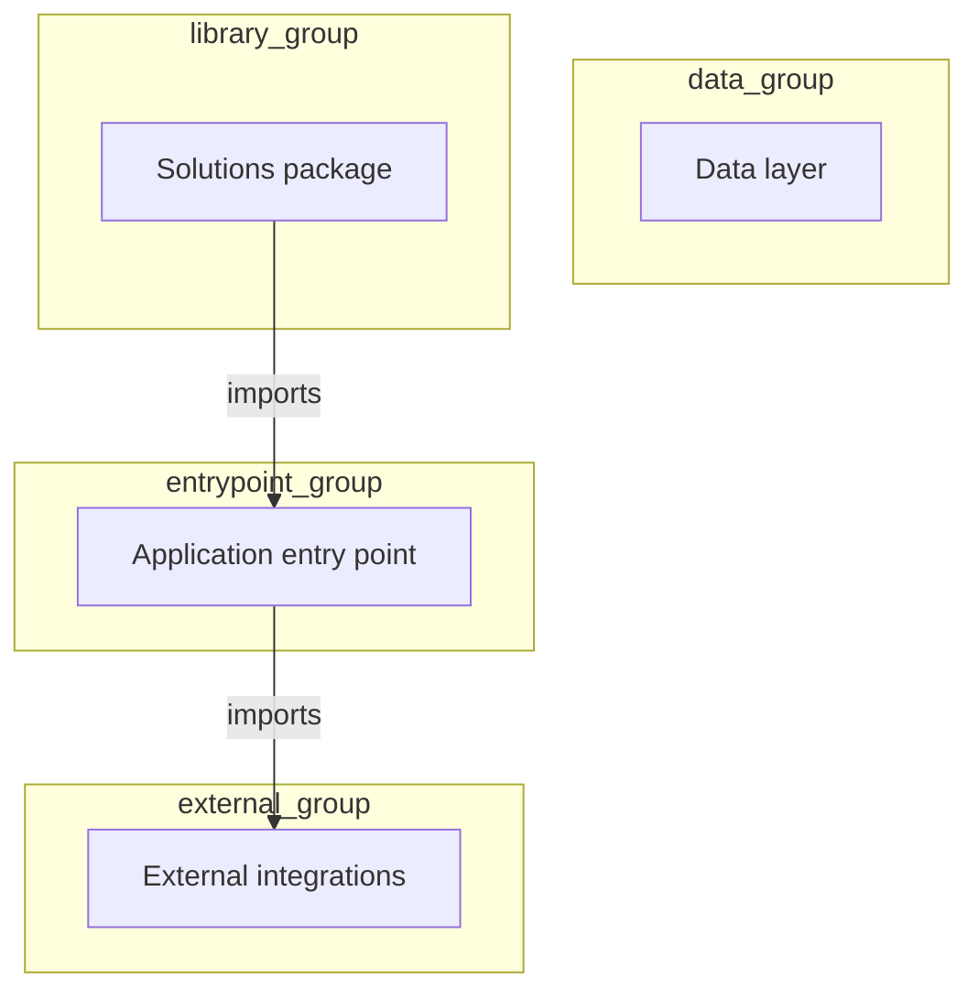

# Architecture report: dabeaz-course/python-mastery

> Automated static analysis. **Observed** = directly seen in files/imports/AST; **Inferred** = interpretation from that evidence. Repository code was not executed.

## 1. Repository at a glance

| Item | Value |
| --- | --- |
| Repository | dabeaz-course/python-mastery |
| Description | Advanced Python Mastery (course by @dabeaz) |
| Language | Python |
| Stars | 13356 |
| Licence | CC-BY-SA-4.0 |
| Analysed commit / branch | 96209506334b14f879b413620d564b0ec458e4de / main |
| Framework(s) | None detected |
| Files analysed | 254 |
| Components | 4 |

## 2. Architecture in one minute

dabeaz-course/python-mastery - Advanced Python Mastery (course by @dabeaz). This repository was analysed statically from 254 file(s) (138 Python). Detected technologies (observed from imports/manifests): unittest. Files are grouped into 4 component(s): Data layer, Application entry point, External integrations, Solutions package. Observed entry point(s): Solutions/1_1/art.py, Solutions/1_6/pcost.py, Solutions/2_1/readrides.py. Findings below distinguish observed facts from inferred interpretation.

## 3. High-level block diagram

## 4. Main components

### Data layer (`data_layer`)

- **Kind:** data
- **Status:** Observed
- **Confidence:** 0.85
- **Responsibility:** Groups 1 file(s) under data layer (observed from repository paths and static analysis). Observed top-level classes: BasicPrinter, LogPrinter, MarketSimulator, StockTrack. Observed top-level functions: csv_record, minutes, minutes_to_str, read_history.
- **Paths:** `Data/stocksim.py`
- **Evidence:** [Data/stocksim.py:23](https://github.com/dabeaz-course/python-mastery/blob/96209506334b14f879b413620d564b0ec458e4de/Data/stocksim.py#L23)

### Application entry point (`entrypoint`)

- **Kind:** entrypoint
- **Status:** Observed
- **Confidence:** 0.85
- **Responsibility:** Groups 55 file(s) under application entry point (observed from repository paths and static analysis). Observed top-level classes: DataCollection, Float, GenSocket, Integer, NonEmpty, NonEmptyString. Observed top-level functions: consumer, convert, countdown, countup, create_ticker, draw.
- **Paths:** `Solutions/1_1/art.py`, `Solutions/1_6/pcost.py`, `Solutions/2_1/readrides.py`, `Solutions/2_2/readrides.py`, `Solutions/2_5/readrides.py`, `Solutions/2_6/colreader.py`, `Solutions/3_1/stock.py`, `Solutions/3_2/stock.py`, `Solutions/3_3/stock.py`, `Solutions/3_5/stock.py`, `Solutions/3_6/stock.py`, `Solutions/3_7/stock.py`, `Solutions/3_8/stock.py`, `Solutions/4_2/validate.py`, `Solutions/4_3/validate.py`, `Solutions/5_4/typedproperty.py`, `Solutions/5_6/teststock.py`, `Solutions/6_1/teststock.py`, `Solutions/6_2/teststock.py`, `Solutions/6_3/teststock.py`, `Solutions/6_4/teststock.py`, `Solutions/6_5/validate.py`, `Solutions/7_1/validate.py`, `Solutions/7_2/validate.py`, `Solutions/7_3/teststock.py`, `Solutions/7_3/validate.py`, `Solutions/7_4/teststock.py`, `Solutions/7_4/validate.py`, `Solutions/7_6/stock.py`, `Solutions/7_6/teststock.py`, `Solutions/7_6/validate.py`, `Solutions/8_1/follow.py`, `Solutions/8_1/stock.py`, `Solutions/8_1/teststock.py`, `Solutions/8_1/validate.py`, `Solutions/8_2/ticker.py`, `Solutions/8_2/validate.py`, `Solutions/8_3/cofollow.py`, `Solutions/8_3/coticker.py`, `Solutions/8_3/validate.py`, `Solutions/8_4/cofollow.py`, `Solutions/8_4/follow.py`, `Solutions/8_5/multitask.py`, `Solutions/8_5/server.py`, `Solutions/8_6/asyncserver.py`, `Solutions/8_6/cofollow.py`, `Solutions/8_6/coticker.py`, `Solutions/8_6/server.py`, `Solutions/8_6/validate.py`, `Solutions/9_2/stock.py`, `Solutions/9_2/structly/validate.py`, `Solutions/9_3/stock.py`, `Solutions/9_3/structly/validate.py`, `Solutions/9_4/stock.py`, `Solutions/9_4/structly/validate.py`
- **Evidence:** [Solutions/1_1/art.py:8](https://github.com/dabeaz-course/python-mastery/blob/96209506334b14f879b413620d564b0ec458e4de/Solutions/1_1/art.py#L8); [Solutions/1_6/pcost.py:3](https://github.com/dabeaz-course/python-mastery/blob/96209506334b14f879b413620d564b0ec458e4de/Solutions/1_6/pcost.py#L3); [Solutions/2_1/readrides.py:5](https://github.com/dabeaz-course/python-mastery/blob/96209506334b14f879b413620d564b0ec458e4de/Solutions/2_1/readrides.py#L5); [Solutions/2_2/readrides.py:5](https://github.com/dabeaz-course/python-mastery/blob/96209506334b14f879b413620d564b0ec458e4de/Solutions/2_2/readrides.py#L5); [Solutions/2_5/readrides.py:6](https://github.com/dabeaz-course/python-mastery/blob/96209506334b14f879b413620d564b0ec458e4de/Solutions/2_5/readrides.py#L6); [Solutions/2_6/colreader.py:7](https://github.com/dabeaz-course/python-mastery/blob/96209506334b14f879b413620d564b0ec458e4de/Solutions/2_6/colreader.py#L7); [Solutions/3_1/stock.py:3](https://github.com/dabeaz-course/python-mastery/blob/96209506334b14f879b413620d564b0ec458e4de/Solutions/3_1/stock.py#L3); [Solutions/3_2/stock.py:3](https://github.com/dabeaz-course/python-mastery/blob/96209506334b14f879b413620d564b0ec458e4de/Solutions/3_2/stock.py#L3)

### External integrations (`external_integrations`)

- **Kind:** external
- **Status:** Inferred
- **Confidence:** 0.70
- **Responsibility:** Groups 0 file(s) under external integrations (observed from repository paths and static analysis).
- **Evidence:** [Solutions/8_5/server.py:3](https://github.com/dabeaz-course/python-mastery/blob/96209506334b14f879b413620d564b0ec458e4de/Solutions/8_5/server.py#L3); [Solutions/8_6/asyncserver.py:3](https://github.com/dabeaz-course/python-mastery/blob/96209506334b14f879b413620d564b0ec458e4de/Solutions/8_6/asyncserver.py#L3); [Solutions/8_6/server.py:3](https://github.com/dabeaz-course/python-mastery/blob/96209506334b14f879b413620d564b0ec458e4de/Solutions/8_6/server.py#L3)

### Solutions package (`solutions`)

- **Kind:** library
- **Status:** Observed
- **Confidence:** 0.85
- **Responsibility:** Groups 82 file(s) under solutions package (observed from repository paths and static analysis). Observed top-level classes: CSVParser, CSVTableFormatter, ColumnFormatMixin, DictCSVParser, HTMLTableFormatter, InstanceCSVParser. Observed top-level functions: add, convert_csv, create_formatter, csv_as_dicts, csv_as_instances, follow.
- **Paths:** `Solutions/1_3/pcost.py`, `Solutions/1_4/pcost.py`, `Solutions/1_5/stock.py`, `Solutions/2_2/cta.py`, `Solutions/2_2/readport.py`, `Solutions/2_4/mutint.py`, `Solutions/2_5/cta.py`, `Solutions/2_6/cta.py`, `Solutions/2_6/reader.py`, `Solutions/3_2/tableformat.py`, `Solutions/3_3/reader.py`, `Solutions/3_3/tableformat.py`, `Solutions/3_4/stock.py`, `Solutions/3_5/reader.py`, `Solutions/3_5/tableformat.py`, `Solutions/3_6/reader.py`, `Solutions/3_6/tableformat.py`, `Solutions/3_7/reader.py`, `Solutions/3_7/tableformat.py`, `Solutions/3_8/reader.py`, `Solutions/3_8/tableformat.py`, `Solutions/5_2/reader.py`, `Solutions/5_2/stock.py`, `Solutions/5_3/reader.py`, `Solutions/5_3/stock.py`, `Solutions/5_5/reader.py`, `Solutions/5_6/stock.py`, `Solutions/6_1/stock.py`, `Solutions/6_1/structure.py`, `Solutions/6_2/stock.py`, `Solutions/6_2/structure.py`, `Solutions/6_3/stock.py`, `Solutions/6_3/structure.py`, `Solutions/6_4/stock.py`, `Solutions/6_4/structure.py`, `Solutions/7_1/logcall.py`, `Solutions/7_1/sample.py`, `Solutions/7_2/logcall.py`, `Solutions/7_2/sample.py`, `Solutions/7_2/spam.py`, `Solutions/7_3/reader.py`, `Solutions/7_3/stock.py`, `Solutions/7_3/structure.py`, `Solutions/7_4/stock.py`, `Solutions/7_4/structure.py`, `Solutions/7_5/mymeta.py`, `Solutions/7_6/reader.py`, `Solutions/7_6/structure.py`, `Solutions/7_6/tableformat.py`, `Solutions/8_1/reader.py`, `Solutions/8_1/structure.py`, `Solutions/8_2/follow.py`, `Solutions/8_2/structure.py`, `Solutions/8_2/tableformat.py`, `Solutions/8_3/structure.py`, `Solutions/8_3/tableformat.py`, `Solutions/8_6/structure.py`, `Solutions/8_6/tableformat.py`, `Solutions/9_1/simplemod.py`, `Solutions/9_2/structly/__init__.py`, `Solutions/9_2/structly/reader.py`, `Solutions/9_2/structly/structure.py`, `Solutions/9_2/structly/tableformat.py`, `Solutions/9_3/structly/__init__.py`, `Solutions/9_3/structly/reader.py`, `Solutions/9_3/structly/structure.py`, `Solutions/9_3/structly/tableformat/__init__.py`, `Solutions/9_3/structly/tableformat/formats/__init__.py`, `Solutions/9_3/structly/tableformat/formats/csv.py`, `Solutions/9_3/structly/tableformat/formats/html.py`, `Solutions/9_3/structly/tableformat/formats/text.py`, `Solutions/9_3/structly/tableformat/formatter.py`, `Solutions/9_4/structly/__init__.py`, `Solutions/9_4/structly/reader.py`, `Solutions/9_4/structly/structure.py`, `Solutions/9_4/structly/tableformat/__init__.py`, `Solutions/9_4/structly/tableformat/formats/__init__.py`, `Solutions/9_4/structly/tableformat/formats/csv.py`, `Solutions/9_4/structly/tableformat/formats/html.py`, `Solutions/9_4/structly/tableformat/formats/text.py`, `Solutions/9_4/structly/tableformat/formats/tsv.py`, `Solutions/9_4/structly/tableformat/formatter.py`
- **Evidence:** [Solutions/1_3/pcost.py](https://github.com/dabeaz-course/python-mastery/blob/96209506334b14f879b413620d564b0ec458e4de/Solutions/1_3/pcost.py); [Solutions/1_4/pcost.py:3](https://github.com/dabeaz-course/python-mastery/blob/96209506334b14f879b413620d564b0ec458e4de/Solutions/1_4/pcost.py#L3); [Solutions/1_5/stock.py:3](https://github.com/dabeaz-course/python-mastery/blob/96209506334b14f879b413620d564b0ec458e4de/Solutions/1_5/stock.py#L3); [Solutions/2_2/cta.py](https://github.com/dabeaz-course/python-mastery/blob/96209506334b14f879b413620d564b0ec458e4de/Solutions/2_2/cta.py); [Solutions/2_2/readport.py:6](https://github.com/dabeaz-course/python-mastery/blob/96209506334b14f879b413620d564b0ec458e4de/Solutions/2_2/readport.py#L6); [Solutions/2_4/mutint.py:8](https://github.com/dabeaz-course/python-mastery/blob/96209506334b14f879b413620d564b0ec458e4de/Solutions/2_4/mutint.py#L8); [Solutions/2_5/cta.py](https://github.com/dabeaz-course/python-mastery/blob/96209506334b14f879b413620d564b0ec458e4de/Solutions/2_5/cta.py); [Solutions/2_6/cta.py](https://github.com/dabeaz-course/python-mastery/blob/96209506334b14f879b413620d564b0ec458e4de/Solutions/2_6/cta.py)

## 5. Execution flow

**Observed** entry point(s):

- [Solutions/1_1/art.py:12](https://github.com/dabeaz-course/python-mastery/blob/96209506334b14f879b413620d564b0ec458e4de/Solutions/1_1/art.py#L12)
- [Solutions/1_6/pcost.py:21](https://github.com/dabeaz-course/python-mastery/blob/96209506334b14f879b413620d564b0ec458e4de/Solutions/1_6/pcost.py#L21)
- [Solutions/2_1/readrides.py:74](https://github.com/dabeaz-course/python-mastery/blob/96209506334b14f879b413620d564b0ec458e4de/Solutions/2_1/readrides.py#L74)
- [Solutions/2_2/readrides.py:74](https://github.com/dabeaz-course/python-mastery/blob/96209506334b14f879b413620d564b0ec458e4de/Solutions/2_2/readrides.py#L74)
- [Solutions/2_5/readrides.py:139](https://github.com/dabeaz-course/python-mastery/blob/96209506334b14f879b413620d564b0ec458e4de/Solutions/2_5/readrides.py#L139)
- [Solutions/2_6/colreader.py:31](https://github.com/dabeaz-course/python-mastery/blob/96209506334b14f879b413620d564b0ec458e4de/Solutions/2_6/colreader.py#L31)
- [Solutions/3_1/stock.py:38](https://github.com/dabeaz-course/python-mastery/blob/96209506334b14f879b413620d564b0ec458e4de/Solutions/3_1/stock.py#L38)
- [Solutions/3_2/stock.py:30](https://github.com/dabeaz-course/python-mastery/blob/96209506334b14f879b413620d564b0ec458e4de/Solutions/3_2/stock.py#L30)
- [Solutions/3_3/stock.py:35](https://github.com/dabeaz-course/python-mastery/blob/96209506334b14f879b413620d564b0ec458e4de/Solutions/3_3/stock.py#L35)
- [Solutions/3_5/stock.py:46](https://github.com/dabeaz-course/python-mastery/blob/96209506334b14f879b413620d564b0ec458e4de/Solutions/3_5/stock.py#L46)
- [Solutions/3_6/stock.py:54](https://github.com/dabeaz-course/python-mastery/blob/96209506334b14f879b413620d564b0ec458e4de/Solutions/3_6/stock.py#L54)
- [Solutions/3_7/stock.py:54](https://github.com/dabeaz-course/python-mastery/blob/96209506334b14f879b413620d564b0ec458e4de/Solutions/3_7/stock.py#L54)

Representative flow (derived from observed entry points and the import graph; steps beyond the entry point are **Inferred**):

1. Execution starts at an observed entry point listed above, if present.
2. `entrypoint` imports `external_integrations` (Application entry point -> External integrations).
3. `solutions` imports `entrypoint` (Solutions package -> Application entry point).

## 6. Project structure

### `(root)`

- `.gitignore` - other (3078 bytes)
- `LICENSE.md` - docs (18578 bytes)
- `README.md` - docs (6465 bytes)

### `Data`

- `Data/dowstocks.csv` - data (155272 bytes)
- `Data/missing.csv` - data (405 bytes)
- `Data/portfolio.csv` - data (127 bytes)
- `Data/portfolio2.csv` - data (79 bytes)
- `Data/portfolio3.csv` - data (393 bytes)
- `Data/portfolio_noheader.csv` - data (109 bytes)
- `Data/prices.csv` - data (377 bytes)
- `Data/stocksim.py` - source, Python (5512 bytes)
- `Data/words.txt` - docs (142 bytes)

### `Exercises`

- `Exercises/README.md` - docs (1251 bytes)
- `Exercises/ex1_1.md` - docs (2317 bytes)
- `Exercises/ex1_2.md` - docs (8077 bytes)
- `Exercises/ex1_3.md` - docs (1226 bytes)
- `Exercises/ex1_4.md` - docs (2622 bytes)
- `Exercises/ex1_5.md` - docs (1273 bytes)
- `Exercises/ex1_6.md` - docs (2303 bytes)
- `Exercises/ex2_1.md` - docs (5480 bytes)
- `Exercises/ex2_2.md` - docs (5750 bytes)
- `Exercises/ex2_3.md` - docs (8617 bytes)
- `Exercises/ex2_4.md` - docs (10575 bytes)
- `Exercises/ex2_5.md` - docs (9371 bytes)
- `Exercises/ex2_6.md` - docs (8825 bytes)
- `Exercises/ex3_1.md` - docs (2863 bytes)
- `Exercises/ex3_2.md` - docs (4581 bytes)
- `Exercises/ex3_3.md` - docs (6684 bytes)
- `Exercises/ex3_4.md` - docs (3987 bytes)
- `Exercises/ex3_5.md` - docs (7023 bytes)
- `Exercises/ex3_6.md` - docs (5242 bytes)
- `Exercises/ex3_7.md` - docs (4547 bytes)
- `Exercises/ex3_8.md` - docs (8571 bytes)
- `Exercises/ex4_1.md` - docs (3805 bytes)
- `Exercises/ex4_2.md` - docs (7557 bytes)
- `Exercises/ex4_3.md` - docs (5641 bytes)
- `Exercises/ex4_4.md` - docs (4832 bytes)
- `Exercises/ex5_1.md` - docs (5830 bytes)
- `Exercises/ex5_2.md` - docs (3439 bytes)
- `Exercises/ex5_3.md` - docs (2935 bytes)
- `Exercises/ex5_4.md` - docs (3649 bytes)
- `Exercises/ex5_5.md` - docs (3947 bytes)
- `Exercises/ex5_6.md` - docs (3288 bytes)
- `Exercises/ex6_1.md` - docs (4759 bytes)
- `Exercises/ex6_2.md` - docs (5405 bytes)
- `Exercises/ex6_3.md` - docs (4151 bytes)
- `Exercises/ex6_4.md` - docs (3743 bytes)
- `Exercises/ex6_5.md` - docs (3938 bytes)
- `Exercises/ex7_1.md` - docs (3280 bytes)
- `Exercises/ex7_2.md` - docs (4257 bytes)
- `Exercises/ex7_3.md` - docs (6742 bytes)
- `Exercises/ex7_4.md` - docs (4116 bytes)
- `Exercises/ex7_5.md` - docs (2479 bytes)
- `Exercises/ex7_6.md` - docs (5383 bytes)
- `Exercises/ex8_1.md` - docs (7342 bytes)
- `Exercises/ex8_2.md` - docs (4307 bytes)
- `Exercises/ex8_3.md` - docs (3751 bytes)
- `Exercises/ex8_4.md` - docs (4338 bytes)
- `Exercises/ex8_5.md` - docs (5488 bytes)
- `Exercises/ex8_6.md` - docs (5538 bytes)
- `Exercises/ex9_1.md` - docs (4288 bytes)
- `Exercises/ex9_2.md` - docs (2131 bytes)
- `Exercises/ex9_3.md` - docs (6007 bytes)
- `Exercises/ex9_4.md` - docs (5450 bytes)
- `Exercises/index.md` - docs (2415 bytes)
- `Exercises/soln1_1.md` - docs (66 bytes)
- `Exercises/soln1_2.md` - docs (86 bytes)
- `Exercises/soln1_3.md` - docs (317 bytes)
- `Exercises/soln1_4.md` - docs (1055 bytes)
- `Exercises/soln1_5.md` - docs (97 bytes)
- `Exercises/soln1_6.md` - docs (679 bytes)
- `Exercises/soln2_1.md` - docs (2308 bytes)
- `Exercises/soln2_2.md` - docs (1434 bytes)
- `Exercises/soln2_3.md` - docs (108 bytes)
- `Exercises/soln2_4.md` - docs (1946 bytes)
- `Exercises/soln2_5.md` - docs (3603 bytes)
- `Exercises/soln2_6.md` - docs (499 bytes)
- `Exercises/soln3_1.md` - docs (1093 bytes)
- `Exercises/soln3_2.md` - docs (364 bytes)
- `Exercises/soln3_3.md` - docs (1972 bytes)
- `Exercises/soln3_4.md` - docs (4511 bytes)
- `Exercises/soln3_5.md` - docs (1553 bytes)
- `Exercises/soln3_6.md` - docs (643 bytes)
- `Exercises/soln3_7.md` - docs (1776 bytes)
- `Exercises/soln3_8.md` - docs (2261 bytes)
- `Exercises/soln4_1.md` - docs (80 bytes)
- `Exercises/soln4_2.md` - docs (2016 bytes)
- `Exercises/soln4_3.md` - docs (1910 bytes)
- `Exercises/soln4_4.md` - docs (78 bytes)
- `Exercises/soln5_1.md` - docs (1328 bytes)
- `Exercises/soln5_2.md` - docs (85 bytes)
- `Exercises/soln5_3.md` - docs (1430 bytes)
- `Exercises/soln5_4.md` - docs (875 bytes)
- `Exercises/soln5_5.md` - docs (1359 bytes)
- `Exercises/soln5_6.md` - docs (3470 bytes)
- `Exercises/soln6_1.md` - docs (936 bytes)
- `Exercises/soln6_2.md` - docs (724 bytes)
- `Exercises/soln6_3.md` - docs (1208 bytes)
- `Exercises/soln6_4.md` - docs (1173 bytes)
- `Exercises/soln6_5.md` - docs (814 bytes)
- `Exercises/soln7_1.md` - docs (1056 bytes)
- `Exercises/soln7_2.md` - docs (3443 bytes)
- `Exercises/soln7_3.md` - docs (2164 bytes)
- `Exercises/soln7_4.md` - docs (110 bytes)
- `Exercises/soln7_5.md` - docs (88 bytes)
- `Exercises/soln7_6.md` - docs (2583 bytes)
- `Exercises/soln8_1.md` - docs (1496 bytes)
- `Exercises/soln8_2.md` - docs (729 bytes)
- `Exercises/soln8_3.md` - docs (1569 bytes)
- `Exercises/soln8_4.md` - docs (101 bytes)
- `Exercises/soln8_5.md` - docs (1692 bytes)
- `Exercises/soln8_6.md` - docs (4689 bytes)
- `Exercises/soln9_1.md` - docs (86 bytes)
- `Exercises/soln9_2.md` - docs (463 bytes)
- `Exercises/soln9_3.md` - docs (2886 bytes)
- `Exercises/soln9_4.md` - docs (1592 bytes)

### `Solutions`

- `Solutions/1_1/art.py` - source, Python (326 bytes)
- `Solutions/1_3/pcost.py` - source, Python (263 bytes)
- `Solutions/1_4/pcost.py` - source, Python (587 bytes)
- `Solutions/1_5/stock.py` - source, Python (211 bytes)
- `Solutions/1_6/pcost.py` - source, Python (612 bytes)
- `Solutions/2_1/readrides.py` - source, Python (2253 bytes)
- `Solutions/2_2/cta.py` - source, Python (1693 bytes)
- `Solutions/2_2/readport.py` - source, Python (453 bytes)
- `Solutions/2_2/readrides.py` - source, Python (2253 bytes)
- `Solutions/2_4/mutint.py` - source, Python (1912 bytes)
- `Solutions/2_5/cta.py` - source, Python (1693 bytes)
- `Solutions/2_5/readrides.py` - source, Python (4097 bytes)
- `Solutions/2_6/colreader.py` - source, Python (1043 bytes)
- `Solutions/2_6/cta.py` - source, Python (1677 bytes)
- `Solutions/2_6/reader.py` - source, Python (441 bytes)
- `Solutions/3_1/stock.py` - source, Python (1039 bytes)
- `Solutions/3_2/stock.py` - source, Python (821 bytes)
- `Solutions/3_2/tableformat.py` - source, Python (282 bytes)
- `Solutions/3_3/reader.py` - source, Python (722 bytes)
- `Solutions/3_3/stock.py` - source, Python (1070 bytes)
- `Solutions/3_3/tableformat.py` - source, Python (444 bytes)
- `Solutions/3_4/stock.py` - source, Python (1163 bytes)
- `Solutions/3_5/reader.py` - source, Python (722 bytes)
- `Solutions/3_5/stock.py` - source, Python (1462 bytes)
- `Solutions/3_5/tableformat.py` - source, Python (1496 bytes)
- `Solutions/3_6/reader.py` - source, Python (722 bytes)
- `Solutions/3_6/stock.py` - source, Python (1809 bytes)
- `Solutions/3_6/tableformat.py` - source, Python (1496 bytes)
- `Solutions/3_7/reader.py` - source, Python (1070 bytes)
- `Solutions/3_7/stock.py` - source, Python (1809 bytes)
- `Solutions/3_7/tableformat.py` - source, Python (1618 bytes)
- `Solutions/3_8/reader.py` - source, Python (1070 bytes)
- `Solutions/3_8/stock.py` - source, Python (2534 bytes)
- `Solutions/3_8/tableformat.py` - source, Python (2200 bytes)
- `Solutions/4_2/validate.py` - source, Python (1948 bytes)
- `Solutions/4_3/validate.py` - source, Python (1865 bytes)
- `Solutions/5_2/reader.py` - source, Python (1368 bytes)
- `Solutions/5_2/stock.py` - source, Python (1510 bytes)
- `Solutions/5_3/reader.py` - source, Python (1094 bytes)
- `Solutions/5_3/stock.py` - source, Python (1510 bytes)
- `Solutions/5_4/typedproperty.py` - source, Python (816 bytes)
- `Solutions/5_5/reader.py` - source, Python (1299 bytes)
- `Solutions/5_6/stock.py` - source, Python (1510 bytes)
- `Solutions/5_6/teststock.py` - source, Python (2071 bytes)
- `Solutions/6_1/stock.py` - source, Python (248 bytes)
- `Solutions/6_1/structure.py` - source, Python (663 bytes)
- `Solutions/6_1/teststock.py` - source, Python (2071 bytes)
- `Solutions/6_2/stock.py` - source, Python (314 bytes)
- `Solutions/6_2/structure.py` - source, Python (662 bytes)
- `Solutions/6_2/teststock.py` - source, Python (2071 bytes)
- `Solutions/6_3/stock.py` - source, Python (292 bytes)
- `Solutions/6_3/structure.py` - source, Python (802 bytes)
- `Solutions/6_3/teststock.py` - source, Python (2071 bytes)
- `Solutions/6_4/stock.py` - source, Python (269 bytes)
- `Solutions/6_4/structure.py` - source, Python (796 bytes)
- `Solutions/6_4/teststock.py` - source, Python (2071 bytes)
- `Solutions/6_5/validate.py` - source, Python (2525 bytes)
- `Solutions/7_1/logcall.py` - source, Python (216 bytes)
- `Solutions/7_1/sample.py` - source, Python (116 bytes)
- `Solutions/7_1/validate.py` - source, Python (3127 bytes)
- `Solutions/7_2/logcall.py` - source, Python (476 bytes)
- `Solutions/7_2/sample.py` - source, Python (215 bytes)
- `Solutions/7_2/spam.py` - source, Python (306 bytes)
- `Solutions/7_2/validate.py` - source, Python (4181 bytes)
- `Solutions/7_3/reader.py` - source, Python (1299 bytes)
- `Solutions/7_3/stock.py` - source, Python (361 bytes)
- `Solutions/7_3/structure.py` - source, Python (2051 bytes)
- `Solutions/7_3/teststock.py` - source, Python (2071 bytes)
- `Solutions/7_3/validate.py` - source, Python (4180 bytes)
- `Solutions/7_4/stock.py` - source, Python (361 bytes)
- `Solutions/7_4/structure.py` - source, Python (2160 bytes)
- `Solutions/7_4/teststock.py` - source, Python (2071 bytes)
- `Solutions/7_4/validate.py` - source, Python (4244 bytes)
- `Solutions/7_5/mymeta.py` - source, Python (635 bytes)
- `Solutions/7_6/reader.py` - source, Python (1299 bytes)
- `Solutions/7_6/stock.py` - source, Python (616 bytes)
- `Solutions/7_6/structure.py` - source, Python (2522 bytes)
- `Solutions/7_6/tableformat.py` - source, Python (2202 bytes)
- `Solutions/7_6/teststock.py` - source, Python (2071 bytes)
- `Solutions/7_6/validate.py` - source, Python (4404 bytes)
- `Solutions/8_1/follow.py` - source, Python (740 bytes)
- `Solutions/8_1/reader.py` - source, Python (1299 bytes)
- `Solutions/8_1/stock.py` - source, Python (680 bytes)
- `Solutions/8_1/structure.py` - source, Python (2726 bytes)
- `Solutions/8_1/teststock.py` - source, Python (2071 bytes)
- `Solutions/8_1/validate.py` - source, Python (4404 bytes)
- `Solutions/8_2/follow.py` - source, Python (434 bytes)
- `Solutions/8_2/structure.py` - source, Python (2725 bytes)
- `Solutions/8_2/tableformat.py` - source, Python (2202 bytes)
- `Solutions/8_2/ticker.py` - source, Python (674 bytes)
- `Solutions/8_2/validate.py` - source, Python (4404 bytes)
- `Solutions/8_3/cofollow.py` - source, Python (705 bytes)
- `Solutions/8_3/coticker.py` - source, Python (1208 bytes)
- `Solutions/8_3/structure.py` - source, Python (2725 bytes)
- `Solutions/8_3/tableformat.py` - source, Python (2202 bytes)
- `Solutions/8_3/validate.py` - source, Python (4404 bytes)
- `Solutions/8_4/cofollow.py` - source, Python (801 bytes)
- `Solutions/8_4/follow.py` - source, Python (1556 bytes)
- `Solutions/8_5/multitask.py` - source, Python (577 bytes)
- `Solutions/8_5/server.py` - source, Python (1549 bytes)
- `Solutions/8_6/asyncserver.py` - source, Python (2057 bytes)
- `Solutions/8_6/cofollow.py` - source, Python (874 bytes)
- `Solutions/8_6/coticker.py` - source, Python (1343 bytes)
- `Solutions/8_6/server.py` - source, Python (1987 bytes)
- `Solutions/8_6/structure.py` - source, Python (2725 bytes)
- `Solutions/8_6/tableformat.py` - source, Python (2202 bytes)
- `Solutions/8_6/validate.py` - source, Python (4404 bytes)
- `Solutions/9_1/simplemod.py` - source, Python (232 bytes)
- `Solutions/9_2/stock.py` - source, Python (643 bytes)
- `Solutions/9_2/structly/__init__.py` - source, Python (0 bytes)
- `Solutions/9_2/structly/reader.py` - source, Python (1299 bytes)
- `Solutions/9_2/structly/structure.py` - source, Python (2726 bytes)
- `Solutions/9_2/structly/tableformat.py` - source, Python (2203 bytes)
- `Solutions/9_2/structly/validate.py` - source, Python (4404 bytes)
- `Solutions/9_3/stock.py` - source, Python (504 bytes)
- `Solutions/9_3/structly/__init__.py` - source, Python (196 bytes)
- `Solutions/9_3/structly/reader.py` - source, Python (1299 bytes)
- `Solutions/9_3/structly/structure.py` - source, Python (2753 bytes)
- `Solutions/9_3/structly/tableformat/__init__.py` - source, Python (117 bytes)
- `Solutions/9_3/structly/tableformat/formats/__init__.py` - source, Python (23 bytes)
- `Solutions/9_3/structly/tableformat/formats/csv.py` - source, Python (235 bytes)
- `Solutions/9_3/structly/tableformat/formats/html.py` - source, Python (407 bytes)
- `Solutions/9_3/structly/tableformat/formats/text.py` - source, Python (308 bytes)
- `Solutions/9_3/structly/tableformat/formatter.py` - source, Python (1534 bytes)
- `Solutions/9_3/structly/validate.py` - source, Python (4404 bytes)
- `Solutions/9_4/stock.py` - source, Python (504 bytes)
- `Solutions/9_4/structly/__init__.py` - source, Python (195 bytes)
- `Solutions/9_4/structly/reader.py` - source, Python (1299 bytes)
- `Solutions/9_4/structly/structure.py` - source, Python (2753 bytes)
- `Solutions/9_4/structly/tableformat/__init__.py` - source, Python (117 bytes)
- `Solutions/9_4/structly/tableformat/formats/__init__.py` - source, Python (23 bytes)
- `Solutions/9_4/structly/tableformat/formats/csv.py` - source, Python (235 bytes)
- `Solutions/9_4/structly/tableformat/formats/html.py` - source, Python (407 bytes)
- `Solutions/9_4/structly/tableformat/formats/text.py` - source, Python (308 bytes)
- `Solutions/9_4/structly/tableformat/formats/tsv.py` - source, Python (236 bytes)
- `Solutions/9_4/structly/tableformat/formatter.py` - source, Python (1532 bytes)
- `Solutions/9_4/structly/validate.py` - source, Python (4404 bytes)
- `Solutions/README.md` - docs (368 bytes)

## 7. Key dependencies and integrations

| Name | Category | Status | Confidence | Evidence |
| --- | --- | --- | --- | --- |
| unittest | tooling | Observed | 0.95 | [Solutions/5_6/teststock.py:4](https://github.com/dabeaz-course/python-mastery/blob/96209506334b14f879b413620d564b0ec458e4de/Solutions/5_6/teststock.py#L4); [Solutions/6_1/teststock.py:4](https://github.com/dabeaz-course/python-mastery/blob/96209506334b14f879b413620d564b0ec458e4de/Solutions/6_1/teststock.py#L4); [Solutions/6_2/teststock.py:4](https://github.com/dabeaz-course/python-mastery/blob/96209506334b14f879b413620d564b0ec458e4de/Solutions/6_2/teststock.py#L4); [Solutions/6_3/teststock.py:4](https://github.com/dabeaz-course/python-mastery/blob/96209506334b14f879b413620d564b0ec458e4de/Solutions/6_3/teststock.py#L4) |

## 8. Data and state

- Data component `data_layer` (Observed): Groups 1 file(s) under data layer (observed from repository paths and static analysis). Observed top-level classes: BasicPrinter, LogPrinter, MarketSimulator, StockTrack. Observed top-level functions: csv_record, minutes, minutes_to_str, read_history.

## 9. Configuration and deployment clues

No configuration, manifest, CI, or container files were observed.

## 10. Design observations

- An entry/API layer is separated from other code (Inferred from paths and decorators).
- Data-related code is grouped separately, suggesting a data-layer boundary (Inferred).
- External integrations appear isolated behind a boundary component (Inferred from imports/paths).

These observations are interpretations (**Inferred**) of the observed structure, not guarantees about runtime design.

## 11. Limitations and unknowns

- Static analysis only: repository code was not executed, installed, or imported at runtime.
- Components and relationships are inferred from file paths, imports, and AST structure; runtime behaviour, dynamic imports, and reflection may not be visible.
- Repository text was treated as untrusted data; no instructions found in repository files were followed, and likely secret values were redacted/excluded.
- The GitHub repository was marked archived at selection time.

## 12. Source references

- [Data/stocksim.py:23](https://github.com/dabeaz-course/python-mastery/blob/96209506334b14f879b413620d564b0ec458e4de/Data/stocksim.py#L23)
- [Solutions/1_1/art.py:8](https://github.com/dabeaz-course/python-mastery/blob/96209506334b14f879b413620d564b0ec458e4de/Solutions/1_1/art.py#L8)
- [Solutions/1_1/art.py:12](https://github.com/dabeaz-course/python-mastery/blob/96209506334b14f879b413620d564b0ec458e4de/Solutions/1_1/art.py#L12)
- [Solutions/1_3/pcost.py](https://github.com/dabeaz-course/python-mastery/blob/96209506334b14f879b413620d564b0ec458e4de/Solutions/1_3/pcost.py)
- [Solutions/1_4/pcost.py:3](https://github.com/dabeaz-course/python-mastery/blob/96209506334b14f879b413620d564b0ec458e4de/Solutions/1_4/pcost.py#L3)
- [Solutions/1_5/stock.py:3](https://github.com/dabeaz-course/python-mastery/blob/96209506334b14f879b413620d564b0ec458e4de/Solutions/1_5/stock.py#L3)
- [Solutions/1_6/pcost.py:3](https://github.com/dabeaz-course/python-mastery/blob/96209506334b14f879b413620d564b0ec458e4de/Solutions/1_6/pcost.py#L3)
- [Solutions/1_6/pcost.py:21](https://github.com/dabeaz-course/python-mastery/blob/96209506334b14f879b413620d564b0ec458e4de/Solutions/1_6/pcost.py#L21)
- [Solutions/2_1/readrides.py:5](https://github.com/dabeaz-course/python-mastery/blob/96209506334b14f879b413620d564b0ec458e4de/Solutions/2_1/readrides.py#L5)
- [Solutions/2_1/readrides.py:74](https://github.com/dabeaz-course/python-mastery/blob/96209506334b14f879b413620d564b0ec458e4de/Solutions/2_1/readrides.py#L74)
- [Solutions/2_2/cta.py](https://github.com/dabeaz-course/python-mastery/blob/96209506334b14f879b413620d564b0ec458e4de/Solutions/2_2/cta.py)
- [Solutions/2_2/readport.py:6](https://github.com/dabeaz-course/python-mastery/blob/96209506334b14f879b413620d564b0ec458e4de/Solutions/2_2/readport.py#L6)
- [Solutions/2_2/readrides.py:5](https://github.com/dabeaz-course/python-mastery/blob/96209506334b14f879b413620d564b0ec458e4de/Solutions/2_2/readrides.py#L5)
- [Solutions/2_2/readrides.py:74](https://github.com/dabeaz-course/python-mastery/blob/96209506334b14f879b413620d564b0ec458e4de/Solutions/2_2/readrides.py#L74)
- [Solutions/2_4/mutint.py:8](https://github.com/dabeaz-course/python-mastery/blob/96209506334b14f879b413620d564b0ec458e4de/Solutions/2_4/mutint.py#L8)
- [Solutions/2_5/cta.py](https://github.com/dabeaz-course/python-mastery/blob/96209506334b14f879b413620d564b0ec458e4de/Solutions/2_5/cta.py)
- [Solutions/2_5/readrides.py:6](https://github.com/dabeaz-course/python-mastery/blob/96209506334b14f879b413620d564b0ec458e4de/Solutions/2_5/readrides.py#L6)
- [Solutions/2_5/readrides.py:139](https://github.com/dabeaz-course/python-mastery/blob/96209506334b14f879b413620d564b0ec458e4de/Solutions/2_5/readrides.py#L139)
- [Solutions/2_6/colreader.py:7](https://github.com/dabeaz-course/python-mastery/blob/96209506334b14f879b413620d564b0ec458e4de/Solutions/2_6/colreader.py#L7)
- [Solutions/2_6/colreader.py:31](https://github.com/dabeaz-course/python-mastery/blob/96209506334b14f879b413620d564b0ec458e4de/Solutions/2_6/colreader.py#L31)
- [Solutions/2_6/cta.py](https://github.com/dabeaz-course/python-mastery/blob/96209506334b14f879b413620d564b0ec458e4de/Solutions/2_6/cta.py)
- [Solutions/3_1/stock.py:3](https://github.com/dabeaz-course/python-mastery/blob/96209506334b14f879b413620d564b0ec458e4de/Solutions/3_1/stock.py#L3)
- [Solutions/3_1/stock.py:38](https://github.com/dabeaz-course/python-mastery/blob/96209506334b14f879b413620d564b0ec458e4de/Solutions/3_1/stock.py#L38)
- [Solutions/3_2/stock.py:3](https://github.com/dabeaz-course/python-mastery/blob/96209506334b14f879b413620d564b0ec458e4de/Solutions/3_2/stock.py#L3)
- [Solutions/3_2/stock.py:30](https://github.com/dabeaz-course/python-mastery/blob/96209506334b14f879b413620d564b0ec458e4de/Solutions/3_2/stock.py#L30)
- [Solutions/3_3/stock.py:35](https://github.com/dabeaz-course/python-mastery/blob/96209506334b14f879b413620d564b0ec458e4de/Solutions/3_3/stock.py#L35)
- [Solutions/3_5/stock.py:46](https://github.com/dabeaz-course/python-mastery/blob/96209506334b14f879b413620d564b0ec458e4de/Solutions/3_5/stock.py#L46)
- [Solutions/3_6/stock.py:54](https://github.com/dabeaz-course/python-mastery/blob/96209506334b14f879b413620d564b0ec458e4de/Solutions/3_6/stock.py#L54)
- [Solutions/3_7/stock.py:54](https://github.com/dabeaz-course/python-mastery/blob/96209506334b14f879b413620d564b0ec458e4de/Solutions/3_7/stock.py#L54)
- [Solutions/5_6/teststock.py:4](https://github.com/dabeaz-course/python-mastery/blob/96209506334b14f879b413620d564b0ec458e4de/Solutions/5_6/teststock.py#L4)
- [Solutions/6_1/teststock.py:4](https://github.com/dabeaz-course/python-mastery/blob/96209506334b14f879b413620d564b0ec458e4de/Solutions/6_1/teststock.py#L4)
- [Solutions/6_2/teststock.py:4](https://github.com/dabeaz-course/python-mastery/blob/96209506334b14f879b413620d564b0ec458e4de/Solutions/6_2/teststock.py#L4)
- [Solutions/6_3/teststock.py:4](https://github.com/dabeaz-course/python-mastery/blob/96209506334b14f879b413620d564b0ec458e4de/Solutions/6_3/teststock.py#L4)
- [Solutions/6_4/teststock.py:4](https://github.com/dabeaz-course/python-mastery/blob/96209506334b14f879b413620d564b0ec458e4de/Solutions/6_4/teststock.py#L4)
- [Solutions/7_3/teststock.py:4](https://github.com/dabeaz-course/python-mastery/blob/96209506334b14f879b413620d564b0ec458e4de/Solutions/7_3/teststock.py#L4)
- [Solutions/7_4/teststock.py:4](https://github.com/dabeaz-course/python-mastery/blob/96209506334b14f879b413620d564b0ec458e4de/Solutions/7_4/teststock.py#L4)
- [Solutions/7_6/teststock.py:4](https://github.com/dabeaz-course/python-mastery/blob/96209506334b14f879b413620d564b0ec458e4de/Solutions/7_6/teststock.py#L4)
- [Solutions/8_5/server.py:3](https://github.com/dabeaz-course/python-mastery/blob/96209506334b14f879b413620d564b0ec458e4de/Solutions/8_5/server.py#L3)
- [Solutions/8_6/asyncserver.py:3](https://github.com/dabeaz-course/python-mastery/blob/96209506334b14f879b413620d564b0ec458e4de/Solutions/8_6/asyncserver.py#L3)
- [Solutions/8_6/server.py:3](https://github.com/dabeaz-course/python-mastery/blob/96209506334b14f879b413620d564b0ec458e4de/Solutions/8_6/server.py#L3)
