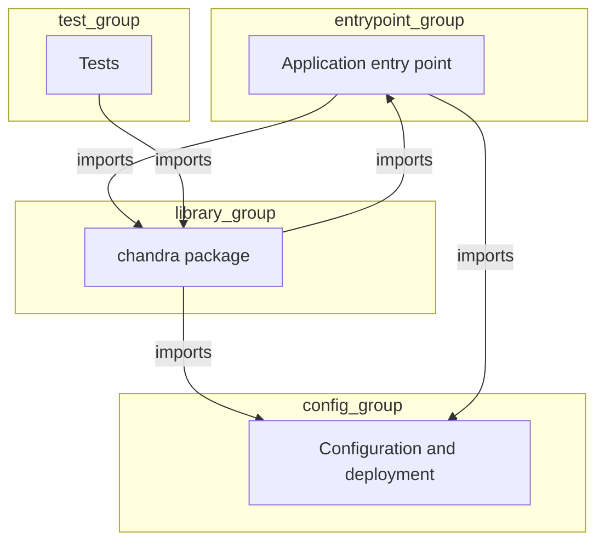

# Architecture report: datalab-to/chandra

> Automated static analysis. **Observed** = directly seen in files/imports/AST; **Inferred** = interpretation from that evidence. Repository code was not executed.

## 1. Repository at a glance

| Item | Value |
| --- | --- |
| Repository | datalab-to/chandra |
| Description | OCR model that handles complex tables, forms, handwriting with full layout. |
| Language | Python |
| Stars | 12724 |
| Licence | Apache-2.0 |
| Analysed commit / branch | b20d54d94e53b32211c98408620edef63e99a4ec / master |
| Framework(s) | Flask |
| Files analysed | 33 |
| Components | 4 |

## 2. Architecture in one minute

datalab-to/chandra - OCR model that handles complex tables, forms, handwriting with full layout.. This repository was analysed statically from 33 file(s) (20 Python). Detected technologies (observed from imports/manifests): GitHub Actions, Flask, Click, Pydantic, Poetry, setuptools. Files are grouped into 4 component(s): chandra package, Configuration and deployment, Application entry point, Tests. Observed entry point(s): chandra/prompts.py, chandra/scripts/cli.py, chandra/scripts/olmocr_bench.py. Findings below distinguish observed facts from inferred interpretation.

## 3. High-level block diagram

## 4. Main components

### chandra package (`chandra`)

- **Kind:** library
- **Status:** Observed
- **Confidence:** 0.85
- **Responsibility:** Groups 10 file(s) under chandra package (observed from repository paths and static analysis). Observed top-level classes: BatchInputItem, BatchOutputItem, GenerationResult, InferenceManager, LayoutBlock, Markdownify. Observed top-level functions: _hash_html, detect_repeat_token, draw_layout, extract_images, flatten, generate_hf.
- **Paths:** `chandra/__init__.py`, `chandra/input.py`, `chandra/model/__init__.py`, `chandra/model/hf.py`, `chandra/model/schema.py`, `chandra/model/util.py`, `chandra/model/vllm.py`, `chandra/output.py`, `chandra/scripts/__init__.py`, `chandra/util.py`
- **Evidence:** [chandra/__init__.py](https://github.com/datalab-to/chandra/blob/b20d54d94e53b32211c98408620edef63e99a4ec/chandra/__init__.py); [chandra/input.py:10](https://github.com/datalab-to/chandra/blob/b20d54d94e53b32211c98408620edef63e99a4ec/chandra/input.py#L10); [chandra/model/__init__.py:10](https://github.com/datalab-to/chandra/blob/b20d54d94e53b32211c98408620edef63e99a4ec/chandra/model/__init__.py#L10); [chandra/model/hf.py:9](https://github.com/datalab-to/chandra/blob/b20d54d94e53b32211c98408620edef63e99a4ec/chandra/model/hf.py#L9); [chandra/model/schema.py:8](https://github.com/datalab-to/chandra/blob/b20d54d94e53b32211c98408620edef63e99a4ec/chandra/model/schema.py#L8); [chandra/model/util.py:6](https://github.com/datalab-to/chandra/blob/b20d54d94e53b32211c98408620edef63e99a4ec/chandra/model/util.py#L6); [chandra/model/vllm.py:17](https://github.com/datalab-to/chandra/blob/b20d54d94e53b32211c98408620edef63e99a4ec/chandra/model/vllm.py#L17); [chandra/output.py:15](https://github.com/datalab-to/chandra/blob/b20d54d94e53b32211c98408620edef63e99a4ec/chandra/output.py#L15)

### Configuration and deployment (`config`)

- **Kind:** config
- **Status:** Observed
- **Confidence:** 0.85
- **Responsibility:** Groups 3 file(s) under configuration and deployment (observed from repository paths and static analysis). Observed top-level classes: Settings.
- **Paths:** `chandra/settings.py`, `pyproject.toml`, `pytest.ini`
- **Evidence:** [chandra/settings.py:6](https://github.com/datalab-to/chandra/blob/b20d54d94e53b32211c98408620edef63e99a4ec/chandra/settings.py#L6); [pyproject.toml](https://github.com/datalab-to/chandra/blob/b20d54d94e53b32211c98408620edef63e99a4ec/pyproject.toml); [pytest.ini](https://github.com/datalab-to/chandra/blob/b20d54d94e53b32211c98408620edef63e99a4ec/pytest.ini)

### Application entry point (`entrypoint`)

- **Kind:** entrypoint
- **Status:** Observed
- **Confidence:** 0.85
- **Responsibility:** Groups 7 file(s) under application entry point (observed from repository paths and static analysis). Observed application object created via Flask. Observed routes: ROUTE /, ROUTE /process. Observed top-level functions: _latex_to_unicode, _strip_escapes_outside_math, _subsup_to_unicode, download_bench, embed_images_in_markdown, get_color_palette.
- **Paths:** `chandra/prompts.py`, `chandra/scripts/app.py`, `chandra/scripts/cli.py`, `chandra/scripts/olmocr_bench.py`, `chandra/scripts/run_app.py`, `chandra/scripts/screenshot_app.py`, `chandra/scripts/vllm.py`
- **Evidence:** [chandra/prompts.py](https://github.com/datalab-to/chandra/blob/b20d54d94e53b32211c98408620edef63e99a4ec/chandra/prompts.py); [chandra/scripts/app.py:16](https://github.com/datalab-to/chandra/blob/b20d54d94e53b32211c98408620edef63e99a4ec/chandra/scripts/app.py#L16); [chandra/scripts/cli.py:12](https://github.com/datalab-to/chandra/blob/b20d54d94e53b32211c98408620edef63e99a4ec/chandra/scripts/cli.py#L12); [chandra/scripts/olmocr_bench.py:36](https://github.com/datalab-to/chandra/blob/b20d54d94e53b32211c98408620edef63e99a4ec/chandra/scripts/olmocr_bench.py#L36); [chandra/scripts/run_app.py:6](https://github.com/datalab-to/chandra/blob/b20d54d94e53b32211c98408620edef63e99a4ec/chandra/scripts/run_app.py#L6); [chandra/scripts/screenshot_app.py:16](https://github.com/datalab-to/chandra/blob/b20d54d94e53b32211c98408620edef63e99a4ec/chandra/scripts/screenshot_app.py#L16); [chandra/scripts/vllm.py:29](https://github.com/datalab-to/chandra/blob/b20d54d94e53b32211c98408620edef63e99a4ec/chandra/scripts/vllm.py#L29)

### Tests (`tests`)

- **Kind:** test
- **Status:** Observed
- **Confidence:** 0.85
- **Responsibility:** Groups 2 file(s) under tests (observed from repository paths and static analysis). Observed top-level functions: simple_text_image, test_inference_image.
- **Paths:** `tests/conftest.py`, `tests/integration/test_image_inference.py`
- **Evidence:** [tests/conftest.py:6](https://github.com/datalab-to/chandra/blob/b20d54d94e53b32211c98408620edef63e99a4ec/tests/conftest.py#L6); [tests/integration/test_image_inference.py:4](https://github.com/datalab-to/chandra/blob/b20d54d94e53b32211c98408620edef63e99a4ec/tests/integration/test_image_inference.py#L4)

## 5. Execution flow

**Observed** entry point(s):

- [chandra/prompts.py:110](https://github.com/datalab-to/chandra/blob/b20d54d94e53b32211c98408620edef63e99a4ec/chandra/prompts.py#L110)
- [chandra/scripts/cli.py](https://github.com/datalab-to/chandra/blob/b20d54d94e53b32211c98408620edef63e99a4ec/chandra/scripts/cli.py)
- [chandra/scripts/olmocr_bench.py:259](https://github.com/datalab-to/chandra/blob/b20d54d94e53b32211c98408620edef63e99a4ec/chandra/scripts/olmocr_bench.py#L259)
- [chandra/scripts/run_app.py](https://github.com/datalab-to/chandra/blob/b20d54d94e53b32211c98408620edef63e99a4ec/chandra/scripts/run_app.py)
- [chandra/scripts/screenshot_app.py](https://github.com/datalab-to/chandra/blob/b20d54d94e53b32211c98408620edef63e99a4ec/chandra/scripts/screenshot_app.py)
- [chandra/scripts/vllm.py](https://github.com/datalab-to/chandra/blob/b20d54d94e53b32211c98408620edef63e99a4ec/chandra/scripts/vllm.py)

**Observed** routes (from decorators):

- `ROUTE /` -> `index` in `chandra/scripts/screenshot_app.py:57`
- `ROUTE /process` -> `process` in `chandra/scripts/screenshot_app.py:62`

Representative flow (derived from observed entry points and the import graph; steps beyond the entry point are **Inferred**):

1. Execution starts at an observed entry point listed above, if present.
2. `chandra` imports `config` (chandra package -> Configuration and deployment).
3. `chandra` imports `entrypoint` (chandra package -> Application entry point).
4. `entrypoint` imports `chandra` (Application entry point -> chandra package).
5. `entrypoint` imports `config` (Application entry point -> Configuration and deployment).
6. `tests` imports `chandra` (Tests -> chandra package).

## 6. Project structure

### `(root)`

- `.gitignore` - other (4639 bytes)
- `.pre-commit-config.yaml` - config (213 bytes)
- `.python-version` - other (5 bytes)
- `FULL_BENCHMARKS.md` - docs (2634 bytes)
- `LICENSE` - docs (11347 bytes)
- `MODEL_LICENSE` - other (14724 bytes)
- `README.md` - docs (15689 bytes)
- `pyproject.toml` - manifest (1329 bytes)
- `pytest.ini` - config (61 bytes)

### `.github`

- `.github/workflows/integration.yml` - ci, YAML (787 bytes)
- `.github/workflows/publish.yml` - ci, YAML (1417 bytes)

### `chandra`

- `chandra/__init__.py` - source, Python (0 bytes)
- `chandra/input.py` - source, Python (2423 bytes)
- `chandra/model/__init__.py` - source, Python (2427 bytes)
- `chandra/model/hf.py` - source, Python (3178 bytes)
- `chandra/model/schema.py` - source, Python (475 bytes)
- `chandra/model/util.py` - source, Python (2964 bytes)
- `chandra/model/vllm.py` - source, Python (4563 bytes)
- `chandra/output.py` - source, Python (7758 bytes)
- `chandra/prompts.py` - source, Python (2820 bytes)
- `chandra/scripts/OLMOCR_BENCH.md` - docs (1719 bytes)
- `chandra/scripts/__init__.py` - source, Python (0 bytes)
- `chandra/scripts/app.py` - source, Python (4561 bytes)
- `chandra/scripts/cli.py` - source, Python (9048 bytes)
- `chandra/scripts/olmocr_bench.py` - source, Python (8706 bytes)
- `chandra/scripts/run_app.py` - source, Python (456 bytes)
- `chandra/scripts/screenshot_app.py` - source, Python (4719 bytes)
- `chandra/scripts/templates/screenshot.html` - other (15279 bytes)
- `chandra/scripts/vllm.py` - source, Python (3277 bytes)
- `chandra/settings.py` - source, Python (800 bytes)
- `chandra/util.py` - source, Python (523 bytes)

### `tests`

- `tests/conftest.py` - test, Python (291 bytes)
- `tests/integration/test_image_inference.py` - test, Python (495 bytes)

## 7. Key dependencies and integrations

| Name | Category | Status | Confidence | Evidence |
| --- | --- | --- | --- | --- |
| GitHub Actions | ci | Observed | 0.90 | [.github/workflows/integration.yml](https://github.com/datalab-to/chandra/blob/b20d54d94e53b32211c98408620edef63e99a4ec/.github/workflows/integration.yml); [.github/workflows/publish.yml](https://github.com/datalab-to/chandra/blob/b20d54d94e53b32211c98408620edef63e99a4ec/.github/workflows/publish.yml) |
| Flask | framework | Observed | 0.90 | [chandra/scripts/screenshot_app.py:6](https://github.com/datalab-to/chandra/blob/b20d54d94e53b32211c98408620edef63e99a4ec/chandra/scripts/screenshot_app.py#L6) |
| Click | library | Observed | 0.90 | [chandra/scripts/cli.py:5](https://github.com/datalab-to/chandra/blob/b20d54d94e53b32211c98408620edef63e99a4ec/chandra/scripts/cli.py#L5); [pyproject.toml:14](https://github.com/datalab-to/chandra/blob/b20d54d94e53b32211c98408620edef63e99a4ec/pyproject.toml#L14) |
| Pydantic | library | Observed | 0.85 | [pyproject.toml:19](https://github.com/datalab-to/chandra/blob/b20d54d94e53b32211c98408620edef63e99a4ec/pyproject.toml#L19) |
| Poetry | packaging | Observed | 0.85 | [pyproject.toml](https://github.com/datalab-to/chandra/blob/b20d54d94e53b32211c98408620edef63e99a4ec/pyproject.toml) |
| setuptools | packaging | Observed | 0.85 | [pyproject.toml:41](https://github.com/datalab-to/chandra/blob/b20d54d94e53b32211c98408620edef63e99a4ec/pyproject.toml#L41) |
| pytest | tooling | Observed | 0.90 | [.github/workflows/integration.yml:29](https://github.com/datalab-to/chandra/blob/b20d54d94e53b32211c98408620edef63e99a4ec/.github/workflows/integration.yml#L29); [tests/conftest.py:1](https://github.com/datalab-to/chandra/blob/b20d54d94e53b32211c98408620edef63e99a4ec/tests/conftest.py#L1) |

## 8. Data and state

No database, cache, queue, or persistent-state usage was observed in the analysed files. State handling, if any, may be in-memory or in files that were not analysed.

## 9. Configuration and deployment clues

- `.github/workflows/integration.yml` (ci)
- `.github/workflows/publish.yml` (ci)
- `.pre-commit-config.yaml` (config)
- `pyproject.toml` (manifest)
- `pytest.ini` (config)

Console scripts declared in packaging metadata (**Observed**):

- `chandra` -> `chandra.scripts.cli:main`
- `chandra_app` -> `chandra.scripts.run_app:main`
- `chandra_screenshot` -> `chandra.scripts.screenshot_app:main`
- `chandra_vllm` -> `chandra.scripts.vllm:main`

## 10. Design observations

- An entry/API layer is separated from other code (Inferred from paths and decorators).
- Tests are present alongside source code (Observed from test file paths).

These observations are interpretations (**Inferred**) of the observed structure, not guarantees about runtime design.

## 11. Limitations and unknowns

- Static analysis only: repository code was not executed, installed, or imported at runtime.
- Components and relationships are inferred from file paths, imports, and AST structure; runtime behaviour, dynamic imports, and reflection may not be visible.
- Repository text was treated as untrusted data; no instructions found in repository files were followed, and likely secret values were redacted/excluded.

## 12. Source references

- [.github/workflows/integration.yml](https://github.com/datalab-to/chandra/blob/b20d54d94e53b32211c98408620edef63e99a4ec/.github/workflows/integration.yml)
- [.github/workflows/integration.yml:29](https://github.com/datalab-to/chandra/blob/b20d54d94e53b32211c98408620edef63e99a4ec/.github/workflows/integration.yml#L29)
- [.github/workflows/publish.yml](https://github.com/datalab-to/chandra/blob/b20d54d94e53b32211c98408620edef63e99a4ec/.github/workflows/publish.yml)
- [chandra/__init__.py](https://github.com/datalab-to/chandra/blob/b20d54d94e53b32211c98408620edef63e99a4ec/chandra/__init__.py)
- [chandra/input.py:10](https://github.com/datalab-to/chandra/blob/b20d54d94e53b32211c98408620edef63e99a4ec/chandra/input.py#L10)
- [chandra/model/__init__.py:10](https://github.com/datalab-to/chandra/blob/b20d54d94e53b32211c98408620edef63e99a4ec/chandra/model/__init__.py#L10)
- [chandra/model/hf.py:9](https://github.com/datalab-to/chandra/blob/b20d54d94e53b32211c98408620edef63e99a4ec/chandra/model/hf.py#L9)
- [chandra/model/schema.py:8](https://github.com/datalab-to/chandra/blob/b20d54d94e53b32211c98408620edef63e99a4ec/chandra/model/schema.py#L8)
- [chandra/model/util.py:6](https://github.com/datalab-to/chandra/blob/b20d54d94e53b32211c98408620edef63e99a4ec/chandra/model/util.py#L6)
- [chandra/model/vllm.py:17](https://github.com/datalab-to/chandra/blob/b20d54d94e53b32211c98408620edef63e99a4ec/chandra/model/vllm.py#L17)
- [chandra/output.py:15](https://github.com/datalab-to/chandra/blob/b20d54d94e53b32211c98408620edef63e99a4ec/chandra/output.py#L15)
- [chandra/prompts.py](https://github.com/datalab-to/chandra/blob/b20d54d94e53b32211c98408620edef63e99a4ec/chandra/prompts.py)
- [chandra/prompts.py:110](https://github.com/datalab-to/chandra/blob/b20d54d94e53b32211c98408620edef63e99a4ec/chandra/prompts.py#L110)
- [chandra/scripts/app.py:16](https://github.com/datalab-to/chandra/blob/b20d54d94e53b32211c98408620edef63e99a4ec/chandra/scripts/app.py#L16)
- [chandra/scripts/cli.py](https://github.com/datalab-to/chandra/blob/b20d54d94e53b32211c98408620edef63e99a4ec/chandra/scripts/cli.py)
- [chandra/scripts/cli.py:5](https://github.com/datalab-to/chandra/blob/b20d54d94e53b32211c98408620edef63e99a4ec/chandra/scripts/cli.py#L5)
- [chandra/scripts/cli.py:12](https://github.com/datalab-to/chandra/blob/b20d54d94e53b32211c98408620edef63e99a4ec/chandra/scripts/cli.py#L12)
- [chandra/scripts/olmocr_bench.py:36](https://github.com/datalab-to/chandra/blob/b20d54d94e53b32211c98408620edef63e99a4ec/chandra/scripts/olmocr_bench.py#L36)
- [chandra/scripts/olmocr_bench.py:259](https://github.com/datalab-to/chandra/blob/b20d54d94e53b32211c98408620edef63e99a4ec/chandra/scripts/olmocr_bench.py#L259)
- [chandra/scripts/run_app.py](https://github.com/datalab-to/chandra/blob/b20d54d94e53b32211c98408620edef63e99a4ec/chandra/scripts/run_app.py)
- [chandra/scripts/run_app.py:6](https://github.com/datalab-to/chandra/blob/b20d54d94e53b32211c98408620edef63e99a4ec/chandra/scripts/run_app.py#L6)
- [chandra/scripts/screenshot_app.py](https://github.com/datalab-to/chandra/blob/b20d54d94e53b32211c98408620edef63e99a4ec/chandra/scripts/screenshot_app.py)
- [chandra/scripts/screenshot_app.py:6](https://github.com/datalab-to/chandra/blob/b20d54d94e53b32211c98408620edef63e99a4ec/chandra/scripts/screenshot_app.py#L6)
- [chandra/scripts/screenshot_app.py:16](https://github.com/datalab-to/chandra/blob/b20d54d94e53b32211c98408620edef63e99a4ec/chandra/scripts/screenshot_app.py#L16)
- [chandra/scripts/vllm.py](https://github.com/datalab-to/chandra/blob/b20d54d94e53b32211c98408620edef63e99a4ec/chandra/scripts/vllm.py)
- [chandra/scripts/vllm.py:29](https://github.com/datalab-to/chandra/blob/b20d54d94e53b32211c98408620edef63e99a4ec/chandra/scripts/vllm.py#L29)
- [chandra/settings.py:6](https://github.com/datalab-to/chandra/blob/b20d54d94e53b32211c98408620edef63e99a4ec/chandra/settings.py#L6)
- [pyproject.toml](https://github.com/datalab-to/chandra/blob/b20d54d94e53b32211c98408620edef63e99a4ec/pyproject.toml)
- [pyproject.toml:14](https://github.com/datalab-to/chandra/blob/b20d54d94e53b32211c98408620edef63e99a4ec/pyproject.toml#L14)
- [pyproject.toml:19](https://github.com/datalab-to/chandra/blob/b20d54d94e53b32211c98408620edef63e99a4ec/pyproject.toml#L19)
- [pyproject.toml:41](https://github.com/datalab-to/chandra/blob/b20d54d94e53b32211c98408620edef63e99a4ec/pyproject.toml#L41)
- [pytest.ini](https://github.com/datalab-to/chandra/blob/b20d54d94e53b32211c98408620edef63e99a4ec/pytest.ini)
- [tests/conftest.py:1](https://github.com/datalab-to/chandra/blob/b20d54d94e53b32211c98408620edef63e99a4ec/tests/conftest.py#L1)
- [tests/conftest.py:6](https://github.com/datalab-to/chandra/blob/b20d54d94e53b32211c98408620edef63e99a4ec/tests/conftest.py#L6)
- [tests/integration/test_image_inference.py:4](https://github.com/datalab-to/chandra/blob/b20d54d94e53b32211c98408620edef63e99a4ec/tests/integration/test_image_inference.py#L4)
