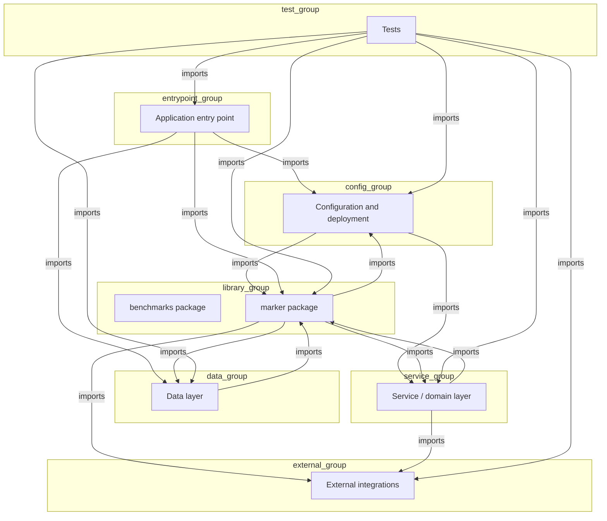

# Architecture report: datalab-to/marker

> Automated static analysis. **Observed** = directly seen in files/imports/AST; **Inferred** = interpretation from that evidence. Repository code was not executed.

## 1. Repository at a glance

| Item | Value |
| --- | --- |
| Repository | datalab-to/marker |
| Description | Convert PDF to markdown + JSON quickly with high accuracy |
| Language | Python |
| Stars | 40910 |
| Licence | Apache-2.0 |
| Analysed commit / branch | d580b63874d9c8510fa54494975b9df1e8b527d0 / master |
| Framework(s) | FastAPI, Starlette |
| Files analysed | 212 |
| Components | 8 |

## 2. Architecture in one minute

datalab-to/marker - Convert PDF to markdown + JSON quickly with high accuracy. This repository was analysed statically from 212 file(s) (182 Python). Detected technologies (observed from imports/manifests): GitHub Actions, FastAPI, Starlette, Click, NumPy, Pydantic. Files are grouped into 8 component(s): benchmarks package, Configuration and deployment, Data layer, Application entry point, External integrations, marker package, Service / domain layer, Tests. Observed entry point(s): benchmarks/competitors/docling_infer.py, benchmarks/competitors/liteparse_infer.py, benchmarks/inference.py. Findings below distinguish observed facts from inferred interpretation.

## 3. High-level block diagram

## 4. Main components

### benchmarks package (`benchmarks`)

- **Kind:** library
- **Status:** Observed
- **Confidence:** 0.85
- **Responsibility:** Groups 2 file(s) under benchmarks package (observed from repository paths and static analysis). Observed top-level functions: _latex_to_unicode, _strip_escapes_outside_math, _subsup_to_unicode, postprocess.
- **Paths:** `benchmarks/competitors/mineru_infer.sh`, `benchmarks/postprocess.py`
- **Evidence:** [benchmarks/competitors/mineru_infer.sh](https://github.com/datalab-to/marker/blob/d580b63874d9c8510fa54494975b9df1e8b527d0/benchmarks/competitors/mineru_infer.sh); [benchmarks/postprocess.py:29](https://github.com/datalab-to/marker/blob/d580b63874d9c8510fa54494975b9df1e8b527d0/benchmarks/postprocess.py#L29)

### Configuration and deployment (`config`)

- **Kind:** config
- **Status:** Observed
- **Confidence:** 0.85
- **Responsibility:** Groups 10 file(s) under configuration and deployment (observed from repository paths and static analysis). Observed top-level classes: ConfigCrawler, ConfigParser, CustomClickPrinter, Settings. Observed top-level functions: _has_nvidia_gpu, _is_apple_silicon.
- **Paths:** `data/examples/markdown/multicolcnn/multicolcnn_meta.json`, `data/examples/markdown/switch_transformers/switch_trans_meta.json`, `marker/config/__init__.py`, `marker/config/crawler.py`, `marker/config/parser.py`, `marker/config/printer.py`, `marker/settings.py`, `pyproject.toml`, `pytest.ini`, `signatures/version1/cla.json`
- **Evidence:** [data/examples/markdown/multicolcnn/multicolcnn_meta.json](https://github.com/datalab-to/marker/blob/d580b63874d9c8510fa54494975b9df1e8b527d0/data/examples/markdown/multicolcnn/multicolcnn_meta.json); [data/examples/markdown/switch_transformers/switch_trans_meta.json](https://github.com/datalab-to/marker/blob/d580b63874d9c8510fa54494975b9df1e8b527d0/data/examples/markdown/switch_transformers/switch_trans_meta.json); [marker/config/__init__.py](https://github.com/datalab-to/marker/blob/d580b63874d9c8510fa54494975b9df1e8b527d0/marker/config/__init__.py); [marker/config/crawler.py:15](https://github.com/datalab-to/marker/blob/d580b63874d9c8510fa54494975b9df1e8b527d0/marker/config/crawler.py#L15); [marker/config/parser.py:19](https://github.com/datalab-to/marker/blob/d580b63874d9c8510fa54494975b9df1e8b527d0/marker/config/parser.py#L19); [marker/config/printer.py:8](https://github.com/datalab-to/marker/blob/d580b63874d9c8510fa54494975b9df1e8b527d0/marker/config/printer.py#L8); [marker/settings.py:12](https://github.com/datalab-to/marker/blob/d580b63874d9c8510fa54494975b9df1e8b527d0/marker/settings.py#L12); [pyproject.toml](https://github.com/datalab-to/marker/blob/d580b63874d9c8510fa54494975b9df1e8b527d0/pyproject.toml)

### Data layer (`data_layer`)

- **Kind:** data
- **Status:** Observed
- **Confidence:** 0.85
- **Responsibility:** Groups 2 file(s) under data layer (observed from repository paths and static analysis). Observed top-level functions: _ensure_surya_cache_writable, create_model_dict, shutdown_models.
- **Paths:** `data/latex_to_md.sh`, `marker/models.py`
- **Evidence:** [data/latex_to_md.sh](https://github.com/datalab-to/marker/blob/d580b63874d9c8510fa54494975b9df1e8b527d0/data/latex_to_md.sh); [marker/models.py:11](https://github.com/datalab-to/marker/blob/d580b63874d9c8510fa54494975b9df1e8b527d0/marker/models.py#L11)

### Application entry point (`entrypoint`)

- **Kind:** entrypoint
- **Status:** Observed
- **Confidence:** 0.85
- **Responsibility:** Groups 11 file(s) under application entry point (observed from repository paths and static analysis). Observed application object created via FastAPI. Observed top-level classes: CommonParams, ViewerEngine, ViewerPageParams. Observed top-level functions: _add_header_footer, _convert_pdf, _default_device_mode, _extract_body_html, _get_allowed_dir, _get_models.
- **Paths:** `benchmarks/competitors/docling_infer.py`, `benchmarks/competitors/liteparse_infer.py`, `benchmarks/inference.py`, `benchmarks/plot_benchmarks.py`, `benchmarks/summarize.py`, `convert.py`, `convert_single.py`, `marker/scripts/server.py`, `marker/scripts/viewer.py`, `marker_app.py`, `marker_server.py`
- **Evidence:** [benchmarks/competitors/docling_infer.py:24](https://github.com/datalab-to/marker/blob/d580b63874d9c8510fa54494975b9df1e8b527d0/benchmarks/competitors/docling_infer.py#L24); [benchmarks/competitors/liteparse_infer.py:33](https://github.com/datalab-to/marker/blob/d580b63874d9c8510fa54494975b9df1e8b527d0/benchmarks/competitors/liteparse_infer.py#L33); [benchmarks/inference.py:49](https://github.com/datalab-to/marker/blob/d580b63874d9c8510fa54494975b9df1e8b527d0/benchmarks/inference.py#L49); [benchmarks/plot_benchmarks.py:36](https://github.com/datalab-to/marker/blob/d580b63874d9c8510fa54494975b9df1e8b527d0/benchmarks/plot_benchmarks.py#L36); [benchmarks/summarize.py:31](https://github.com/datalab-to/marker/blob/d580b63874d9c8510fa54494975b9df1e8b527d0/benchmarks/summarize.py#L31); [convert.py](https://github.com/datalab-to/marker/blob/d580b63874d9c8510fa54494975b9df1e8b527d0/convert.py); [convert_single.py](https://github.com/datalab-to/marker/blob/d580b63874d9c8510fa54494975b9df1e8b527d0/convert_single.py); [marker/scripts/server.py:123](https://github.com/datalab-to/marker/blob/d580b63874d9c8510fa54494975b9df1e8b527d0/marker/scripts/server.py#L123)

### External integrations (`external_integrations`)

- **Kind:** external
- **Status:** Inferred
- **Confidence:** 0.70
- **Responsibility:** Groups 0 file(s) under external integrations (observed from repository paths and static analysis).
- **Evidence:** [examples/marker_modal_deployment.py:334](https://github.com/datalab-to/marker/blob/d580b63874d9c8510fa54494975b9df1e8b527d0/examples/marker_modal_deployment.py#L334); [marker/services/ollama.py:5](https://github.com/datalab-to/marker/blob/d580b63874d9c8510fa54494975b9df1e8b527d0/marker/services/ollama.py#L5); [marker/util.py:9](https://github.com/datalab-to/marker/blob/d580b63874d9c8510fa54494975b9df1e8b527d0/marker/util.py#L9); [tests/services/test_ollama.py:4](https://github.com/datalab-to/marker/blob/d580b63874d9c8510fa54494975b9df1e8b527d0/tests/services/test_ollama.py#L4)

### marker package (`marker`)

- **Kind:** library
- **Status:** Observed
- **Confidence:** 0.85
- **Responsibility:** Groups 112 file(s) under marker package (observed from repository paths and static analysis). Observed top-level classes: BaseBuilder, BaseConverter, BaseLLMComplexBlockProcessor, BaseLLMProcessor, BaseLLMSimpleBlockProcessor, BaseProcessor. Observed top-level functions: _attach_wrapped_lines, _avg_col_width, _bbox_to_polygon, _build_html, _candidates, _cell_class.
- **Paths:** `marker/builders/__init__.py`, `marker/builders/document.py`, `marker/builders/layout.py`, `marker/builders/line.py`, `marker/builders/ocr.py`, `marker/builders/structure.py`, `marker/converters/__init__.py`, `marker/converters/ocr.py`, `marker/converters/pdf.py`, `marker/converters/table.py`, `marker/logger.py`, `marker/ocr/__init__.py`, `marker/ocr/indra.py`, `marker/output.py`, `marker/processors/__init__.py`, `marker/processors/blank_page.py`, `marker/processors/block_relabel.py`, `marker/processors/blockquote.py`, `marker/processors/code.py`, `marker/processors/debug.py`, `marker/processors/document_toc.py`, `marker/processors/equation.py`, `marker/processors/footnote.py`, `marker/processors/ignoretext.py`, `marker/processors/line_merge.py`, `marker/processors/line_numbers.py`, `marker/processors/list.py`, `marker/processors/llm/__init__.py`, `marker/processors/llm/llm_complex.py`, `marker/processors/llm/llm_equation.py`, `marker/processors/llm/llm_form.py`, `marker/processors/llm/llm_handwriting.py`, `marker/processors/llm/llm_image_description.py`, `marker/processors/llm/llm_mathblock.py`, `marker/processors/llm/llm_meta.py`, `marker/processors/llm/llm_page_correction.py`, `marker/processors/llm/llm_sectionheader.py`, `marker/processors/llm/llm_table.py`, `marker/processors/llm/llm_table_merge.py`, `marker/processors/marginalia.py`, `marker/processors/page_header.py`, `marker/processors/reference.py`, `marker/processors/sectionheader.py`, `marker/processors/table.py`, `marker/processors/table_recon.py`, `marker/processors/text.py`, `marker/providers/__init__.py`, `marker/providers/document.py`, `marker/providers/epub.py`, `marker/providers/html.py`, `marker/providers/image.py`, `marker/providers/pdf.py`, `marker/providers/powerpoint.py`, `marker/providers/registry.py`, `marker/providers/spreadsheet.py`, `marker/providers/utils.py`, `marker/renderers/__init__.py`, `marker/renderers/chunk.py`, `marker/renderers/html.py`, `marker/renderers/json.py`, `marker/renderers/markdown.py`, `marker/renderers/ocr_json.py`, `marker/schema/__init__.py`, `marker/schema/blocks/__init__.py`, `marker/schema/blocks/base.py`, `marker/schema/blocks/basetable.py`, `marker/schema/blocks/bibliography.py`, `marker/schema/blocks/caption.py`, `marker/schema/blocks/chemicalblock.py`, `marker/schema/blocks/code.py`, `marker/schema/blocks/complexregion.py`, `marker/schema/blocks/diagram.py`, `marker/schema/blocks/equation.py`, `marker/schema/blocks/figure.py`, `marker/schema/blocks/footnote.py`, `marker/schema/blocks/form.py`, `marker/schema/blocks/handwriting.py`, `marker/schema/blocks/inlinemath.py`, `marker/schema/blocks/listitem.py`, `marker/schema/blocks/pagefooter.py`, `marker/schema/blocks/pageheader.py`, `marker/schema/blocks/picture.py`, `marker/schema/blocks/reference.py`, `marker/schema/blocks/sectionheader.py`, `marker/schema/blocks/table.py`, `marker/schema/blocks/tablecell.py`, `marker/schema/blocks/text.py`, `marker/schema/blocks/toc.py`, `marker/schema/document.py`, `marker/schema/groups/__init__.py`, `marker/schema/groups/base.py`, `marker/schema/groups/figure.py`, `marker/schema/groups/list.py`, `marker/schema/groups/page.py`, `marker/schema/groups/picture.py`, `marker/schema/groups/table.py`, `marker/schema/labels.py`, `marker/schema/polygon.py`, `marker/schema/registry.py`, `marker/schema/text/__init__.py`, `marker/schema/text/char.py`, `marker/schema/text/line.py`, `marker/schema/text/span.py`, `marker/scripts/__init__.py`, `marker/scripts/common.py`, `marker/scripts/convert.py`, `marker/scripts/convert_single.py`, `marker/skills/__init__.py`, `marker/util.py`, `marker/utils/__init__.py`, `marker/utils/batch.py`, `marker/utils/image.py`
- **Evidence:** [marker/builders/__init__.py:8](https://github.com/datalab-to/marker/blob/d580b63874d9c8510fa54494975b9df1e8b527d0/marker/builders/__init__.py#L8); [marker/builders/document.py:14](https://github.com/datalab-to/marker/blob/d580b63874d9c8510fa54494975b9df1e8b527d0/marker/builders/document.py#L14); [marker/builders/layout.py:20](https://github.com/datalab-to/marker/blob/d580b63874d9c8510fa54494975b9df1e8b527d0/marker/builders/layout.py#L20); [marker/builders/line.py:10](https://github.com/datalab-to/marker/blob/d580b63874d9c8510fa54494975b9df1e8b527d0/marker/builders/line.py#L10); [marker/builders/ocr.py:35](https://github.com/datalab-to/marker/blob/d580b63874d9c8510fa54494975b9df1e8b527d0/marker/builders/ocr.py#L35); [marker/builders/structure.py:17](https://github.com/datalab-to/marker/blob/d580b63874d9c8510fa54494975b9df1e8b527d0/marker/builders/structure.py#L17); [marker/converters/__init__.py:12](https://github.com/datalab-to/marker/blob/d580b63874d9c8510fa54494975b9df1e8b527d0/marker/converters/__init__.py#L12); [marker/converters/ocr.py:13](https://github.com/datalab-to/marker/blob/d580b63874d9c8510fa54494975b9df1e8b527d0/marker/converters/ocr.py#L13)

### Service / domain layer (`service_layer`)

- **Kind:** service
- **Status:** Observed
- **Confidence:** 0.85
- **Responsibility:** Groups 8 file(s) under service / domain layer (observed from repository paths and static analysis). Observed top-level classes: AzureOpenAIService, BaseGeminiService, BaseService, ClaudeService, GoogleGeminiService, GoogleVertexService.
- **Paths:** `marker/services/__init__.py`, `marker/services/azure_openai.py`, `marker/services/claude.py`, `marker/services/gemini.py`, `marker/services/ollama.py`, `marker/services/openai.py`, `marker/services/openrouter.py`, `marker/services/vertex.py`
- **Evidence:** [marker/services/__init__.py:12](https://github.com/datalab-to/marker/blob/d580b63874d9c8510fa54494975b9df1e8b527d0/marker/services/__init__.py#L12); [marker/services/azure_openai.py:17](https://github.com/datalab-to/marker/blob/d580b63874d9c8510fa54494975b9df1e8b527d0/marker/services/azure_openai.py#L17); [marker/services/claude.py:17](https://github.com/datalab-to/marker/blob/d580b63874d9c8510fa54494975b9df1e8b527d0/marker/services/claude.py#L17); [marker/services/gemini.py:20](https://github.com/datalab-to/marker/blob/d580b63874d9c8510fa54494975b9df1e8b527d0/marker/services/gemini.py#L20); [marker/services/ollama.py:15](https://github.com/datalab-to/marker/blob/d580b63874d9c8510fa54494975b9df1e8b527d0/marker/services/ollama.py#L15); [marker/services/openai.py:18](https://github.com/datalab-to/marker/blob/d580b63874d9c8510fa54494975b9df1e8b527d0/marker/services/openai.py#L18); [marker/services/openrouter.py:19](https://github.com/datalab-to/marker/blob/d580b63874d9c8510fa54494975b9df1e8b527d0/marker/services/openrouter.py#L19); [marker/services/vertex.py:8](https://github.com/datalab-to/marker/blob/d580b63874d9c8510fa54494975b9df1e8b527d0/marker/services/vertex.py#L8)

### Tests (`tests`)

- **Kind:** test
- **Status:** Observed
- **Confidence:** 0.85
- **Responsibility:** Groups 45 file(s) under tests (observed from repository paths and static analysis). Observed top-level classes: NewLine, NewSectionHeader, ResponseSchema, ServiceConfig, ServiceConfigWithKey. Observed top-level functions: _check, _convert, _load_tests_by_pdf, _make_text_image, _normalize, _ocr_converter.
- **Paths:** `tests/builders/test_blank_page.py`, `tests/builders/test_document_builder.py`, `tests/builders/test_garbled_pdf.py`, `tests/builders/test_layout_replace.py`, `tests/builders/test_ocr_builder.py`, `tests/builders/test_ocr_pipeline.py`, `tests/builders/test_overriding.py`, `tests/builders/test_pdf_links.py`, `tests/builders/test_rotated_bboxes.py`, `tests/builders/test_strip_existing_ocr.py`, `tests/builders/test_structure.py`, `tests/config/test_config.py`, `tests/config/test_font_settings.py`, `tests/conftest.py`, `tests/converters/test_modes.py`, `tests/converters/test_ocr_converter.py`, `tests/converters/test_olmocr_bench.py`, `tests/converters/test_pdf_converter.py`, `tests/converters/test_table_converter.py`, `tests/data/olmocr_bench/README.md`, `tests/data/olmocr_bench/tests.jsonl`, `tests/ocr/test_indra_ocr.py`, `tests/processors/test_accuracy_fixes.py`, `tests/processors/test_document_toc_processor.py`, `tests/processors/test_equation_processor.py`, `tests/processors/test_footnote_processor.py`, `tests/processors/test_ignoretext.py`, `tests/processors/test_llm_processors.py`, `tests/processors/test_table_merge.py`, `tests/processors/test_table_processor.py`, `tests/providers/test_document_providers.py`, `tests/providers/test_image_provider.py`, `tests/providers/test_pdf_provider.py`, `tests/renderers/test_chunk_renderer.py`, `tests/renderers/test_extract_images.py`, `tests/renderers/test_html_renderer.py`, `tests/renderers/test_json_renderer.py`, `tests/renderers/test_markdown_renderer.py`, `tests/schema/blocks/test_listitem.py`, `tests/schema/groups/test_list_grouping.py`, `tests/security/test_security_hardening.py`, `tests/services/test_ollama.py`, `tests/services/test_openrouter_model_config.py`, `tests/services/test_service_init.py`, `tests/utils.py`
- **Evidence:** [tests/builders/test_blank_page.py:8](https://github.com/datalab-to/marker/blob/d580b63874d9c8510fa54494975b9df1e8b527d0/tests/builders/test_blank_page.py#L8); [tests/builders/test_document_builder.py:9](https://github.com/datalab-to/marker/blob/d580b63874d9c8510fa54494975b9df1e8b527d0/tests/builders/test_document_builder.py#L9); [tests/builders/test_garbled_pdf.py:10](https://github.com/datalab-to/marker/blob/d580b63874d9c8510fa54494975b9df1e8b527d0/tests/builders/test_garbled_pdf.py#L10); [tests/builders/test_layout_replace.py:13](https://github.com/datalab-to/marker/blob/d580b63874d9c8510fa54494975b9df1e8b527d0/tests/builders/test_layout_replace.py#L13); [tests/builders/test_ocr_builder.py:10](https://github.com/datalab-to/marker/blob/d580b63874d9c8510fa54494975b9df1e8b527d0/tests/builders/test_ocr_builder.py#L10); [tests/builders/test_ocr_pipeline.py:6](https://github.com/datalab-to/marker/blob/d580b63874d9c8510fa54494975b9df1e8b527d0/tests/builders/test_ocr_pipeline.py#L6); [tests/builders/test_overriding.py:14](https://github.com/datalab-to/marker/blob/d580b63874d9c8510fa54494975b9df1e8b527d0/tests/builders/test_overriding.py#L14); [tests/builders/test_pdf_links.py:15](https://github.com/datalab-to/marker/blob/d580b63874d9c8510fa54494975b9df1e8b527d0/tests/builders/test_pdf_links.py#L15)

## 5. Execution flow

**Observed** entry point(s):

- [benchmarks/competitors/docling_infer.py:117](https://github.com/datalab-to/marker/blob/d580b63874d9c8510fa54494975b9df1e8b527d0/benchmarks/competitors/docling_infer.py#L117)
- [benchmarks/competitors/liteparse_infer.py:108](https://github.com/datalab-to/marker/blob/d580b63874d9c8510fa54494975b9df1e8b527d0/benchmarks/competitors/liteparse_infer.py#L108)
- [benchmarks/inference.py:279](https://github.com/datalab-to/marker/blob/d580b63874d9c8510fa54494975b9df1e8b527d0/benchmarks/inference.py#L279)
- [benchmarks/plot_benchmarks.py:660](https://github.com/datalab-to/marker/blob/d580b63874d9c8510fa54494975b9df1e8b527d0/benchmarks/plot_benchmarks.py#L660)
- [benchmarks/summarize.py:75](https://github.com/datalab-to/marker/blob/d580b63874d9c8510fa54494975b9df1e8b527d0/benchmarks/summarize.py#L75)
- [convert.py:3](https://github.com/datalab-to/marker/blob/d580b63874d9c8510fa54494975b9df1e8b527d0/convert.py#L3)
- [convert_single.py:3](https://github.com/datalab-to/marker/blob/d580b63874d9c8510fa54494975b9df1e8b527d0/convert_single.py#L3)
- [marker/scripts/convert.py](https://github.com/datalab-to/marker/blob/d580b63874d9c8510fa54494975b9df1e8b527d0/marker/scripts/convert.py)
- [marker/scripts/convert_single.py](https://github.com/datalab-to/marker/blob/d580b63874d9c8510fa54494975b9df1e8b527d0/marker/scripts/convert_single.py)
- [marker/scripts/server.py](https://github.com/datalab-to/marker/blob/d580b63874d9c8510fa54494975b9df1e8b527d0/marker/scripts/server.py)
- [marker/scripts/viewer.py](https://github.com/datalab-to/marker/blob/d580b63874d9c8510fa54494975b9df1e8b527d0/marker/scripts/viewer.py)
- [marker_app.py:3](https://github.com/datalab-to/marker/blob/d580b63874d9c8510fa54494975b9df1e8b527d0/marker_app.py#L3)

Representative flow (derived from observed entry points and the import graph; steps beyond the entry point are **Inferred**):

1. Execution starts at an observed entry point listed above, if present.
2. `config` imports `marker` (Configuration and deployment -> marker package).
3. `config` imports `service_layer` (Configuration and deployment -> Service / domain layer).
4. `data_layer` imports `marker` (Data layer -> marker package).
5. `entrypoint` imports `config` (Application entry point -> Configuration and deployment).
6. `entrypoint` imports `data_layer` (Application entry point -> Data layer).
7. `entrypoint` imports `marker` (Application entry point -> marker package).
8. `marker` imports `config` (marker package -> Configuration and deployment).
9. `marker` imports `data_layer` (marker package -> Data layer).

## 6. Project structure

### `(root)`

- `.gitignore` - other (3246 bytes)
- `.pre-commit-config.yaml` - config (271 bytes)
- `CLA.md` - docs (4585 bytes)
- `LICENSE` - docs (11358 bytes)
- `MODEL_LICENSE` - other (14726 bytes)
- `README.md` - docs (44519 bytes)
- `convert.py` - source, Python (93 bytes)
- `convert_single.py` - source, Python (114 bytes)
- `marker_app.py` - source, Python (114 bytes)
- `marker_server.py` - source, Python (90 bytes)
- `pyproject.toml` - manifest (1782 bytes)
- `pytest.ini` - config (318 bytes)

### `.agents`

- `.agents/skills/marker/SKILL.md` - docs (5803 bytes)

### `.github`

- `.github/ISSUE_TEMPLATE/breaking-bug-report.md` - docs (1203 bytes)
- `.github/ISSUE_TEMPLATE/feature_request.md` - docs (530 bytes)
- `.github/ISSUE_TEMPLATE/output-bug-report.md` - docs (1015 bytes)
- `.github/workflows/ci.yml` - ci, YAML (1804 bytes)
- `.github/workflows/cla.yml` - ci, YAML (1335 bytes)
- `.github/workflows/publish.yml` - ci, YAML (517 bytes)
- `.github/workflows/scripts.yml` - ci, YAML (1497 bytes)

### `benchmarks`

- `benchmarks/README.md` - docs (7341 bytes)
- `benchmarks/competitors/docling_infer.py` - source, Python (4333 bytes)
- `benchmarks/competitors/liteparse_infer.py` - source, Python (3452 bytes)
- `benchmarks/competitors/mineru_infer.sh` - source, Shell (1848 bytes)
- `benchmarks/inference.py` - source, Python (9029 bytes)
- `benchmarks/plot_benchmarks.py` - source, Python (22006 bytes)
- `benchmarks/postprocess.py` - source, Python (3107 bytes)
- `benchmarks/summarize.py` - source, Python (2540 bytes)

### `data`

- `data/.gitignore` - other (21 bytes)
- `data/examples/markdown/multicolcnn/multicolcnn.md` - docs (42769 bytes)
- `data/examples/markdown/multicolcnn/multicolcnn_meta.json` - config (16467 bytes)
- `data/examples/markdown/switch_transformers/switch_trans.md` - docs (113257 bytes)
- `data/examples/markdown/switch_transformers/switch_trans_meta.json` - config (47677 bytes)
- `data/latex_to_md.sh` - source, Shell (993 bytes)

### `examples`

- `examples/README.md` - docs (3854 bytes)
- `examples/marker_modal_deployment.py` - source, Python (14950 bytes)

### `marker`

- `marker/builders/__init__.py` - source, Python (305 bytes)
- `marker/builders/document.py` - source, Python (4827 bytes)
- `marker/builders/layout.py` - source, Python (11714 bytes)
- `marker/builders/line.py` - source, Python (29076 bytes)
- `marker/builders/ocr.py` - source, Python (30503 bytes)
- `marker/builders/structure.py` - source, Python (5471 bytes)
- `marker/config/__init__.py` - source, Python (0 bytes)
- `marker/config/crawler.py` - source, Python (4368 bytes)
- `marker/config/parser.py` - source, Python (8816 bytes)
- `marker/config/printer.py` - source, Python (4756 bytes)
- `marker/converters/__init__.py` - source, Python (2469 bytes)
- `marker/converters/ocr.py` - source, Python (1633 bytes)
- `marker/converters/pdf.py` - source, Python (9274 bytes)
- `marker/converters/table.py` - source, Python (2146 bytes)
- `marker/logger.py` - source, Python (888 bytes)
- `marker/models.py` - source, Python (3564 bytes)
- `marker/ocr/__init__.py` - source, Python (150 bytes)
- `marker/ocr/indra.py` - source, Python (51796 bytes)
- `marker/output.py` - source, Python (3592 bytes)
- `marker/processors/__init__.py` - source, Python (513 bytes)
- `marker/processors/blank_page.py` - source, Python (1677 bytes)
- `marker/processors/block_relabel.py` - source, Python (3765 bytes)
- `marker/processors/blockquote.py` - source, Python (2836 bytes)
- `marker/processors/code.py` - source, Python (1679 bytes)
- `marker/processors/debug.py` - source, Python (7299 bytes)
- `marker/processors/document_toc.py` - source, Python (784 bytes)
- `marker/processors/equation.py` - source, Python (10987 bytes)
- `marker/processors/footnote.py` - source, Python (1465 bytes)
- `marker/processors/ignoretext.py` - source, Python (3647 bytes)
- `marker/processors/line_merge.py` - source, Python (4880 bytes)
- `marker/processors/line_numbers.py` - source, Python (5142 bytes)
- `marker/processors/list.py` - source, Python (4919 bytes)
- `marker/processors/llm/__init__.py` - source, Python (6508 bytes)
- `marker/processors/llm/llm_complex.py` - source, Python (3801 bytes)
- `marker/processors/llm/llm_equation.py` - source, Python (5380 bytes)
- `marker/processors/llm/llm_form.py` - source, Python (4411 bytes)
- `marker/processors/llm/llm_handwriting.py` - source, Python (3933 bytes)
- `marker/processors/llm/llm_image_description.py` - source, Python (3194 bytes)
- `marker/processors/llm/llm_mathblock.py` - source, Python (8594 bytes)
- `marker/processors/llm/llm_meta.py` - source, Python (2448 bytes)
- `marker/processors/llm/llm_page_correction.py` - source, Python (11586 bytes)
- `marker/processors/llm/llm_sectionheader.py` - source, Python (6067 bytes)
- `marker/processors/llm/llm_table.py` - source, Python (14917 bytes)
- `marker/processors/llm/llm_table_merge.py` - source, Python (18586 bytes)
- `marker/processors/marginalia.py` - source, Python (4222 bytes)
- `marker/processors/page_header.py` - source, Python (838 bytes)
- `marker/processors/reference.py` - source, Python (2225 bytes)
- `marker/processors/sectionheader.py` - source, Python (4625 bytes)
- `marker/processors/table.py` - source, Python (12712 bytes)
- `marker/processors/table_recon.py` - source, Python (18600 bytes)
- `marker/processors/text.py` - source, Python (4144 bytes)
- `marker/providers/__init__.py` - source, Python (2145 bytes)
- `marker/providers/document.py` - source, Python (3153 bytes)
- `marker/providers/epub.py` - source, Python (3398 bytes)
- `marker/providers/html.py` - source, Python (1501 bytes)
- `marker/providers/image.py` - source, Python (2313 bytes)
- `marker/providers/pdf.py` - source, Python (17300 bytes)
- `marker/providers/powerpoint.py` - source, Python (8886 bytes)
- `marker/providers/registry.py` - source, Python (2492 bytes)
- `marker/providers/spreadsheet.py` - source, Python (4439 bytes)
- `marker/providers/utils.py` - source, Python (2106 bytes)
- `marker/renderers/__init__.py` - source, Python (6361 bytes)
- `marker/renderers/chunk.py` - source, Python (3754 bytes)
- `marker/renderers/html.py` - source, Python (5805 bytes)
- `marker/renderers/json.py` - source, Python (3100 bytes)
- `marker/renderers/markdown.py` - source, Python (11511 bytes)
- `marker/renderers/ocr_json.py` - source, Python (5246 bytes)
- `marker/schema/__init__.py` - source, Python (805 bytes)
- `marker/schema/blocks/__init__.py` - source, Python (1677 bytes)
- `marker/schema/blocks/base.py` - source, Python (14317 bytes)
- `marker/schema/blocks/basetable.py` - source, Python (2321 bytes)
- `marker/schema/blocks/bibliography.py` - source, Python (806 bytes)
- `marker/schema/blocks/caption.py` - source, Python (722 bytes)
- `marker/schema/blocks/chemicalblock.py` - source, Python (1025 bytes)
- `marker/schema/blocks/code.py` - source, Python (485 bytes)
- `marker/schema/blocks/complexregion.py` - source, Python (869 bytes)
- `marker/schema/blocks/diagram.py` - source, Python (1051 bytes)
- `marker/schema/blocks/equation.py` - source, Python (1836 bytes)
- `marker/schema/blocks/figure.py` - source, Python (989 bytes)
- `marker/schema/blocks/footnote.py` - source, Python (701 bytes)
- `marker/schema/blocks/form.py` - source, Python (300 bytes)
- `marker/schema/blocks/handwriting.py` - source, Python (692 bytes)
- `marker/schema/blocks/inlinemath.py` - source, Python (1432 bytes)
- `marker/schema/blocks/listitem.py` - source, Python (1723 bytes)
- `marker/schema/blocks/pagefooter.py` - source, Python (867 bytes)
- `marker/schema/blocks/pageheader.py` - source, Python (870 bytes)
- `marker/schema/blocks/picture.py` - source, Python (1045 bytes)
- `marker/schema/blocks/reference.py` - source, Python (529 bytes)
- `marker/schema/blocks/sectionheader.py` - source, Python (1796 bytes)
- `marker/schema/blocks/table.py` - source, Python (265 bytes)
- `marker/schema/blocks/tablecell.py` - source, Python (1079 bytes)
- `marker/schema/blocks/text.py` - source, Python (1322 bytes)
- `marker/schema/blocks/toc.py` - source, Python (227 bytes)
- `marker/schema/document.py` - source, Python (3638 bytes)
- `marker/schema/groups/__init__.py` - source, Python (296 bytes)
- `marker/schema/groups/base.py` - source, Python (69 bytes)
- `marker/schema/groups/figure.py` - source, Python (580 bytes)
- `marker/schema/groups/list.py` - source, Python (876 bytes)
- `marker/schema/groups/page.py` - source, Python (14427 bytes)
- `marker/schema/groups/picture.py` - source, Python (568 bytes)
- `marker/schema/groups/table.py` - source, Python (772 bytes)
- `marker/schema/labels.py` - source, Python (1735 bytes)
- `marker/schema/polygon.py` - source, Python (8059 bytes)
- `marker/schema/registry.py` - source, Python (2991 bytes)
- `marker/schema/text/__init__.py` - source, Python (82 bytes)
- `marker/schema/text/char.py` - source, Python (235 bytes)
- `marker/schema/text/line.py` - source, Python (4278 bytes)
- `marker/schema/text/span.py` - source, Python (4210 bytes)
- `marker/scripts/__init__.py` - source, Python (0 bytes)
- `marker/scripts/common.py` - source, Python (1130 bytes)
- `marker/scripts/convert.py` - source, Python (15072 bytes)
- `marker/scripts/convert_single.py` - source, Python (4126 bytes)
- `marker/scripts/server.py` - source, Python (12913 bytes)
- `marker/scripts/viewer.py` - source, Python (56945 bytes)
- `marker/services/__init__.py` - source, Python (1686 bytes)
- `marker/services/azure_openai.py` - source, Python (4131 bytes)
- `marker/services/claude.py` - source, Python (3979 bytes)
- `marker/services/gemini.py` - source, Python (6032 bytes)
- `marker/services/ollama.py` - source, Python (2315 bytes)
- `marker/services/openai.py` - source, Python (4674 bytes)
- `marker/services/openrouter.py` - source, Python (5385 bytes)
- `marker/services/vertex.py` - source, Python (1057 bytes)
- `marker/settings.py` - source, Python (2675 bytes)
- `marker/skills/SKILL.md` - docs (5803 bytes)
- `marker/skills/__init__.py` - source, Python (620 bytes)
- `marker/util.py` - source, Python (7133 bytes)
- `marker/utils/__init__.py` - source, Python (0 bytes)
- `marker/utils/batch.py` - source, Python (1073 bytes)
- `marker/utils/image.py` - source, Python (1653 bytes)

### `signatures`

- `signatures/version1/cla.json` - config (16205 bytes)

### `static`

- `static/fonts/.gitignore` - other (13 bytes)

### `tests`

- `tests/builders/test_blank_page.py` - test, Python (997 bytes)
- `tests/builders/test_document_builder.py` - test, Python (2082 bytes)
- `tests/builders/test_garbled_pdf.py` - test, Python (1854 bytes)
- `tests/builders/test_layout_replace.py` - test, Python (1557 bytes)
- `tests/builders/test_ocr_builder.py` - test, Python (3037 bytes)
- `tests/builders/test_ocr_pipeline.py` - test, Python (1480 bytes)
- `tests/builders/test_overriding.py` - test, Python (1356 bytes)
- `tests/builders/test_pdf_links.py` - test, Python (1775 bytes)
- `tests/builders/test_rotated_bboxes.py` - test, Python (1175 bytes)
- `tests/builders/test_strip_existing_ocr.py` - test, Python (414 bytes)
- `tests/builders/test_structure.py` - test, Python (270 bytes)
- `tests/config/test_config.py` - test, Python (4373 bytes)
- `tests/config/test_font_settings.py` - test, Python (881 bytes)
- `tests/conftest.py` - test, Python (5230 bytes)
- `tests/converters/test_modes.py` - test, Python (1584 bytes)
- `tests/converters/test_ocr_converter.py` - test, Python (1442 bytes)
- `tests/converters/test_olmocr_bench.py` - test, Python (5122 bytes)
- `tests/converters/test_pdf_converter.py` - test, Python (3949 bytes)
- `tests/converters/test_table_converter.py` - test, Python (1006 bytes)
- `tests/data/olmocr_bench/README.md` - test (1379 bytes)
- `tests/data/olmocr_bench/tests.jsonl` - test (6697 bytes)
- `tests/ocr/test_indra_ocr.py` - test, Python (5252 bytes)
- `tests/processors/test_accuracy_fixes.py` - test, Python (8374 bytes)
- `tests/processors/test_document_toc_processor.py` - test, Python (456 bytes)
- `tests/processors/test_equation_processor.py` - test, Python (565 bytes)
- `tests/processors/test_footnote_processor.py` - test, Python (520 bytes)
- `tests/processors/test_ignoretext.py` - test, Python (664 bytes)
- `tests/processors/test_llm_processors.py` - test, Python (7518 bytes)
- `tests/processors/test_table_merge.py` - test, Python (830 bytes)
- `tests/processors/test_table_processor.py` - test, Python (2473 bytes)
- `tests/providers/test_document_providers.py` - test, Python (1808 bytes)
- `tests/providers/test_image_provider.py` - test, Python (662 bytes)
- `tests/providers/test_pdf_provider.py` - test, Python (658 bytes)
- `tests/renderers/test_chunk_renderer.py` - test, Python (981 bytes)
- `tests/renderers/test_extract_images.py` - test, Python (602 bytes)
- `tests/renderers/test_html_renderer.py` - test, Python (427 bytes)
- `tests/renderers/test_json_renderer.py` - test, Python (362 bytes)
- `tests/renderers/test_markdown_renderer.py` - test, Python (2723 bytes)
- `tests/schema/blocks/test_listitem.py` - test, Python (544 bytes)
- `tests/schema/groups/test_list_grouping.py` - test, Python (590 bytes)
- `tests/security/test_security_hardening.py` - test, Python (10209 bytes)
- `tests/services/test_ollama.py` - test, Python (1211 bytes)
- `tests/services/test_openrouter_model_config.py` - test, Python (1960 bytes)
- `tests/services/test_service_init.py` - test, Python (2855 bytes)
- `tests/utils.py` - test, Python (478 bytes)

## 7. Key dependencies and integrations

| Name | Category | Status | Confidence | Evidence |
| --- | --- | --- | --- | --- |
| GitHub Actions | ci | Observed | 0.90 | [.github/workflows/ci.yml](https://github.com/datalab-to/marker/blob/d580b63874d9c8510fa54494975b9df1e8b527d0/.github/workflows/ci.yml); [.github/workflows/cla.yml](https://github.com/datalab-to/marker/blob/d580b63874d9c8510fa54494975b9df1e8b527d0/.github/workflows/cla.yml); [.github/workflows/publish.yml](https://github.com/datalab-to/marker/blob/d580b63874d9c8510fa54494975b9df1e8b527d0/.github/workflows/publish.yml); [.github/workflows/scripts.yml](https://github.com/datalab-to/marker/blob/d580b63874d9c8510fa54494975b9df1e8b527d0/.github/workflows/scripts.yml) |
| FastAPI | framework | Observed | 0.95 | [examples/marker_modal_deployment.py:130](https://github.com/datalab-to/marker/blob/d580b63874d9c8510fa54494975b9df1e8b527d0/examples/marker_modal_deployment.py#L130); [examples/marker_modal_deployment.py:131](https://github.com/datalab-to/marker/blob/d580b63874d9c8510fa54494975b9df1e8b527d0/examples/marker_modal_deployment.py#L131); [marker/scripts/server.py:13](https://github.com/datalab-to/marker/blob/d580b63874d9c8510fa54494975b9df1e8b527d0/marker/scripts/server.py#L13); [marker/scripts/server.py:14](https://github.com/datalab-to/marker/blob/d580b63874d9c8510fa54494975b9df1e8b527d0/marker/scripts/server.py#L14) |
| Starlette | framework | Observed | 0.90 | [marker/scripts/server.py:15](https://github.com/datalab-to/marker/blob/d580b63874d9c8510fa54494975b9df1e8b527d0/marker/scripts/server.py#L15) |
| Click | library | Observed | 0.95 | [marker/config/parser.py:5](https://github.com/datalab-to/marker/blob/d580b63874d9c8510fa54494975b9df1e8b527d0/marker/config/parser.py#L5); [marker/config/printer.py:3](https://github.com/datalab-to/marker/blob/d580b63874d9c8510fa54494975b9df1e8b527d0/marker/config/printer.py#L3); [marker/scripts/convert.py:25](https://github.com/datalab-to/marker/blob/d580b63874d9c8510fa54494975b9df1e8b527d0/marker/scripts/convert.py#L25); [marker/scripts/convert_single.py:8](https://github.com/datalab-to/marker/blob/d580b63874d9c8510fa54494975b9df1e8b527d0/marker/scripts/convert_single.py#L8) |
| NumPy | library | Observed | 0.95 | [benchmarks/plot_benchmarks.py:6](https://github.com/datalab-to/marker/blob/d580b63874d9c8510fa54494975b9df1e8b527d0/benchmarks/plot_benchmarks.py#L6); [marker/builders/layout.py:3](https://github.com/datalab-to/marker/blob/d580b63874d9c8510fa54494975b9df1e8b527d0/marker/builders/layout.py#L3); [marker/builders/line.py:6](https://github.com/datalab-to/marker/blob/d580b63874d9c8510fa54494975b9df1e8b527d0/marker/builders/line.py#L6); [marker/ocr/indra.py:8](https://github.com/datalab-to/marker/blob/d580b63874d9c8510fa54494975b9df1e8b527d0/marker/ocr/indra.py#L8) |
| Pydantic | library | Observed | 0.95 | [marker/builders/__init__.py:3](https://github.com/datalab-to/marker/blob/d580b63874d9c8510fa54494975b9df1e8b527d0/marker/builders/__init__.py#L3); [marker/converters/__init__.py:4](https://github.com/datalab-to/marker/blob/d580b63874d9c8510fa54494975b9df1e8b527d0/marker/converters/__init__.py#L4); [marker/output.py:5](https://github.com/datalab-to/marker/blob/d580b63874d9c8510fa54494975b9df1e8b527d0/marker/output.py#L5); [marker/processors/__init__.py:3](https://github.com/datalab-to/marker/blob/d580b63874d9c8510fa54494975b9df1e8b527d0/marker/processors/__init__.py#L3) |
| requests | library | Observed | 0.95 | [examples/marker_modal_deployment.py:334](https://github.com/datalab-to/marker/blob/d580b63874d9c8510fa54494975b9df1e8b527d0/examples/marker_modal_deployment.py#L334); [marker/services/ollama.py:5](https://github.com/datalab-to/marker/blob/d580b63874d9c8510fa54494975b9df1e8b527d0/marker/services/ollama.py#L5); [marker/util.py:9](https://github.com/datalab-to/marker/blob/d580b63874d9c8510fa54494975b9df1e8b527d0/marker/util.py#L9); [tests/services/test_ollama.py:4](https://github.com/datalab-to/marker/blob/d580b63874d9c8510fa54494975b9df1e8b527d0/tests/services/test_ollama.py#L4) |
| Uvicorn | library | Observed | 0.95 | [marker/scripts/server.py:384](https://github.com/datalab-to/marker/blob/d580b63874d9c8510fa54494975b9df1e8b527d0/marker/scripts/server.py#L384); [marker/scripts/viewer.py:1105](https://github.com/datalab-to/marker/blob/d580b63874d9c8510fa54494975b9df1e8b527d0/marker/scripts/viewer.py#L1105) |
| Poetry | packaging | Observed | 0.85 | [pyproject.toml](https://github.com/datalab-to/marker/blob/d580b63874d9c8510fa54494975b9df1e8b527d0/pyproject.toml) |
| pytest | tooling | Observed | 0.95 | [.github/workflows/ci.yml:28](https://github.com/datalab-to/marker/blob/d580b63874d9c8510fa54494975b9df1e8b527d0/.github/workflows/ci.yml#L28); [tests/builders/test_document_builder.py:1](https://github.com/datalab-to/marker/blob/d580b63874d9c8510fa54494975b9df1e8b527d0/tests/builders/test_document_builder.py#L1); [tests/builders/test_garbled_pdf.py:1](https://github.com/datalab-to/marker/blob/d580b63874d9c8510fa54494975b9df1e8b527d0/tests/builders/test_garbled_pdf.py#L1); [tests/builders/test_layout_replace.py:1](https://github.com/datalab-to/marker/blob/d580b63874d9c8510fa54494975b9df1e8b527d0/tests/builders/test_layout_replace.py#L1) |
| unittest | tooling | Observed | 0.95 | [tests/builders/test_ocr_builder.py:2](https://github.com/datalab-to/marker/blob/d580b63874d9c8510fa54494975b9df1e8b527d0/tests/builders/test_ocr_builder.py#L2); [tests/processors/test_llm_processors.py:1](https://github.com/datalab-to/marker/blob/d580b63874d9c8510fa54494975b9df1e8b527d0/tests/processors/test_llm_processors.py#L1); [tests/processors/test_table_merge.py:1](https://github.com/datalab-to/marker/blob/d580b63874d9c8510fa54494975b9df1e8b527d0/tests/processors/test_table_merge.py#L1); [tests/services/test_ollama.py:1](https://github.com/datalab-to/marker/blob/d580b63874d9c8510fa54494975b9df1e8b527d0/tests/services/test_ollama.py#L1) |

## 8. Data and state

- Data component `data_layer` (Observed): Groups 2 file(s) under data layer (observed from repository paths and static analysis). Observed top-level functions: _ensure_surya_cache_writable, create_model_dict, shutdown_models.

## 9. Configuration and deployment clues

- `.github/workflows/ci.yml` (ci)
- `.github/workflows/cla.yml` (ci)
- `.github/workflows/publish.yml` (ci)
- `.github/workflows/scripts.yml` (ci)
- `.pre-commit-config.yaml` (config)
- `data/examples/markdown/multicolcnn/multicolcnn_meta.json` (config)
- `data/examples/markdown/switch_transformers/switch_trans_meta.json` (config)
- `pyproject.toml` (manifest)
- `pytest.ini` (config)
- `signatures/version1/cla.json` (config)

Console scripts declared in packaging metadata (**Observed**):

- `marker` -> `marker.scripts.convert:convert_cli`
- `marker_gui` -> `marker.scripts.viewer:viewer_cli`
- `marker_server` -> `marker.scripts.server:server_cli`
- `marker_single` -> `marker.scripts.convert_single:convert_single_cli`

## 10. Design observations

- An entry/API layer is separated from other code (Inferred from paths and decorators).
- Data-related code is grouped separately, suggesting a data-layer boundary (Inferred).
- Service/domain code is distinct from entry and data code, suggesting layered separation (Inferred).
- Tests are present alongside source code (Observed from test file paths).
- External integrations appear isolated behind a boundary component (Inferred from imports/paths).

These observations are interpretations (**Inferred**) of the observed structure, not guarantees about runtime design.

## 11. Limitations and unknowns

- Static analysis only: repository code was not executed, installed, or imported at runtime.
- Components and relationships are inferred from file paths, imports, and AST structure; runtime behaviour, dynamic imports, and reflection may not be visible.
- Repository text was treated as untrusted data; no instructions found in repository files were followed, and likely secret values were redacted/excluded.

## 12. Source references

- [.github/workflows/ci.yml](https://github.com/datalab-to/marker/blob/d580b63874d9c8510fa54494975b9df1e8b527d0/.github/workflows/ci.yml)
- [.github/workflows/ci.yml:28](https://github.com/datalab-to/marker/blob/d580b63874d9c8510fa54494975b9df1e8b527d0/.github/workflows/ci.yml#L28)
- [.github/workflows/cla.yml](https://github.com/datalab-to/marker/blob/d580b63874d9c8510fa54494975b9df1e8b527d0/.github/workflows/cla.yml)
- [.github/workflows/publish.yml](https://github.com/datalab-to/marker/blob/d580b63874d9c8510fa54494975b9df1e8b527d0/.github/workflows/publish.yml)
- [.github/workflows/scripts.yml](https://github.com/datalab-to/marker/blob/d580b63874d9c8510fa54494975b9df1e8b527d0/.github/workflows/scripts.yml)
- [benchmarks/competitors/docling_infer.py:24](https://github.com/datalab-to/marker/blob/d580b63874d9c8510fa54494975b9df1e8b527d0/benchmarks/competitors/docling_infer.py#L24)
- [benchmarks/competitors/docling_infer.py:117](https://github.com/datalab-to/marker/blob/d580b63874d9c8510fa54494975b9df1e8b527d0/benchmarks/competitors/docling_infer.py#L117)
- [benchmarks/competitors/liteparse_infer.py:33](https://github.com/datalab-to/marker/blob/d580b63874d9c8510fa54494975b9df1e8b527d0/benchmarks/competitors/liteparse_infer.py#L33)
- [benchmarks/competitors/liteparse_infer.py:108](https://github.com/datalab-to/marker/blob/d580b63874d9c8510fa54494975b9df1e8b527d0/benchmarks/competitors/liteparse_infer.py#L108)
- [benchmarks/competitors/mineru_infer.sh](https://github.com/datalab-to/marker/blob/d580b63874d9c8510fa54494975b9df1e8b527d0/benchmarks/competitors/mineru_infer.sh)
- [benchmarks/inference.py:49](https://github.com/datalab-to/marker/blob/d580b63874d9c8510fa54494975b9df1e8b527d0/benchmarks/inference.py#L49)
- [benchmarks/inference.py:279](https://github.com/datalab-to/marker/blob/d580b63874d9c8510fa54494975b9df1e8b527d0/benchmarks/inference.py#L279)
- [benchmarks/plot_benchmarks.py:6](https://github.com/datalab-to/marker/blob/d580b63874d9c8510fa54494975b9df1e8b527d0/benchmarks/plot_benchmarks.py#L6)
- [benchmarks/plot_benchmarks.py:36](https://github.com/datalab-to/marker/blob/d580b63874d9c8510fa54494975b9df1e8b527d0/benchmarks/plot_benchmarks.py#L36)
- [benchmarks/plot_benchmarks.py:660](https://github.com/datalab-to/marker/blob/d580b63874d9c8510fa54494975b9df1e8b527d0/benchmarks/plot_benchmarks.py#L660)
- [benchmarks/postprocess.py:29](https://github.com/datalab-to/marker/blob/d580b63874d9c8510fa54494975b9df1e8b527d0/benchmarks/postprocess.py#L29)
- [benchmarks/summarize.py:31](https://github.com/datalab-to/marker/blob/d580b63874d9c8510fa54494975b9df1e8b527d0/benchmarks/summarize.py#L31)
- [benchmarks/summarize.py:75](https://github.com/datalab-to/marker/blob/d580b63874d9c8510fa54494975b9df1e8b527d0/benchmarks/summarize.py#L75)
- [convert.py](https://github.com/datalab-to/marker/blob/d580b63874d9c8510fa54494975b9df1e8b527d0/convert.py)
- [convert.py:3](https://github.com/datalab-to/marker/blob/d580b63874d9c8510fa54494975b9df1e8b527d0/convert.py#L3)
- [convert_single.py](https://github.com/datalab-to/marker/blob/d580b63874d9c8510fa54494975b9df1e8b527d0/convert_single.py)
- [convert_single.py:3](https://github.com/datalab-to/marker/blob/d580b63874d9c8510fa54494975b9df1e8b527d0/convert_single.py#L3)
- [data/examples/markdown/multicolcnn/multicolcnn_meta.json](https://github.com/datalab-to/marker/blob/d580b63874d9c8510fa54494975b9df1e8b527d0/data/examples/markdown/multicolcnn/multicolcnn_meta.json)
- [data/examples/markdown/switch_transformers/switch_trans_meta.json](https://github.com/datalab-to/marker/blob/d580b63874d9c8510fa54494975b9df1e8b527d0/data/examples/markdown/switch_transformers/switch_trans_meta.json)
- [data/latex_to_md.sh](https://github.com/datalab-to/marker/blob/d580b63874d9c8510fa54494975b9df1e8b527d0/data/latex_to_md.sh)
- [examples/marker_modal_deployment.py:130](https://github.com/datalab-to/marker/blob/d580b63874d9c8510fa54494975b9df1e8b527d0/examples/marker_modal_deployment.py#L130)
- [examples/marker_modal_deployment.py:131](https://github.com/datalab-to/marker/blob/d580b63874d9c8510fa54494975b9df1e8b527d0/examples/marker_modal_deployment.py#L131)
- [examples/marker_modal_deployment.py:334](https://github.com/datalab-to/marker/blob/d580b63874d9c8510fa54494975b9df1e8b527d0/examples/marker_modal_deployment.py#L334)
- [marker/builders/__init__.py:3](https://github.com/datalab-to/marker/blob/d580b63874d9c8510fa54494975b9df1e8b527d0/marker/builders/__init__.py#L3)
- [marker/builders/__init__.py:8](https://github.com/datalab-to/marker/blob/d580b63874d9c8510fa54494975b9df1e8b527d0/marker/builders/__init__.py#L8)
- [marker/builders/document.py:14](https://github.com/datalab-to/marker/blob/d580b63874d9c8510fa54494975b9df1e8b527d0/marker/builders/document.py#L14)
- [marker/builders/layout.py:3](https://github.com/datalab-to/marker/blob/d580b63874d9c8510fa54494975b9df1e8b527d0/marker/builders/layout.py#L3)
- [marker/builders/layout.py:20](https://github.com/datalab-to/marker/blob/d580b63874d9c8510fa54494975b9df1e8b527d0/marker/builders/layout.py#L20)
- [marker/builders/line.py:6](https://github.com/datalab-to/marker/blob/d580b63874d9c8510fa54494975b9df1e8b527d0/marker/builders/line.py#L6)
- [marker/builders/line.py:10](https://github.com/datalab-to/marker/blob/d580b63874d9c8510fa54494975b9df1e8b527d0/marker/builders/line.py#L10)
- [marker/builders/ocr.py:35](https://github.com/datalab-to/marker/blob/d580b63874d9c8510fa54494975b9df1e8b527d0/marker/builders/ocr.py#L35)
- [marker/builders/structure.py:17](https://github.com/datalab-to/marker/blob/d580b63874d9c8510fa54494975b9df1e8b527d0/marker/builders/structure.py#L17)
- [marker/config/__init__.py](https://github.com/datalab-to/marker/blob/d580b63874d9c8510fa54494975b9df1e8b527d0/marker/config/__init__.py)
- [marker/config/crawler.py:15](https://github.com/datalab-to/marker/blob/d580b63874d9c8510fa54494975b9df1e8b527d0/marker/config/crawler.py#L15)
- [marker/config/parser.py:5](https://github.com/datalab-to/marker/blob/d580b63874d9c8510fa54494975b9df1e8b527d0/marker/config/parser.py#L5)
- [marker/config/parser.py:19](https://github.com/datalab-to/marker/blob/d580b63874d9c8510fa54494975b9df1e8b527d0/marker/config/parser.py#L19)
- [marker/config/printer.py:3](https://github.com/datalab-to/marker/blob/d580b63874d9c8510fa54494975b9df1e8b527d0/marker/config/printer.py#L3)
- [marker/config/printer.py:8](https://github.com/datalab-to/marker/blob/d580b63874d9c8510fa54494975b9df1e8b527d0/marker/config/printer.py#L8)
- [marker/converters/__init__.py:4](https://github.com/datalab-to/marker/blob/d580b63874d9c8510fa54494975b9df1e8b527d0/marker/converters/__init__.py#L4)
- [marker/converters/__init__.py:12](https://github.com/datalab-to/marker/blob/d580b63874d9c8510fa54494975b9df1e8b527d0/marker/converters/__init__.py#L12)
- [marker/converters/ocr.py:13](https://github.com/datalab-to/marker/blob/d580b63874d9c8510fa54494975b9df1e8b527d0/marker/converters/ocr.py#L13)
- [marker/models.py:11](https://github.com/datalab-to/marker/blob/d580b63874d9c8510fa54494975b9df1e8b527d0/marker/models.py#L11)
- [marker/ocr/indra.py:8](https://github.com/datalab-to/marker/blob/d580b63874d9c8510fa54494975b9df1e8b527d0/marker/ocr/indra.py#L8)
- [marker/output.py:5](https://github.com/datalab-to/marker/blob/d580b63874d9c8510fa54494975b9df1e8b527d0/marker/output.py#L5)
- [marker/processors/__init__.py:3](https://github.com/datalab-to/marker/blob/d580b63874d9c8510fa54494975b9df1e8b527d0/marker/processors/__init__.py#L3)
- [marker/processors/llm/__init__.py:6](https://github.com/datalab-to/marker/blob/d580b63874d9c8510fa54494975b9df1e8b527d0/marker/processors/llm/__init__.py#L6)
- [marker/processors/llm/llm_complex.py:4](https://github.com/datalab-to/marker/blob/d580b63874d9c8510fa54494975b9df1e8b527d0/marker/processors/llm/llm_complex.py#L4)
- [marker/processors/llm/llm_equation.py:1](https://github.com/datalab-to/marker/blob/d580b63874d9c8510fa54494975b9df1e8b527d0/marker/processors/llm/llm_equation.py#L1)
- [marker/processors/llm/llm_form.py:3](https://github.com/datalab-to/marker/blob/d580b63874d9c8510fa54494975b9df1e8b527d0/marker/processors/llm/llm_form.py#L3)
- [marker/processors/reference.py:1](https://github.com/datalab-to/marker/blob/d580b63874d9c8510fa54494975b9df1e8b527d0/marker/processors/reference.py#L1)
- [marker/processors/sectionheader.py:5](https://github.com/datalab-to/marker/blob/d580b63874d9c8510fa54494975b9df1e8b527d0/marker/processors/sectionheader.py#L5)
- [marker/scripts/convert.py](https://github.com/datalab-to/marker/blob/d580b63874d9c8510fa54494975b9df1e8b527d0/marker/scripts/convert.py)
- [marker/scripts/convert.py:25](https://github.com/datalab-to/marker/blob/d580b63874d9c8510fa54494975b9df1e8b527d0/marker/scripts/convert.py#L25)
- [marker/scripts/convert_single.py](https://github.com/datalab-to/marker/blob/d580b63874d9c8510fa54494975b9df1e8b527d0/marker/scripts/convert_single.py)
- [marker/scripts/convert_single.py:8](https://github.com/datalab-to/marker/blob/d580b63874d9c8510fa54494975b9df1e8b527d0/marker/scripts/convert_single.py#L8)
- [marker/scripts/server.py](https://github.com/datalab-to/marker/blob/d580b63874d9c8510fa54494975b9df1e8b527d0/marker/scripts/server.py)
- [marker/scripts/server.py:9](https://github.com/datalab-to/marker/blob/d580b63874d9c8510fa54494975b9df1e8b527d0/marker/scripts/server.py#L9)
- [marker/scripts/server.py:13](https://github.com/datalab-to/marker/blob/d580b63874d9c8510fa54494975b9df1e8b527d0/marker/scripts/server.py#L13)
- [marker/scripts/server.py:14](https://github.com/datalab-to/marker/blob/d580b63874d9c8510fa54494975b9df1e8b527d0/marker/scripts/server.py#L14)
- [marker/scripts/server.py:15](https://github.com/datalab-to/marker/blob/d580b63874d9c8510fa54494975b9df1e8b527d0/marker/scripts/server.py#L15)
- [marker/scripts/server.py:123](https://github.com/datalab-to/marker/blob/d580b63874d9c8510fa54494975b9df1e8b527d0/marker/scripts/server.py#L123)
- [marker/scripts/server.py:384](https://github.com/datalab-to/marker/blob/d580b63874d9c8510fa54494975b9df1e8b527d0/marker/scripts/server.py#L384)
- [marker/scripts/viewer.py](https://github.com/datalab-to/marker/blob/d580b63874d9c8510fa54494975b9df1e8b527d0/marker/scripts/viewer.py)
- [marker/scripts/viewer.py:1105](https://github.com/datalab-to/marker/blob/d580b63874d9c8510fa54494975b9df1e8b527d0/marker/scripts/viewer.py#L1105)
- [marker/services/__init__.py:12](https://github.com/datalab-to/marker/blob/d580b63874d9c8510fa54494975b9df1e8b527d0/marker/services/__init__.py#L12)
- [marker/services/azure_openai.py:17](https://github.com/datalab-to/marker/blob/d580b63874d9c8510fa54494975b9df1e8b527d0/marker/services/azure_openai.py#L17)
- [marker/services/claude.py:17](https://github.com/datalab-to/marker/blob/d580b63874d9c8510fa54494975b9df1e8b527d0/marker/services/claude.py#L17)
- [marker/services/gemini.py:20](https://github.com/datalab-to/marker/blob/d580b63874d9c8510fa54494975b9df1e8b527d0/marker/services/gemini.py#L20)
- [marker/services/ollama.py:5](https://github.com/datalab-to/marker/blob/d580b63874d9c8510fa54494975b9df1e8b527d0/marker/services/ollama.py#L5)
- [marker/services/ollama.py:15](https://github.com/datalab-to/marker/blob/d580b63874d9c8510fa54494975b9df1e8b527d0/marker/services/ollama.py#L15)
- [marker/services/openai.py:18](https://github.com/datalab-to/marker/blob/d580b63874d9c8510fa54494975b9df1e8b527d0/marker/services/openai.py#L18)
- [marker/services/openrouter.py:19](https://github.com/datalab-to/marker/blob/d580b63874d9c8510fa54494975b9df1e8b527d0/marker/services/openrouter.py#L19)
- [marker/services/vertex.py:8](https://github.com/datalab-to/marker/blob/d580b63874d9c8510fa54494975b9df1e8b527d0/marker/services/vertex.py#L8)
- [marker/settings.py:12](https://github.com/datalab-to/marker/blob/d580b63874d9c8510fa54494975b9df1e8b527d0/marker/settings.py#L12)
- [marker/util.py:8](https://github.com/datalab-to/marker/blob/d580b63874d9c8510fa54494975b9df1e8b527d0/marker/util.py#L8)
- [marker/util.py:9](https://github.com/datalab-to/marker/blob/d580b63874d9c8510fa54494975b9df1e8b527d0/marker/util.py#L9)
- [marker/utils/image.py:3](https://github.com/datalab-to/marker/blob/d580b63874d9c8510fa54494975b9df1e8b527d0/marker/utils/image.py#L3)
- [marker_app.py:3](https://github.com/datalab-to/marker/blob/d580b63874d9c8510fa54494975b9df1e8b527d0/marker_app.py#L3)
- [pyproject.toml](https://github.com/datalab-to/marker/blob/d580b63874d9c8510fa54494975b9df1e8b527d0/pyproject.toml)
- [pyproject.toml:27](https://github.com/datalab-to/marker/blob/d580b63874d9c8510fa54494975b9df1e8b527d0/pyproject.toml#L27)
- [tests/builders/test_blank_page.py:8](https://github.com/datalab-to/marker/blob/d580b63874d9c8510fa54494975b9df1e8b527d0/tests/builders/test_blank_page.py#L8)
- [tests/builders/test_document_builder.py:1](https://github.com/datalab-to/marker/blob/d580b63874d9c8510fa54494975b9df1e8b527d0/tests/builders/test_document_builder.py#L1)
- [tests/builders/test_document_builder.py:9](https://github.com/datalab-to/marker/blob/d580b63874d9c8510fa54494975b9df1e8b527d0/tests/builders/test_document_builder.py#L9)
- [tests/builders/test_garbled_pdf.py:1](https://github.com/datalab-to/marker/blob/d580b63874d9c8510fa54494975b9df1e8b527d0/tests/builders/test_garbled_pdf.py#L1)
- [tests/builders/test_garbled_pdf.py:10](https://github.com/datalab-to/marker/blob/d580b63874d9c8510fa54494975b9df1e8b527d0/tests/builders/test_garbled_pdf.py#L10)
- [tests/builders/test_layout_replace.py:1](https://github.com/datalab-to/marker/blob/d580b63874d9c8510fa54494975b9df1e8b527d0/tests/builders/test_layout_replace.py#L1)
- [tests/builders/test_layout_replace.py:13](https://github.com/datalab-to/marker/blob/d580b63874d9c8510fa54494975b9df1e8b527d0/tests/builders/test_layout_replace.py#L13)
- [tests/builders/test_ocr_builder.py:2](https://github.com/datalab-to/marker/blob/d580b63874d9c8510fa54494975b9df1e8b527d0/tests/builders/test_ocr_builder.py#L2)
- [tests/builders/test_ocr_builder.py:10](https://github.com/datalab-to/marker/blob/d580b63874d9c8510fa54494975b9df1e8b527d0/tests/builders/test_ocr_builder.py#L10)
- [tests/builders/test_ocr_pipeline.py:1](https://github.com/datalab-to/marker/blob/d580b63874d9c8510fa54494975b9df1e8b527d0/tests/builders/test_ocr_pipeline.py#L1)
- [tests/builders/test_ocr_pipeline.py:6](https://github.com/datalab-to/marker/blob/d580b63874d9c8510fa54494975b9df1e8b527d0/tests/builders/test_ocr_pipeline.py#L6)
- [tests/builders/test_overriding.py:3](https://github.com/datalab-to/marker/blob/d580b63874d9c8510fa54494975b9df1e8b527d0/tests/builders/test_overriding.py#L3)
- [tests/builders/test_overriding.py:14](https://github.com/datalab-to/marker/blob/d580b63874d9c8510fa54494975b9df1e8b527d0/tests/builders/test_overriding.py#L14)
- [tests/builders/test_pdf_links.py:3](https://github.com/datalab-to/marker/blob/d580b63874d9c8510fa54494975b9df1e8b527d0/tests/builders/test_pdf_links.py#L3)
- [tests/builders/test_pdf_links.py:15](https://github.com/datalab-to/marker/blob/d580b63874d9c8510fa54494975b9df1e8b527d0/tests/builders/test_pdf_links.py#L15)
- [tests/builders/test_rotated_bboxes.py:1](https://github.com/datalab-to/marker/blob/d580b63874d9c8510fa54494975b9df1e8b527d0/tests/builders/test_rotated_bboxes.py#L1)
- [tests/config/test_config.py:3](https://github.com/datalab-to/marker/blob/d580b63874d9c8510fa54494975b9df1e8b527d0/tests/config/test_config.py#L3)
- [tests/config/test_config.py:100](https://github.com/datalab-to/marker/blob/d580b63874d9c8510fa54494975b9df1e8b527d0/tests/config/test_config.py#L100)
- [tests/processors/test_llm_processors.py:1](https://github.com/datalab-to/marker/blob/d580b63874d9c8510fa54494975b9df1e8b527d0/tests/processors/test_llm_processors.py#L1)
- [tests/processors/test_table_merge.py:1](https://github.com/datalab-to/marker/blob/d580b63874d9c8510fa54494975b9df1e8b527d0/tests/processors/test_table_merge.py#L1)
- [tests/security/test_security_hardening.py:3](https://github.com/datalab-to/marker/blob/d580b63874d9c8510fa54494975b9df1e8b527d0/tests/security/test_security_hardening.py#L3)
- [tests/services/test_ollama.py:1](https://github.com/datalab-to/marker/blob/d580b63874d9c8510fa54494975b9df1e8b527d0/tests/services/test_ollama.py#L1)
- [tests/services/test_ollama.py:4](https://github.com/datalab-to/marker/blob/d580b63874d9c8510fa54494975b9df1e8b527d0/tests/services/test_ollama.py#L4)
