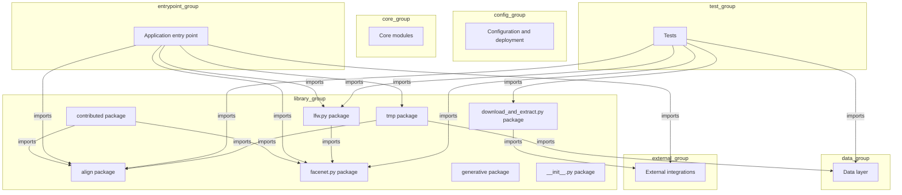

# Architecture report: davidsandberg/facenet

> Automated static analysis. **Observed** = directly seen in files/imports/AST; **Inferred** = interpretation from that evidence. Repository code was not executed.

## 1. Repository at a glance

| Item | Value |
| --- | --- |
| Repository | davidsandberg/facenet |
| Description | Face recognition using Tensorflow |
| Language | Python |
| Stars | 14364 |
| Licence | MIT |
| Analysed commit / branch | 096ed770f163957c1e56efa7feeb194773920f6e / master |
| Framework(s) | None detected |
| Files analysed | 91 |
| Components | 14 |

## 2. Architecture in one minute

davidsandberg/facenet - Face recognition using Tensorflow. This repository was analysed statically from 91 file(s) (73 Python). Detected technologies (observed from imports/manifests): NumPy, requests, unittest. Files are grouped into 14 component(s): align package, Configuration and deployment, contributed package, Core modules, Data layer, download_and_extract.py package, Application entry point, External integrations. Observed entry point(s): src/align/align_dataset_mtcnn.py, src/calculate_filtering_metrics.py, src/classifier.py. Findings below distinguish observed facts from inferred interpretation.

## 3. High-level block diagram

## 4. Main components

### align package (`align`)

- **Kind:** library
- **Status:** Observed
- **Confidence:** 0.85
- **Responsibility:** Groups 2 file(s) under align package (observed from repository paths and static analysis). Observed top-level classes: Network, ONet, PNet, RNet. Observed top-level functions: bbreg, bulk_detect_face, create_mtcnn, detect_face, generateBoundingBox, imresample.
- **Paths:** `src/align/__init__.py`, `src/align/detect_face.py`
- **Evidence:** [src/align/__init__.py](https://github.com/davidsandberg/facenet/blob/096ed770f163957c1e56efa7feeb194773920f6e/src/align/__init__.py); [src/align/detect_face.py:37](https://github.com/davidsandberg/facenet/blob/096ed770f163957c1e56efa7feeb194773920f6e/src/align/detect_face.py#L37)

### Configuration and deployment (`config`)

- **Kind:** config
- **Status:** Observed
- **Confidence:** 0.85
- **Responsibility:** Groups 1 file(s) under configuration and deployment (observed from repository paths and static analysis).
- **Paths:** `requirements.txt`
- **Evidence:** [requirements.txt](https://github.com/davidsandberg/facenet/blob/096ed770f163957c1e56efa7feeb194773920f6e/requirements.txt)

### contributed package (`contributed`)

- **Kind:** library
- **Status:** Observed
- **Confidence:** 0.85
- **Responsibility:** Groups 2 file(s) under contributed package (observed from repository paths and static analysis). Observed top-level classes: Detection, Encoder, Face, Identifier, Recognition.
- **Paths:** `contributed/__init__.py`, `contributed/face.py`
- **Evidence:** [contributed/__init__.py](https://github.com/davidsandberg/facenet/blob/096ed770f163957c1e56efa7feeb194773920f6e/contributed/__init__.py); [contributed/face.py:50](https://github.com/davidsandberg/facenet/blob/096ed770f163957c1e56efa7feeb194773920f6e/contributed/face.py#L50)

### Core modules (`core`)

- **Kind:** core
- **Status:** Observed
- **Confidence:** 0.85
- **Responsibility:** Groups 1 file(s) under core modules (observed from repository paths and static analysis).
- **Paths:** `__init__.py`
- **Evidence:** [__init__.py](https://github.com/davidsandberg/facenet/blob/096ed770f163957c1e56efa7feeb194773920f6e/__init__.py)

### Data layer (`data_layer`)

- **Kind:** data
- **Status:** Observed
- **Confidence:** 0.85
- **Responsibility:** Groups 10 file(s) under data layer (observed from repository paths and static analysis). Observed top-level classes: Vae. Observed top-level functions: block17, block35, block8, conv2d_block, expand, fire_module.
- **Paths:** `src/generative/models/__init__.py`, `src/generative/models/dfc_vae.py`, `src/generative/models/dfc_vae_large.py`, `src/generative/models/dfc_vae_resnet.py`, `src/generative/models/vae_base.py`, `src/models/__init__.py`, `src/models/dummy.py`, `src/models/inception_resnet_v1.py`, `src/models/inception_resnet_v2.py`, `src/models/squeezenet.py`
- **Evidence:** [src/generative/models/__init__.py](https://github.com/davidsandberg/facenet/blob/096ed770f163957c1e56efa7feeb194773920f6e/src/generative/models/__init__.py); [src/generative/models/dfc_vae.py:37](https://github.com/davidsandberg/facenet/blob/096ed770f163957c1e56efa7feeb194773920f6e/src/generative/models/dfc_vae.py#L37); [src/generative/models/dfc_vae_large.py:37](https://github.com/davidsandberg/facenet/blob/096ed770f163957c1e56efa7feeb194773920f6e/src/generative/models/dfc_vae_large.py#L37); [src/generative/models/dfc_vae_resnet.py:37](https://github.com/davidsandberg/facenet/blob/096ed770f163957c1e56efa7feeb194773920f6e/src/generative/models/dfc_vae_resnet.py#L37); [src/generative/models/vae_base.py:32](https://github.com/davidsandberg/facenet/blob/096ed770f163957c1e56efa7feeb194773920f6e/src/generative/models/vae_base.py#L32); [src/models/__init__.py](https://github.com/davidsandberg/facenet/blob/096ed770f163957c1e56efa7feeb194773920f6e/src/models/__init__.py); [src/models/dummy.py:33](https://github.com/davidsandberg/facenet/blob/096ed770f163957c1e56efa7feeb194773920f6e/src/models/dummy.py#L33); [src/models/inception_resnet_v1.py:30](https://github.com/davidsandberg/facenet/blob/096ed770f163957c1e56efa7feeb194773920f6e/src/models/inception_resnet_v1.py#L30)

### download_and_extract.py package (`download_and_extract_py`)

- **Kind:** library
- **Status:** Observed
- **Confidence:** 0.85
- **Responsibility:** Groups 1 file(s) under download_and_extract.py package (observed from repository paths and static analysis). Observed top-level functions: download_and_extract_file, download_file_from_google_drive, get_confirm_token, save_response_content.
- **Paths:** `src/download_and_extract.py`
- **Evidence:** [src/download_and_extract.py:13](https://github.com/davidsandberg/facenet/blob/096ed770f163957c1e56efa7feeb194773920f6e/src/download_and_extract.py#L13)

### Application entry point (`entrypoint`)

- **Kind:** entrypoint
- **Status:** Observed
- **Confidence:** 0.85
- **Responsibility:** Groups 29 file(s) under application entry point (observed from repository paths and static analysis). Observed top-level functions: T, TemporaryDirectory, _chinese_whispers, add_overlays, align_data, cluster_facial_encodings.
- **Paths:** `contributed/batch_represent.py`, `contributed/cluster.py`, `contributed/clustering.py`, `contributed/export_embeddings.py`, `contributed/predict.py`, `contributed/real_time_face_recognition.py`, `src/align/align_dataset_mtcnn.py`, `src/calculate_filtering_metrics.py`, `src/classifier.py`, `src/compare.py`, `src/decode_msceleb_dataset.py`, `src/freeze_graph.py`, `src/generative/calculate_attribute_vectors.py`, `src/generative/modify_attribute.py`, `src/generative/train_vae.py`, `src/train_softmax.py`, `src/train_tripletloss.py`, `src/validate_on_lfw.py`, `tmp/align_dataset.py`, `tmp/cacd2000_split_identities.py`, `tmp/dataset_read_speed.py`, `tmp/deepdream.py`, `tmp/download_vgg_face_dataset.py`, `tmp/funnel_dataset.py`, `tmp/mnist_center_loss.py`, `tmp/mnist_noise_labels.py`, `tmp/rename_casia_directories.py`, `tmp/visualize.py`, `tmp/visualize_vggface.py`
- **Evidence:** [contributed/batch_represent.py:81](https://github.com/davidsandberg/facenet/blob/096ed770f163957c1e56efa7feeb194773920f6e/contributed/batch_represent.py#L81); [contributed/cluster.py:40](https://github.com/davidsandberg/facenet/blob/096ed770f163957c1e56efa7feeb194773920f6e/contributed/cluster.py#L40); [contributed/clustering.py:9](https://github.com/davidsandberg/facenet/blob/096ed770f163957c1e56efa7feeb194773920f6e/contributed/clustering.py#L9); [contributed/export_embeddings.py:66](https://github.com/davidsandberg/facenet/blob/096ed770f163957c1e56efa7feeb194773920f6e/contributed/export_embeddings.py#L66); [contributed/predict.py:45](https://github.com/davidsandberg/facenet/blob/096ed770f163957c1e56efa7feeb194773920f6e/contributed/predict.py#L45); [contributed/real_time_face_recognition.py:36](https://github.com/davidsandberg/facenet/blob/096ed770f163957c1e56efa7feeb194773920f6e/contributed/real_time_face_recognition.py#L36); [src/align/align_dataset_mtcnn.py:39](https://github.com/davidsandberg/facenet/blob/096ed770f163957c1e56efa7feeb194773920f6e/src/align/align_dataset_mtcnn.py#L39); [src/calculate_filtering_metrics.py:41](https://github.com/davidsandberg/facenet/blob/096ed770f163957c1e56efa7feeb194773920f6e/src/calculate_filtering_metrics.py#L41)

### External integrations (`external_integrations`)

- **Kind:** external
- **Status:** Inferred
- **Confidence:** 0.70
- **Responsibility:** Groups 0 file(s) under external integrations (observed from repository paths and static analysis).
- **Evidence:** [src/download_and_extract.py:1](https://github.com/davidsandberg/facenet/blob/096ed770f163957c1e56efa7feeb194773920f6e/src/download_and_extract.py#L1); [tmp/download_vgg_face_dataset.py:35](https://github.com/davidsandberg/facenet/blob/096ed770f163957c1e56efa7feeb194773920f6e/tmp/download_vgg_face_dataset.py#L35)

### facenet.py package (`facenet_py`)

- **Kind:** library
- **Status:** Observed
- **Confidence:** 0.85
- **Responsibility:** Groups 1 file(s) under facenet.py package (observed from repository paths and static analysis). Observed top-level classes: ImageClass. Observed top-level functions: _add_loss_summaries, calculate_accuracy, calculate_roc, calculate_val, calculate_val_far, center_loss.
- **Paths:** `src/facenet.py`
- **Evidence:** [src/facenet.py:44](https://github.com/davidsandberg/facenet/blob/096ed770f163957c1e56efa7feeb194773920f6e/src/facenet.py#L44)

### generative package (`generative`)

- **Kind:** library
- **Status:** Observed
- **Confidence:** 0.85
- **Responsibility:** Groups 1 file(s) under generative package (observed from repository paths and static analysis).
- **Paths:** `src/generative/__init__.py`
- **Evidence:** [src/generative/__init__.py](https://github.com/davidsandberg/facenet/blob/096ed770f163957c1e56efa7feeb194773920f6e/src/generative/__init__.py)

### __init__.py package (`init_py`)

- **Kind:** library
- **Status:** Observed
- **Confidence:** 0.85
- **Responsibility:** Groups 1 file(s) under __init__.py package (observed from repository paths and static analysis).
- **Paths:** `src/__init__.py`
- **Evidence:** [src/__init__.py](https://github.com/davidsandberg/facenet/blob/096ed770f163957c1e56efa7feeb194773920f6e/src/__init__.py)

### lfw.py package (`lfw_py`)

- **Kind:** library
- **Status:** Observed
- **Confidence:** 0.85
- **Responsibility:** Groups 1 file(s) under lfw.py package (observed from repository paths and static analysis). Observed top-level functions: add_extension, evaluate, get_paths, read_pairs.
- **Paths:** `src/lfw.py`
- **Evidence:** [src/lfw.py:34](https://github.com/davidsandberg/facenet/blob/096ed770f163957c1e56efa7feeb194773920f6e/src/lfw.py#L34)

### Tests (`tests`)

- **Kind:** test
- **Status:** Observed
- **Confidence:** 0.85
- **Responsibility:** Groups 11 file(s) under tests (observed from repository paths and static analysis). Observed top-level classes: BatchNormTest, CenterLossTest, DemuxEmbeddingsTest, TrainTest. Observed top-level functions: _affine, _conv, align_dataset_if_needed, create_checkpoint_file, create_features, create_mock_dataset.
- **Paths:** `test/batch_norm_test.py`, `test/center_loss_test.py`, `test/restore_test.py`, `test/train_test.py`, `test/triplet_loss_test.py`, `tmp/mtcnn_test.py`, `tmp/random_test.py`, `tmp/seed_test.py`, `tmp/select_triplets_test.py`, `tmp/test_align.py`, `tmp/test_invariance_on_lfw.py`
- **Evidence:** [test/batch_norm_test.py:29](https://github.com/davidsandberg/facenet/blob/096ed770f163957c1e56efa7feeb194773920f6e/test/batch_norm_test.py#L29); [test/center_loss_test.py:28](https://github.com/davidsandberg/facenet/blob/096ed770f163957c1e56efa7feeb194773920f6e/test/center_loss_test.py#L28); [test/restore_test.py:30](https://github.com/davidsandberg/facenet/blob/096ed770f163957c1e56efa7feeb194773920f6e/test/restore_test.py#L30); [test/train_test.py:32](https://github.com/davidsandberg/facenet/blob/096ed770f163957c1e56efa7feeb194773920f6e/test/train_test.py#L32); [test/triplet_loss_test.py:28](https://github.com/davidsandberg/facenet/blob/096ed770f163957c1e56efa7feeb194773920f6e/test/triplet_loss_test.py#L28); [tmp/mtcnn_test.py](https://github.com/davidsandberg/facenet/blob/096ed770f163957c1e56efa7feeb194773920f6e/tmp/mtcnn_test.py); [tmp/random_test.py](https://github.com/davidsandberg/facenet/blob/096ed770f163957c1e56efa7feeb194773920f6e/tmp/random_test.py); [tmp/seed_test.py:25](https://github.com/davidsandberg/facenet/blob/096ed770f163957c1e56efa7feeb194773920f6e/tmp/seed_test.py#L25)

### tmp package (`tmp`)

- **Kind:** library
- **Status:** Observed
- **Confidence:** 0.85
- **Responsibility:** Groups 13 file(s) under tmp package (observed from repository paths and static analysis). Observed top-level classes: AlignDlib. Observed top-level functions: affine, apool, batch_norm, conv, inception, inference.
- **Paths:** `tmp/__init__.py`, `tmp/align_dlib.py`, `tmp/mtcnn.py`, `tmp/mtcnn_test_pnet_dbg.py`, `tmp/network.py`, `tmp/nn2.py`, `tmp/nn3.py`, `tmp/nn4.py`, `tmp/nn4_small2_v1.py`, `tmp/test1.py`, `tmp/vggface16.py`, `tmp/vggverydeep19.py`, `tmp/visualize_vgg_model.py`
- **Evidence:** [tmp/__init__.py](https://github.com/davidsandberg/facenet/blob/096ed770f163957c1e56efa7feeb194773920f6e/tmp/__init__.py); [tmp/align_dlib.py:69](https://github.com/davidsandberg/facenet/blob/096ed770f163957c1e56efa7feeb194773920f6e/tmp/align_dlib.py#L69); [tmp/mtcnn.py](https://github.com/davidsandberg/facenet/blob/096ed770f163957c1e56efa7feeb194773920f6e/tmp/mtcnn.py); [tmp/mtcnn_test_pnet_dbg.py](https://github.com/davidsandberg/facenet/blob/096ed770f163957c1e56efa7feeb194773920f6e/tmp/mtcnn_test_pnet_dbg.py); [tmp/network.py:35](https://github.com/davidsandberg/facenet/blob/096ed770f163957c1e56efa7feeb194773920f6e/tmp/network.py#L35); [tmp/nn2.py:31](https://github.com/davidsandberg/facenet/blob/096ed770f163957c1e56efa7feeb194773920f6e/tmp/nn2.py#L31); [tmp/nn3.py:31](https://github.com/davidsandberg/facenet/blob/096ed770f163957c1e56efa7feeb194773920f6e/tmp/nn3.py#L31); [tmp/nn4.py:31](https://github.com/davidsandberg/facenet/blob/096ed770f163957c1e56efa7feeb194773920f6e/tmp/nn4.py#L31)

## 5. Execution flow

**Observed** entry point(s):

- [src/align/align_dataset_mtcnn.py:158](https://github.com/davidsandberg/facenet/blob/096ed770f163957c1e56efa7feeb194773920f6e/src/align/align_dataset_mtcnn.py#L158)
- [src/calculate_filtering_metrics.py:127](https://github.com/davidsandberg/facenet/blob/096ed770f163957c1e56efa7feeb194773920f6e/src/calculate_filtering_metrics.py#L127)
- [src/classifier.py:169](https://github.com/davidsandberg/facenet/blob/096ed770f163957c1e56efa7feeb194773920f6e/src/classifier.py#L169)
- [src/compare.py:129](https://github.com/davidsandberg/facenet/blob/096ed770f163957c1e56efa7feeb194773920f6e/src/compare.py#L129)
- [src/decode_msceleb_dataset.py:78](https://github.com/davidsandberg/facenet/blob/096ed770f163957c1e56efa7feeb194773920f6e/src/decode_msceleb_dataset.py#L78)
- [src/freeze_graph.py:102](https://github.com/davidsandberg/facenet/blob/096ed770f163957c1e56efa7feeb194773920f6e/src/freeze_graph.py#L102)
- [src/generative/calculate_attribute_vectors.py:199](https://github.com/davidsandberg/facenet/blob/096ed770f163957c1e56efa7feeb194773920f6e/src/generative/calculate_attribute_vectors.py#L199)
- [src/generative/modify_attribute.py:141](https://github.com/davidsandberg/facenet/blob/096ed770f163957c1e56efa7feeb194773920f6e/src/generative/modify_attribute.py#L141)
- [src/generative/train_vae.py:283](https://github.com/davidsandberg/facenet/blob/096ed770f163957c1e56efa7feeb194773920f6e/src/generative/train_vae.py#L283)
- [src/train_softmax.py:579](https://github.com/davidsandberg/facenet/blob/096ed770f163957c1e56efa7feeb194773920f6e/src/train_softmax.py#L579)
- [src/train_tripletloss.py:485](https://github.com/davidsandberg/facenet/blob/096ed770f163957c1e56efa7feeb194773920f6e/src/train_tripletloss.py#L485)
- [src/validate_on_lfw.py:163](https://github.com/davidsandberg/facenet/blob/096ed770f163957c1e56efa7feeb194773920f6e/src/validate_on_lfw.py#L163)

Representative flow (derived from observed entry points and the import graph; steps beyond the entry point are **Inferred**):

1. Execution starts at an observed entry point listed above, if present.
2. `contributed` imports `align` (contributed package -> align package).
3. `contributed` imports `facenet_py` (contributed package -> facenet.py package).
4. `download_and_extract_py` imports `external_integrations` (download_and_extract.py package -> External integrations).
5. `entrypoint` imports `align` (Application entry point -> align package).
6. `entrypoint` imports `external_integrations` (Application entry point -> External integrations).
7. `entrypoint` imports `facenet_py` (Application entry point -> facenet.py package).
8. `entrypoint` imports `lfw_py` (Application entry point -> lfw.py package).
9. `entrypoint` imports `tmp` (Application entry point -> tmp package).

## 6. Project structure

### `(root)`

- `.gitignore` - other (1080 bytes)
- `.project` - other (361 bytes)
- `.pydevproject` - other (461 bytes)
- `.pylintrc` - other (13765 bytes)
- `.travis.yml` - ci, YAML (458 bytes)
- `LICENSE.md` - docs (1071 bytes)
- `README.md` - docs (5784 bytes)
- `__init__.py` - source, Python (0 bytes)
- `requirements.txt` - manifest (88 bytes)

### `contributed`

- `contributed/__init__.py` - source, Python (0 bytes)
- `contributed/batch_represent.py` - source, Python (5519 bytes)
- `contributed/cluster.py` - source, Python (8541 bytes)
- `contributed/clustering.py` - source, Python (9733 bytes)
- `contributed/export_embeddings.py` - source, Python (8585 bytes)
- `contributed/face.py` - source, Python (5934 bytes)
- `contributed/predict.py` - source, Python (6182 bytes)
- `contributed/real_time_face_recognition.py` - source, Python (3413 bytes)

### `data`

- `data/learning_rate_retrain_tripletloss.txt` - docs (108 bytes)
- `data/learning_rate_schedule_classifier_casia.txt` - docs (104 bytes)
- `data/learning_rate_schedule_classifier_msceleb.txt` - docs (107 bytes)
- `data/learning_rate_schedule_classifier_vggface2.txt` - docs (107 bytes)
- `data/pairs.txt` - docs (155335 bytes)

### `src`

- `src/__init__.py` - source, Python (16 bytes)
- `src/align/__init__.py` - source, Python (0 bytes)
- `src/align/align_dataset_mtcnn.py` - source, Python (8302 bytes)
- `src/align/detect_face.py` - source, Python (31695 bytes)
- `src/calculate_filtering_metrics.py` - source, Python (6024 bytes)
- `src/classifier.py` - source, Python (8113 bytes)
- `src/compare.py` - source, Python (5510 bytes)
- `src/decode_msceleb_dataset.py` - source, Python (3630 bytes)
- `src/download_and_extract.py` - source, Python (1752 bytes)
- `src/facenet.py` - source, Python (23366 bytes)
- `src/freeze_graph.py` - source, Python (4735 bytes)
- `src/generative/__init__.py` - source, Python (0 bytes)
- `src/generative/calculate_attribute_vectors.py` - source, Python (8896 bytes)
- `src/generative/models/__init__.py` - source, Python (0 bytes)
- `src/generative/models/dfc_vae.py` - source, Python (4916 bytes)
- `src/generative/models/dfc_vae_large.py` - source, Python (5279 bytes)
- `src/generative/models/dfc_vae_resnet.py` - source, Python (6257 bytes)
- `src/generative/models/vae_base.py` - source, Python (2275 bytes)
- `src/generative/modify_attribute.py` - source, Python (6129 bytes)
- `src/generative/train_vae.py` - source, Python (13938 bytes)
- `src/lfw.py` - source, Python (3568 bytes)
- `src/models/__init__.py` - source, Python (16 bytes)
- `src/models/dummy.py` - source, Python (2556 bytes)
- `src/models/inception_resnet_v1.py` - source, Python (11768 bytes)
- `src/models/inception_resnet_v2.py` - source, Python (13364 bytes)
- `src/models/squeezenet.py` - source, Python (3403 bytes)
- `src/train_softmax.py` - source, Python (32282 bytes)
- `src/train_tripletloss.py` - source, Python (24907 bytes)
- `src/validate_on_lfw.py` - source, Python (8795 bytes)

### `test`

- `test/batch_norm_test.py` - test, Python (2466 bytes)
- `test/center_loss_test.py` - test, Python (3706 bytes)
- `test/restore_test.py` - test, Python (7104 bytes)
- `test/train_test.py` - test, Python (9848 bytes)
- `test/triplet_loss_test.py` - test, Python (2449 bytes)

### `tmp`

- `tmp/__init__.py` - source, Python (16 bytes)
- `tmp/align_dataset.m` - other (8428 bytes)
- `tmp/align_dataset.py` - source, Python (7002 bytes)
- `tmp/align_dlib.py` - source, Python (8790 bytes)
- `tmp/cacd2000_split_identities.py` - source, Python (1130 bytes)
- `tmp/dataset_read_speed.py` - source, Python (903 bytes)
- `tmp/deepdream.py` - source, Python (10431 bytes)
- `tmp/detect_face_v1.m` - other (7954 bytes)
- `tmp/detect_face_v2.m` - other (9016 bytes)
- `tmp/download_vgg_face_dataset.py` - source, Python (5016 bytes)
- `tmp/funnel_dataset.py` - source, Python (4264 bytes)
- `tmp/invariance_test.txt` - docs (1640 bytes)
- `tmp/mnist_center_loss.py` - source, Python (18603 bytes)
- `tmp/mnist_noise_labels.py` - source, Python (15432 bytes)
- `tmp/mtcnn.py` - source, Python (2831 bytes)
- `tmp/mtcnn_test.py` - test, Python (4376 bytes)
- `tmp/mtcnn_test_pnet_dbg.py` - source, Python (4550 bytes)
- `tmp/network.py` - source, Python (8807 bytes)
- `tmp/nn2.py` - source, Python (4671 bytes)
- `tmp/nn3.py` - source, Python (4671 bytes)
- `tmp/nn4.py` - source, Python (4663 bytes)
- `tmp/nn4_small2_v1.py` - source, Python (4093 bytes)
- `tmp/random_test.py` - test, Python (3770 bytes)
- `tmp/rename_casia_directories.py` - source, Python (1350 bytes)
- `tmp/seed_test.py` - test, Python (5549 bytes)
- `tmp/select_triplets_test.py` - test, Python (774 bytes)
- `tmp/test1.py` - source, Python (21 bytes)
- `tmp/test_align.py` - test, Python (1503 bytes)
- `tmp/test_invariance_on_lfw.py` - test, Python (11123 bytes)
- `tmp/vggface16.py` - source, Python (4807 bytes)
- `tmp/vggverydeep19.py` - source, Python (4024 bytes)
- `tmp/visualize.py` - source, Python (5036 bytes)
- `tmp/visualize_vgg_model.py` - source, Python (3543 bytes)
- `tmp/visualize_vggface.py` - source, Python (1640 bytes)

### `util`

- `util/plot_learning_curves.m` - other (10884 bytes)

## 7. Key dependencies and integrations

| Name | Category | Status | Confidence | Evidence |
| --- | --- | --- | --- | --- |
| NumPy | library | Observed | 0.95 | [contributed/batch_represent.py:76](https://github.com/davidsandberg/facenet/blob/096ed770f163957c1e56efa7feeb194773920f6e/contributed/batch_represent.py#L76); [contributed/cluster.py:31](https://github.com/davidsandberg/facenet/blob/096ed770f163957c1e56efa7feeb194773920f6e/contributed/cluster.py#L31); [contributed/clustering.py:3](https://github.com/davidsandberg/facenet/blob/096ed770f163957c1e56efa7feeb194773920f6e/contributed/clustering.py#L3); [contributed/clustering.py:17](https://github.com/davidsandberg/facenet/blob/096ed770f163957c1e56efa7feeb194773920f6e/contributed/clustering.py#L17) |
| requests | library | Observed | 0.90 | [requirements.txt:8](https://github.com/davidsandberg/facenet/blob/096ed770f163957c1e56efa7feeb194773920f6e/requirements.txt#L8); [src/download_and_extract.py:1](https://github.com/davidsandberg/facenet/blob/096ed770f163957c1e56efa7feeb194773920f6e/src/download_and_extract.py#L1) |
| unittest | tooling | Observed | 0.95 | [test/batch_norm_test.py:23](https://github.com/davidsandberg/facenet/blob/096ed770f163957c1e56efa7feeb194773920f6e/test/batch_norm_test.py#L23); [test/center_loss_test.py:23](https://github.com/davidsandberg/facenet/blob/096ed770f163957c1e56efa7feeb194773920f6e/test/center_loss_test.py#L23); [test/restore_test.py:23](https://github.com/davidsandberg/facenet/blob/096ed770f163957c1e56efa7feeb194773920f6e/test/restore_test.py#L23); [test/train_test.py:23](https://github.com/davidsandberg/facenet/blob/096ed770f163957c1e56efa7feeb194773920f6e/test/train_test.py#L23) |

## 8. Data and state

- Data component `data_layer` (Observed): Groups 10 file(s) under data layer (observed from repository paths and static analysis). Observed top-level classes: Vae. Observed top-level functions: block17, block35, block8, conv2d_block, expand, fire_module.

## 9. Configuration and deployment clues

- `.travis.yml` (ci)
- `requirements.txt` (manifest)

## 10. Design observations

- An entry/API layer is separated from other code (Inferred from paths and decorators).
- Data-related code is grouped separately, suggesting a data-layer boundary (Inferred).
- Tests are present alongside source code (Observed from test file paths).
- External integrations appear isolated behind a boundary component (Inferred from imports/paths).

These observations are interpretations (**Inferred**) of the observed structure, not guarantees about runtime design.

## 11. Limitations and unknowns

- Static analysis only: repository code was not executed, installed, or imported at runtime.
- Components and relationships are inferred from file paths, imports, and AST structure; runtime behaviour, dynamic imports, and reflection may not be visible.
- Repository text was treated as untrusted data; no instructions found in repository files were followed, and likely secret values were redacted/excluded.

## 12. Source references

- [__init__.py](https://github.com/davidsandberg/facenet/blob/096ed770f163957c1e56efa7feeb194773920f6e/__init__.py)
- [contributed/__init__.py](https://github.com/davidsandberg/facenet/blob/096ed770f163957c1e56efa7feeb194773920f6e/contributed/__init__.py)
- [contributed/batch_represent.py:76](https://github.com/davidsandberg/facenet/blob/096ed770f163957c1e56efa7feeb194773920f6e/contributed/batch_represent.py#L76)
- [contributed/batch_represent.py:81](https://github.com/davidsandberg/facenet/blob/096ed770f163957c1e56efa7feeb194773920f6e/contributed/batch_represent.py#L81)
- [contributed/cluster.py:31](https://github.com/davidsandberg/facenet/blob/096ed770f163957c1e56efa7feeb194773920f6e/contributed/cluster.py#L31)
- [contributed/cluster.py:40](https://github.com/davidsandberg/facenet/blob/096ed770f163957c1e56efa7feeb194773920f6e/contributed/cluster.py#L40)
- [contributed/clustering.py:3](https://github.com/davidsandberg/facenet/blob/096ed770f163957c1e56efa7feeb194773920f6e/contributed/clustering.py#L3)
- [contributed/clustering.py:9](https://github.com/davidsandberg/facenet/blob/096ed770f163957c1e56efa7feeb194773920f6e/contributed/clustering.py#L9)
- [contributed/clustering.py:17](https://github.com/davidsandberg/facenet/blob/096ed770f163957c1e56efa7feeb194773920f6e/contributed/clustering.py#L17)
- [contributed/clustering.py:206](https://github.com/davidsandberg/facenet/blob/096ed770f163957c1e56efa7feeb194773920f6e/contributed/clustering.py#L206)
- [contributed/export_embeddings.py:56](https://github.com/davidsandberg/facenet/blob/096ed770f163957c1e56efa7feeb194773920f6e/contributed/export_embeddings.py#L56)
- [contributed/export_embeddings.py:66](https://github.com/davidsandberg/facenet/blob/096ed770f163957c1e56efa7feeb194773920f6e/contributed/export_embeddings.py#L66)
- [contributed/face.py:36](https://github.com/davidsandberg/facenet/blob/096ed770f163957c1e56efa7feeb194773920f6e/contributed/face.py#L36)
- [contributed/face.py:50](https://github.com/davidsandberg/facenet/blob/096ed770f163957c1e56efa7feeb194773920f6e/contributed/face.py#L50)
- [contributed/predict.py:33](https://github.com/davidsandberg/facenet/blob/096ed770f163957c1e56efa7feeb194773920f6e/contributed/predict.py#L33)
- [contributed/predict.py:45](https://github.com/davidsandberg/facenet/blob/096ed770f163957c1e56efa7feeb194773920f6e/contributed/predict.py#L45)
- [contributed/real_time_face_recognition.py:36](https://github.com/davidsandberg/facenet/blob/096ed770f163957c1e56efa7feeb194773920f6e/contributed/real_time_face_recognition.py#L36)
- [requirements.txt](https://github.com/davidsandberg/facenet/blob/096ed770f163957c1e56efa7feeb194773920f6e/requirements.txt)
- [requirements.txt:8](https://github.com/davidsandberg/facenet/blob/096ed770f163957c1e56efa7feeb194773920f6e/requirements.txt#L8)
- [src/__init__.py](https://github.com/davidsandberg/facenet/blob/096ed770f163957c1e56efa7feeb194773920f6e/src/__init__.py)
- [src/align/__init__.py](https://github.com/davidsandberg/facenet/blob/096ed770f163957c1e56efa7feeb194773920f6e/src/align/__init__.py)
- [src/align/align_dataset_mtcnn.py:39](https://github.com/davidsandberg/facenet/blob/096ed770f163957c1e56efa7feeb194773920f6e/src/align/align_dataset_mtcnn.py#L39)
- [src/align/align_dataset_mtcnn.py:158](https://github.com/davidsandberg/facenet/blob/096ed770f163957c1e56efa7feeb194773920f6e/src/align/align_dataset_mtcnn.py#L158)
- [src/align/detect_face.py:37](https://github.com/davidsandberg/facenet/blob/096ed770f163957c1e56efa7feeb194773920f6e/src/align/detect_face.py#L37)
- [src/calculate_filtering_metrics.py:41](https://github.com/davidsandberg/facenet/blob/096ed770f163957c1e56efa7feeb194773920f6e/src/calculate_filtering_metrics.py#L41)
- [src/calculate_filtering_metrics.py:127](https://github.com/davidsandberg/facenet/blob/096ed770f163957c1e56efa7feeb194773920f6e/src/calculate_filtering_metrics.py#L127)
- [src/classifier.py:169](https://github.com/davidsandberg/facenet/blob/096ed770f163957c1e56efa7feeb194773920f6e/src/classifier.py#L169)
- [src/compare.py:129](https://github.com/davidsandberg/facenet/blob/096ed770f163957c1e56efa7feeb194773920f6e/src/compare.py#L129)
- [src/decode_msceleb_dataset.py:78](https://github.com/davidsandberg/facenet/blob/096ed770f163957c1e56efa7feeb194773920f6e/src/decode_msceleb_dataset.py#L78)
- [src/download_and_extract.py:1](https://github.com/davidsandberg/facenet/blob/096ed770f163957c1e56efa7feeb194773920f6e/src/download_and_extract.py#L1)
- [src/download_and_extract.py:13](https://github.com/davidsandberg/facenet/blob/096ed770f163957c1e56efa7feeb194773920f6e/src/download_and_extract.py#L13)
- [src/facenet.py:44](https://github.com/davidsandberg/facenet/blob/096ed770f163957c1e56efa7feeb194773920f6e/src/facenet.py#L44)
- [src/freeze_graph.py:102](https://github.com/davidsandberg/facenet/blob/096ed770f163957c1e56efa7feeb194773920f6e/src/freeze_graph.py#L102)
- [src/generative/__init__.py](https://github.com/davidsandberg/facenet/blob/096ed770f163957c1e56efa7feeb194773920f6e/src/generative/__init__.py)
- [src/generative/calculate_attribute_vectors.py:199](https://github.com/davidsandberg/facenet/blob/096ed770f163957c1e56efa7feeb194773920f6e/src/generative/calculate_attribute_vectors.py#L199)
- [src/generative/models/__init__.py](https://github.com/davidsandberg/facenet/blob/096ed770f163957c1e56efa7feeb194773920f6e/src/generative/models/__init__.py)
- [src/generative/models/dfc_vae.py:37](https://github.com/davidsandberg/facenet/blob/096ed770f163957c1e56efa7feeb194773920f6e/src/generative/models/dfc_vae.py#L37)
- [src/generative/models/dfc_vae_large.py:37](https://github.com/davidsandberg/facenet/blob/096ed770f163957c1e56efa7feeb194773920f6e/src/generative/models/dfc_vae_large.py#L37)
- [src/generative/models/dfc_vae_resnet.py:37](https://github.com/davidsandberg/facenet/blob/096ed770f163957c1e56efa7feeb194773920f6e/src/generative/models/dfc_vae_resnet.py#L37)
- [src/generative/models/vae_base.py:32](https://github.com/davidsandberg/facenet/blob/096ed770f163957c1e56efa7feeb194773920f6e/src/generative/models/vae_base.py#L32)
- [src/generative/modify_attribute.py:141](https://github.com/davidsandberg/facenet/blob/096ed770f163957c1e56efa7feeb194773920f6e/src/generative/modify_attribute.py#L141)
- [src/generative/train_vae.py:283](https://github.com/davidsandberg/facenet/blob/096ed770f163957c1e56efa7feeb194773920f6e/src/generative/train_vae.py#L283)
- [src/lfw.py:34](https://github.com/davidsandberg/facenet/blob/096ed770f163957c1e56efa7feeb194773920f6e/src/lfw.py#L34)
- [src/models/__init__.py](https://github.com/davidsandberg/facenet/blob/096ed770f163957c1e56efa7feeb194773920f6e/src/models/__init__.py)
- [src/models/dummy.py:33](https://github.com/davidsandberg/facenet/blob/096ed770f163957c1e56efa7feeb194773920f6e/src/models/dummy.py#L33)
- [src/models/inception_resnet_v1.py:30](https://github.com/davidsandberg/facenet/blob/096ed770f163957c1e56efa7feeb194773920f6e/src/models/inception_resnet_v1.py#L30)
- [src/train_softmax.py:579](https://github.com/davidsandberg/facenet/blob/096ed770f163957c1e56efa7feeb194773920f6e/src/train_softmax.py#L579)
- [src/train_tripletloss.py:485](https://github.com/davidsandberg/facenet/blob/096ed770f163957c1e56efa7feeb194773920f6e/src/train_tripletloss.py#L485)
- [src/validate_on_lfw.py:163](https://github.com/davidsandberg/facenet/blob/096ed770f163957c1e56efa7feeb194773920f6e/src/validate_on_lfw.py#L163)
- [test/batch_norm_test.py:23](https://github.com/davidsandberg/facenet/blob/096ed770f163957c1e56efa7feeb194773920f6e/test/batch_norm_test.py#L23)
- [test/batch_norm_test.py:29](https://github.com/davidsandberg/facenet/blob/096ed770f163957c1e56efa7feeb194773920f6e/test/batch_norm_test.py#L29)
- [test/center_loss_test.py:23](https://github.com/davidsandberg/facenet/blob/096ed770f163957c1e56efa7feeb194773920f6e/test/center_loss_test.py#L23)
- [test/center_loss_test.py:28](https://github.com/davidsandberg/facenet/blob/096ed770f163957c1e56efa7feeb194773920f6e/test/center_loss_test.py#L28)
- [test/restore_test.py:23](https://github.com/davidsandberg/facenet/blob/096ed770f163957c1e56efa7feeb194773920f6e/test/restore_test.py#L23)
- [test/restore_test.py:30](https://github.com/davidsandberg/facenet/blob/096ed770f163957c1e56efa7feeb194773920f6e/test/restore_test.py#L30)
- [test/train_test.py:23](https://github.com/davidsandberg/facenet/blob/096ed770f163957c1e56efa7feeb194773920f6e/test/train_test.py#L23)
- [test/train_test.py:32](https://github.com/davidsandberg/facenet/blob/096ed770f163957c1e56efa7feeb194773920f6e/test/train_test.py#L32)
- [test/triplet_loss_test.py:23](https://github.com/davidsandberg/facenet/blob/096ed770f163957c1e56efa7feeb194773920f6e/test/triplet_loss_test.py#L23)
- [test/triplet_loss_test.py:28](https://github.com/davidsandberg/facenet/blob/096ed770f163957c1e56efa7feeb194773920f6e/test/triplet_loss_test.py#L28)
- [tmp/__init__.py](https://github.com/davidsandberg/facenet/blob/096ed770f163957c1e56efa7feeb194773920f6e/tmp/__init__.py)
- [tmp/align_dlib.py:69](https://github.com/davidsandberg/facenet/blob/096ed770f163957c1e56efa7feeb194773920f6e/tmp/align_dlib.py#L69)
- [tmp/download_vgg_face_dataset.py:35](https://github.com/davidsandberg/facenet/blob/096ed770f163957c1e56efa7feeb194773920f6e/tmp/download_vgg_face_dataset.py#L35)
- [tmp/mtcnn.py](https://github.com/davidsandberg/facenet/blob/096ed770f163957c1e56efa7feeb194773920f6e/tmp/mtcnn.py)
- [tmp/mtcnn_test.py](https://github.com/davidsandberg/facenet/blob/096ed770f163957c1e56efa7feeb194773920f6e/tmp/mtcnn_test.py)
- [tmp/mtcnn_test_pnet_dbg.py](https://github.com/davidsandberg/facenet/blob/096ed770f163957c1e56efa7feeb194773920f6e/tmp/mtcnn_test_pnet_dbg.py)
- [tmp/network.py:35](https://github.com/davidsandberg/facenet/blob/096ed770f163957c1e56efa7feeb194773920f6e/tmp/network.py#L35)
- [tmp/nn2.py:31](https://github.com/davidsandberg/facenet/blob/096ed770f163957c1e56efa7feeb194773920f6e/tmp/nn2.py#L31)
- [tmp/nn3.py:31](https://github.com/davidsandberg/facenet/blob/096ed770f163957c1e56efa7feeb194773920f6e/tmp/nn3.py#L31)
- [tmp/nn4.py:31](https://github.com/davidsandberg/facenet/blob/096ed770f163957c1e56efa7feeb194773920f6e/tmp/nn4.py#L31)
- [tmp/random_test.py](https://github.com/davidsandberg/facenet/blob/096ed770f163957c1e56efa7feeb194773920f6e/tmp/random_test.py)
- [tmp/seed_test.py:25](https://github.com/davidsandberg/facenet/blob/096ed770f163957c1e56efa7feeb194773920f6e/tmp/seed_test.py#L25)
