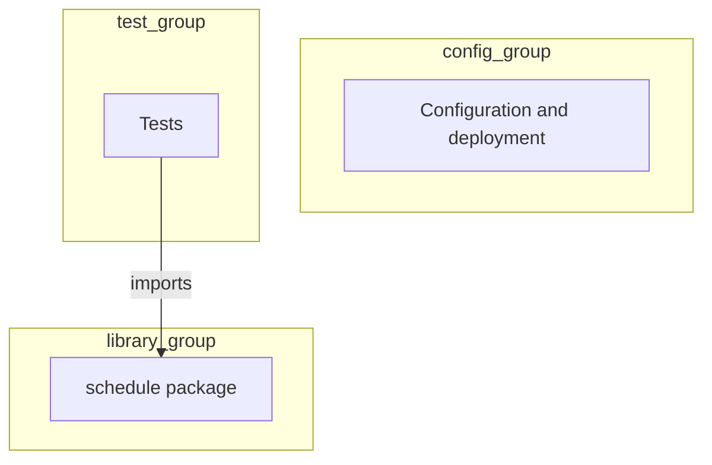

# Architecture report: dbader/schedule

> Automated static analysis. **Observed** = directly seen in files/imports/AST; **Inferred** = interpretation from that evidence. Repository code was not executed.

## 1. Repository at a glance

| Item | Value |
| --- | --- |
| Repository | dbader/schedule |
| Description | Python job scheduling for humans. |
| Language | Python |
| Stars | 12265 |
| Licence | MIT |
| Analysed commit / branch | 82a43db1b938d8fdf60103bd41f329e06c8d3651 / master |
| Framework(s) | None detected |
| Files analysed | 32 |
| Components | 3 |

## 2. Architecture in one minute

dbader/schedule - Python job scheduling for humans.. This repository was analysed statically from 32 file(s) (4 Python). Detected technologies (observed from imports/manifests): GitHub Actions, Click, Poetry, setuptools, pytest, unittest. Files are grouped into 3 component(s): Configuration and deployment, schedule package, Tests. Findings below distinguish observed facts from inferred interpretation.

## 3. High-level block diagram

## 4. Main components

### Configuration and deployment (`config`)

- **Kind:** config
- **Status:** Observed
- **Confidence:** 0.85
- **Responsibility:** Groups 6 file(s) under configuration and deployment (observed from repository paths and static analysis). Observed top-level functions: read_file.
- **Paths:** `MANIFEST.in`, `pyproject.toml`, `requirements-dev.txt`, `setup.cfg`, `setup.py`, `tox.ini`
- **Evidence:** [MANIFEST.in](https://github.com/dbader/schedule/blob/82a43db1b938d8fdf60103bd41f329e06c8d3651/MANIFEST.in); [pyproject.toml](https://github.com/dbader/schedule/blob/82a43db1b938d8fdf60103bd41f329e06c8d3651/pyproject.toml); [requirements-dev.txt](https://github.com/dbader/schedule/blob/82a43db1b938d8fdf60103bd41f329e06c8d3651/requirements-dev.txt); [setup.cfg](https://github.com/dbader/schedule/blob/82a43db1b938d8fdf60103bd41f329e06c8d3651/setup.cfg); [setup.py:9](https://github.com/dbader/schedule/blob/82a43db1b938d8fdf60103bd41f329e06c8d3651/setup.py#L9); [tox.ini](https://github.com/dbader/schedule/blob/82a43db1b938d8fdf60103bd41f329e06c8d3651/tox.ini)

### schedule package (`schedule`)

- **Kind:** library
- **Status:** Observed
- **Confidence:** 0.85
- **Responsibility:** Groups 1 file(s) under schedule package (observed from repository paths and static analysis). Observed top-level classes: CancelJob, IntervalError, Job, ScheduleError, ScheduleValueError, Scheduler. Observed top-level functions: _move_to_next_weekday, _weekday_index, cancel_job, clear, every, get_jobs.
- **Paths:** `schedule/__init__.py`
- **Evidence:** [schedule/__init__.py:53](https://github.com/dbader/schedule/blob/82a43db1b938d8fdf60103bd41f329e06c8d3651/schedule/__init__.py#L53)

### Tests (`tests`)

- **Kind:** test
- **Status:** Observed
- **Confidence:** 0.85
- **Responsibility:** Groups 1 file(s) under tests (observed from repository paths and static analysis). Observed top-level classes: SchedulerTests, mock_datetime. Observed top-level functions: make_mock_job.
- **Paths:** `test_schedule.py`
- **Evidence:** [test_schedule.py:33](https://github.com/dbader/schedule/blob/82a43db1b938d8fdf60103bd41f329e06c8d3651/test_schedule.py#L33)

## 5. Execution flow

No entry point was observed; the startup flow below is therefore limited.

Representative flow (derived from observed entry points and the import graph; steps beyond the entry point are **Inferred**):

1. Execution starts at an observed entry point listed above, if present.
2. `tests` imports `schedule` (Tests -> schedule package).

## 6. Project structure

### `(root)`

- `.gitignore` - other (404 bytes)
- `AUTHORS.rst` - docs (2054 bytes)
- `HISTORY.rst` - docs (6743 bytes)
- `LICENSE.txt` - docs (1099 bytes)
- `MANIFEST.in` - manifest (147 bytes)
- `README.rst` - docs (2288 bytes)
- `pyproject.toml` - manifest (669 bytes)
- `requirements-dev.txt` - manifest (104 bytes)
- `setup.cfg` - manifest (22 bytes)
- `setup.py` - manifest, Python (1588 bytes)
- `test_schedule.py` - test, Python (66565 bytes)
- `tox.ini` - config (842 bytes)

### `.github`

- `.github/workflows/ci.yml` - ci, YAML (2330 bytes)

### `docs`

- `docs/Makefile` - docs (7614 bytes)
- `docs/_static/custom.css` - docs (40 bytes)
- `docs/_templates/sidebarintro.html` - docs (962 bytes)
- `docs/background-execution.rst` - docs (1652 bytes)
- `docs/changelog.rst` - docs (28 bytes)
- `docs/conf.py` - docs (10641 bytes)
- `docs/development.rst` - docs (1878 bytes)
- `docs/examples.rst` - docs (7461 bytes)
- `docs/exception-handling.rst` - docs (1162 bytes)
- `docs/faq.rst` - docs (3501 bytes)
- `docs/index.rst` - docs (3160 bytes)
- `docs/installation.rst` - docs (2963 bytes)
- `docs/logging.rst` - docs (1830 bytes)
- `docs/multiple-schedulers.rst` - docs (865 bytes)
- `docs/parallel-execution.rst` - docs (2125 bytes)
- `docs/reference.rst` - docs (623 bytes)
- `docs/timezones.rst` - docs (3085 bytes)

### `schedule`

- `schedule/__init__.py` - source, Python (31983 bytes)
- `schedule/py.typed` - other (0 bytes)

## 7. Key dependencies and integrations

| Name | Category | Status | Confidence | Evidence |
| --- | --- | --- | --- | --- |
| GitHub Actions | ci | Observed | 0.85 | [.github/workflows/ci.yml](https://github.com/dbader/schedule/blob/82a43db1b938d8fdf60103bd41f329e06c8d3651/.github/workflows/ci.yml) |
| Click | library | Observed | 0.85 | [requirements-dev.txt:8](https://github.com/dbader/schedule/blob/82a43db1b938d8fdf60103bd41f329e06c8d3651/requirements-dev.txt#L8) |
| Poetry | packaging | Observed | 0.85 | [pyproject.toml](https://github.com/dbader/schedule/blob/82a43db1b938d8fdf60103bd41f329e06c8d3651/pyproject.toml) |
| setuptools | packaging | Observed | 0.90 | [pyproject.toml:2](https://github.com/dbader/schedule/blob/82a43db1b938d8fdf60103bd41f329e06c8d3651/pyproject.toml#L2); [setup.py:2](https://github.com/dbader/schedule/blob/82a43db1b938d8fdf60103bd41f329e06c8d3651/setup.py#L2) |
| pytest | tooling | Observed | 0.85 | [requirements-dev.txt:3](https://github.com/dbader/schedule/blob/82a43db1b938d8fdf60103bd41f329e06c8d3651/requirements-dev.txt#L3) |
| unittest | tooling | Observed | 0.90 | [test_schedule.py:5](https://github.com/dbader/schedule/blob/82a43db1b938d8fdf60103bd41f329e06c8d3651/test_schedule.py#L5) |

## 8. Data and state

No database, cache, queue, or persistent-state usage was observed in the analysed files. State handling, if any, may be in-memory or in files that were not analysed.

## 9. Configuration and deployment clues

- `.github/workflows/ci.yml` (ci)
- `MANIFEST.in` (manifest)
- `pyproject.toml` (manifest)
- `requirements-dev.txt` (manifest)
- `setup.cfg` (manifest)
- `setup.py` (manifest)
- `tox.ini` (config)

## 10. Design observations

- Tests are present alongside source code (Observed from test file paths).

These observations are interpretations (**Inferred**) of the observed structure, not guarantees about runtime design.

## 11. Limitations and unknowns

- Static analysis only: repository code was not executed, installed, or imported at runtime.
- Components and relationships are inferred from file paths, imports, and AST structure; runtime behaviour, dynamic imports, and reflection may not be visible.
- No clear application entry point was observed in the analysed files.
- Repository text was treated as untrusted data; no instructions found in repository files were followed, and likely secret values were redacted/excluded.

## 12. Source references

- [.github/workflows/ci.yml](https://github.com/dbader/schedule/blob/82a43db1b938d8fdf60103bd41f329e06c8d3651/.github/workflows/ci.yml)
- [MANIFEST.in](https://github.com/dbader/schedule/blob/82a43db1b938d8fdf60103bd41f329e06c8d3651/MANIFEST.in)
- [pyproject.toml](https://github.com/dbader/schedule/blob/82a43db1b938d8fdf60103bd41f329e06c8d3651/pyproject.toml)
- [pyproject.toml:2](https://github.com/dbader/schedule/blob/82a43db1b938d8fdf60103bd41f329e06c8d3651/pyproject.toml#L2)
- [requirements-dev.txt](https://github.com/dbader/schedule/blob/82a43db1b938d8fdf60103bd41f329e06c8d3651/requirements-dev.txt)
- [requirements-dev.txt:3](https://github.com/dbader/schedule/blob/82a43db1b938d8fdf60103bd41f329e06c8d3651/requirements-dev.txt#L3)
- [requirements-dev.txt:8](https://github.com/dbader/schedule/blob/82a43db1b938d8fdf60103bd41f329e06c8d3651/requirements-dev.txt#L8)
- [schedule/__init__.py:53](https://github.com/dbader/schedule/blob/82a43db1b938d8fdf60103bd41f329e06c8d3651/schedule/__init__.py#L53)
- [setup.cfg](https://github.com/dbader/schedule/blob/82a43db1b938d8fdf60103bd41f329e06c8d3651/setup.cfg)
- [setup.py:2](https://github.com/dbader/schedule/blob/82a43db1b938d8fdf60103bd41f329e06c8d3651/setup.py#L2)
- [setup.py:9](https://github.com/dbader/schedule/blob/82a43db1b938d8fdf60103bd41f329e06c8d3651/setup.py#L9)
- [test_schedule.py:5](https://github.com/dbader/schedule/blob/82a43db1b938d8fdf60103bd41f329e06c8d3651/test_schedule.py#L5)
- [test_schedule.py:33](https://github.com/dbader/schedule/blob/82a43db1b938d8fdf60103bd41f329e06c8d3651/test_schedule.py#L33)
- [tox.ini](https://github.com/dbader/schedule/blob/82a43db1b938d8fdf60103bd41f329e06c8d3651/tox.ini)
