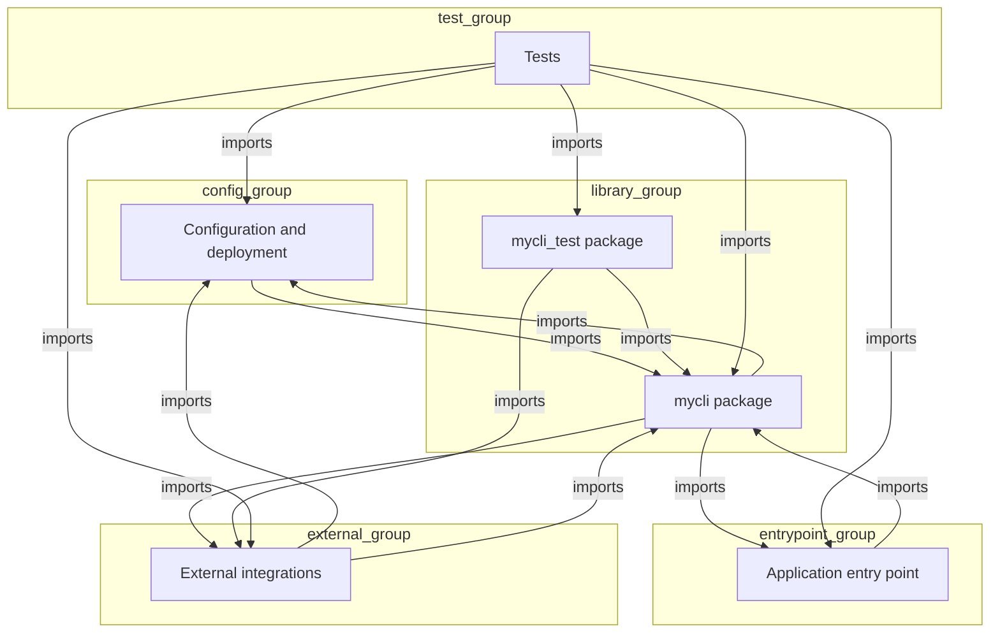

# Architecture report: dbcli/mycli

> Automated static analysis. **Observed** = directly seen in files/imports/AST; **Inferred** = interpretation from that evidence. Repository code was not executed.

## 1. Repository at a glance

| Item | Value |
| --- | --- |
| Repository | dbcli/mycli |
| Description | Rich MySQL Terminal Client with AutoCompletion, Syntax Highlighting, and Dataframes |
| Language | Python |
| Stars | 11997 |
| Licence | BSD-3-Clause |
| Analysed commit / branch | 9a216b6c68294b4222e1780bfe66d00d3c1d1a91 / main |
| Framework(s) | None detected |
| Files analysed | 211 |
| Components | 6 |

## 2. Architecture in one minute

dbcli/mycli - Rich MySQL Terminal Client with AutoCompletion, Syntax Highlighting, and Dataframes. This repository was analysed statically from 211 file(s) (165 Python). Detected technologies (observed from imports/manifests): GitHub Actions, MySQL, Click, Poetry, setuptools, Docker. Files are grouped into 6 component(s): Configuration and deployment, Application entry point, External integrations, mycli package, mycli_test package, Tests. Observed entry point(s): mycli/main.py, mycli_test/features/wrappager.py. Findings below distinguish observed facts from inferred interpretation.

## 3. High-level block diagram

## 4. Main components

### Configuration and deployment (`config`)

- **Kind:** config
- **Status:** Observed
- **Confidence:** 0.85
- **Responsibility:** Groups 4 file(s) under configuration and deployment (observed from repository paths and static analysis). Observed top-level classes: LimitedQuotePreservingConfigObj, SQLValuePreservingConfigObj, TripleQuotedConfigValue. Observed top-level functions: _remove_pad, create_default_config, get_mylogin_cnf_path, get_xdg_config_file, log, open_mylogin_cnf.
- **Paths:** `MANIFEST.in`, `docker/Dockerfile`, `mycli/config.py`, `pyproject.toml`
- **Evidence:** [MANIFEST.in](https://github.com/dbcli/mycli/blob/9a216b6c68294b4222e1780bfe66d00d3c1d1a91/MANIFEST.in); [docker/Dockerfile](https://github.com/dbcli/mycli/blob/9a216b6c68294b4222e1780bfe66d00d3c1d1a91/docker/Dockerfile); [mycli/config.py:20](https://github.com/dbcli/mycli/blob/9a216b6c68294b4222e1780bfe66d00d3c1d1a91/mycli/config.py#L20); [pyproject.toml](https://github.com/dbcli/mycli/blob/9a216b6c68294b4222e1780bfe66d00d3c1d1a91/pyproject.toml)

### Application entry point (`entrypoint`)

- **Kind:** entrypoint
- **Status:** Observed
- **Confidence:** 0.85
- **Responsibility:** Groups 3 file(s) under application entry point (observed from repository paths and static analysis). Observed top-level classes: ArgType, CliArgs, CommandNotFound, CommandVerbosity, IntOrStringClickParamType, SpecialCommand. Observed top-level functions: _show_mysql_help, _show_special_help, click_entrypoint, execute, file_bug, get_password_from_file.
- **Paths:** `mycli/main.py`, `mycli/packages/special_commands/main.py`, `mycli_test/features/wrappager.py`
- **Evidence:** [mycli/main.py:33](https://github.com/dbcli/mycli/blob/9a216b6c68294b4222e1780bfe66d00d3c1d1a91/mycli/main.py#L33); [mycli/packages/special_commands/main.py:29](https://github.com/dbcli/mycli/blob/9a216b6c68294b4222e1780bfe66d00d3c1d1a91/mycli/packages/special_commands/main.py#L29); [mycli_test/features/wrappager.py:6](https://github.com/dbcli/mycli/blob/9a216b6c68294b4222e1780bfe66d00d3c1d1a91/mycli_test/features/wrappager.py#L6)

### External integrations (`external_integrations`)

- **Kind:** external
- **Status:** Observed
- **Confidence:** 0.85
- **Responsibility:** Groups 14 file(s) under external integrations (observed from repository paths and static analysis). Observed top-level classes: BoundaryTunnel, BoundaryTunnelError, Fzf, KubectlTunnel, KubectlTunnelError, MyCli. Observed top-level functions: _authentication_terminal, _check_local_socket_path_limit, _ensure_vault_user_logged_in, _find_free_local_port, _get_api, _make_local_socket_path.
- **Paths:** `mycli/client.py`, `mycli/packages/integrations/__init__.py`, `mycli/packages/integrations/boundary/__init__.py`, `mycli/packages/integrations/boundary/boundary_tunnel.py`, `mycli/packages/integrations/fzf/__init__.py`, `mycli/packages/integrations/fzf/fzf.py`, `mycli/packages/integrations/kubernetes/__init__.py`, `mycli/packages/integrations/kubernetes/kubectl_tunnel.py`, `mycli/packages/integrations/macos/__init__.py`, `mycli/packages/integrations/macos/macos_keychain.py`, `mycli/packages/integrations/openssh/__init__.py`, `mycli/packages/integrations/openssh/ssh_tunnel.py`, `mycli/packages/integrations/vault/__init__.py`, `mycli/packages/integrations/vault/vault_credentials.py`
- **Evidence:** [mycli/client.py:57](https://github.com/dbcli/mycli/blob/9a216b6c68294b4222e1780bfe66d00d3c1d1a91/mycli/client.py#L57); [mycli/packages/integrations/__init__.py](https://github.com/dbcli/mycli/blob/9a216b6c68294b4222e1780bfe66d00d3c1d1a91/mycli/packages/integrations/__init__.py); [mycli/packages/integrations/boundary/__init__.py](https://github.com/dbcli/mycli/blob/9a216b6c68294b4222e1780bfe66d00d3c1d1a91/mycli/packages/integrations/boundary/__init__.py); [mycli/packages/integrations/boundary/boundary_tunnel.py:24](https://github.com/dbcli/mycli/blob/9a216b6c68294b4222e1780bfe66d00d3c1d1a91/mycli/packages/integrations/boundary/boundary_tunnel.py#L24); [mycli/packages/integrations/fzf/__init__.py](https://github.com/dbcli/mycli/blob/9a216b6c68294b4222e1780bfe66d00d3c1d1a91/mycli/packages/integrations/fzf/__init__.py); [mycli/packages/integrations/fzf/fzf.py:37](https://github.com/dbcli/mycli/blob/9a216b6c68294b4222e1780bfe66d00d3c1d1a91/mycli/packages/integrations/fzf/fzf.py#L37); [mycli/packages/integrations/kubernetes/__init__.py](https://github.com/dbcli/mycli/blob/9a216b6c68294b4222e1780bfe66d00d3c1d1a91/mycli/packages/integrations/kubernetes/__init__.py); [mycli/packages/integrations/kubernetes/kubectl_tunnel.py:16](https://github.com/dbcli/mycli/blob/9a216b6c68294b4222e1780bfe66d00d3c1d1a91/mycli/packages/integrations/kubernetes/kubectl_tunnel.py#L16)

### mycli package (`mycli`)

- **Kind:** library
- **Status:** Observed
- **Confidence:** 0.85
- **Responsibility:** Groups 65 file(s) under mycli package (observed from repository paths and static analysis). Observed top-level classes: AppStateMixin, BackgroundCursor, BackgroundRunner, BackgroundSSCursor, CheckpointReplayError, ClientCommandsMixin. Observed top-level functions: _aliases, _build_command_tree, _build_prompt_session, _build_suggest_context, _calculate_frecency, _call_return_type.
- **Paths:** `mycli/__init__.py`, `mycli/app_state.py`, `mycli/cli_runner.py`, `mycli/client_commands.py`, `mycli/client_connection.py`, `mycli/client_query.py`, `mycli/compat.py`, `mycli/constants.py`, `mycli/main_modes/batch.py`, `mycli/main_modes/checkup.py`, `mycli/main_modes/completions.py`, `mycli/main_modes/execute.py`, `mycli/main_modes/list_dsn.py`, `mycli/main_modes/repl.py`, `mycli/output.py`, `mycli/packages/__init__.py`, `mycli/packages/completion/__init__.py`, `mycli/packages/completion/completion_engine.py`, `mycli/packages/completion/completion_refresher.py`, `mycli/packages/completion/schema_prefetcher.py`, `mycli/packages/completion/sql_completer.py`, `mycli/packages/credentials/__init__.py`, `mycli/packages/credentials/password_sources.py`, `mycli/packages/dataframes/__init__.py`, `mycli/packages/dataframes/completion.py`, `mycli/packages/dataframes/transform.py`, `mycli/packages/execution/__init__.py`, `mycli/packages/execution/background_runner.py`, `mycli/packages/execution/sql_execute.py`, `mycli/packages/prompt_toolkit/__init__.py`, `mycli/packages/prompt_toolkit/fzf_history.py`, `mycli/packages/prompt_toolkit/history.py`, `mycli/packages/prompt_toolkit/key_bindings.py`, `mycli/packages/prompt_toolkit/multiline.py`, `mycli/packages/prompt_toolkit/style.py`, `mycli/packages/prompt_toolkit/toolbar.py`, `mycli/packages/prompt_toolkit/utils.py`, `mycli/packages/pygments/__init__.py`, `mycli/packages/pygments/mycli_lexer.py`, `mycli/packages/redirection/__init__.py`, `mycli/packages/redirection/hybrid_redirection.py`, `mycli/packages/special_commands/__init__.py`, `mycli/packages/special_commands/db_commands.py`, `mycli/packages/special_commands/delimiter_command.py`, `mycli/packages/special_commands/dsn_aliases.py`, `mycli/packages/special_commands/favorite_queries.py`, `mycli/packages/special_commands/io_commands.py`, `mycli/packages/special_commands/llm.py`, `mycli/packages/special_commands/source.py`, `mycli/packages/special_commands/special_command_utils.py`, `mycli/packages/sql_result/__init__.py`, `mycli/packages/sql_result/sql_result.py`, `mycli/packages/tabular_output/__init__.py`, `mycli/packages/tabular_output/sql_format.py`, `mycli/packages/utils/__init__.py`, `mycli/packages/utils/batch_utils.py`, `mycli/packages/utils/cli_utils.py`, `mycli/packages/utils/dsn_utils.py`, `mycli/packages/utils/interactive_utils.py`, `mycli/packages/utils/key_binding_utils.py`, `mycli/packages/utils/keyring_utils.py`, `mycli/packages/utils/path_utils.py`, `mycli/packages/utils/sql_utils.py`, `mycli/packages/utils/string_utils.py`, `mycli/types.py`
- **Evidence:** [mycli/__init__.py](https://github.com/dbcli/mycli/blob/9a216b6c68294b4222e1780bfe66d00d3c1d1a91/mycli/__init__.py); [mycli/app_state.py:15](https://github.com/dbcli/mycli/blob/9a216b6c68294b4222e1780bfe66d00d3c1d1a91/mycli/app_state.py#L15); [mycli/cli_runner.py:54](https://github.com/dbcli/mycli/blob/9a216b6c68294b4222e1780bfe66d00d3c1d1a91/mycli/cli_runner.py#L54); [mycli/client_commands.py:42](https://github.com/dbcli/mycli/blob/9a216b6c68294b4222e1780bfe66d00d3c1d1a91/mycli/client_commands.py#L42); [mycli/client_connection.py:38](https://github.com/dbcli/mycli/blob/9a216b6c68294b4222e1780bfe66d00d3c1d1a91/mycli/client_connection.py#L38); [mycli/client_query.py:13](https://github.com/dbcli/mycli/blob/9a216b6c68294b4222e1780bfe66d00d3c1d1a91/mycli/client_query.py#L13); [mycli/compat.py:9](https://github.com/dbcli/mycli/blob/9a216b6c68294b4222e1780bfe66d00d3c1d1a91/mycli/compat.py#L9); [mycli/constants.py:56](https://github.com/dbcli/mycli/blob/9a216b6c68294b4222e1780bfe66d00d3c1d1a91/mycli/constants.py#L56)

### mycli_test package (`mycli_test`)

- **Kind:** library
- **Status:** Observed
- **Confidence:** 0.85
- **Responsibility:** Groups 17 file(s) under mycli_test package (observed from repository paths and static analysis). Observed top-level classes: DummyFormatter, DummyLogger, FakeCursorBase, RecordingSQLExecute, ReusableLock. Observed top-level functions: after_all, after_scenario, before_all, before_scenario, before_step, call_click_entrypoint_direct.
- **Paths:** `mycli_test/__init__.py`, `mycli_test/features/__init__.py`, `mycli_test/features/db_utils.py`, `mycli_test/features/environment.py`, `mycli_test/features/fixture_utils.py`, `mycli_test/features/steps/__init__.py`, `mycli_test/features/steps/auto_vertical.py`, `mycli_test/features/steps/basic_commands.py`, `mycli_test/features/steps/connection.py`, `mycli_test/features/steps/crud_database.py`, `mycli_test/features/steps/crud_table.py`, `mycli_test/features/steps/iocommands.py`, `mycli_test/features/steps/named_queries.py`, `mycli_test/features/steps/specials.py`, `mycli_test/features/steps/utils.py`, `mycli_test/features/steps/wrappers.py`, `mycli_test/utils.py`
- **Evidence:** [mycli_test/__init__.py](https://github.com/dbcli/mycli/blob/9a216b6c68294b4222e1780bfe66d00d3c1d1a91/mycli_test/__init__.py); [mycli_test/features/__init__.py](https://github.com/dbcli/mycli/blob/9a216b6c68294b4222e1780bfe66d00d3c1d1a91/mycli_test/features/__init__.py); [mycli_test/features/db_utils.py:8](https://github.com/dbcli/mycli/blob/9a216b6c68294b4222e1780bfe66d00d3c1d1a91/mycli_test/features/db_utils.py#L8); [mycli_test/features/environment.py:21](https://github.com/dbcli/mycli/blob/9a216b6c68294b4222e1780bfe66d00d3c1d1a91/mycli_test/features/environment.py#L21); [mycli_test/features/fixture_utils.py:6](https://github.com/dbcli/mycli/blob/9a216b6c68294b4222e1780bfe66d00d3c1d1a91/mycli_test/features/fixture_utils.py#L6); [mycli_test/features/steps/__init__.py](https://github.com/dbcli/mycli/blob/9a216b6c68294b4222e1780bfe66d00d3c1d1a91/mycli_test/features/steps/__init__.py); [mycli_test/features/steps/auto_vertical.py:11](https://github.com/dbcli/mycli/blob/9a216b6c68294b4222e1780bfe66d00d3c1d1a91/mycli_test/features/steps/auto_vertical.py#L11); [mycli_test/features/steps/basic_commands.py:21](https://github.com/dbcli/mycli/blob/9a216b6c68294b4222e1780bfe66d00d3c1d1a91/mycli_test/features/steps/basic_commands.py#L21)

### Tests (`tests`)

- **Kind:** test
- **Status:** Observed
- **Confidence:** 0.85
- **Responsibility:** Groups 66 file(s) under tests (observed from repository paths and static analysis). Observed application object created via Group. Observed routes: PATCH mycli.packages.utils.path_utils.list_path, PATCH click.clear, PATCH click.clear, PATCH mycli.packages.special_commands.llm.llm, PATCH mycli.packages.special_commands.llm.llm. Observed top-level classes: ApiDenied, ApiError, AppState, DummyApp, DummyBuffer, DummyCliArgs. Observed top-level functions: _cursor_with_pending_error, _fake_executor_factory, _make_completer, api, arm_test_redirect, assert_result_equal.
- **Paths:** `docker/resources/test_db_license.md`, `mycli_test/pytests/conftest.py`, `mycli_test/pytests/test_app_state.py`, `mycli_test/pytests/test_background_runner.py`, `mycli_test/pytests/test_bash_completion.py`, `mycli_test/pytests/test_batch_utils.py`, `mycli_test/pytests/test_boundary_tunnel.py`, `mycli_test/pytests/test_checkup.py`, `mycli_test/pytests/test_cli_runner.py`, `mycli_test/pytests/test_cli_utils.py`, `mycli_test/pytests/test_clibuffer.py`, `mycli_test/pytests/test_client.py`, `mycli_test/pytests/test_client_commands.py`, `mycli_test/pytests/test_client_connection.py`, `mycli_test/pytests/test_client_query.py`, `mycli_test/pytests/test_completer_use_switch.py`, `mycli_test/pytests/test_completion_engine.py`, `mycli_test/pytests/test_completion_refresher.py`, `mycli_test/pytests/test_config.py`, `mycli_test/pytests/test_delimitercommand.py`, `mycli_test/pytests/test_dsn_aliases.py`, `mycli_test/pytests/test_favoritequeries.py`, `mycli_test/pytests/test_fish_completion.py`, `mycli_test/pytests/test_fzf.py`, `mycli_test/pytests/test_hybrid_redirection.py`, `mycli_test/pytests/test_interactive_utils.py`, `mycli_test/pytests/test_key_binding_utils.py`, `mycli_test/pytests/test_key_bindings.py`, `mycli_test/pytests/test_keyring_utils.py`, `mycli_test/pytests/test_kubectl_tunnel.py`, `mycli_test/pytests/test_macos_keychain.py`, `mycli_test/pytests/test_main.py`, `mycli_test/pytests/test_main_modes_batch.py`, `mycli_test/pytests/test_main_modes_execute.py`, `mycli_test/pytests/test_main_modes_list_dsn.py`, `mycli_test/pytests/test_main_modes_repl.py`, `mycli_test/pytests/test_naive_completion.py`, `mycli_test/pytests/test_output.py`, `mycli_test/pytests/test_password_sources.py`, `mycli_test/pytests/test_path_utils.py`, `mycli_test/pytests/test_polars_completion.py`, `mycli_test/pytests/test_polars_transform.py`, `mycli_test/pytests/test_prompt_toolkit_fzf_history.py`, `mycli_test/pytests/test_prompt_toolkit_history.py`, `mycli_test/pytests/test_prompt_toolkit_style.py`, `mycli_test/pytests/test_prompt_toolkit_toolbar.py`, `mycli_test/pytests/test_prompt_toolkit_utils.py`, `mycli_test/pytests/test_schema_prefetcher.py`, `mycli_test/pytests/test_smart_completion_public_schema_only.py`, `mycli_test/pytests/test_special_commands_init.py`, `mycli_test/pytests/test_special_db_commands.py`, `mycli_test/pytests/test_special_io_commands.py`, `mycli_test/pytests/test_special_llm.py`, `mycli_test/pytests/test_special_main.py`, `mycli_test/pytests/test_special_source.py`, `mycli_test/pytests/test_special_utils.py`, `mycli_test/pytests/test_sql_execute.py`, `mycli_test/pytests/test_sql_format.py`, `mycli_test/pytests/test_sql_utils.py`, `mycli_test/pytests/test_sqlcompleter.py`, `mycli_test/pytests/test_sqlresult.py`, `mycli_test/pytests/test_ssh_tunnel.py`, `mycli_test/pytests/test_string_utils.py`, `mycli_test/pytests/test_tabular_output.py`, `mycli_test/pytests/test_vault.py`, `mycli_test/pytests/test_zsh_completion.py`
- **Evidence:** [docker/resources/test_db_license.md](https://github.com/dbcli/mycli/blob/9a216b6c68294b4222e1780bfe66d00d3c1d1a91/docker/resources/test_db_license.md); [mycli_test/pytests/conftest.py:10](https://github.com/dbcli/mycli/blob/9a216b6c68294b4222e1780bfe66d00d3c1d1a91/mycli_test/pytests/conftest.py#L10); [mycli_test/pytests/test_app_state.py:16](https://github.com/dbcli/mycli/blob/9a216b6c68294b4222e1780bfe66d00d3c1d1a91/mycli_test/pytests/test_app_state.py#L16); [mycli_test/pytests/test_background_runner.py:31](https://github.com/dbcli/mycli/blob/9a216b6c68294b4222e1780bfe66d00d3c1d1a91/mycli_test/pytests/test_background_runner.py#L31); [mycli_test/pytests/test_bash_completion.py:12](https://github.com/dbcli/mycli/blob/9a216b6c68294b4222e1780bfe66d00d3c1d1a91/mycli_test/pytests/test_bash_completion.py#L12); [mycli_test/pytests/test_batch_utils.py:11](https://github.com/dbcli/mycli/blob/9a216b6c68294b4222e1780bfe66d00d3c1d1a91/mycli_test/pytests/test_batch_utils.py#L11); [mycli_test/pytests/test_boundary_tunnel.py:29](https://github.com/dbcli/mycli/blob/9a216b6c68294b4222e1780bfe66d00d3c1d1a91/mycli_test/pytests/test_boundary_tunnel.py#L29); [mycli_test/pytests/test_checkup.py:9](https://github.com/dbcli/mycli/blob/9a216b6c68294b4222e1780bfe66d00d3c1d1a91/mycli_test/pytests/test_checkup.py#L9)

## 5. Execution flow

**Observed** entry point(s):

- [mycli/main.py](https://github.com/dbcli/mycli/blob/9a216b6c68294b4222e1780bfe66d00d3c1d1a91/mycli/main.py)
- [mycli_test/features/wrappager.py:16](https://github.com/dbcli/mycli/blob/9a216b6c68294b4222e1780bfe66d00d3c1d1a91/mycli_test/features/wrappager.py#L16)

**Observed** routes (from decorators):

- `PATCH mycli.packages.utils.path_utils.list_path` -> `test_file_name_completion` in `mycli_test/pytests/test_smart_completion_public_schema_only.py:878`
- `PATCH click.clear` -> `test_watch_query_clear` in `mycli_test/pytests/test_special_io_commands.py:453`
- `PATCH click.clear` -> `test_watch_query_interval_clear` in `mycli_test/pytests/test_special_io_commands.py:485`
- `PATCH mycli.packages.special_commands.llm.llm` -> `test_llm_command_without_args` in `mycli_test/pytests/test_special_llm.py:231`
- `PATCH mycli.packages.special_commands.llm.llm` -> `test_llm_command_with_help_subcommand` in `mycli_test/pytests/test_special_llm.py:244`
- `PATCH mycli.packages.special_commands.llm.llm` -> `test_llm_command_with_c_flag` in `mycli_test/pytests/test_special_llm.py:258`
- `PATCH mycli.packages.special_commands.llm.run_external_cmd` -> `test_llm_command_with_c_flag` in `mycli_test/pytests/test_special_llm.py:258`
- `PATCH mycli.packages.special_commands.llm.llm` -> `test_llm_command_with_c_flag_and_fenced_sql` in `mycli_test/pytests/test_special_llm.py:271`
- `PATCH mycli.packages.special_commands.llm.run_external_cmd` -> `test_llm_command_with_c_flag_and_fenced_sql` in `mycli_test/pytests/test_special_llm.py:271`
- `PATCH mycli.packages.special_commands.llm.llm` -> `test_llm_command_known_subcommand` in `mycli_test/pytests/test_special_llm.py:286`
- `PATCH mycli.packages.special_commands.llm.run_external_cmd` -> `test_llm_command_known_subcommand` in `mycli_test/pytests/test_special_llm.py:286`
- `PATCH mycli.packages.special_commands.llm.llm` -> `test_llm_command_with_help_flag` in `mycli_test/pytests/test_special_llm.py:297`
- `PATCH mycli.packages.special_commands.llm.run_external_cmd` -> `test_llm_command_with_help_flag` in `mycli_test/pytests/test_special_llm.py:297`
- `PATCH mycli.packages.special_commands.llm.llm` -> `test_llm_command_with_install_flag` in `mycli_test/pytests/test_special_llm.py:307`
- `PATCH mycli.packages.special_commands.llm.run_external_cmd` -> `test_llm_command_with_install_flag` in `mycli_test/pytests/test_special_llm.py:307`
- `PATCH mycli.packages.special_commands.llm.llm` -> `test_llm_command_with_prompt` in `mycli_test/pytests/test_special_llm.py:318`
- `PATCH mycli.packages.special_commands.llm.ensure_mycli_template` -> `test_llm_command_with_prompt` in `mycli_test/pytests/test_special_llm.py:318`
- `PATCH mycli.packages.special_commands.llm.sql_using_llm` -> `test_llm_command_with_prompt` in `mycli_test/pytests/test_special_llm.py:318`
- `PATCH mycli.packages.special_commands.llm.llm` -> `test_llm_command_question_with_context` in `mycli_test/pytests/test_special_llm.py:335`
- `PATCH mycli.packages.special_commands.llm.ensure_mycli_template` -> `test_llm_command_question_with_context` in `mycli_test/pytests/test_special_llm.py:335`
- `PATCH mycli.packages.special_commands.llm.sql_using_llm` -> `test_llm_command_question_with_context` in `mycli_test/pytests/test_special_llm.py:335`
- `PATCH mycli.packages.special_commands.llm.llm` -> `test_llm_command_question_verbose` in `mycli_test/pytests/test_special_llm.py:352`
- `PATCH mycli.packages.special_commands.llm.ensure_mycli_template` -> `test_llm_command_question_verbose` in `mycli_test/pytests/test_special_llm.py:352`
- `PATCH mycli.packages.special_commands.llm.sql_using_llm` -> `test_llm_command_question_verbose` in `mycli_test/pytests/test_special_llm.py:352`
- `PATCH mycli.packages.special_commands.llm.llm` -> `test_handle_llm_wraps_context_errors` in `mycli_test/pytests/test_special_llm.py:374`
- `PATCH mycli.packages.special_commands.llm.run_external_cmd` -> `test_sql_using_llm_success` in `mycli_test/pytests/test_special_llm.py:465`

Representative flow (derived from observed entry points and the import graph; steps beyond the entry point are **Inferred**):

1. Execution starts at an observed entry point listed above, if present.
2. `config` imports `mycli` (Configuration and deployment -> mycli package).
3. `entrypoint` imports `mycli` (Application entry point -> mycli package).
4. `external_integrations` imports `config` (External integrations -> Configuration and deployment).
5. `external_integrations` imports `mycli` (External integrations -> mycli package).
6. `mycli` imports `config` (mycli package -> Configuration and deployment).
7. `mycli` imports `entrypoint` (mycli package -> Application entry point).
8. `mycli` imports `external_integrations` (mycli package -> External integrations).
9. `mycli_test` imports `external_integrations` (mycli_test package -> External integrations).

## 6. Project structure

### `(root)`

- `.git-blame-ignore-revs` - other (1741 bytes)
- `.gitignore` - other (198 bytes)
- `AGENTS.md` - docs (9271 bytes)
- `AUTHORS.md` - docs (37 bytes)
- `CONTRIBUTING.md` - docs (4150 bytes)
- `LICENSE.txt` - docs (1485 bytes)
- `MANIFEST.in` - manifest (240 bytes)
- `README.md` - docs (9008 bytes)
- `SPONSORS.md` - docs (39 bytes)
- `changelog.md` - docs (86921 bytes)
- `pyproject.toml` - manifest (5067 bytes)

### `.github`

- `.github/ISSUE_TEMPLATE/bug_report.md` - docs (465 bytes)
- `.github/ISSUE_TEMPLATE/feature_request.md` - docs (108 bytes)
- `.github/PULL_REQUEST_TEMPLATE.md` - docs (468 bytes)
- `.github/actions/lint/action.yml` - config (342 bytes)
- `.github/actions/typecheck/action.yml` - config (658 bytes)
- `.github/dependabot.yml` - config (153 bytes)
- `.github/workflows/ci.yml` - ci, YAML (8140 bytes)
- `.github/workflows/lint.yml` - ci, YAML (459 bytes)
- `.github/workflows/publish.yml` - ci, YAML (9707 bytes)
- `.github/workflows/typecheck.yml` - ci, YAML (478 bytes)

### `doc`

- `doc/cookbook.md` - docs (1756 bytes)
- `doc/key_bindings.md` - docs (4522 bytes)
- `doc/known_bugs.md` - docs (1799 bytes)
- `doc/llm.md` - docs (5445 bytes)
- `doc/transforms.md` - docs (4547 bytes)

### `docker`

- `docker/Dockerfile` - container (765 bytes)
- `docker/resources/dot_mycli_history.txt` - docs (1029 bytes)
- `docker/resources/test_db_license.md` - test (509 bytes)

### `mycli`

- `mycli/AUTHORS.txt` - docs (2151 bytes)
- `mycli/SPONSORS.txt` - docs (510 bytes)
- `mycli/TIPS.txt` - docs (9250 bytes)
- `mycli/__init__.py` - source, Python (82 bytes)
- `mycli/app_state.py` - source, Python (4488 bytes)
- `mycli/cli_runner.py` - source, Python (23393 bytes)
- `mycli/client.py` - source, Python (13346 bytes)
- `mycli/client_commands.py` - source, Python (16738 bytes)
- `mycli/client_connection.py` - source, Python (25474 bytes)
- `mycli/client_query.py` - source, Python (6198 bytes)
- `mycli/compat.py` - source, Python (783 bytes)
- `mycli/config.py` - source, Python (12462 bytes)
- `mycli/constants.py` - source, Python (1197 bytes)
- `mycli/main.py` - source, Python (16328 bytes)
- `mycli/main_modes/batch.py` - source, Python (9690 bytes)
- `mycli/main_modes/checkup.py` - source, Python (7245 bytes)
- `mycli/main_modes/completions.py` - source, Python (483 bytes)
- `mycli/main_modes/execute.py` - source, Python (2111 bytes)
- `mycli/main_modes/list_dsn.py` - source, Python (1006 bytes)
- `mycli/main_modes/repl.py` - source, Python (49663 bytes)
- `mycli/myclirc` - other (25162 bytes)
- `mycli/output.py` - source, Python (14371 bytes)
- `mycli/packages/__init__.py` - source, Python (0 bytes)
- `mycli/packages/completion/__init__.py` - source, Python (0 bytes)
- `mycli/packages/completion/completion_engine.py` - source, Python (42095 bytes)
- `mycli/packages/completion/completion_refresher.py` - source, Python (10415 bytes)
- `mycli/packages/completion/schema_prefetcher.py` - source, Python (10505 bytes)
- `mycli/packages/completion/sql_completer.py` - source, Python (73885 bytes)
- `mycli/packages/credentials/__init__.py` - source, Python (0 bytes)
- `mycli/packages/credentials/password_sources.py` - source, Python (2108 bytes)
- `mycli/packages/dataframes/__init__.py` - source, Python (0 bytes)
- `mycli/packages/dataframes/completion.py` - source, Python (10407 bytes)
- `mycli/packages/dataframes/transform.py` - source, Python (15978 bytes)
- `mycli/packages/execution/__init__.py` - source, Python (0 bytes)
- `mycli/packages/execution/background_runner.py` - source, Python (16820 bytes)
- `mycli/packages/execution/sql_execute.py` - source, Python (29568 bytes)
- `mycli/packages/integrations/__init__.py` - source, Python (0 bytes)
- `mycli/packages/integrations/boundary/__init__.py` - source, Python (0 bytes)
- `mycli/packages/integrations/boundary/boundary_tunnel.py` - source, Python (10524 bytes)
- `mycli/packages/integrations/fzf/__init__.py` - source, Python (0 bytes)
- `mycli/packages/integrations/fzf/fzf.py` - source, Python (2609 bytes)
- `mycli/packages/integrations/kubernetes/__init__.py` - source, Python (0 bytes)
- `mycli/packages/integrations/kubernetes/kubectl_tunnel.py` - source, Python (4517 bytes)
- `mycli/packages/integrations/macos/__init__.py` - source, Python (0 bytes)
- `mycli/packages/integrations/macos/macos_keychain.py` - source, Python (3429 bytes)
- `mycli/packages/integrations/openssh/__init__.py` - source, Python (0 bytes)
- `mycli/packages/integrations/openssh/ssh_tunnel.py` - source, Python (8309 bytes)
- `mycli/packages/integrations/vault/__init__.py` - source, Python (0 bytes)
- `mycli/packages/integrations/vault/vault_credentials.py` - source, Python (2642 bytes)
- `mycli/packages/prompt_toolkit/__init__.py` - source, Python (0 bytes)
- `mycli/packages/prompt_toolkit/fzf_history.py` - source, Python (2150 bytes)
- `mycli/packages/prompt_toolkit/history.py` - source, Python (7088 bytes)
- `mycli/packages/prompt_toolkit/key_bindings.py` - source, Python (11980 bytes)
- `mycli/packages/prompt_toolkit/multiline.py` - source, Python (1858 bytes)
- `mycli/packages/prompt_toolkit/style.py` - source, Python (9066 bytes)
- `mycli/packages/prompt_toolkit/toolbar.py` - source, Python (4191 bytes)
- `mycli/packages/prompt_toolkit/utils.py` - source, Python (686 bytes)
- `mycli/packages/pygments/__init__.py` - source, Python (0 bytes)
- `mycli/packages/pygments/mycli_lexer.py` - source, Python (377 bytes)
- `mycli/packages/redirection/__init__.py` - source, Python (0 bytes)
- `mycli/packages/redirection/hybrid_redirection.py` - source, Python (11175 bytes)
- `mycli/packages/special_commands/__init__.py` - source, Python (3440 bytes)
- `mycli/packages/special_commands/db_commands.py` - source, Python (8060 bytes)
- `mycli/packages/special_commands/delimiter_command.py` - source, Python (2992 bytes)
- `mycli/packages/special_commands/dsn_aliases.py` - source, Python (8538 bytes)
- `mycli/packages/special_commands/favorite_queries.py` - source, Python (14368 bytes)
- `mycli/packages/special_commands/io_commands.py` - source, Python (40492 bytes)
- `mycli/packages/special_commands/llm.py` - source, Python (11917 bytes)
- `mycli/packages/special_commands/main.py` - source, Python (11815 bytes)
- `mycli/packages/special_commands/source.py` - source, Python (5895 bytes)
- `mycli/packages/special_commands/special_command_utils.py` - source, Python (6047 bytes)
- `mycli/packages/sql_result/__init__.py` - source, Python (0 bytes)
- `mycli/packages/sql_result/sql_result.py` - source, Python (1433 bytes)
- `mycli/packages/tabular_output/__init__.py` - source, Python (0 bytes)
- `mycli/packages/tabular_output/sql_format.py` - source, Python (2275 bytes)
- `mycli/packages/utils/__init__.py` - source, Python (0 bytes)
- `mycli/packages/utils/batch_utils.py` - source, Python (2835 bytes)
- `mycli/packages/utils/cli_utils.py` - source, Python (786 bytes)
- `mycli/packages/utils/dsn_utils.py` - source, Python (1162 bytes)
- `mycli/packages/utils/interactive_utils.py` - source, Python (1707 bytes)
- `mycli/packages/utils/key_binding_utils.py` - source, Python (4260 bytes)
- `mycli/packages/utils/keyring_utils.py` - source, Python (1121 bytes)
- `mycli/packages/utils/path_utils.py` - source, Python (5788 bytes)
- `mycli/packages/utils/sql_utils.py` - source, Python (20473 bytes)
- `mycli/packages/utils/string_utils.py` - source, Python (675 bytes)
- `mycli/resources/completions/bash/mycli` - other (5040 bytes)
- `mycli/resources/completions/fish/mycli.fish` - other (5054 bytes)
- `mycli/resources/completions/zsh/_mycli` - other (5209 bytes)
- `mycli/types.py` - source, Python (315 bytes)

### `mycli_test`

- `mycli_test/__init__.py` - source, Python (0 bytes)
- `mycli_test/features/__init__.py` - source, Python (0 bytes)
- `mycli_test/features/auto_vertical.feature` - other (407 bytes)
- `mycli_test/features/basic_commands.feature` - other (589 bytes)
- `mycli_test/features/connection.feature` - other (797 bytes)
- `mycli_test/features/crud_database.feature` - other (1022 bytes)
- `mycli_test/features/crud_table.feature` - other (2117 bytes)
- `mycli_test/features/db_utils.py` - source, Python (1987 bytes)
- `mycli_test/features/environment.py` - source, Python (5004 bytes)
- `mycli_test/features/fixture_data/help_commands.txt` - docs (4773 bytes)
- `mycli_test/features/fixture_utils.py` - source, Python (717 bytes)
- `mycli_test/features/iocommands.feature` - other (3720 bytes)
- `mycli_test/features/named_queries.feature` - other (1448 bytes)
- `mycli_test/features/specials.feature` - other (174 bytes)
- `mycli_test/features/steps/__init__.py` - source, Python (0 bytes)
- `mycli_test/features/steps/auto_vertical.py` - source, Python (1412 bytes)
- `mycli_test/features/steps/basic_commands.py` - source, Python (4476 bytes)
- `mycli_test/features/steps/connection.py` - source, Python (1307 bytes)
- `mycli_test/features/steps/crud_database.py` - source, Python (3383 bytes)
- `mycli_test/features/steps/crud_table.py` - source, Python (3178 bytes)
- `mycli_test/features/steps/iocommands.py` - source, Python (4058 bytes)
- `mycli_test/features/steps/named_queries.py` - source, Python (3982 bytes)
- `mycli_test/features/steps/specials.py` - source, Python (764 bytes)
- `mycli_test/features/steps/utils.py` - source, Python (298 bytes)
- `mycli_test/features/steps/wrappers.py` - source, Python (3178 bytes)
- `mycli_test/features/wrappager.py` - source, Python (286 bytes)
- `mycli_test/myclirc` - other (25248 bytes)
- `mycli_test/pytests/conftest.py` - test, Python (749 bytes)
- `mycli_test/pytests/test_app_state.py` - test, Python (7558 bytes)
- `mycli_test/pytests/test_background_runner.py` - test, Python (49387 bytes)
- `mycli_test/pytests/test_bash_completion.py` - test, Python (4905 bytes)
- `mycli_test/pytests/test_batch_utils.py` - test, Python (3783 bytes)
- `mycli_test/pytests/test_boundary_tunnel.py` - test, Python (30777 bytes)
- `mycli_test/pytests/test_checkup.py` - test, Python (8991 bytes)
- `mycli_test/pytests/test_cli_runner.py` - test, Python (59390 bytes)
- `mycli_test/pytests/test_cli_utils.py` - test, Python (1651 bytes)
- `mycli_test/pytests/test_clibuffer.py` - test, Python (3660 bytes)
- `mycli_test/pytests/test_client.py` - test, Python (20183 bytes)
- `mycli_test/pytests/test_client_commands.py` - test, Python (41309 bytes)
- `mycli_test/pytests/test_client_connection.py` - test, Python (52670 bytes)
- `mycli_test/pytests/test_client_query.py` - test, Python (15597 bytes)
- `mycli_test/pytests/test_completer_use_switch.py` - test, Python (4435 bytes)
- `mycli_test/pytests/test_completion_engine.py` - test, Python (79919 bytes)
- `mycli_test/pytests/test_completion_refresher.py` - test, Python (27404 bytes)
- `mycli_test/pytests/test_config.py` - test, Python (19590 bytes)
- `mycli_test/pytests/test_delimitercommand.py` - test, Python (2796 bytes)
- `mycli_test/pytests/test_dsn_aliases.py` - test, Python (21379 bytes)
- `mycli_test/pytests/test_favoritequeries.py` - test, Python (28461 bytes)
- `mycli_test/pytests/test_fish_completion.py` - test, Python (4183 bytes)
- `mycli_test/pytests/test_fzf.py` - test, Python (4536 bytes)
- `mycli_test/pytests/test_hybrid_redirection.py` - test, Python (11849 bytes)
- `mycli_test/pytests/test_interactive_utils.py` - test, Python (6456 bytes)
- `mycli_test/pytests/test_key_binding_utils.py` - test, Python (9352 bytes)
- `mycli_test/pytests/test_key_bindings.py` - test, Python (27842 bytes)
- `mycli_test/pytests/test_keyring_utils.py` - test, Python (4499 bytes)
- `mycli_test/pytests/test_kubectl_tunnel.py` - test, Python (7536 bytes)
- `mycli_test/pytests/test_macos_keychain.py` - test, Python (6107 bytes)
- `mycli_test/pytests/test_main.py` - test, Python (85967 bytes)
- `mycli_test/pytests/test_main_modes_batch.py` - test, Python (37732 bytes)
- `mycli_test/pytests/test_main_modes_execute.py` - test, Python (6738 bytes)
- `mycli_test/pytests/test_main_modes_list_dsn.py` - test, Python (10873 bytes)
- `mycli_test/pytests/test_main_modes_repl.py` - test, Python (132773 bytes)
- `mycli_test/pytests/test_naive_completion.py` - test, Python (3679 bytes)
- `mycli_test/pytests/test_output.py` - test, Python (33099 bytes)
- `mycli_test/pytests/test_password_sources.py` - test, Python (2473 bytes)
- `mycli_test/pytests/test_path_utils.py` - test, Python (8082 bytes)
- `mycli_test/pytests/test_polars_completion.py` - test, Python (9667 bytes)
- `mycli_test/pytests/test_polars_transform.py` - test, Python (33788 bytes)
- `mycli_test/pytests/test_prompt_toolkit_fzf_history.py` - test, Python (6449 bytes)
- `mycli_test/pytests/test_prompt_toolkit_history.py` - test, Python (14625 bytes)
- `mycli_test/pytests/test_prompt_toolkit_style.py` - test, Python (7563 bytes)
- `mycli_test/pytests/test_prompt_toolkit_toolbar.py` - test, Python (6115 bytes)
- `mycli_test/pytests/test_prompt_toolkit_utils.py` - test, Python (1166 bytes)
- `mycli_test/pytests/test_schema_prefetcher.py` - test, Python (17589 bytes)
- `mycli_test/pytests/test_smart_completion_public_schema_only.py` - test, Python (66622 bytes)
- `mycli_test/pytests/test_special_commands_init.py` - test, Python (4561 bytes)
- `mycli_test/pytests/test_special_db_commands.py` - test, Python (14345 bytes)
- `mycli_test/pytests/test_special_io_commands.py` - test, Python (94906 bytes)
- `mycli_test/pytests/test_special_llm.py` - test, Python (21571 bytes)
- `mycli_test/pytests/test_special_main.py` - test, Python (19139 bytes)
- `mycli_test/pytests/test_special_source.py` - test, Python (7295 bytes)
- `mycli_test/pytests/test_special_utils.py` - test, Python (12221 bytes)
- `mycli_test/pytests/test_sql_execute.py` - test, Python (74799 bytes)
- `mycli_test/pytests/test_sql_format.py` - test, Python (3363 bytes)
- `mycli_test/pytests/test_sql_utils.py` - test, Python (23342 bytes)
- `mycli_test/pytests/test_sqlcompleter.py` - test, Python (51269 bytes)
- `mycli_test/pytests/test_sqlresult.py` - test, Python (1699 bytes)
- `mycli_test/pytests/test_ssh_tunnel.py` - test, Python (17732 bytes)
- `mycli_test/pytests/test_string_utils.py` - test, Python (1482 bytes)
- `mycli_test/pytests/test_tabular_output.py` - test, Python (7084 bytes)
- `mycli_test/pytests/test_vault.py` - test, Python (5544 bytes)
- `mycli_test/pytests/test_zsh_completion.py` - test, Python (3901 bytes)
- `mycli_test/utils.py` - source, Python (10669 bytes)

## 7. Key dependencies and integrations

| Name | Category | Status | Confidence | Evidence |
| --- | --- | --- | --- | --- |
| GitHub Actions | ci | Observed | 0.90 | [.github/workflows/ci.yml](https://github.com/dbcli/mycli/blob/9a216b6c68294b4222e1780bfe66d00d3c1d1a91/.github/workflows/ci.yml); [.github/workflows/lint.yml](https://github.com/dbcli/mycli/blob/9a216b6c68294b4222e1780bfe66d00d3c1d1a91/.github/workflows/lint.yml); [.github/workflows/publish.yml](https://github.com/dbcli/mycli/blob/9a216b6c68294b4222e1780bfe66d00d3c1d1a91/.github/workflows/publish.yml); [.github/workflows/typecheck.yml](https://github.com/dbcli/mycli/blob/9a216b6c68294b4222e1780bfe66d00d3c1d1a91/.github/workflows/typecheck.yml) |
| MySQL | database | Observed | 0.95 | [mycli/client_connection.py:11](https://github.com/dbcli/mycli/blob/9a216b6c68294b4222e1780bfe66d00d3c1d1a91/mycli/client_connection.py#L11); [mycli/client_connection.py:12](https://github.com/dbcli/mycli/blob/9a216b6c68294b4222e1780bfe66d00d3c1d1a91/mycli/client_connection.py#L12); [mycli/client_connection.py:13](https://github.com/dbcli/mycli/blob/9a216b6c68294b4222e1780bfe66d00d3c1d1a91/mycli/client_connection.py#L13); [mycli/client_query.py:6](https://github.com/dbcli/mycli/blob/9a216b6c68294b4222e1780bfe66d00d3c1d1a91/mycli/client_query.py#L6) |
| Click | library | Observed | 0.95 | [mycli/cli_runner.py:27](https://github.com/dbcli/mycli/blob/9a216b6c68294b4222e1780bfe66d00d3c1d1a91/mycli/cli_runner.py#L27); [mycli/client_commands.py:10](https://github.com/dbcli/mycli/blob/9a216b6c68294b4222e1780bfe66d00d3c1d1a91/mycli/client_commands.py#L10); [mycli/client_connection.py:9](https://github.com/dbcli/mycli/blob/9a216b6c68294b4222e1780bfe66d00d3c1d1a91/mycli/client_connection.py#L9); [mycli/client_query.py:5](https://github.com/dbcli/mycli/blob/9a216b6c68294b4222e1780bfe66d00d3c1d1a91/mycli/client_query.py#L5) |
| Poetry | packaging | Observed | 0.85 | [pyproject.toml](https://github.com/dbcli/mycli/blob/9a216b6c68294b4222e1780bfe66d00d3c1d1a91/pyproject.toml) |
| setuptools | packaging | Observed | 0.90 | [pyproject.toml:57](https://github.com/dbcli/mycli/blob/9a216b6c68294b4222e1780bfe66d00d3c1d1a91/pyproject.toml#L57) |
| Docker | tooling | Observed | 0.90 | [.github/workflows/ci.yml:253](https://github.com/dbcli/mycli/blob/9a216b6c68294b4222e1780bfe66d00d3c1d1a91/.github/workflows/ci.yml#L253); [.github/workflows/publish.yml:312](https://github.com/dbcli/mycli/blob/9a216b6c68294b4222e1780bfe66d00d3c1d1a91/.github/workflows/publish.yml#L312); [docker/Dockerfile](https://github.com/dbcli/mycli/blob/9a216b6c68294b4222e1780bfe66d00d3c1d1a91/docker/Dockerfile) |
| pytest | tooling | Observed | 0.95 | [.github/workflows/ci.yml:49](https://github.com/dbcli/mycli/blob/9a216b6c68294b4222e1780bfe66d00d3c1d1a91/.github/workflows/ci.yml#L49); [.github/workflows/publish.yml:76](https://github.com/dbcli/mycli/blob/9a216b6c68294b4222e1780bfe66d00d3c1d1a91/.github/workflows/publish.yml#L76); [mycli_test/pytests/conftest.py:3](https://github.com/dbcli/mycli/blob/9a216b6c68294b4222e1780bfe66d00d3c1d1a91/mycli_test/pytests/conftest.py#L3); [mycli_test/pytests/test_app_state.py:4](https://github.com/dbcli/mycli/blob/9a216b6c68294b4222e1780bfe66d00d3c1d1a91/mycli_test/pytests/test_app_state.py#L4) |
| unittest | tooling | Observed | 0.95 | [mycli_test/pytests/test_background_runner.py:12](https://github.com/dbcli/mycli/blob/9a216b6c68294b4222e1780bfe66d00d3c1d1a91/mycli_test/pytests/test_background_runner.py#L12); [mycli_test/pytests/test_boundary_tunnel.py:11](https://github.com/dbcli/mycli/blob/9a216b6c68294b4222e1780bfe66d00d3c1d1a91/mycli_test/pytests/test_boundary_tunnel.py#L11); [mycli_test/pytests/test_completion_refresher.py:5](https://github.com/dbcli/mycli/blob/9a216b6c68294b4222e1780bfe66d00d3c1d1a91/mycli_test/pytests/test_completion_refresher.py#L5); [mycli_test/pytests/test_fzf.py:1](https://github.com/dbcli/mycli/blob/9a216b6c68294b4222e1780bfe66d00d3c1d1a91/mycli_test/pytests/test_fzf.py#L1) |

## 8. Data and state

- **MySQL** (Observed, confidence 0.95) - evidence: [mycli/client_connection.py:11](https://github.com/dbcli/mycli/blob/9a216b6c68294b4222e1780bfe66d00d3c1d1a91/mycli/client_connection.py#L11); [mycli/client_connection.py:12](https://github.com/dbcli/mycli/blob/9a216b6c68294b4222e1780bfe66d00d3c1d1a91/mycli/client_connection.py#L12); [mycli/client_connection.py:13](https://github.com/dbcli/mycli/blob/9a216b6c68294b4222e1780bfe66d00d3c1d1a91/mycli/client_connection.py#L13); [mycli/client_query.py:6](https://github.com/dbcli/mycli/blob/9a216b6c68294b4222e1780bfe66d00d3c1d1a91/mycli/client_query.py#L6)

## 9. Configuration and deployment clues

- `.github/actions/lint/action.yml` (config)
- `.github/actions/typecheck/action.yml` (config)
- `.github/dependabot.yml` (config)
- `.github/workflows/ci.yml` (ci)
- `.github/workflows/lint.yml` (ci)
- `.github/workflows/publish.yml` (ci)
- `.github/workflows/typecheck.yml` (ci)
- `MANIFEST.in` (manifest)
- `docker/Dockerfile` (container)
- `pyproject.toml` (manifest)

Console scripts declared in packaging metadata (**Observed**):

- `mycli` -> `mycli.main:main`

## 10. Design observations

- An entry/API layer is separated from other code (Inferred from paths and decorators).
- Tests are present alongside source code (Observed from test file paths).
- External integrations appear isolated behind a boundary component (Inferred from imports/paths).

These observations are interpretations (**Inferred**) of the observed structure, not guarantees about runtime design.

## 11. Limitations and unknowns

- Static analysis only: repository code was not executed, installed, or imported at runtime.
- Components and relationships are inferred from file paths, imports, and AST structure; runtime behaviour, dynamic imports, and reflection may not be visible.
- Repository text was treated as untrusted data; no instructions found in repository files were followed, and likely secret values were redacted/excluded.

## 12. Source references

- [.github/workflows/ci.yml](https://github.com/dbcli/mycli/blob/9a216b6c68294b4222e1780bfe66d00d3c1d1a91/.github/workflows/ci.yml)
- [.github/workflows/ci.yml:49](https://github.com/dbcli/mycli/blob/9a216b6c68294b4222e1780bfe66d00d3c1d1a91/.github/workflows/ci.yml#L49)
- [.github/workflows/ci.yml:253](https://github.com/dbcli/mycli/blob/9a216b6c68294b4222e1780bfe66d00d3c1d1a91/.github/workflows/ci.yml#L253)
- [.github/workflows/lint.yml](https://github.com/dbcli/mycli/blob/9a216b6c68294b4222e1780bfe66d00d3c1d1a91/.github/workflows/lint.yml)
- [.github/workflows/publish.yml](https://github.com/dbcli/mycli/blob/9a216b6c68294b4222e1780bfe66d00d3c1d1a91/.github/workflows/publish.yml)
- [.github/workflows/publish.yml:76](https://github.com/dbcli/mycli/blob/9a216b6c68294b4222e1780bfe66d00d3c1d1a91/.github/workflows/publish.yml#L76)
- [.github/workflows/publish.yml:312](https://github.com/dbcli/mycli/blob/9a216b6c68294b4222e1780bfe66d00d3c1d1a91/.github/workflows/publish.yml#L312)
- [.github/workflows/typecheck.yml](https://github.com/dbcli/mycli/blob/9a216b6c68294b4222e1780bfe66d00d3c1d1a91/.github/workflows/typecheck.yml)
- [MANIFEST.in](https://github.com/dbcli/mycli/blob/9a216b6c68294b4222e1780bfe66d00d3c1d1a91/MANIFEST.in)
- [docker/Dockerfile](https://github.com/dbcli/mycli/blob/9a216b6c68294b4222e1780bfe66d00d3c1d1a91/docker/Dockerfile)
- [docker/resources/test_db_license.md](https://github.com/dbcli/mycli/blob/9a216b6c68294b4222e1780bfe66d00d3c1d1a91/docker/resources/test_db_license.md)
- [mycli/__init__.py](https://github.com/dbcli/mycli/blob/9a216b6c68294b4222e1780bfe66d00d3c1d1a91/mycli/__init__.py)
- [mycli/app_state.py:15](https://github.com/dbcli/mycli/blob/9a216b6c68294b4222e1780bfe66d00d3c1d1a91/mycli/app_state.py#L15)
- [mycli/cli_runner.py:27](https://github.com/dbcli/mycli/blob/9a216b6c68294b4222e1780bfe66d00d3c1d1a91/mycli/cli_runner.py#L27)
- [mycli/cli_runner.py:54](https://github.com/dbcli/mycli/blob/9a216b6c68294b4222e1780bfe66d00d3c1d1a91/mycli/cli_runner.py#L54)
- [mycli/client.py:57](https://github.com/dbcli/mycli/blob/9a216b6c68294b4222e1780bfe66d00d3c1d1a91/mycli/client.py#L57)
- [mycli/client_commands.py:10](https://github.com/dbcli/mycli/blob/9a216b6c68294b4222e1780bfe66d00d3c1d1a91/mycli/client_commands.py#L10)
- [mycli/client_commands.py:42](https://github.com/dbcli/mycli/blob/9a216b6c68294b4222e1780bfe66d00d3c1d1a91/mycli/client_commands.py#L42)
- [mycli/client_connection.py:9](https://github.com/dbcli/mycli/blob/9a216b6c68294b4222e1780bfe66d00d3c1d1a91/mycli/client_connection.py#L9)
- [mycli/client_connection.py:11](https://github.com/dbcli/mycli/blob/9a216b6c68294b4222e1780bfe66d00d3c1d1a91/mycli/client_connection.py#L11)
- [mycli/client_connection.py:12](https://github.com/dbcli/mycli/blob/9a216b6c68294b4222e1780bfe66d00d3c1d1a91/mycli/client_connection.py#L12)
- [mycli/client_connection.py:13](https://github.com/dbcli/mycli/blob/9a216b6c68294b4222e1780bfe66d00d3c1d1a91/mycli/client_connection.py#L13)
- [mycli/client_connection.py:38](https://github.com/dbcli/mycli/blob/9a216b6c68294b4222e1780bfe66d00d3c1d1a91/mycli/client_connection.py#L38)
- [mycli/client_query.py:5](https://github.com/dbcli/mycli/blob/9a216b6c68294b4222e1780bfe66d00d3c1d1a91/mycli/client_query.py#L5)
- [mycli/client_query.py:6](https://github.com/dbcli/mycli/blob/9a216b6c68294b4222e1780bfe66d00d3c1d1a91/mycli/client_query.py#L6)
- [mycli/client_query.py:13](https://github.com/dbcli/mycli/blob/9a216b6c68294b4222e1780bfe66d00d3c1d1a91/mycli/client_query.py#L13)
- [mycli/compat.py:9](https://github.com/dbcli/mycli/blob/9a216b6c68294b4222e1780bfe66d00d3c1d1a91/mycli/compat.py#L9)
- [mycli/config.py:20](https://github.com/dbcli/mycli/blob/9a216b6c68294b4222e1780bfe66d00d3c1d1a91/mycli/config.py#L20)
- [mycli/constants.py:56](https://github.com/dbcli/mycli/blob/9a216b6c68294b4222e1780bfe66d00d3c1d1a91/mycli/constants.py#L56)
- [mycli/main.py](https://github.com/dbcli/mycli/blob/9a216b6c68294b4222e1780bfe66d00d3c1d1a91/mycli/main.py)
- [mycli/main.py:21](https://github.com/dbcli/mycli/blob/9a216b6c68294b4222e1780bfe66d00d3c1d1a91/mycli/main.py#L21)
- [mycli/main.py:33](https://github.com/dbcli/mycli/blob/9a216b6c68294b4222e1780bfe66d00d3c1d1a91/mycli/main.py#L33)
- [mycli/main_modes/batch.py:8](https://github.com/dbcli/mycli/blob/9a216b6c68294b4222e1780bfe66d00d3c1d1a91/mycli/main_modes/batch.py#L8)
- [mycli/main_modes/batch.py:12](https://github.com/dbcli/mycli/blob/9a216b6c68294b4222e1780bfe66d00d3c1d1a91/mycli/main_modes/batch.py#L12)
- [mycli/main_modes/execute.py:6](https://github.com/dbcli/mycli/blob/9a216b6c68294b4222e1780bfe66d00d3c1d1a91/mycli/main_modes/execute.py#L6)
- [mycli/main_modes/list_dsn.py:3](https://github.com/dbcli/mycli/blob/9a216b6c68294b4222e1780bfe66d00d3c1d1a91/mycli/main_modes/list_dsn.py#L3)
- [mycli/main_modes/repl.py:46](https://github.com/dbcli/mycli/blob/9a216b6c68294b4222e1780bfe66d00d3c1d1a91/mycli/main_modes/repl.py#L46)
- [mycli/main_modes/repl.py:47](https://github.com/dbcli/mycli/blob/9a216b6c68294b4222e1780bfe66d00d3c1d1a91/mycli/main_modes/repl.py#L47)
- [mycli/main_modes/repl.py:52](https://github.com/dbcli/mycli/blob/9a216b6c68294b4222e1780bfe66d00d3c1d1a91/mycli/main_modes/repl.py#L52)
- [mycli/packages/integrations/__init__.py](https://github.com/dbcli/mycli/blob/9a216b6c68294b4222e1780bfe66d00d3c1d1a91/mycli/packages/integrations/__init__.py)
- [mycli/packages/integrations/boundary/__init__.py](https://github.com/dbcli/mycli/blob/9a216b6c68294b4222e1780bfe66d00d3c1d1a91/mycli/packages/integrations/boundary/__init__.py)
- [mycli/packages/integrations/boundary/boundary_tunnel.py:24](https://github.com/dbcli/mycli/blob/9a216b6c68294b4222e1780bfe66d00d3c1d1a91/mycli/packages/integrations/boundary/boundary_tunnel.py#L24)
- [mycli/packages/integrations/fzf/__init__.py](https://github.com/dbcli/mycli/blob/9a216b6c68294b4222e1780bfe66d00d3c1d1a91/mycli/packages/integrations/fzf/__init__.py)
- [mycli/packages/integrations/fzf/fzf.py:37](https://github.com/dbcli/mycli/blob/9a216b6c68294b4222e1780bfe66d00d3c1d1a91/mycli/packages/integrations/fzf/fzf.py#L37)
- [mycli/packages/integrations/kubernetes/__init__.py](https://github.com/dbcli/mycli/blob/9a216b6c68294b4222e1780bfe66d00d3c1d1a91/mycli/packages/integrations/kubernetes/__init__.py)
- [mycli/packages/integrations/kubernetes/kubectl_tunnel.py:16](https://github.com/dbcli/mycli/blob/9a216b6c68294b4222e1780bfe66d00d3c1d1a91/mycli/packages/integrations/kubernetes/kubectl_tunnel.py#L16)
- [mycli/packages/special_commands/main.py:29](https://github.com/dbcli/mycli/blob/9a216b6c68294b4222e1780bfe66d00d3c1d1a91/mycli/packages/special_commands/main.py#L29)
- [mycli_test/__init__.py](https://github.com/dbcli/mycli/blob/9a216b6c68294b4222e1780bfe66d00d3c1d1a91/mycli_test/__init__.py)
- [mycli_test/features/__init__.py](https://github.com/dbcli/mycli/blob/9a216b6c68294b4222e1780bfe66d00d3c1d1a91/mycli_test/features/__init__.py)
- [mycli_test/features/db_utils.py:8](https://github.com/dbcli/mycli/blob/9a216b6c68294b4222e1780bfe66d00d3c1d1a91/mycli_test/features/db_utils.py#L8)
- [mycli_test/features/environment.py:21](https://github.com/dbcli/mycli/blob/9a216b6c68294b4222e1780bfe66d00d3c1d1a91/mycli_test/features/environment.py#L21)
- [mycli_test/features/fixture_utils.py:6](https://github.com/dbcli/mycli/blob/9a216b6c68294b4222e1780bfe66d00d3c1d1a91/mycli_test/features/fixture_utils.py#L6)
- [mycli_test/features/steps/__init__.py](https://github.com/dbcli/mycli/blob/9a216b6c68294b4222e1780bfe66d00d3c1d1a91/mycli_test/features/steps/__init__.py)
- [mycli_test/features/steps/auto_vertical.py:11](https://github.com/dbcli/mycli/blob/9a216b6c68294b4222e1780bfe66d00d3c1d1a91/mycli_test/features/steps/auto_vertical.py#L11)
- [mycli_test/features/steps/basic_commands.py:21](https://github.com/dbcli/mycli/blob/9a216b6c68294b4222e1780bfe66d00d3c1d1a91/mycli_test/features/steps/basic_commands.py#L21)
- [mycli_test/features/wrappager.py:6](https://github.com/dbcli/mycli/blob/9a216b6c68294b4222e1780bfe66d00d3c1d1a91/mycli_test/features/wrappager.py#L6)
- [mycli_test/features/wrappager.py:16](https://github.com/dbcli/mycli/blob/9a216b6c68294b4222e1780bfe66d00d3c1d1a91/mycli_test/features/wrappager.py#L16)
- [mycli_test/pytests/conftest.py:3](https://github.com/dbcli/mycli/blob/9a216b6c68294b4222e1780bfe66d00d3c1d1a91/mycli_test/pytests/conftest.py#L3)
- [mycli_test/pytests/conftest.py:10](https://github.com/dbcli/mycli/blob/9a216b6c68294b4222e1780bfe66d00d3c1d1a91/mycli_test/pytests/conftest.py#L10)
- [mycli_test/pytests/test_app_state.py:4](https://github.com/dbcli/mycli/blob/9a216b6c68294b4222e1780bfe66d00d3c1d1a91/mycli_test/pytests/test_app_state.py#L4)
- [mycli_test/pytests/test_app_state.py:16](https://github.com/dbcli/mycli/blob/9a216b6c68294b4222e1780bfe66d00d3c1d1a91/mycli_test/pytests/test_app_state.py#L16)
- [mycli_test/pytests/test_background_runner.py:12](https://github.com/dbcli/mycli/blob/9a216b6c68294b4222e1780bfe66d00d3c1d1a91/mycli_test/pytests/test_background_runner.py#L12)
- [mycli_test/pytests/test_background_runner.py:19](https://github.com/dbcli/mycli/blob/9a216b6c68294b4222e1780bfe66d00d3c1d1a91/mycli_test/pytests/test_background_runner.py#L19)
- [mycli_test/pytests/test_background_runner.py:31](https://github.com/dbcli/mycli/blob/9a216b6c68294b4222e1780bfe66d00d3c1d1a91/mycli_test/pytests/test_background_runner.py#L31)
- [mycli_test/pytests/test_bash_completion.py:9](https://github.com/dbcli/mycli/blob/9a216b6c68294b4222e1780bfe66d00d3c1d1a91/mycli_test/pytests/test_bash_completion.py#L9)
- [mycli_test/pytests/test_bash_completion.py:12](https://github.com/dbcli/mycli/blob/9a216b6c68294b4222e1780bfe66d00d3c1d1a91/mycli_test/pytests/test_bash_completion.py#L12)
- [mycli_test/pytests/test_batch_utils.py:5](https://github.com/dbcli/mycli/blob/9a216b6c68294b4222e1780bfe66d00d3c1d1a91/mycli_test/pytests/test_batch_utils.py#L5)
- [mycli_test/pytests/test_batch_utils.py:11](https://github.com/dbcli/mycli/blob/9a216b6c68294b4222e1780bfe66d00d3c1d1a91/mycli_test/pytests/test_batch_utils.py#L11)
- [mycli_test/pytests/test_boundary_tunnel.py:11](https://github.com/dbcli/mycli/blob/9a216b6c68294b4222e1780bfe66d00d3c1d1a91/mycli_test/pytests/test_boundary_tunnel.py#L11)
- [mycli_test/pytests/test_boundary_tunnel.py:13](https://github.com/dbcli/mycli/blob/9a216b6c68294b4222e1780bfe66d00d3c1d1a91/mycli_test/pytests/test_boundary_tunnel.py#L13)
- [mycli_test/pytests/test_boundary_tunnel.py:29](https://github.com/dbcli/mycli/blob/9a216b6c68294b4222e1780bfe66d00d3c1d1a91/mycli_test/pytests/test_boundary_tunnel.py#L29)
- [mycli_test/pytests/test_checkup.py:9](https://github.com/dbcli/mycli/blob/9a216b6c68294b4222e1780bfe66d00d3c1d1a91/mycli_test/pytests/test_checkup.py#L9)
- [mycli_test/pytests/test_completion_refresher.py:5](https://github.com/dbcli/mycli/blob/9a216b6c68294b4222e1780bfe66d00d3c1d1a91/mycli_test/pytests/test_completion_refresher.py#L5)
- [mycli_test/pytests/test_fzf.py:1](https://github.com/dbcli/mycli/blob/9a216b6c68294b4222e1780bfe66d00d3c1d1a91/mycli_test/pytests/test_fzf.py#L1)
- [mycli_test/pytests/test_keyring_utils.py:1](https://github.com/dbcli/mycli/blob/9a216b6c68294b4222e1780bfe66d00d3c1d1a91/mycli_test/pytests/test_keyring_utils.py#L1)
- [mycli_test/pytests/test_macos_keychain.py:4](https://github.com/dbcli/mycli/blob/9a216b6c68294b4222e1780bfe66d00d3c1d1a91/mycli_test/pytests/test_macos_keychain.py#L4)
- [mycli_test/pytests/test_main_modes_repl.py:12](https://github.com/dbcli/mycli/blob/9a216b6c68294b4222e1780bfe66d00d3c1d1a91/mycli_test/pytests/test_main_modes_repl.py#L12)
- [mycli_test/pytests/test_naive_completion.py:19](https://github.com/dbcli/mycli/blob/9a216b6c68294b4222e1780bfe66d00d3c1d1a91/mycli_test/pytests/test_naive_completion.py#L19)
- [pyproject.toml](https://github.com/dbcli/mycli/blob/9a216b6c68294b4222e1780bfe66d00d3c1d1a91/pyproject.toml)
- [pyproject.toml:57](https://github.com/dbcli/mycli/blob/9a216b6c68294b4222e1780bfe66d00d3c1d1a91/pyproject.toml#L57)
