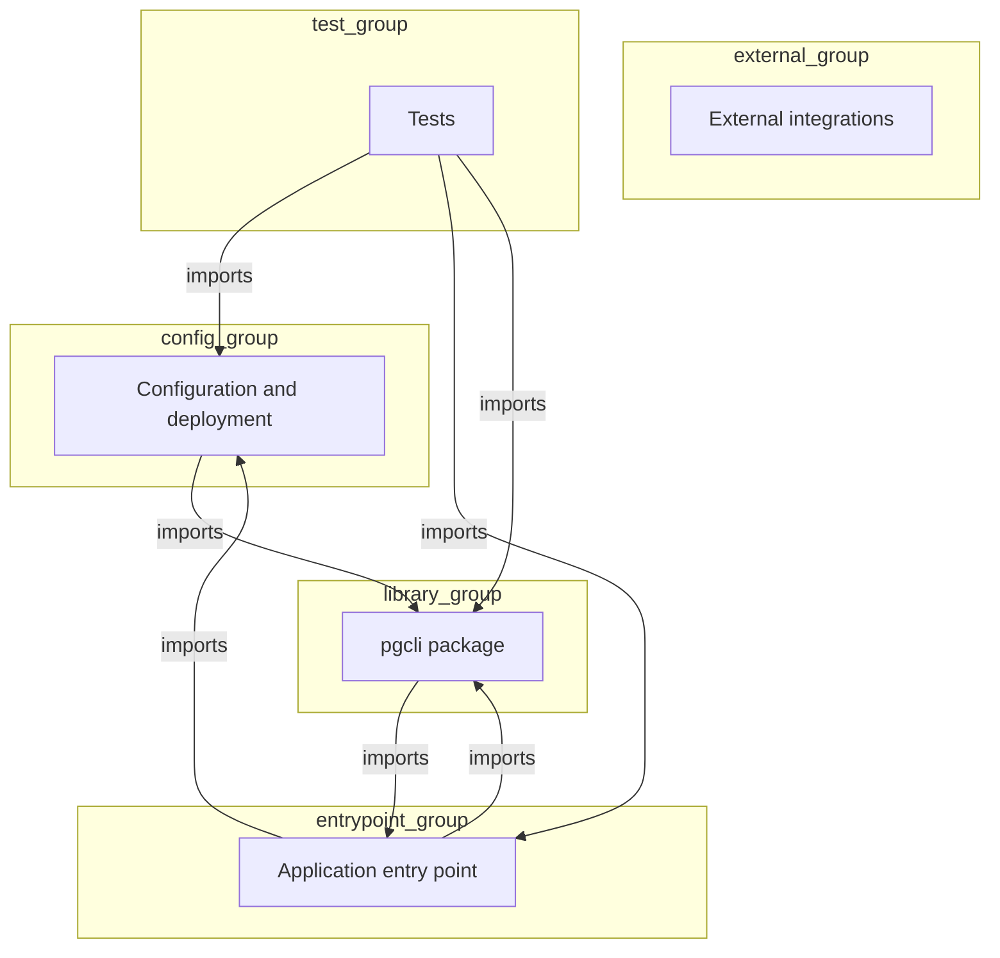

# Architecture report: dbcli/pgcli

> Automated static analysis. **Observed** = directly seen in files/imports/AST; **Inferred** = interpretation from that evidence. Repository code was not executed.

## 1. Repository at a glance

| Item | Value |
| --- | --- |
| Repository | dbcli/pgcli |
| Description | Postgres CLI with autocompletion and syntax highlighting |
| Language | Python |
| Stars | 13446 |
| Licence | BSD-3-Clause |
| Analysed commit / branch | dc9ce9447e0fc005a347b75b7eb5d541e282b1c1 / main |
| Framework(s) | None detected |
| Files analysed | 120 |
| Components | 5 |

## 2. Architecture in one minute

dbcli/pgcli - Postgres CLI with autocompletion and syntax highlighting. This repository was analysed statically from 120 file(s) (76 Python). Detected technologies (observed from imports/manifests): GitHub Actions, PostgreSQL, Click, Poetry, setuptools, Docker. Files are grouped into 5 component(s): Configuration and deployment, Application entry point, External integrations, pgcli package, Tests. Observed entry point(s): pgcli/__main__.py, pgcli/main.py, release.py. Findings below distinguish observed facts from inferred interpretation.

## 3. High-level block diagram

## 4. Main components

### Configuration and deployment (`config`)

- **Kind:** config
- **Status:** Observed
- **Confidence:** 0.85
- **Responsibility:** Groups 6 file(s) under configuration and deployment (observed from repository paths and static analysis). Observed top-level functions: config_location, ensure_dir_exists, get_casing_file, get_config, get_config_filename, load_config.
- **Paths:** `Dockerfile`, `MANIFEST.in`, `pgcli/config.py`, `pgcli/packages/pgliterals/pgliterals.json`, `pyproject.toml`, `tox.ini`
- **Evidence:** [Dockerfile](https://github.com/dbcli/pgcli/blob/dc9ce9447e0fc005a347b75b7eb5d541e282b1c1/Dockerfile); [MANIFEST.in](https://github.com/dbcli/pgcli/blob/dc9ce9447e0fc005a347b75b7eb5d541e282b1c1/MANIFEST.in); [pgcli/config.py:10](https://github.com/dbcli/pgcli/blob/dc9ce9447e0fc005a347b75b7eb5d541e282b1c1/pgcli/config.py#L10); [pgcli/packages/pgliterals/pgliterals.json](https://github.com/dbcli/pgcli/blob/dc9ce9447e0fc005a347b75b7eb5d541e282b1c1/pgcli/packages/pgliterals/pgliterals.json); [pyproject.toml](https://github.com/dbcli/pgcli/blob/dc9ce9447e0fc005a347b75b7eb5d541e282b1c1/pyproject.toml); [tox.ini](https://github.com/dbcli/pgcli/blob/dc9ce9447e0fc005a347b75b7eb5d541e282b1c1/tox.ini)

### Application entry point (`entrypoint`)

- **Kind:** entrypoint
- **Status:** Observed
- **Confidence:** 0.85
- **Responsibility:** Groups 4 file(s) under application entry point (observed from repository paths and static analysis). Observed top-level classes: PGCli, PgCliQuitError. Observed top-level functions: check_tag, checklist, cli, comment_on_released_prs, commit_for_release, create_distribution_files.
- **Paths:** `pgcli/__main__.py`, `pgcli/main.py`, `pgcli/packages/pgliterals/main.py`, `release.py`
- **Evidence:** [pgcli/__main__.py](https://github.com/dbcli/pgcli/blob/dc9ce9447e0fc005a347b75b7eb5d541e282b1c1/pgcli/__main__.py); [pgcli/main.py:140](https://github.com/dbcli/pgcli/blob/dc9ce9447e0fc005a347b75b7eb5d541e282b1c1/pgcli/main.py#L140); [pgcli/packages/pgliterals/main.py:11](https://github.com/dbcli/pgcli/blob/dc9ce9447e0fc005a347b75b7eb5d541e282b1c1/pgcli/packages/pgliterals/main.py#L11); [release.py:17](https://github.com/dbcli/pgcli/blob/dc9ce9447e0fc005a347b75b7eb5d541e282b1c1/release.py#L17)

### External integrations (`external_integrations`)

- **Kind:** external
- **Status:** Inferred
- **Confidence:** 0.70
- **Responsibility:** Groups 0 file(s) under external integrations (observed from repository paths and static analysis).
- **Evidence:** [pgcli/main.py:85](https://github.com/dbcli/pgcli/blob/dc9ce9447e0fc005a347b75b7eb5d541e282b1c1/pgcli/main.py#L85); [pgcli/main.py:86](https://github.com/dbcli/pgcli/blob/dc9ce9447e0fc005a347b75b7eb5d541e282b1c1/pgcli/main.py#L86); [pgcli/main.py:87](https://github.com/dbcli/pgcli/blob/dc9ce9447e0fc005a347b75b7eb5d541e282b1c1/pgcli/main.py#L87); [pgcli/pgexecute.py:7](https://github.com/dbcli/pgcli/blob/dc9ce9447e0fc005a347b75b7eb5d541e282b1c1/pgcli/pgexecute.py#L7); [pgcli/pgexecute.py:8](https://github.com/dbcli/pgcli/blob/dc9ce9447e0fc005a347b75b7eb5d541e282b1c1/pgcli/pgexecute.py#L8); [pgcli/pgexecute.py:9](https://github.com/dbcli/pgcli/blob/dc9ce9447e0fc005a347b75b7eb5d541e282b1c1/pgcli/pgexecute.py#L9)

### pgcli package (`pgcli`)

- **Kind:** library
- **Status:** Observed
- **Confidence:** 0.85
- **Responsibility:** Groups 24 file(s) under pgcli package (observed from repository paths and static analysis). Observed top-level classes: CompletionRefresher, ExplainOutputFormatter, FunctionMetadata, InvalidMapFile, PGCompleter, PGExecute. Observed top-level functions: Candidate, ColumnMetadata, SchemaObject, _allow_join, _allow_join_condition, _compile_regex.
- **Paths:** `pgcli/__init__.py`, `pgcli/auth.py`, `pgcli/completion_refresher.py`, `pgcli/explain_output_formatter.py`, `pgcli/key_bindings.py`, `pgcli/magic.py`, `pgcli/packages/__init__.py`, `pgcli/packages/formatter/__init__.py`, `pgcli/packages/formatter/sqlformatter.py`, `pgcli/packages/parseutils/__init__.py`, `pgcli/packages/parseutils/ctes.py`, `pgcli/packages/parseutils/meta.py`, `pgcli/packages/parseutils/tables.py`, `pgcli/packages/parseutils/utils.py`, `pgcli/packages/pgliterals/__init__.py`, `pgcli/packages/prioritization.py`, `pgcli/packages/prompt_utils.py`, `pgcli/packages/sqlcompletion.py`, `pgcli/pgbuffer.py`, `pgcli/pgcompleter.py`, `pgcli/pgexecute.py`, `pgcli/pgstyle.py`, `pgcli/pgtoolbar.py`, `pgcli/pyev.py`
- **Evidence:** [pgcli/__init__.py](https://github.com/dbcli/pgcli/blob/dc9ce9447e0fc005a347b75b7eb5d541e282b1c1/pgcli/__init__.py); [pgcli/auth.py:19](https://github.com/dbcli/pgcli/blob/dc9ce9447e0fc005a347b75b7eb5d541e282b1c1/pgcli/auth.py#L19); [pgcli/completion_refresher.py:8](https://github.com/dbcli/pgcli/blob/dc9ce9447e0fc005a347b75b7eb5d541e282b1c1/pgcli/completion_refresher.py#L8); [pgcli/explain_output_formatter.py:8](https://github.com/dbcli/pgcli/blob/dc9ce9447e0fc005a347b75b7eb5d541e282b1c1/pgcli/explain_output_formatter.py#L8); [pgcli/key_bindings.py:17](https://github.com/dbcli/pgcli/blob/dc9ce9447e0fc005a347b75b7eb5d541e282b1c1/pgcli/key_bindings.py#L17); [pgcli/magic.py:9](https://github.com/dbcli/pgcli/blob/dc9ce9447e0fc005a347b75b7eb5d541e282b1c1/pgcli/magic.py#L9); [pgcli/packages/__init__.py](https://github.com/dbcli/pgcli/blob/dc9ce9447e0fc005a347b75b7eb5d541e282b1c1/pgcli/packages/__init__.py); [pgcli/packages/formatter/__init__.py](https://github.com/dbcli/pgcli/blob/dc9ce9447e0fc005a347b75b7eb5d541e282b1c1/pgcli/packages/formatter/__init__.py)

### Tests (`tests`)

- **Kind:** test
- **Status:** Observed
- **Confidence:** 0.85
- **Responsibility:** Groups 62 file(s) under tests (observed from repository paths and static analysis). Observed routes: PATCH pgcli.main.os. Observed top-level classes: MetaData, TestIsCompleteWithTrailingComments, VirtualCursor. Observed top-level functions: DEFAULT, LIMIT, _cli_conn_target, _effective_connect_timeout, after_all, after_scenario.
- **Paths:** `tests/conftest.py`, `tests/features/__init__.py`, `tests/features/auto_vertical.feature`, `tests/features/basic_commands.feature`, `tests/features/command_option.feature`, `tests/features/crud_database.feature`, `tests/features/crud_table.feature`, `tests/features/db_utils.py`, `tests/features/environment.py`, `tests/features/expanded.feature`, `tests/features/file_option.feature`, `tests/features/fixture_data/help.txt`, `tests/features/fixture_data/help_commands.txt`, `tests/features/fixture_data/mock_pg_service.conf`, `tests/features/fixture_utils.py`, `tests/features/iocommands.feature`, `tests/features/named_queries.feature`, `tests/features/pgbouncer.feature`, `tests/features/specials.feature`, `tests/features/steps/__init__.py`, `tests/features/steps/auto_vertical.py`, `tests/features/steps/basic_commands.py`, `tests/features/steps/command_option.py`, `tests/features/steps/crud_database.py`, `tests/features/steps/crud_table.py`, `tests/features/steps/expanded.py`, `tests/features/steps/file_option.py`, `tests/features/steps/iocommands.py`, `tests/features/steps/named_queries.py`, `tests/features/steps/pgbouncer.py`, `tests/features/steps/specials.py`, `tests/features/steps/wrappers.py`, `tests/features/wrappager.py`, `tests/formatter/__init__.py`, `tests/formatter/test_sqlformatter.py`, `tests/metadata.py`, `tests/parseutils/test_ctes.py`, `tests/parseutils/test_function_metadata.py`, `tests/parseutils/test_parseutils.py`, `tests/pytest.ini`, `tests/test_alias_dsn.py`, `tests/test_application_name.py`, `tests/test_auth.py`, `tests/test_completion_refresher.py`, `tests/test_config.py`, `tests/test_fuzzy_completion.py`, `tests/test_init_commands_simple.py`, `tests/test_main.py`, `tests/test_naive_completion.py`, `tests/test_pgcompleter.py`, `tests/test_pgexecute.py`, `tests/test_pgspecial.py`, `tests/test_prioritization.py`, `tests/test_prompt_utils.py`, `tests/test_rowlimit.py`, `tests/test_smart_completion_multiple_schemata.py`, `tests/test_smart_completion_public_schema_only.py`, `tests/test_sqlcompletion.py`, `tests/test_ssh_tunnel.py`, `tests/test_trailing_comments.py`, `tests/test_tuples_only.py`, `tests/utils.py`
- **Evidence:** [tests/conftest.py:25](https://github.com/dbcli/pgcli/blob/dc9ce9447e0fc005a347b75b7eb5d541e282b1c1/tests/conftest.py#L25); [tests/features/__init__.py](https://github.com/dbcli/pgcli/blob/dc9ce9447e0fc005a347b75b7eb5d541e282b1c1/tests/features/__init__.py); [tests/features/auto_vertical.feature](https://github.com/dbcli/pgcli/blob/dc9ce9447e0fc005a347b75b7eb5d541e282b1c1/tests/features/auto_vertical.feature); [tests/features/basic_commands.feature](https://github.com/dbcli/pgcli/blob/dc9ce9447e0fc005a347b75b7eb5d541e282b1c1/tests/features/basic_commands.feature); [tests/features/command_option.feature](https://github.com/dbcli/pgcli/blob/dc9ce9447e0fc005a347b75b7eb5d541e282b1c1/tests/features/command_option.feature); [tests/features/crud_database.feature](https://github.com/dbcli/pgcli/blob/dc9ce9447e0fc005a347b75b7eb5d541e282b1c1/tests/features/crud_database.feature); [tests/features/crud_table.feature](https://github.com/dbcli/pgcli/blob/dc9ce9447e0fc005a347b75b7eb5d541e282b1c1/tests/features/crud_table.feature); [tests/features/db_utils.py:4](https://github.com/dbcli/pgcli/blob/dc9ce9447e0fc005a347b75b7eb5d541e282b1c1/tests/features/db_utils.py#L4)

## 5. Execution flow

**Observed** entry point(s):

- [pgcli/__main__.py:8](https://github.com/dbcli/pgcli/blob/dc9ce9447e0fc005a347b75b7eb5d541e282b1c1/pgcli/__main__.py#L8)
- [pgcli/main.py](https://github.com/dbcli/pgcli/blob/dc9ce9447e0fc005a347b75b7eb5d541e282b1c1/pgcli/main.py)
- [release.py:183](https://github.com/dbcli/pgcli/blob/dc9ce9447e0fc005a347b75b7eb5d541e282b1c1/release.py#L183)

**Observed** routes (from decorators):

- `PATCH pgcli.main.os` -> `test_execute_from_file_io_error` in `tests/test_pgexecute.py:288`

Representative flow (derived from observed entry points and the import graph; steps beyond the entry point are **Inferred**):

1. Execution starts at an observed entry point listed above, if present.
2. `config` imports `pgcli` (Configuration and deployment -> pgcli package).
3. `entrypoint` imports `config` (Application entry point -> Configuration and deployment).
4. `entrypoint` imports `pgcli` (Application entry point -> pgcli package).
5. `pgcli` imports `entrypoint` (pgcli package -> Application entry point).
6. `tests` imports `config` (Tests -> Configuration and deployment).
7. `tests` imports `entrypoint` (Tests -> Application entry point).
8. `tests` imports `pgcli` (Tests -> pgcli package).

## 6. Project structure

### `(root)`

- `.coveragerc` - other (19 bytes)
- `.editorconfig` - config (266 bytes)
- `.git-blame-ignore-revs` - other (0 bytes)
- `.gitignore` - other (845 bytes)
- `.pre-commit-config.yaml` - config (209 bytes)
- `AUTHORS` - other (3776 bytes)
- `CONTRIBUTING.rst` - docs (5472 bytes)
- `Dockerfile` - container (73 bytes)
- `LICENSE.txt` - docs (1455 bytes)
- `MANIFEST.in` - manifest (93 bytes)
- `README.rst` - docs (11978 bytes)
- `RELEASES.md` - docs (1323 bytes)
- `TODO` - other (865 bytes)
- `changelog.rst` - docs (57816 bytes)
- `pgcli-completion.bash` - other (2092 bytes)
- `post-install` - other (103 bytes)
- `post-remove` - other (70 bytes)
- `pylintrc` - other (57 bytes)
- `pyproject.toml` - manifest (3971 bytes)
- `release.py` - source, Python (6039 bytes)
- `sanity_checks.txt` - docs (1158 bytes)
- `tox.ini` - config (751 bytes)

### `.github`

- `.github/ISSUE_TEMPLATE.md` - docs (290 bytes)
- `.github/PULL_REQUEST_TEMPLATE.md` - docs (843 bytes)
- `.github/workflows/ci.yml` - ci, YAML (2421 bytes)
- `.github/workflows/codeql.yml` - ci, YAML (834 bytes)
- `.github/workflows/codex-review.yml` - ci, YAML (2871 bytes)
- `.github/workflows/publish.yml` - ci, YAML (2655 bytes)

### `pgcli`

- `pgcli/__init__.py` - source, Python (22 bytes)
- `pgcli/__main__.py` - source, Python (101 bytes)
- `pgcli/auth.py` - source, Python (1568 bytes)
- `pgcli/completion_refresher.py` - source, Python (5212 bytes)
- `pgcli/config.py` - source, Python (2867 bytes)
- `pgcli/explain_output_formatter.py` - source, Python (546 bytes)
- `pgcli/key_bindings.py` - source, Python (4170 bytes)
- `pgcli/magic.py` - source, Python (2247 bytes)
- `pgcli/main.py` - source, Python (87671 bytes)
- `pgcli/packages/__init__.py` - source, Python (0 bytes)
- `pgcli/packages/formatter/__init__.py` - source, Python (15 bytes)
- `pgcli/packages/formatter/sqlformatter.py` - source, Python (2019 bytes)
- `pgcli/packages/parseutils/__init__.py` - source, Python (2337 bytes)
- `pgcli/packages/parseutils/ctes.py` - source, Python (4890 bytes)
- `pgcli/packages/parseutils/meta.py` - source, Python (5383 bytes)
- `pgcli/packages/parseutils/tables.py` - source, Python (6495 bytes)
- `pgcli/packages/parseutils/utils.py` - source, Python (4531 bytes)
- `pgcli/packages/pgliterals/__init__.py` - source, Python (0 bytes)
- `pgcli/packages/pgliterals/main.py` - source, Python (386 bytes)
- `pgcli/packages/pgliterals/pgliterals.json` - config (13017 bytes)
- `pgcli/packages/prioritization.py` - source, Python (1635 bytes)
- `pgcli/packages/prompt_utils.py` - source, Python (1279 bytes)
- `pgcli/packages/sqlcompletion.py` - source, Python (24209 bytes)
- `pgcli/pgbuffer.py` - source, Python (1996 bytes)
- `pgcli/pgclirc` - other (10825 bytes)
- `pgcli/pgcompleter.py` - source, Python (42154 bytes)
- `pgcli/pgexecute.py` - source, Python (35495 bytes)
- `pgcli/pgstyle.py` - source, Python (4872 bytes)
- `pgcli/pgtoolbar.py` - source, Python (2281 bytes)
- `pgcli/pyev.py` - source, Python (15263 bytes)

### `tests`

- `tests/conftest.py` - test, Python (1491 bytes)
- `tests/features/__init__.py` - test, Python (0 bytes)
- `tests/features/auto_vertical.feature` - test (407 bytes)
- `tests/features/basic_commands.feature` - test (2390 bytes)
- `tests/features/command_option.feature` - test (1344 bytes)
- `tests/features/crud_database.feature` - test (566 bytes)
- `tests/features/crud_table.feature` - test (1608 bytes)
- `tests/features/db_utils.py` - test, Python (2048 bytes)
- `tests/features/environment.py` - test, Python (7127 bytes)
- `tests/features/expanded.feature` - test (852 bytes)
- `tests/features/file_option.feature` - test (1255 bytes)
- `tests/features/fixture_data/help.txt` - test (1950 bytes)
- `tests/features/fixture_data/help_commands.txt` - test (1254 bytes)
- `tests/features/fixture_data/mock_pg_service.conf` - test (61 bytes)
- `tests/features/fixture_utils.py` - test, Python (798 bytes)
- `tests/features/iocommands.feature` - test (513 bytes)
- `tests/features/named_queries.feature` - test (334 bytes)
- `tests/features/pgbouncer.feature` - test (280 bytes)
- `tests/features/specials.feature` - test (167 bytes)
- `tests/features/steps/__init__.py` - test, Python (0 bytes)
- `tests/features/steps/auto_vertical.py` - test, Python (2276 bytes)
- `tests/features/steps/basic_commands.py` - test, Python (6669 bytes)
- `tests/features/steps/command_option.py` - test, Python (4708 bytes)
- `tests/features/steps/crud_database.py` - test, Python (2280 bytes)
- `tests/features/steps/crud_table.py` - test, Python (3944 bytes)
- `tests/features/steps/expanded.py` - test, Python (2035 bytes)
- `tests/features/steps/file_option.py` - test, Python (4792 bytes)
- `tests/features/steps/iocommands.py` - test, Python (2621 bytes)
- `tests/features/steps/named_queries.py` - test, Python (1293 bytes)
- `tests/features/steps/pgbouncer.py` - test, Python (558 bytes)
- `tests/features/steps/specials.py` - test, Python (724 bytes)
- `tests/features/steps/wrappers.py` - test, Python (1938 bytes)
- `tests/features/wrappager.py` - test, Python (272 bytes)
- `tests/formatter/__init__.py` - test, Python (15 bytes)
- `tests/formatter/test_sqlformatter.py` - test, Python (3549 bytes)
- `tests/metadata.py` - test, Python (8308 bytes)
- `tests/parseutils/test_ctes.py` - test, Python (3580 bytes)
- `tests/parseutils/test_function_metadata.py` - test, Python (554 bytes)
- `tests/parseutils/test_parseutils.py` - test, Python (10818 bytes)
- `tests/pytest.ini` - test (43 bytes)
- `tests/test_alias_dsn.py` - test, Python (3045 bytes)
- `tests/test_application_name.py` - test, Python (488 bytes)
- `tests/test_auth.py` - test, Python (1437 bytes)
- `tests/test_completion_refresher.py` - test, Python (2633 bytes)
- `tests/test_config.py` - test, Python (988 bytes)
- `tests/test_fuzzy_completion.py` - test, Python (2823 bytes)
- `tests/test_init_commands_simple.py` - test, Python (3281 bytes)
- `tests/test_main.py` - test, Python (44013 bytes)
- `tests/test_naive_completion.py` - test, Python (4334 bytes)
- `tests/test_pgcompleter.py` - test, Python (4801 bytes)
- `tests/test_pgexecute.py` - test, Python (26923 bytes)
- `tests/test_pgspecial.py` - test, Python (2819 bytes)
- `tests/test_prioritization.py` - test, Python (657 bytes)
- `tests/test_prompt_utils.py` - test, Python (523 bytes)
- `tests/test_rowlimit.py` - test, Python (2604 bytes)
- `tests/test_smart_completion_multiple_schemata.py` - test, Python (24344 bytes)
- `tests/test_smart_completion_public_schema_only.py` - test, Python (35680 bytes)
- `tests/test_sqlcompletion.py` - test, Python (30077 bytes)
- `tests/test_ssh_tunnel.py` - test, Python (7818 bytes)
- `tests/test_trailing_comments.py` - test, Python (1639 bytes)
- `tests/test_tuples_only.py` - test, Python (2740 bytes)
- `tests/utils.py` - test, Python (2370 bytes)

## 7. Key dependencies and integrations

| Name | Category | Status | Confidence | Evidence |
| --- | --- | --- | --- | --- |
| GitHub Actions | ci | Observed | 0.90 | [.github/workflows/ci.yml](https://github.com/dbcli/pgcli/blob/dc9ce9447e0fc005a347b75b7eb5d541e282b1c1/.github/workflows/ci.yml); [.github/workflows/codeql.yml](https://github.com/dbcli/pgcli/blob/dc9ce9447e0fc005a347b75b7eb5d541e282b1c1/.github/workflows/codeql.yml); [.github/workflows/codex-review.yml](https://github.com/dbcli/pgcli/blob/dc9ce9447e0fc005a347b75b7eb5d541e282b1c1/.github/workflows/codex-review.yml); [.github/workflows/publish.yml](https://github.com/dbcli/pgcli/blob/dc9ce9447e0fc005a347b75b7eb5d541e282b1c1/.github/workflows/publish.yml) |
| PostgreSQL | database | Observed | 0.95 | [pgcli/main.py:85](https://github.com/dbcli/pgcli/blob/dc9ce9447e0fc005a347b75b7eb5d541e282b1c1/pgcli/main.py#L85); [pgcli/main.py:86](https://github.com/dbcli/pgcli/blob/dc9ce9447e0fc005a347b75b7eb5d541e282b1c1/pgcli/main.py#L86); [pgcli/main.py:87](https://github.com/dbcli/pgcli/blob/dc9ce9447e0fc005a347b75b7eb5d541e282b1c1/pgcli/main.py#L87); [pgcli/pgexecute.py:7](https://github.com/dbcli/pgcli/blob/dc9ce9447e0fc005a347b75b7eb5d541e282b1c1/pgcli/pgexecute.py#L7) |
| Click | library | Observed | 0.95 | [pgcli/auth.py:1](https://github.com/dbcli/pgcli/blob/dc9ce9447e0fc005a347b75b7eb5d541e282b1c1/pgcli/auth.py#L1); [pgcli/main.py:29](https://github.com/dbcli/pgcli/blob/dc9ce9447e0fc005a347b75b7eb5d541e282b1c1/pgcli/main.py#L29); [pgcli/packages/prompt_utils.py:2](https://github.com/dbcli/pgcli/blob/dc9ce9447e0fc005a347b75b7eb5d541e282b1c1/pgcli/packages/prompt_utils.py#L2); [pgcli/pyev.py:3](https://github.com/dbcli/pgcli/blob/dc9ce9447e0fc005a347b75b7eb5d541e282b1c1/pgcli/pyev.py#L3) |
| Poetry | packaging | Observed | 0.85 | [pyproject.toml](https://github.com/dbcli/pgcli/blob/dc9ce9447e0fc005a347b75b7eb5d541e282b1c1/pyproject.toml) |
| setuptools | packaging | Observed | 0.85 | [pyproject.toml:72](https://github.com/dbcli/pgcli/blob/dc9ce9447e0fc005a347b75b7eb5d541e282b1c1/pyproject.toml#L72) |
| Docker | tooling | Observed | 0.85 | [Dockerfile](https://github.com/dbcli/pgcli/blob/dc9ce9447e0fc005a347b75b7eb5d541e282b1c1/Dockerfile) |
| pytest | tooling | Observed | 0.95 | [pyproject.toml:64](https://github.com/dbcli/pgcli/blob/dc9ce9447e0fc005a347b75b7eb5d541e282b1c1/pyproject.toml#L64); [tests/conftest.py:3](https://github.com/dbcli/pgcli/blob/dc9ce9447e0fc005a347b75b7eb5d541e282b1c1/tests/conftest.py#L3); [tests/metadata.py:7](https://github.com/dbcli/pgcli/blob/dc9ce9447e0fc005a347b75b7eb5d541e282b1c1/tests/metadata.py#L7); [tests/parseutils/test_ctes.py:1](https://github.com/dbcli/pgcli/blob/dc9ce9447e0fc005a347b75b7eb5d541e282b1c1/tests/parseutils/test_ctes.py#L1) |
| unittest | tooling | Observed | 0.95 | [tests/metadata.py:6](https://github.com/dbcli/pgcli/blob/dc9ce9447e0fc005a347b75b7eb5d541e282b1c1/tests/metadata.py#L6); [tests/test_application_name.py:1](https://github.com/dbcli/pgcli/blob/dc9ce9447e0fc005a347b75b7eb5d541e282b1c1/tests/test_application_name.py#L1); [tests/test_auth.py:2](https://github.com/dbcli/pgcli/blob/dc9ce9447e0fc005a347b75b7eb5d541e282b1c1/tests/test_auth.py#L2); [tests/test_completion_refresher.py:3](https://github.com/dbcli/pgcli/blob/dc9ce9447e0fc005a347b75b7eb5d541e282b1c1/tests/test_completion_refresher.py#L3) |

## 8. Data and state

- **PostgreSQL** (Observed, confidence 0.95) - evidence: [pgcli/main.py:85](https://github.com/dbcli/pgcli/blob/dc9ce9447e0fc005a347b75b7eb5d541e282b1c1/pgcli/main.py#L85); [pgcli/main.py:86](https://github.com/dbcli/pgcli/blob/dc9ce9447e0fc005a347b75b7eb5d541e282b1c1/pgcli/main.py#L86); [pgcli/main.py:87](https://github.com/dbcli/pgcli/blob/dc9ce9447e0fc005a347b75b7eb5d541e282b1c1/pgcli/main.py#L87); [pgcli/pgexecute.py:7](https://github.com/dbcli/pgcli/blob/dc9ce9447e0fc005a347b75b7eb5d541e282b1c1/pgcli/pgexecute.py#L7)

## 9. Configuration and deployment clues

- `.editorconfig` (config)
- `.github/workflows/ci.yml` (ci)
- `.github/workflows/codeql.yml` (ci)
- `.github/workflows/codex-review.yml` (ci)
- `.github/workflows/publish.yml` (ci)
- `.pre-commit-config.yaml` (config)
- `Dockerfile` (container)
- `MANIFEST.in` (manifest)
- `pgcli/packages/pgliterals/pgliterals.json` (config)
- `pyproject.toml` (manifest)
- `tox.ini` (config)

Console scripts declared in packaging metadata (**Observed**):

- `pgcli` -> `pgcli.main:cli`

## 10. Design observations

- An entry/API layer is separated from other code (Inferred from paths and decorators).
- Tests are present alongside source code (Observed from test file paths).
- External integrations appear isolated behind a boundary component (Inferred from imports/paths).

These observations are interpretations (**Inferred**) of the observed structure, not guarantees about runtime design.

## 11. Limitations and unknowns

- Static analysis only: repository code was not executed, installed, or imported at runtime.
- Components and relationships are inferred from file paths, imports, and AST structure; runtime behaviour, dynamic imports, and reflection may not be visible.
- Repository text was treated as untrusted data; no instructions found in repository files were followed, and likely secret values were redacted/excluded.

## 12. Source references

- [.github/workflows/ci.yml](https://github.com/dbcli/pgcli/blob/dc9ce9447e0fc005a347b75b7eb5d541e282b1c1/.github/workflows/ci.yml)
- [.github/workflows/codeql.yml](https://github.com/dbcli/pgcli/blob/dc9ce9447e0fc005a347b75b7eb5d541e282b1c1/.github/workflows/codeql.yml)
- [.github/workflows/codex-review.yml](https://github.com/dbcli/pgcli/blob/dc9ce9447e0fc005a347b75b7eb5d541e282b1c1/.github/workflows/codex-review.yml)
- [.github/workflows/publish.yml](https://github.com/dbcli/pgcli/blob/dc9ce9447e0fc005a347b75b7eb5d541e282b1c1/.github/workflows/publish.yml)
- [Dockerfile](https://github.com/dbcli/pgcli/blob/dc9ce9447e0fc005a347b75b7eb5d541e282b1c1/Dockerfile)
- [MANIFEST.in](https://github.com/dbcli/pgcli/blob/dc9ce9447e0fc005a347b75b7eb5d541e282b1c1/MANIFEST.in)
- [pgcli/__init__.py](https://github.com/dbcli/pgcli/blob/dc9ce9447e0fc005a347b75b7eb5d541e282b1c1/pgcli/__init__.py)
- [pgcli/__main__.py](https://github.com/dbcli/pgcli/blob/dc9ce9447e0fc005a347b75b7eb5d541e282b1c1/pgcli/__main__.py)
- [pgcli/__main__.py:8](https://github.com/dbcli/pgcli/blob/dc9ce9447e0fc005a347b75b7eb5d541e282b1c1/pgcli/__main__.py#L8)
- [pgcli/auth.py:1](https://github.com/dbcli/pgcli/blob/dc9ce9447e0fc005a347b75b7eb5d541e282b1c1/pgcli/auth.py#L1)
- [pgcli/auth.py:19](https://github.com/dbcli/pgcli/blob/dc9ce9447e0fc005a347b75b7eb5d541e282b1c1/pgcli/auth.py#L19)
- [pgcli/completion_refresher.py:8](https://github.com/dbcli/pgcli/blob/dc9ce9447e0fc005a347b75b7eb5d541e282b1c1/pgcli/completion_refresher.py#L8)
- [pgcli/config.py:10](https://github.com/dbcli/pgcli/blob/dc9ce9447e0fc005a347b75b7eb5d541e282b1c1/pgcli/config.py#L10)
- [pgcli/explain_output_formatter.py:8](https://github.com/dbcli/pgcli/blob/dc9ce9447e0fc005a347b75b7eb5d541e282b1c1/pgcli/explain_output_formatter.py#L8)
- [pgcli/key_bindings.py:17](https://github.com/dbcli/pgcli/blob/dc9ce9447e0fc005a347b75b7eb5d541e282b1c1/pgcli/key_bindings.py#L17)
- [pgcli/magic.py:9](https://github.com/dbcli/pgcli/blob/dc9ce9447e0fc005a347b75b7eb5d541e282b1c1/pgcli/magic.py#L9)
- [pgcli/main.py](https://github.com/dbcli/pgcli/blob/dc9ce9447e0fc005a347b75b7eb5d541e282b1c1/pgcli/main.py)
- [pgcli/main.py:29](https://github.com/dbcli/pgcli/blob/dc9ce9447e0fc005a347b75b7eb5d541e282b1c1/pgcli/main.py#L29)
- [pgcli/main.py:85](https://github.com/dbcli/pgcli/blob/dc9ce9447e0fc005a347b75b7eb5d541e282b1c1/pgcli/main.py#L85)
- [pgcli/main.py:86](https://github.com/dbcli/pgcli/blob/dc9ce9447e0fc005a347b75b7eb5d541e282b1c1/pgcli/main.py#L86)
- [pgcli/main.py:87](https://github.com/dbcli/pgcli/blob/dc9ce9447e0fc005a347b75b7eb5d541e282b1c1/pgcli/main.py#L87)
- [pgcli/main.py:140](https://github.com/dbcli/pgcli/blob/dc9ce9447e0fc005a347b75b7eb5d541e282b1c1/pgcli/main.py#L140)
- [pgcli/packages/__init__.py](https://github.com/dbcli/pgcli/blob/dc9ce9447e0fc005a347b75b7eb5d541e282b1c1/pgcli/packages/__init__.py)
- [pgcli/packages/formatter/__init__.py](https://github.com/dbcli/pgcli/blob/dc9ce9447e0fc005a347b75b7eb5d541e282b1c1/pgcli/packages/formatter/__init__.py)
- [pgcli/packages/pgliterals/main.py:11](https://github.com/dbcli/pgcli/blob/dc9ce9447e0fc005a347b75b7eb5d541e282b1c1/pgcli/packages/pgliterals/main.py#L11)
- [pgcli/packages/pgliterals/pgliterals.json](https://github.com/dbcli/pgcli/blob/dc9ce9447e0fc005a347b75b7eb5d541e282b1c1/pgcli/packages/pgliterals/pgliterals.json)
- [pgcli/packages/prompt_utils.py:2](https://github.com/dbcli/pgcli/blob/dc9ce9447e0fc005a347b75b7eb5d541e282b1c1/pgcli/packages/prompt_utils.py#L2)
- [pgcli/pgexecute.py:7](https://github.com/dbcli/pgcli/blob/dc9ce9447e0fc005a347b75b7eb5d541e282b1c1/pgcli/pgexecute.py#L7)
- [pgcli/pgexecute.py:8](https://github.com/dbcli/pgcli/blob/dc9ce9447e0fc005a347b75b7eb5d541e282b1c1/pgcli/pgexecute.py#L8)
- [pgcli/pgexecute.py:9](https://github.com/dbcli/pgcli/blob/dc9ce9447e0fc005a347b75b7eb5d541e282b1c1/pgcli/pgexecute.py#L9)
- [pgcli/pyev.py:3](https://github.com/dbcli/pgcli/blob/dc9ce9447e0fc005a347b75b7eb5d541e282b1c1/pgcli/pyev.py#L3)
- [pyproject.toml](https://github.com/dbcli/pgcli/blob/dc9ce9447e0fc005a347b75b7eb5d541e282b1c1/pyproject.toml)
- [pyproject.toml:26](https://github.com/dbcli/pgcli/blob/dc9ce9447e0fc005a347b75b7eb5d541e282b1c1/pyproject.toml#L26)
- [pyproject.toml:32](https://github.com/dbcli/pgcli/blob/dc9ce9447e0fc005a347b75b7eb5d541e282b1c1/pyproject.toml#L32)
- [pyproject.toml:64](https://github.com/dbcli/pgcli/blob/dc9ce9447e0fc005a347b75b7eb5d541e282b1c1/pyproject.toml#L64)
- [pyproject.toml:72](https://github.com/dbcli/pgcli/blob/dc9ce9447e0fc005a347b75b7eb5d541e282b1c1/pyproject.toml#L72)
- [release.py:10](https://github.com/dbcli/pgcli/blob/dc9ce9447e0fc005a347b75b7eb5d541e282b1c1/release.py#L10)
- [release.py:17](https://github.com/dbcli/pgcli/blob/dc9ce9447e0fc005a347b75b7eb5d541e282b1c1/release.py#L17)
- [release.py:183](https://github.com/dbcli/pgcli/blob/dc9ce9447e0fc005a347b75b7eb5d541e282b1c1/release.py#L183)
- [tests/conftest.py:3](https://github.com/dbcli/pgcli/blob/dc9ce9447e0fc005a347b75b7eb5d541e282b1c1/tests/conftest.py#L3)
- [tests/conftest.py:25](https://github.com/dbcli/pgcli/blob/dc9ce9447e0fc005a347b75b7eb5d541e282b1c1/tests/conftest.py#L25)
- [tests/features/__init__.py](https://github.com/dbcli/pgcli/blob/dc9ce9447e0fc005a347b75b7eb5d541e282b1c1/tests/features/__init__.py)
- [tests/features/auto_vertical.feature](https://github.com/dbcli/pgcli/blob/dc9ce9447e0fc005a347b75b7eb5d541e282b1c1/tests/features/auto_vertical.feature)
- [tests/features/basic_commands.feature](https://github.com/dbcli/pgcli/blob/dc9ce9447e0fc005a347b75b7eb5d541e282b1c1/tests/features/basic_commands.feature)
- [tests/features/command_option.feature](https://github.com/dbcli/pgcli/blob/dc9ce9447e0fc005a347b75b7eb5d541e282b1c1/tests/features/command_option.feature)
- [tests/features/crud_database.feature](https://github.com/dbcli/pgcli/blob/dc9ce9447e0fc005a347b75b7eb5d541e282b1c1/tests/features/crud_database.feature)
- [tests/features/crud_table.feature](https://github.com/dbcli/pgcli/blob/dc9ce9447e0fc005a347b75b7eb5d541e282b1c1/tests/features/crud_table.feature)
- [tests/features/db_utils.py:1](https://github.com/dbcli/pgcli/blob/dc9ce9447e0fc005a347b75b7eb5d541e282b1c1/tests/features/db_utils.py#L1)
- [tests/features/db_utils.py:4](https://github.com/dbcli/pgcli/blob/dc9ce9447e0fc005a347b75b7eb5d541e282b1c1/tests/features/db_utils.py#L4)
- [tests/metadata.py:6](https://github.com/dbcli/pgcli/blob/dc9ce9447e0fc005a347b75b7eb5d541e282b1c1/tests/metadata.py#L6)
- [tests/metadata.py:7](https://github.com/dbcli/pgcli/blob/dc9ce9447e0fc005a347b75b7eb5d541e282b1c1/tests/metadata.py#L7)
- [tests/parseutils/test_ctes.py:1](https://github.com/dbcli/pgcli/blob/dc9ce9447e0fc005a347b75b7eb5d541e282b1c1/tests/parseutils/test_ctes.py#L1)
- [tests/parseutils/test_parseutils.py:1](https://github.com/dbcli/pgcli/blob/dc9ce9447e0fc005a347b75b7eb5d541e282b1c1/tests/parseutils/test_parseutils.py#L1)
- [tests/test_alias_dsn.py:1](https://github.com/dbcli/pgcli/blob/dc9ce9447e0fc005a347b75b7eb5d541e282b1c1/tests/test_alias_dsn.py#L1)
- [tests/test_alias_dsn.py:2](https://github.com/dbcli/pgcli/blob/dc9ce9447e0fc005a347b75b7eb5d541e282b1c1/tests/test_alias_dsn.py#L2)
- [tests/test_application_name.py:1](https://github.com/dbcli/pgcli/blob/dc9ce9447e0fc005a347b75b7eb5d541e282b1c1/tests/test_application_name.py#L1)
- [tests/test_application_name.py:3](https://github.com/dbcli/pgcli/blob/dc9ce9447e0fc005a347b75b7eb5d541e282b1c1/tests/test_application_name.py#L3)
- [tests/test_auth.py:1](https://github.com/dbcli/pgcli/blob/dc9ce9447e0fc005a347b75b7eb5d541e282b1c1/tests/test_auth.py#L1)
- [tests/test_auth.py:2](https://github.com/dbcli/pgcli/blob/dc9ce9447e0fc005a347b75b7eb5d541e282b1c1/tests/test_auth.py#L2)
- [tests/test_completion_refresher.py:2](https://github.com/dbcli/pgcli/blob/dc9ce9447e0fc005a347b75b7eb5d541e282b1c1/tests/test_completion_refresher.py#L2)
- [tests/test_completion_refresher.py:3](https://github.com/dbcli/pgcli/blob/dc9ce9447e0fc005a347b75b7eb5d541e282b1c1/tests/test_completion_refresher.py#L3)
- [tests/test_main.py:7](https://github.com/dbcli/pgcli/blob/dc9ce9447e0fc005a347b75b7eb5d541e282b1c1/tests/test_main.py#L7)
- [tests/test_naive_completion.py:16](https://github.com/dbcli/pgcli/blob/dc9ce9447e0fc005a347b75b7eb5d541e282b1c1/tests/test_naive_completion.py#L16)
- [tests/test_pgexecute.py:6](https://github.com/dbcli/pgcli/blob/dc9ce9447e0fc005a347b75b7eb5d541e282b1c1/tests/test_pgexecute.py#L6)
- [tests/test_rowlimit.py:2](https://github.com/dbcli/pgcli/blob/dc9ce9447e0fc005a347b75b7eb5d541e282b1c1/tests/test_rowlimit.py#L2)
- [tox.ini](https://github.com/dbcli/pgcli/blob/dc9ce9447e0fc005a347b75b7eb5d541e282b1c1/tox.ini)
