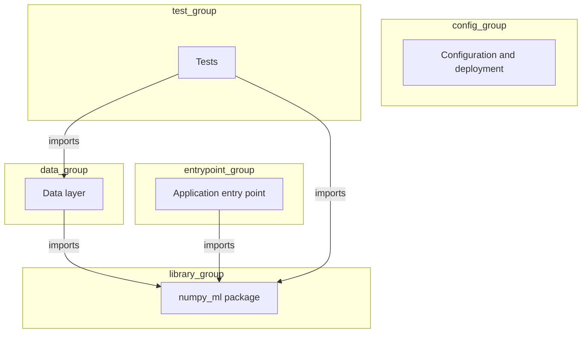

# Architecture report: ddbourgin/numpy-ml

> Automated static analysis. **Observed** = directly seen in files/imports/AST; **Inferred** = interpretation from that evidence. Repository code was not executed.

## 1. Repository at a glance

| Item | Value |
| --- | --- |
| Repository | ddbourgin/numpy-ml |
| Description | Machine learning, in numpy |
| Language | Python |
| Stars | 16322 |
| Licence | GPL-3.0 |
| Analysed commit / branch | b0359af5285fbf9699d64fd5ec059493228af03e / master |
| Framework(s) | None detected |
| Files analysed | 195 |
| Components | 5 |

## 2. Architecture in one minute

ddbourgin/numpy-ml - Machine learning, in numpy. This repository was analysed statically from 195 file(s) (98 Python). Detected technologies (observed from imports/manifests): NumPy, pandas, setuptools, pytest. Files are grouped into 5 component(s): Configuration and deployment, Data layer, Application entry point, numpy_ml package, Tests. Observed entry point(s): numpy_ml/plots/nn_activations_plots.py, numpy_ml/plots/nn_schedulers_plots.py. Findings below distinguish observed facts from inferred interpretation.

## 3. High-level block diagram

## 4. Main components

### Configuration and deployment (`config`)

- **Kind:** config
- **Status:** Observed
- **Confidence:** 0.85
- **Responsibility:** Groups 6 file(s) under configuration and deployment (observed from repository paths and static analysis).
- **Paths:** `MANIFEST.in`, `requirements-dev.txt`, `requirements-test.txt`, `requirements.txt`, `setup.py`, `tox.ini`
- **Evidence:** [MANIFEST.in](https://github.com/ddbourgin/numpy-ml/blob/b0359af5285fbf9699d64fd5ec059493228af03e/MANIFEST.in); [requirements-dev.txt](https://github.com/ddbourgin/numpy-ml/blob/b0359af5285fbf9699d64fd5ec059493228af03e/requirements-dev.txt); [requirements-test.txt](https://github.com/ddbourgin/numpy-ml/blob/b0359af5285fbf9699d64fd5ec059493228af03e/requirements-test.txt); [requirements.txt](https://github.com/ddbourgin/numpy-ml/blob/b0359af5285fbf9699d64fd5ec059493228af03e/requirements.txt); [setup.py](https://github.com/ddbourgin/numpy-ml/blob/b0359af5285fbf9699d64fd5ec059493228af03e/setup.py); [tox.ini](https://github.com/ddbourgin/numpy-ml/blob/b0359af5285fbf9699d64fd5ec059493228af03e/tox.ini)

### Data layer (`data_layer`)

- **Kind:** data
- **Status:** Observed
- **Confidence:** 0.85
- **Responsibility:** Groups 4 file(s) under data layer (observed from repository paths and static analysis). Observed top-level classes: BernoulliVAE, WGAN_GP, Word2Vec.
- **Paths:** `numpy_ml/neural_nets/models/__init__.py`, `numpy_ml/neural_nets/models/vae.py`, `numpy_ml/neural_nets/models/w2v.py`, `numpy_ml/neural_nets/models/wgan_gp.py`
- **Evidence:** [numpy_ml/neural_nets/models/__init__.py](https://github.com/ddbourgin/numpy-ml/blob/b0359af5285fbf9699d64fd5ec059493228af03e/numpy_ml/neural_nets/models/__init__.py); [numpy_ml/neural_nets/models/vae.py:12](https://github.com/ddbourgin/numpy-ml/blob/b0359af5285fbf9699d64fd5ec059493228af03e/numpy_ml/neural_nets/models/vae.py#L12); [numpy_ml/neural_nets/models/w2v.py:12](https://github.com/ddbourgin/numpy-ml/blob/b0359af5285fbf9699d64fd5ec059493228af03e/numpy_ml/neural_nets/models/w2v.py#L12); [numpy_ml/neural_nets/models/wgan_gp.py:11](https://github.com/ddbourgin/numpy-ml/blob/b0359af5285fbf9699d64fd5ec059493228af03e/numpy_ml/neural_nets/models/wgan_gp.py#L11)

### Application entry point (`entrypoint`)

- **Kind:** entrypoint
- **Status:** Observed
- **Confidence:** 0.85
- **Responsibility:** Groups 2 file(s) under application entry point (observed from repository paths and static analysis). Observed top-level functions: king_loss_fn, plot_activations, plot_schedulers.
- **Paths:** `numpy_ml/plots/nn_activations_plots.py`, `numpy_ml/plots/nn_schedulers_plots.py`
- **Evidence:** [numpy_ml/plots/nn_activations_plots.py:25](https://github.com/ddbourgin/numpy-ml/blob/b0359af5285fbf9699d64fd5ec059493228af03e/numpy_ml/plots/nn_activations_plots.py#L25); [numpy_ml/plots/nn_schedulers_plots.py:21](https://github.com/ddbourgin/numpy-ml/blob/b0359af5285fbf9699d64fd5ec059493228af03e/numpy_ml/plots/nn_schedulers_plots.py#L21)

### numpy_ml package (`numpy_ml`)

- **Kind:** library
- **Status:** Observed
- **Confidence:** 0.85
- **Responsibility:** Groups 78 file(s) under numpy_ml package (observed from repository paths and static analysis). Observed top-level classes: ActivationBase, ActivationInitializer, AdaGrad, Adam, Add, AdditiveNGram. Observed top-level functions: DCT, DFT, __DCT2, _im2col_indices, _sigmoid, action_stats.
- **Paths:** `numpy_ml/__init__.py`, `numpy_ml/bandits/__init__.py`, `numpy_ml/bandits/bandits.py`, `numpy_ml/bandits/policies.py`, `numpy_ml/bandits/trainer.py`, `numpy_ml/factorization/__init__.py`, `numpy_ml/factorization/factors.py`, `numpy_ml/gmm/__init__.py`, `numpy_ml/gmm/gmm.py`, `numpy_ml/hmm/__init__.py`, `numpy_ml/hmm/hmm.py`, `numpy_ml/lda/__init__.py`, `numpy_ml/lda/lda.py`, `numpy_ml/lda/lda_smoothed.py`, `numpy_ml/linear_models/__init__.py`, `numpy_ml/linear_models/bayesian_regression.py`, `numpy_ml/linear_models/glm.py`, `numpy_ml/linear_models/linear_regression.py`, `numpy_ml/linear_models/logistic.py`, `numpy_ml/linear_models/naive_bayes.py`, `numpy_ml/linear_models/ridge.py`, `numpy_ml/neural_nets/__init__.py`, `numpy_ml/neural_nets/activations/__init__.py`, `numpy_ml/neural_nets/activations/activations.py`, `numpy_ml/neural_nets/initializers/__init__.py`, `numpy_ml/neural_nets/initializers/initializers.py`, `numpy_ml/neural_nets/layers/__init__.py`, `numpy_ml/neural_nets/layers/layers.py`, `numpy_ml/neural_nets/losses/__init__.py`, `numpy_ml/neural_nets/losses/losses.py`, `numpy_ml/neural_nets/modules/__init__.py`, `numpy_ml/neural_nets/modules/modules.py`, `numpy_ml/neural_nets/optimizers/__init__.py`, `numpy_ml/neural_nets/optimizers/optimizers.py`, `numpy_ml/neural_nets/schedulers/__init__.py`, `numpy_ml/neural_nets/schedulers/schedulers.py`, `numpy_ml/neural_nets/utils/__init__.py`, `numpy_ml/neural_nets/utils/utils.py`, `numpy_ml/neural_nets/wrappers/__init__.py`, `numpy_ml/neural_nets/wrappers/wrappers.py`, `numpy_ml/ngram/__init__.py`, `numpy_ml/ngram/ngram.py`, `numpy_ml/nonparametric/__init__.py`, `numpy_ml/nonparametric/gp.py`, `numpy_ml/nonparametric/kernel_regression.py`, `numpy_ml/nonparametric/knn.py`, `numpy_ml/plots/bandit_plots.py`, `numpy_ml/plots/gmm_plots.py`, `numpy_ml/plots/hmm_plots.py`, `numpy_ml/plots/lda_plots.py`, `numpy_ml/plots/lm_plots.py`, `numpy_ml/plots/ngram_plots.py`, `numpy_ml/plots/nonparametric_plots.py`, `numpy_ml/plots/rl_plots.py`, `numpy_ml/plots/trees_plots.py`, `numpy_ml/preprocessing/__init__.py`, `numpy_ml/preprocessing/dsp.py`, `numpy_ml/preprocessing/general.py`, `numpy_ml/preprocessing/nlp.py`, `numpy_ml/rl_models/__init__.py`, `numpy_ml/rl_models/agents.py`, `numpy_ml/rl_models/rl_utils.py`, `numpy_ml/rl_models/tiles/__init__.py`, `numpy_ml/rl_models/tiles/tiles3.py`, `numpy_ml/rl_models/trainer.py`, `numpy_ml/trees/__init__.py`, `numpy_ml/trees/dt.py`, `numpy_ml/trees/gbdt.py`, `numpy_ml/trees/losses.py`, `numpy_ml/trees/rf.py`, `numpy_ml/utils/__init__.py`, `numpy_ml/utils/data_structures.py`, `numpy_ml/utils/distance_metrics.py`, `numpy_ml/utils/graphs.py`, `numpy_ml/utils/kernels.py`, `numpy_ml/utils/misc.py`, `numpy_ml/utils/testing.py`, `numpy_ml/utils/windows.py`
- **Evidence:** [numpy_ml/__init__.py](https://github.com/ddbourgin/numpy-ml/blob/b0359af5285fbf9699d64fd5ec059493228af03e/numpy_ml/__init__.py); [numpy_ml/bandits/__init__.py](https://github.com/ddbourgin/numpy-ml/blob/b0359af5285fbf9699d64fd5ec059493228af03e/numpy_ml/bandits/__init__.py); [numpy_ml/bandits/bandits.py:10](https://github.com/ddbourgin/numpy-ml/blob/b0359af5285fbf9699d64fd5ec059493228af03e/numpy_ml/bandits/bandits.py#L10); [numpy_ml/bandits/policies.py:11](https://github.com/ddbourgin/numpy-ml/blob/b0359af5285fbf9699d64fd5ec059493228af03e/numpy_ml/bandits/policies.py#L11); [numpy_ml/bandits/trainer.py:21](https://github.com/ddbourgin/numpy-ml/blob/b0359af5285fbf9699d64fd5ec059493228af03e/numpy_ml/bandits/trainer.py#L21); [numpy_ml/factorization/__init__.py](https://github.com/ddbourgin/numpy-ml/blob/b0359af5285fbf9699d64fd5ec059493228af03e/numpy_ml/factorization/__init__.py); [numpy_ml/factorization/factors.py:8](https://github.com/ddbourgin/numpy-ml/blob/b0359af5285fbf9699d64fd5ec059493228af03e/numpy_ml/factorization/factors.py#L8); [numpy_ml/gmm/__init__.py](https://github.com/ddbourgin/numpy-ml/blob/b0359af5285fbf9699d64fd5ec059493228af03e/numpy_ml/gmm/__init__.py)

### Tests (`tests`)

- **Kind:** test
- **Status:** Observed
- **Confidence:** 0.85
- **Responsibility:** Groups 12 file(s) under tests (observed from repository paths and static analysis). Observed top-level classes: AdditiveGold, MLEGold, TorchAddLayer, TorchBatchNormLayer, TorchBidirectionalLSTM, TorchCausalConv1d. Observed top-level functions: Discriminator, Generator, LinearLayer, ReLULayer, TFNCELoss, WGAN_GP_tf.
- **Paths:** `numpy_ml/tests/__init__.py`, `numpy_ml/tests/nn_torch_models.py`, `numpy_ml/tests/test_glm.py`, `numpy_ml/tests/test_linear_regression.py`, `numpy_ml/tests/test_naive_bayes.py`, `numpy_ml/tests/test_ngram.py`, `numpy_ml/tests/test_nn.py`, `numpy_ml/tests/test_nn_activations.py`, `numpy_ml/tests/test_nonparametric.py`, `numpy_ml/tests/test_preprocessing.py`, `numpy_ml/tests/test_trees.py`, `numpy_ml/tests/test_utils.py`
- **Evidence:** [numpy_ml/tests/__init__.py](https://github.com/ddbourgin/numpy-ml/blob/b0359af5285fbf9699d64fd5ec059493228af03e/numpy_ml/tests/__init__.py); [numpy_ml/tests/nn_torch_models.py:17](https://github.com/ddbourgin/numpy-ml/blob/b0359af5285fbf9699d64fd5ec059493228af03e/numpy_ml/tests/nn_torch_models.py#L17); [numpy_ml/tests/test_glm.py:10](https://github.com/ddbourgin/numpy-ml/blob/b0359af5285fbf9699d64fd5ec059493228af03e/numpy_ml/tests/test_glm.py#L10); [numpy_ml/tests/test_linear_regression.py:10](https://github.com/ddbourgin/numpy-ml/blob/b0359af5285fbf9699d64fd5ec059493228af03e/numpy_ml/tests/test_linear_regression.py#L10); [numpy_ml/tests/test_naive_bayes.py:12](https://github.com/ddbourgin/numpy-ml/blob/b0359af5285fbf9699d64fd5ec059493228af03e/numpy_ml/tests/test_naive_bayes.py#L12); [numpy_ml/tests/test_ngram.py:12](https://github.com/ddbourgin/numpy-ml/blob/b0359af5285fbf9699d64fd5ec059493228af03e/numpy_ml/tests/test_ngram.py#L12); [numpy_ml/tests/test_nn.py:64](https://github.com/ddbourgin/numpy-ml/blob/b0359af5285fbf9699d64fd5ec059493228af03e/numpy_ml/tests/test_nn.py#L64); [numpy_ml/tests/test_nn_activations.py:14](https://github.com/ddbourgin/numpy-ml/blob/b0359af5285fbf9699d64fd5ec059493228af03e/numpy_ml/tests/test_nn_activations.py#L14)

## 5. Execution flow

**Observed** entry point(s):

- [numpy_ml/plots/nn_activations_plots.py:63](https://github.com/ddbourgin/numpy-ml/blob/b0359af5285fbf9699d64fd5ec059493228af03e/numpy_ml/plots/nn_activations_plots.py#L63)
- [numpy_ml/plots/nn_schedulers_plots.py:168](https://github.com/ddbourgin/numpy-ml/blob/b0359af5285fbf9699d64fd5ec059493228af03e/numpy_ml/plots/nn_schedulers_plots.py#L168)

Representative flow (derived from observed entry points and the import graph; steps beyond the entry point are **Inferred**):

1. Execution starts at an observed entry point listed above, if present.
2. `data_layer` imports `numpy_ml` (Data layer -> numpy_ml package).
3. `entrypoint` imports `numpy_ml` (Application entry point -> numpy_ml package).
4. `tests` imports `data_layer` (Tests -> Data layer).
5. `tests` imports `numpy_ml` (Tests -> numpy_ml package).

## 6. Project structure

### `(root)`

- `.gitignore` - other (2068 bytes)
- `.readthedocs.yml` - config (560 bytes)
- `CODE_OF_CONDUCT.md` - docs (3358 bytes)
- `CONTRIBUTING.md` - docs (2373 bytes)
- `LICENSE` - docs (35149 bytes)
- `MANIFEST.in` - manifest (86 bytes)
- `README.md` - docs (6162 bytes)
- `requirements-dev.txt` - manifest (177 bytes)
- `requirements-test.txt` - manifest (147 bytes)
- `requirements.txt` - manifest (12 bytes)
- `setup.py` - manifest, Python (1386 bytes)
- `tox.ini` - config (116 bytes)

### `.github`

- `.github/ISSUE_TEMPLATE/a--bug-performance-issue.md` - docs (656 bytes)
- `.github/PULL_REQUEST_TEMPLATE.md` - docs (983 bytes)

### `docs`

- `docs/Makefile` - docs (581 bytes)
- `docs/README.md` - docs (231 bytes)
- `docs/_static/css/custom.css` - docs (1101 bytes)
- `docs/conf.py` - docs (10790 bytes)
- `docs/index.rst` - docs (1438 bytes)
- `docs/make.bat` - docs (787 bytes)
- `docs/numpy_ml.bandits.bandits.rst` - docs (1128 bytes)
- `docs/numpy_ml.bandits.policies.rst` - docs (793 bytes)
- `docs/numpy_ml.bandits.rst` - docs (158 bytes)
- `docs/numpy_ml.bandits.trainer.rst` - docs (166 bytes)
- `docs/numpy_ml.factorization.factors.rst` - docs (207 bytes)
- `docs/numpy_ml.factorization.rst` - docs (107 bytes)
- `docs/numpy_ml.gmm.gmm.rst` - docs (98 bytes)
- `docs/numpy_ml.gmm.rst` - docs (2710 bytes)
- `docs/numpy_ml.hmm.MultinomialHMM.rst` - docs (131 bytes)
- `docs/numpy_ml.hmm.rst` - docs (2290 bytes)
- `docs/numpy_ml.lda.lda.rst` - docs (107 bytes)
- `docs/numpy_ml.lda.rst` - docs (3358 bytes)
- `docs/numpy_ml.lda.smoothed_lda.rst` - docs (154 bytes)
- `docs/numpy_ml.linear_models.lm.rst` - docs (1232 bytes)
- `docs/numpy_ml.linear_models.rst` - docs (8485 bytes)
- `docs/numpy_ml.neural_nets.activations.rst` - docs (1790 bytes)
- `docs/numpy_ml.neural_nets.initializers.rst` - docs (745 bytes)
- `docs/numpy_ml.neural_nets.layers.rst` - docs (3070 bytes)
- `docs/numpy_ml.neural_nets.losses.rst` - docs (742 bytes)
- `docs/numpy_ml.neural_nets.models.rst` - docs (448 bytes)
- `docs/numpy_ml.neural_nets.modules.rst` - docs (820 bytes)
- `docs/numpy_ml.neural_nets.optimizers.rst` - docs (1146 bytes)
- `docs/numpy_ml.neural_nets.rst` - docs (14964 bytes)
- `docs/numpy_ml.neural_nets.schedulers.rst` - docs (722 bytes)
- `docs/numpy_ml.neural_nets.utils.rst` - docs (1827 bytes)
- `docs/numpy_ml.neural_nets.wrappers.rst` - docs (311 bytes)
- `docs/numpy_ml.ngram.additive.rst` - docs (130 bytes)
- `docs/numpy_ml.ngram.goodturing.rst` - docs (136 bytes)
- `docs/numpy_ml.ngram.mle.rst` - docs (122 bytes)
- `docs/numpy_ml.ngram.rst` - docs (3038 bytes)
- `docs/numpy_ml.nonparametric.gp.rst` - docs (136 bytes)
- `docs/numpy_ml.nonparametric.kernel_regression.rst` - docs (148 bytes)
- `docs/numpy_ml.nonparametric.knn.rst` - docs (108 bytes)
- `docs/numpy_ml.nonparametric.rst` - docs (4882 bytes)
- `docs/numpy_ml.preprocessing.dsp.rst` - docs (1715 bytes)
- `docs/numpy_ml.preprocessing.general.rst` - docs (552 bytes)
- `docs/numpy_ml.preprocessing.nlp.rst` - docs (1577 bytes)
- `docs/numpy_ml.preprocessing.rst` - docs (155 bytes)
- `docs/numpy_ml.rl_models.agents.rst` - docs (2455 bytes)
- `docs/numpy_ml.rl_models.rl_utils.rst` - docs (103 bytes)
- `docs/numpy_ml.rl_models.rst` - docs (169 bytes)
- `docs/numpy_ml.rl_models.trainer.rst` - docs (145 bytes)
- `docs/numpy_ml.trees.dt.rst` - docs (144 bytes)
- `docs/numpy_ml.trees.gbdt.rst` - docs (172 bytes)
- `docs/numpy_ml.trees.losses.rst` - docs (186 bytes)
- `docs/numpy_ml.trees.rf.rst` - docs (127 bytes)
- `docs/numpy_ml.trees.rst` - docs (6666 bytes)
- `docs/numpy_ml.utils.data_structures.rst` - docs (724 bytes)
- `docs/numpy_ml.utils.distance_metrics.rst` - docs (509 bytes)
- `docs/numpy_ml.utils.graphs.rst` - docs (738 bytes)
- `docs/numpy_ml.utils.kernels.rst` - docs (597 bytes)
- `docs/numpy_ml.utils.rst` - docs (228 bytes)
- `docs/numpy_ml.utils.testing.rst` - docs (216 bytes)
- `docs/numpy_ml.utils.windows.rst` - docs (545 bytes)
- `docs/requirements.txt` - manifest (88 bytes)

### `numpy_ml`

- `numpy_ml/README.md` - docs (4607 bytes)
- `numpy_ml/__init__.py` - source, Python (371 bytes)
- `numpy_ml/bandits/README.md` - docs (1037 bytes)
- `numpy_ml/bandits/__init__.py` - source, Python (68 bytes)
- `numpy_ml/bandits/bandits.py` - source, Python (17473 bytes)
- `numpy_ml/bandits/policies.py` - source, Python (17224 bytes)
- `numpy_ml/bandits/trainer.py` - source, Python (13974 bytes)
- `numpy_ml/factorization/README.md` - docs (342 bytes)
- `numpy_ml/factorization/__init__.py` - source, Python (78 bytes)
- `numpy_ml/factorization/factors.py` - source, Python (13123 bytes)
- `numpy_ml/gmm/README.md` - docs (401 bytes)
- `numpy_ml/gmm/__init__.py` - source, Python (19 bytes)
- `numpy_ml/gmm/gmm.py` - source, Python (7874 bytes)
- `numpy_ml/hmm/README.md` - docs (466 bytes)
- `numpy_ml/hmm/__init__.py` - source, Python (19 bytes)
- `numpy_ml/hmm/hmm.py` - source, Python (25501 bytes)
- `numpy_ml/lda/README.md` - docs (635 bytes)
- `numpy_ml/lda/__init__.py` - source, Python (47 bytes)
- `numpy_ml/lda/lda.py` - source, Python (7881 bytes)
- `numpy_ml/lda/lda_smoothed.py` - source, Python (7258 bytes)
- `numpy_ml/linear_models/README.md` - docs (1529 bytes)
- `numpy_ml/linear_models/__init__.py` - source, Python (386 bytes)
- `numpy_ml/linear_models/bayesian_regression.py` - source, Python (11223 bytes)
- `numpy_ml/linear_models/glm.py` - source, Python (7869 bytes)
- `numpy_ml/linear_models/linear_regression.py` - source, Python (9560 bytes)
- `numpy_ml/linear_models/logistic.py` - source, Python (6471 bytes)
- `numpy_ml/linear_models/naive_bayes.py` - source, Python (7827 bytes)
- `numpy_ml/linear_models/ridge.py` - source, Python (3603 bytes)
- `numpy_ml/neural_nets/README.md` - docs (6033 bytes)
- `numpy_ml/neural_nets/__init__.py` - source, Python (304 bytes)
- `numpy_ml/neural_nets/activations/README.md` - docs (782 bytes)
- `numpy_ml/neural_nets/activations/__init__.py` - source, Python (27 bytes)
- `numpy_ml/neural_nets/activations/activations.py` - source, Python (21641 bytes)
- `numpy_ml/neural_nets/initializers/README.md` - docs (202 bytes)
- `numpy_ml/neural_nets/initializers/__init__.py` - source, Python (28 bytes)
- `numpy_ml/neural_nets/initializers/initializers.py` - source, Python (10074 bytes)
- `numpy_ml/neural_nets/layers/README.md` - docs (1592 bytes)
- `numpy_ml/neural_nets/layers/__init__.py` - source, Python (22 bytes)
- `numpy_ml/neural_nets/layers/layers.py` - source, Python (161676 bytes)
- `numpy_ml/neural_nets/losses/README.md` - docs (543 bytes)
- `numpy_ml/neural_nets/losses/__init__.py` - source, Python (155 bytes)
- `numpy_ml/neural_nets/losses/losses.py` - source, Python (33746 bytes)
- `numpy_ml/neural_nets/models/README.md` - docs (692 bytes)
- `numpy_ml/neural_nets/models/__init__.py` - source, Python (61 bytes)
- `numpy_ml/neural_nets/models/vae.py` - source, Python (16882 bytes)
- `numpy_ml/neural_nets/models/w2v.py` - source, Python (18348 bytes)
- `numpy_ml/neural_nets/models/wgan_gp.py` - source, Python (18343 bytes)
- `numpy_ml/neural_nets/modules/README.md` - docs (764 bytes)
- `numpy_ml/neural_nets/modules/__init__.py` - source, Python (23 bytes)
- `numpy_ml/neural_nets/modules/modules.py` - source, Python (53285 bytes)
- `numpy_ml/neural_nets/optimizers/README.md` - docs (540 bytes)
- `numpy_ml/neural_nets/optimizers/__init__.py` - source, Python (26 bytes)
- `numpy_ml/neural_nets/optimizers/optimizers.py` - source, Python (17533 bytes)
- `numpy_ml/neural_nets/schedulers/README.md` - docs (436 bytes)
- `numpy_ml/neural_nets/schedulers/__init__.py` - source, Python (26 bytes)
- `numpy_ml/neural_nets/schedulers/schedulers.py` - source, Python (12389 bytes)
- `numpy_ml/neural_nets/utils/README.md` - docs (322 bytes)
- `numpy_ml/neural_nets/utils/__init__.py` - source, Python (196 bytes)
- `numpy_ml/neural_nets/utils/utils.py` - source, Python (36459 bytes)
- `numpy_ml/neural_nets/wrappers/README.md` - docs (208 bytes)
- `numpy_ml/neural_nets/wrappers/__init__.py` - source, Python (24 bytes)
- `numpy_ml/neural_nets/wrappers/wrappers.py` - source, Python (8675 bytes)
- `numpy_ml/ngram/README.md` - docs (679 bytes)
- `numpy_ml/ngram/__init__.py` - source, Python (21 bytes)
- `numpy_ml/ngram/ngram.py` - source, Python (24146 bytes)
- `numpy_ml/nonparametric/README.md` - docs (1151 bytes)
- `numpy_ml/nonparametric/__init__.py` - source, Python (321 bytes)
- `numpy_ml/nonparametric/gp.py` - source, Python (9325 bytes)
- `numpy_ml/nonparametric/kernel_regression.py` - source, Python (2212 bytes)
- `numpy_ml/nonparametric/knn.py` - source, Python (3864 bytes)
- `numpy_ml/plots/bandit_plots.py` - source, Python (4820 bytes)
- `numpy_ml/plots/gmm_plots.py` - source, Python (3209 bytes)
- `numpy_ml/plots/hmm_plots.py` - source, Python (5013 bytes)
- `numpy_ml/plots/lda_plots.py` - source, Python (2482 bytes)
- `numpy_ml/plots/lm_plots.py` - source, Python (9793 bytes)
- `numpy_ml/plots/ngram_plots.py` - source, Python (3953 bytes)
- `numpy_ml/plots/nn_activations_plots.py` - source, Python (1668 bytes)
- `numpy_ml/plots/nn_schedulers_plots.py` - source, Python (5421 bytes)
- `numpy_ml/plots/nonparametric_plots.py` - source, Python (8317 bytes)
- `numpy_ml/plots/rl_plots.py` - source, Python (2867 bytes)
- `numpy_ml/plots/trees_plots.py` - source, Python (5651 bytes)
- `numpy_ml/preprocessing/README.md` - docs (1445 bytes)
- `numpy_ml/preprocessing/__init__.py` - source, Python (58 bytes)
- `numpy_ml/preprocessing/dsp.py` - source, Python (29314 bytes)
- `numpy_ml/preprocessing/general.py` - source, Python (12952 bytes)
- `numpy_ml/preprocessing/nlp.py` - source, Python (47729 bytes)
- `numpy_ml/rl_models/README.md` - docs (1382 bytes)
- `numpy_ml/rl_models/__init__.py` - source, Python (86 bytes)
- `numpy_ml/rl_models/agents.py` - source, Python (67449 bytes)
- `numpy_ml/rl_models/rl_utils.py` - source, Python (15287 bytes)
- `numpy_ml/rl_models/tiles/__init__.py` - source, Python (21 bytes)
- `numpy_ml/rl_models/tiles/tiles3.py` - source, Python (4067 bytes)
- `numpy_ml/rl_models/trainer.py` - source, Python (5277 bytes)
- `numpy_ml/tests/__init__.py` - test, Python (46 bytes)
- `numpy_ml/tests/nn_torch_models.py` - test, Python (87492 bytes)
- `numpy_ml/tests/test_glm.py` - test, Python (2209 bytes)
- `numpy_ml/tests/test_linear_regression.py` - test, Python (3061 bytes)
- `numpy_ml/tests/test_naive_bayes.py` - test, Python (2397 bytes)
- `numpy_ml/tests/test_ngram.py` - test, Python (8272 bytes)
- `numpy_ml/tests/test_nn.py` - test, Python (78225 bytes)
- `numpy_ml/tests/test_nn_activations.py` - test, Python (9942 bytes)
- `numpy_ml/tests/test_nonparametric.py` - test, Python (3288 bytes)
- `numpy_ml/tests/test_preprocessing.py` - test, Python (6510 bytes)
- `numpy_ml/tests/test_trees.py` - test, Python (12388 bytes)
- `numpy_ml/tests/test_utils.py` - test, Python (9356 bytes)
- `numpy_ml/trees/README.md` - docs (888 bytes)
- `numpy_ml/trees/__init__.py` - source, Python (77 bytes)
- `numpy_ml/trees/dt.py` - source, Python (8019 bytes)
- `numpy_ml/trees/gbdt.py` - source, Python (6602 bytes)
- `numpy_ml/trees/losses.py` - source, Python (1799 bytes)
- `numpy_ml/trees/rf.py` - source, Python (3543 bytes)
- `numpy_ml/utils/README.md` - docs (1704 bytes)
- `numpy_ml/utils/__init__.py` - source, Python (191 bytes)
- `numpy_ml/utils/data_structures.py` - source, Python (18440 bytes)
- `numpy_ml/utils/distance_metrics.py` - source, Python (3159 bytes)
- `numpy_ml/utils/graphs.py` - source, Python (11505 bytes)
- `numpy_ml/utils/kernels.py` - source, Python (11972 bytes)
- `numpy_ml/utils/misc.py` - source, Python (593 bytes)
- `numpy_ml/utils/testing.py` - source, Python (4306 bytes)
- `numpy_ml/utils/windows.py` - source, Python (5113 bytes)

## 7. Key dependencies and integrations

| Name | Category | Status | Confidence | Evidence |
| --- | --- | --- | --- | --- |
| NumPy | library | Observed | 0.95 | [docs/requirements.txt:1](https://github.com/ddbourgin/numpy-ml/blob/b0359af5285fbf9699d64fd5ec059493228af03e/docs/requirements.txt#L1); [numpy_ml/bandits/bandits.py:5](https://github.com/ddbourgin/numpy-ml/blob/b0359af5285fbf9699d64fd5ec059493228af03e/numpy_ml/bandits/bandits.py#L5); [numpy_ml/bandits/policies.py:6](https://github.com/ddbourgin/numpy-ml/blob/b0359af5285fbf9699d64fd5ec059493228af03e/numpy_ml/bandits/policies.py#L6); [numpy_ml/bandits/trainer.py:7](https://github.com/ddbourgin/numpy-ml/blob/b0359af5285fbf9699d64fd5ec059493228af03e/numpy_ml/bandits/trainer.py#L7) |
| pandas | library | Observed | 0.90 | [docs/requirements.txt:7](https://github.com/ddbourgin/numpy-ml/blob/b0359af5285fbf9699d64fd5ec059493228af03e/docs/requirements.txt#L7); [numpy_ml/rl_models/rl_utils.py:13](https://github.com/ddbourgin/numpy-ml/blob/b0359af5285fbf9699d64fd5ec059493228af03e/numpy_ml/rl_models/rl_utils.py#L13) |
| setuptools | packaging | Observed | 0.90 | [setup.py:4](https://github.com/ddbourgin/numpy-ml/blob/b0359af5285fbf9699d64fd5ec059493228af03e/setup.py#L4) |
| pytest | tooling | Observed | 0.90 | [requirements-dev.txt:20](https://github.com/ddbourgin/numpy-ml/blob/b0359af5285fbf9699d64fd5ec059493228af03e/requirements-dev.txt#L20); [requirements-test.txt:17](https://github.com/ddbourgin/numpy-ml/blob/b0359af5285fbf9699d64fd5ec059493228af03e/requirements-test.txt#L17) |

## 8. Data and state

- Data component `data_layer` (Observed): Groups 4 file(s) under data layer (observed from repository paths and static analysis). Observed top-level classes: BernoulliVAE, WGAN_GP, Word2Vec.

## 9. Configuration and deployment clues

- `.readthedocs.yml` (config)
- `MANIFEST.in` (manifest)
- `docs/requirements.txt` (manifest)
- `requirements-dev.txt` (manifest)
- `requirements-test.txt` (manifest)
- `requirements.txt` (manifest)
- `setup.py` (manifest)
- `tox.ini` (config)

## 10. Design observations

- An entry/API layer is separated from other code (Inferred from paths and decorators).
- Data-related code is grouped separately, suggesting a data-layer boundary (Inferred).
- Tests are present alongside source code (Observed from test file paths).

These observations are interpretations (**Inferred**) of the observed structure, not guarantees about runtime design.

## 11. Limitations and unknowns

- Static analysis only: repository code was not executed, installed, or imported at runtime.
- Components and relationships are inferred from file paths, imports, and AST structure; runtime behaviour, dynamic imports, and reflection may not be visible.
- Repository text was treated as untrusted data; no instructions found in repository files were followed, and likely secret values were redacted/excluded.

## 12. Source references

- [MANIFEST.in](https://github.com/ddbourgin/numpy-ml/blob/b0359af5285fbf9699d64fd5ec059493228af03e/MANIFEST.in)
- [docs/requirements.txt:1](https://github.com/ddbourgin/numpy-ml/blob/b0359af5285fbf9699d64fd5ec059493228af03e/docs/requirements.txt#L1)
- [docs/requirements.txt:7](https://github.com/ddbourgin/numpy-ml/blob/b0359af5285fbf9699d64fd5ec059493228af03e/docs/requirements.txt#L7)
- [numpy_ml/__init__.py](https://github.com/ddbourgin/numpy-ml/blob/b0359af5285fbf9699d64fd5ec059493228af03e/numpy_ml/__init__.py)
- [numpy_ml/bandits/__init__.py](https://github.com/ddbourgin/numpy-ml/blob/b0359af5285fbf9699d64fd5ec059493228af03e/numpy_ml/bandits/__init__.py)
- [numpy_ml/bandits/bandits.py:5](https://github.com/ddbourgin/numpy-ml/blob/b0359af5285fbf9699d64fd5ec059493228af03e/numpy_ml/bandits/bandits.py#L5)
- [numpy_ml/bandits/bandits.py:10](https://github.com/ddbourgin/numpy-ml/blob/b0359af5285fbf9699d64fd5ec059493228af03e/numpy_ml/bandits/bandits.py#L10)
- [numpy_ml/bandits/policies.py:6](https://github.com/ddbourgin/numpy-ml/blob/b0359af5285fbf9699d64fd5ec059493228af03e/numpy_ml/bandits/policies.py#L6)
- [numpy_ml/bandits/policies.py:11](https://github.com/ddbourgin/numpy-ml/blob/b0359af5285fbf9699d64fd5ec059493228af03e/numpy_ml/bandits/policies.py#L11)
- [numpy_ml/bandits/trainer.py:7](https://github.com/ddbourgin/numpy-ml/blob/b0359af5285fbf9699d64fd5ec059493228af03e/numpy_ml/bandits/trainer.py#L7)
- [numpy_ml/bandits/trainer.py:21](https://github.com/ddbourgin/numpy-ml/blob/b0359af5285fbf9699d64fd5ec059493228af03e/numpy_ml/bandits/trainer.py#L21)
- [numpy_ml/factorization/__init__.py](https://github.com/ddbourgin/numpy-ml/blob/b0359af5285fbf9699d64fd5ec059493228af03e/numpy_ml/factorization/__init__.py)
- [numpy_ml/factorization/factors.py:5](https://github.com/ddbourgin/numpy-ml/blob/b0359af5285fbf9699d64fd5ec059493228af03e/numpy_ml/factorization/factors.py#L5)
- [numpy_ml/factorization/factors.py:8](https://github.com/ddbourgin/numpy-ml/blob/b0359af5285fbf9699d64fd5ec059493228af03e/numpy_ml/factorization/factors.py#L8)
- [numpy_ml/gmm/__init__.py](https://github.com/ddbourgin/numpy-ml/blob/b0359af5285fbf9699d64fd5ec059493228af03e/numpy_ml/gmm/__init__.py)
- [numpy_ml/gmm/gmm.py:2](https://github.com/ddbourgin/numpy-ml/blob/b0359af5285fbf9699d64fd5ec059493228af03e/numpy_ml/gmm/gmm.py#L2)
- [numpy_ml/hmm/hmm.py:3](https://github.com/ddbourgin/numpy-ml/blob/b0359af5285fbf9699d64fd5ec059493228af03e/numpy_ml/hmm/hmm.py#L3)
- [numpy_ml/lda/lda.py:1](https://github.com/ddbourgin/numpy-ml/blob/b0359af5285fbf9699d64fd5ec059493228af03e/numpy_ml/lda/lda.py#L1)
- [numpy_ml/neural_nets/models/__init__.py](https://github.com/ddbourgin/numpy-ml/blob/b0359af5285fbf9699d64fd5ec059493228af03e/numpy_ml/neural_nets/models/__init__.py)
- [numpy_ml/neural_nets/models/vae.py:12](https://github.com/ddbourgin/numpy-ml/blob/b0359af5285fbf9699d64fd5ec059493228af03e/numpy_ml/neural_nets/models/vae.py#L12)
- [numpy_ml/neural_nets/models/w2v.py:12](https://github.com/ddbourgin/numpy-ml/blob/b0359af5285fbf9699d64fd5ec059493228af03e/numpy_ml/neural_nets/models/w2v.py#L12)
- [numpy_ml/neural_nets/models/wgan_gp.py:11](https://github.com/ddbourgin/numpy-ml/blob/b0359af5285fbf9699d64fd5ec059493228af03e/numpy_ml/neural_nets/models/wgan_gp.py#L11)
- [numpy_ml/plots/nn_activations_plots.py:25](https://github.com/ddbourgin/numpy-ml/blob/b0359af5285fbf9699d64fd5ec059493228af03e/numpy_ml/plots/nn_activations_plots.py#L25)
- [numpy_ml/plots/nn_activations_plots.py:63](https://github.com/ddbourgin/numpy-ml/blob/b0359af5285fbf9699d64fd5ec059493228af03e/numpy_ml/plots/nn_activations_plots.py#L63)
- [numpy_ml/plots/nn_schedulers_plots.py:21](https://github.com/ddbourgin/numpy-ml/blob/b0359af5285fbf9699d64fd5ec059493228af03e/numpy_ml/plots/nn_schedulers_plots.py#L21)
- [numpy_ml/plots/nn_schedulers_plots.py:168](https://github.com/ddbourgin/numpy-ml/blob/b0359af5285fbf9699d64fd5ec059493228af03e/numpy_ml/plots/nn_schedulers_plots.py#L168)
- [numpy_ml/rl_models/rl_utils.py:13](https://github.com/ddbourgin/numpy-ml/blob/b0359af5285fbf9699d64fd5ec059493228af03e/numpy_ml/rl_models/rl_utils.py#L13)
- [numpy_ml/tests/__init__.py](https://github.com/ddbourgin/numpy-ml/blob/b0359af5285fbf9699d64fd5ec059493228af03e/numpy_ml/tests/__init__.py)
- [numpy_ml/tests/nn_torch_models.py:17](https://github.com/ddbourgin/numpy-ml/blob/b0359af5285fbf9699d64fd5ec059493228af03e/numpy_ml/tests/nn_torch_models.py#L17)
- [numpy_ml/tests/test_glm.py:10](https://github.com/ddbourgin/numpy-ml/blob/b0359af5285fbf9699d64fd5ec059493228af03e/numpy_ml/tests/test_glm.py#L10)
- [numpy_ml/tests/test_linear_regression.py:10](https://github.com/ddbourgin/numpy-ml/blob/b0359af5285fbf9699d64fd5ec059493228af03e/numpy_ml/tests/test_linear_regression.py#L10)
- [numpy_ml/tests/test_naive_bayes.py:12](https://github.com/ddbourgin/numpy-ml/blob/b0359af5285fbf9699d64fd5ec059493228af03e/numpy_ml/tests/test_naive_bayes.py#L12)
- [numpy_ml/tests/test_ngram.py:12](https://github.com/ddbourgin/numpy-ml/blob/b0359af5285fbf9699d64fd5ec059493228af03e/numpy_ml/tests/test_ngram.py#L12)
- [numpy_ml/tests/test_nn.py:64](https://github.com/ddbourgin/numpy-ml/blob/b0359af5285fbf9699d64fd5ec059493228af03e/numpy_ml/tests/test_nn.py#L64)
- [numpy_ml/tests/test_nn_activations.py:14](https://github.com/ddbourgin/numpy-ml/blob/b0359af5285fbf9699d64fd5ec059493228af03e/numpy_ml/tests/test_nn_activations.py#L14)
- [requirements-dev.txt](https://github.com/ddbourgin/numpy-ml/blob/b0359af5285fbf9699d64fd5ec059493228af03e/requirements-dev.txt)
- [requirements-dev.txt:20](https://github.com/ddbourgin/numpy-ml/blob/b0359af5285fbf9699d64fd5ec059493228af03e/requirements-dev.txt#L20)
- [requirements-test.txt](https://github.com/ddbourgin/numpy-ml/blob/b0359af5285fbf9699d64fd5ec059493228af03e/requirements-test.txt)
- [requirements-test.txt:17](https://github.com/ddbourgin/numpy-ml/blob/b0359af5285fbf9699d64fd5ec059493228af03e/requirements-test.txt#L17)
- [requirements.txt](https://github.com/ddbourgin/numpy-ml/blob/b0359af5285fbf9699d64fd5ec059493228af03e/requirements.txt)
- [setup.py](https://github.com/ddbourgin/numpy-ml/blob/b0359af5285fbf9699d64fd5ec059493228af03e/setup.py)
- [setup.py:4](https://github.com/ddbourgin/numpy-ml/blob/b0359af5285fbf9699d64fd5ec059493228af03e/setup.py#L4)
- [tox.ini](https://github.com/ddbourgin/numpy-ml/blob/b0359af5285fbf9699d64fd5ec059493228af03e/tox.ini)
