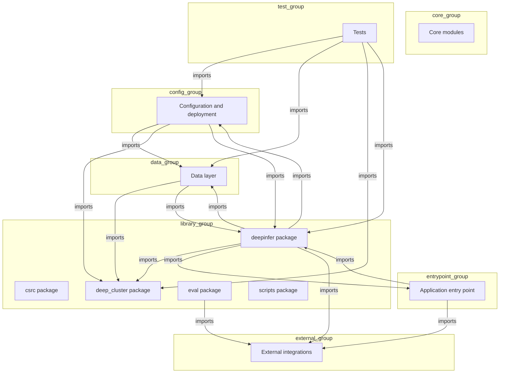

# Architecture report: deepseek-ai/DeepInfer

> Automated static analysis. **Observed** = directly seen in files/imports/AST; **Inferred** = interpretation from that evidence. Repository code was not executed.

## 1. Repository at a glance

| Item | Value |
| --- | --- |
| Repository | deepseek-ai/DeepInfer |
| Description | DeepInfer: High-performance, large-scale inference framework for DeepSeek models |
| Language | Python |
| Stars | 26020 |
| Licence | Apache-2.0 |
| Analysed commit / branch | a679bb86ce36e883a98a97733492b686e5b9a08e / main |
| Framework(s) | FastAPI, Starlette |
| Files analysed | 336 |
| Components | 11 |

## 2. Architecture in one minute

deepseek-ai/DeepInfer - DeepInfer: High-performance, large-scale inference framework for DeepSeek models. This repository was analysed statically from 336 file(s) (270 Python). Detected technologies (observed from imports/manifests): FastAPI, Starlette, NumPy, Pydantic, requests, Uvicorn. Files are grouped into 11 component(s): Configuration and deployment, Core modules, csrc package, Data layer, deep_cluster package, deepinfer package, Application entry point, eval package. Observed entry point(s): deepinfer/engine/profile_server.py, eval/run_eval.py, eval/score.py. Findings below distinguish observed facts from inferred interpretation.

## 3. High-level block diagram

## 4. Main components

### Configuration and deployment (`config`)

- **Kind:** config
- **Status:** Observed
- **Confidence:** 0.85
- **Responsibility:** Groups 8 file(s) under configuration and deployment (observed from repository paths and static analysis). Observed top-level classes: CacheConfig, ModelConfig, ParallelConfig, SchedulerConfig. Observed top-level functions: _assert_supported, _build_attn_module_list, _build_dflash_cfg, _build_engram, _build_moe, _build_vision.
- **Paths:** `deepinfer/config.py`, `deepinfer/hugging_face/config.py`, `pyproject.toml`, `requirements-ascend.txt`, `requirements-dev.txt`, `requirements-nvidia.txt`, `requirements.txt`, `setup.py`
- **Evidence:** [deepinfer/config.py:11](https://github.com/deepseek-ai/DeepInfer/blob/a679bb86ce36e883a98a97733492b686e5b9a08e/deepinfer/config.py#L11); [deepinfer/hugging_face/config.py:51](https://github.com/deepseek-ai/DeepInfer/blob/a679bb86ce36e883a98a97733492b686e5b9a08e/deepinfer/hugging_face/config.py#L51); [pyproject.toml](https://github.com/deepseek-ai/DeepInfer/blob/a679bb86ce36e883a98a97733492b686e5b9a08e/pyproject.toml); [requirements-ascend.txt](https://github.com/deepseek-ai/DeepInfer/blob/a679bb86ce36e883a98a97733492b686e5b9a08e/requirements-ascend.txt); [requirements-dev.txt](https://github.com/deepseek-ai/DeepInfer/blob/a679bb86ce36e883a98a97733492b686e5b9a08e/requirements-dev.txt); [requirements-nvidia.txt](https://github.com/deepseek-ai/DeepInfer/blob/a679bb86ce36e883a98a97733492b686e5b9a08e/requirements-nvidia.txt); [requirements.txt](https://github.com/deepseek-ai/DeepInfer/blob/a679bb86ce36e883a98a97733492b686e5b9a08e/requirements.txt); [setup.py:75](https://github.com/deepseek-ai/DeepInfer/blob/a679bb86ce36e883a98a97733492b686e5b9a08e/setup.py#L75)

### Core modules (`core`)

- **Kind:** core
- **Status:** Observed
- **Confidence:** 0.85
- **Responsibility:** Groups 1 file(s) under core modules (observed from repository paths and static analysis).
- **Paths:** `build.sh`
- **Evidence:** [build.sh](https://github.com/deepseek-ai/DeepInfer/blob/a679bb86ce36e883a98a97733492b686e5b9a08e/build.sh)

### csrc package (`csrc`)

- **Kind:** library
- **Status:** Observed
- **Confidence:** 0.85
- **Responsibility:** Groups 15 file(s) under csrc package (observed from repository paths and static analysis).
- **Paths:** `csrc/asc_utils.cpp`, `csrc/cuda_utils.cpp`, `csrc/engine/input_metadata/block_load_plan.cpp`, `csrc/engine/input_metadata/prepare_tensor_input_base.cpp`, `csrc/engine/input_metadata/prepare_tensor_input_v4.cpp`, `csrc/engine/prepare_sample.cpp`, `csrc/engine/pybind.cpp`, `csrc/engine/pybind_output.cpp`, `csrc/engine/pybind_scheduler.cpp`, `csrc/engine/pybind_sequence.cpp`, `csrc/engine/zos.cpp`, `csrc/graph_timer/graph_timer_asc.cpp`, `csrc/graph_timer/graph_timer_cuda.cpp`, `csrc/graph_timer/pybind.cpp`, `csrc/pybind.cpp`
- **Evidence:** [csrc/asc_utils.cpp](https://github.com/deepseek-ai/DeepInfer/blob/a679bb86ce36e883a98a97733492b686e5b9a08e/csrc/asc_utils.cpp); [csrc/cuda_utils.cpp](https://github.com/deepseek-ai/DeepInfer/blob/a679bb86ce36e883a98a97733492b686e5b9a08e/csrc/cuda_utils.cpp); [csrc/engine/input_metadata/block_load_plan.cpp](https://github.com/deepseek-ai/DeepInfer/blob/a679bb86ce36e883a98a97733492b686e5b9a08e/csrc/engine/input_metadata/block_load_plan.cpp); [csrc/engine/input_metadata/prepare_tensor_input_base.cpp](https://github.com/deepseek-ai/DeepInfer/blob/a679bb86ce36e883a98a97733492b686e5b9a08e/csrc/engine/input_metadata/prepare_tensor_input_base.cpp); [csrc/engine/input_metadata/prepare_tensor_input_v4.cpp](https://github.com/deepseek-ai/DeepInfer/blob/a679bb86ce36e883a98a97733492b686e5b9a08e/csrc/engine/input_metadata/prepare_tensor_input_v4.cpp); [csrc/engine/prepare_sample.cpp](https://github.com/deepseek-ai/DeepInfer/blob/a679bb86ce36e883a98a97733492b686e5b9a08e/csrc/engine/prepare_sample.cpp); [csrc/engine/pybind.cpp](https://github.com/deepseek-ai/DeepInfer/blob/a679bb86ce36e883a98a97733492b686e5b9a08e/csrc/engine/pybind.cpp); [csrc/engine/pybind_output.cpp](https://github.com/deepseek-ai/DeepInfer/blob/a679bb86ce36e883a98a97733492b686e5b9a08e/csrc/engine/pybind_output.cpp)

### Data layer (`data_layer`)

- **Kind:** data
- **Status:** Observed
- **Confidence:** 0.85
- **Responsibility:** Groups 34 file(s) under data layer (observed from repository paths and static analysis). Observed top-level classes: AcceptRatePredictor, Attention, Block, ColumnParallelLora, CompressedTokenizer, CompressedVocabulary. Observed top-level functions: _align_mqa_weights, _apply_in_gpu_chunks, _apply_random_init, _build_mlp_and_layernorms, _clone_linear_weight, _convert_mega_moe_weight.
- **Paths:** `deepinfer/model_executor/models/__init__.py`, `deepinfer/model_executor/models/decoder_layer.py`, `deepinfer/model_executor/models/deepseek.py`, `deepinfer/model_executor/models/deepseek_vl.py`, `deepinfer/model_executor/models/mtp/__init__.py`, `deepinfer/model_executor/models/mtp/dflash.py`, `deepinfer/model_executor/models/v4_modules/__init__.py`, `deepinfer/model_executor/models/v4_modules/attn.py`, `deepinfer/model_executor/models/v4_modules/builder.py`, `deepinfer/model_executor/models/v4_modules/compress.py`, `deepinfer/model_executor/models/v4_modules/containers.py`, `deepinfer/model_executor/models/v4_modules/cross_layer.py`, `deepinfer/model_executor/models/v4_modules/engram.py`, `deepinfer/model_executor/models/v4_modules/engram_metadata.py`, `deepinfer/model_executor/models/v4_modules/engram_parameters.py`, `deepinfer/model_executor/models/v4_modules/hc.py`, `deepinfer/model_executor/models/v4_modules/hc_blocks.py`, `deepinfer/model_executor/models/v4_modules/hc_lazy.py`, `deepinfer/model_executor/models/v4_modules/heads.py`, `deepinfer/model_executor/models/v4_modules/index_attn.py`, `deepinfer/model_executor/models/v4_modules/linear.py`, `deepinfer/model_executor/models/v4_modules/mhc_modeling.py`, `deepinfer/model_executor/models/v4_modules/mhc_ops.py`, `deepinfer/model_executor/models/v4_modules/mla_attn.py`, `deepinfer/model_executor/models/v4_modules/mlp.py`, `deepinfer/model_executor/models/v4_modules/moe.py`, `deepinfer/model_executor/models/v4_modules/norm.py`, `deepinfer/model_executor/models/v4_modules/rope.py`, `deepinfer/model_executor/models/v4_modules/utils.py`, `deepinfer/model_executor/models/v4_modules/yoco.py`, `deepinfer/model_executor/models/vision_encoder/__init__.py`, `deepinfer/model_executor/models/vision_encoder/mlp_projector.py`, `deepinfer/model_executor/models/vision_encoder/vit.py`, `deepinfer/model_executor/models/vision_encoder/vl_aligner.py`
- **Evidence:** [deepinfer/model_executor/models/__init__.py:20](https://github.com/deepseek-ai/DeepInfer/blob/a679bb86ce36e883a98a97733492b686e5b9a08e/deepinfer/model_executor/models/__init__.py#L20); [deepinfer/model_executor/models/decoder_layer.py:38](https://github.com/deepseek-ai/DeepInfer/blob/a679bb86ce36e883a98a97733492b686e5b9a08e/deepinfer/model_executor/models/decoder_layer.py#L38); [deepinfer/model_executor/models/deepseek.py:59](https://github.com/deepseek-ai/DeepInfer/blob/a679bb86ce36e883a98a97733492b686e5b9a08e/deepinfer/model_executor/models/deepseek.py#L59); [deepinfer/model_executor/models/deepseek_vl.py:26](https://github.com/deepseek-ai/DeepInfer/blob/a679bb86ce36e883a98a97733492b686e5b9a08e/deepinfer/model_executor/models/deepseek_vl.py#L26); [deepinfer/model_executor/models/mtp/__init__.py](https://github.com/deepseek-ai/DeepInfer/blob/a679bb86ce36e883a98a97733492b686e5b9a08e/deepinfer/model_executor/models/mtp/__init__.py); [deepinfer/model_executor/models/mtp/dflash.py:38](https://github.com/deepseek-ai/DeepInfer/blob/a679bb86ce36e883a98a97733492b686e5b9a08e/deepinfer/model_executor/models/mtp/dflash.py#L38); [deepinfer/model_executor/models/v4_modules/__init__.py](https://github.com/deepseek-ai/DeepInfer/blob/a679bb86ce36e883a98a97733492b686e5b9a08e/deepinfer/model_executor/models/v4_modules/__init__.py); [deepinfer/model_executor/models/v4_modules/attn.py:54](https://github.com/deepseek-ai/DeepInfer/blob/a679bb86ce36e883a98a97733492b686e5b9a08e/deepinfer/model_executor/models/v4_modules/attn.py#L54)

### deep_cluster package (`deep_cluster`)

- **Kind:** library
- **Status:** Observed
- **Confidence:** 0.85
- **Responsibility:** Groups 8 file(s) under deep_cluster package (observed from repository paths and static analysis). Observed top-level classes: _Bitmask. Observed top-level functions: _device_node_indices, _entries, _libnuma, _npu_smi_numa_nodes, _nvml, _parse_cpu_list.
- **Paths:** `deep_cluster/__init__.py`, `deep_cluster/hardware/__init__.py`, `deep_cluster/hardware/ascend.py`, `deep_cluster/hardware/cpu.py`, `deep_cluster/hardware/device.py`, `deep_cluster/hardware/nvidia.py`, `deep_cluster/topology/__init__.py`, `deep_cluster/topology/bind.py`
- **Evidence:** [deep_cluster/__init__.py](https://github.com/deepseek-ai/DeepInfer/blob/a679bb86ce36e883a98a97733492b686e5b9a08e/deep_cluster/__init__.py); [deep_cluster/hardware/__init__.py](https://github.com/deepseek-ai/DeepInfer/blob/a679bb86ce36e883a98a97733492b686e5b9a08e/deep_cluster/hardware/__init__.py); [deep_cluster/hardware/ascend.py:17](https://github.com/deepseek-ai/DeepInfer/blob/a679bb86ce36e883a98a97733492b686e5b9a08e/deep_cluster/hardware/ascend.py#L17); [deep_cluster/hardware/cpu.py:10](https://github.com/deepseek-ai/DeepInfer/blob/a679bb86ce36e883a98a97733492b686e5b9a08e/deep_cluster/hardware/cpu.py#L10); [deep_cluster/hardware/device.py:18](https://github.com/deepseek-ai/DeepInfer/blob/a679bb86ce36e883a98a97733492b686e5b9a08e/deep_cluster/hardware/device.py#L18); [deep_cluster/hardware/nvidia.py:14](https://github.com/deepseek-ai/DeepInfer/blob/a679bb86ce36e883a98a97733492b686e5b9a08e/deep_cluster/hardware/nvidia.py#L14); [deep_cluster/topology/__init__.py](https://github.com/deepseek-ai/DeepInfer/blob/a679bb86ce36e883a98a97733492b686e5b9a08e/deep_cluster/topology/__init__.py); [deep_cluster/topology/bind.py:18](https://github.com/deepseek-ai/DeepInfer/blob/a679bb86ce36e883a98a97733492b686e5b9a08e/deep_cluster/topology/bind.py#L18)

### deepinfer package (`deepinfer`)

- **Kind:** library
- **Status:** Observed
- **Confidence:** 0.85
- **Responsibility:** Groups 180 file(s) under deepinfer package (observed from repository paths and static analysis). Observed top-level classes: Aggregates, AttrDict, BaseInput, BaseProcessor, BaseTimer, BasicImageTransform. Observed top-level functions: __dir__, __getattr__, _add, _align_to_multiple, _alloc_fp8_sf, _alloc_quant.
- **Paths:** `deepinfer/__init__.py`, `deepinfer/attrdict.py`, `deepinfer/distributed/__init__.py`, `deepinfer/distributed/shm_broadcast.py`, `deepinfer/engine/__init__.py`, `deepinfer/engine/arg_utils.py`, `deepinfer/engine/engine_type.py`, `deepinfer/engine/llm_engine.py`, `deepinfer/engine/stats_logger.py`, `deepinfer/entrypoints/__init__.py`, `deepinfer/entrypoints/llm.py`, `deepinfer/environ.py`, `deepinfer/hugging_face/__init__.py`, `deepinfer/hugging_face/loading.py`, `deepinfer/hugging_face/names.py`, `deepinfer/hugging_face/parameters.py`, `deepinfer/hugging_face/processor.py`, `deepinfer/hugging_face/tokenizer.py`, `deepinfer/hugging_face/weights.py`, `deepinfer/load_class.py`, `deepinfer/logger.py`, `deepinfer/model_config_loader.py`, `deepinfer/model_executor/__init__.py`, `deepinfer/model_executor/eplb/__init__.py`, `deepinfer/model_executor/eplb/policy.py`, `deepinfer/model_executor/eplb/shuffle.py`, `deepinfer/model_executor/input_metadata/__init__.py`, `deepinfer/model_executor/input_metadata/dflash.py`, `deepinfer/model_executor/input_metadata/input_metadata.py`, `deepinfer/model_executor/input_metadata/prepare_tensor_input_zos.py`, `deepinfer/model_executor/input_metadata/yoco.py`, `deepinfer/model_executor/layer_utils.py`, `deepinfer/model_executor/layers/__init__.py`, `deepinfer/model_executor/layers/attention_backend.py`, `deepinfer/model_executor/layers/layernorm.py`, `deepinfer/model_executor/layers/linear.py`, `deepinfer/model_executor/layers/mtp_info_pool.py`, `deepinfer/model_executor/layers/rotary_embedding.py`, `deepinfer/model_executor/layers/sampler.py`, `deepinfer/model_executor/layers/sampler_utils.py`, `deepinfer/model_executor/layers/tilelang_ops/__init__.py`, `deepinfer/model_executor/layers/tilelang_ops/asc/__init__.py`, `deepinfer/model_executor/layers/tilelang_ops/asc/candidate_blocks.py`, `deepinfer/model_executor/layers/tilelang_ops/asc/compress.py`, `deepinfer/model_executor/layers/tilelang_ops/asc/compute_seqlens_k_zos.py`, `deepinfer/model_executor/layers/tilelang_ops/asc/dflash.py`, `deepinfer/model_executor/layers/tilelang_ops/asc/dflash_copy.py`, `deepinfer/model_executor/layers/tilelang_ops/asc/flash_mla_utils.py`, `deepinfer/model_executor/layers/tilelang_ops/asc/fused_sample.py`, `deepinfer/model_executor/layers/tilelang_ops/asc/fused_transform.py`, `deepinfer/model_executor/layers/tilelang_ops/asc/gather.py`, `deepinfer/model_executor/layers/tilelang_ops/asc/gather_engram_tokens_zos.py`, `deepinfer/model_executor/layers/tilelang_ops/asc/gather_input_ids_zos.py`, `deepinfer/model_executor/layers/tilelang_ops/asc/get_kv_index.py`, `deepinfer/model_executor/layers/tilelang_ops/asc/image_embed_ops.py`, `deepinfer/model_executor/layers/tilelang_ops/asc/kv_index_cat.py`, `deepinfer/model_executor/layers/tilelang_ops/asc/kv_quant.py`, `deepinfer/model_executor/layers/tilelang_ops/asc/load_paged_kv_cache.py`, `deepinfer/model_executor/layers/tilelang_ops/asc/norm.py`, `deepinfer/model_executor/layers/tilelang_ops/asc/prepare_cp_mirror.py`, `deepinfer/model_executor/layers/tilelang_ops/asc/prepare_v4_decode_metadata.py`, `deepinfer/model_executor/layers/tilelang_ops/asc/random_sampling.py`, `deepinfer/model_executor/layers/tilelang_ops/asc/rstd_1ulp.py`, `deepinfer/model_executor/layers/tilelang_ops/asc/sampler.py`, `deepinfer/model_executor/layers/tilelang_ops/asc/schedule_mtp_varlen.py`, `deepinfer/model_executor/layers/tilelang_ops/asc/state_cache.py`, `deepinfer/model_executor/layers/tilelang_ops/asc/store_kv_cache.py`, `deepinfer/model_executor/layers/tilelang_ops/asc/store_mtp_info.py`, `deepinfer/model_executor/layers/tilelang_ops/asc/structure_output.py`, `deepinfer/model_executor/layers/tilelang_ops/asc/sum_smaller_probs.py`, `deepinfer/model_executor/layers/tilelang_ops/asc/swa_index.py`, `deepinfer/model_executor/layers/tilelang_ops/cache_common.py`, `deepinfer/model_executor/layers/tilelang_ops/candidate_blocks.py`, `deepinfer/model_executor/layers/tilelang_ops/common.py`, `deepinfer/model_executor/layers/tilelang_ops/compress.py`, `deepinfer/model_executor/layers/tilelang_ops/compute_seqlens_k_zos.py`, `deepinfer/model_executor/layers/tilelang_ops/cuda/__init__.py`, `deepinfer/model_executor/layers/tilelang_ops/cuda/candidate_blocks.py`, `deepinfer/model_executor/layers/tilelang_ops/cuda/compress.py`, `deepinfer/model_executor/layers/tilelang_ops/cuda/compute_seqlens_k_zos.py`, `deepinfer/model_executor/layers/tilelang_ops/cuda/dflash.py`, `deepinfer/model_executor/layers/tilelang_ops/cuda/dflash_copy.py`, `deepinfer/model_executor/layers/tilelang_ops/cuda/flash_mla_utils.py`, `deepinfer/model_executor/layers/tilelang_ops/cuda/fused_sample.py`, `deepinfer/model_executor/layers/tilelang_ops/cuda/fused_transform.py`, `deepinfer/model_executor/layers/tilelang_ops/cuda/gather.py`, `deepinfer/model_executor/layers/tilelang_ops/cuda/gather_engram_tokens_zos.py`, `deepinfer/model_executor/layers/tilelang_ops/cuda/gather_input_ids_zos.py`, `deepinfer/model_executor/layers/tilelang_ops/cuda/get_kv_index.py`, `deepinfer/model_executor/layers/tilelang_ops/cuda/image_embed_ops.py`, `deepinfer/model_executor/layers/tilelang_ops/cuda/kv_index_cat.py`, `deepinfer/model_executor/layers/tilelang_ops/cuda/load_paged_kv_cache.py`, `deepinfer/model_executor/layers/tilelang_ops/cuda/norm.py`, `deepinfer/model_executor/layers/tilelang_ops/cuda/outlier_detection.py`, `deepinfer/model_executor/layers/tilelang_ops/cuda/prepare_cp_mirror.py`, `deepinfer/model_executor/layers/tilelang_ops/cuda/prepare_decode_metadata.py`, `deepinfer/model_executor/layers/tilelang_ops/cuda/quant.py`, `deepinfer/model_executor/layers/tilelang_ops/cuda/random_sampling.py`, `deepinfer/model_executor/layers/tilelang_ops/cuda/sampler.py`, `deepinfer/model_executor/layers/tilelang_ops/cuda/schedule_mtp_varlen.py`, `deepinfer/model_executor/layers/tilelang_ops/cuda/state_cache.py`, `deepinfer/model_executor/layers/tilelang_ops/cuda/store_kv_cache.py`, `deepinfer/model_executor/layers/tilelang_ops/cuda/store_mtp_info.py`, `deepinfer/model_executor/layers/tilelang_ops/cuda/structure_output.py`, `deepinfer/model_executor/layers/tilelang_ops/cuda/sum_smaller_probs.py`, `deepinfer/model_executor/layers/tilelang_ops/cuda/swa_index.py`, `deepinfer/model_executor/layers/tilelang_ops/dflash.py`, `deepinfer/model_executor/layers/tilelang_ops/dflash_copy.py`, `deepinfer/model_executor/layers/tilelang_ops/flash_mla_utils.py`, `deepinfer/model_executor/layers/tilelang_ops/fused_sample.py`, `deepinfer/model_executor/layers/tilelang_ops/fused_transform.py`, `deepinfer/model_executor/layers/tilelang_ops/gather.py`, `deepinfer/model_executor/layers/tilelang_ops/gather_engram_tokens_zos.py`, `deepinfer/model_executor/layers/tilelang_ops/gather_input_ids_zos.py`, `deepinfer/model_executor/layers/tilelang_ops/get_kv_index.py`, `deepinfer/model_executor/layers/tilelang_ops/image_embed_ops.py`, `deepinfer/model_executor/layers/tilelang_ops/kv_index_cat.py`, `deepinfer/model_executor/layers/tilelang_ops/load_paged_kv_cache.py`, `deepinfer/model_executor/layers/tilelang_ops/norm.py`, `deepinfer/model_executor/layers/tilelang_ops/ops.py`, `deepinfer/model_executor/layers/tilelang_ops/outlier_detection.py`, `deepinfer/model_executor/layers/tilelang_ops/prepare_cp_mirror.py`, `deepinfer/model_executor/layers/tilelang_ops/prepare_v4_decode_metadata.py`, `deepinfer/model_executor/layers/tilelang_ops/random_sampling.py`, `deepinfer/model_executor/layers/tilelang_ops/sampler.py`, `deepinfer/model_executor/layers/tilelang_ops/schedule_mtp_varlen.py`, `deepinfer/model_executor/layers/tilelang_ops/state_cache.py`, `deepinfer/model_executor/layers/tilelang_ops/store_kv_cache.py`, `deepinfer/model_executor/layers/tilelang_ops/store_mtp_info.py`, `deepinfer/model_executor/layers/tilelang_ops/structure_output.py`, `deepinfer/model_executor/layers/tilelang_ops/sum_smaller_probs.py`, `deepinfer/model_executor/layers/tilelang_ops/swa_index.py`, `deepinfer/model_executor/layers/vocab_parallel_embedding.py`, `deepinfer/model_executor/model_loader.py`, `deepinfer/model_executor/model_metadata_utils.py`, `deepinfer/model_executor/model_output.py`, `deepinfer/model_executor/parallel_utils/__init__.py`, `deepinfer/model_executor/parallel_utils/communication_op.py`, `deepinfer/model_executor/parallel_utils/cp.py`, `deepinfer/model_executor/parallel_utils/nccl_memory.py`, `deepinfer/model_executor/parallel_utils/parallel_state.py`, `deepinfer/model_executor/parallel_utils/userbuffer.py`, `deepinfer/model_executor/sampling_inputs.py`, `deepinfer/model_executor/utils.py`, `deepinfer/multimodal_tokens.py`, `deepinfer/npu_ops/__init__.py`, `deepinfer/npu_ops/deep_select.py`, `deepinfer/npu_ops/patch_imports.py`, `deepinfer/npu_ops/vit_attn.py`, `deepinfer/platform.py`, `deepinfer/sampling_params.py`, `deepinfer/sequence.py`, `deepinfer/shared_memory.py`, `deepinfer/structure_output/__init__.py`, `deepinfer/structure_output/compiler.py`, `deepinfer/structure_output/mask.py`, `deepinfer/structure_output/matcher.py`, `deepinfer/structure_output/so_matcher_builder.py`, `deepinfer/testing.py`, `deepinfer/timer.py`, `deepinfer/utils.py`, `deepinfer/ve/__init__.py`, `deepinfer/ve/multimodal_processor.py`, `deepinfer/ve/prepare_tensor_input_vl.py`, `deepinfer/ve/processor/__init__.py`, `deepinfer/ve/processor/common.py`, `deepinfer/ve/processor/image_processor.py`, `deepinfer/ve/processor/mm_processor.py`, `deepinfer/ve/processor/text_processor.py`, `deepinfer/ve/schema.py`, `deepinfer/worker/__init__.py`, `deepinfer/worker/base.py`, `deepinfer/worker/cache_engine.py`, `deepinfer/worker/cuda_graph_runner.py`, `deepinfer/worker/decode_perf_cache.py`, `deepinfer/worker/dflash_cuda_graph_runner.py`, `deepinfer/worker/model_runner.py`, `deepinfer/worker/runtime_config.py`, `deepinfer/worker/worker.py`, `deepinfer/worker/zos_status.py`
- **Evidence:** [deepinfer/__init__.py:9](https://github.com/deepseek-ai/DeepInfer/blob/a679bb86ce36e883a98a97733492b686e5b9a08e/deepinfer/__init__.py#L9); [deepinfer/attrdict.py:12](https://github.com/deepseek-ai/DeepInfer/blob/a679bb86ce36e883a98a97733492b686e5b9a08e/deepinfer/attrdict.py#L12); [deepinfer/distributed/__init__.py](https://github.com/deepseek-ai/DeepInfer/blob/a679bb86ce36e883a98a97733492b686e5b9a08e/deepinfer/distributed/__init__.py); [deepinfer/distributed/shm_broadcast.py:33](https://github.com/deepseek-ai/DeepInfer/blob/a679bb86ce36e883a98a97733492b686e5b9a08e/deepinfer/distributed/shm_broadcast.py#L33); [deepinfer/engine/__init__.py](https://github.com/deepseek-ai/DeepInfer/blob/a679bb86ce36e883a98a97733492b686e5b9a08e/deepinfer/engine/__init__.py); [deepinfer/engine/arg_utils.py:18](https://github.com/deepseek-ai/DeepInfer/blob/a679bb86ce36e883a98a97733492b686e5b9a08e/deepinfer/engine/arg_utils.py#L18); [deepinfer/engine/engine_type.py:4](https://github.com/deepseek-ai/DeepInfer/blob/a679bb86ce36e883a98a97733492b686e5b9a08e/deepinfer/engine/engine_type.py#L4); [deepinfer/engine/llm_engine.py:67](https://github.com/deepseek-ai/DeepInfer/blob/a679bb86ce36e883a98a97733492b686e5b9a08e/deepinfer/engine/llm_engine.py#L67)

### Application entry point (`entrypoint`)

- **Kind:** entrypoint
- **Status:** Observed
- **Confidence:** 0.85
- **Responsibility:** Groups 3 file(s) under application entry point (observed from repository paths and static analysis). Observed application object created via FastAPI. Observed top-level classes: ProfileManager, _PendingTrace, _ProfileRequest, _Reply. Observed top-level functions: _fmt_error, _judge, _multi_modal_entry, _reasoning_effort, _render_prompts, _rows_from_outputs.
- **Paths:** `deepinfer/engine/profile_server.py`, `eval/run_eval.py`, `eval/score.py`
- **Evidence:** [deepinfer/engine/profile_server.py:182](https://github.com/deepseek-ai/DeepInfer/blob/a679bb86ce36e883a98a97733492b686e5b9a08e/deepinfer/engine/profile_server.py#L182); [eval/run_eval.py:33](https://github.com/deepseek-ai/DeepInfer/blob/a679bb86ce36e883a98a97733492b686e5b9a08e/eval/run_eval.py#L33); [eval/score.py:27](https://github.com/deepseek-ai/DeepInfer/blob/a679bb86ce36e883a98a97733492b686e5b9a08e/eval/score.py#L27)

### eval package (`eval`)

- **Kind:** library
- **Status:** Observed
- **Confidence:** 0.85
- **Responsibility:** Groups 13 file(s) under eval package (observed from repository paths and static analysis). Observed top-level classes: LLMJudge, Problem. Observed top-level functions: _has_image, _hle_wording_verdict, _looks_like_repo, _normalize_row, _resolve_images, _strip_trailing_instruction.
- **Paths:** `eval/aime/bench.py`, `eval/aime/run.sh`, `eval/common/__init__.py`, `eval/common/encoder.py`, `eval/common/io.py`, `eval/common/judge.py`, `eval/common/loader.py`, `eval/common/passk.py`, `eval/common/paths.py`, `eval/gpqa/bench.py`, `eval/gpqa/run.sh`, `eval/hle/bench.py`, `eval/hle/run.sh`
- **Evidence:** [eval/aime/bench.py:21](https://github.com/deepseek-ai/DeepInfer/blob/a679bb86ce36e883a98a97733492b686e5b9a08e/eval/aime/bench.py#L21); [eval/aime/run.sh](https://github.com/deepseek-ai/DeepInfer/blob/a679bb86ce36e883a98a97733492b686e5b9a08e/eval/aime/run.sh); [eval/common/__init__.py](https://github.com/deepseek-ai/DeepInfer/blob/a679bb86ce36e883a98a97733492b686e5b9a08e/eval/common/__init__.py); [eval/common/encoder.py:9](https://github.com/deepseek-ai/DeepInfer/blob/a679bb86ce36e883a98a97733492b686e5b9a08e/eval/common/encoder.py#L9); [eval/common/io.py:10](https://github.com/deepseek-ai/DeepInfer/blob/a679bb86ce36e883a98a97733492b686e5b9a08e/eval/common/io.py#L10); [eval/common/judge.py:137](https://github.com/deepseek-ai/DeepInfer/blob/a679bb86ce36e883a98a97733492b686e5b9a08e/eval/common/judge.py#L137); [eval/common/loader.py:12](https://github.com/deepseek-ai/DeepInfer/blob/a679bb86ce36e883a98a97733492b686e5b9a08e/eval/common/loader.py#L12); [eval/common/passk.py:8](https://github.com/deepseek-ai/DeepInfer/blob/a679bb86ce36e883a98a97733492b686e5b9a08e/eval/common/passk.py#L8)

### External integrations (`external_integrations`)

- **Kind:** external
- **Status:** Inferred
- **Confidence:** 0.70
- **Responsibility:** Groups 0 file(s) under external integrations (observed from repository paths and static analysis).
- **Evidence:** [deepinfer/engine/profile_server.py:21](https://github.com/deepseek-ai/DeepInfer/blob/a679bb86ce36e883a98a97733492b686e5b9a08e/deepinfer/engine/profile_server.py#L21); [deepinfer/utils.py:9](https://github.com/deepseek-ai/DeepInfer/blob/a679bb86ce36e883a98a97733492b686e5b9a08e/deepinfer/utils.py#L9); [eval/common/judge.py:11](https://github.com/deepseek-ai/DeepInfer/blob/a679bb86ce36e883a98a97733492b686e5b9a08e/eval/common/judge.py#L11)

### scripts package (`scripts`)

- **Kind:** library
- **Status:** Observed
- **Confidence:** 0.85
- **Responsibility:** Groups 4 file(s) under scripts package (observed from repository paths and static analysis).
- **Paths:** `scripts/build.sh`, `scripts/build_vendor.sh`, `scripts/format_csrc.sh`, `scripts/gen_stub.sh`
- **Evidence:** [scripts/build.sh](https://github.com/deepseek-ai/DeepInfer/blob/a679bb86ce36e883a98a97733492b686e5b9a08e/scripts/build.sh); [scripts/build_vendor.sh](https://github.com/deepseek-ai/DeepInfer/blob/a679bb86ce36e883a98a97733492b686e5b9a08e/scripts/build_vendor.sh); [scripts/format_csrc.sh](https://github.com/deepseek-ai/DeepInfer/blob/a679bb86ce36e883a98a97733492b686e5b9a08e/scripts/format_csrc.sh); [scripts/gen_stub.sh](https://github.com/deepseek-ai/DeepInfer/blob/a679bb86ce36e883a98a97733492b686e5b9a08e/scripts/gen_stub.sh)

### Tests (`tests`)

- **Kind:** test
- **Status:** Observed
- **Confidence:** 0.85
- **Responsibility:** Groups 21 file(s) under tests (observed from repository paths and static analysis). Observed top-level classes: Case, TestKVCacheLayoutCompressRatios, TestStateCacheOperationsBase, TestStateCacheOperationsWithExtraSizeZero, TestStateCacheOperationsWithExtraState, TestStateCacheOperationsWithoutExtraState. Observed top-level functions: _allocate_sym_buffer, _allocate_yoco_test_state, _assert_chunk, _bind_worker_gpu, _build_vl_prompts, _cases.
- **Paths:** `deepinfer/model_executor/layers/tilelang_ops/conftest.py`, `tests/__init__.py`, `tests/conftest.py`, `tests/distributed/test_expert_shuffle.py`, `tests/distributed/test_shm_broadcast.py`, `tests/engine/test_flops_estimator.py`, `tests/engine/test_mm_overwrite_prompt.py`, `tests/engine/test_sequence.py`, `tests/models/_runner.py`, `tests/models/offline_decode_ppl.json`, `tests/models/test_batch_invariant.py`, `tests/models/test_eplb_policy.py`, `tests/models/test_kl.py`, `tests/models/test_offline_inference.py`, `tests/models/test_offline_inference_long.py`, `tests/models/test_sampler.py`, `tests/models/test_ve_batch_invariant.py`, `tests/test_cuda_sync_guards.py`, `tests/ve/test_chunk_mm_metadata.py`, `tests/worker/test_state_cache_ops.py`, `tests/worker/test_userbuffer.py`
- **Evidence:** [deepinfer/model_executor/layers/tilelang_ops/conftest.py:30](https://github.com/deepseek-ai/DeepInfer/blob/a679bb86ce36e883a98a97733492b686e5b9a08e/deepinfer/model_executor/layers/tilelang_ops/conftest.py#L30); [tests/__init__.py](https://github.com/deepseek-ai/DeepInfer/blob/a679bb86ce36e883a98a97733492b686e5b9a08e/tests/__init__.py); [tests/conftest.py:13](https://github.com/deepseek-ai/DeepInfer/blob/a679bb86ce36e883a98a97733492b686e5b9a08e/tests/conftest.py#L13); [tests/distributed/test_expert_shuffle.py:27](https://github.com/deepseek-ai/DeepInfer/blob/a679bb86ce36e883a98a97733492b686e5b9a08e/tests/distributed/test_expert_shuffle.py#L27); [tests/distributed/test_shm_broadcast.py:24](https://github.com/deepseek-ai/DeepInfer/blob/a679bb86ce36e883a98a97733492b686e5b9a08e/tests/distributed/test_shm_broadcast.py#L24); [tests/engine/test_flops_estimator.py:28](https://github.com/deepseek-ai/DeepInfer/blob/a679bb86ce36e883a98a97733492b686e5b9a08e/tests/engine/test_flops_estimator.py#L28); [tests/engine/test_mm_overwrite_prompt.py:13](https://github.com/deepseek-ai/DeepInfer/blob/a679bb86ce36e883a98a97733492b686e5b9a08e/tests/engine/test_mm_overwrite_prompt.py#L13); [tests/engine/test_sequence.py:11](https://github.com/deepseek-ai/DeepInfer/blob/a679bb86ce36e883a98a97733492b686e5b9a08e/tests/engine/test_sequence.py#L11)

## 5. Execution flow

**Observed** entry point(s):

- [deepinfer/engine/profile_server.py:182](https://github.com/deepseek-ai/DeepInfer/blob/a679bb86ce36e883a98a97733492b686e5b9a08e/deepinfer/engine/profile_server.py#L182)
- [eval/run_eval.py:308](https://github.com/deepseek-ai/DeepInfer/blob/a679bb86ce36e883a98a97733492b686e5b9a08e/eval/run_eval.py#L308)
- [eval/score.py:252](https://github.com/deepseek-ai/DeepInfer/blob/a679bb86ce36e883a98a97733492b686e5b9a08e/eval/score.py#L252)

Representative flow (derived from observed entry points and the import graph; steps beyond the entry point are **Inferred**):

1. Execution starts at an observed entry point listed above, if present.
2. `config` imports `data_layer` (Configuration and deployment -> Data layer).
3. `config` imports `deep_cluster` (Configuration and deployment -> deep_cluster package).
4. `config` imports `deepinfer` (Configuration and deployment -> deepinfer package).
5. `data_layer` imports `deep_cluster` (Data layer -> deep_cluster package).
6. `data_layer` imports `deepinfer` (Data layer -> deepinfer package).
7. `deepinfer` imports `config` (deepinfer package -> Configuration and deployment).
8. `deepinfer` imports `data_layer` (deepinfer package -> Data layer).
9. `deepinfer` imports `deep_cluster` (deepinfer package -> deep_cluster package).

## 6. Project structure

### `(root)`

- `.clang-format` - other (3910 bytes)
- `.gitignore` - other (1306 bytes)
- `.gitmodules` - other (666 bytes)
- `CONTRIBUTING.md` - docs (1617 bytes)
- `LICENSE` - docs (11357 bytes)
- `Makefile` - other (983 bytes)
- `README.md` - docs (4660 bytes)
- `build.sh` - source, Shell (606 bytes)
- `pyproject.toml` - manifest (2242 bytes)
- `requirements-ascend.txt` - manifest (120 bytes)
- `requirements-dev.txt` - manifest (483 bytes)
- `requirements-nvidia.txt` - manifest (127 bytes)
- `requirements.txt` - manifest (342 bytes)
- `setup.py` - manifest, Python (3077 bytes)

### `csrc`

- `csrc/asc_utils.cpp` - source, C++ (5077 bytes)
- `csrc/cuda_utils.cpp` - source, C++ (4265 bytes)
- `csrc/cuda_utils.hpp` - other (1443 bytes)
- `csrc/engine/block_manager.hpp` - other (7224 bytes)
- `csrc/engine/flops_estimator.hpp` - other (17958 bytes)
- `csrc/engine/input_metadata/block_load_plan.cpp` - source, C++ (2755 bytes)
- `csrc/engine/input_metadata/block_load_plan.hpp` - other (1008 bytes)
- `csrc/engine/input_metadata/prepare_tensor_input.hpp` - other (2629 bytes)
- `csrc/engine/input_metadata/prepare_tensor_input_base.cpp` - source, C++ (10206 bytes)
- `csrc/engine/input_metadata/prepare_tensor_input_v4.cpp` - source, C++ (32119 bytes)
- `csrc/engine/mtp_varlen.hpp` - other (12151 bytes)
- `csrc/engine/outputs.hpp` - other (15425 bytes)
- `csrc/engine/prepare_sample.cpp` - source, C++ (15967 bytes)
- `csrc/engine/prepare_sample.hpp` - other (1785 bytes)
- `csrc/engine/process_output.hpp` - other (1624 bytes)
- `csrc/engine/pybind.cpp` - source, C++ (244 bytes)
- `csrc/engine/pybind.hpp` - other (379 bytes)
- `csrc/engine/pybind_output.cpp` - source, C++ (9033 bytes)
- `csrc/engine/pybind_scheduler.cpp` - source, C++ (9517 bytes)
- `csrc/engine/pybind_sequence.cpp` - source, C++ (11935 bytes)
- `csrc/engine/scheduler.hpp` - other (66347 bytes)
- `csrc/engine/sequence.hpp` - other (17396 bytes)
- `csrc/engine/utils.hpp` - other (1065 bytes)
- `csrc/engine/zos.cpp` - source, C++ (15140 bytes)
- `csrc/engine/zos.hpp` - other (1323 bytes)
- `csrc/graph_timer/graph_timer.hpp` - other (1857 bytes)
- `csrc/graph_timer/graph_timer_asc.cpp` - source, C++ (1871 bytes)
- `csrc/graph_timer/graph_timer_cuda.cpp` - source, C++ (3502 bytes)
- `csrc/graph_timer/pybind.cpp` - source, C++ (1921 bytes)
- `csrc/pybind.cpp` - source, C++ (626 bytes)
- `csrc/utils/lockable.hpp` - other (1024 bytes)
- `csrc/utils/log.hpp` - other (2191 bytes)
- `csrc/utils/object_pool.hpp` - other (1285 bytes)

### `deep_cluster`

- `deep_cluster/__init__.py` - source, Python (0 bytes)
- `deep_cluster/hardware/__init__.py` - source, Python (808 bytes)
- `deep_cluster/hardware/ascend.py` - source, Python (5625 bytes)
- `deep_cluster/hardware/cpu.py` - source, Python (1519 bytes)
- `deep_cluster/hardware/device.py` - source, Python (5476 bytes)
- `deep_cluster/hardware/nvidia.py` - source, Python (4549 bytes)
- `deep_cluster/topology/__init__.py` - source, Python (191 bytes)
- `deep_cluster/topology/bind.py` - source, Python (3553 bytes)

### `deepinfer`

- `deepinfer/_C/__init__.pyi` - other (168 bytes)
- `deepinfer/_C/cuda_utils.pyi` - other (699 bytes)
- `deepinfer/_C/engine.pyi` - other (30725 bytes)
- `deepinfer/_C/graph_timer.pyi` - other (1832 bytes)
- `deepinfer/__init__.py` - source, Python (2369 bytes)
- `deepinfer/attrdict.py` - source, Python (3628 bytes)
- `deepinfer/config.py` - source, Python (9535 bytes)
- `deepinfer/distributed/__init__.py` - source, Python (0 bytes)
- `deepinfer/distributed/shm_broadcast.py` - source, Python (20347 bytes)
- `deepinfer/engine/__init__.py` - source, Python (0 bytes)
- `deepinfer/engine/arg_utils.py` - source, Python (4001 bytes)
- `deepinfer/engine/engine_type.py` - source, Python (450 bytes)
- `deepinfer/engine/llm_engine.py` - source, Python (45489 bytes)
- `deepinfer/engine/profile_server.py` - source, Python (14914 bytes)
- `deepinfer/engine/stats_logger.py` - source, Python (20323 bytes)
- `deepinfer/entrypoints/__init__.py` - source, Python (0 bytes)
- `deepinfer/entrypoints/llm.py` - source, Python (8807 bytes)
- `deepinfer/environ.py` - source, Python (8935 bytes)
- `deepinfer/hugging_face/__init__.py` - source, Python (2025 bytes)
- `deepinfer/hugging_face/config.py` - source, Python (13018 bytes)
- `deepinfer/hugging_face/loading.py` - source, Python (6046 bytes)
- `deepinfer/hugging_face/names.py` - source, Python (8421 bytes)
- `deepinfer/hugging_face/parameters.py` - source, Python (3081 bytes)
- `deepinfer/hugging_face/processor.py` - source, Python (2956 bytes)
- `deepinfer/hugging_face/tokenizer.py` - source, Python (5958 bytes)
- `deepinfer/hugging_face/weights.py` - source, Python (21932 bytes)
- `deepinfer/load_class.py` - source, Python (288 bytes)
- `deepinfer/logger.py` - source, Python (5980 bytes)
- `deepinfer/model_config_loader.py` - source, Python (886 bytes)
- `deepinfer/model_executor/__init__.py` - source, Python (0 bytes)
- `deepinfer/model_executor/eplb/__init__.py` - source, Python (19270 bytes)
- `deepinfer/model_executor/eplb/policy.py` - source, Python (7862 bytes)
- `deepinfer/model_executor/eplb/shuffle.py` - source, Python (9718 bytes)
- `deepinfer/model_executor/input_metadata/__init__.py` - source, Python (262 bytes)
- `deepinfer/model_executor/input_metadata/dflash.py` - source, Python (3403 bytes)
- `deepinfer/model_executor/input_metadata/input_metadata.py` - source, Python (26152 bytes)
- `deepinfer/model_executor/input_metadata/prepare_tensor_input_zos.py` - source, Python (16182 bytes)
- `deepinfer/model_executor/input_metadata/yoco.py` - source, Python (10478 bytes)
- `deepinfer/model_executor/layer_utils.py` - source, Python (717 bytes)
- `deepinfer/model_executor/layers/__init__.py` - source, Python (0 bytes)
- `deepinfer/model_executor/layers/attention_backend.py` - source, Python (6171 bytes)
- `deepinfer/model_executor/layers/layernorm.py` - source, Python (2013 bytes)
- `deepinfer/model_executor/layers/linear.py` - source, Python (6850 bytes)
- `deepinfer/model_executor/layers/mtp_info_pool.py` - source, Python (3288 bytes)
- `deepinfer/model_executor/layers/rotary_embedding.py` - source, Python (10410 bytes)
- `deepinfer/model_executor/layers/sampler.py` - source, Python (30729 bytes)
- `deepinfer/model_executor/layers/sampler_utils.py` - source, Python (7895 bytes)
- `deepinfer/model_executor/layers/tilelang_ops/__init__.py` - source, Python (0 bytes)
- `deepinfer/model_executor/layers/tilelang_ops/asc/__init__.py` - source, Python (0 bytes)
- `deepinfer/model_executor/layers/tilelang_ops/asc/candidate_blocks.py` - source, Python (22307 bytes)
- `deepinfer/model_executor/layers/tilelang_ops/asc/compress.py` - source, Python (20936 bytes)
- `deepinfer/model_executor/layers/tilelang_ops/asc/compute_seqlens_k_zos.py` - source, Python (2491 bytes)
- `deepinfer/model_executor/layers/tilelang_ops/asc/dflash.py` - source, Python (6398 bytes)
- `deepinfer/model_executor/layers/tilelang_ops/asc/dflash_copy.py` - source, Python (8514 bytes)
- `deepinfer/model_executor/layers/tilelang_ops/asc/flash_mla_utils.py` - source, Python (1855 bytes)
- `deepinfer/model_executor/layers/tilelang_ops/asc/fused_sample.py` - source, Python (44925 bytes)
- `deepinfer/model_executor/layers/tilelang_ops/asc/fused_transform.py` - source, Python (49441 bytes)
- `deepinfer/model_executor/layers/tilelang_ops/asc/gather.py` - source, Python (4128 bytes)
- `deepinfer/model_executor/layers/tilelang_ops/asc/gather_engram_tokens_zos.py` - source, Python (7040 bytes)
- `deepinfer/model_executor/layers/tilelang_ops/asc/gather_input_ids_zos.py` - source, Python (3874 bytes)
- `deepinfer/model_executor/layers/tilelang_ops/asc/get_kv_index.py` - source, Python (14189 bytes)
- `deepinfer/model_executor/layers/tilelang_ops/asc/image_embed_ops.py` - source, Python (21663 bytes)
- `deepinfer/model_executor/layers/tilelang_ops/asc/kv_index_cat.py` - source, Python (3357 bytes)
- `deepinfer/model_executor/layers/tilelang_ops/asc/kv_quant.py` - source, Python (10131 bytes)
- `deepinfer/model_executor/layers/tilelang_ops/asc/load_paged_kv_cache.py` - source, Python (20528 bytes)
- `deepinfer/model_executor/layers/tilelang_ops/asc/norm.py` - source, Python (24240 bytes)
- `deepinfer/model_executor/layers/tilelang_ops/asc/prepare_cp_mirror.py` - source, Python (27565 bytes)
- `deepinfer/model_executor/layers/tilelang_ops/asc/prepare_v4_decode_metadata.py` - source, Python (11976 bytes)
- `deepinfer/model_executor/layers/tilelang_ops/asc/random_sampling.py` - source, Python (9968 bytes)
- `deepinfer/model_executor/layers/tilelang_ops/asc/rstd_1ulp.py` - source, Python (3622 bytes)
- `deepinfer/model_executor/layers/tilelang_ops/asc/sampler.py` - source, Python (39483 bytes)
- `deepinfer/model_executor/layers/tilelang_ops/asc/schedule_mtp_varlen.py` - source, Python (5131 bytes)
- `deepinfer/model_executor/layers/tilelang_ops/asc/state_cache.py` - source, Python (3580 bytes)
- `deepinfer/model_executor/layers/tilelang_ops/asc/store_kv_cache.py` - source, Python (16644 bytes)
- `deepinfer/model_executor/layers/tilelang_ops/asc/store_mtp_info.py` - source, Python (3172 bytes)
- `deepinfer/model_executor/layers/tilelang_ops/asc/structure_output.py` - source, Python (4480 bytes)
- `deepinfer/model_executor/layers/tilelang_ops/asc/sum_smaller_probs.py` - source, Python (4714 bytes)
- `deepinfer/model_executor/layers/tilelang_ops/asc/swa_index.py` - source, Python (2760 bytes)
- `deepinfer/model_executor/layers/tilelang_ops/cache_common.py` - source, Python (18002 bytes)
- `deepinfer/model_executor/layers/tilelang_ops/candidate_blocks.py` - source, Python (14969 bytes)
- `deepinfer/model_executor/layers/tilelang_ops/common.py` - source, Python (2254 bytes)
- `deepinfer/model_executor/layers/tilelang_ops/compress.py` - source, Python (24341 bytes)
- `deepinfer/model_executor/layers/tilelang_ops/compute_seqlens_k_zos.py` - source, Python (4043 bytes)
- `deepinfer/model_executor/layers/tilelang_ops/conftest.py` - test, Python (4668 bytes)
- `deepinfer/model_executor/layers/tilelang_ops/cuda/__init__.py` - source, Python (0 bytes)
- `deepinfer/model_executor/layers/tilelang_ops/cuda/candidate_blocks.py` - source, Python (10892 bytes)
- `deepinfer/model_executor/layers/tilelang_ops/cuda/compress.py` - source, Python (14497 bytes)
- `deepinfer/model_executor/layers/tilelang_ops/cuda/compute_seqlens_k_zos.py` - source, Python (1368 bytes)
- `deepinfer/model_executor/layers/tilelang_ops/cuda/dflash.py` - source, Python (3798 bytes)
- `deepinfer/model_executor/layers/tilelang_ops/cuda/dflash_copy.py` - source, Python (5026 bytes)
- `deepinfer/model_executor/layers/tilelang_ops/cuda/flash_mla_utils.py` - source, Python (1256 bytes)
- `deepinfer/model_executor/layers/tilelang_ops/cuda/fused_sample.py` - source, Python (29025 bytes)
- `deepinfer/model_executor/layers/tilelang_ops/cuda/fused_transform.py` - source, Python (35256 bytes)
- `deepinfer/model_executor/layers/tilelang_ops/cuda/gather.py` - source, Python (2229 bytes)
- `deepinfer/model_executor/layers/tilelang_ops/cuda/gather_engram_tokens_zos.py` - source, Python (3200 bytes)
- `deepinfer/model_executor/layers/tilelang_ops/cuda/gather_input_ids_zos.py` - source, Python (1831 bytes)
- `deepinfer/model_executor/layers/tilelang_ops/cuda/get_kv_index.py` - source, Python (5928 bytes)
- `deepinfer/model_executor/layers/tilelang_ops/cuda/image_embed_ops.py` - source, Python (12351 bytes)
- `deepinfer/model_executor/layers/tilelang_ops/cuda/kv_index_cat.py` - source, Python (3487 bytes)
- `deepinfer/model_executor/layers/tilelang_ops/cuda/load_paged_kv_cache.py` - source, Python (9233 bytes)
- `deepinfer/model_executor/layers/tilelang_ops/cuda/norm.py` - source, Python (15245 bytes)
- `deepinfer/model_executor/layers/tilelang_ops/cuda/outlier_detection.py` - source, Python (1494 bytes)
- `deepinfer/model_executor/layers/tilelang_ops/cuda/prepare_cp_mirror.py` - source, Python (13176 bytes)
- `deepinfer/model_executor/layers/tilelang_ops/cuda/prepare_decode_metadata.py` - source, Python (9071 bytes)
- `deepinfer/model_executor/layers/tilelang_ops/cuda/quant.py` - source, Python (391 bytes)
- `deepinfer/model_executor/layers/tilelang_ops/cuda/random_sampling.py` - source, Python (9862 bytes)
- `deepinfer/model_executor/layers/tilelang_ops/cuda/sampler.py` - source, Python (18964 bytes)
- `deepinfer/model_executor/layers/tilelang_ops/cuda/schedule_mtp_varlen.py` - source, Python (3216 bytes)
- `deepinfer/model_executor/layers/tilelang_ops/cuda/state_cache.py` - source, Python (5461 bytes)
- `deepinfer/model_executor/layers/tilelang_ops/cuda/store_kv_cache.py` - source, Python (10337 bytes)
- `deepinfer/model_executor/layers/tilelang_ops/cuda/store_mtp_info.py` - source, Python (2620 bytes)
- `deepinfer/model_executor/layers/tilelang_ops/cuda/structure_output.py` - source, Python (2386 bytes)
- `deepinfer/model_executor/layers/tilelang_ops/cuda/sum_smaller_probs.py` - source, Python (2245 bytes)
- `deepinfer/model_executor/layers/tilelang_ops/cuda/swa_index.py` - source, Python (1190 bytes)
- `deepinfer/model_executor/layers/tilelang_ops/dflash.py` - source, Python (8339 bytes)
- `deepinfer/model_executor/layers/tilelang_ops/dflash_copy.py` - source, Python (6205 bytes)
- `deepinfer/model_executor/layers/tilelang_ops/flash_mla_utils.py` - source, Python (3862 bytes)
- `deepinfer/model_executor/layers/tilelang_ops/fused_sample.py` - source, Python (38007 bytes)
- `deepinfer/model_executor/layers/tilelang_ops/fused_transform.py` - source, Python (47640 bytes)
- `deepinfer/model_executor/layers/tilelang_ops/gather.py` - source, Python (4324 bytes)
- `deepinfer/model_executor/layers/tilelang_ops/gather_engram_tokens_zos.py` - source, Python (9730 bytes)
- `deepinfer/model_executor/layers/tilelang_ops/gather_input_ids_zos.py` - source, Python (7522 bytes)
- `deepinfer/model_executor/layers/tilelang_ops/get_kv_index.py` - source, Python (21991 bytes)
- `deepinfer/model_executor/layers/tilelang_ops/image_embed_ops.py` - source, Python (26337 bytes)
- `deepinfer/model_executor/layers/tilelang_ops/kv_index_cat.py` - source, Python (3550 bytes)
- `deepinfer/model_executor/layers/tilelang_ops/load_paged_kv_cache.py` - source, Python (16499 bytes)
- `deepinfer/model_executor/layers/tilelang_ops/norm.py` - source, Python (26521 bytes)
- `deepinfer/model_executor/layers/tilelang_ops/ops.py` - source, Python (1278 bytes)
- `deepinfer/model_executor/layers/tilelang_ops/outlier_detection.py` - source, Python (953 bytes)
- `deepinfer/model_executor/layers/tilelang_ops/prepare_cp_mirror.py` - source, Python (15669 bytes)
- `deepinfer/model_executor/layers/tilelang_ops/prepare_v4_decode_metadata.py` - source, Python (25411 bytes)
- `deepinfer/model_executor/layers/tilelang_ops/random_sampling.py` - source, Python (13300 bytes)
- `deepinfer/model_executor/layers/tilelang_ops/sampler.py` - source, Python (48850 bytes)
- `deepinfer/model_executor/layers/tilelang_ops/schedule_mtp_varlen.py` - source, Python (7003 bytes)
- `deepinfer/model_executor/layers/tilelang_ops/state_cache.py` - source, Python (7969 bytes)
- `deepinfer/model_executor/layers/tilelang_ops/store_kv_cache.py` - source, Python (16716 bytes)
- `deepinfer/model_executor/layers/tilelang_ops/store_mtp_info.py` - source, Python (9782 bytes)
- `deepinfer/model_executor/layers/tilelang_ops/structure_output.py` - source, Python (6614 bytes)
- `deepinfer/model_executor/layers/tilelang_ops/sum_smaller_probs.py` - source, Python (3234 bytes)
- `deepinfer/model_executor/layers/tilelang_ops/swa_index.py` - source, Python (4999 bytes)
- `deepinfer/model_executor/layers/vocab_parallel_embedding.py` - source, Python (883 bytes)
- `deepinfer/model_executor/model_loader.py` - source, Python (5780 bytes)
- `deepinfer/model_executor/model_metadata_utils.py` - source, Python (9821 bytes)
- `deepinfer/model_executor/model_output.py` - source, Python (619 bytes)
- `deepinfer/model_executor/models/__init__.py` - source, Python (863 bytes)
- `deepinfer/model_executor/models/decoder_layer.py` - source, Python (11446 bytes)
- `deepinfer/model_executor/models/deepseek.py` - source, Python (24852 bytes)
- `deepinfer/model_executor/models/deepseek_vl.py` - source, Python (14790 bytes)
- `deepinfer/model_executor/models/mtp/__init__.py` - source, Python (0 bytes)
- `deepinfer/model_executor/models/mtp/dflash.py` - source, Python (17894 bytes)
- `deepinfer/model_executor/models/v4_modules/__init__.py` - source, Python (2472 bytes)
- `deepinfer/model_executor/models/v4_modules/attn.py` - source, Python (46250 bytes)
- `deepinfer/model_executor/models/v4_modules/builder.py` - source, Python (6576 bytes)
- `deepinfer/model_executor/models/v4_modules/compress.py` - source, Python (6741 bytes)
- `deepinfer/model_executor/models/v4_modules/containers.py` - source, Python (6122 bytes)
- `deepinfer/model_executor/models/v4_modules/cross_layer.py` - source, Python (22604 bytes)
- `deepinfer/model_executor/models/v4_modules/engram.py` - source, Python (9812 bytes)
- `deepinfer/model_executor/models/v4_modules/engram_metadata.py` - source, Python (5033 bytes)
- `deepinfer/model_executor/models/v4_modules/engram_parameters.py` - source, Python (2993 bytes)
- `deepinfer/model_executor/models/v4_modules/hc.py` - source, Python (18309 bytes)
- `deepinfer/model_executor/models/v4_modules/hc_blocks.py` - source, Python (4718 bytes)
- `deepinfer/model_executor/models/v4_modules/hc_lazy.py` - source, Python (1212 bytes)
- `deepinfer/model_executor/models/v4_modules/heads.py` - source, Python (4365 bytes)
- `deepinfer/model_executor/models/v4_modules/index_attn.py` - source, Python (26204 bytes)
- `deepinfer/model_executor/models/v4_modules/linear.py` - source, Python (1096 bytes)
- `deepinfer/model_executor/models/v4_modules/mhc_modeling.py` - source, Python (4924 bytes)
- `deepinfer/model_executor/models/v4_modules/mhc_ops.py` - source, Python (5366 bytes)
- `deepinfer/model_executor/models/v4_modules/mla_attn.py` - source, Python (11335 bytes)
- `deepinfer/model_executor/models/v4_modules/mlp.py` - source, Python (25524 bytes)
- `deepinfer/model_executor/models/v4_modules/moe.py` - source, Python (4709 bytes)
- `deepinfer/model_executor/models/v4_modules/norm.py` - source, Python (1178 bytes)
- `deepinfer/model_executor/models/v4_modules/rope.py` - source, Python (1750 bytes)
- `deepinfer/model_executor/models/v4_modules/utils.py` - source, Python (5730 bytes)
- `deepinfer/model_executor/models/v4_modules/yoco.py` - source, Python (6540 bytes)
- `deepinfer/model_executor/models/vision_encoder/__init__.py` - source, Python (0 bytes)
- `deepinfer/model_executor/models/vision_encoder/mlp_projector.py` - source, Python (950 bytes)
- `deepinfer/model_executor/models/vision_encoder/vit.py` - source, Python (9692 bytes)
- `deepinfer/model_executor/models/vision_encoder/vl_aligner.py` - source, Python (6054 bytes)
- `deepinfer/model_executor/parallel_utils/__init__.py` - source, Python (0 bytes)
- `deepinfer/model_executor/parallel_utils/communication_op.py` - source, Python (3149 bytes)
- `deepinfer/model_executor/parallel_utils/cp.py` - source, Python (2097 bytes)
- `deepinfer/model_executor/parallel_utils/nccl_memory.py` - source, Python (3950 bytes)
- `deepinfer/model_executor/parallel_utils/parallel_state.py` - source, Python (7537 bytes)
- `deepinfer/model_executor/parallel_utils/userbuffer.py` - source, Python (8707 bytes)
- `deepinfer/model_executor/sampling_inputs.py` - source, Python (4915 bytes)
- `deepinfer/model_executor/utils.py` - source, Python (3246 bytes)
- `deepinfer/multimodal_tokens.py` - source, Python (1421 bytes)
- `deepinfer/npu_ops/__init__.py` - source, Python (298 bytes)
- `deepinfer/npu_ops/deep_select.py` - source, Python (798 bytes)
- `deepinfer/npu_ops/patch_imports.py` - source, Python (5209 bytes)
- `deepinfer/npu_ops/vit_attn.py` - source, Python (789 bytes)
- `deepinfer/platform.py` - source, Python (8809 bytes)
- `deepinfer/py.typed` - other (70 bytes)
- `deepinfer/sampling_params.py` - source, Python (5142 bytes)
- `deepinfer/sequence.py` - source, Python (11248 bytes)
- `deepinfer/shared_memory.py` - source, Python (12381 bytes)
- `deepinfer/structure_output/__init__.py` - source, Python (0 bytes)
- `deepinfer/structure_output/compiler.py` - source, Python (2820 bytes)
- `deepinfer/structure_output/mask.py` - source, Python (1184 bytes)
- `deepinfer/structure_output/matcher.py` - source, Python (12520 bytes)
- `deepinfer/structure_output/so_matcher_builder.py` - source, Python (5274 bytes)
- `deepinfer/testing.py` - source, Python (1002 bytes)
- `deepinfer/timer.py` - source, Python (10382 bytes)
- `deepinfer/utils.py` - source, Python (9803 bytes)
- `deepinfer/ve/__init__.py` - source, Python (0 bytes)
- `deepinfer/ve/multimodal_processor.py` - source, Python (16046 bytes)
- `deepinfer/ve/prepare_tensor_input_vl.py` - source, Python (8740 bytes)
- `deepinfer/ve/processor/__init__.py` - source, Python (0 bytes)
- `deepinfer/ve/processor/common.py` - source, Python (1335 bytes)
- `deepinfer/ve/processor/image_processor.py` - source, Python (12525 bytes)
- `deepinfer/ve/processor/mm_processor.py` - source, Python (1262 bytes)
- `deepinfer/ve/processor/text_processor.py` - source, Python (524 bytes)
- `deepinfer/ve/schema.py` - source, Python (3221 bytes)
- `deepinfer/worker/__init__.py` - source, Python (0 bytes)
- `deepinfer/worker/base.py` - source, Python (15141 bytes)
- `deepinfer/worker/cache_engine.py` - source, Python (49243 bytes)
- `deepinfer/worker/cuda_graph_runner.py` - source, Python (7207 bytes)
- `deepinfer/worker/decode_perf_cache.py` - source, Python (6709 bytes)
- `deepinfer/worker/dflash_cuda_graph_runner.py` - source, Python (4029 bytes)
- `deepinfer/worker/model_runner.py` - source, Python (29533 bytes)
- `deepinfer/worker/runtime_config.py` - source, Python (3048 bytes)
- `deepinfer/worker/worker.py` - source, Python (11604 bytes)
- `deepinfer/worker/zos_status.py` - source, Python (1705 bytes)

### `doc`

- `doc/inference_deployment_qa.md` - docs (34526 bytes)

### `eval`

- `eval/.gitignore` - other (15 bytes)
- `eval/README.md` - docs (8497 bytes)
- `eval/aime/bench.py` - source, Python (6366 bytes)
- `eval/aime/run.sh` - source, Shell (1073 bytes)
- `eval/common/__init__.py` - source, Python (35 bytes)
- `eval/common/encoder.py` - source, Python (791 bytes)
- `eval/common/io.py` - source, Python (1178 bytes)
- `eval/common/judge.py` - source, Python (16146 bytes)
- `eval/common/loader.py` - source, Python (790 bytes)
- `eval/common/passk.py` - source, Python (4032 bytes)
- `eval/common/paths.py` - source, Python (1581 bytes)
- `eval/gpqa/bench.py` - source, Python (5894 bytes)
- `eval/gpqa/run.sh` - source, Shell (1075 bytes)
- `eval/hle/bench.py` - source, Python (7922 bytes)
- `eval/hle/run.sh` - source, Shell (941 bytes)
- `eval/run_eval.py` - source, Python (12588 bytes)
- `eval/score.py` - source, Python (10988 bytes)

### `examples`

- `examples/README.md` - docs (13550 bytes)
- `examples/_config.py` - source, Python (5272 bytes)
- `examples/_launch.py` - source, Python (1793 bytes)
- `examples/_prompts.py` - source, Python (13838 bytes)
- `examples/_structured_output.py` - source, Python (2834 bytes)
- `examples/_trace.py` - source, Python (8564 bytes)
- `examples/_ve_helper.py` - source, Python (6839 bytes)
- `examples/benchmark.py` - source, Python (28274 bytes)
- `examples/offline_inference.py` - source, Python (4909 bytes)
- `examples/refresh_offline_decode_ppl.py` - source, Python (3878 bytes)
- `examples/sweep/plot_pareto.py` - source, Python (8872 bytes)
- `examples/sweep/run_sweep.sh` - source, Shell (3798 bytes)
- `examples/sweep/ve_sweep.py` - source, Python (6395 bytes)
- `examples/yoco/README.md` - docs (2267 bytes)
- `examples/yoco/run_yoco_equiv_l2.sh` - source, Shell (421 bytes)
- `examples/yoco/yoco_equiv.py` - source, Python (51830 bytes)

### `scripts`

- `scripts/build.sh` - source, Shell (1094 bytes)
- `scripts/build_vendor.sh` - source, Shell (1584 bytes)
- `scripts/format_csrc.sh` - source, Shell (2095 bytes)
- `scripts/gen_stub.sh` - source, Shell (493 bytes)

### `tests`

- `tests/__init__.py` - test, Python (0 bytes)
- `tests/conftest.py` - test, Python (700 bytes)
- `tests/distributed/test_expert_shuffle.py` - test, Python (6389 bytes)
- `tests/distributed/test_shm_broadcast.py` - test, Python (4655 bytes)
- `tests/engine/test_flops_estimator.py` - test, Python (8561 bytes)
- `tests/engine/test_mm_overwrite_prompt.py` - test, Python (7324 bytes)
- `tests/engine/test_sequence.py` - test, Python (5573 bytes)
- `tests/models/_runner.py` - test, Python (1097 bytes)
- `tests/models/offline_decode_ppl.json` - test (1955 bytes)
- `tests/models/test_batch_invariant.py` - test, Python (3993 bytes)
- `tests/models/test_eplb_policy.py` - test, Python (6015 bytes)
- `tests/models/test_kl.py` - test, Python (8413 bytes)
- `tests/models/test_offline_inference.py` - test, Python (7051 bytes)
- `tests/models/test_offline_inference_long.py` - test, Python (430 bytes)
- `tests/models/test_sampler.py` - test, Python (9256 bytes)
- `tests/models/test_ve_batch_invariant.py` - test, Python (8044 bytes)
- `tests/test_cuda_sync_guards.py` - test, Python (8246 bytes)
- `tests/ve/test_chunk_mm_metadata.py` - test, Python (9150 bytes)
- `tests/worker/test_state_cache_ops.py` - test, Python (36075 bytes)
- `tests/worker/test_userbuffer.py` - test, Python (3034 bytes)

## 7. Key dependencies and integrations

| Name | Category | Status | Confidence | Evidence |
| --- | --- | --- | --- | --- |
| FastAPI | framework | Observed | 0.95 | [deepinfer/engine/profile_server.py:162](https://github.com/deepseek-ai/DeepInfer/blob/a679bb86ce36e883a98a97733492b686e5b9a08e/deepinfer/engine/profile_server.py#L162); [deepinfer/engine/profile_server.py:163](https://github.com/deepseek-ai/DeepInfer/blob/a679bb86ce36e883a98a97733492b686e5b9a08e/deepinfer/engine/profile_server.py#L163); [requirements-dev.txt:18](https://github.com/deepseek-ai/DeepInfer/blob/a679bb86ce36e883a98a97733492b686e5b9a08e/requirements-dev.txt#L18) |
| Starlette | framework | Observed | 0.90 | [deepinfer/engine/profile_server.py:165](https://github.com/deepseek-ai/DeepInfer/blob/a679bb86ce36e883a98a97733492b686e5b9a08e/deepinfer/engine/profile_server.py#L165) |
| NumPy | library | Observed | 0.95 | [deepinfer/engine/llm_engine.py:13](https://github.com/deepseek-ai/DeepInfer/blob/a679bb86ce36e883a98a97733492b686e5b9a08e/deepinfer/engine/llm_engine.py#L13); [deepinfer/engine/stats_logger.py:15](https://github.com/deepseek-ai/DeepInfer/blob/a679bb86ce36e883a98a97733492b686e5b9a08e/deepinfer/engine/stats_logger.py#L15); [deepinfer/entrypoints/llm.py:11](https://github.com/deepseek-ai/DeepInfer/blob/a679bb86ce36e883a98a97733492b686e5b9a08e/deepinfer/entrypoints/llm.py#L11); [deepinfer/model_executor/models/v4_modules/engram.py:10](https://github.com/deepseek-ai/DeepInfer/blob/a679bb86ce36e883a98a97733492b686e5b9a08e/deepinfer/model_executor/models/v4_modules/engram.py#L10) |
| Pydantic | library | Observed | 0.90 | [deepinfer/engine/profile_server.py:164](https://github.com/deepseek-ai/DeepInfer/blob/a679bb86ce36e883a98a97733492b686e5b9a08e/deepinfer/engine/profile_server.py#L164) |
| requests | library | Observed | 0.90 | [eval/common/judge.py:11](https://github.com/deepseek-ai/DeepInfer/blob/a679bb86ce36e883a98a97733492b686e5b9a08e/eval/common/judge.py#L11); [requirements.txt:11](https://github.com/deepseek-ai/DeepInfer/blob/a679bb86ce36e883a98a97733492b686e5b9a08e/requirements.txt#L11) |
| Uvicorn | library | Observed | 0.90 | [deepinfer/engine/profile_server.py:141](https://github.com/deepseek-ai/DeepInfer/blob/a679bb86ce36e883a98a97733492b686e5b9a08e/deepinfer/engine/profile_server.py#L141); [requirements-dev.txt:19](https://github.com/deepseek-ai/DeepInfer/blob/a679bb86ce36e883a98a97733492b686e5b9a08e/requirements-dev.txt#L19) |
| Poetry | packaging | Observed | 0.85 | [pyproject.toml](https://github.com/deepseek-ai/DeepInfer/blob/a679bb86ce36e883a98a97733492b686e5b9a08e/pyproject.toml) |
| setuptools | packaging | Observed | 0.90 | [pyproject.toml:4](https://github.com/deepseek-ai/DeepInfer/blob/a679bb86ce36e883a98a97733492b686e5b9a08e/pyproject.toml#L4); [setup.py:6](https://github.com/deepseek-ai/DeepInfer/blob/a679bb86ce36e883a98a97733492b686e5b9a08e/setup.py#L6) |
| pytest | tooling | Observed | 0.95 | [deepinfer/model_executor/layers/tilelang_ops/cache_common.py:7](https://github.com/deepseek-ai/DeepInfer/blob/a679bb86ce36e883a98a97733492b686e5b9a08e/deepinfer/model_executor/layers/tilelang_ops/cache_common.py#L7); [deepinfer/model_executor/layers/tilelang_ops/candidate_blocks.py:4](https://github.com/deepseek-ai/DeepInfer/blob/a679bb86ce36e883a98a97733492b686e5b9a08e/deepinfer/model_executor/layers/tilelang_ops/candidate_blocks.py#L4); [deepinfer/model_executor/layers/tilelang_ops/compress.py:5](https://github.com/deepseek-ai/DeepInfer/blob/a679bb86ce36e883a98a97733492b686e5b9a08e/deepinfer/model_executor/layers/tilelang_ops/compress.py#L5); [deepinfer/model_executor/layers/tilelang_ops/compute_seqlens_k_zos.py:4](https://github.com/deepseek-ai/DeepInfer/blob/a679bb86ce36e883a98a97733492b686e5b9a08e/deepinfer/model_executor/layers/tilelang_ops/compute_seqlens_k_zos.py#L4) |
| unittest | tooling | Observed | 0.90 | [deepinfer/distributed/shm_broadcast.py:12](https://github.com/deepseek-ai/DeepInfer/blob/a679bb86ce36e883a98a97733492b686e5b9a08e/deepinfer/distributed/shm_broadcast.py#L12) |

## 8. Data and state

- Data component `data_layer` (Observed): Groups 34 file(s) under data layer (observed from repository paths and static analysis). Observed top-level classes: AcceptRatePredictor, Attention, Block, ColumnParallelLora, CompressedTokenizer, CompressedVocabulary. Observed top-level functions: _align_mqa_weights, _apply_in_gpu_chunks, _apply_r…

## 9. Configuration and deployment clues

- `pyproject.toml` (manifest)
- `requirements-ascend.txt` (manifest)
- `requirements-dev.txt` (manifest)
- `requirements-nvidia.txt` (manifest)
- `requirements.txt` (manifest)
- `setup.py` (manifest)

## 10. Design observations

- An entry/API layer is separated from other code (Inferred from paths and decorators).
- Data-related code is grouped separately, suggesting a data-layer boundary (Inferred).
- Tests are present alongside source code (Observed from test file paths).
- External integrations appear isolated behind a boundary component (Inferred from imports/paths).

These observations are interpretations (**Inferred**) of the observed structure, not guarantees about runtime design.

## 11. Limitations and unknowns

- Static analysis only: repository code was not executed, installed, or imported at runtime.
- Components and relationships are inferred from file paths, imports, and AST structure; runtime behaviour, dynamic imports, and reflection may not be visible.
- Repository text was treated as untrusted data; no instructions found in repository files were followed, and likely secret values were redacted/excluded.

## 12. Source references

- [build.sh](https://github.com/deepseek-ai/DeepInfer/blob/a679bb86ce36e883a98a97733492b686e5b9a08e/build.sh)
- [csrc/asc_utils.cpp](https://github.com/deepseek-ai/DeepInfer/blob/a679bb86ce36e883a98a97733492b686e5b9a08e/csrc/asc_utils.cpp)
- [csrc/cuda_utils.cpp](https://github.com/deepseek-ai/DeepInfer/blob/a679bb86ce36e883a98a97733492b686e5b9a08e/csrc/cuda_utils.cpp)
- [csrc/engine/input_metadata/block_load_plan.cpp](https://github.com/deepseek-ai/DeepInfer/blob/a679bb86ce36e883a98a97733492b686e5b9a08e/csrc/engine/input_metadata/block_load_plan.cpp)
- [csrc/engine/input_metadata/prepare_tensor_input_base.cpp](https://github.com/deepseek-ai/DeepInfer/blob/a679bb86ce36e883a98a97733492b686e5b9a08e/csrc/engine/input_metadata/prepare_tensor_input_base.cpp)
- [csrc/engine/input_metadata/prepare_tensor_input_v4.cpp](https://github.com/deepseek-ai/DeepInfer/blob/a679bb86ce36e883a98a97733492b686e5b9a08e/csrc/engine/input_metadata/prepare_tensor_input_v4.cpp)
- [csrc/engine/prepare_sample.cpp](https://github.com/deepseek-ai/DeepInfer/blob/a679bb86ce36e883a98a97733492b686e5b9a08e/csrc/engine/prepare_sample.cpp)
- [csrc/engine/pybind.cpp](https://github.com/deepseek-ai/DeepInfer/blob/a679bb86ce36e883a98a97733492b686e5b9a08e/csrc/engine/pybind.cpp)
- [csrc/engine/pybind_output.cpp](https://github.com/deepseek-ai/DeepInfer/blob/a679bb86ce36e883a98a97733492b686e5b9a08e/csrc/engine/pybind_output.cpp)
- [deep_cluster/__init__.py](https://github.com/deepseek-ai/DeepInfer/blob/a679bb86ce36e883a98a97733492b686e5b9a08e/deep_cluster/__init__.py)
- [deep_cluster/hardware/__init__.py](https://github.com/deepseek-ai/DeepInfer/blob/a679bb86ce36e883a98a97733492b686e5b9a08e/deep_cluster/hardware/__init__.py)
- [deep_cluster/hardware/ascend.py:17](https://github.com/deepseek-ai/DeepInfer/blob/a679bb86ce36e883a98a97733492b686e5b9a08e/deep_cluster/hardware/ascend.py#L17)
- [deep_cluster/hardware/cpu.py:10](https://github.com/deepseek-ai/DeepInfer/blob/a679bb86ce36e883a98a97733492b686e5b9a08e/deep_cluster/hardware/cpu.py#L10)
- [deep_cluster/hardware/device.py:18](https://github.com/deepseek-ai/DeepInfer/blob/a679bb86ce36e883a98a97733492b686e5b9a08e/deep_cluster/hardware/device.py#L18)
- [deep_cluster/hardware/nvidia.py:14](https://github.com/deepseek-ai/DeepInfer/blob/a679bb86ce36e883a98a97733492b686e5b9a08e/deep_cluster/hardware/nvidia.py#L14)
- [deep_cluster/topology/__init__.py](https://github.com/deepseek-ai/DeepInfer/blob/a679bb86ce36e883a98a97733492b686e5b9a08e/deep_cluster/topology/__init__.py)
- [deep_cluster/topology/bind.py:18](https://github.com/deepseek-ai/DeepInfer/blob/a679bb86ce36e883a98a97733492b686e5b9a08e/deep_cluster/topology/bind.py#L18)
- [deepinfer/__init__.py:9](https://github.com/deepseek-ai/DeepInfer/blob/a679bb86ce36e883a98a97733492b686e5b9a08e/deepinfer/__init__.py#L9)
- [deepinfer/attrdict.py:12](https://github.com/deepseek-ai/DeepInfer/blob/a679bb86ce36e883a98a97733492b686e5b9a08e/deepinfer/attrdict.py#L12)
- [deepinfer/config.py:11](https://github.com/deepseek-ai/DeepInfer/blob/a679bb86ce36e883a98a97733492b686e5b9a08e/deepinfer/config.py#L11)
- [deepinfer/distributed/__init__.py](https://github.com/deepseek-ai/DeepInfer/blob/a679bb86ce36e883a98a97733492b686e5b9a08e/deepinfer/distributed/__init__.py)
- [deepinfer/distributed/shm_broadcast.py:12](https://github.com/deepseek-ai/DeepInfer/blob/a679bb86ce36e883a98a97733492b686e5b9a08e/deepinfer/distributed/shm_broadcast.py#L12)
- [deepinfer/distributed/shm_broadcast.py:33](https://github.com/deepseek-ai/DeepInfer/blob/a679bb86ce36e883a98a97733492b686e5b9a08e/deepinfer/distributed/shm_broadcast.py#L33)
- [deepinfer/engine/__init__.py](https://github.com/deepseek-ai/DeepInfer/blob/a679bb86ce36e883a98a97733492b686e5b9a08e/deepinfer/engine/__init__.py)
- [deepinfer/engine/arg_utils.py:18](https://github.com/deepseek-ai/DeepInfer/blob/a679bb86ce36e883a98a97733492b686e5b9a08e/deepinfer/engine/arg_utils.py#L18)
- [deepinfer/engine/engine_type.py:4](https://github.com/deepseek-ai/DeepInfer/blob/a679bb86ce36e883a98a97733492b686e5b9a08e/deepinfer/engine/engine_type.py#L4)
- [deepinfer/engine/llm_engine.py:13](https://github.com/deepseek-ai/DeepInfer/blob/a679bb86ce36e883a98a97733492b686e5b9a08e/deepinfer/engine/llm_engine.py#L13)
- [deepinfer/engine/llm_engine.py:67](https://github.com/deepseek-ai/DeepInfer/blob/a679bb86ce36e883a98a97733492b686e5b9a08e/deepinfer/engine/llm_engine.py#L67)
- [deepinfer/engine/profile_server.py:21](https://github.com/deepseek-ai/DeepInfer/blob/a679bb86ce36e883a98a97733492b686e5b9a08e/deepinfer/engine/profile_server.py#L21)
- [deepinfer/engine/profile_server.py:141](https://github.com/deepseek-ai/DeepInfer/blob/a679bb86ce36e883a98a97733492b686e5b9a08e/deepinfer/engine/profile_server.py#L141)
- [deepinfer/engine/profile_server.py:162](https://github.com/deepseek-ai/DeepInfer/blob/a679bb86ce36e883a98a97733492b686e5b9a08e/deepinfer/engine/profile_server.py#L162)
- [deepinfer/engine/profile_server.py:163](https://github.com/deepseek-ai/DeepInfer/blob/a679bb86ce36e883a98a97733492b686e5b9a08e/deepinfer/engine/profile_server.py#L163)
- [deepinfer/engine/profile_server.py:164](https://github.com/deepseek-ai/DeepInfer/blob/a679bb86ce36e883a98a97733492b686e5b9a08e/deepinfer/engine/profile_server.py#L164)
- [deepinfer/engine/profile_server.py:165](https://github.com/deepseek-ai/DeepInfer/blob/a679bb86ce36e883a98a97733492b686e5b9a08e/deepinfer/engine/profile_server.py#L165)
- [deepinfer/engine/profile_server.py:182](https://github.com/deepseek-ai/DeepInfer/blob/a679bb86ce36e883a98a97733492b686e5b9a08e/deepinfer/engine/profile_server.py#L182)
- [deepinfer/engine/stats_logger.py:15](https://github.com/deepseek-ai/DeepInfer/blob/a679bb86ce36e883a98a97733492b686e5b9a08e/deepinfer/engine/stats_logger.py#L15)
- [deepinfer/entrypoints/llm.py:11](https://github.com/deepseek-ai/DeepInfer/blob/a679bb86ce36e883a98a97733492b686e5b9a08e/deepinfer/entrypoints/llm.py#L11)
- [deepinfer/hugging_face/config.py:51](https://github.com/deepseek-ai/DeepInfer/blob/a679bb86ce36e883a98a97733492b686e5b9a08e/deepinfer/hugging_face/config.py#L51)
- [deepinfer/model_executor/layers/tilelang_ops/cache_common.py:7](https://github.com/deepseek-ai/DeepInfer/blob/a679bb86ce36e883a98a97733492b686e5b9a08e/deepinfer/model_executor/layers/tilelang_ops/cache_common.py#L7)
- [deepinfer/model_executor/layers/tilelang_ops/candidate_blocks.py:4](https://github.com/deepseek-ai/DeepInfer/blob/a679bb86ce36e883a98a97733492b686e5b9a08e/deepinfer/model_executor/layers/tilelang_ops/candidate_blocks.py#L4)
- [deepinfer/model_executor/layers/tilelang_ops/compress.py:5](https://github.com/deepseek-ai/DeepInfer/blob/a679bb86ce36e883a98a97733492b686e5b9a08e/deepinfer/model_executor/layers/tilelang_ops/compress.py#L5)
- [deepinfer/model_executor/layers/tilelang_ops/compute_seqlens_k_zos.py:4](https://github.com/deepseek-ai/DeepInfer/blob/a679bb86ce36e883a98a97733492b686e5b9a08e/deepinfer/model_executor/layers/tilelang_ops/compute_seqlens_k_zos.py#L4)
- [deepinfer/model_executor/layers/tilelang_ops/conftest.py:25](https://github.com/deepseek-ai/DeepInfer/blob/a679bb86ce36e883a98a97733492b686e5b9a08e/deepinfer/model_executor/layers/tilelang_ops/conftest.py#L25)
- [deepinfer/model_executor/layers/tilelang_ops/conftest.py:30](https://github.com/deepseek-ai/DeepInfer/blob/a679bb86ce36e883a98a97733492b686e5b9a08e/deepinfer/model_executor/layers/tilelang_ops/conftest.py#L30)
- [deepinfer/model_executor/layers/tilelang_ops/dflash.py:4](https://github.com/deepseek-ai/DeepInfer/blob/a679bb86ce36e883a98a97733492b686e5b9a08e/deepinfer/model_executor/layers/tilelang_ops/dflash.py#L4)
- [deepinfer/model_executor/layers/tilelang_ops/dflash_copy.py:6](https://github.com/deepseek-ai/DeepInfer/blob/a679bb86ce36e883a98a97733492b686e5b9a08e/deepinfer/model_executor/layers/tilelang_ops/dflash_copy.py#L6)
- [deepinfer/model_executor/layers/tilelang_ops/flash_mla_utils.py:4](https://github.com/deepseek-ai/DeepInfer/blob/a679bb86ce36e883a98a97733492b686e5b9a08e/deepinfer/model_executor/layers/tilelang_ops/flash_mla_utils.py#L4)
- [deepinfer/model_executor/models/__init__.py:20](https://github.com/deepseek-ai/DeepInfer/blob/a679bb86ce36e883a98a97733492b686e5b9a08e/deepinfer/model_executor/models/__init__.py#L20)
- [deepinfer/model_executor/models/decoder_layer.py:38](https://github.com/deepseek-ai/DeepInfer/blob/a679bb86ce36e883a98a97733492b686e5b9a08e/deepinfer/model_executor/models/decoder_layer.py#L38)
- [deepinfer/model_executor/models/deepseek.py:59](https://github.com/deepseek-ai/DeepInfer/blob/a679bb86ce36e883a98a97733492b686e5b9a08e/deepinfer/model_executor/models/deepseek.py#L59)
- [deepinfer/model_executor/models/deepseek_vl.py:26](https://github.com/deepseek-ai/DeepInfer/blob/a679bb86ce36e883a98a97733492b686e5b9a08e/deepinfer/model_executor/models/deepseek_vl.py#L26)
- [deepinfer/model_executor/models/mtp/__init__.py](https://github.com/deepseek-ai/DeepInfer/blob/a679bb86ce36e883a98a97733492b686e5b9a08e/deepinfer/model_executor/models/mtp/__init__.py)
- [deepinfer/model_executor/models/mtp/dflash.py:38](https://github.com/deepseek-ai/DeepInfer/blob/a679bb86ce36e883a98a97733492b686e5b9a08e/deepinfer/model_executor/models/mtp/dflash.py#L38)
- [deepinfer/model_executor/models/v4_modules/__init__.py](https://github.com/deepseek-ai/DeepInfer/blob/a679bb86ce36e883a98a97733492b686e5b9a08e/deepinfer/model_executor/models/v4_modules/__init__.py)
- [deepinfer/model_executor/models/v4_modules/attn.py:54](https://github.com/deepseek-ai/DeepInfer/blob/a679bb86ce36e883a98a97733492b686e5b9a08e/deepinfer/model_executor/models/v4_modules/attn.py#L54)
- [deepinfer/model_executor/models/v4_modules/engram.py:10](https://github.com/deepseek-ai/DeepInfer/blob/a679bb86ce36e883a98a97733492b686e5b9a08e/deepinfer/model_executor/models/v4_modules/engram.py#L10)
- [deepinfer/model_executor/models/v4_modules/engram_metadata.py:7](https://github.com/deepseek-ai/DeepInfer/blob/a679bb86ce36e883a98a97733492b686e5b9a08e/deepinfer/model_executor/models/v4_modules/engram_metadata.py#L7)
- [deepinfer/model_executor/utils.py:9](https://github.com/deepseek-ai/DeepInfer/blob/a679bb86ce36e883a98a97733492b686e5b9a08e/deepinfer/model_executor/utils.py#L9)
- [deepinfer/shared_memory.py:14](https://github.com/deepseek-ai/DeepInfer/blob/a679bb86ce36e883a98a97733492b686e5b9a08e/deepinfer/shared_memory.py#L14)
- [deepinfer/structure_output/matcher.py:10](https://github.com/deepseek-ai/DeepInfer/blob/a679bb86ce36e883a98a97733492b686e5b9a08e/deepinfer/structure_output/matcher.py#L10)
- [deepinfer/utils.py:9](https://github.com/deepseek-ai/DeepInfer/blob/a679bb86ce36e883a98a97733492b686e5b9a08e/deepinfer/utils.py#L9)
- [eval/aime/bench.py:21](https://github.com/deepseek-ai/DeepInfer/blob/a679bb86ce36e883a98a97733492b686e5b9a08e/eval/aime/bench.py#L21)
- [eval/aime/run.sh](https://github.com/deepseek-ai/DeepInfer/blob/a679bb86ce36e883a98a97733492b686e5b9a08e/eval/aime/run.sh)
- [eval/common/__init__.py](https://github.com/deepseek-ai/DeepInfer/blob/a679bb86ce36e883a98a97733492b686e5b9a08e/eval/common/__init__.py)
- [eval/common/encoder.py:9](https://github.com/deepseek-ai/DeepInfer/blob/a679bb86ce36e883a98a97733492b686e5b9a08e/eval/common/encoder.py#L9)
- [eval/common/io.py:10](https://github.com/deepseek-ai/DeepInfer/blob/a679bb86ce36e883a98a97733492b686e5b9a08e/eval/common/io.py#L10)
- [eval/common/judge.py:11](https://github.com/deepseek-ai/DeepInfer/blob/a679bb86ce36e883a98a97733492b686e5b9a08e/eval/common/judge.py#L11)
- [eval/common/judge.py:137](https://github.com/deepseek-ai/DeepInfer/blob/a679bb86ce36e883a98a97733492b686e5b9a08e/eval/common/judge.py#L137)
- [eval/common/loader.py:12](https://github.com/deepseek-ai/DeepInfer/blob/a679bb86ce36e883a98a97733492b686e5b9a08e/eval/common/loader.py#L12)
- [eval/common/passk.py:8](https://github.com/deepseek-ai/DeepInfer/blob/a679bb86ce36e883a98a97733492b686e5b9a08e/eval/common/passk.py#L8)
- [eval/run_eval.py:33](https://github.com/deepseek-ai/DeepInfer/blob/a679bb86ce36e883a98a97733492b686e5b9a08e/eval/run_eval.py#L33)
- [eval/run_eval.py:308](https://github.com/deepseek-ai/DeepInfer/blob/a679bb86ce36e883a98a97733492b686e5b9a08e/eval/run_eval.py#L308)
- [eval/score.py:27](https://github.com/deepseek-ai/DeepInfer/blob/a679bb86ce36e883a98a97733492b686e5b9a08e/eval/score.py#L27)
- [eval/score.py:252](https://github.com/deepseek-ai/DeepInfer/blob/a679bb86ce36e883a98a97733492b686e5b9a08e/eval/score.py#L252)
- [pyproject.toml](https://github.com/deepseek-ai/DeepInfer/blob/a679bb86ce36e883a98a97733492b686e5b9a08e/pyproject.toml)
- [pyproject.toml:4](https://github.com/deepseek-ai/DeepInfer/blob/a679bb86ce36e883a98a97733492b686e5b9a08e/pyproject.toml#L4)
- [requirements-ascend.txt](https://github.com/deepseek-ai/DeepInfer/blob/a679bb86ce36e883a98a97733492b686e5b9a08e/requirements-ascend.txt)
- [requirements-dev.txt](https://github.com/deepseek-ai/DeepInfer/blob/a679bb86ce36e883a98a97733492b686e5b9a08e/requirements-dev.txt)
- [requirements-dev.txt:18](https://github.com/deepseek-ai/DeepInfer/blob/a679bb86ce36e883a98a97733492b686e5b9a08e/requirements-dev.txt#L18)
- [requirements-dev.txt:19](https://github.com/deepseek-ai/DeepInfer/blob/a679bb86ce36e883a98a97733492b686e5b9a08e/requirements-dev.txt#L19)
- [requirements-nvidia.txt](https://github.com/deepseek-ai/DeepInfer/blob/a679bb86ce36e883a98a97733492b686e5b9a08e/requirements-nvidia.txt)
- [requirements.txt](https://github.com/deepseek-ai/DeepInfer/blob/a679bb86ce36e883a98a97733492b686e5b9a08e/requirements.txt)
- [requirements.txt:11](https://github.com/deepseek-ai/DeepInfer/blob/a679bb86ce36e883a98a97733492b686e5b9a08e/requirements.txt#L11)
- [scripts/build.sh](https://github.com/deepseek-ai/DeepInfer/blob/a679bb86ce36e883a98a97733492b686e5b9a08e/scripts/build.sh)
- [scripts/build_vendor.sh](https://github.com/deepseek-ai/DeepInfer/blob/a679bb86ce36e883a98a97733492b686e5b9a08e/scripts/build_vendor.sh)
- [scripts/format_csrc.sh](https://github.com/deepseek-ai/DeepInfer/blob/a679bb86ce36e883a98a97733492b686e5b9a08e/scripts/format_csrc.sh)
- [scripts/gen_stub.sh](https://github.com/deepseek-ai/DeepInfer/blob/a679bb86ce36e883a98a97733492b686e5b9a08e/scripts/gen_stub.sh)
- [setup.py:6](https://github.com/deepseek-ai/DeepInfer/blob/a679bb86ce36e883a98a97733492b686e5b9a08e/setup.py#L6)
- [setup.py:75](https://github.com/deepseek-ai/DeepInfer/blob/a679bb86ce36e883a98a97733492b686e5b9a08e/setup.py#L75)
- [tests/__init__.py](https://github.com/deepseek-ai/DeepInfer/blob/a679bb86ce36e883a98a97733492b686e5b9a08e/tests/__init__.py)
- [tests/conftest.py:13](https://github.com/deepseek-ai/DeepInfer/blob/a679bb86ce36e883a98a97733492b686e5b9a08e/tests/conftest.py#L13)
- [tests/distributed/test_expert_shuffle.py:27](https://github.com/deepseek-ai/DeepInfer/blob/a679bb86ce36e883a98a97733492b686e5b9a08e/tests/distributed/test_expert_shuffle.py#L27)
- [tests/distributed/test_shm_broadcast.py:24](https://github.com/deepseek-ai/DeepInfer/blob/a679bb86ce36e883a98a97733492b686e5b9a08e/tests/distributed/test_shm_broadcast.py#L24)
- [tests/engine/test_flops_estimator.py:28](https://github.com/deepseek-ai/DeepInfer/blob/a679bb86ce36e883a98a97733492b686e5b9a08e/tests/engine/test_flops_estimator.py#L28)
- [tests/engine/test_mm_overwrite_prompt.py:13](https://github.com/deepseek-ai/DeepInfer/blob/a679bb86ce36e883a98a97733492b686e5b9a08e/tests/engine/test_mm_overwrite_prompt.py#L13)
- [tests/engine/test_sequence.py:11](https://github.com/deepseek-ai/DeepInfer/blob/a679bb86ce36e883a98a97733492b686e5b9a08e/tests/engine/test_sequence.py#L11)
