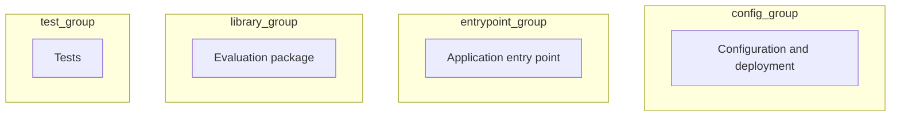

# Architecture report: deepseek-ai/DeepSeek-Coder

> Automated static analysis. **Observed** = directly seen in files/imports/AST; **Inferred** = interpretation from that evidence. Repository code was not executed.

## 1. Repository at a glance

| Item | Value |
| --- | --- |
| Repository | deepseek-ai/DeepSeek-Coder |
| Description | DeepSeek Coder: Let the Code Write Itself |
| Language | Python |
| Stars | 24371 |
| Licence | MIT |
| Analysed commit / branch | 2f9fd85927c669dae3c0fbb2d607274023af243e / main |
| Framework(s) | None detected |
| Files analysed | 57 |
| Components | 4 |

## 2. Architecture in one minute

deepseek-ai/DeepSeek-Coder - DeepSeek Coder: Let the Code Write Itself. This repository was analysed statically from 57 file(s) (32 Python). Detected technologies (observed from imports/manifests): NumPy, pandas. Files are grouped into 4 component(s): Configuration and deployment, Application entry point, Evaluation package, Tests. Observed entry point(s): Evaluation/HumanEval/eval_instruct.py, Evaluation/HumanEval/eval_pal.py, Evaluation/LeetCode/evaluate_leetcode.py. Findings below distinguish observed facts from inferred interpretation.

## 3. High-level block diagram

## 4. Main components

### Configuration and deployment (`config`)

- **Kind:** config
- **Status:** Observed
- **Confidence:** 0.85
- **Responsibility:** Groups 3 file(s) under configuration and deployment (observed from repository paths and static analysis).
- **Paths:** `finetune/configs/ds_config_zero3.json`, `finetune/requirements.txt`, `requirements.txt`
- **Evidence:** [finetune/configs/ds_config_zero3.json](https://github.com/deepseek-ai/DeepSeek-Coder/blob/2f9fd85927c669dae3c0fbb2d607274023af243e/finetune/configs/ds_config_zero3.json); [finetune/requirements.txt](https://github.com/deepseek-ai/DeepSeek-Coder/blob/2f9fd85927c669dae3c0fbb2d607274023af243e/finetune/requirements.txt); [requirements.txt](https://github.com/deepseek-ai/DeepSeek-Coder/blob/2f9fd85927c669dae3c0fbb2d607274023af243e/requirements.txt)

### Application entry point (`entrypoint`)

- **Kind:** entrypoint
- **Status:** Observed
- **Confidence:** 0.85
- **Responsibility:** Groups 11 file(s) under application entry point (observed from repository paths and static analysis). Observed top-level classes: ColorObjectRuntime, CustomDict, DataArguments, DataCollatorForSupervisedDataset, DateRuntime, GenericRuntime. Observed top-level functions: _test, _test_math_equal, _tokenize_fn, build_deepseekcoder_instruction, build_instruction_prompt, call_with_timeout.
- **Paths:** `Evaluation/HumanEval/eval_instruct.py`, `Evaluation/HumanEval/eval_pal.py`, `Evaluation/LeetCode/evaluate_leetcode.py`, `Evaluation/LeetCode/vllm_inference.py`, `Evaluation/MBPP/eval_instruct.py`, `Evaluation/MBPP/eval_pal.py`, `Evaluation/PAL-Math/run.py`, `Evaluation/PAL-Math/utils/grader.py`, `Evaluation/PAL-Math/utils/python_executor.py`, `demo/app.py`, `finetune/finetune_deepseekcoder.py`
- **Evidence:** [Evaluation/HumanEval/eval_instruct.py:14](https://github.com/deepseek-ai/DeepSeek-Coder/blob/2f9fd85927c669dae3c0fbb2d607274023af243e/Evaluation/HumanEval/eval_instruct.py#L14); [Evaluation/HumanEval/eval_pal.py](https://github.com/deepseek-ai/DeepSeek-Coder/blob/2f9fd85927c669dae3c0fbb2d607274023af243e/Evaluation/HumanEval/eval_pal.py); [Evaluation/LeetCode/evaluate_leetcode.py:11](https://github.com/deepseek-ai/DeepSeek-Coder/blob/2f9fd85927c669dae3c0fbb2d607274023af243e/Evaluation/LeetCode/evaluate_leetcode.py#L11); [Evaluation/LeetCode/vllm_inference.py:8](https://github.com/deepseek-ai/DeepSeek-Coder/blob/2f9fd85927c669dae3c0fbb2d607274023af243e/Evaluation/LeetCode/vllm_inference.py#L8); [Evaluation/MBPP/eval_instruct.py:14](https://github.com/deepseek-ai/DeepSeek-Coder/blob/2f9fd85927c669dae3c0fbb2d607274023af243e/Evaluation/MBPP/eval_instruct.py#L14); [Evaluation/MBPP/eval_pal.py](https://github.com/deepseek-ai/DeepSeek-Coder/blob/2f9fd85927c669dae3c0fbb2d607274023af243e/Evaluation/MBPP/eval_pal.py); [Evaluation/PAL-Math/run.py:13](https://github.com/deepseek-ai/DeepSeek-Coder/blob/2f9fd85927c669dae3c0fbb2d607274023af243e/Evaluation/PAL-Math/run.py#L13); [Evaluation/PAL-Math/utils/grader.py:15](https://github.com/deepseek-ai/DeepSeek-Coder/blob/2f9fd85927c669dae3c0fbb2d607274023af243e/Evaluation/PAL-Math/utils/grader.py#L15)

### Evaluation package (`evaluation`)

- **Kind:** library
- **Status:** Observed
- **Confidence:** 0.85
- **Responsibility:** Groups 23 file(s) under evaluation package (observed from repository paths and static analysis). Observed top-level classes: HumanEval, HumanEvalDataset, KeywordsStoppingCriteria, MBPP, MBPPDataset, TimeoutException. Observed top-level functions: _clean_python_code_for_sft, _fix_a_slash_b, _fix_fracs, _fix_sqrt, _truncate_code_at_stopwords, chdir.
- **Paths:** `Evaluation/HumanEval/eval.sh`, `Evaluation/HumanEval/human_eval/__init__.py`, `Evaluation/HumanEval/human_eval/data.py`, `Evaluation/HumanEval/human_eval/evaluate_functional_correctness.py`, `Evaluation/HumanEval/human_eval/evaluation.py`, `Evaluation/HumanEval/human_eval/execution.py`, `Evaluation/HumanEval/humaneval.py`, `Evaluation/HumanEval/utils/dataset.py`, `Evaluation/HumanEval/utils/utils.py`, `Evaluation/LeetCode/human_eval/__init__.py`, `Evaluation/LeetCode/human_eval/data.py`, `Evaluation/LeetCode/human_eval/evaluation.py`, `Evaluation/LeetCode/human_eval/execution.py`, `Evaluation/MBPP/eval.sh`, `Evaluation/MBPP/human_eval/__init__.py`, `Evaluation/MBPP/human_eval/data.py`, `Evaluation/MBPP/human_eval/evaluate_functional_correctness.py`, `Evaluation/MBPP/human_eval/evaluation.py`, `Evaluation/MBPP/human_eval/execution.py`, `Evaluation/MBPP/mbpp.py`, `Evaluation/MBPP/utils/dataset.py`, `Evaluation/MBPP/utils/utils.py`, `Evaluation/PAL-Math/utils/parser.py`
- **Evidence:** [Evaluation/HumanEval/eval.sh](https://github.com/deepseek-ai/DeepSeek-Coder/blob/2f9fd85927c669dae3c0fbb2d607274023af243e/Evaluation/HumanEval/eval.sh); [Evaluation/HumanEval/human_eval/__init__.py](https://github.com/deepseek-ai/DeepSeek-Coder/blob/2f9fd85927c669dae3c0fbb2d607274023af243e/Evaluation/HumanEval/human_eval/__init__.py); [Evaluation/HumanEval/human_eval/data.py:11](https://github.com/deepseek-ai/DeepSeek-Coder/blob/2f9fd85927c669dae3c0fbb2d607274023af243e/Evaluation/HumanEval/human_eval/data.py#L11); [Evaluation/HumanEval/human_eval/evaluate_functional_correctness.py:8](https://github.com/deepseek-ai/DeepSeek-Coder/blob/2f9fd85927c669dae3c0fbb2d607274023af243e/Evaluation/HumanEval/human_eval/evaluate_functional_correctness.py#L8); [Evaluation/HumanEval/human_eval/evaluation.py:71](https://github.com/deepseek-ai/DeepSeek-Coder/blob/2f9fd85927c669dae3c0fbb2d607274023af243e/Evaluation/HumanEval/human_eval/evaluation.py#L71); [Evaluation/HumanEval/human_eval/execution.py:23](https://github.com/deepseek-ai/DeepSeek-Coder/blob/2f9fd85927c669dae3c0fbb2d607274023af243e/Evaluation/HumanEval/human_eval/execution.py#L23); [Evaluation/HumanEval/humaneval.py:18](https://github.com/deepseek-ai/DeepSeek-Coder/blob/2f9fd85927c669dae3c0fbb2d607274023af243e/Evaluation/HumanEval/humaneval.py#L18); [Evaluation/HumanEval/utils/dataset.py:5](https://github.com/deepseek-ai/DeepSeek-Coder/blob/2f9fd85927c669dae3c0fbb2d607274023af243e/Evaluation/HumanEval/utils/dataset.py#L5)

### Tests (`tests`)

- **Kind:** test
- **Status:** Observed
- **Confidence:** 0.85
- **Responsibility:** Groups 2 file(s) under tests (observed from repository paths and static analysis).
- **Paths:** `Evaluation/HumanEval/test_config.yaml`, `Evaluation/MBPP/test_config.yaml`
- **Evidence:** [Evaluation/HumanEval/test_config.yaml](https://github.com/deepseek-ai/DeepSeek-Coder/blob/2f9fd85927c669dae3c0fbb2d607274023af243e/Evaluation/HumanEval/test_config.yaml); [Evaluation/MBPP/test_config.yaml](https://github.com/deepseek-ai/DeepSeek-Coder/blob/2f9fd85927c669dae3c0fbb2d607274023af243e/Evaluation/MBPP/test_config.yaml)

## 5. Execution flow

**Observed** entry point(s):

- [Evaluation/HumanEval/eval_instruct.py:119](https://github.com/deepseek-ai/DeepSeek-Coder/blob/2f9fd85927c669dae3c0fbb2d607274023af243e/Evaluation/HumanEval/eval_instruct.py#L119)
- [Evaluation/HumanEval/eval_pal.py:17](https://github.com/deepseek-ai/DeepSeek-Coder/blob/2f9fd85927c669dae3c0fbb2d607274023af243e/Evaluation/HumanEval/eval_pal.py#L17)
- [Evaluation/LeetCode/evaluate_leetcode.py:74](https://github.com/deepseek-ai/DeepSeek-Coder/blob/2f9fd85927c669dae3c0fbb2d607274023af243e/Evaluation/LeetCode/evaluate_leetcode.py#L74)
- [Evaluation/LeetCode/vllm_inference.py:69](https://github.com/deepseek-ai/DeepSeek-Coder/blob/2f9fd85927c669dae3c0fbb2d607274023af243e/Evaluation/LeetCode/vllm_inference.py#L69)
- [Evaluation/MBPP/eval_instruct.py:131](https://github.com/deepseek-ai/DeepSeek-Coder/blob/2f9fd85927c669dae3c0fbb2d607274023af243e/Evaluation/MBPP/eval_instruct.py#L131)
- [Evaluation/MBPP/eval_pal.py:17](https://github.com/deepseek-ai/DeepSeek-Coder/blob/2f9fd85927c669dae3c0fbb2d607274023af243e/Evaluation/MBPP/eval_pal.py#L17)
- [Evaluation/PAL-Math/run.py:179](https://github.com/deepseek-ai/DeepSeek-Coder/blob/2f9fd85927c669dae3c0fbb2d607274023af243e/Evaluation/PAL-Math/run.py#L179)
- [Evaluation/PAL-Math/utils/grader.py:150](https://github.com/deepseek-ai/DeepSeek-Coder/blob/2f9fd85927c669dae3c0fbb2d607274023af243e/Evaluation/PAL-Math/utils/grader.py#L150)
- [Evaluation/PAL-Math/utils/python_executor.py:179](https://github.com/deepseek-ai/DeepSeek-Coder/blob/2f9fd85927c669dae3c0fbb2d607274023af243e/Evaluation/PAL-Math/utils/python_executor.py#L179)
- [demo/app.py:128](https://github.com/deepseek-ai/DeepSeek-Coder/blob/2f9fd85927c669dae3c0fbb2d607274023af243e/demo/app.py#L128)
- [finetune/finetune_deepseekcoder.py:192](https://github.com/deepseek-ai/DeepSeek-Coder/blob/2f9fd85927c669dae3c0fbb2d607274023af243e/finetune/finetune_deepseekcoder.py#L192)

Representative flow (derived from observed entry points and the import graph; steps beyond the entry point are **Inferred**):

1. Execution starts at an observed entry point listed above, if present.
2. No internal import relationships between components were observed.

## 6. Project structure

### `(root)`

- `.gitignore` - other (73 bytes)
- `LICENSE-CODE` - other (1065 bytes)
- `LICENSE-MODEL` - other (13760 bytes)
- `README.md` - docs (20346 bytes)
- `requirements.txt` - manifest (110 bytes)

### `Evaluation`

- `Evaluation/DS-1000/README.md` - docs (2474 bytes)
- `Evaluation/HumanEval/README.md` - docs (4178 bytes)
- `Evaluation/HumanEval/eval.sh` - source, Shell (274 bytes)
- `Evaluation/HumanEval/eval_instruct.py` - source, Python (4769 bytes)
- `Evaluation/HumanEval/eval_pal.py` - source, Python (1473 bytes)
- `Evaluation/HumanEval/human_eval/__init__.py` - source, Python (0 bytes)
- `Evaluation/HumanEval/human_eval/data.py` - source, Python (1547 bytes)
- `Evaluation/HumanEval/human_eval/evaluate_functional_correctness.py` - source, Python (643 bytes)
- `Evaluation/HumanEval/human_eval/evaluation.py` - source, Python (9954 bytes)
- `Evaluation/HumanEval/human_eval/execution.py` - source, Python (30337 bytes)
- `Evaluation/HumanEval/humaneval.py` - source, Python (7354 bytes)
- `Evaluation/HumanEval/test_config.yaml` - test (306 bytes)
- `Evaluation/HumanEval/utils/dataset.py` - source, Python (2262 bytes)
- `Evaluation/HumanEval/utils/utils.py` - source, Python (4433 bytes)
- `Evaluation/LeetCode/evaluate_leetcode.py` - source, Python (3254 bytes)
- `Evaluation/LeetCode/human_eval/__init__.py` - source, Python (0 bytes)
- `Evaluation/LeetCode/human_eval/data.py` - source, Python (1529 bytes)
- `Evaluation/LeetCode/human_eval/evaluation.py` - source, Python (10357 bytes)
- `Evaluation/LeetCode/human_eval/execution.py` - source, Python (30337 bytes)
- `Evaluation/LeetCode/readme.md` - docs (3060 bytes)
- `Evaluation/LeetCode/vllm_inference.py` - source, Python (3105 bytes)
- `Evaluation/MBPP/README.md` - docs (1888 bytes)
- `Evaluation/MBPP/eval.sh` - source, Shell (283 bytes)
- `Evaluation/MBPP/eval_instruct.py` - source, Python (4810 bytes)
- `Evaluation/MBPP/eval_pal.py` - source, Python (1355 bytes)
- `Evaluation/MBPP/human_eval/__init__.py` - source, Python (0 bytes)
- `Evaluation/MBPP/human_eval/data.py` - source, Python (1547 bytes)
- `Evaluation/MBPP/human_eval/evaluate_functional_correctness.py` - source, Python (643 bytes)
- `Evaluation/MBPP/human_eval/evaluation.py` - source, Python (9951 bytes)
- `Evaluation/MBPP/human_eval/execution.py` - source, Python (30337 bytes)
- `Evaluation/MBPP/mbpp.py` - source, Python (8902 bytes)
- `Evaluation/MBPP/test_config.yaml` - test (306 bytes)
- `Evaluation/MBPP/utils/dataset.py` - source, Python (1682 bytes)
- `Evaluation/MBPP/utils/utils.py` - source, Python (1311 bytes)
- `Evaluation/PAL-Math/README.md` - docs (2945 bytes)
- `Evaluation/PAL-Math/datasets/mawps/addsub.jsonl` - data (70911 bytes)
- `Evaluation/PAL-Math/datasets/mawps/multiarith.jsonl` - data (109522 bytes)
- `Evaluation/PAL-Math/datasets/mawps/singleeq.jsonl` - data (86536 bytes)
- `Evaluation/PAL-Math/datasets/mawps/singleop.jsonl` - data (75278 bytes)
- `Evaluation/PAL-Math/prompts/gsm8k.md` - docs (1730 bytes)
- `Evaluation/PAL-Math/prompts/math.md` - docs (2652 bytes)
- `Evaluation/PAL-Math/run.py` - source, Python (6833 bytes)
- `Evaluation/PAL-Math/utils/grader.py` - source, Python (4791 bytes)
- `Evaluation/PAL-Math/utils/parser.py` - source, Python (10049 bytes)
- `Evaluation/PAL-Math/utils/python_executor.py` - source, Python (5883 bytes)

### `demo`

- `demo/app.py` - source, Python (3912 bytes)
- `demo/requirement.txt` - docs (157 bytes)
- `demo/style.css` - other (204 bytes)

### `finetune`

- `finetune/README.md` - docs (1630 bytes)
- `finetune/configs/ds_config_zero3.json` - config (1348 bytes)
- `finetune/finetune_deepseekcoder.py` - source, Python (6933 bytes)
- `finetune/requirements.txt` - manifest (127 bytes)

## 7. Key dependencies and integrations

| Name | Category | Status | Confidence | Evidence |
| --- | --- | --- | --- | --- |
| NumPy | library | Observed | 0.95 | [Evaluation/HumanEval/eval_pal.py:2](https://github.com/deepseek-ai/DeepSeek-Coder/blob/2f9fd85927c669dae3c0fbb2d607274023af243e/Evaluation/HumanEval/eval_pal.py#L2); [Evaluation/HumanEval/human_eval/evaluation.py:7](https://github.com/deepseek-ai/DeepSeek-Coder/blob/2f9fd85927c669dae3c0fbb2d607274023af243e/Evaluation/HumanEval/human_eval/evaluation.py#L7); [Evaluation/HumanEval/humaneval.py:5](https://github.com/deepseek-ai/DeepSeek-Coder/blob/2f9fd85927c669dae3c0fbb2d607274023af243e/Evaluation/HumanEval/humaneval.py#L5); [Evaluation/HumanEval/utils/dataset.py:2](https://github.com/deepseek-ai/DeepSeek-Coder/blob/2f9fd85927c669dae3c0fbb2d607274023af243e/Evaluation/HumanEval/utils/dataset.py#L2) |
| pandas | library | Observed | 0.95 | [Evaluation/HumanEval/eval_pal.py:3](https://github.com/deepseek-ai/DeepSeek-Coder/blob/2f9fd85927c669dae3c0fbb2d607274023af243e/Evaluation/HumanEval/eval_pal.py#L3); [Evaluation/MBPP/eval_pal.py:3](https://github.com/deepseek-ai/DeepSeek-Coder/blob/2f9fd85927c669dae3c0fbb2d607274023af243e/Evaluation/MBPP/eval_pal.py#L3) |

## 8. Data and state

No database, cache, queue, or persistent-state usage was observed in the analysed files. State handling, if any, may be in-memory or in files that were not analysed.

## 9. Configuration and deployment clues

- `finetune/configs/ds_config_zero3.json` (config)
- `finetune/requirements.txt` (manifest)
- `requirements.txt` (manifest)

## 10. Design observations

- An entry/API layer is separated from other code (Inferred from paths and decorators).
- Tests are present alongside source code (Observed from test file paths).

These observations are interpretations (**Inferred**) of the observed structure, not guarantees about runtime design.

## 11. Limitations and unknowns

- Static analysis only: repository code was not executed, installed, or imported at runtime.
- Components and relationships are inferred from file paths, imports, and AST structure; runtime behaviour, dynamic imports, and reflection may not be visible.
- Repository text was treated as untrusted data; no instructions found in repository files were followed, and likely secret values were redacted/excluded.

## 12. Source references

- [Evaluation/HumanEval/eval.sh](https://github.com/deepseek-ai/DeepSeek-Coder/blob/2f9fd85927c669dae3c0fbb2d607274023af243e/Evaluation/HumanEval/eval.sh)
- [Evaluation/HumanEval/eval_instruct.py:14](https://github.com/deepseek-ai/DeepSeek-Coder/blob/2f9fd85927c669dae3c0fbb2d607274023af243e/Evaluation/HumanEval/eval_instruct.py#L14)
- [Evaluation/HumanEval/eval_instruct.py:119](https://github.com/deepseek-ai/DeepSeek-Coder/blob/2f9fd85927c669dae3c0fbb2d607274023af243e/Evaluation/HumanEval/eval_instruct.py#L119)
- [Evaluation/HumanEval/eval_pal.py](https://github.com/deepseek-ai/DeepSeek-Coder/blob/2f9fd85927c669dae3c0fbb2d607274023af243e/Evaluation/HumanEval/eval_pal.py)
- [Evaluation/HumanEval/eval_pal.py:2](https://github.com/deepseek-ai/DeepSeek-Coder/blob/2f9fd85927c669dae3c0fbb2d607274023af243e/Evaluation/HumanEval/eval_pal.py#L2)
- [Evaluation/HumanEval/eval_pal.py:3](https://github.com/deepseek-ai/DeepSeek-Coder/blob/2f9fd85927c669dae3c0fbb2d607274023af243e/Evaluation/HumanEval/eval_pal.py#L3)
- [Evaluation/HumanEval/eval_pal.py:17](https://github.com/deepseek-ai/DeepSeek-Coder/blob/2f9fd85927c669dae3c0fbb2d607274023af243e/Evaluation/HumanEval/eval_pal.py#L17)
- [Evaluation/HumanEval/human_eval/__init__.py](https://github.com/deepseek-ai/DeepSeek-Coder/blob/2f9fd85927c669dae3c0fbb2d607274023af243e/Evaluation/HumanEval/human_eval/__init__.py)
- [Evaluation/HumanEval/human_eval/data.py:11](https://github.com/deepseek-ai/DeepSeek-Coder/blob/2f9fd85927c669dae3c0fbb2d607274023af243e/Evaluation/HumanEval/human_eval/data.py#L11)
- [Evaluation/HumanEval/human_eval/evaluate_functional_correctness.py:8](https://github.com/deepseek-ai/DeepSeek-Coder/blob/2f9fd85927c669dae3c0fbb2d607274023af243e/Evaluation/HumanEval/human_eval/evaluate_functional_correctness.py#L8)
- [Evaluation/HumanEval/human_eval/evaluation.py:7](https://github.com/deepseek-ai/DeepSeek-Coder/blob/2f9fd85927c669dae3c0fbb2d607274023af243e/Evaluation/HumanEval/human_eval/evaluation.py#L7)
- [Evaluation/HumanEval/human_eval/evaluation.py:71](https://github.com/deepseek-ai/DeepSeek-Coder/blob/2f9fd85927c669dae3c0fbb2d607274023af243e/Evaluation/HumanEval/human_eval/evaluation.py#L71)
- [Evaluation/HumanEval/human_eval/execution.py:23](https://github.com/deepseek-ai/DeepSeek-Coder/blob/2f9fd85927c669dae3c0fbb2d607274023af243e/Evaluation/HumanEval/human_eval/execution.py#L23)
- [Evaluation/HumanEval/humaneval.py:5](https://github.com/deepseek-ai/DeepSeek-Coder/blob/2f9fd85927c669dae3c0fbb2d607274023af243e/Evaluation/HumanEval/humaneval.py#L5)
- [Evaluation/HumanEval/humaneval.py:18](https://github.com/deepseek-ai/DeepSeek-Coder/blob/2f9fd85927c669dae3c0fbb2d607274023af243e/Evaluation/HumanEval/humaneval.py#L18)
- [Evaluation/HumanEval/test_config.yaml](https://github.com/deepseek-ai/DeepSeek-Coder/blob/2f9fd85927c669dae3c0fbb2d607274023af243e/Evaluation/HumanEval/test_config.yaml)
- [Evaluation/HumanEval/utils/dataset.py:2](https://github.com/deepseek-ai/DeepSeek-Coder/blob/2f9fd85927c669dae3c0fbb2d607274023af243e/Evaluation/HumanEval/utils/dataset.py#L2)
- [Evaluation/HumanEval/utils/dataset.py:5](https://github.com/deepseek-ai/DeepSeek-Coder/blob/2f9fd85927c669dae3c0fbb2d607274023af243e/Evaluation/HumanEval/utils/dataset.py#L5)
- [Evaluation/LeetCode/evaluate_leetcode.py:11](https://github.com/deepseek-ai/DeepSeek-Coder/blob/2f9fd85927c669dae3c0fbb2d607274023af243e/Evaluation/LeetCode/evaluate_leetcode.py#L11)
- [Evaluation/LeetCode/evaluate_leetcode.py:74](https://github.com/deepseek-ai/DeepSeek-Coder/blob/2f9fd85927c669dae3c0fbb2d607274023af243e/Evaluation/LeetCode/evaluate_leetcode.py#L74)
- [Evaluation/LeetCode/human_eval/evaluation.py:4](https://github.com/deepseek-ai/DeepSeek-Coder/blob/2f9fd85927c669dae3c0fbb2d607274023af243e/Evaluation/LeetCode/human_eval/evaluation.py#L4)
- [Evaluation/LeetCode/vllm_inference.py:8](https://github.com/deepseek-ai/DeepSeek-Coder/blob/2f9fd85927c669dae3c0fbb2d607274023af243e/Evaluation/LeetCode/vllm_inference.py#L8)
- [Evaluation/LeetCode/vllm_inference.py:69](https://github.com/deepseek-ai/DeepSeek-Coder/blob/2f9fd85927c669dae3c0fbb2d607274023af243e/Evaluation/LeetCode/vllm_inference.py#L69)
- [Evaluation/MBPP/eval_instruct.py:14](https://github.com/deepseek-ai/DeepSeek-Coder/blob/2f9fd85927c669dae3c0fbb2d607274023af243e/Evaluation/MBPP/eval_instruct.py#L14)
- [Evaluation/MBPP/eval_instruct.py:131](https://github.com/deepseek-ai/DeepSeek-Coder/blob/2f9fd85927c669dae3c0fbb2d607274023af243e/Evaluation/MBPP/eval_instruct.py#L131)
- [Evaluation/MBPP/eval_pal.py](https://github.com/deepseek-ai/DeepSeek-Coder/blob/2f9fd85927c669dae3c0fbb2d607274023af243e/Evaluation/MBPP/eval_pal.py)
- [Evaluation/MBPP/eval_pal.py:2](https://github.com/deepseek-ai/DeepSeek-Coder/blob/2f9fd85927c669dae3c0fbb2d607274023af243e/Evaluation/MBPP/eval_pal.py#L2)
- [Evaluation/MBPP/eval_pal.py:3](https://github.com/deepseek-ai/DeepSeek-Coder/blob/2f9fd85927c669dae3c0fbb2d607274023af243e/Evaluation/MBPP/eval_pal.py#L3)
- [Evaluation/MBPP/eval_pal.py:17](https://github.com/deepseek-ai/DeepSeek-Coder/blob/2f9fd85927c669dae3c0fbb2d607274023af243e/Evaluation/MBPP/eval_pal.py#L17)
- [Evaluation/MBPP/human_eval/evaluation.py:4](https://github.com/deepseek-ai/DeepSeek-Coder/blob/2f9fd85927c669dae3c0fbb2d607274023af243e/Evaluation/MBPP/human_eval/evaluation.py#L4)
- [Evaluation/MBPP/mbpp.py:5](https://github.com/deepseek-ai/DeepSeek-Coder/blob/2f9fd85927c669dae3c0fbb2d607274023af243e/Evaluation/MBPP/mbpp.py#L5)
- [Evaluation/MBPP/test_config.yaml](https://github.com/deepseek-ai/DeepSeek-Coder/blob/2f9fd85927c669dae3c0fbb2d607274023af243e/Evaluation/MBPP/test_config.yaml)
- [Evaluation/PAL-Math/run.py:13](https://github.com/deepseek-ai/DeepSeek-Coder/blob/2f9fd85927c669dae3c0fbb2d607274023af243e/Evaluation/PAL-Math/run.py#L13)
- [Evaluation/PAL-Math/run.py:179](https://github.com/deepseek-ai/DeepSeek-Coder/blob/2f9fd85927c669dae3c0fbb2d607274023af243e/Evaluation/PAL-Math/run.py#L179)
- [Evaluation/PAL-Math/utils/grader.py:15](https://github.com/deepseek-ai/DeepSeek-Coder/blob/2f9fd85927c669dae3c0fbb2d607274023af243e/Evaluation/PAL-Math/utils/grader.py#L15)
- [Evaluation/PAL-Math/utils/grader.py:150](https://github.com/deepseek-ai/DeepSeek-Coder/blob/2f9fd85927c669dae3c0fbb2d607274023af243e/Evaluation/PAL-Math/utils/grader.py#L150)
- [Evaluation/PAL-Math/utils/python_executor.py:179](https://github.com/deepseek-ai/DeepSeek-Coder/blob/2f9fd85927c669dae3c0fbb2d607274023af243e/Evaluation/PAL-Math/utils/python_executor.py#L179)
- [demo/app.py:128](https://github.com/deepseek-ai/DeepSeek-Coder/blob/2f9fd85927c669dae3c0fbb2d607274023af243e/demo/app.py#L128)
- [finetune/configs/ds_config_zero3.json](https://github.com/deepseek-ai/DeepSeek-Coder/blob/2f9fd85927c669dae3c0fbb2d607274023af243e/finetune/configs/ds_config_zero3.json)
- [finetune/finetune_deepseekcoder.py:192](https://github.com/deepseek-ai/DeepSeek-Coder/blob/2f9fd85927c669dae3c0fbb2d607274023af243e/finetune/finetune_deepseekcoder.py#L192)
- [finetune/requirements.txt](https://github.com/deepseek-ai/DeepSeek-Coder/blob/2f9fd85927c669dae3c0fbb2d607274023af243e/finetune/requirements.txt)
- [requirements.txt](https://github.com/deepseek-ai/DeepSeek-Coder/blob/2f9fd85927c669dae3c0fbb2d607274023af243e/requirements.txt)
