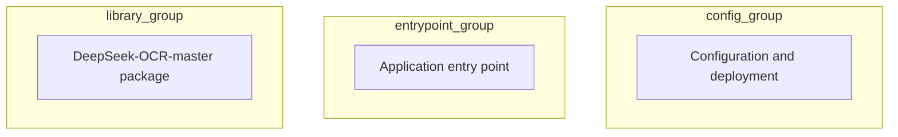

# Architecture report: deepseek-ai/DeepSeek-OCR

> Automated static analysis. **Observed** = directly seen in files/imports/AST; **Inferred** = interpretation from that evidence. Repository code was not executed.

## 1. Repository at a glance

| Item | Value |
| --- | --- |
| Repository | deepseek-ai/DeepSeek-OCR |
| Description | Contexts Optical Compression |
| Language | Python |
| Stars | 24162 |
| Licence | MIT |
| Analysed commit / branch | 09eaf526153e7a01ed16c9dea8c96282aaea29c0 / main |
| Framework(s) | None detected |
| Files analysed | 18 |
| Components | 3 |

## 2. Architecture in one minute

deepseek-ai/DeepSeek-OCR - Contexts Optical Compression. This repository was analysed statically from 18 file(s) (13 Python). Detected technologies (observed from imports/manifests): NumPy. Files are grouped into 3 component(s): Configuration and deployment, DeepSeek-OCR-master package, Application entry point. Observed entry point(s): DeepSeek-OCR-master/DeepSeek-OCR-vllm/deepencoder/clip_sdpa.py, DeepSeek-OCR-master/DeepSeek-OCR-vllm/run_dpsk_ocr_eval_batch.py, DeepSeek-OCR-master/DeepSeek-OCR-vllm/run_dpsk_ocr_image.py. Findings below distinguish observed facts from inferred interpretation.

## 3. High-level block diagram

## 4. Main components

### Configuration and deployment (`config`)

- **Kind:** config
- **Status:** Observed
- **Confidence:** 0.85
- **Responsibility:** Groups 2 file(s) under configuration and deployment (observed from repository paths and static analysis).
- **Paths:** `DeepSeek-OCR-master/DeepSeek-OCR-vllm/config.py`, `requirements.txt`
- **Evidence:** [DeepSeek-OCR-master/DeepSeek-OCR-vllm/config.py](https://github.com/deepseek-ai/DeepSeek-OCR/blob/09eaf526153e7a01ed16c9dea8c96282aaea29c0/DeepSeek-OCR-master/DeepSeek-OCR-vllm/config.py); [requirements.txt](https://github.com/deepseek-ai/DeepSeek-OCR/blob/09eaf526153e7a01ed16c9dea8c96282aaea29c0/requirements.txt)

### DeepSeek-OCR-master package (`deepseek_ocr_master`)

- **Kind:** library
- **Status:** Observed
- **Confidence:** 0.85
- **Responsibility:** Groups 8 file(s) under deepseek-ocr-master package (observed from repository paths and static analysis). Observed top-level classes: Attention, Block, DeepseekOCRDummyInputsBuilder, DeepseekOCRForCausalLM, DeepseekOCRMultiModalProcessor, DeepseekOCRProcessingInfo. Observed top-level functions: _build_sam, add_decomposed_rel_pos, build_sam_vit_b, count_tiles, dynamic_preprocess, find_closest_aspect_ratio.
- **Paths:** `DeepSeek-OCR-master/DeepSeek-OCR-hf/run_dpsk_ocr.py`, `DeepSeek-OCR-master/DeepSeek-OCR-vllm/deepencoder/__init__.py`, `DeepSeek-OCR-master/DeepSeek-OCR-vllm/deepencoder/build_linear.py`, `DeepSeek-OCR-master/DeepSeek-OCR-vllm/deepencoder/sam_vary_sdpa.py`, `DeepSeek-OCR-master/DeepSeek-OCR-vllm/deepseek_ocr.py`, `DeepSeek-OCR-master/DeepSeek-OCR-vllm/process/__init__.py`, `DeepSeek-OCR-master/DeepSeek-OCR-vllm/process/image_process.py`, `DeepSeek-OCR-master/DeepSeek-OCR-vllm/process/ngram_norepeat.py`
- **Evidence:** [DeepSeek-OCR-master/DeepSeek-OCR-hf/run_dpsk_ocr.py](https://github.com/deepseek-ai/DeepSeek-OCR/blob/09eaf526153e7a01ed16c9dea8c96282aaea29c0/DeepSeek-OCR-master/DeepSeek-OCR-hf/run_dpsk_ocr.py); [DeepSeek-OCR-master/DeepSeek-OCR-vllm/deepencoder/__init__.py](https://github.com/deepseek-ai/DeepSeek-OCR/blob/09eaf526153e7a01ed16c9dea8c96282aaea29c0/DeepSeek-OCR-master/DeepSeek-OCR-vllm/deepencoder/__init__.py); [DeepSeek-OCR-master/DeepSeek-OCR-vllm/deepencoder/build_linear.py:7](https://github.com/deepseek-ai/DeepSeek-OCR/blob/09eaf526153e7a01ed16c9dea8c96282aaea29c0/DeepSeek-OCR-master/DeepSeek-OCR-vllm/deepencoder/build_linear.py#L7); [DeepSeek-OCR-master/DeepSeek-OCR-vllm/deepencoder/sam_vary_sdpa.py:19](https://github.com/deepseek-ai/DeepSeek-OCR/blob/09eaf526153e7a01ed16c9dea8c96282aaea29c0/DeepSeek-OCR-master/DeepSeek-OCR-vllm/deepencoder/sam_vary_sdpa.py#L19); [DeepSeek-OCR-master/DeepSeek-OCR-vllm/deepseek_ocr.py:50](https://github.com/deepseek-ai/DeepSeek-OCR/blob/09eaf526153e7a01ed16c9dea8c96282aaea29c0/DeepSeek-OCR-master/DeepSeek-OCR-vllm/deepseek_ocr.py#L50); [DeepSeek-OCR-master/DeepSeek-OCR-vllm/process/__init__.py](https://github.com/deepseek-ai/DeepSeek-OCR/blob/09eaf526153e7a01ed16c9dea8c96282aaea29c0/DeepSeek-OCR-master/DeepSeek-OCR-vllm/process/__init__.py); [DeepSeek-OCR-master/DeepSeek-OCR-vllm/process/image_process.py:11](https://github.com/deepseek-ai/DeepSeek-OCR/blob/09eaf526153e7a01ed16c9dea8c96282aaea29c0/DeepSeek-OCR-master/DeepSeek-OCR-vllm/process/image_process.py#L11); [DeepSeek-OCR-master/DeepSeek-OCR-vllm/process/ngram_norepeat.py:7](https://github.com/deepseek-ai/DeepSeek-OCR/blob/09eaf526153e7a01ed16c9dea8c96282aaea29c0/DeepSeek-OCR-master/DeepSeek-OCR-vllm/process/ngram_norepeat.py#L7)

### Application entry point (`entrypoint`)

- **Kind:** entrypoint
- **Status:** Observed
- **Confidence:** 0.85
- **Responsibility:** Groups 4 file(s) under application entry point (observed from repository paths and static analysis). Observed top-level classes: CLIPVisionEmbeddings, Colors, LayerNormfp32, NoTPAttention, NoTPFeedForward, NoTPTransformer. Observed top-level functions: build_clip_l, clean_formula, draw_bounding_boxes, extract_coordinates_and_label, get_abs_pos, load_image.
- **Paths:** `DeepSeek-OCR-master/DeepSeek-OCR-vllm/deepencoder/clip_sdpa.py`, `DeepSeek-OCR-master/DeepSeek-OCR-vllm/run_dpsk_ocr_eval_batch.py`, `DeepSeek-OCR-master/DeepSeek-OCR-vllm/run_dpsk_ocr_image.py`, `DeepSeek-OCR-master/DeepSeek-OCR-vllm/run_dpsk_ocr_pdf.py`
- **Evidence:** [DeepSeek-OCR-master/DeepSeek-OCR-vllm/deepencoder/clip_sdpa.py:54](https://github.com/deepseek-ai/DeepSeek-OCR/blob/09eaf526153e7a01ed16c9dea8c96282aaea29c0/DeepSeek-OCR-master/DeepSeek-OCR-vllm/deepencoder/clip_sdpa.py#L54); [DeepSeek-OCR-master/DeepSeek-OCR-vllm/run_dpsk_ocr_eval_batch.py:46](https://github.com/deepseek-ai/DeepSeek-OCR/blob/09eaf526153e7a01ed16c9dea8c96282aaea29c0/DeepSeek-OCR-master/DeepSeek-OCR-vllm/run_dpsk_ocr_eval_batch.py#L46); [DeepSeek-OCR-master/DeepSeek-OCR-vllm/run_dpsk_ocr_image.py:28](https://github.com/deepseek-ai/DeepSeek-OCR/blob/09eaf526153e7a01ed16c9dea8c96282aaea29c0/DeepSeek-OCR-master/DeepSeek-OCR-vllm/run_dpsk_ocr_image.py#L28); [DeepSeek-OCR-master/DeepSeek-OCR-vllm/run_dpsk_ocr_pdf.py:57](https://github.com/deepseek-ai/DeepSeek-OCR/blob/09eaf526153e7a01ed16c9dea8c96282aaea29c0/DeepSeek-OCR-master/DeepSeek-OCR-vllm/run_dpsk_ocr_pdf.py#L57)

## 5. Execution flow

**Observed** entry point(s):

- [DeepSeek-OCR-master/DeepSeek-OCR-vllm/deepencoder/clip_sdpa.py:455](https://github.com/deepseek-ai/DeepSeek-OCR/blob/09eaf526153e7a01ed16c9dea8c96282aaea29c0/DeepSeek-OCR-master/DeepSeek-OCR-vllm/deepencoder/clip_sdpa.py#L455)
- [DeepSeek-OCR-master/DeepSeek-OCR-vllm/run_dpsk_ocr_eval_batch.py:91](https://github.com/deepseek-ai/DeepSeek-OCR/blob/09eaf526153e7a01ed16c9dea8c96282aaea29c0/DeepSeek-OCR-master/DeepSeek-OCR-vllm/run_dpsk_ocr_eval_batch.py#L91)
- [DeepSeek-OCR-master/DeepSeek-OCR-vllm/run_dpsk_ocr_image.py:204](https://github.com/deepseek-ai/DeepSeek-OCR/blob/09eaf526153e7a01ed16c9dea8c96282aaea29c0/DeepSeek-OCR-master/DeepSeek-OCR-vllm/run_dpsk_ocr_image.py#L204)
- [DeepSeek-OCR-master/DeepSeek-OCR-vllm/run_dpsk_ocr_pdf.py:233](https://github.com/deepseek-ai/DeepSeek-OCR/blob/09eaf526153e7a01ed16c9dea8c96282aaea29c0/DeepSeek-OCR-master/DeepSeek-OCR-vllm/run_dpsk_ocr_pdf.py#L233)

Representative flow (derived from observed entry points and the import graph; steps beyond the entry point are **Inferred**):

1. Execution starts at an observed entry point listed above, if present.
2. No internal import relationships between components were observed.

## 6. Project structure

### `(root)`

- `LICENSE` - docs (1065 bytes)
- `README.md` - docs (7846 bytes)
- `requirements.txt` - manifest (93 bytes)

### `DeepSeek-OCR-master`

- `DeepSeek-OCR-master/DeepSeek-OCR-hf/run_dpsk_ocr.py` - source, Python (1263 bytes)
- `DeepSeek-OCR-master/DeepSeek-OCR-vllm/config.py` - source, Python (1542 bytes)
- `DeepSeek-OCR-master/DeepSeek-OCR-vllm/deepencoder/__init__.py` - source, Python (0 bytes)
- `DeepSeek-OCR-master/DeepSeek-OCR-vllm/deepencoder/build_linear.py` - source, Python (7258 bytes)
- `DeepSeek-OCR-master/DeepSeek-OCR-vllm/deepencoder/clip_sdpa.py` - source, Python (16340 bytes)
- `DeepSeek-OCR-master/DeepSeek-OCR-vllm/deepencoder/sam_vary_sdpa.py` - source, Python (19353 bytes)
- `DeepSeek-OCR-master/DeepSeek-OCR-vllm/deepseek_ocr.py` - source, Python (21888 bytes)
- `DeepSeek-OCR-master/DeepSeek-OCR-vllm/process/__init__.py` - source, Python (0 bytes)
- `DeepSeek-OCR-master/DeepSeek-OCR-vllm/process/image_process.py` - source, Python (20093 bytes)
- `DeepSeek-OCR-master/DeepSeek-OCR-vllm/process/ngram_norepeat.py` - source, Python (1672 bytes)
- `DeepSeek-OCR-master/DeepSeek-OCR-vllm/run_dpsk_ocr_eval_batch.py` - source, Python (4500 bytes)
- `DeepSeek-OCR-master/DeepSeek-OCR-vllm/run_dpsk_ocr_image.py` - source, Python (9765 bytes)
- `DeepSeek-OCR-master/DeepSeek-OCR-vllm/run_dpsk_ocr_pdf.py` - source, Python (9864 bytes)

### `assets`

- `assets/badge.svg` - other (6179 bytes)
- `assets/logo.svg` - other (10656 bytes)

## 7. Key dependencies and integrations

| Name | Category | Status | Confidence | Evidence |
| --- | --- | --- | --- | --- |
| NumPy | library | Observed | 0.95 | [DeepSeek-OCR-master/DeepSeek-OCR-vllm/run_dpsk_ocr_image.py:18](https://github.com/deepseek-ai/DeepSeek-OCR/blob/09eaf526153e7a01ed16c9dea8c96282aaea29c0/DeepSeek-OCR-master/DeepSeek-OCR-vllm/run_dpsk_ocr_image.py#L18); [DeepSeek-OCR-master/DeepSeek-OCR-vllm/run_dpsk_ocr_pdf.py:20](https://github.com/deepseek-ai/DeepSeek-OCR/blob/09eaf526153e7a01ed16c9dea8c96282aaea29c0/DeepSeek-OCR-master/DeepSeek-OCR-vllm/run_dpsk_ocr_pdf.py#L20); [requirements.txt:9](https://github.com/deepseek-ai/DeepSeek-OCR/blob/09eaf526153e7a01ed16c9dea8c96282aaea29c0/requirements.txt#L9) |

## 8. Data and state

No database, cache, queue, or persistent-state usage was observed in the analysed files. State handling, if any, may be in-memory or in files that were not analysed.

## 9. Configuration and deployment clues

- `requirements.txt` (manifest)

## 10. Design observations

- An entry/API layer is separated from other code (Inferred from paths and decorators).

These observations are interpretations (**Inferred**) of the observed structure, not guarantees about runtime design.

## 11. Limitations and unknowns

- Static analysis only: repository code was not executed, installed, or imported at runtime.
- Components and relationships are inferred from file paths, imports, and AST structure; runtime behaviour, dynamic imports, and reflection may not be visible.
- Repository text was treated as untrusted data; no instructions found in repository files were followed, and likely secret values were redacted/excluded.

## 12. Source references

- [DeepSeek-OCR-master/DeepSeek-OCR-hf/run_dpsk_ocr.py](https://github.com/deepseek-ai/DeepSeek-OCR/blob/09eaf526153e7a01ed16c9dea8c96282aaea29c0/DeepSeek-OCR-master/DeepSeek-OCR-hf/run_dpsk_ocr.py)
- [DeepSeek-OCR-master/DeepSeek-OCR-vllm/config.py](https://github.com/deepseek-ai/DeepSeek-OCR/blob/09eaf526153e7a01ed16c9dea8c96282aaea29c0/DeepSeek-OCR-master/DeepSeek-OCR-vllm/config.py)
- [DeepSeek-OCR-master/DeepSeek-OCR-vllm/deepencoder/__init__.py](https://github.com/deepseek-ai/DeepSeek-OCR/blob/09eaf526153e7a01ed16c9dea8c96282aaea29c0/DeepSeek-OCR-master/DeepSeek-OCR-vllm/deepencoder/__init__.py)
- [DeepSeek-OCR-master/DeepSeek-OCR-vllm/deepencoder/build_linear.py:7](https://github.com/deepseek-ai/DeepSeek-OCR/blob/09eaf526153e7a01ed16c9dea8c96282aaea29c0/DeepSeek-OCR-master/DeepSeek-OCR-vllm/deepencoder/build_linear.py#L7)
- [DeepSeek-OCR-master/DeepSeek-OCR-vllm/deepencoder/clip_sdpa.py:54](https://github.com/deepseek-ai/DeepSeek-OCR/blob/09eaf526153e7a01ed16c9dea8c96282aaea29c0/DeepSeek-OCR-master/DeepSeek-OCR-vllm/deepencoder/clip_sdpa.py#L54)
- [DeepSeek-OCR-master/DeepSeek-OCR-vllm/deepencoder/clip_sdpa.py:455](https://github.com/deepseek-ai/DeepSeek-OCR/blob/09eaf526153e7a01ed16c9dea8c96282aaea29c0/DeepSeek-OCR-master/DeepSeek-OCR-vllm/deepencoder/clip_sdpa.py#L455)
- [DeepSeek-OCR-master/DeepSeek-OCR-vllm/deepencoder/sam_vary_sdpa.py:19](https://github.com/deepseek-ai/DeepSeek-OCR/blob/09eaf526153e7a01ed16c9dea8c96282aaea29c0/DeepSeek-OCR-master/DeepSeek-OCR-vllm/deepencoder/sam_vary_sdpa.py#L19)
- [DeepSeek-OCR-master/DeepSeek-OCR-vllm/deepseek_ocr.py:50](https://github.com/deepseek-ai/DeepSeek-OCR/blob/09eaf526153e7a01ed16c9dea8c96282aaea29c0/DeepSeek-OCR-master/DeepSeek-OCR-vllm/deepseek_ocr.py#L50)
- [DeepSeek-OCR-master/DeepSeek-OCR-vllm/process/__init__.py](https://github.com/deepseek-ai/DeepSeek-OCR/blob/09eaf526153e7a01ed16c9dea8c96282aaea29c0/DeepSeek-OCR-master/DeepSeek-OCR-vllm/process/__init__.py)
- [DeepSeek-OCR-master/DeepSeek-OCR-vllm/process/image_process.py:11](https://github.com/deepseek-ai/DeepSeek-OCR/blob/09eaf526153e7a01ed16c9dea8c96282aaea29c0/DeepSeek-OCR-master/DeepSeek-OCR-vllm/process/image_process.py#L11)
- [DeepSeek-OCR-master/DeepSeek-OCR-vllm/process/ngram_norepeat.py:7](https://github.com/deepseek-ai/DeepSeek-OCR/blob/09eaf526153e7a01ed16c9dea8c96282aaea29c0/DeepSeek-OCR-master/DeepSeek-OCR-vllm/process/ngram_norepeat.py#L7)
- [DeepSeek-OCR-master/DeepSeek-OCR-vllm/run_dpsk_ocr_eval_batch.py:46](https://github.com/deepseek-ai/DeepSeek-OCR/blob/09eaf526153e7a01ed16c9dea8c96282aaea29c0/DeepSeek-OCR-master/DeepSeek-OCR-vllm/run_dpsk_ocr_eval_batch.py#L46)
- [DeepSeek-OCR-master/DeepSeek-OCR-vllm/run_dpsk_ocr_eval_batch.py:91](https://github.com/deepseek-ai/DeepSeek-OCR/blob/09eaf526153e7a01ed16c9dea8c96282aaea29c0/DeepSeek-OCR-master/DeepSeek-OCR-vllm/run_dpsk_ocr_eval_batch.py#L91)
- [DeepSeek-OCR-master/DeepSeek-OCR-vllm/run_dpsk_ocr_image.py:18](https://github.com/deepseek-ai/DeepSeek-OCR/blob/09eaf526153e7a01ed16c9dea8c96282aaea29c0/DeepSeek-OCR-master/DeepSeek-OCR-vllm/run_dpsk_ocr_image.py#L18)
- [DeepSeek-OCR-master/DeepSeek-OCR-vllm/run_dpsk_ocr_image.py:28](https://github.com/deepseek-ai/DeepSeek-OCR/blob/09eaf526153e7a01ed16c9dea8c96282aaea29c0/DeepSeek-OCR-master/DeepSeek-OCR-vllm/run_dpsk_ocr_image.py#L28)
- [DeepSeek-OCR-master/DeepSeek-OCR-vllm/run_dpsk_ocr_image.py:204](https://github.com/deepseek-ai/DeepSeek-OCR/blob/09eaf526153e7a01ed16c9dea8c96282aaea29c0/DeepSeek-OCR-master/DeepSeek-OCR-vllm/run_dpsk_ocr_image.py#L204)
- [DeepSeek-OCR-master/DeepSeek-OCR-vllm/run_dpsk_ocr_pdf.py:20](https://github.com/deepseek-ai/DeepSeek-OCR/blob/09eaf526153e7a01ed16c9dea8c96282aaea29c0/DeepSeek-OCR-master/DeepSeek-OCR-vllm/run_dpsk_ocr_pdf.py#L20)
- [DeepSeek-OCR-master/DeepSeek-OCR-vllm/run_dpsk_ocr_pdf.py:57](https://github.com/deepseek-ai/DeepSeek-OCR/blob/09eaf526153e7a01ed16c9dea8c96282aaea29c0/DeepSeek-OCR-master/DeepSeek-OCR-vllm/run_dpsk_ocr_pdf.py#L57)
- [DeepSeek-OCR-master/DeepSeek-OCR-vllm/run_dpsk_ocr_pdf.py:233](https://github.com/deepseek-ai/DeepSeek-OCR/blob/09eaf526153e7a01ed16c9dea8c96282aaea29c0/DeepSeek-OCR-master/DeepSeek-OCR-vllm/run_dpsk_ocr_pdf.py#L233)
- [requirements.txt](https://github.com/deepseek-ai/DeepSeek-OCR/blob/09eaf526153e7a01ed16c9dea8c96282aaea29c0/requirements.txt)
- [requirements.txt:9](https://github.com/deepseek-ai/DeepSeek-OCR/blob/09eaf526153e7a01ed16c9dea8c96282aaea29c0/requirements.txt#L9)
