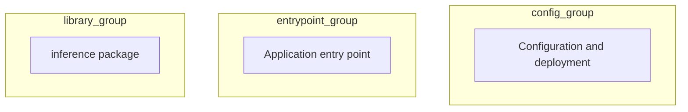

# Architecture report: deepseek-ai/DeepSeek-V3

> Automated static analysis. **Observed** = directly seen in files/imports/AST; **Inferred** = interpretation from that evidence. Repository code was not executed.

## 1. Repository at a glance

| Item | Value |
| --- | --- |
| Repository | deepseek-ai/DeepSeek-V3 |
| Description | Not provided |
| Language | Python |
| Stars | 104827 |
| Licence | MIT |
| Analysed commit / branch | 9b4e9788e4a3a731f7567338ed15d3ec549ce03b / main |
| Framework(s) | None detected |
| Files analysed | 18 |
| Components | 3 |

## 2. Architecture in one minute

deepseek-ai/DeepSeek-V3. This repository was analysed statically from 18 file(s) (5 Python). Detected technologies (observed from imports/manifests): GitHub Actions. Files are grouped into 3 component(s): Configuration and deployment, Application entry point, inference package. Observed entry point(s): inference/convert.py, inference/fp8_cast_bf16.py, inference/generate.py. Findings below distinguish observed facts from inferred interpretation.

## 3. High-level block diagram

## 4. Main components

### Configuration and deployment (`config`)

- **Kind:** config
- **Status:** Observed
- **Confidence:** 0.85
- **Responsibility:** Groups 5 file(s) under configuration and deployment (observed from repository paths and static analysis).
- **Paths:** `inference/configs/config_16B.json`, `inference/configs/config_236B.json`, `inference/configs/config_671B.json`, `inference/configs/config_v3.1.json`, `inference/requirements.txt`
- **Evidence:** [inference/configs/config_16B.json](https://github.com/deepseek-ai/DeepSeek-V3/blob/9b4e9788e4a3a731f7567338ed15d3ec549ce03b/inference/configs/config_16B.json); [inference/configs/config_236B.json](https://github.com/deepseek-ai/DeepSeek-V3/blob/9b4e9788e4a3a731f7567338ed15d3ec549ce03b/inference/configs/config_236B.json); [inference/configs/config_671B.json](https://github.com/deepseek-ai/DeepSeek-V3/blob/9b4e9788e4a3a731f7567338ed15d3ec549ce03b/inference/configs/config_671B.json); [inference/configs/config_v3.1.json](https://github.com/deepseek-ai/DeepSeek-V3/blob/9b4e9788e4a3a731f7567338ed15d3ec549ce03b/inference/configs/config_v3.1.json); [inference/requirements.txt](https://github.com/deepseek-ai/DeepSeek-V3/blob/9b4e9788e4a3a731f7567338ed15d3ec549ce03b/inference/requirements.txt)

### Application entry point (`entrypoint`)

- **Kind:** entrypoint
- **Status:** Observed
- **Confidence:** 0.85
- **Responsibility:** Groups 4 file(s) under application entry point (observed from repository paths and static analysis). Observed top-level classes: Block, ColumnParallelLinear, Expert, Gate, Linear, MLA. Observed top-level functions: apply_rotary_emb, generate, linear, main, precompute_freqs_cis, sample.
- **Paths:** `inference/convert.py`, `inference/fp8_cast_bf16.py`, `inference/generate.py`, `inference/model.py`
- **Evidence:** [inference/convert.py:33](https://github.com/deepseek-ai/DeepSeek-V3/blob/9b4e9788e4a3a731f7567338ed15d3ec549ce03b/inference/convert.py#L33); [inference/fp8_cast_bf16.py:12](https://github.com/deepseek-ai/DeepSeek-V3/blob/9b4e9788e4a3a731f7567338ed15d3ec549ce03b/inference/fp8_cast_bf16.py#L12); [inference/generate.py:14](https://github.com/deepseek-ai/DeepSeek-V3/blob/9b4e9788e4a3a731f7567338ed15d3ec549ce03b/inference/generate.py#L14); [inference/model.py:20](https://github.com/deepseek-ai/DeepSeek-V3/blob/9b4e9788e4a3a731f7567338ed15d3ec549ce03b/inference/model.py#L20)

### inference package (`inference`)

- **Kind:** library
- **Status:** Observed
- **Confidence:** 0.85
- **Responsibility:** Groups 1 file(s) under inference package (observed from repository paths and static analysis). Observed top-level functions: act_quant, act_quant_kernel, fp8_gemm, fp8_gemm_kernel, weight_dequant, weight_dequant_kernel.
- **Paths:** `inference/kernel.py`
- **Evidence:** [inference/kernel.py:10](https://github.com/deepseek-ai/DeepSeek-V3/blob/9b4e9788e4a3a731f7567338ed15d3ec549ce03b/inference/kernel.py#L10)

## 5. Execution flow

**Observed** entry point(s):

- [inference/convert.py:88](https://github.com/deepseek-ai/DeepSeek-V3/blob/9b4e9788e4a3a731f7567338ed15d3ec549ce03b/inference/convert.py#L88)
- [inference/fp8_cast_bf16.py:106](https://github.com/deepseek-ai/DeepSeek-V3/blob/9b4e9788e4a3a731f7567338ed15d3ec549ce03b/inference/fp8_cast_bf16.py#L106)
- [inference/generate.py:161](https://github.com/deepseek-ai/DeepSeek-V3/blob/9b4e9788e4a3a731f7567338ed15d3ec549ce03b/inference/generate.py#L161)
- [inference/model.py:801](https://github.com/deepseek-ai/DeepSeek-V3/blob/9b4e9788e4a3a731f7567338ed15d3ec549ce03b/inference/model.py#L801)

Representative flow (derived from observed entry points and the import graph; steps beyond the entry point are **Inferred**):

1. Execution starts at an observed entry point listed above, if present.
2. No internal import relationships between components were observed.

## 6. Project structure

### `(root)`

- `.gitignore` - other (3401 bytes)
- `LICENSE-CODE` - other (1064 bytes)
- `LICENSE-MODEL` - other (13759 bytes)
- `README.md` - docs (20851 bytes)
- `README_WEIGHTS.md` - docs (3655 bytes)

### `.github`

- `.github/ISSUE_TEMPLATE/bug_report.md` - docs (468 bytes)
- `.github/ISSUE_TEMPLATE/feature_request.md` - docs (595 bytes)
- `.github/workflows/stale.yml` - ci, YAML (1031 bytes)

### `inference`

- `inference/configs/config_16B.json` - config (417 bytes)
- `inference/configs/config_236B.json` - config (455 bytes)
- `inference/configs/config_671B.json` - config (503 bytes)
- `inference/configs/config_v3.1.json` - config (529 bytes)
- `inference/convert.py` - source, Python (3819 bytes)
- `inference/fp8_cast_bf16.py` - source, Python (4454 bytes)
- `inference/generate.py` - source, Python (7813 bytes)
- `inference/kernel.py` - source, Python (8464 bytes)
- `inference/model.py` - source, Python (32831 bytes)
- `inference/requirements.txt` - manifest (66 bytes)

## 7. Key dependencies and integrations

| Name | Category | Status | Confidence | Evidence |
| --- | --- | --- | --- | --- |
| GitHub Actions | ci | Observed | 0.85 | [.github/workflows/stale.yml](https://github.com/deepseek-ai/DeepSeek-V3/blob/9b4e9788e4a3a731f7567338ed15d3ec549ce03b/.github/workflows/stale.yml) |

## 8. Data and state

No database, cache, queue, or persistent-state usage was observed in the analysed files. State handling, if any, may be in-memory or in files that were not analysed.

## 9. Configuration and deployment clues

- `.github/workflows/stale.yml` (ci)
- `inference/configs/config_16B.json` (config)
- `inference/configs/config_236B.json` (config)
- `inference/configs/config_671B.json` (config)
- `inference/configs/config_v3.1.json` (config)
- `inference/requirements.txt` (manifest)

## 10. Design observations

- An entry/API layer is separated from other code (Inferred from paths and decorators).

These observations are interpretations (**Inferred**) of the observed structure, not guarantees about runtime design.

## 11. Limitations and unknowns

- Static analysis only: repository code was not executed, installed, or imported at runtime.
- Components and relationships are inferred from file paths, imports, and AST structure; runtime behaviour, dynamic imports, and reflection may not be visible.
- Repository text was treated as untrusted data; no instructions found in repository files were followed, and likely secret values were redacted/excluded.

## 12. Source references

- [.github/workflows/stale.yml](https://github.com/deepseek-ai/DeepSeek-V3/blob/9b4e9788e4a3a731f7567338ed15d3ec549ce03b/.github/workflows/stale.yml)
- [inference/configs/config_16B.json](https://github.com/deepseek-ai/DeepSeek-V3/blob/9b4e9788e4a3a731f7567338ed15d3ec549ce03b/inference/configs/config_16B.json)
- [inference/configs/config_236B.json](https://github.com/deepseek-ai/DeepSeek-V3/blob/9b4e9788e4a3a731f7567338ed15d3ec549ce03b/inference/configs/config_236B.json)
- [inference/configs/config_671B.json](https://github.com/deepseek-ai/DeepSeek-V3/blob/9b4e9788e4a3a731f7567338ed15d3ec549ce03b/inference/configs/config_671B.json)
- [inference/configs/config_v3.1.json](https://github.com/deepseek-ai/DeepSeek-V3/blob/9b4e9788e4a3a731f7567338ed15d3ec549ce03b/inference/configs/config_v3.1.json)
- [inference/convert.py:33](https://github.com/deepseek-ai/DeepSeek-V3/blob/9b4e9788e4a3a731f7567338ed15d3ec549ce03b/inference/convert.py#L33)
- [inference/convert.py:88](https://github.com/deepseek-ai/DeepSeek-V3/blob/9b4e9788e4a3a731f7567338ed15d3ec549ce03b/inference/convert.py#L88)
- [inference/fp8_cast_bf16.py:12](https://github.com/deepseek-ai/DeepSeek-V3/blob/9b4e9788e4a3a731f7567338ed15d3ec549ce03b/inference/fp8_cast_bf16.py#L12)
- [inference/fp8_cast_bf16.py:106](https://github.com/deepseek-ai/DeepSeek-V3/blob/9b4e9788e4a3a731f7567338ed15d3ec549ce03b/inference/fp8_cast_bf16.py#L106)
- [inference/generate.py:14](https://github.com/deepseek-ai/DeepSeek-V3/blob/9b4e9788e4a3a731f7567338ed15d3ec549ce03b/inference/generate.py#L14)
- [inference/generate.py:161](https://github.com/deepseek-ai/DeepSeek-V3/blob/9b4e9788e4a3a731f7567338ed15d3ec549ce03b/inference/generate.py#L161)
- [inference/kernel.py:10](https://github.com/deepseek-ai/DeepSeek-V3/blob/9b4e9788e4a3a731f7567338ed15d3ec549ce03b/inference/kernel.py#L10)
- [inference/model.py:20](https://github.com/deepseek-ai/DeepSeek-V3/blob/9b4e9788e4a3a731f7567338ed15d3ec549ce03b/inference/model.py#L20)
- [inference/model.py:801](https://github.com/deepseek-ai/DeepSeek-V3/blob/9b4e9788e4a3a731f7567338ed15d3ec549ce03b/inference/model.py#L801)
- [inference/requirements.txt](https://github.com/deepseek-ai/DeepSeek-V3/blob/9b4e9788e4a3a731f7567338ed15d3ec549ce03b/inference/requirements.txt)
