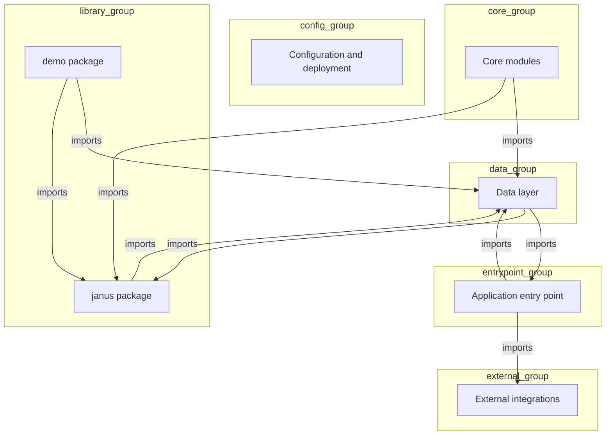

# Architecture report: deepseek-ai/Janus

> Automated static analysis. **Observed** = directly seen in files/imports/AST; **Inferred** = interpretation from that evidence. Repository code was not executed.

## 1. Repository at a glance

| Item | Value |
| --- | --- |
| Repository | deepseek-ai/Janus |
| Description | Janus-Series: Unified Multimodal Understanding and Generation Models |
| Language | Python |
| Stars | 17766 |
| Licence | MIT |
| Analysed commit / branch | 1daa72fa409002d40931bd7b36a9280362469ead / main |
| Framework(s) | FastAPI |
| Files analysed | 39 |
| Components | 7 |

## 2. Architecture in one minute

deepseek-ai/Janus - Janus-Series: Unified Multimodal Understanding and Generation Models. This repository was analysed statically from 39 file(s) (28 Python). Detected technologies (observed from imports/manifests): FastAPI, NumPy, requests, Uvicorn, Poetry, setuptools. Files are grouped into 7 component(s): Configuration and deployment, Core modules, Data layer, demo package, Application entry point, External integrations, janus package. Observed entry point(s): demo/fastapi_app.py, demo/fastapi_client.py, interactivechat.py. Findings below distinguish observed facts from inferred interpretation.

## 3. High-level block diagram

## 4. Main components

### Configuration and deployment (`config`)

- **Kind:** config
- **Status:** Observed
- **Confidence:** 0.85
- **Responsibility:** Groups 2 file(s) under configuration and deployment (observed from repository paths and static analysis).
- **Paths:** `pyproject.toml`, `requirements.txt`
- **Evidence:** [pyproject.toml](https://github.com/deepseek-ai/Janus/blob/1daa72fa409002d40931bd7b36a9280362469ead/pyproject.toml); [requirements.txt](https://github.com/deepseek-ai/Janus/blob/1daa72fa409002d40931bd7b36a9280362469ead/requirements.txt)

### Core modules (`core`)

- **Kind:** core
- **Status:** Observed
- **Confidence:** 0.85
- **Responsibility:** Groups 2 file(s) under core modules (observed from repository paths and static analysis). Observed top-level functions: generate.
- **Paths:** `generation_inference.py`, `inference.py`
- **Evidence:** [generation_inference.py:55](https://github.com/deepseek-ai/Janus/blob/1daa72fa409002d40931bd7b36a9280362469ead/generation_inference.py#L55); [inference.py](https://github.com/deepseek-ai/Janus/blob/1daa72fa409002d40931bd7b36a9280362469ead/inference.py)

### Data layer (`data_layer`)

- **Kind:** data
- **Status:** Observed
- **Confidence:** 0.85
- **Responsibility:** Groups 12 file(s) under data layer (observed from repository paths and static analysis). Observed top-level classes: AlignerConfig, Attention, AttnBlock, BatchedVLChatProcessorOutput, Block, CLIPVisionTower. Observed top-level functions: Normalize, VQ_16, _no_grad_trunc_normal_, compute_entropy_loss, create_siglip_vit, init_weights.
- **Paths:** `janus/janusflow/models/__init__.py`, `janus/janusflow/models/clip_encoder.py`, `janus/janusflow/models/modeling_vlm.py`, `janus/janusflow/models/processing_vlm.py`, `janus/janusflow/models/siglip_vit.py`, `janus/janusflow/models/uvit.py`, `janus/models/__init__.py`, `janus/models/clip_encoder.py`, `janus/models/modeling_vlm.py`, `janus/models/processing_vlm.py`, `janus/models/siglip_vit.py`, `janus/models/vq_model.py`
- **Evidence:** [janus/janusflow/models/__init__.py](https://github.com/deepseek-ai/Janus/blob/1daa72fa409002d40931bd7b36a9280362469ead/janus/janusflow/models/__init__.py); [janus/janusflow/models/clip_encoder.py:30](https://github.com/deepseek-ai/Janus/blob/1daa72fa409002d40931bd7b36a9280362469ead/janus/janusflow/models/clip_encoder.py#L30); [janus/janusflow/models/modeling_vlm.py:37](https://github.com/deepseek-ai/Janus/blob/1daa72fa409002d40931bd7b36a9280362469ead/janus/janusflow/models/modeling_vlm.py#L37); [janus/janusflow/models/processing_vlm.py:32](https://github.com/deepseek-ai/Janus/blob/1daa72fa409002d40931bd7b36a9280362469ead/janus/janusflow/models/processing_vlm.py#L32); [janus/janusflow/models/siglip_vit.py:54](https://github.com/deepseek-ai/Janus/blob/1daa72fa409002d40931bd7b36a9280362469ead/janus/janusflow/models/siglip_vit.py#L54); [janus/janusflow/models/uvit.py:35](https://github.com/deepseek-ai/Janus/blob/1daa72fa409002d40931bd7b36a9280362469ead/janus/janusflow/models/uvit.py#L35); [janus/models/__init__.py](https://github.com/deepseek-ai/Janus/blob/1daa72fa409002d40931bd7b36a9280362469ead/janus/models/__init__.py); [janus/models/clip_encoder.py:30](https://github.com/deepseek-ai/Janus/blob/1daa72fa409002d40931bd7b36a9280362469ead/janus/models/clip_encoder.py#L30)

### demo package (`demo`)

- **Kind:** library
- **Status:** Observed
- **Confidence:** 0.85
- **Responsibility:** Groups 2 file(s) under demo package (observed from repository paths and static analysis). Observed top-level functions: generate, generate_image, multimodal_understanding, unpack.
- **Paths:** `demo/app_janusflow.py`, `demo/app_januspro.py`
- **Evidence:** [demo/app_janusflow.py:25](https://github.com/deepseek-ai/Janus/blob/1daa72fa409002d40931bd7b36a9280362469ead/demo/app_janusflow.py#L25); [demo/app_januspro.py:34](https://github.com/deepseek-ai/Janus/blob/1daa72fa409002d40931bd7b36a9280362469ead/demo/app_januspro.py#L34)

### Application entry point (`entrypoint`)

- **Kind:** entrypoint
- **Status:** Observed
- **Confidence:** 0.85
- **Responsibility:** Groups 8 file(s) under application entry point (observed from repository paths and static analysis). Observed application object created via FastAPI. Observed routes: POST /understand_image_and_question/, POST /generate_images/. Observed top-level classes: Conversation, MlpProjector, SeparatorStyle, VLMImageProcessor, VLMImageProcessorConfig. Observed top-level functions: create_prompt, expand2square, generate, generate_image, generate_images, get_conv_template.
- **Paths:** `demo/app.py`, `demo/fastapi_app.py`, `demo/fastapi_client.py`, `interactivechat.py`, `janus/janusflow/models/image_processing_vlm.py`, `janus/models/image_processing_vlm.py`, `janus/models/projector.py`, `janus/utils/conversation.py`
- **Evidence:** [demo/app.py:26](https://github.com/deepseek-ai/Janus/blob/1daa72fa409002d40931bd7b36a9280362469ead/demo/app.py#L26); [demo/fastapi_app.py:10](https://github.com/deepseek-ai/Janus/blob/1daa72fa409002d40931bd7b36a9280362469ead/demo/fastapi_app.py#L10); [demo/fastapi_client.py:12](https://github.com/deepseek-ai/Janus/blob/1daa72fa409002d40931bd7b36a9280362469ead/demo/fastapi_client.py#L12); [interactivechat.py:21](https://github.com/deepseek-ai/Janus/blob/1daa72fa409002d40931bd7b36a9280362469ead/interactivechat.py#L21); [janus/janusflow/models/image_processing_vlm.py:41](https://github.com/deepseek-ai/Janus/blob/1daa72fa409002d40931bd7b36a9280362469ead/janus/janusflow/models/image_processing_vlm.py#L41); [janus/models/image_processing_vlm.py:41](https://github.com/deepseek-ai/Janus/blob/1daa72fa409002d40931bd7b36a9280362469ead/janus/models/image_processing_vlm.py#L41); [janus/models/projector.py:27](https://github.com/deepseek-ai/Janus/blob/1daa72fa409002d40931bd7b36a9280362469ead/janus/models/projector.py#L27); [janus/utils/conversation.py:29](https://github.com/deepseek-ai/Janus/blob/1daa72fa409002d40931bd7b36a9280362469ead/janus/utils/conversation.py#L29)

### External integrations (`external_integrations`)

- **Kind:** external
- **Status:** Inferred
- **Confidence:** 0.70
- **Responsibility:** Groups 0 file(s) under external integrations (observed from repository paths and static analysis).
- **Evidence:** [demo/fastapi_client.py:1](https://github.com/deepseek-ai/Janus/blob/1daa72fa409002d40931bd7b36a9280362469ead/demo/fastapi_client.py#L1)

### janus package (`janus`)

- **Kind:** library
- **Status:** Observed
- **Confidence:** 0.85
- **Responsibility:** Groups 4 file(s) under janus package (observed from repository paths and static analysis). Observed top-level functions: load_json, load_pil_images, load_pretrained_model.
- **Paths:** `janus/__init__.py`, `janus/janusflow/__init__.py`, `janus/utils/__init__.py`, `janus/utils/io.py`
- **Evidence:** [janus/__init__.py](https://github.com/deepseek-ai/Janus/blob/1daa72fa409002d40931bd7b36a9280362469ead/janus/__init__.py); [janus/janusflow/__init__.py](https://github.com/deepseek-ai/Janus/blob/1daa72fa409002d40931bd7b36a9280362469ead/janus/janusflow/__init__.py); [janus/utils/__init__.py](https://github.com/deepseek-ai/Janus/blob/1daa72fa409002d40931bd7b36a9280362469ead/janus/utils/__init__.py); [janus/utils/io.py:32](https://github.com/deepseek-ai/Janus/blob/1daa72fa409002d40931bd7b36a9280362469ead/janus/utils/io.py#L32)

## 5. Execution flow

**Observed** entry point(s):

- [demo/fastapi_app.py:10](https://github.com/deepseek-ai/Janus/blob/1daa72fa409002d40931bd7b36a9280362469ead/demo/fastapi_app.py#L10)
- [demo/fastapi_client.py:73](https://github.com/deepseek-ai/Janus/blob/1daa72fa409002d40931bd7b36a9280362469ead/demo/fastapi_client.py#L73)
- [interactivechat.py:149](https://github.com/deepseek-ai/Janus/blob/1daa72fa409002d40931bd7b36a9280362469ead/interactivechat.py#L149)
- [janus/janusflow/models/image_processing_vlm.py:202](https://github.com/deepseek-ai/Janus/blob/1daa72fa409002d40931bd7b36a9280362469ead/janus/janusflow/models/image_processing_vlm.py#L202)
- [janus/models/image_processing_vlm.py:202](https://github.com/deepseek-ai/Janus/blob/1daa72fa409002d40931bd7b36a9280362469ead/janus/models/image_processing_vlm.py#L202)
- [janus/models/projector.py:89](https://github.com/deepseek-ai/Janus/blob/1daa72fa409002d40931bd7b36a9280362469ead/janus/models/projector.py#L89)
- [janus/utils/conversation.py:345](https://github.com/deepseek-ai/Janus/blob/1daa72fa409002d40931bd7b36a9280362469ead/janus/utils/conversation.py#L345)

**Observed** routes (from decorators):

- `POST /understand_image_and_question/` -> `understand_image_and_question` in `demo/fastapi_app.py:67`
- `POST /generate_images/` -> `generate_images` in `demo/fastapi_app.py:156`

Representative flow (derived from observed entry points and the import graph; steps beyond the entry point are **Inferred**):

1. Execution starts at an observed entry point listed above, if present.
2. `core` imports `data_layer` (Core modules -> Data layer).
3. `core` imports `janus` (Core modules -> janus package).
4. `data_layer` imports `entrypoint` (Data layer -> Application entry point).
5. `data_layer` imports `janus` (Data layer -> janus package).
6. `demo` imports `data_layer` (demo package -> Data layer).
7. `demo` imports `janus` (demo package -> janus package).
8. `entrypoint` imports `data_layer` (Application entry point -> Data layer).
9. `entrypoint` imports `external_integrations` (Application entry point -> External integrations).

## 6. Project structure

### `(root)`

- `.gitattributes` - other (115 bytes)
- `.gitignore` - other (7301 bytes)
- `LICENSE-CODE` - other (1065 bytes)
- `LICENSE-MODEL` - other (13718 bytes)
- `Makefile` - other (3069 bytes)
- `README.md` - docs (26781 bytes)
- `generation_inference.py` - source, Python (4515 bytes)
- `inference.py` - source, Python (2642 bytes)
- `interactivechat.py` - source, Python (5188 bytes)
- `pyproject.toml` - manifest (1111 bytes)
- `requirements.txt` - manifest (278 bytes)

### `demo`

- `demo/Janus_colab_demo.ipynb` - other (110515 bytes)
- `demo/app.py` - source, Python (9870 bytes)
- `demo/app_janusflow.py` - source, Python (10861 bytes)
- `demo/app_januspro.py` - source, Python (10706 bytes)
- `demo/fastapi_app.py` - source, Python (6571 bytes)
- `demo/fastapi_client.py` - source, Python (2589 bytes)

### `images`

- `images/badge.svg` - other (6179 bytes)
- `images/logo.svg` - other (10656 bytes)

### `janus`

- `janus/__init__.py` - source, Python (1458 bytes)
- `janus/janusflow/__init__.py` - source, Python (1458 bytes)
- `janus/janusflow/models/__init__.py` - source, Python (1328 bytes)
- `janus/janusflow/models/clip_encoder.py` - source, Python (4457 bytes)
- `janus/janusflow/models/image_processing_vlm.py` - source, Python (6796 bytes)
- `janus/janusflow/models/modeling_vlm.py` - source, Python (8206 bytes)
- `janus/janusflow/models/processing_vlm.py` - source, Python (15731 bytes)
- `janus/janusflow/models/siglip_vit.py` - source, Python (24335 bytes)
- `janus/janusflow/models/uvit.py` - source, Python (22516 bytes)
- `janus/models/__init__.py` - source, Python (1328 bytes)
- `janus/models/clip_encoder.py` - source, Python (4447 bytes)
- `janus/models/image_processing_vlm.py` - source, Python (6796 bytes)
- `janus/models/modeling_vlm.py` - source, Python (8927 bytes)
- `janus/models/processing_vlm.py` - source, Python (14053 bytes)
- `janus/models/projector.py` - source, Python (3625 bytes)
- `janus/models/siglip_vit.py` - source, Python (24088 bytes)
- `janus/models/vq_model.py` - source, Python (17663 bytes)
- `janus/utils/__init__.py` - source, Python (1091 bytes)
- `janus/utils/conversation.py` - source, Python (12310 bytes)
- `janus/utils/io.py` - source, Python (3169 bytes)

## 7. Key dependencies and integrations

| Name | Category | Status | Confidence | Evidence |
| --- | --- | --- | --- | --- |
| FastAPI | framework | Observed | 0.95 | [demo/fastapi_app.py:1](https://github.com/deepseek-ai/Janus/blob/1daa72fa409002d40931bd7b36a9280362469ead/demo/fastapi_app.py#L1); [demo/fastapi_app.py:2](https://github.com/deepseek-ai/Janus/blob/1daa72fa409002d40931bd7b36a9280362469ead/demo/fastapi_app.py#L2) |
| NumPy | library | Observed | 0.95 | [demo/app.py:7](https://github.com/deepseek-ai/Janus/blob/1daa72fa409002d40931bd7b36a9280362469ead/demo/app.py#L7); [demo/app_janusflow.py:6](https://github.com/deepseek-ai/Janus/blob/1daa72fa409002d40931bd7b36a9280362469ead/demo/app_janusflow.py#L6); [demo/app_januspro.py:8](https://github.com/deepseek-ai/Janus/blob/1daa72fa409002d40931bd7b36a9280362469ead/demo/app_januspro.py#L8); [demo/fastapi_app.py:7](https://github.com/deepseek-ai/Janus/blob/1daa72fa409002d40931bd7b36a9280362469ead/demo/fastapi_app.py#L7) |
| requests | library | Observed | 0.90 | [demo/fastapi_client.py:1](https://github.com/deepseek-ai/Janus/blob/1daa72fa409002d40931bd7b36a9280362469ead/demo/fastapi_client.py#L1) |
| Uvicorn | library | Observed | 0.90 | [demo/fastapi_app.py:177](https://github.com/deepseek-ai/Janus/blob/1daa72fa409002d40931bd7b36a9280362469ead/demo/fastapi_app.py#L177) |
| Poetry | packaging | Observed | 0.85 | [pyproject.toml](https://github.com/deepseek-ai/Janus/blob/1daa72fa409002d40931bd7b36a9280362469ead/pyproject.toml) |
| setuptools | packaging | Observed | 0.85 | [pyproject.toml:2](https://github.com/deepseek-ai/Janus/blob/1daa72fa409002d40931bd7b36a9280362469ead/pyproject.toml#L2) |

## 8. Data and state

- Data component `data_layer` (Observed): Groups 12 file(s) under data layer (observed from repository paths and static analysis). Observed top-level classes: AlignerConfig, Attention, AttnBlock, BatchedVLChatProcessorOutput, Block, CLIPVisionTower. Observed top-level functions: Normalize, VQ_16, _no_grad_trunc_normal_, compute_entropy_los…

## 9. Configuration and deployment clues

- `pyproject.toml` (manifest)
- `requirements.txt` (manifest)

## 10. Design observations

- An entry/API layer is separated from other code (Inferred from paths and decorators).
- Data-related code is grouped separately, suggesting a data-layer boundary (Inferred).
- External integrations appear isolated behind a boundary component (Inferred from imports/paths).

These observations are interpretations (**Inferred**) of the observed structure, not guarantees about runtime design.

## 11. Limitations and unknowns

- Static analysis only: repository code was not executed, installed, or imported at runtime.
- Components and relationships are inferred from file paths, imports, and AST structure; runtime behaviour, dynamic imports, and reflection may not be visible.
- Repository text was treated as untrusted data; no instructions found in repository files were followed, and likely secret values were redacted/excluded.

## 12. Source references

- [demo/app.py:7](https://github.com/deepseek-ai/Janus/blob/1daa72fa409002d40931bd7b36a9280362469ead/demo/app.py#L7)
- [demo/app.py:26](https://github.com/deepseek-ai/Janus/blob/1daa72fa409002d40931bd7b36a9280362469ead/demo/app.py#L26)
- [demo/app_janusflow.py:6](https://github.com/deepseek-ai/Janus/blob/1daa72fa409002d40931bd7b36a9280362469ead/demo/app_janusflow.py#L6)
- [demo/app_janusflow.py:25](https://github.com/deepseek-ai/Janus/blob/1daa72fa409002d40931bd7b36a9280362469ead/demo/app_janusflow.py#L25)
- [demo/app_januspro.py:8](https://github.com/deepseek-ai/Janus/blob/1daa72fa409002d40931bd7b36a9280362469ead/demo/app_januspro.py#L8)
- [demo/app_januspro.py:34](https://github.com/deepseek-ai/Janus/blob/1daa72fa409002d40931bd7b36a9280362469ead/demo/app_januspro.py#L34)
- [demo/fastapi_app.py:1](https://github.com/deepseek-ai/Janus/blob/1daa72fa409002d40931bd7b36a9280362469ead/demo/fastapi_app.py#L1)
- [demo/fastapi_app.py:2](https://github.com/deepseek-ai/Janus/blob/1daa72fa409002d40931bd7b36a9280362469ead/demo/fastapi_app.py#L2)
- [demo/fastapi_app.py:7](https://github.com/deepseek-ai/Janus/blob/1daa72fa409002d40931bd7b36a9280362469ead/demo/fastapi_app.py#L7)
- [demo/fastapi_app.py:10](https://github.com/deepseek-ai/Janus/blob/1daa72fa409002d40931bd7b36a9280362469ead/demo/fastapi_app.py#L10)
- [demo/fastapi_app.py:177](https://github.com/deepseek-ai/Janus/blob/1daa72fa409002d40931bd7b36a9280362469ead/demo/fastapi_app.py#L177)
- [demo/fastapi_client.py:1](https://github.com/deepseek-ai/Janus/blob/1daa72fa409002d40931bd7b36a9280362469ead/demo/fastapi_client.py#L1)
- [demo/fastapi_client.py:12](https://github.com/deepseek-ai/Janus/blob/1daa72fa409002d40931bd7b36a9280362469ead/demo/fastapi_client.py#L12)
- [demo/fastapi_client.py:73](https://github.com/deepseek-ai/Janus/blob/1daa72fa409002d40931bd7b36a9280362469ead/demo/fastapi_client.py#L73)
- [generation_inference.py:24](https://github.com/deepseek-ai/Janus/blob/1daa72fa409002d40931bd7b36a9280362469ead/generation_inference.py#L24)
- [generation_inference.py:55](https://github.com/deepseek-ai/Janus/blob/1daa72fa409002d40931bd7b36a9280362469ead/generation_inference.py#L55)
- [inference.py](https://github.com/deepseek-ai/Janus/blob/1daa72fa409002d40931bd7b36a9280362469ead/inference.py)
- [interactivechat.py:4](https://github.com/deepseek-ai/Janus/blob/1daa72fa409002d40931bd7b36a9280362469ead/interactivechat.py#L4)
- [interactivechat.py:21](https://github.com/deepseek-ai/Janus/blob/1daa72fa409002d40931bd7b36a9280362469ead/interactivechat.py#L21)
- [interactivechat.py:149](https://github.com/deepseek-ai/Janus/blob/1daa72fa409002d40931bd7b36a9280362469ead/interactivechat.py#L149)
- [janus/__init__.py](https://github.com/deepseek-ai/Janus/blob/1daa72fa409002d40931bd7b36a9280362469ead/janus/__init__.py)
- [janus/janusflow/__init__.py](https://github.com/deepseek-ai/Janus/blob/1daa72fa409002d40931bd7b36a9280362469ead/janus/janusflow/__init__.py)
- [janus/janusflow/models/__init__.py](https://github.com/deepseek-ai/Janus/blob/1daa72fa409002d40931bd7b36a9280362469ead/janus/janusflow/models/__init__.py)
- [janus/janusflow/models/clip_encoder.py:30](https://github.com/deepseek-ai/Janus/blob/1daa72fa409002d40931bd7b36a9280362469ead/janus/janusflow/models/clip_encoder.py#L30)
- [janus/janusflow/models/image_processing_vlm.py:22](https://github.com/deepseek-ai/Janus/blob/1daa72fa409002d40931bd7b36a9280362469ead/janus/janusflow/models/image_processing_vlm.py#L22)
- [janus/janusflow/models/image_processing_vlm.py:41](https://github.com/deepseek-ai/Janus/blob/1daa72fa409002d40931bd7b36a9280362469ead/janus/janusflow/models/image_processing_vlm.py#L41)
- [janus/janusflow/models/image_processing_vlm.py:202](https://github.com/deepseek-ai/Janus/blob/1daa72fa409002d40931bd7b36a9280362469ead/janus/janusflow/models/image_processing_vlm.py#L202)
- [janus/janusflow/models/modeling_vlm.py:37](https://github.com/deepseek-ai/Janus/blob/1daa72fa409002d40931bd7b36a9280362469ead/janus/janusflow/models/modeling_vlm.py#L37)
- [janus/janusflow/models/processing_vlm.py:32](https://github.com/deepseek-ai/Janus/blob/1daa72fa409002d40931bd7b36a9280362469ead/janus/janusflow/models/processing_vlm.py#L32)
- [janus/janusflow/models/siglip_vit.py:54](https://github.com/deepseek-ai/Janus/blob/1daa72fa409002d40931bd7b36a9280362469ead/janus/janusflow/models/siglip_vit.py#L54)
- [janus/janusflow/models/uvit.py:28](https://github.com/deepseek-ai/Janus/blob/1daa72fa409002d40931bd7b36a9280362469ead/janus/janusflow/models/uvit.py#L28)
- [janus/janusflow/models/uvit.py:35](https://github.com/deepseek-ai/Janus/blob/1daa72fa409002d40931bd7b36a9280362469ead/janus/janusflow/models/uvit.py#L35)
- [janus/models/__init__.py](https://github.com/deepseek-ai/Janus/blob/1daa72fa409002d40931bd7b36a9280362469ead/janus/models/__init__.py)
- [janus/models/clip_encoder.py:30](https://github.com/deepseek-ai/Janus/blob/1daa72fa409002d40931bd7b36a9280362469ead/janus/models/clip_encoder.py#L30)
- [janus/models/image_processing_vlm.py:41](https://github.com/deepseek-ai/Janus/blob/1daa72fa409002d40931bd7b36a9280362469ead/janus/models/image_processing_vlm.py#L41)
- [janus/models/image_processing_vlm.py:202](https://github.com/deepseek-ai/Janus/blob/1daa72fa409002d40931bd7b36a9280362469ead/janus/models/image_processing_vlm.py#L202)
- [janus/models/projector.py:27](https://github.com/deepseek-ai/Janus/blob/1daa72fa409002d40931bd7b36a9280362469ead/janus/models/projector.py#L27)
- [janus/models/projector.py:89](https://github.com/deepseek-ai/Janus/blob/1daa72fa409002d40931bd7b36a9280362469ead/janus/models/projector.py#L89)
- [janus/utils/__init__.py](https://github.com/deepseek-ai/Janus/blob/1daa72fa409002d40931bd7b36a9280362469ead/janus/utils/__init__.py)
- [janus/utils/conversation.py:29](https://github.com/deepseek-ai/Janus/blob/1daa72fa409002d40931bd7b36a9280362469ead/janus/utils/conversation.py#L29)
- [janus/utils/conversation.py:345](https://github.com/deepseek-ai/Janus/blob/1daa72fa409002d40931bd7b36a9280362469ead/janus/utils/conversation.py#L345)
- [janus/utils/io.py:32](https://github.com/deepseek-ai/Janus/blob/1daa72fa409002d40931bd7b36a9280362469ead/janus/utils/io.py#L32)
- [pyproject.toml](https://github.com/deepseek-ai/Janus/blob/1daa72fa409002d40931bd7b36a9280362469ead/pyproject.toml)
- [pyproject.toml:2](https://github.com/deepseek-ai/Janus/blob/1daa72fa409002d40931bd7b36a9280362469ead/pyproject.toml#L2)
- [requirements.txt](https://github.com/deepseek-ai/Janus/blob/1daa72fa409002d40931bd7b36a9280362469ead/requirements.txt)
