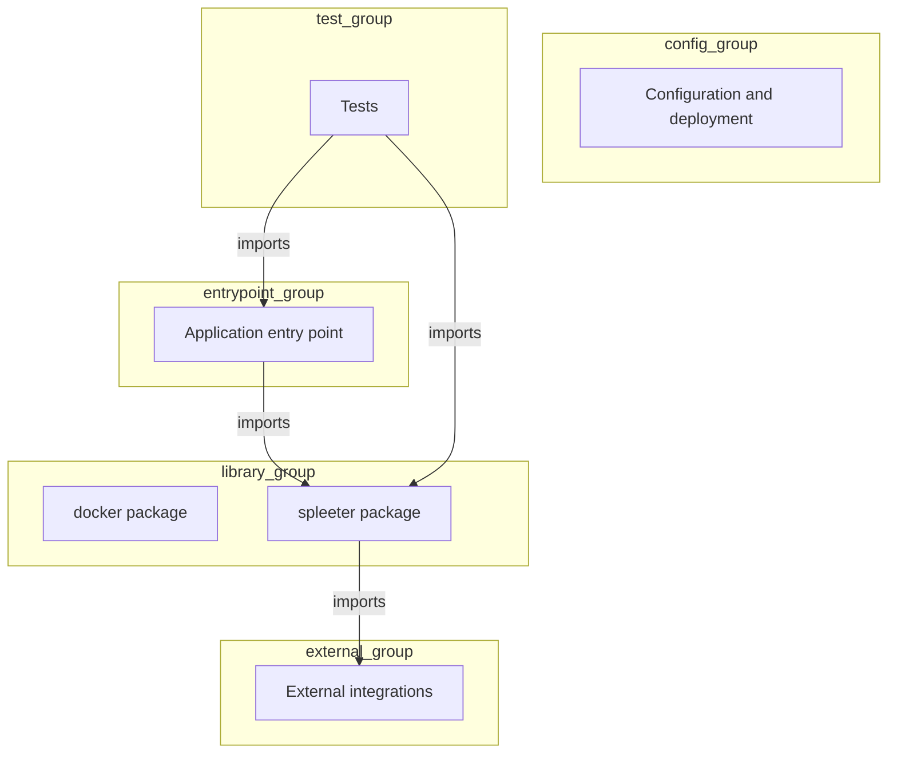

# Architecture report: deezer/spleeter

> Automated static analysis. **Observed** = directly seen in files/imports/AST; **Inferred** = interpretation from that evidence. Repository code was not executed.

## 1. Repository at a glance

| Item | Value |
| --- | --- |
| Repository | deezer/spleeter |
| Description | Deezer source separation library including pretrained models. |
| Language | Python |
| Stars | 28532 |
| Licence | MIT |
| Analysed commit / branch | 6f2c8a2e283914faa544631430f65b793f1b1218 / master |
| Framework(s) | Typer |
| Files analysed | 72 |
| Components | 6 |

## 2. Architecture in one minute

deezer/spleeter - Deezer source separation library including pretrained models.. This repository was analysed statically from 72 file(s) (29 Python). Detected technologies (observed from imports/manifests): GitHub Actions, Typer, httpx, NumPy, pandas, Poetry. Files are grouped into 6 component(s): Configuration and deployment, docker package, Application entry point, External integrations, spleeter package, Tests. Observed entry point(s): spleeter/__main__.py. Findings below distinguish observed facts from inferred interpretation.

## 3. High-level block diagram

## 4. Main components

### Configuration and deployment (`config`)

- **Kind:** config
- **Status:** Observed
- **Confidence:** 0.85
- **Responsibility:** Groups 13 file(s) under configuration and deployment (observed from repository paths and static analysis).
- **Paths:** `conda/spleeter/meta.yaml`, `configs/2stems/base_config.json`, `configs/4stems/base_config.json`, `configs/5stems/base_config.json`, `configs/musdb_config.json`, `pyproject.toml`, `spleeter/resources/2stems-16kHz.json`, `spleeter/resources/2stems.json`, `spleeter/resources/4stems-16kHz.json`, `spleeter/resources/4stems.json`, `spleeter/resources/5stems-16kHz.json`, `spleeter/resources/5stems.json`, `spleeter/resources/musdb.json`
- **Evidence:** [conda/spleeter/meta.yaml](https://github.com/deezer/spleeter/blob/6f2c8a2e283914faa544631430f65b793f1b1218/conda/spleeter/meta.yaml); [configs/2stems/base_config.json](https://github.com/deezer/spleeter/blob/6f2c8a2e283914faa544631430f65b793f1b1218/configs/2stems/base_config.json); [configs/4stems/base_config.json](https://github.com/deezer/spleeter/blob/6f2c8a2e283914faa544631430f65b793f1b1218/configs/4stems/base_config.json); [configs/5stems/base_config.json](https://github.com/deezer/spleeter/blob/6f2c8a2e283914faa544631430f65b793f1b1218/configs/5stems/base_config.json); [configs/musdb_config.json](https://github.com/deezer/spleeter/blob/6f2c8a2e283914faa544631430f65b793f1b1218/configs/musdb_config.json); [pyproject.toml](https://github.com/deezer/spleeter/blob/6f2c8a2e283914faa544631430f65b793f1b1218/pyproject.toml); [spleeter/resources/2stems-16kHz.json](https://github.com/deezer/spleeter/blob/6f2c8a2e283914faa544631430f65b793f1b1218/spleeter/resources/2stems-16kHz.json); [spleeter/resources/2stems.json](https://github.com/deezer/spleeter/blob/6f2c8a2e283914faa544631430f65b793f1b1218/spleeter/resources/2stems.json)

### docker package (`docker`)

- **Kind:** library
- **Status:** Observed
- **Confidence:** 0.85
- **Responsibility:** Groups 1 file(s) under docker package (observed from repository paths and static analysis).
- **Paths:** `docker/conda-entrypoint.sh`
- **Evidence:** [docker/conda-entrypoint.sh](https://github.com/deezer/spleeter/blob/6f2c8a2e283914faa544631430f65b793f1b1218/docker/conda-entrypoint.sh)

### Application entry point (`entrypoint`)

- **Kind:** entrypoint
- **Status:** Observed
- **Confidence:** 0.85
- **Responsibility:** Groups 1 file(s) under application entry point (observed from repository paths and static analysis). Observed top-level functions: _compile_metrics, default, entrypoint, evaluate, separate, train.
- **Paths:** `spleeter/__main__.py`
- **Evidence:** [spleeter/__main__.py:53](https://github.com/deezer/spleeter/blob/6f2c8a2e283914faa544631430f65b793f1b1218/spleeter/__main__.py#L53)

### External integrations (`external_integrations`)

- **Kind:** external
- **Status:** Inferred
- **Confidence:** 0.70
- **Responsibility:** Groups 0 file(s) under external integrations (observed from repository paths and static analysis).
- **Evidence:** [spleeter/model/provider/github.py:28](https://github.com/deezer/spleeter/blob/6f2c8a2e283914faa544631430f65b793f1b1218/spleeter/model/provider/github.py#L28)

### spleeter package (`spleeter`)

- **Kind:** library
- **Status:** Observed
- **Confidence:** 0.85
- **Responsibility:** Groups 21 file(s) under spleeter package (observed from repository paths and static analysis). Observed top-level classes: AudioAdapter, Codec, DatasetBuilder, EstimatorSpecBuilder, FFMPEGProcessAudioAdapter, GithubModelProvider. Observed top-level functions: _get_conv_activation_layer, _get_deconv_activation_layer, apply, apply_blstm, apply_unet, blstm.
- **Paths:** `spleeter/__init__.py`, `spleeter/audio/__init__.py`, `spleeter/audio/adapter.py`, `spleeter/audio/convertor.py`, `spleeter/audio/ffmpeg.py`, `spleeter/audio/spectrogram.py`, `spleeter/dataset.py`, `spleeter/model/__init__.py`, `spleeter/model/functions/__init__.py`, `spleeter/model/functions/blstm.py`, `spleeter/model/functions/unet.py`, `spleeter/model/provider/__init__.py`, `spleeter/model/provider/github.py`, `spleeter/options.py`, `spleeter/resources/__init__.py`, `spleeter/separator.py`, `spleeter/types.py`, `spleeter/utils/__init__.py`, `spleeter/utils/configuration.py`, `spleeter/utils/logging.py`, `spleeter/utils/tensor.py`
- **Evidence:** [spleeter/__init__.py:21](https://github.com/deezer/spleeter/blob/6f2c8a2e283914faa544631430f65b793f1b1218/spleeter/__init__.py#L21); [spleeter/audio/__init__.py:29](https://github.com/deezer/spleeter/blob/6f2c8a2e283914faa544631430f65b793f1b1218/spleeter/audio/__init__.py#L29); [spleeter/audio/adapter.py:30](https://github.com/deezer/spleeter/blob/6f2c8a2e283914faa544631430f65b793f1b1218/spleeter/audio/adapter.py#L30); [spleeter/audio/convertor.py:20](https://github.com/deezer/spleeter/blob/6f2c8a2e283914faa544631430f65b793f1b1218/spleeter/audio/convertor.py#L20); [spleeter/audio/ffmpeg.py:35](https://github.com/deezer/spleeter/blob/6f2c8a2e283914faa544631430f65b793f1b1218/spleeter/audio/ffmpeg.py#L35); [spleeter/audio/spectrogram.py:18](https://github.com/deezer/spleeter/blob/6f2c8a2e283914faa544631430f65b793f1b1218/spleeter/audio/spectrogram.py#L18); [spleeter/dataset.py:60](https://github.com/deezer/spleeter/blob/6f2c8a2e283914faa544631430f65b793f1b1218/spleeter/dataset.py#L60); [spleeter/model/__init__.py:27](https://github.com/deezer/spleeter/blob/6f2c8a2e283914faa544631430f65b793f1b1218/spleeter/model/__init__.py#L27)

### Tests (`tests`)

- **Kind:** test
- **Status:** Observed
- **Confidence:** 0.85
- **Responsibility:** Groups 7 file(s) under tests (observed from repository paths and static analysis). Observed top-level functions: adapter, audio_data, generate_fake_eval_dataset, generate_fake_training_dataset, test_checksum, test_default_adapter.
- **Paths:** `tests/__init__.py`, `tests/test_command.py`, `tests/test_eval.py`, `tests/test_ffmpeg_adapter.py`, `tests/test_github_model_provider.py`, `tests/test_separator.py`, `tests/test_train.py`
- **Evidence:** [tests/__init__.py](https://github.com/deezer/spleeter/blob/6f2c8a2e283914faa544631430f65b793f1b1218/tests/__init__.py); [tests/test_command.py:15](https://github.com/deezer/spleeter/blob/6f2c8a2e283914faa544631430f65b793f1b1218/tests/test_command.py#L15); [tests/test_eval.py:27](https://github.com/deezer/spleeter/blob/6f2c8a2e283914faa544631430f65b793f1b1218/tests/test_eval.py#L27); [tests/test_ffmpeg_adapter.py:33](https://github.com/deezer/spleeter/blob/6f2c8a2e283914faa544631430f65b793f1b1218/tests/test_ffmpeg_adapter.py#L33); [tests/test_github_model_provider.py:11](https://github.com/deezer/spleeter/blob/6f2c8a2e283914faa544631430f65b793f1b1218/tests/test_github_model_provider.py#L11); [tests/test_separator.py:40](https://github.com/deezer/spleeter/blob/6f2c8a2e283914faa544631430f65b793f1b1218/tests/test_separator.py#L40); [tests/test_train.py:50](https://github.com/deezer/spleeter/blob/6f2c8a2e283914faa544631430f65b793f1b1218/tests/test_train.py#L50)

## 5. Execution flow

**Observed** entry point(s):

- [spleeter/__main__.py:272](https://github.com/deezer/spleeter/blob/6f2c8a2e283914faa544631430f65b793f1b1218/spleeter/__main__.py#L272)

Representative flow (derived from observed entry points and the import graph; steps beyond the entry point are **Inferred**):

1. Execution starts at an observed entry point listed above, if present.
2. `entrypoint` imports `spleeter` (Application entry point -> spleeter package).
3. `spleeter` imports `external_integrations` (spleeter package -> External integrations).
4. `tests` imports `entrypoint` (Tests -> Application entry point).
5. `tests` imports `spleeter` (Tests -> spleeter package).

## 6. Project structure

### `(root)`

- `.flake8` - other (50 bytes)
- `.gitignore` - other (1349 bytes)
- `CHANGELOG.md` - docs (3082 bytes)
- `LICENSE` - docs (1075 bytes)
- `README.md` - docs (9332 bytes)
- `paper.bib` - other (5650 bytes)
- `paper.md` - docs (8208 bytes)
- `pyproject.toml` - manifest (2797 bytes)
- `spleeter.ipynb` - other (3967 bytes)

### `.github`

- `.github/CODEOWNERS` - other (58 bytes)
- `.github/CONTRIBUTING.md` - docs (2059 bytes)
- `.github/ISSUE_TEMPLATE/bug.md` - docs (1187 bytes)
- `.github/ISSUE_TEMPLATE/config.yml` - config (28 bytes)
- `.github/ISSUE_TEMPLATE/discussion.md` - docs (183 bytes)
- `.github/ISSUE_TEMPLATE/feature.md` - docs (261 bytes)
- `.github/PULL_REQUEST_TEMPLATE.md` - docs (790 bytes)
- `.github/workflows/conda.yml` - ci, YAML (2168 bytes)
- `.github/workflows/docker.yml` - ci, YAML (5392 bytes)
- `.github/workflows/pypi.yml` - ci, YAML (590 bytes)
- `.github/workflows/test.yml` - ci, YAML (1629 bytes)

### `conda`

- `conda/spleeter/meta.yaml` - config (1166 bytes)

### `configs`

- `configs/2stems/base_config.json` - config (718 bytes)
- `configs/4stems/base_config.json` - config (801 bytes)
- `configs/5stems/base_config.json` - config (818 bytes)
- `configs/musdb_config.json` - config (853 bytes)
- `configs/musdb_train.csv` - data (19579 bytes)
- `configs/musdb_validation.csv` - data (3258 bytes)

### `docker`

- `docker/conda-entrypoint.sh` - source, Shell (386 bytes)
- `docker/conda.dockerfile` - other (685 bytes)
- `docker/cuda-10-0.dockerfile` - other (1872 bytes)
- `docker/cuda-10-1.dockerfile` - other (1986 bytes)
- `docker/cuda-9.2.dockerfile` - other (2500 bytes)
- `docker/spleeter-conda.dockerfile` - other (341 bytes)
- `docker/spleeter-model.dockerfile` - other (294 bytes)
- `docker/spleeter.dockerfile` - other (266 bytes)

### `spleeter`

- `spleeter/__init__.py` - source, Python (671 bytes)
- `spleeter/__main__.py` - source, Python (8600 bytes)
- `spleeter/audio/__init__.py` - source, Python (854 bytes)
- `spleeter/audio/adapter.py` - source, Python (6578 bytes)
- `spleeter/audio/convertor.py` - source, Python (3652 bytes)
- `spleeter/audio/ffmpeg.py` - source, Python (6303 bytes)
- `spleeter/audio/spectrogram.py` - source, Python (5907 bytes)
- `spleeter/dataset.py` - source, Python (20953 bytes)
- `spleeter/model/__init__.py` - source, Python (19898 bytes)
- `spleeter/model/functions/__init__.py` - source, Python (1247 bytes)
- `spleeter/model/functions/blstm.py` - source, Python (3024 bytes)
- `spleeter/model/functions/unet.py` - source, Python (7446 bytes)
- `spleeter/model/provider/__init__.py` - source, Python (2746 bytes)
- `spleeter/model/provider/github.py` - source, Python (4828 bytes)
- `spleeter/options.py` - source, Python (3138 bytes)
- `spleeter/py.typed` - other (0 bytes)
- `spleeter/resources/2stems-16kHz.json` - config (718 bytes)
- `spleeter/resources/2stems.json` - config (718 bytes)
- `spleeter/resources/4stems-16kHz.json` - config (800 bytes)
- `spleeter/resources/4stems.json` - config (800 bytes)
- `spleeter/resources/5stems-16kHz.json` - config (818 bytes)
- `spleeter/resources/5stems.json` - config (818 bytes)
- `spleeter/resources/__init__.py` - source, Python (202 bytes)
- `spleeter/resources/musdb.json` - config (850 bytes)
- `spleeter/separator.py` - source, Python (11628 bytes)
- `spleeter/types.py` - source, Python (279 bytes)
- `spleeter/utils/__init__.py` - source, Python (192 bytes)
- `spleeter/utils/configuration.py` - source, Python (1591 bytes)
- `spleeter/utils/logging.py` - source, Python (1437 bytes)
- `spleeter/utils/tensor.py` - source, Python (6332 bytes)

### `tests`

- `tests/__init__.py` - test, Python (162 bytes)
- `tests/test_command.py` - test, Python (432 bytes)
- `tests/test_eval.py` - test, Python (2032 bytes)
- `tests/test_ffmpeg_adapter.py` - test, Python (2210 bytes)
- `tests/test_github_model_provider.py` - test, Python (733 bytes)
- `tests/test_separator.py` - test, Python (3560 bytes)
- `tests/test_train.py` - test, Python (3705 bytes)

## 7. Key dependencies and integrations

| Name | Category | Status | Confidence | Evidence |
| --- | --- | --- | --- | --- |
| GitHub Actions | ci | Observed | 0.90 | [.github/workflows/conda.yml](https://github.com/deezer/spleeter/blob/6f2c8a2e283914faa544631430f65b793f1b1218/.github/workflows/conda.yml); [.github/workflows/docker.yml](https://github.com/deezer/spleeter/blob/6f2c8a2e283914faa544631430f65b793f1b1218/.github/workflows/docker.yml); [.github/workflows/pypi.yml](https://github.com/deezer/spleeter/blob/6f2c8a2e283914faa544631430f65b793f1b1218/.github/workflows/pypi.yml); [.github/workflows/test.yml](https://github.com/deezer/spleeter/blob/6f2c8a2e283914faa544631430f65b793f1b1218/.github/workflows/test.yml) |
| Typer | framework | Observed | 0.95 | [pyproject.toml:51](https://github.com/deezer/spleeter/blob/6f2c8a2e283914faa544631430f65b793f1b1218/pyproject.toml#L51); [spleeter/__main__.py:23](https://github.com/deezer/spleeter/blob/6f2c8a2e283914faa544631430f65b793f1b1218/spleeter/__main__.py#L23); [spleeter/options.py:9](https://github.com/deezer/spleeter/blob/6f2c8a2e283914faa544631430f65b793f1b1218/spleeter/options.py#L9); [spleeter/options.py:10](https://github.com/deezer/spleeter/blob/6f2c8a2e283914faa544631430f65b793f1b1218/spleeter/options.py#L10) |
| httpx | library | Observed | 0.90 | [pyproject.toml:50](https://github.com/deezer/spleeter/blob/6f2c8a2e283914faa544631430f65b793f1b1218/pyproject.toml#L50); [spleeter/model/provider/github.py:28](https://github.com/deezer/spleeter/blob/6f2c8a2e283914faa544631430f65b793f1b1218/spleeter/model/provider/github.py#L28) |
| NumPy | library | Observed | 0.95 | [pyproject.toml:58](https://github.com/deezer/spleeter/blob/6f2c8a2e283914faa544631430f65b793f1b1218/pyproject.toml#L58); [spleeter/__main__.py:175](https://github.com/deezer/spleeter/blob/6f2c8a2e283914faa544631430f65b793f1b1218/spleeter/__main__.py#L175); [spleeter/__main__.py:217](https://github.com/deezer/spleeter/blob/6f2c8a2e283914faa544631430f65b793f1b1218/spleeter/__main__.py#L217); [spleeter/audio/adapter.py:13](https://github.com/deezer/spleeter/blob/6f2c8a2e283914faa544631430f65b793f1b1218/spleeter/audio/adapter.py#L13) |
| pandas | library | Observed | 0.95 | [pyproject.toml:56](https://github.com/deezer/spleeter/blob/6f2c8a2e283914faa544631430f65b793f1b1218/pyproject.toml#L56); [spleeter/__main__.py:176](https://github.com/deezer/spleeter/blob/6f2c8a2e283914faa544631430f65b793f1b1218/spleeter/__main__.py#L176); [spleeter/utils/tensor.py:8](https://github.com/deezer/spleeter/blob/6f2c8a2e283914faa544631430f65b793f1b1218/spleeter/utils/tensor.py#L8); [tests/test_train.py:17](https://github.com/deezer/spleeter/blob/6f2c8a2e283914faa544631430f65b793f1b1218/tests/test_train.py#L17) |
| Poetry | packaging | Observed | 0.85 | [pyproject.toml:1](https://github.com/deezer/spleeter/blob/6f2c8a2e283914faa544631430f65b793f1b1218/pyproject.toml#L1) |
| Docker | tooling | Observed | 0.70 | [.github/workflows/docker.yml:1](https://github.com/deezer/spleeter/blob/6f2c8a2e283914faa544631430f65b793f1b1218/.github/workflows/docker.yml#L1) |
| pytest | tooling | Observed | 0.95 | [.github/workflows/test.yml:50](https://github.com/deezer/spleeter/blob/6f2c8a2e283914faa544631430f65b793f1b1218/.github/workflows/test.yml#L50); [pyproject.toml:61](https://github.com/deezer/spleeter/blob/6f2c8a2e283914faa544631430f65b793f1b1218/pyproject.toml#L61); [tests/test_ffmpeg_adapter.py:18](https://github.com/deezer/spleeter/blob/6f2c8a2e283914faa544631430f65b793f1b1218/tests/test_ffmpeg_adapter.py#L18); [tests/test_github_model_provider.py:6](https://github.com/deezer/spleeter/blob/6f2c8a2e283914faa544631430f65b793f1b1218/tests/test_github_model_provider.py#L6) |

## 8. Data and state

No database, cache, queue, or persistent-state usage was observed in the analysed files. State handling, if any, may be in-memory or in files that were not analysed.

## 9. Configuration and deployment clues

- `.github/ISSUE_TEMPLATE/config.yml` (config)
- `.github/workflows/conda.yml` (ci)
- `.github/workflows/docker.yml` (ci)
- `.github/workflows/pypi.yml` (ci)
- `.github/workflows/test.yml` (ci)
- `conda/spleeter/meta.yaml` (config)
- `configs/2stems/base_config.json` (config)
- `configs/4stems/base_config.json` (config)
- `configs/5stems/base_config.json` (config)
- `configs/musdb_config.json` (config)
- `pyproject.toml` (manifest)
- `spleeter/resources/2stems-16kHz.json` (config)
- `spleeter/resources/2stems.json` (config)
- `spleeter/resources/4stems-16kHz.json` (config)
- `spleeter/resources/4stems.json` (config)
- `spleeter/resources/5stems-16kHz.json` (config)
- `spleeter/resources/5stems.json` (config)
- `spleeter/resources/musdb.json` (config)

## 10. Design observations

- An entry/API layer is separated from other code (Inferred from paths and decorators).
- Tests are present alongside source code (Observed from test file paths).
- External integrations appear isolated behind a boundary component (Inferred from imports/paths).

These observations are interpretations (**Inferred**) of the observed structure, not guarantees about runtime design.

## 11. Limitations and unknowns

- Static analysis only: repository code was not executed, installed, or imported at runtime.
- Components and relationships are inferred from file paths, imports, and AST structure; runtime behaviour, dynamic imports, and reflection may not be visible.
- 1 file(s) were skipped during inventory (1 x lockfile excluded).
- Repository text was treated as untrusted data; no instructions found in repository files were followed, and likely secret values were redacted/excluded.

## 12. Source references

- [.github/workflows/conda.yml](https://github.com/deezer/spleeter/blob/6f2c8a2e283914faa544631430f65b793f1b1218/.github/workflows/conda.yml)
- [.github/workflows/docker.yml](https://github.com/deezer/spleeter/blob/6f2c8a2e283914faa544631430f65b793f1b1218/.github/workflows/docker.yml)
- [.github/workflows/docker.yml:1](https://github.com/deezer/spleeter/blob/6f2c8a2e283914faa544631430f65b793f1b1218/.github/workflows/docker.yml#L1)
- [.github/workflows/pypi.yml](https://github.com/deezer/spleeter/blob/6f2c8a2e283914faa544631430f65b793f1b1218/.github/workflows/pypi.yml)
- [.github/workflows/test.yml](https://github.com/deezer/spleeter/blob/6f2c8a2e283914faa544631430f65b793f1b1218/.github/workflows/test.yml)
- [.github/workflows/test.yml:50](https://github.com/deezer/spleeter/blob/6f2c8a2e283914faa544631430f65b793f1b1218/.github/workflows/test.yml#L50)
- [conda/spleeter/meta.yaml](https://github.com/deezer/spleeter/blob/6f2c8a2e283914faa544631430f65b793f1b1218/conda/spleeter/meta.yaml)
- [configs/2stems/base_config.json](https://github.com/deezer/spleeter/blob/6f2c8a2e283914faa544631430f65b793f1b1218/configs/2stems/base_config.json)
- [configs/4stems/base_config.json](https://github.com/deezer/spleeter/blob/6f2c8a2e283914faa544631430f65b793f1b1218/configs/4stems/base_config.json)
- [configs/5stems/base_config.json](https://github.com/deezer/spleeter/blob/6f2c8a2e283914faa544631430f65b793f1b1218/configs/5stems/base_config.json)
- [configs/musdb_config.json](https://github.com/deezer/spleeter/blob/6f2c8a2e283914faa544631430f65b793f1b1218/configs/musdb_config.json)
- [docker/conda-entrypoint.sh](https://github.com/deezer/spleeter/blob/6f2c8a2e283914faa544631430f65b793f1b1218/docker/conda-entrypoint.sh)
- [pyproject.toml](https://github.com/deezer/spleeter/blob/6f2c8a2e283914faa544631430f65b793f1b1218/pyproject.toml)
- [pyproject.toml:1](https://github.com/deezer/spleeter/blob/6f2c8a2e283914faa544631430f65b793f1b1218/pyproject.toml#L1)
- [pyproject.toml:50](https://github.com/deezer/spleeter/blob/6f2c8a2e283914faa544631430f65b793f1b1218/pyproject.toml#L50)
- [pyproject.toml:51](https://github.com/deezer/spleeter/blob/6f2c8a2e283914faa544631430f65b793f1b1218/pyproject.toml#L51)
- [pyproject.toml:56](https://github.com/deezer/spleeter/blob/6f2c8a2e283914faa544631430f65b793f1b1218/pyproject.toml#L56)
- [pyproject.toml:58](https://github.com/deezer/spleeter/blob/6f2c8a2e283914faa544631430f65b793f1b1218/pyproject.toml#L58)
- [pyproject.toml:61](https://github.com/deezer/spleeter/blob/6f2c8a2e283914faa544631430f65b793f1b1218/pyproject.toml#L61)
- [spleeter/__init__.py:21](https://github.com/deezer/spleeter/blob/6f2c8a2e283914faa544631430f65b793f1b1218/spleeter/__init__.py#L21)
- [spleeter/__main__.py:23](https://github.com/deezer/spleeter/blob/6f2c8a2e283914faa544631430f65b793f1b1218/spleeter/__main__.py#L23)
- [spleeter/__main__.py:53](https://github.com/deezer/spleeter/blob/6f2c8a2e283914faa544631430f65b793f1b1218/spleeter/__main__.py#L53)
- [spleeter/__main__.py:175](https://github.com/deezer/spleeter/blob/6f2c8a2e283914faa544631430f65b793f1b1218/spleeter/__main__.py#L175)
- [spleeter/__main__.py:176](https://github.com/deezer/spleeter/blob/6f2c8a2e283914faa544631430f65b793f1b1218/spleeter/__main__.py#L176)
- [spleeter/__main__.py:217](https://github.com/deezer/spleeter/blob/6f2c8a2e283914faa544631430f65b793f1b1218/spleeter/__main__.py#L217)
- [spleeter/__main__.py:272](https://github.com/deezer/spleeter/blob/6f2c8a2e283914faa544631430f65b793f1b1218/spleeter/__main__.py#L272)
- [spleeter/audio/__init__.py:29](https://github.com/deezer/spleeter/blob/6f2c8a2e283914faa544631430f65b793f1b1218/spleeter/audio/__init__.py#L29)
- [spleeter/audio/adapter.py:13](https://github.com/deezer/spleeter/blob/6f2c8a2e283914faa544631430f65b793f1b1218/spleeter/audio/adapter.py#L13)
- [spleeter/audio/adapter.py:30](https://github.com/deezer/spleeter/blob/6f2c8a2e283914faa544631430f65b793f1b1218/spleeter/audio/adapter.py#L30)
- [spleeter/audio/convertor.py:8](https://github.com/deezer/spleeter/blob/6f2c8a2e283914faa544631430f65b793f1b1218/spleeter/audio/convertor.py#L8)
- [spleeter/audio/convertor.py:20](https://github.com/deezer/spleeter/blob/6f2c8a2e283914faa544631430f65b793f1b1218/spleeter/audio/convertor.py#L20)
- [spleeter/audio/ffmpeg.py:20](https://github.com/deezer/spleeter/blob/6f2c8a2e283914faa544631430f65b793f1b1218/spleeter/audio/ffmpeg.py#L20)
- [spleeter/audio/ffmpeg.py:35](https://github.com/deezer/spleeter/blob/6f2c8a2e283914faa544631430f65b793f1b1218/spleeter/audio/ffmpeg.py#L35)
- [spleeter/audio/spectrogram.py:18](https://github.com/deezer/spleeter/blob/6f2c8a2e283914faa544631430f65b793f1b1218/spleeter/audio/spectrogram.py#L18)
- [spleeter/dataset.py:60](https://github.com/deezer/spleeter/blob/6f2c8a2e283914faa544631430f65b793f1b1218/spleeter/dataset.py#L60)
- [spleeter/model/__init__.py:27](https://github.com/deezer/spleeter/blob/6f2c8a2e283914faa544631430f65b793f1b1218/spleeter/model/__init__.py#L27)
- [spleeter/model/provider/github.py:28](https://github.com/deezer/spleeter/blob/6f2c8a2e283914faa544631430f65b793f1b1218/spleeter/model/provider/github.py#L28)
- [spleeter/options.py:9](https://github.com/deezer/spleeter/blob/6f2c8a2e283914faa544631430f65b793f1b1218/spleeter/options.py#L9)
- [spleeter/options.py:10](https://github.com/deezer/spleeter/blob/6f2c8a2e283914faa544631430f65b793f1b1218/spleeter/options.py#L10)
- [spleeter/resources/2stems-16kHz.json](https://github.com/deezer/spleeter/blob/6f2c8a2e283914faa544631430f65b793f1b1218/spleeter/resources/2stems-16kHz.json)
- [spleeter/resources/2stems.json](https://github.com/deezer/spleeter/blob/6f2c8a2e283914faa544631430f65b793f1b1218/spleeter/resources/2stems.json)
- [spleeter/separator.py:25](https://github.com/deezer/spleeter/blob/6f2c8a2e283914faa544631430f65b793f1b1218/spleeter/separator.py#L25)
- [spleeter/types.py:10](https://github.com/deezer/spleeter/blob/6f2c8a2e283914faa544631430f65b793f1b1218/spleeter/types.py#L10)
- [spleeter/utils/logging.py:12](https://github.com/deezer/spleeter/blob/6f2c8a2e283914faa544631430f65b793f1b1218/spleeter/utils/logging.py#L12)
- [spleeter/utils/tensor.py:8](https://github.com/deezer/spleeter/blob/6f2c8a2e283914faa544631430f65b793f1b1218/spleeter/utils/tensor.py#L8)
- [tests/__init__.py](https://github.com/deezer/spleeter/blob/6f2c8a2e283914faa544631430f65b793f1b1218/tests/__init__.py)
- [tests/test_command.py:10](https://github.com/deezer/spleeter/blob/6f2c8a2e283914faa544631430f65b793f1b1218/tests/test_command.py#L10)
- [tests/test_command.py:15](https://github.com/deezer/spleeter/blob/6f2c8a2e283914faa544631430f65b793f1b1218/tests/test_command.py#L15)
- [tests/test_eval.py:27](https://github.com/deezer/spleeter/blob/6f2c8a2e283914faa544631430f65b793f1b1218/tests/test_eval.py#L27)
- [tests/test_ffmpeg_adapter.py:18](https://github.com/deezer/spleeter/blob/6f2c8a2e283914faa544631430f65b793f1b1218/tests/test_ffmpeg_adapter.py#L18)
- [tests/test_ffmpeg_adapter.py:33](https://github.com/deezer/spleeter/blob/6f2c8a2e283914faa544631430f65b793f1b1218/tests/test_ffmpeg_adapter.py#L33)
- [tests/test_github_model_provider.py:6](https://github.com/deezer/spleeter/blob/6f2c8a2e283914faa544631430f65b793f1b1218/tests/test_github_model_provider.py#L6)
- [tests/test_github_model_provider.py:11](https://github.com/deezer/spleeter/blob/6f2c8a2e283914faa544631430f65b793f1b1218/tests/test_github_model_provider.py#L11)
- [tests/test_separator.py:15](https://github.com/deezer/spleeter/blob/6f2c8a2e283914faa544631430f65b793f1b1218/tests/test_separator.py#L15)
- [tests/test_separator.py:40](https://github.com/deezer/spleeter/blob/6f2c8a2e283914faa544631430f65b793f1b1218/tests/test_separator.py#L40)
- [tests/test_train.py:17](https://github.com/deezer/spleeter/blob/6f2c8a2e283914faa544631430f65b793f1b1218/tests/test_train.py#L17)
- [tests/test_train.py:18](https://github.com/deezer/spleeter/blob/6f2c8a2e283914faa544631430f65b793f1b1218/tests/test_train.py#L18)
- [tests/test_train.py:50](https://github.com/deezer/spleeter/blob/6f2c8a2e283914faa544631430f65b793f1b1218/tests/test_train.py#L50)
