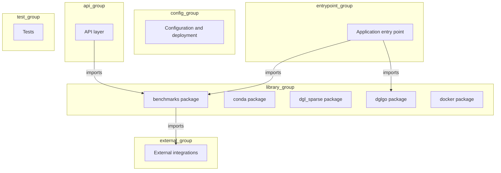

# Architecture report: dmlc/dgl

> Automated static analysis. **Observed** = directly seen in files/imports/AST; **Inferred** = interpretation from that evidence. Repository code was not executed.

## 1. Repository at a glance

| Item | Value |
| --- | --- |
| Repository | dmlc/dgl |
| Description | Python package built to ease deep learning on graph, on top of existing DL frameworks. |
| Language | Python |
| Stars | 14290 |
| Licence | Apache-2.0 |
| Analysed commit / branch | 3d16000b4170fa741ed9e9667f22ba84d3493026 / master |
| Framework(s) | Typer |
| Files analysed | 793 |
| Components | 10 |

## 2. Architecture in one minute

dmlc/dgl - Python package built to ease deep learning on graph, on top of existing DL frameworks.. This repository was analysed statically from 793 file(s) (378 Python). Detected technologies (observed from imports/manifests): GitHub Actions, Typer, Click, NumPy, pandas, Pydantic. Files are grouped into 10 component(s): API layer, benchmarks package, conda package, Configuration and deployment, dgl_sparse package, dglgo package, docker package, Application entry point. Observed entry point(s): benchmarks/benchmarks/multigpu/bench_multigpu_rgcn.py, benchmarks/scripts/replace_branch.py, dglgo/dglgo/cli/__init__.py. Findings below distinguish observed facts from inferred interpretation.

## 3. High-level block diagram

## 4. Main components

### API layer (`api_layer`)

- **Kind:** api
- **Status:** Observed
- **Confidence:** 0.85
- **Responsibility:** Groups 34 file(s) under api layer (observed from repository paths and static analysis). Observed top-level functions: _node2vec, _random_walk, track_time.
- **Paths:** `benchmarks/benchmarks/api/__init__.py`, `benchmarks/benchmarks/api/bench_add_self_loop.py`, `benchmarks/benchmarks/api/bench_batch.py`, `benchmarks/benchmarks/api/bench_builtin_apply_edges.py`, `benchmarks/benchmarks/api/bench_builtin_apply_edges_hetero.py`, `benchmarks/benchmarks/api/bench_builtin_multi_update_all.py`, `benchmarks/benchmarks/api/bench_builtin_update_all_coo.py`, `benchmarks/benchmarks/api/bench_builtin_update_all_csc.py`, `benchmarks/benchmarks/api/bench_edge_ids.py`, `benchmarks/benchmarks/api/bench_edge_subgraph.py`, `benchmarks/benchmarks/api/bench_find_edges.py`, `benchmarks/benchmarks/api/bench_format_conversion.py`, `benchmarks/benchmarks/api/bench_fused_sample_neighbors.py`, `benchmarks/benchmarks/api/bench_heterograph_construction.py`, `benchmarks/benchmarks/api/bench_homograph_edge_construction.py`, `benchmarks/benchmarks/api/bench_homograph_scipy_construction.py`, `benchmarks/benchmarks/api/bench_in_degrees.py`, `benchmarks/benchmarks/api/bench_in_edges.py`, `benchmarks/benchmarks/api/bench_in_subgraph.py`, `benchmarks/benchmarks/api/bench_khop.py`, `benchmarks/benchmarks/api/bench_knn_graph.py`, `benchmarks/benchmarks/api/bench_metis_partition.py`, `benchmarks/benchmarks/api/bench_nn_graphconv.py`, `benchmarks/benchmarks/api/bench_nn_heterographconv.py`, `benchmarks/benchmarks/api/bench_node_subgraph.py`, `benchmarks/benchmarks/api/bench_random_walk.py`, `benchmarks/benchmarks/api/bench_readout.py`, `benchmarks/benchmarks/api/bench_reverse.py`, `benchmarks/benchmarks/api/bench_sample_neighbors.py`, `benchmarks/benchmarks/api/bench_to_block.py`, `benchmarks/benchmarks/api/bench_udf_apply_edges.py`, `benchmarks/benchmarks/api/bench_udf_multi_update_all.py`, `benchmarks/benchmarks/api/bench_udf_update_all.py`, `benchmarks/benchmarks/api/bench_unbatch.py`
- **Evidence:** [benchmarks/benchmarks/api/__init__.py](https://github.com/dmlc/dgl/blob/3d16000b4170fa741ed9e9667f22ba84d3493026/benchmarks/benchmarks/api/__init__.py); [benchmarks/benchmarks/api/bench_add_self_loop.py:15](https://github.com/dmlc/dgl/blob/3d16000b4170fa741ed9e9667f22ba84d3493026/benchmarks/benchmarks/api/bench_add_self_loop.py#L15); [benchmarks/benchmarks/api/bench_batch.py:12](https://github.com/dmlc/dgl/blob/3d16000b4170fa741ed9e9667f22ba84d3493026/benchmarks/benchmarks/api/bench_batch.py#L12); [benchmarks/benchmarks/api/bench_builtin_apply_edges.py:17](https://github.com/dmlc/dgl/blob/3d16000b4170fa741ed9e9667f22ba84d3493026/benchmarks/benchmarks/api/bench_builtin_apply_edges.py#L17); [benchmarks/benchmarks/api/bench_builtin_apply_edges_hetero.py:17](https://github.com/dmlc/dgl/blob/3d16000b4170fa741ed9e9667f22ba84d3493026/benchmarks/benchmarks/api/bench_builtin_apply_edges_hetero.py#L17); [benchmarks/benchmarks/api/bench_builtin_multi_update_all.py:15](https://github.com/dmlc/dgl/blob/3d16000b4170fa741ed9e9667f22ba84d3493026/benchmarks/benchmarks/api/bench_builtin_multi_update_all.py#L15); [benchmarks/benchmarks/api/bench_builtin_update_all_coo.py:18](https://github.com/dmlc/dgl/blob/3d16000b4170fa741ed9e9667f22ba84d3493026/benchmarks/benchmarks/api/bench_builtin_update_all_coo.py#L18); [benchmarks/benchmarks/api/bench_builtin_update_all_csc.py:18](https://github.com/dmlc/dgl/blob/3d16000b4170fa741ed9e9667f22ba84d3493026/benchmarks/benchmarks/api/bench_builtin_update_all_csc.py#L18)

### benchmarks package (`benchmarks`)

- **Kind:** library
- **Status:** Observed
- **Confidence:** 0.85
- **Responsibility:** Groups 36 file(s) under benchmarks package (observed from repository paths and static analysis). Observed top-level classes: BagOfWords, BagOfWordsPretrained, BaseRGCN, CrossEntropyLoss, EntityClassify, GAT. Observed top-level functions: _cuda_device_count, _download, _init_input_modules, assign_features_to_blocks, assign_simple_node_features, assign_textual_node_features.
- **Paths:** `benchmarks/benchmarks/__init__.py`, `benchmarks/benchmarks/kernel/__init__.py`, `benchmarks/benchmarks/kernel/bench_edgesoftmax.py`, `benchmarks/benchmarks/kernel/bench_gsddmm_u_dot_v.py`, `benchmarks/benchmarks/kernel/bench_gspmm_copy_u.py`, `benchmarks/benchmarks/kernel/bench_gspmm_u_mul_e_sum.py`, `benchmarks/benchmarks/model_acc/__init__.py`, `benchmarks/benchmarks/model_acc/bench_gat.py`, `benchmarks/benchmarks/model_acc/bench_gcn.py`, `benchmarks/benchmarks/model_acc/bench_gcn_udf.py`, `benchmarks/benchmarks/model_acc/bench_rgcn_base.py`, `benchmarks/benchmarks/model_acc/bench_rgcn_ns.py`, `benchmarks/benchmarks/model_acc/bench_sage.py`, `benchmarks/benchmarks/model_acc/bench_sage_ns.py`, `benchmarks/benchmarks/model_speed/__init__.py`, `benchmarks/benchmarks/model_speed/bench_gat.py`, `benchmarks/benchmarks/model_speed/bench_gat_ns.py`, `benchmarks/benchmarks/model_speed/bench_gcn_udf.py`, `benchmarks/benchmarks/model_speed/bench_pinsage.py`, `benchmarks/benchmarks/model_speed/bench_rgcn_base.py`, `benchmarks/benchmarks/model_speed/bench_rgcn_hetero_ns.py`, `benchmarks/benchmarks/model_speed/bench_rgcn_homogeneous_ns.py`, `benchmarks/benchmarks/model_speed/bench_sage.py`, `benchmarks/benchmarks/model_speed/bench_sage_ns.py`, `benchmarks/benchmarks/model_speed/bench_sage_unsupervised_ns.py`, `benchmarks/benchmarks/multigpu/__init__.py`, `benchmarks/benchmarks/multigpu/bench_multigpu_sage.py`, `benchmarks/benchmarks/multigpu/rgcn_model.py`, `benchmarks/benchmarks/rgcn.py`, `benchmarks/benchmarks/utils.py`, `benchmarks/run.sh`, `benchmarks/scripts/build_dgl_asv.sh`, `benchmarks/scripts/fix_ram_info.py`, `benchmarks/scripts/generate_excel.py`, `benchmarks/scripts/install_dgl_asv.sh`, `benchmarks/scripts/publish.sh`
- **Evidence:** [benchmarks/benchmarks/__init__.py](https://github.com/dmlc/dgl/blob/3d16000b4170fa741ed9e9667f22ba84d3493026/benchmarks/benchmarks/__init__.py); [benchmarks/benchmarks/kernel/__init__.py](https://github.com/dmlc/dgl/blob/3d16000b4170fa741ed9e9667f22ba84d3493026/benchmarks/benchmarks/kernel/__init__.py); [benchmarks/benchmarks/kernel/bench_edgesoftmax.py:14](https://github.com/dmlc/dgl/blob/3d16000b4170fa741ed9e9667f22ba84d3493026/benchmarks/benchmarks/kernel/bench_edgesoftmax.py#L14); [benchmarks/benchmarks/kernel/bench_gsddmm_u_dot_v.py:10](https://github.com/dmlc/dgl/blob/3d16000b4170fa741ed9e9667f22ba84d3493026/benchmarks/benchmarks/kernel/bench_gsddmm_u_dot_v.py#L10); [benchmarks/benchmarks/kernel/bench_gspmm_copy_u.py:10](https://github.com/dmlc/dgl/blob/3d16000b4170fa741ed9e9667f22ba84d3493026/benchmarks/benchmarks/kernel/bench_gspmm_copy_u.py#L10); [benchmarks/benchmarks/kernel/bench_gspmm_u_mul_e_sum.py:10](https://github.com/dmlc/dgl/blob/3d16000b4170fa741ed9e9667f22ba84d3493026/benchmarks/benchmarks/kernel/bench_gspmm_u_mul_e_sum.py#L10); [benchmarks/benchmarks/model_acc/__init__.py](https://github.com/dmlc/dgl/blob/3d16000b4170fa741ed9e9667f22ba84d3493026/benchmarks/benchmarks/model_acc/__init__.py); [benchmarks/benchmarks/model_acc/bench_gat.py:10](https://github.com/dmlc/dgl/blob/3d16000b4170fa741ed9e9667f22ba84d3493026/benchmarks/benchmarks/model_acc/bench_gat.py#L10)

### conda package (`conda`)

- **Kind:** library
- **Status:** Observed
- **Confidence:** 0.85
- **Responsibility:** Groups 2 file(s) under conda package (observed from repository paths and static analysis).
- **Paths:** `conda/dgl/build.sh`, `conda/dgl/run_test.sh`
- **Evidence:** [conda/dgl/build.sh](https://github.com/dmlc/dgl/blob/3d16000b4170fa741ed9e9667f22ba84d3493026/conda/dgl/build.sh); [conda/dgl/run_test.sh](https://github.com/dmlc/dgl/blob/3d16000b4170fa741ed9e9667f22ba84d3493026/conda/dgl/run_test.sh)

### Configuration and deployment (`config`)

- **Kind:** config
- **Status:** Observed
- **Confidence:** 0.85
- **Responsibility:** Groups 40 file(s) under configuration and deployment (observed from repository paths and static analysis).
- **Paths:** `benchmarks/asv.conf.json`, `benchmarks/task.json`, `conda/dgl/conda_build_config.yaml`, `conda/dgl/meta.yaml`, `dglgo/recipes/graphpred_hiv_gin.yaml`, `dglgo/recipes/graphpred_hiv_pna.yaml`, `dglgo/recipes/graphpred_pcba_gin.yaml`, `dglgo/recipes/linkpred_citation2_sage.yaml`, `dglgo/recipes/linkpred_collab_sage.yaml`, `dglgo/recipes/linkpred_cora_sage.yaml`, `dglgo/recipes/nodepred-ns_arxiv_gcn.yaml`, `dglgo/recipes/nodepred-ns_product_sage.yaml`, `dglgo/recipes/nodepred_citeseer_gat.yaml`, `dglgo/recipes/nodepred_citeseer_gcn.yaml`, `dglgo/recipes/nodepred_citeseer_sage.yaml`, `dglgo/recipes/nodepred_cora_gat.yaml`, `dglgo/recipes/nodepred_cora_gcn.yaml`, `dglgo/recipes/nodepred_cora_sage.yaml`, `dglgo/recipes/nodepred_pubmed_gat.yaml`, `dglgo/recipes/nodepred_pubmed_gcn.yaml`, `dglgo/recipes/nodepred_pubmed_sage.yaml`, `dglgo/setup.py`, `docker/Dockerfile.awscli`, `docker/Dockerfile.ci_benchmark`, `docker/Dockerfile.ci_cpu`, `docker/Dockerfile.ci_gpu`, `docker/Dockerfile.ci_lint`, `docker/install/conda_env/kg_cpu.yml`, `docker/install/conda_env/kg_gpu.yml`, `docker/install/conda_env/mxnet_cpu.yml`, `docker/install/conda_env/mxnet_gpu.yml`, `docker/install/conda_env/tensorflow_cpu.yml`, `docker/install/conda_env/tensorflow_gpu.yml`, `docker/install/conda_env/torch_cpu.yml`, `docker/install/conda_env/torch_gpu.yml`, `docker/pods/ci-compile-cpu.yaml`, `docker/pods/ci-compile-gpu.yaml`, `docker/pods/ci-cpu.yaml`, `docker/pods/ci-gpu.yaml`, `docker/pods/ci-lint.yaml`
- **Evidence:** [benchmarks/asv.conf.json](https://github.com/dmlc/dgl/blob/3d16000b4170fa741ed9e9667f22ba84d3493026/benchmarks/asv.conf.json); [benchmarks/task.json](https://github.com/dmlc/dgl/blob/3d16000b4170fa741ed9e9667f22ba84d3493026/benchmarks/task.json); [conda/dgl/conda_build_config.yaml](https://github.com/dmlc/dgl/blob/3d16000b4170fa741ed9e9667f22ba84d3493026/conda/dgl/conda_build_config.yaml); [conda/dgl/meta.yaml](https://github.com/dmlc/dgl/blob/3d16000b4170fa741ed9e9667f22ba84d3493026/conda/dgl/meta.yaml); [dglgo/recipes/graphpred_hiv_gin.yaml](https://github.com/dmlc/dgl/blob/3d16000b4170fa741ed9e9667f22ba84d3493026/dglgo/recipes/graphpred_hiv_gin.yaml); [dglgo/recipes/graphpred_hiv_pna.yaml](https://github.com/dmlc/dgl/blob/3d16000b4170fa741ed9e9667f22ba84d3493026/dglgo/recipes/graphpred_hiv_pna.yaml); [dglgo/recipes/graphpred_pcba_gin.yaml](https://github.com/dmlc/dgl/blob/3d16000b4170fa741ed9e9667f22ba84d3493026/dglgo/recipes/graphpred_pcba_gin.yaml); [dglgo/recipes/linkpred_citation2_sage.yaml](https://github.com/dmlc/dgl/blob/3d16000b4170fa741ed9e9667f22ba84d3493026/dglgo/recipes/linkpred_citation2_sage.yaml)

### dgl_sparse package (`dgl_sparse`)

- **Kind:** library
- **Status:** Observed
- **Confidence:** 0.85
- **Responsibility:** Groups 15 file(s) under dgl_sparse package (observed from repository paths and static analysis).
- **Paths:** `dgl_sparse/build.sh`, `dgl_sparse/find_cmake.py`, `dgl_sparse/include/sparse/dgl_headers.h`, `dgl_sparse/include/sparse/elementwise_op.h`, `dgl_sparse/include/sparse/matrix_ops.h`, `dgl_sparse/include/sparse/reduction.h`, `dgl_sparse/include/sparse/sddmm.h`, `dgl_sparse/include/sparse/softmax.h`, `dgl_sparse/include/sparse/sparse_format.h`, `dgl_sparse/include/sparse/sparse_matrix.h`, `dgl_sparse/include/sparse/spmm.h`, `dgl_sparse/include/sparse/spspmm.h`, `dgl_sparse/src/matmul.h`, `dgl_sparse/src/matrix_ops_impl.h`, `dgl_sparse/src/utils.h`
- **Evidence:** [dgl_sparse/build.sh](https://github.com/dmlc/dgl/blob/3d16000b4170fa741ed9e9667f22ba84d3493026/dgl_sparse/build.sh); [dgl_sparse/find_cmake.py](https://github.com/dmlc/dgl/blob/3d16000b4170fa741ed9e9667f22ba84d3493026/dgl_sparse/find_cmake.py); [dgl_sparse/include/sparse/dgl_headers.h](https://github.com/dmlc/dgl/blob/3d16000b4170fa741ed9e9667f22ba84d3493026/dgl_sparse/include/sparse/dgl_headers.h); [dgl_sparse/include/sparse/elementwise_op.h](https://github.com/dmlc/dgl/blob/3d16000b4170fa741ed9e9667f22ba84d3493026/dgl_sparse/include/sparse/elementwise_op.h); [dgl_sparse/include/sparse/matrix_ops.h](https://github.com/dmlc/dgl/blob/3d16000b4170fa741ed9e9667f22ba84d3493026/dgl_sparse/include/sparse/matrix_ops.h); [dgl_sparse/include/sparse/reduction.h](https://github.com/dmlc/dgl/blob/3d16000b4170fa741ed9e9667f22ba84d3493026/dgl_sparse/include/sparse/reduction.h); [dgl_sparse/include/sparse/sddmm.h](https://github.com/dmlc/dgl/blob/3d16000b4170fa741ed9e9667f22ba84d3493026/dgl_sparse/include/sparse/sddmm.h); [dgl_sparse/include/sparse/softmax.h](https://github.com/dmlc/dgl/blob/3d16000b4170fa741ed9e9667f22ba84d3493026/dgl_sparse/include/sparse/softmax.h)

### dglgo package (`dglgo`)

- **Kind:** library
- **Status:** Observed
- **Confidence:** 0.85
- **Responsibility:** Groups 39 file(s) under dglgo package (observed from repository paths and static analysis). Observed top-level classes: ApplyGraphpredPipeline, ApplyGraphpredPipelineCfg, ApplyNodepredNsPipeline, ApplyNodepredPipeline, ApplyPipelineFactory, BilinearPredictor. Observed top-level functions: aggregate_max, aggregate_mean, aggregate_min, aggregate_std, aggregate_sum, aggregate_var.
- **Paths:** `dglgo/dglgo/__init__.py`, `dglgo/dglgo/apply_pipeline/__init__.py`, `dglgo/dglgo/apply_pipeline/graphpred/__init__.py`, `dglgo/dglgo/apply_pipeline/graphpred/gen.py`, `dglgo/dglgo/apply_pipeline/nodepred/__init__.py`, `dglgo/dglgo/apply_pipeline/nodepred/gen.py`, `dglgo/dglgo/apply_pipeline/nodepred_sample/__init__.py`, `dglgo/dglgo/apply_pipeline/nodepred_sample/gen.py`, `dglgo/dglgo/cli/apply_cli.py`, `dglgo/dglgo/model/__init__.py`, `dglgo/dglgo/model/edge_encoder/__init__.py`, `dglgo/dglgo/model/edge_encoder/bilinear.py`, `dglgo/dglgo/model/edge_encoder/dot.py`, `dglgo/dglgo/model/edge_encoder/ele.py`, `dglgo/dglgo/model/graph_encoder/__init__.py`, `dglgo/dglgo/model/graph_encoder/gin_ogbg.py`, `dglgo/dglgo/model/graph_encoder/pna.py`, `dglgo/dglgo/model/node_encoder/__init__.py`, `dglgo/dglgo/model/node_encoder/gat.py`, `dglgo/dglgo/model/node_encoder/gcn.py`, `dglgo/dglgo/model/node_encoder/gin.py`, `dglgo/dglgo/model/node_encoder/sage.py`, `dglgo/dglgo/model/node_encoder/sgc.py`, `dglgo/dglgo/pipeline/__init__.py`, `dglgo/dglgo/pipeline/graphpred/__init__.py`, `dglgo/dglgo/pipeline/graphpred/gen.py`, `dglgo/dglgo/pipeline/linkpred/__init__.py`, `dglgo/dglgo/pipeline/linkpred/gen.py`, `dglgo/dglgo/pipeline/nodepred/__init__.py`, `dglgo/dglgo/pipeline/nodepred/gen.py`, `dglgo/dglgo/pipeline/nodepred_sample/__init__.py`, `dglgo/dglgo/pipeline/nodepred_sample/gen.py`, `dglgo/dglgo/utils/__init__.py`, `dglgo/dglgo/utils/base_model.py`, `dglgo/dglgo/utils/early_stop.py`, `dglgo/dglgo/utils/enter_config.py`, `dglgo/dglgo/utils/factory.py`, `dglgo/dglgo/utils/yaml_dump.py`, `dglgo/recipes/__init__.py`
- **Evidence:** [dglgo/dglgo/__init__.py](https://github.com/dmlc/dgl/blob/3d16000b4170fa741ed9e9667f22ba84d3493026/dglgo/dglgo/__init__.py); [dglgo/dglgo/apply_pipeline/__init__.py](https://github.com/dmlc/dgl/blob/3d16000b4170fa741ed9e9667f22ba84d3493026/dglgo/dglgo/apply_pipeline/__init__.py); [dglgo/dglgo/apply_pipeline/graphpred/__init__.py](https://github.com/dmlc/dgl/blob/3d16000b4170fa741ed9e9667f22ba84d3493026/dglgo/dglgo/apply_pipeline/graphpred/__init__.py); [dglgo/dglgo/apply_pipeline/graphpred/gen.py:26](https://github.com/dmlc/dgl/blob/3d16000b4170fa741ed9e9667f22ba84d3493026/dglgo/dglgo/apply_pipeline/graphpred/gen.py#L26); [dglgo/dglgo/apply_pipeline/nodepred/__init__.py](https://github.com/dmlc/dgl/blob/3d16000b4170fa741ed9e9667f22ba84d3493026/dglgo/dglgo/apply_pipeline/nodepred/__init__.py); [dglgo/dglgo/apply_pipeline/nodepred/gen.py:21](https://github.com/dmlc/dgl/blob/3d16000b4170fa741ed9e9667f22ba84d3493026/dglgo/dglgo/apply_pipeline/nodepred/gen.py#L21); [dglgo/dglgo/apply_pipeline/nodepred_sample/__init__.py](https://github.com/dmlc/dgl/blob/3d16000b4170fa741ed9e9667f22ba84d3493026/dglgo/dglgo/apply_pipeline/nodepred_sample/__init__.py); [dglgo/dglgo/apply_pipeline/nodepred_sample/gen.py:21](https://github.com/dmlc/dgl/blob/3d16000b4170fa741ed9e9667f22ba84d3493026/dglgo/dglgo/apply_pipeline/nodepred_sample/gen.py#L21)

### docker package (`docker`)

- **Kind:** library
- **Status:** Observed
- **Confidence:** 0.85
- **Responsibility:** Groups 11 file(s) under docker package (observed from repository paths and static analysis).
- **Paths:** `docker/install/ubuntu_install_antlr.sh`, `docker/install/ubuntu_install_build.sh`, `docker/install/ubuntu_install_conda.sh`, `docker/install/ubuntu_install_core.sh`, `docker/install/ubuntu_install_java.sh`, `docker/install/ubuntu_install_mxnet_cpu.sh`, `docker/install/ubuntu_install_mxnet_gpu.sh`, `docker/install/ubuntu_install_python.sh`, `docker/install/ubuntu_install_python_package.sh`, `docker/install/ubuntu_install_torch.sh`, `docker/install/ubuntu_install_torch_1.2.0.sh`
- **Evidence:** [docker/install/ubuntu_install_antlr.sh](https://github.com/dmlc/dgl/blob/3d16000b4170fa741ed9e9667f22ba84d3493026/docker/install/ubuntu_install_antlr.sh); [docker/install/ubuntu_install_build.sh](https://github.com/dmlc/dgl/blob/3d16000b4170fa741ed9e9667f22ba84d3493026/docker/install/ubuntu_install_build.sh); [docker/install/ubuntu_install_conda.sh](https://github.com/dmlc/dgl/blob/3d16000b4170fa741ed9e9667f22ba84d3493026/docker/install/ubuntu_install_conda.sh); [docker/install/ubuntu_install_core.sh](https://github.com/dmlc/dgl/blob/3d16000b4170fa741ed9e9667f22ba84d3493026/docker/install/ubuntu_install_core.sh); [docker/install/ubuntu_install_java.sh](https://github.com/dmlc/dgl/blob/3d16000b4170fa741ed9e9667f22ba84d3493026/docker/install/ubuntu_install_java.sh); [docker/install/ubuntu_install_mxnet_cpu.sh](https://github.com/dmlc/dgl/blob/3d16000b4170fa741ed9e9667f22ba84d3493026/docker/install/ubuntu_install_mxnet_cpu.sh); [docker/install/ubuntu_install_mxnet_gpu.sh](https://github.com/dmlc/dgl/blob/3d16000b4170fa741ed9e9667f22ba84d3493026/docker/install/ubuntu_install_mxnet_gpu.sh); [docker/install/ubuntu_install_python.sh](https://github.com/dmlc/dgl/blob/3d16000b4170fa741ed9e9667f22ba84d3493026/docker/install/ubuntu_install_python.sh)

### Application entry point (`entrypoint`)

- **Kind:** entrypoint
- **Status:** Observed
- **Confidence:** 0.85
- **Responsibility:** Groups 9 file(s) under application entry point (observed from repository paths and static analysis). Observed application object created via Typer. Observed top-level classes: EntityClassify, NeighborSampler. Observed top-level functions: add_prefix, change_branch, config, export, gen_norm, get_recipe.
- **Paths:** `benchmarks/benchmarks/multigpu/bench_multigpu_rgcn.py`, `benchmarks/scripts/replace_branch.py`, `dglgo/dglgo/cli/__init__.py`, `dglgo/dglgo/cli/cli.py`, `dglgo/dglgo/cli/config_apply_cli.py`, `dglgo/dglgo/cli/config_cli.py`, `dglgo/dglgo/cli/export_cli.py`, `dglgo/dglgo/cli/recipe_cli.py`, `dglgo/dglgo/cli/train_cli.py`
- **Evidence:** [benchmarks/benchmarks/multigpu/bench_multigpu_rgcn.py:31](https://github.com/dmlc/dgl/blob/3d16000b4170fa741ed9e9667f22ba84d3493026/benchmarks/benchmarks/multigpu/bench_multigpu_rgcn.py#L31); [benchmarks/scripts/replace_branch.py:7](https://github.com/dmlc/dgl/blob/3d16000b4170fa741ed9e9667f22ba84d3493026/benchmarks/scripts/replace_branch.py#L7); [dglgo/dglgo/cli/__init__.py](https://github.com/dmlc/dgl/blob/3d16000b4170fa741ed9e9667f22ba84d3493026/dglgo/dglgo/cli/__init__.py); [dglgo/dglgo/cli/cli.py:12](https://github.com/dmlc/dgl/blob/3d16000b4170fa741ed9e9667f22ba84d3493026/dglgo/dglgo/cli/cli.py#L12); [dglgo/dglgo/cli/config_apply_cli.py:6](https://github.com/dmlc/dgl/blob/3d16000b4170fa741ed9e9667f22ba84d3493026/dglgo/dglgo/cli/config_apply_cli.py#L6); [dglgo/dglgo/cli/config_cli.py:11](https://github.com/dmlc/dgl/blob/3d16000b4170fa741ed9e9667f22ba84d3493026/dglgo/dglgo/cli/config_cli.py#L11); [dglgo/dglgo/cli/export_cli.py:42](https://github.com/dmlc/dgl/blob/3d16000b4170fa741ed9e9667f22ba84d3493026/dglgo/dglgo/cli/export_cli.py#L42); [dglgo/dglgo/cli/recipe_cli.py:70](https://github.com/dmlc/dgl/blob/3d16000b4170fa741ed9e9667f22ba84d3493026/dglgo/dglgo/cli/recipe_cli.py#L70)

### External integrations (`external_integrations`)

- **Kind:** external
- **Status:** Inferred
- **Confidence:** 0.70
- **Responsibility:** Groups 0 file(s) under external integrations (observed from repository paths and static analysis).
- **Evidence:** [benchmarks/benchmarks/utils.py:15](https://github.com/dmlc/dgl/blob/3d16000b4170fa741ed9e9667f22ba84d3493026/benchmarks/benchmarks/utils.py#L15); [examples/distributed/graphsage/node_classification.py:2](https://github.com/dmlc/dgl/blob/3d16000b4170fa741ed9e9667f22ba84d3493026/examples/distributed/graphsage/node_classification.py#L2)

### Tests (`tests`)

- **Kind:** test
- **Status:** Observed
- **Confidence:** 0.85
- **Responsibility:** Groups 4 file(s) under tests (observed from repository paths and static analysis). Observed top-level classes: ExperimentSpec. Observed top-level functions: get_auc, get_performance, ranklist_by_heapq, ranklist_by_sorted, setup_recipe_folder, test.
- **Paths:** `dglgo/tests/cfg.yml`, `dglgo/tests/run_test.sh`, `dglgo/tests/test_pipeline.py`, `examples/pytorch/NGCF/NGCF/utility/batch_test.py`
- **Evidence:** [dglgo/tests/cfg.yml](https://github.com/dmlc/dgl/blob/3d16000b4170fa741ed9e9667f22ba84d3493026/dglgo/tests/cfg.yml); [dglgo/tests/run_test.sh](https://github.com/dmlc/dgl/blob/3d16000b4170fa741ed9e9667f22ba84d3493026/dglgo/tests/run_test.sh); [dglgo/tests/test_pipeline.py:12](https://github.com/dmlc/dgl/blob/3d16000b4170fa741ed9e9667f22ba84d3493026/dglgo/tests/test_pipeline.py#L12); [examples/pytorch/NGCF/NGCF/utility/batch_test.py:25](https://github.com/dmlc/dgl/blob/3d16000b4170fa741ed9e9667f22ba84d3493026/examples/pytorch/NGCF/NGCF/utility/batch_test.py#L25)

## 5. Execution flow

**Observed** entry point(s):

- [benchmarks/benchmarks/multigpu/bench_multigpu_rgcn.py:564](https://github.com/dmlc/dgl/blob/3d16000b4170fa741ed9e9667f22ba84d3493026/benchmarks/benchmarks/multigpu/bench_multigpu_rgcn.py#L564)
- [benchmarks/scripts/replace_branch.py:80](https://github.com/dmlc/dgl/blob/3d16000b4170fa741ed9e9667f22ba84d3493026/benchmarks/scripts/replace_branch.py#L80)
- [dglgo/dglgo/cli/__init__.py:3](https://github.com/dmlc/dgl/blob/3d16000b4170fa741ed9e9667f22ba84d3493026/dglgo/dglgo/cli/__init__.py#L3)
- [dglgo/dglgo/cli/cli.py:12](https://github.com/dmlc/dgl/blob/3d16000b4170fa741ed9e9667f22ba84d3493026/dglgo/dglgo/cli/cli.py#L12)
- [dglgo/dglgo/cli/config_apply_cli.py:6](https://github.com/dmlc/dgl/blob/3d16000b4170fa741ed9e9667f22ba84d3493026/dglgo/dglgo/cli/config_apply_cli.py#L6)
- [dglgo/dglgo/cli/config_cli.py:11](https://github.com/dmlc/dgl/blob/3d16000b4170fa741ed9e9667f22ba84d3493026/dglgo/dglgo/cli/config_cli.py#L11)
- [dglgo/dglgo/cli/export_cli.py:41](https://github.com/dmlc/dgl/blob/3d16000b4170fa741ed9e9667f22ba84d3493026/dglgo/dglgo/cli/export_cli.py#L41)
- [dglgo/dglgo/cli/recipe_cli.py:70](https://github.com/dmlc/dgl/blob/3d16000b4170fa741ed9e9667f22ba84d3493026/dglgo/dglgo/cli/recipe_cli.py#L70)
- [dglgo/dglgo/cli/train_cli.py:28](https://github.com/dmlc/dgl/blob/3d16000b4170fa741ed9e9667f22ba84d3493026/dglgo/dglgo/cli/train_cli.py#L28)

Representative flow (derived from observed entry points and the import graph; steps beyond the entry point are **Inferred**):

1. Execution starts at an observed entry point listed above, if present.
2. `api_layer` imports `benchmarks` (API layer -> benchmarks package).
3. `benchmarks` imports `external_integrations` (benchmarks package -> External integrations).
4. `entrypoint` imports `benchmarks` (Application entry point -> benchmarks package).
5. `entrypoint` imports `dglgo` (Application entry point -> dglgo package).

## 6. Project structure

### `(root)`

- `.clang-format` - other (6277 bytes)
- `.gitignore` - other (2506 bytes)
- `.gitmodules` - other (1401 bytes)
- `.lintrunner.toml` - config (927 bytes)
- `CMakeLists.txt` - docs (19311 bytes)
- `CONTRIBUTORS.md` - docs (3743 bytes)
- `Jenkinsfile` - other (22989 bytes)
- `LICENSE` - docs (11357 bytes)
- `NEWS.md` - docs (2186 bytes)
- `README.md` - docs (32164 bytes)

### `.github`

- `.github/ISSUE_TEMPLATE/--work-item--dev-only-.md` - docs (674 bytes)
- `.github/ISSUE_TEMPLATE/bug-report.md` - docs (911 bytes)
- `.github/ISSUE_TEMPLATE/documentation.md` - docs (247 bytes)
- `.github/ISSUE_TEMPLATE/feature-request.md` - docs (736 bytes)
- `.github/ISSUE_TEMPLATE/questions-help-support.md` - docs (332 bytes)
- `.github/PULL_REQUEST_TEMPLATE.md` - docs (1315 bytes)
- `.github/workflows/lint.yml` - ci, YAML (1857 bytes)
- `.github/workflows/stale.yml` - ci, YAML (1197 bytes)

### `apps`

- `apps/life_sci/README.md` - docs (84 bytes)

### `benchmarks`

- `benchmarks/.gitignore` - other (13 bytes)
- `benchmarks/Jenkinsfile` - other (3568 bytes)
- `benchmarks/README.md` - docs (4624 bytes)
- `benchmarks/asv.conf.json` - config (6684 bytes)
- `benchmarks/benchmarks/__init__.py` - source, Python (0 bytes)
- `benchmarks/benchmarks/api/__init__.py` - source, Python (0 bytes)
- `benchmarks/benchmarks/api/bench_add_self_loop.py` - source, Python (595 bytes)
- `benchmarks/benchmarks/api/bench_batch.py` - source, Python (575 bytes)
- `benchmarks/benchmarks/api/bench_builtin_apply_edges.py` - source, Python (996 bytes)
- `benchmarks/benchmarks/api/bench_builtin_apply_edges_hetero.py` - source, Python (1482 bytes)
- `benchmarks/benchmarks/api/bench_builtin_multi_update_all.py` - source, Python (1437 bytes)
- `benchmarks/benchmarks/api/bench_builtin_update_all_coo.py` - source, Python (1345 bytes)
- `benchmarks/benchmarks/api/bench_builtin_update_all_csc.py` - source, Python (1410 bytes)
- `benchmarks/benchmarks/api/bench_edge_ids.py` - source, Python (1225 bytes)
- `benchmarks/benchmarks/api/bench_edge_subgraph.py` - source, Python (853 bytes)
- `benchmarks/benchmarks/api/bench_find_edges.py` - source, Python (1048 bytes)
- `benchmarks/benchmarks/api/bench_format_conversion.py` - source, Python (1170 bytes)
- `benchmarks/benchmarks/api/bench_fused_sample_neighbors.py` - source, Python (1118 bytes)
- `benchmarks/benchmarks/api/bench_heterograph_construction.py` - source, Python (776 bytes)
- `benchmarks/benchmarks/api/bench_homograph_edge_construction.py` - source, Python (562 bytes)
- `benchmarks/benchmarks/api/bench_homograph_scipy_construction.py` - source, Python (717 bytes)
- `benchmarks/benchmarks/api/bench_in_degrees.py` - source, Python (1014 bytes)
- `benchmarks/benchmarks/api/bench_in_edges.py` - source, Python (1009 bytes)
- `benchmarks/benchmarks/api/bench_in_subgraph.py` - source, Python (873 bytes)
- `benchmarks/benchmarks/api/bench_khop.py` - source, Python (619 bytes)
- `benchmarks/benchmarks/api/bench_knn_graph.py` - source, Python (904 bytes)
- `benchmarks/benchmarks/api/bench_metis_partition.py` - source, Python (575 bytes)
- `benchmarks/benchmarks/api/bench_nn_graphconv.py` - source, Python (897 bytes)
- `benchmarks/benchmarks/api/bench_nn_heterographconv.py` - source, Python (1421 bytes)
- `benchmarks/benchmarks/api/bench_node_subgraph.py` - source, Python (860 bytes)
- `benchmarks/benchmarks/api/bench_random_walk.py` - source, Python (1051 bytes)
- `benchmarks/benchmarks/api/bench_readout.py` - source, Python (1227 bytes)
- `benchmarks/benchmarks/api/bench_reverse.py` - source, Python (675 bytes)
- `benchmarks/benchmarks/api/bench_sample_neighbors.py` - source, Python (1076 bytes)
- `benchmarks/benchmarks/api/bench_to_block.py` - source, Python (930 bytes)
- `benchmarks/benchmarks/api/bench_udf_apply_edges.py` - source, Python (1022 bytes)
- `benchmarks/benchmarks/api/bench_udf_multi_update_all.py` - source, Python (1533 bytes)
- `benchmarks/benchmarks/api/bench_udf_update_all.py` - source, Python (1511 bytes)
- `benchmarks/benchmarks/api/bench_unbatch.py` - source, Python (541 bytes)
- `benchmarks/benchmarks/kernel/__init__.py` - source, Python (0 bytes)
- `benchmarks/benchmarks/kernel/bench_edgesoftmax.py` - source, Python (757 bytes)
- `benchmarks/benchmarks/kernel/bench_gsddmm_u_dot_v.py` - source, Python (1489 bytes)
- `benchmarks/benchmarks/kernel/bench_gspmm_copy_u.py` - source, Python (997 bytes)
- `benchmarks/benchmarks/kernel/bench_gspmm_u_mul_e_sum.py` - source, Python (1638 bytes)
- `benchmarks/benchmarks/model_acc/__init__.py` - source, Python (0 bytes)
- `benchmarks/benchmarks/model_acc/bench_gat.py` - source, Python (3369 bytes)
- `benchmarks/benchmarks/model_acc/bench_gcn.py` - source, Python (2506 bytes)
- `benchmarks/benchmarks/model_acc/bench_gcn_udf.py` - source, Python (3773 bytes)
- `benchmarks/benchmarks/model_acc/bench_rgcn_base.py` - source, Python (1681 bytes)
- `benchmarks/benchmarks/model_acc/bench_rgcn_ns.py` - source, Python (11824 bytes)
- `benchmarks/benchmarks/model_acc/bench_sage.py` - source, Python (2559 bytes)
- `benchmarks/benchmarks/model_acc/bench_sage_ns.py` - source, Python (7163 bytes)
- `benchmarks/benchmarks/model_speed/__init__.py` - source, Python (0 bytes)
- `benchmarks/benchmarks/model_speed/bench_gat.py` - source, Python (3314 bytes)
- `benchmarks/benchmarks/model_speed/bench_gat_ns.py` - source, Python (4989 bytes)
- `benchmarks/benchmarks/model_speed/bench_gcn_udf.py` - source, Python (3690 bytes)
- `benchmarks/benchmarks/model_speed/bench_pinsage.py` - source, Python (16559 bytes)
- `benchmarks/benchmarks/model_speed/bench_rgcn_base.py` - source, Python (1276 bytes)
- `benchmarks/benchmarks/model_speed/bench_rgcn_hetero_ns.py` - source, Python (11407 bytes)
- `benchmarks/benchmarks/model_speed/bench_rgcn_homogeneous_ns.py` - source, Python (10773 bytes)
- `benchmarks/benchmarks/model_speed/bench_sage.py` - source, Python (2500 bytes)
- `benchmarks/benchmarks/model_speed/bench_sage_ns.py` - source, Python (4076 bytes)
- `benchmarks/benchmarks/model_speed/bench_sage_unsupervised_ns.py` - source, Python (5756 bytes)
- `benchmarks/benchmarks/multigpu/__init__.py` - source, Python (0 bytes)
- `benchmarks/benchmarks/multigpu/bench_multigpu_rgcn.py` - source, Python (17062 bytes)
- `benchmarks/benchmarks/multigpu/bench_multigpu_sage.py` - source, Python (5603 bytes)
- `benchmarks/benchmarks/multigpu/rgcn_model.py` - source, Python (5509 bytes)
- `benchmarks/benchmarks/rgcn.py` - source, Python (3577 bytes)
- `benchmarks/benchmarks/utils.py` - source, Python (17359 bytes)
- `benchmarks/run.sh` - source, Shell (590 bytes)
- `benchmarks/scripts/README.md` - docs (1244 bytes)
- `benchmarks/scripts/build_dgl_asv.sh` - source, Shell (457 bytes)
- `benchmarks/scripts/fix_ram_info.py` - source, Python (974 bytes)
- `benchmarks/scripts/generate_excel.py` - source, Python (3946 bytes)
- `benchmarks/scripts/install_dgl_asv.sh` - source, Shell (124 bytes)
- `benchmarks/scripts/publish.sh` - source, Shell (2690 bytes)
- `benchmarks/scripts/replace_branch.py` - source, Python (2490 bytes)
- `benchmarks/scripts/torch_gpu_pip.txt` - docs (238 bytes)
- `benchmarks/task.json` - config (488 bytes)

### `cmake`

- `cmake/modules/CUDA.cmake` - other (10212 bytes)
- `cmake/modules/FindMETIS.cmake` - other (631 bytes)
- `cmake/util/FindCUDA.cmake` - other (2260 bytes)
- `cmake/util/MshadowUtil.cmake` - other (14045 bytes)
- `cmake/util/Util.cmake` - other (2155 bytes)

### `conda`

- `conda/dgl/README.md` - docs (57 bytes)
- `conda/dgl/bld.bat` - other (246 bytes)
- `conda/dgl/build.sh` - source, Shell (239 bytes)
- `conda/dgl/conda_build_config.yaml` - config (51 bytes)
- `conda/dgl/meta.yaml` - config (646 bytes)
- `conda/dgl/run_test.bat` - other (46 bytes)
- `conda/dgl/run_test.sh` - source, Shell (41 bytes)

### `dgl_sparse`

- `dgl_sparse/CMakeLists.txt` - docs (3782 bytes)
- `dgl_sparse/build.bat` - other (1170 bytes)
- `dgl_sparse/build.sh` - source, Shell (982 bytes)
- `dgl_sparse/find_cmake.py` - source, Python (255 bytes)
- `dgl_sparse/include/sparse/dgl_headers.h` - source, C/C++ (1144 bytes)
- `dgl_sparse/include/sparse/elementwise_op.h` - source, C/C++ (1306 bytes)
- `dgl_sparse/include/sparse/matrix_ops.h` - source, C/C++ (1941 bytes)
- `dgl_sparse/include/sparse/reduction.h` - source, C/C++ (1715 bytes)
- `dgl_sparse/include/sparse/sddmm.h` - source, C/C++ (1241 bytes)
- `dgl_sparse/include/sparse/softmax.h` - source, C/C++ (818 bytes)
- `dgl_sparse/include/sparse/sparse_format.h` - source, C/C++ (4031 bytes)
- `dgl_sparse/include/sparse/sparse_matrix.h` - source, C/C++ (11554 bytes)
- `dgl_sparse/include/sparse/spmm.h` - source, C/C++ (1048 bytes)
- `dgl_sparse/include/sparse/spspmm.h` - source, C/C++ (1066 bytes)
- `dgl_sparse/src/cpu/matrix_ops_impl.cc` - other (224 bytes)
- `dgl_sparse/src/elemenwise_op.cc` - other (6191 bytes)
- `dgl_sparse/src/matmul.cc` - other (7436 bytes)
- `dgl_sparse/src/matmul.h` - source, C/C++ (5806 bytes)
- `dgl_sparse/src/matrix_ops.cc` - other (6690 bytes)
- `dgl_sparse/src/matrix_ops_impl.h` - source, C/C++ (455 bytes)
- `dgl_sparse/src/python_binding.cc` - other (2011 bytes)
- `dgl_sparse/src/reduction.cc` - other (2598 bytes)
- `dgl_sparse/src/sddmm.cc` - other (4375 bytes)
- `dgl_sparse/src/softmax.cc` - other (3057 bytes)
- `dgl_sparse/src/sparse_format.cc` - other (5548 bytes)
- `dgl_sparse/src/sparse_matrix.cc` - other (11715 bytes)
- `dgl_sparse/src/sparse_matrix_coalesce.cc` - other (1040 bytes)
- `dgl_sparse/src/spmm.cc` - other (4384 bytes)
- `dgl_sparse/src/spspmm.cc` - other (6374 bytes)
- `dgl_sparse/src/utils.h` - source, C/C++ (2654 bytes)

### `dglgo`

- `dglgo/README.md` - docs (16277 bytes)
- `dglgo/dglgo/__init__.py` - source, Python (0 bytes)
- `dglgo/dglgo/apply_pipeline/__init__.py` - source, Python (143 bytes)
- `dglgo/dglgo/apply_pipeline/graphpred/__init__.py` - source, Python (19 bytes)
- `dglgo/dglgo/apply_pipeline/graphpred/gen.py` - source, Python (5275 bytes)
- `dglgo/dglgo/apply_pipeline/graphpred/graphpred.jinja-py` - other (3073 bytes)
- `dglgo/dglgo/apply_pipeline/nodepred/__init__.py` - source, Python (19 bytes)
- `dglgo/dglgo/apply_pipeline/nodepred/gen.py` - source, Python (4719 bytes)
- `dglgo/dglgo/apply_pipeline/nodepred/nodepred.jinja-py` - other (2108 bytes)
- `dglgo/dglgo/apply_pipeline/nodepred_sample/__init__.py` - source, Python (19 bytes)
- `dglgo/dglgo/apply_pipeline/nodepred_sample/gen.py` - source, Python (4757 bytes)
- `dglgo/dglgo/apply_pipeline/nodepred_sample/nodepred-ns.jinja-py` - other (2108 bytes)
- `dglgo/dglgo/cli/__init__.py` - source, Python (59 bytes)
- `dglgo/dglgo/cli/apply_cli.py` - source, Python (610 bytes)
- `dglgo/dglgo/cli/cli.py` - source, Python (903 bytes)
- `dglgo/dglgo/cli/config_apply_cli.py` - source, Python (350 bytes)
- `dglgo/dglgo/cli/config_cli.py` - source, Python (435 bytes)
- `dglgo/dglgo/cli/export_cli.py` - source, Python (1224 bytes)
- `dglgo/dglgo/cli/recipe_cli.py` - source, Python (2455 bytes)
- `dglgo/dglgo/cli/train_cli.py` - source, Python (770 bytes)
- `dglgo/dglgo/model/__init__.py` - source, Python (85 bytes)
- `dglgo/dglgo/model/edge_encoder/__init__.py` - source, Python (251 bytes)
- `dglgo/dglgo/model/edge_encoder/bilinear.py` - source, Python (1270 bytes)
- `dglgo/dglgo/model/edge_encoder/dot.py` - source, Python (758 bytes)
- `dglgo/dglgo/model/edge_encoder/ele.py` - source, Python (1297 bytes)
- `dglgo/dglgo/model/graph_encoder/__init__.py` - source, Python (181 bytes)
- `dglgo/dglgo/model/graph_encoder/gin_ogbg.py` - source, Python (3846 bytes)
- `dglgo/dglgo/model/graph_encoder/pna.py` - source, Python (8348 bytes)
- `dglgo/dglgo/model/node_encoder/__init__.py` - source, Python (356 bytes)
- `dglgo/dglgo/model/node_encoder/gat.py` - source, Python (3274 bytes)
- `dglgo/dglgo/model/node_encoder/gcn.py` - source, Python (2953 bytes)
- `dglgo/dglgo/model/node_encoder/gin.py` - source, Python (2143 bytes)
- `dglgo/dglgo/model/node_encoder/sage.py` - source, Python (2673 bytes)
- `dglgo/dglgo/model/node_encoder/sgc.py` - source, Python (1718 bytes)
- `dglgo/dglgo/pipeline/__init__.py` - source, Python (167 bytes)
- `dglgo/dglgo/pipeline/graphpred/__init__.py` - source, Python (19 bytes)
- `dglgo/dglgo/pipeline/graphpred/gen.py` - source, Python (5976 bytes)
- `dglgo/dglgo/pipeline/graphpred/graphpred.jinja-py` - other (5416 bytes)
- `dglgo/dglgo/pipeline/linkpred/__init__.py` - source, Python (19 bytes)
- `dglgo/dglgo/pipeline/linkpred/gen.py` - source, Python (8466 bytes)
- `dglgo/dglgo/pipeline/linkpred/linkpred.jinja-py` - other (5663 bytes)
- `dglgo/dglgo/pipeline/nodepred/__init__.py` - source, Python (19 bytes)
- `dglgo/dglgo/pipeline/nodepred/gen.py` - source, Python (5887 bytes)
- `dglgo/dglgo/pipeline/nodepred/nodepred.jinja-py` - other (4858 bytes)
- `dglgo/dglgo/pipeline/nodepred_sample/__init__.py` - source, Python (19 bytes)
- `dglgo/dglgo/pipeline/nodepred_sample/gen.py` - source, Python (7842 bytes)
- `dglgo/dglgo/pipeline/nodepred_sample/nodepred-ns.jinja-py` - other (6735 bytes)
- `dglgo/dglgo/utils/__init__.py` - source, Python (23 bytes)
- `dglgo/dglgo/utils/base_model.py` - source, Python (1088 bytes)
- `dglgo/dglgo/utils/early_stop.py` - source, Python (1186 bytes)
- `dglgo/dglgo/utils/enter_config.py` - source, Python (773 bytes)
- `dglgo/dglgo/utils/factory.py` - source, Python (16046 bytes)
- `dglgo/dglgo/utils/yaml_dump.py` - source, Python (639 bytes)
- `dglgo/recipes/__init__.py` - source, Python (0 bytes)
- `dglgo/recipes/graphpred_hiv_gin.yaml` - config (1153 bytes)
- `dglgo/recipes/graphpred_hiv_pna.yaml` - config (1755 bytes)
- `dglgo/recipes/graphpred_pcba_gin.yaml` - config (1164 bytes)
- `dglgo/recipes/linkpred_citation2_sage.yaml` - config (1723 bytes)
- `dglgo/recipes/linkpred_collab_sage.yaml` - config (1720 bytes)
- `dglgo/recipes/linkpred_cora_sage.yaml` - config (1730 bytes)
- `dglgo/recipes/nodepred-ns_arxiv_gcn.yaml` - config (1142 bytes)
- `dglgo/recipes/nodepred-ns_product_sage.yaml` - config (1408 bytes)
- `dglgo/recipes/nodepred_citeseer_gat.yaml` - config (1183 bytes)
- `dglgo/recipes/nodepred_citeseer_gcn.yaml` - config (1158 bytes)
- `dglgo/recipes/nodepred_citeseer_sage.yaml` - config (1048 bytes)
- `dglgo/recipes/nodepred_cora_gat.yaml` - config (1180 bytes)
- `dglgo/recipes/nodepred_cora_gcn.yaml` - config (1153 bytes)
- `dglgo/recipes/nodepred_cora_sage.yaml` - config (1044 bytes)
- `dglgo/recipes/nodepred_pubmed_gat.yaml` - config (1182 bytes)
- `dglgo/recipes/nodepred_pubmed_gcn.yaml` - config (1156 bytes)
- `dglgo/recipes/nodepred_pubmed_sage.yaml` - config (1046 bytes)
- `dglgo/setup.py` - manifest, Python (718 bytes)
- `dglgo/tests/cfg.yml` - test (1176 bytes)
- `dglgo/tests/run_test.sh` - test, Shell (74 bytes)
- `dglgo/tests/test_pipeline.py` - test, Python (2561 bytes)

### `docker`

- `docker/Dockerfile.awscli` - container (524 bytes)
- `docker/Dockerfile.ci_benchmark` - container (1019 bytes)
- `docker/Dockerfile.ci_cpu` - container (1503 bytes)
- `docker/Dockerfile.ci_gpu` - container (1550 bytes)
- `docker/Dockerfile.ci_lint` - container (456 bytes)
- `docker/README.md` - docs (574 bytes)
- `docker/install/conda_env/kg_cpu.yml` - config (223 bytes)
- `docker/install/conda_env/kg_gpu.yml` - config (229 bytes)
- `docker/install/conda_env/mxnet_cpu.yml` - config (305 bytes)
- `docker/install/conda_env/mxnet_gpu.yml` - config (311 bytes)
- `docker/install/conda_env/tensorflow_cpu.yml` - config (313 bytes)
- `docker/install/conda_env/tensorflow_gpu.yml` - config (315 bytes)
- `docker/install/conda_env/torch_cpu.yml` - config (171 bytes)
- `docker/install/conda_env/torch_cpu_pip.txt` - docs (277 bytes)
- `docker/install/conda_env/torch_gpu.yml` - config (171 bytes)
- `docker/install/conda_env/torch_gpu_pip.txt` - docs (262 bytes)
- `docker/install/ubuntu_install_antlr.sh` - source, Shell (131 bytes)
- `docker/install/ubuntu_install_build.sh` - source, Shell (343 bytes)
- `docker/install/ubuntu_install_conda.sh` - source, Shell (687 bytes)
- `docker/install/ubuntu_install_core.sh` - source, Shell (355 bytes)
- `docker/install/ubuntu_install_java.sh` - source, Shell (239 bytes)
- `docker/install/ubuntu_install_mxnet_cpu.sh` - source, Shell (19 bytes)
- `docker/install/ubuntu_install_mxnet_gpu.sh` - source, Shell (24 bytes)
- `docker/install/ubuntu_install_python.sh` - source, Shell (323 bytes)
- `docker/install/ubuntu_install_python_package.sh` - source, Shell (222 bytes)
- `docker/install/ubuntu_install_torch.sh` - source, Shell (118 bytes)
- `docker/install/ubuntu_install_torch_1.2.0.sh` - source, Shell (137 bytes)
- `docker/pods/ci-compile-cpu.yaml` - config (518 bytes)
- `docker/pods/ci-compile-gpu.yaml` - config (518 bytes)
- `docker/pods/ci-cpu.yaml` - config (526 bytes)
- `docker/pods/ci-gpu.yaml` - config (667 bytes)
- `docker/pods/ci-lint.yaml` - config (252 bytes)

### `docs`

- `docs/.gitignore` - docs (92 bytes)
- `docs/Makefile` - docs (2240 bytes)
- `docs/README.md` - docs (440 bytes)
- `docs/clean.sh` - docs (83 bytes)
- `docs/migrate-guide-0.5.md` - docs (7120 bytes)
- `docs/source/_static/css/custom.css` - docs (420 bytes)
- `docs/source/_templates/classtemplate.rst` - docs (304 bytes)
- `docs/source/_templates/graphbolt_classtemplate.rst` - docs (193 bytes)
- `docs/source/api/python/dgl.DGLGraph.rst` - docs (5312 bytes)
- `docs/source/api/python/dgl.data.rst` - docs (2861 bytes)
- `docs/source/api/python/dgl.dataloading.rst` - docs (1957 bytes)
- `docs/source/api/python/dgl.distributed.rst` - docs (2701 bytes)
- `docs/source/api/python/dgl.function.rst` - docs (8551 bytes)
- `docs/source/api/python/dgl.geometry.rst` - docs (661 bytes)
- `docs/source/api/python/dgl.graphbolt.rst` - docs (3802 bytes)
- `docs/source/api/python/dgl.multiprocessing.rst` - docs (621 bytes)
- `docs/source/api/python/dgl.ops.rst` - docs (9607 bytes)
- `docs/source/api/python/dgl.optim.rst` - docs (206 bytes)
- `docs/source/api/python/dgl.rst` - docs (5083 bytes)
- `docs/source/api/python/dgl.sampling.rst` - docs (570 bytes)
- `docs/source/api/python/dgl.sparse_v0.rst` - docs (2217 bytes)
- `docs/source/api/python/index.rst` - docs (239 bytes)
- `docs/source/api/python/knn_benchmark.rst` - docs (9670 bytes)
- `docs/source/api/python/nn-mxnet.rst` - docs (1716 bytes)
- `docs/source/api/python/nn-pytorch.rst` - docs (4514 bytes)
- `docs/source/api/python/nn-tensorflow.rst` - docs (1107 bytes)
- `docs/source/api/python/nn.functional.rst` - docs (160 bytes)
- `docs/source/api/python/transforms.rst` - docs (563 bytes)
- `docs/source/api/python/udf.rst` - docs (3955 bytes)
- `docs/source/conf.py` - docs (7661 bytes)
- `docs/source/contribute.rst` - docs (12665 bytes)
- `docs/source/developer/ffi.rst` - docs (7182 bytes)
- `docs/source/env_var.rst` - docs (1207 bytes)
- `docs/source/faq.rst` - docs (186 bytes)
- `docs/source/features/dataset.rst` - docs (8290 bytes)
- `docs/source/gen_dataset_stat.py` - docs (2501 bytes)
- `docs/source/graphtransformer/data.rst` - docs (3866 bytes)
- `docs/source/graphtransformer/index.rst` - docs (270 bytes)
- `docs/source/graphtransformer/model.rst` - docs (4627 bytes)
- `docs/source/guide/data-dataset.rst` - docs (3669 bytes)
- `docs/source/guide/data-download.rst` - docs (2417 bytes)
- `docs/source/guide/data-loadcsv.rst` - docs (20292 bytes)
- `docs/source/guide/data-loadogb.rst` - docs (2686 bytes)
- `docs/source/guide/data-process.rst` - docs (11329 bytes)
- `docs/source/guide/data-savenload.rst` - docs (2219 bytes)
- `docs/source/guide/data.rst` - docs (1037 bytes)
- `docs/source/guide/distributed-apis.rst` - docs (14093 bytes)
- `docs/source/guide/distributed-hetero.rst` - docs (9583 bytes)
- `docs/source/guide/distributed-partition.rst` - docs (10519 bytes)
- `docs/source/guide/distributed-preprocessing.rst` - docs (21850 bytes)
- `docs/source/guide/distributed-tools.rst` - docs (2181 bytes)
- `docs/source/guide/distributed.rst` - docs (5161 bytes)
- `docs/source/guide/graph-basic.rst` - docs (2335 bytes)
- `docs/source/guide/graph-external.rst` - docs (4173 bytes)
- `docs/source/guide/graph-feature.rst` - docs (2974 bytes)
- `docs/source/guide/graph-gpu.rst` - docs (1967 bytes)
- `docs/source/guide/graph-graphs-nodes-edges.rst` - docs (4143 bytes)
- `docs/source/guide/graph-heterogeneous.rst` - docs (10900 bytes)
- `docs/source/guide/graph.rst` - docs (1076 bytes)
- `docs/source/guide/index.rst` - docs (152 bytes)
- `docs/source/guide/message-api.rst` - docs (5065 bytes)
- `docs/source/guide/message-efficient.rst` - docs (2960 bytes)
- `docs/source/guide/message-heterograph.rst` - docs (2095 bytes)
- `docs/source/guide/message-part.rst` - docs (641 bytes)
- `docs/source/guide/message.rst` - docs (1601 bytes)
- `docs/source/guide/minibatch-custom-sampler.rst` - docs (5042 bytes)
- `docs/source/guide/minibatch-edge.rst` - docs (12061 bytes)
- `docs/source/guide/minibatch-gpu-sampling.rst` - docs (5411 bytes)
- `docs/source/guide/minibatch-inference.rst` - docs (5393 bytes)
- `docs/source/guide/minibatch-link.rst` - docs (9942 bytes)
- `docs/source/guide/minibatch-nn.rst` - docs (8617 bytes)
- `docs/source/guide/minibatch-node.rst` - docs (9270 bytes)
- `docs/source/guide/minibatch-parallelism.rst` - docs (2586 bytes)
- `docs/source/guide/minibatch-sparse.rst` - docs (6403 bytes)
- `docs/source/guide/minibatch.rst` - docs (2723 bytes)
- `docs/source/guide/mixed_precision.rst` - docs (9068 bytes)
- `docs/source/guide/nn-construction.rst` - docs (3332 bytes)
- `docs/source/guide/nn-forward.rst` - docs (6588 bytes)
- `docs/source/guide/nn-heterograph.rst` - docs (4197 bytes)
- `docs/source/guide/nn.rst` - docs (1431 bytes)
- `docs/source/guide/training-edge.rst` - docs (12650 bytes)
- `docs/source/guide/training-eweight.rst` - docs (3009 bytes)
- `docs/source/guide/training-graph.rst` - docs (10435 bytes)
- `docs/source/guide/training-link.rst` - docs (8000 bytes)
- `docs/source/guide/training-node.rst` - docs (8694 bytes)
- `docs/source/guide/training.rst` - docs (3765 bytes)
- `docs/source/guide_cn/data-dataset.rst` - docs (3467 bytes)
- `docs/source/guide_cn/data-download.rst` - docs (2419 bytes)
- `docs/source/guide_cn/data-loadogb.rst` - docs (2700 bytes)
- `docs/source/guide_cn/data-process.rst` - docs (10909 bytes)
- `docs/source/guide_cn/data-savenload.rst` - docs (2282 bytes)
- `docs/source/guide_cn/data.rst` - docs (1005 bytes)
- `docs/source/guide_cn/distributed-apis.rst` - docs (12954 bytes)
- `docs/source/guide_cn/distributed-preprocessing.rst` - docs (4389 bytes)
- `docs/source/guide_cn/distributed-tools.rst` - docs (3058 bytes)
- `docs/source/guide_cn/distributed.rst` - docs (4376 bytes)
- `docs/source/guide_cn/graph-basic.rst` - docs (1992 bytes)
- `docs/source/guide_cn/graph-external.rst` - docs (3785 bytes)
- `docs/source/guide_cn/graph-feature.rst` - docs (2893 bytes)
- `docs/source/guide_cn/graph-gpu.rst` - docs (1947 bytes)
- `docs/source/guide_cn/graph-graphs-nodes-edges.rst` - docs (4247 bytes)
- `docs/source/guide_cn/graph-heterogeneous.rst` - docs (10352 bytes)
- `docs/source/guide_cn/graph.rst` - docs (1033 bytes)
- `docs/source/guide_cn/index.rst` - docs (4468 bytes)
- `docs/source/guide_cn/message-api.rst` - docs (4457 bytes)
- `docs/source/guide_cn/message-efficient.rst` - docs (2668 bytes)
- `docs/source/guide_cn/message-heterograph.rst` - docs (2007 bytes)
- `docs/source/guide_cn/message-part.rst` - docs (590 bytes)
- `docs/source/guide_cn/message.rst` - docs (1706 bytes)
- `docs/source/guide_cn/minibatch-custom-sampler.rst` - docs (14457 bytes)
- `docs/source/guide_cn/minibatch-edge.rst` - docs (11241 bytes)
- `docs/source/guide_cn/minibatch-inference.rst` - docs (4470 bytes)
- `docs/source/guide_cn/minibatch-link.rst` - docs (10564 bytes)
- `docs/source/guide_cn/minibatch-nn.rst` - docs (8230 bytes)
- `docs/source/guide_cn/minibatch-node.rst` - docs (8686 bytes)
- `docs/source/guide_cn/minibatch.rst` - docs (2376 bytes)
- `docs/source/guide_cn/nn-construction.rst` - docs (3199 bytes)
- `docs/source/guide_cn/nn-forward.rst` - docs (6072 bytes)
- `docs/source/guide_cn/nn-heterograph.rst` - docs (3898 bytes)
- `docs/source/guide_cn/nn.rst` - docs (1607 bytes)
- `docs/source/guide_cn/training-edge.rst` - docs (11669 bytes)
- `docs/source/guide_cn/training-eweight.rst` - docs (2844 bytes)
- `docs/source/guide_cn/training-graph.rst` - docs (9337 bytes)
- `docs/source/guide_cn/training-link.rst` - docs (7774 bytes)
- `docs/source/guide_cn/training-node.rst` - docs (8956 bytes)
- `docs/source/guide_cn/training.rst` - docs (3784 bytes)
- `docs/source/guide_ko/data-dataset.rst` - docs (3983 bytes)
- `docs/source/guide_ko/data-download.rst` - docs (2702 bytes)
- `docs/source/guide_ko/data-loadogb.rst` - docs (2892 bytes)
- `docs/source/guide_ko/data-process.rst` - docs (11773 bytes)
- `docs/source/guide_ko/data-savenload.rst` - docs (2475 bytes)
- `docs/source/guide_ko/data.rst` - docs (1262 bytes)
- `docs/source/guide_ko/distributed-apis.rst` - docs (15835 bytes)
- `docs/source/guide_ko/distributed-hetero.rst` - docs (6328 bytes)
- `docs/source/guide_ko/distributed-preprocessing.rst` - docs (23644 bytes)
- `docs/source/guide_ko/distributed-tools.rst` - docs (3757 bytes)
- `docs/source/guide_ko/distributed.rst` - docs (4964 bytes)
- `docs/source/guide_ko/graph-basic.rst` - docs (3014 bytes)
- `docs/source/guide_ko/graph-external.rst` - docs (4696 bytes)
- `docs/source/guide_ko/graph-feature.rst` - docs (3213 bytes)
- `docs/source/guide_ko/graph-gpu.rst` - docs (2048 bytes)
- `docs/source/guide_ko/graph-graphs-nodes-edges.rst` - docs (4656 bytes)
- `docs/source/guide_ko/graph-heterogeneous.rst` - docs (11624 bytes)
- `docs/source/guide_ko/graph.rst` - docs (1219 bytes)
- `docs/source/guide_ko/index.rst` - docs (473 bytes)
- `docs/source/guide_ko/message-api.rst` - docs (6358 bytes)
- `docs/source/guide_ko/message-edge.rst` - docs (1013 bytes)
- `docs/source/guide_ko/message-efficient.rst` - docs (3206 bytes)
- `docs/source/guide_ko/message-heterograph.rst` - docs (2180 bytes)
- `docs/source/guide_ko/message-part.rst` - docs (700 bytes)
- `docs/source/guide_ko/message.rst` - docs (1910 bytes)
- `docs/source/guide_ko/minibatch-custom-sampler.rst` - docs (16567 bytes)
- `docs/source/guide_ko/minibatch-edge.rst` - docs (12811 bytes)
- `docs/source/guide_ko/minibatch-gpu-sampling.rst` - docs (2960 bytes)
- `docs/source/guide_ko/minibatch-inference.rst` - docs (5338 bytes)
- `docs/source/guide_ko/minibatch-link.rst` - docs (11752 bytes)
- `docs/source/guide_ko/minibatch-nn.rst` - docs (8854 bytes)
- `docs/source/guide_ko/minibatch-node.rst` - docs (10242 bytes)
- `docs/source/guide_ko/minibatch.rst` - docs (2948 bytes)
- `docs/source/guide_ko/mixed_precision.rst` - docs (6561 bytes)
- `docs/source/guide_ko/nn-construction.rst` - docs (3598 bytes)
- `docs/source/guide_ko/nn-forward.rst` - docs (7086 bytes)
- `docs/source/guide_ko/nn-heterograph.rst` - docs (4373 bytes)
- `docs/source/guide_ko/nn.rst` - docs (1561 bytes)
- `docs/source/guide_ko/training-edge.rst` - docs (13144 bytes)
- `docs/source/guide_ko/training-graph.rst` - docs (11300 bytes)
- `docs/source/guide_ko/training-link.rst` - docs (8424 bytes)
- `docs/source/guide_ko/training-node.rst` - docs (9359 bytes)
- `docs/source/guide_ko/training.rst` - docs (4026 bytes)
- `docs/source/index.rst` - docs (3246 bytes)
- `docs/source/install/index.rst` - docs (6450 bytes)
- `docs/source/notebooks/sparse/gcn.nblink` - docs (57 bytes)
- `docs/source/notebooks/sparse/graph_diffusion.nblink` - docs (69 bytes)
- `docs/source/notebooks/sparse/graph_transformer.nblink` - docs (71 bytes)
- `docs/source/notebooks/sparse/hgnn.nblink` - docs (58 bytes)
- `docs/source/notebooks/sparse/index.rst` - docs (533 bytes)
- `docs/source/notebooks/sparse/quickstart.nblink` - docs (64 bytes)
- `docs/source/performance.rst` - docs (5225 bytes)
- `docs/source/resources.rst` - docs (319 bytes)
- `docs/source/stochastic_training/index.rst` - docs (2089 bytes)
- `docs/source/stochastic_training/link_prediction.nblink` - docs (79 bytes)
- `docs/source/stochastic_training/multigpu_node_classification.nblink` - docs (92 bytes)
- `docs/source/stochastic_training/neighbor_sampling_overview.nblink` - docs (90 bytes)
- `docs/source/stochastic_training/node_classification.nblink` - docs (83 bytes)
- `docs/source/stochastic_training/ondisk-dataset-specification.rst` - docs (7553 bytes)
- `docs/source/stochastic_training/ondisk-dataset.rst` - docs (685 bytes)
- `docs/source/stochastic_training/ondisk_dataset_heterograph.nblink` - docs (90 bytes)
- `docs/source/stochastic_training/ondisk_dataset_homograph.nblink` - docs (88 bytes)

### `examples`

- `examples/README.md` - docs (36377 bytes)
- `examples/advanced/cugraph/graphsage.py` - source, Python (6189 bytes)
- `examples/advanced/cugraph/rgcn.py` - source, Python (6198 bytes)
- `examples/core/Graphormer/README.md` - docs (1189 bytes)
- `examples/core/Graphormer/dataset.py` - source, Python (4521 bytes)
- `examples/core/Graphormer/main.py` - source, Python (7775 bytes)
- `examples/core/Graphormer/model.py` - source, Python (4623 bytes)
- `examples/core/gat/README.md` - docs (804 bytes)
- `examples/core/gat/train.py` - source, Python (4164 bytes)
- `examples/core/gated_gcn/README.md` - docs (529 bytes)
- `examples/core/gated_gcn/train.py` - source, Python (4752 bytes)
- `examples/core/graphsage/node_classification.py` - source, Python (4648 bytes)
- `examples/core/rgcn/README.md` - docs (3409 bytes)
- `examples/core/rgcn/hetero_rgcn.py` - source, Python (22787 bytes)
- `examples/distributed/graphsage/README.md` - docs (8016 bytes)
- `examples/distributed/graphsage/node_classification.py` - source, Python (15173 bytes)
- `examples/distributed/graphsage/node_classification_unsupervised.py` - source, Python (16434 bytes)
- `examples/distributed/graphsage/partition_graph.py` - source, Python (4162 bytes)
- `examples/distributed/rgcn/README.md` - docs (9271 bytes)
- `examples/distributed/rgcn/lp_perf.py` - source, Python (8153 bytes)
- `examples/distributed/rgcn/node_classification.py` - source, Python (29128 bytes)
- `examples/distributed/rgcn/partition_graph.py` - source, Python (4496 bytes)
- `examples/graphbolt/README.md` - docs (125 bytes)
- `examples/graphbolt/disk_based_feature/README.md` - docs (6305 bytes)
- `examples/graphbolt/disk_based_feature/node_classification.py` - source, Python (18117 bytes)
- `examples/graphbolt/lightning/README.md` - docs (187 bytes)
- `examples/graphbolt/lightning/node_classification.py` - source, Python (7952 bytes)
- `examples/graphbolt/link_prediction.py` - source, Python (16395 bytes)
- `examples/graphbolt/node_classification.py` - source, Python (15563 bytes)
- `examples/graphbolt/pyg/README.md` - docs (1007 bytes)
- `examples/graphbolt/pyg/hetero/node_classification.py` - source, Python (17260 bytes)
- `examples/graphbolt/pyg/labor/README.md` - docs (4507 bytes)
- `examples/graphbolt/pyg/labor/load_dataset.py` - source, Python (1594 bytes)
- `examples/graphbolt/pyg/labor/node_classification.py` - source, Python (18230 bytes)
- `examples/graphbolt/pyg/labor/sage_conv.py` - source, Python (5123 bytes)
- `examples/graphbolt/pyg/link_prediction.py` - source, Python (16631 bytes)
- `examples/graphbolt/pyg/multigpu/node_classification.py` - source, Python (17610 bytes)
- `examples/graphbolt/pyg/node_classification.py` - source, Python (9835 bytes)
- `examples/graphbolt/pyg/node_classification_advanced.py` - source, Python (17402 bytes)
- `examples/graphbolt/quickstart/README.md` - docs (602 bytes)
- `examples/graphbolt/quickstart/link_prediction.py` - source, Python (5783 bytes)
- `examples/graphbolt/quickstart/node_classification.py` - source, Python (4441 bytes)
- `examples/graphbolt/rgcn/README.md` - docs (2923 bytes)
- `examples/graphbolt/rgcn/hetero_rgcn.py` - source, Python (22087 bytes)
- `examples/graphbolt/sparse/graphsage.py` - source, Python (9079 bytes)
- `examples/graphbolt/temporal_link_prediction.py` - source, Python (11076 bytes)
- `examples/legacy/README.md` - docs (406 bytes)
- `examples/legacy/link_prediction.py` - source, Python (18151 bytes)
- `examples/legacy/node_classification.py` - source, Python (11491 bytes)
- `examples/multigpu/README.md` - docs (410 bytes)
- `examples/multigpu/graphbolt/README.md` - docs (115 bytes)
- `examples/multigpu/graphbolt/node_classification.py` - source, Python (14941 bytes)
- `examples/multigpu/node_classification_sage.py` - source, Python (12414 bytes)
- `examples/mxnet/README.md` - docs (467 bytes)
- `examples/mxnet/appnp/README.md` - docs (925 bytes)
- `examples/mxnet/appnp/appnp.py` - source, Python (5760 bytes)
- `examples/mxnet/gat/README.md` - docs (679 bytes)
- `examples/mxnet/gat/gat.py` - source, Python (2075 bytes)
- `examples/mxnet/gat/train.py` - source, Python (5529 bytes)
- `examples/mxnet/gat/utils.py` - source, Python (922 bytes)
- `examples/mxnet/gcn/README.md` - docs (3461 bytes)
- `examples/mxnet/gcn/gcn.py` - source, Python (1127 bytes)
- `examples/mxnet/gcn/gcn_concat.py` - source, Python (6454 bytes)
- `examples/mxnet/gcn/gcn_mp.py` - source, Python (2518 bytes)
- `examples/mxnet/gcn/train.py` - source, Python (4667 bytes)
- `examples/mxnet/gin/README.md` - docs (1013 bytes)
- `examples/mxnet/gin/dataloader.py` - source, Python (3344 bytes)
- `examples/mxnet/gin/gin.py` - source, Python (6059 bytes)
- `examples/mxnet/gin/main.py` - source, Python (5327 bytes)
- `examples/mxnet/gin/parser.py` - source, Python (3530 bytes)
- `examples/mxnet/graphsage/README.md` - docs (727 bytes)
- `examples/mxnet/graphsage/main.py` - source, Python (6102 bytes)
- `examples/mxnet/monet/README.md` - docs (377 bytes)
- `examples/mxnet/monet/citation.py` - source, Python (6174 bytes)
- `examples/mxnet/rgcn/README.md` - docs (1102 bytes)
- `examples/mxnet/rgcn/entity_classify.py` - source, Python (8095 bytes)
- `examples/mxnet/rgcn/model.py` - source, Python (1463 bytes)
- `examples/mxnet/scenegraph/README.md` - docs (3815 bytes)
- `examples/mxnet/scenegraph/data/__init__.py` - source, Python (72 bytes)
- `examples/mxnet/scenegraph/data/dataloader.py` - source, Python (625 bytes)
- `examples/mxnet/scenegraph/data/object.py` - source, Python (3201 bytes)
- `examples/mxnet/scenegraph/data/prepare_visualgenome.py` - source, Python (3196 bytes)
- `examples/mxnet/scenegraph/data/relation.py` - source, Python (5533 bytes)
- `examples/mxnet/scenegraph/demo_reldn.py` - source, Python (3977 bytes)
- `examples/mxnet/scenegraph/model/__init__.py` - source, Python (48 bytes)
- `examples/mxnet/scenegraph/model/faster_rcnn.py` - source, Python (40482 bytes)
- `examples/mxnet/scenegraph/model/reldn.py` - source, Python (5526 bytes)
- `examples/mxnet/scenegraph/train_faster_rcnn.py` - source, Python (28231 bytes)
- `examples/mxnet/scenegraph/train_faster_rcnn.sh` - source, Shell (301 bytes)
- `examples/mxnet/scenegraph/train_freq_prior.py` - source, Python (3156 bytes)
- `examples/mxnet/scenegraph/train_reldn.py` - source, Python (13349 bytes)
- `examples/mxnet/scenegraph/train_reldn.sh` - source, Shell (175 bytes)
- `examples/mxnet/scenegraph/utils/__init__.py` - source, Python (92 bytes)
- `examples/mxnet/scenegraph/utils/build_graph.py` - source, Python (11368 bytes)
- `examples/mxnet/scenegraph/utils/metric.py` - source, Python (11811 bytes)
- `examples/mxnet/scenegraph/utils/sampling.py` - source, Python (1171 bytes)
- `examples/mxnet/scenegraph/utils/viz.py` - source, Python (1953 bytes)
- `examples/mxnet/scenegraph/validate_reldn.py` - source, Python (9984 bytes)
- `examples/mxnet/scenegraph/validate_reldn.sh` - source, Shell (327 bytes)
- `examples/mxnet/sgc/README.md` - docs (833 bytes)
- `examples/mxnet/sgc/sgc.py` - source, Python (4103 bytes)
- `examples/mxnet/tagcn/README.md` - docs (533 bytes)
- `examples/mxnet/tagcn/tagcn.py` - source, Python (1059 bytes)
- `examples/mxnet/tagcn/train.py` - source, Python (4295 bytes)
- `examples/mxnet/tree_lstm/README.md` - docs (974 bytes)
- `examples/mxnet/tree_lstm/train.py` - source, Python (9468 bytes)
- `examples/mxnet/tree_lstm/tree_lstm.py` - source, Python (4484 bytes)
- `examples/pytorch/GATNE-T/README.md` - docs (2187 bytes)
- `examples/pytorch/GATNE-T/requirements.txt` - manifest (65 bytes)
- `examples/pytorch/GATNE-T/scripts/run_example.sh` - source, Shell (48 bytes)
- `examples/pytorch/GATNE-T/scripts/run_example_sparse.sh` - source, Shell (55 bytes)
- `examples/pytorch/GATNE-T/scripts/run_example_sparse_multi_gpus.sh` - source, Shell (58 bytes)
- `examples/pytorch/GATNE-T/src/main.py` - source, Python (14456 bytes)
- `examples/pytorch/GATNE-T/src/main_sparse.py` - source, Python (15508 bytes)
- `examples/pytorch/GATNE-T/src/main_sparse_multi_gpus.py` - source, Python (17689 bytes)
- `examples/pytorch/GATNE-T/src/utils.py` - source, Python (8665 bytes)
- `examples/pytorch/GNN-FiLM/README.md` - docs (2058 bytes)
- `examples/pytorch/GNN-FiLM/data_loader.py` - source, Python (3248 bytes)
- `examples/pytorch/GNN-FiLM/main.py` - source, Python (9326 bytes)
- `examples/pytorch/GNN-FiLM/utils.py` - source, Python (272 bytes)
- `examples/pytorch/NGCF/Data/load_amazon-book.sh` - source, Shell (94 bytes)
- `examples/pytorch/NGCF/Data/load_gowalla.sh` - source, Shell (86 bytes)
- `examples/pytorch/NGCF/NGCF/main.py` - source, Python (4946 bytes)
- `examples/pytorch/NGCF/NGCF/model.py` - source, Python (5644 bytes)
- `examples/pytorch/NGCF/NGCF/utility/batch_test.py` - test, Python (5652 bytes)
- `examples/pytorch/NGCF/NGCF/utility/helper.py` - source, Python (1737 bytes)
- `examples/pytorch/NGCF/NGCF/utility/load_data.py` - source, Python (5422 bytes)
- `examples/pytorch/NGCF/NGCF/utility/metrics.py` - source, Python (2902 bytes)
- `examples/pytorch/NGCF/NGCF/utility/parser.py` - source, Python (2597 bytes)
- `examples/pytorch/NGCF/README.md` - docs (2018 bytes)
- `examples/pytorch/P-GNN/README.md` - docs (1424 bytes)
- `examples/pytorch/P-GNN/main.py` - source, Python (5876 bytes)
- `examples/pytorch/P-GNN/model.py` - source, Python (2334 bytes)
- `examples/pytorch/P-GNN/utils.py` - source, Python (10242 bytes)
- `examples/pytorch/TAHIN/TAHIN.py` - source, Python (8422 bytes)
- `examples/pytorch/TAHIN/data_loader.py` - source, Python (13491 bytes)
- `examples/pytorch/TAHIN/main.py` - source, Python (6726 bytes)
- `examples/pytorch/TAHIN/readme.md` - docs (2935 bytes)
- `examples/pytorch/TAHIN/utils.py` - source, Python (627 bytes)
- `examples/pytorch/appnp/README.md` - docs (912 bytes)
- `examples/pytorch/appnp/appnp.py` - source, Python (1551 bytes)
- `examples/pytorch/appnp/train.py` - source, Python (4304 bytes)
- `examples/pytorch/argo/README.md` - docs (6763 bytes)
- `examples/pytorch/argo/argo.py` - source, Python (9484 bytes)
- `examples/pytorch/argo/main.py` - source, Python (8449 bytes)
- `examples/pytorch/argo/ogb_example.py` - source, Python (10360 bytes)
- `examples/pytorch/argo/ogb_example_ARGO.py` - source, Python (12256 bytes)
- `examples/pytorch/arma/README.md` - docs (2521 bytes)
- `examples/pytorch/arma/citation.py` - source, Python (5594 bytes)
- `examples/pytorch/arma/model.py` - source, Python (4064 bytes)
- `examples/pytorch/bgnn/BGNN.py` - source, Python (17765 bytes)
- `examples/pytorch/bgnn/Readme.md` - docs (1110 bytes)
- `examples/pytorch/bgnn/run.py` - source, Python (7598 bytes)
- `examples/pytorch/bgrl/README.md` - docs (4943 bytes)
- `examples/pytorch/bgrl/eval_function.py` - source, Python (5748 bytes)
- `examples/pytorch/bgrl/main.py` - source, Python (7274 bytes)
- `examples/pytorch/bgrl/model.py` - source, Python (8457 bytes)
- `examples/pytorch/bgrl/utils.py` - source, Python (3138 bytes)
- `examples/pytorch/capsule/DGLDigitCapsule.py` - source, Python (2098 bytes)
- `examples/pytorch/capsule/DGLRoutingLayer.py` - source, Python (2911 bytes)
- `examples/pytorch/capsule/README.md` - docs (574 bytes)
- `examples/pytorch/capsule/main.py` - source, Python (4585 bytes)
- `examples/pytorch/capsule/model.py` - source, Python (2154 bytes)
- `examples/pytorch/capsule/simple_routing.py` - source, Python (1040 bytes)
- `examples/pytorch/caregnn/README.md` - docs (3169 bytes)
- `examples/pytorch/caregnn/main.py` - source, Python (6330 bytes)
- `examples/pytorch/caregnn/main_sampling.py` - source, Python (8610 bytes)
- `examples/pytorch/caregnn/model.py` - source, Python (6530 bytes)
- `examples/pytorch/caregnn/model_sampling.py` - source, Python (7453 bytes)
- `examples/pytorch/caregnn/utils.py` - source, Python (953 bytes)
- `examples/pytorch/cluster_gcn/README.md` - docs (806 bytes)
- `examples/pytorch/cluster_gcn/cluster_gcn.py` - source, Python (3828 bytes)
- `examples/pytorch/compGCN/README.md` - docs (1969 bytes)
- `examples/pytorch/compGCN/data_loader.py` - source, Python (10024 bytes)
- `examples/pytorch/compGCN/get_fb15k-237.sh` - source, Shell (95 bytes)
- `examples/pytorch/compGCN/get_wn18rr.sh` - source, Shell (89 bytes)
- `examples/pytorch/compGCN/main.py` - source, Python (10818 bytes)
- `examples/pytorch/compGCN/models.py` - source, Python (9894 bytes)
- `examples/pytorch/compGCN/utils.py` - source, Python (1906 bytes)
- `examples/pytorch/correct_and_smooth/README.md` - docs (2635 bytes)
- `examples/pytorch/correct_and_smooth/main.py` - source, Python (6481 bytes)
- `examples/pytorch/correct_and_smooth/model.py` - source, Python (7215 bytes)
- `examples/pytorch/dagnn/README.md` - docs (2332 bytes)
- `examples/pytorch/dagnn/main.py` - source, Python (8186 bytes)
- `examples/pytorch/dagnn/utils.py` - source, Python (850 bytes)
- `examples/pytorch/deepergcn/README.md` - docs (1554 bytes)
- `examples/pytorch/deepergcn/layers.py` - source, Python (3703 bytes)
- `examples/pytorch/deepergcn/main.py` - source, Python (4557 bytes)
- `examples/pytorch/deepergcn/models.py` - source, Python (2529 bytes)
- `examples/pytorch/deepergcn/modules.py` - source, Python (1426 bytes)
- `examples/pytorch/deepwalk/README.md` - docs (132 bytes)
- `examples/pytorch/dgi/README.md` - docs (671 bytes)
- `examples/pytorch/dgi/dgi.py` - source, Python (2528 bytes)
- `examples/pytorch/dgi/gcn.py` - source, Python (986 bytes)
- `examples/pytorch/dgi/train.py` - source, Python (5967 bytes)
- `examples/pytorch/dgmg/README.md` - docs (772 bytes)
- `examples/pytorch/dgmg/configure.py` - source, Python (797 bytes)
- `examples/pytorch/dgmg/cycles.py` - source, Python (6415 bytes)
- `examples/pytorch/dgmg/main.py` - source, Python (4702 bytes)
- `examples/pytorch/dgmg/model.py` - source, Python (11226 bytes)
- `examples/pytorch/dgmg/utils.py` - source, Python (4606 bytes)
- `examples/pytorch/diffpool/README.md` - docs (2185 bytes)
- `examples/pytorch/diffpool/data_utils.py` - source, Python (1317 bytes)
- `examples/pytorch/diffpool/model/__init__.py` - source, Python (0 bytes)
- `examples/pytorch/diffpool/model/dgl_layers/__init__.py` - source, Python (70 bytes)
- `examples/pytorch/diffpool/model/dgl_layers/aggregator.py` - source, Python (2635 bytes)
- `examples/pytorch/diffpool/model/dgl_layers/bundler.py` - source, Python (971 bytes)
- `examples/pytorch/diffpool/model/dgl_layers/gnn.py` - source, Python (4723 bytes)
- `examples/pytorch/diffpool/model/encoder.py` - source, Python (7659 bytes)
- `examples/pytorch/diffpool/model/loss.py` - source, Python (616 bytes)
- `examples/pytorch/diffpool/model/model_utils.py` - source, Python (1619 bytes)
- `examples/pytorch/diffpool/model/tensorized_layers/__init__.py` - source, Python (78 bytes)
- `examples/pytorch/diffpool/model/tensorized_layers/assignment.py` - source, Python (498 bytes)
- `examples/pytorch/diffpool/model/tensorized_layers/diffpool.py` - source, Python (1357 bytes)
- `examples/pytorch/diffpool/model/tensorized_layers/graphsage.py` - source, Python (1251 bytes)
- `examples/pytorch/diffpool/train.py` - source, Python (11743 bytes)
- `examples/pytorch/dimenet/README.md` - docs (6994 bytes)
- `examples/pytorch/dimenet/config/convert.yaml` - config (86 bytes)
- `examples/pytorch/dimenet/config/dimenet.yaml` - config (604 bytes)
- `examples/pytorch/dimenet/config/dimenet_pp.yaml` - config (666 bytes)
- `examples/pytorch/dimenet/convert_tf_ckpt_to_pytorch.py` - source, Python (3593 bytes)
- `examples/pytorch/dimenet/main.py` - source, Python (10013 bytes)
- `examples/pytorch/dimenet/modules/activations.py` - source, Python (183 bytes)
- `examples/pytorch/dimenet/modules/basis_utils.py` - source, Python (6193 bytes)
- `examples/pytorch/dimenet/modules/bessel_basis_layer.py` - source, Python (953 bytes)
- `examples/pytorch/dimenet/modules/dimenet.py` - source, Python (4690 bytes)
- `examples/pytorch/dimenet/modules/dimenet_pp.py` - source, Python (5204 bytes)
- `examples/pytorch/dimenet/modules/embedding_block.py` - source, Python (1802 bytes)
- `examples/pytorch/dimenet/modules/envelope.py` - source, Python (610 bytes)
- `examples/pytorch/dimenet/modules/initializers.py` - source, Python (237 bytes)
- `examples/pytorch/dimenet/modules/interaction_block.py` - source, Python (3869 bytes)
- `examples/pytorch/dimenet/modules/interaction_pp_block.py` - source, Python (4415 bytes)
- `examples/pytorch/dimenet/modules/output_block.py` - source, Python (1452 bytes)
- `examples/pytorch/dimenet/modules/output_pp_block.py` - source, Python (1878 bytes)
- `examples/pytorch/dimenet/modules/residual_layer.py` - source, Python (835 bytes)
- `examples/pytorch/dimenet/modules/spherical_basis_layer.py` - source, Python (1815 bytes)
- `examples/pytorch/dimenet/qm9.py` - source, Python (11487 bytes)
- `examples/pytorch/dtgrnn/README.md` - docs (1846 bytes)
- `examples/pytorch/dtgrnn/dataloading.py` - source, Python (2667 bytes)
- `examples/pytorch/dtgrnn/dcrnn.py` - source, Python (4154 bytes)
- `examples/pytorch/dtgrnn/gaan.py` - source, Python (6252 bytes)
- `examples/pytorch/dtgrnn/model.py` - source, Python (7095 bytes)
- `examples/pytorch/dtgrnn/train.py` - source, Python (8596 bytes)
- `examples/pytorch/dtgrnn/utils.py` - source, Python (809 bytes)
- `examples/pytorch/eeg-gcnn/EEGGraphDataset.py` - source, Python (5431 bytes)
- `examples/pytorch/eeg-gcnn/README.md` - docs (5863 bytes)
- `examples/pytorch/eeg-gcnn/deep_EEGGraphConvNet.py` - source, Python (2551 bytes)
- `examples/pytorch/eeg-gcnn/main.py` - source, Python (11497 bytes)
- `examples/pytorch/eeg-gcnn/shallow_EEGGraphConvNet.py` - source, Python (1625 bytes)
- `examples/pytorch/eges/.gitignore` - other (13 bytes)
- `examples/pytorch/eges/README.md` - docs (628 bytes)
- `examples/pytorch/eges/main.py` - source, Python (3358 bytes)
- `examples/pytorch/eges/model.py` - source, Python (2426 bytes)
- `examples/pytorch/eges/sampler.py` - source, Python (2915 bytes)
- `examples/pytorch/eges/utils.py` - source, Python (6963 bytes)
- `examples/pytorch/evolveGCN/README.md` - docs (1569 bytes)
- `examples/pytorch/evolveGCN/dataset.py` - source, Python (6755 bytes)
- `examples/pytorch/evolveGCN/model.py` - source, Python (8912 bytes)
- `examples/pytorch/evolveGCN/train.py` - source, Python (9272 bytes)
- `examples/pytorch/evolveGCN/utils.py` - source, Python (2759 bytes)
- `examples/pytorch/gas/README.md` - docs (2157 bytes)
- `examples/pytorch/gas/dataloader.py` - source, Python (4913 bytes)
- `examples/pytorch/gas/main.py` - source, Python (6415 bytes)
- `examples/pytorch/gas/main_sampling.py` - source, Python (8262 bytes)
- `examples/pytorch/gas/model.py` - source, Python (7205 bytes)
- `examples/pytorch/gas/model_sampling.py` - source, Python (8246 bytes)
- `examples/pytorch/gat/README.md` - docs (1032 bytes)
- `examples/pytorch/gat/train.py` - source, Python (4084 bytes)
- `examples/pytorch/gat/train_ppi.py` - source, Python (4323 bytes)
- `examples/pytorch/gatv2/README.md` - docs (818 bytes)
- `examples/pytorch/gatv2/gatv2.py` - source, Python (2312 bytes)
- `examples/pytorch/gatv2/train.py` - source, Python (6917 bytes)
- `examples/pytorch/gcmc/README.md` - docs (6959 bytes)
- `examples/pytorch/gcmc/data.py` - source, Python (27828 bytes)
- `examples/pytorch/gcmc/model.py` - source, Python (14047 bytes)
- `examples/pytorch/gcmc/train.py` - source, Python (11489 bytes)
- `examples/pytorch/gcmc/train_sampling.py` - source, Python (18010 bytes)
- `examples/pytorch/gcmc/utils.py` - source, Python (2178 bytes)
- `examples/pytorch/gcn/README.md` - docs (503 bytes)
- `examples/pytorch/gcn/train.py` - source, Python (3669 bytes)
- `examples/pytorch/geniepath/README.md` - docs (1555 bytes)
- `examples/pytorch/geniepath/model.py` - source, Python (2925 bytes)
- `examples/pytorch/geniepath/ppi.py` - source, Python (5261 bytes)
- `examples/pytorch/geniepath/pubmed.py` - source, Python (4569 bytes)
- `examples/pytorch/ggnn/README.md` - docs (5944 bytes)
- `examples/pytorch/ggnn/data_utils.py` - source, Python (14161 bytes)
- `examples/pytorch/ggnn/ggnn_gc.py` - source, Python (1657 bytes)
- `examples/pytorch/ggnn/ggnn_ns.py` - source, Python (1882 bytes)
- `examples/pytorch/ggnn/ggsnn.py` - source, Python (3098 bytes)
- `examples/pytorch/ggnn/train_gc.py` - source, Python (3557 bytes)
- `examples/pytorch/ggnn/train_ns.py` - source, Python (3632 bytes)
- `examples/pytorch/ggnn/train_path_finding.py` - source, Python (3701 bytes)
- `examples/pytorch/gin/README.md` - docs (1356 bytes)
- `examples/pytorch/gin/train.py` - source, Python (6122 bytes)
- `examples/pytorch/gnn_explainer/README.md` - docs (2166 bytes)
- `examples/pytorch/gnn_explainer/explain_main.py` - source, Python (2225 bytes)
- `examples/pytorch/gnn_explainer/gnn_subgraph/1/graph.json` - config (22557 bytes)
- `examples/pytorch/gnn_explainer/gnn_subgraph/1/model_list.json` - config (31 bytes)
- `examples/pytorch/gnn_explainer/gnn_subgraph/1/subgraph_1.json` - config (44878 bytes)
- `examples/pytorch/gnn_explainer/gnn_subgraph/1/subgraph_list.json` - config (67 bytes)
- `examples/pytorch/gnn_explainer/gnn_subgraph/dataset_list.json` - config (61 bytes)
- `examples/pytorch/gnn_explainer/models.py` - source, Python (1228 bytes)
- `examples/pytorch/gnn_explainer/train_main.py` - source, Python (1808 bytes)
- `examples/pytorch/grace/README.md` - docs (4369 bytes)
- `examples/pytorch/grace/aug.py` - source, Python (940 bytes)
- `examples/pytorch/grace/dataset.py` - source, Python (540 bytes)
- `examples/pytorch/grace/eval.py` - source, Python (2737 bytes)
- `examples/pytorch/grace/main.py` - source, Python (3969 bytes)
- `examples/pytorch/grace/model.py` - source, Python (2886 bytes)
- `examples/pytorch/grand/README.md` - docs (3322 bytes)
- `examples/pytorch/grand/main.py` - source, Python (7210 bytes)
- `examples/pytorch/grand/model.py` - source, Python (4128 bytes)
- `examples/pytorch/graph_matching/README.md` - docs (4215 bytes)
- `examples/pytorch/graph_matching/examples.py` - source, Python (2431 bytes)
- `examples/pytorch/graph_matching/ged.py` - source, Python (47645 bytes)
- `examples/pytorch/graphsage/README.md` - docs (1747 bytes)
- `examples/pytorch/graphsage/advanced/README.md` - docs (306 bytes)
- `examples/pytorch/graphsage/advanced/model.py` - source, Python (4071 bytes)
- `examples/pytorch/graphsage/advanced/negative_sampler.py` - source, Python (731 bytes)
- `examples/pytorch/graphsage/advanced/train_lightning_unsupervised.py` - source, Python (8797 bytes)
- `examples/pytorch/graphsage/lightning/node_classification.py` - source, Python (7036 bytes)
- `examples/pytorch/graphsage/link_pred.py` - source, Python (8089 bytes)
- `examples/pytorch/graphsage/load_graph.py` - source, Python (1841 bytes)
- `examples/pytorch/graphsage/node_classification.py` - source, Python (6600 bytes)
- `examples/pytorch/graphsage/train_full.py` - source, Python (3710 bytes)
- `examples/pytorch/graphsaint/README.md` - docs (12045 bytes)
- `examples/pytorch/graphsaint/config.py` - source, Python (9245 bytes)
- `examples/pytorch/graphsaint/modules.py` - source, Python (4636 bytes)
- `examples/pytorch/graphsaint/sampler.py` - source, Python (14448 bytes)
- `examples/pytorch/graphsaint/train_sampling.py` - source, Python (7833 bytes)
- `examples/pytorch/graphsaint/utils.py` - source, Python (3674 bytes)
- `examples/pytorch/graphsim/README.md` - docs (2351 bytes)
- `examples/pytorch/graphsim/dataloader.py` - source, Python (2398 bytes)
- `examples/pytorch/graphsim/models.py` - source, Python (6668 bytes)
- `examples/pytorch/graphsim/n_body_sim.py` - source, Python (5644 bytes)
- `examples/pytorch/graphsim/train.py` - source, Python (7791 bytes)
- `examples/pytorch/graphsim/utils.py` - source, Python (851 bytes)
- `examples/pytorch/graphwriter/README.md` - docs (1564 bytes)
- `examples/pytorch/graphwriter/graphwriter.py` - source, Python (12911 bytes)
- `examples/pytorch/graphwriter/modules.py` - source, Python (7880 bytes)
- `examples/pytorch/graphwriter/opts.py` - source, Python (3383 bytes)
- `examples/pytorch/graphwriter/prepare_data.sh` - source, Shell (91 bytes)
- `examples/pytorch/graphwriter/run.sh` - source, Shell (706 bytes)
- `examples/pytorch/graphwriter/test.sh` - source, Shell (694 bytes)
- `examples/pytorch/graphwriter/train.py` - source, Python (5462 bytes)
- `examples/pytorch/graphwriter/utlis.py` - source, Python (16142 bytes)
- `examples/pytorch/gxn/README.md` - docs (5058 bytes)
- `examples/pytorch/gxn/data_preprocess.py` - source, Python (4910 bytes)
- `examples/pytorch/gxn/layers.py` - source, Python (9550 bytes)
- `examples/pytorch/gxn/main.py` - source, Python (6162 bytes)
- `examples/pytorch/gxn/main_early_stop.py` - source, Python (7350 bytes)
- `examples/pytorch/gxn/networks.py` - source, Python (14696 bytes)
- `examples/pytorch/gxn/scripts/run_gxn.sh` - source, Shell (1468 bytes)
- `examples/pytorch/gxn/scripts/run_gxn_early_stop.sh` - source, Shell (1607 bytes)
- `examples/pytorch/gxn/utils.py` - source, Python (6520 bytes)
- `examples/pytorch/han/README.md` - docs (1111 bytes)
- `examples/pytorch/han/main.py` - source, Python (4457 bytes)
- `examples/pytorch/han/model.py` - source, Python (3100 bytes)

## 7. Key dependencies and integrations

| Name | Category | Status | Confidence | Evidence |
| --- | --- | --- | --- | --- |
| GitHub Actions | ci | Observed | 0.90 | [.github/workflows/lint.yml](https://github.com/dmlc/dgl/blob/3d16000b4170fa741ed9e9667f22ba84d3493026/.github/workflows/lint.yml); [.github/workflows/stale.yml](https://github.com/dmlc/dgl/blob/3d16000b4170fa741ed9e9667f22ba84d3493026/.github/workflows/stale.yml) |
| Typer | framework | Observed | 0.95 | [dglgo/dglgo/apply_pipeline/graphpred/gen.py:7](https://github.com/dmlc/dgl/blob/3d16000b4170fa741ed9e9667f22ba84d3493026/dglgo/dglgo/apply_pipeline/graphpred/gen.py#L7); [dglgo/dglgo/apply_pipeline/nodepred/gen.py:7](https://github.com/dmlc/dgl/blob/3d16000b4170fa741ed9e9667f22ba84d3493026/dglgo/dglgo/apply_pipeline/nodepred/gen.py#L7); [dglgo/dglgo/apply_pipeline/nodepred_sample/gen.py:7](https://github.com/dmlc/dgl/blob/3d16000b4170fa741ed9e9667f22ba84d3493026/dglgo/dglgo/apply_pipeline/nodepred_sample/gen.py#L7); [dglgo/dglgo/cli/apply_cli.py:5](https://github.com/dmlc/dgl/blob/3d16000b4170fa741ed9e9667f22ba84d3493026/dglgo/dglgo/cli/apply_cli.py#L5) |
| Click | library | Observed | 0.95 | [examples/pytorch/dimenet/convert_tf_ckpt_to_pytorch.py:4](https://github.com/dmlc/dgl/blob/3d16000b4170fa741ed9e9667f22ba84d3493026/examples/pytorch/dimenet/convert_tf_ckpt_to_pytorch.py#L4); [examples/pytorch/dimenet/main.py:4](https://github.com/dmlc/dgl/blob/3d16000b4170fa741ed9e9667f22ba84d3493026/examples/pytorch/dimenet/main.py#L4) |
| NumPy | library | Observed | 0.95 | [benchmarks/benchmarks/api/bench_add_self_loop.py:6](https://github.com/dmlc/dgl/blob/3d16000b4170fa741ed9e9667f22ba84d3493026/benchmarks/benchmarks/api/bench_add_self_loop.py#L6); [benchmarks/benchmarks/api/bench_builtin_apply_edges.py:6](https://github.com/dmlc/dgl/blob/3d16000b4170fa741ed9e9667f22ba84d3493026/benchmarks/benchmarks/api/bench_builtin_apply_edges.py#L6); [benchmarks/benchmarks/api/bench_builtin_apply_edges_hetero.py:6](https://github.com/dmlc/dgl/blob/3d16000b4170fa741ed9e9667f22ba84d3493026/benchmarks/benchmarks/api/bench_builtin_apply_edges_hetero.py#L6); [benchmarks/benchmarks/api/bench_builtin_multi_update_all.py:5](https://github.com/dmlc/dgl/blob/3d16000b4170fa741ed9e9667f22ba84d3493026/benchmarks/benchmarks/api/bench_builtin_multi_update_all.py#L5) |
| pandas | library | Observed | 0.95 | [benchmarks/benchmarks/utils.py:14](https://github.com/dmlc/dgl/blob/3d16000b4170fa741ed9e9667f22ba84d3493026/benchmarks/benchmarks/utils.py#L14); [benchmarks/scripts/generate_excel.py:5](https://github.com/dmlc/dgl/blob/3d16000b4170fa741ed9e9667f22ba84d3493026/benchmarks/scripts/generate_excel.py#L5); [docs/source/gen_dataset_stat.py:2](https://github.com/dmlc/dgl/blob/3d16000b4170fa741ed9e9667f22ba84d3493026/docs/source/gen_dataset_stat.py#L2); [examples/pytorch/bgnn/BGNN.py:6](https://github.com/dmlc/dgl/blob/3d16000b4170fa741ed9e9667f22ba84d3493026/examples/pytorch/bgnn/BGNN.py#L6) |
| Pydantic | library | Observed | 0.95 | [dglgo/dglgo/apply_pipeline/graphpred/gen.py:9](https://github.com/dmlc/dgl/blob/3d16000b4170fa741ed9e9667f22ba84d3493026/dglgo/dglgo/apply_pipeline/graphpred/gen.py#L9); [dglgo/dglgo/apply_pipeline/nodepred/gen.py:9](https://github.com/dmlc/dgl/blob/3d16000b4170fa741ed9e9667f22ba84d3493026/dglgo/dglgo/apply_pipeline/nodepred/gen.py#L9); [dglgo/dglgo/apply_pipeline/nodepred_sample/gen.py:9](https://github.com/dmlc/dgl/blob/3d16000b4170fa741ed9e9667f22ba84d3493026/dglgo/dglgo/apply_pipeline/nodepred_sample/gen.py#L9); [dglgo/dglgo/pipeline/graphpred/gen.py:8](https://github.com/dmlc/dgl/blob/3d16000b4170fa741ed9e9667f22ba84d3493026/dglgo/dglgo/pipeline/graphpred/gen.py#L8) |
| requests | library | Observed | 0.90 | [benchmarks/benchmarks/utils.py:15](https://github.com/dmlc/dgl/blob/3d16000b4170fa741ed9e9667f22ba84d3493026/benchmarks/benchmarks/utils.py#L15); [examples/pytorch/GATNE-T/requirements.txt:6](https://github.com/dmlc/dgl/blob/3d16000b4170fa741ed9e9667f22ba84d3493026/examples/pytorch/GATNE-T/requirements.txt#L6) |
| setuptools | packaging | Observed | 0.90 | [dglgo/setup.py:3](https://github.com/dmlc/dgl/blob/3d16000b4170fa741ed9e9667f22ba84d3493026/dglgo/setup.py#L3) |
| Docker | tooling | Observed | 0.90 | [docker/Dockerfile.awscli](https://github.com/dmlc/dgl/blob/3d16000b4170fa741ed9e9667f22ba84d3493026/docker/Dockerfile.awscli); [docker/Dockerfile.ci_benchmark](https://github.com/dmlc/dgl/blob/3d16000b4170fa741ed9e9667f22ba84d3493026/docker/Dockerfile.ci_benchmark); [docker/Dockerfile.ci_cpu](https://github.com/dmlc/dgl/blob/3d16000b4170fa741ed9e9667f22ba84d3493026/docker/Dockerfile.ci_cpu); [docker/Dockerfile.ci_gpu](https://github.com/dmlc/dgl/blob/3d16000b4170fa741ed9e9667f22ba84d3493026/docker/Dockerfile.ci_gpu) |
| pytest | tooling | Observed | 0.90 | [dglgo/tests/test_pipeline.py:5](https://github.com/dmlc/dgl/blob/3d16000b4170fa741ed9e9667f22ba84d3493026/dglgo/tests/test_pipeline.py#L5) |

## 8. Data and state

No database, cache, queue, or persistent-state usage was observed in the analysed files. State handling, if any, may be in-memory or in files that were not analysed.

## 9. Configuration and deployment clues

- `.github/workflows/lint.yml` (ci)
- `.github/workflows/stale.yml` (ci)
- `.lintrunner.toml` (config)
- `benchmarks/asv.conf.json` (config)
- `benchmarks/task.json` (config)
- `conda/dgl/conda_build_config.yaml` (config)
- `conda/dgl/meta.yaml` (config)
- `dglgo/recipes/graphpred_hiv_gin.yaml` (config)
- `dglgo/recipes/graphpred_hiv_pna.yaml` (config)
- `dglgo/recipes/graphpred_pcba_gin.yaml` (config)
- `dglgo/recipes/linkpred_citation2_sage.yaml` (config)
- `dglgo/recipes/linkpred_collab_sage.yaml` (config)
- `dglgo/recipes/linkpred_cora_sage.yaml` (config)
- `dglgo/recipes/nodepred-ns_arxiv_gcn.yaml` (config)
- `dglgo/recipes/nodepred-ns_product_sage.yaml` (config)
- `dglgo/recipes/nodepred_citeseer_gat.yaml` (config)
- `dglgo/recipes/nodepred_citeseer_gcn.yaml` (config)
- `dglgo/recipes/nodepred_citeseer_sage.yaml` (config)
- `dglgo/recipes/nodepred_cora_gat.yaml` (config)
- `dglgo/recipes/nodepred_cora_gcn.yaml` (config)
- `dglgo/recipes/nodepred_cora_sage.yaml` (config)
- `dglgo/recipes/nodepred_pubmed_gat.yaml` (config)
- `dglgo/recipes/nodepred_pubmed_gcn.yaml` (config)
- `dglgo/recipes/nodepred_pubmed_sage.yaml` (config)
- `dglgo/setup.py` (manifest)
- `docker/Dockerfile.awscli` (container)
- `docker/Dockerfile.ci_benchmark` (container)
- `docker/Dockerfile.ci_cpu` (container)
- `docker/Dockerfile.ci_gpu` (container)
- `docker/Dockerfile.ci_lint` (container)
- `docker/install/conda_env/kg_cpu.yml` (config)
- `docker/install/conda_env/kg_gpu.yml` (config)
- `docker/install/conda_env/mxnet_cpu.yml` (config)
- `docker/install/conda_env/mxnet_gpu.yml` (config)
- `docker/install/conda_env/tensorflow_cpu.yml` (config)
- `docker/install/conda_env/tensorflow_gpu.yml` (config)
- `docker/install/conda_env/torch_cpu.yml` (config)
- `docker/install/conda_env/torch_gpu.yml` (config)
- `docker/pods/ci-compile-cpu.yaml` (config)
- `docker/pods/ci-compile-gpu.yaml` (config)
- `docker/pods/ci-cpu.yaml` (config)
- `docker/pods/ci-gpu.yaml` (config)
- `docker/pods/ci-lint.yaml` (config)
- `examples/pytorch/GATNE-T/requirements.txt` (manifest)
- `examples/pytorch/dimenet/config/convert.yaml` (config)
- `examples/pytorch/dimenet/config/dimenet.yaml` (config)
- `examples/pytorch/dimenet/config/dimenet_pp.yaml` (config)
- `examples/pytorch/gnn_explainer/gnn_subgraph/1/graph.json` (config)
- `examples/pytorch/gnn_explainer/gnn_subgraph/1/model_list.json` (config)
- `examples/pytorch/gnn_explainer/gnn_subgraph/1/subgraph_1.json` (config)
- `examples/pytorch/gnn_explainer/gnn_subgraph/1/subgraph_list.json` (config)
- `examples/pytorch/gnn_explainer/gnn_subgraph/dataset_list.json` (config)

Console scripts declared in packaging metadata (**Observed**):

- `dgl` -> `dglgo.cli.cli:main`

## 10. Design observations

- An entry/API layer is separated from other code (Inferred from paths and decorators).
- Tests are present alongside source code (Observed from test file paths).
- External integrations appear isolated behind a boundary component (Inferred from imports/paths).

These observations are interpretations (**Inferred**) of the observed structure, not guarantees about runtime design.

## 11. Limitations and unknowns

- Static analysis only: repository code was not executed, installed, or imported at runtime.
- Components and relationships are inferred from file paths, imports, and AST structure; runtime behaviour, dynamic imports, and reflection may not be visible.
- 7 file(s) were skipped during inventory (7 x vendored/generated directory excluded).
- Repository text was treated as untrusted data; no instructions found in repository files were followed, and likely secret values were redacted/excluded.

## 12. Source references

- [.github/workflows/lint.yml](https://github.com/dmlc/dgl/blob/3d16000b4170fa741ed9e9667f22ba84d3493026/.github/workflows/lint.yml)
- [.github/workflows/stale.yml](https://github.com/dmlc/dgl/blob/3d16000b4170fa741ed9e9667f22ba84d3493026/.github/workflows/stale.yml)
- [benchmarks/asv.conf.json](https://github.com/dmlc/dgl/blob/3d16000b4170fa741ed9e9667f22ba84d3493026/benchmarks/asv.conf.json)
- [benchmarks/benchmarks/__init__.py](https://github.com/dmlc/dgl/blob/3d16000b4170fa741ed9e9667f22ba84d3493026/benchmarks/benchmarks/__init__.py)
- [benchmarks/benchmarks/api/__init__.py](https://github.com/dmlc/dgl/blob/3d16000b4170fa741ed9e9667f22ba84d3493026/benchmarks/benchmarks/api/__init__.py)
- [benchmarks/benchmarks/api/bench_add_self_loop.py:6](https://github.com/dmlc/dgl/blob/3d16000b4170fa741ed9e9667f22ba84d3493026/benchmarks/benchmarks/api/bench_add_self_loop.py#L6)
- [benchmarks/benchmarks/api/bench_add_self_loop.py:15](https://github.com/dmlc/dgl/blob/3d16000b4170fa741ed9e9667f22ba84d3493026/benchmarks/benchmarks/api/bench_add_self_loop.py#L15)
- [benchmarks/benchmarks/api/bench_batch.py:12](https://github.com/dmlc/dgl/blob/3d16000b4170fa741ed9e9667f22ba84d3493026/benchmarks/benchmarks/api/bench_batch.py#L12)
- [benchmarks/benchmarks/api/bench_builtin_apply_edges.py:6](https://github.com/dmlc/dgl/blob/3d16000b4170fa741ed9e9667f22ba84d3493026/benchmarks/benchmarks/api/bench_builtin_apply_edges.py#L6)
- [benchmarks/benchmarks/api/bench_builtin_apply_edges.py:17](https://github.com/dmlc/dgl/blob/3d16000b4170fa741ed9e9667f22ba84d3493026/benchmarks/benchmarks/api/bench_builtin_apply_edges.py#L17)
- [benchmarks/benchmarks/api/bench_builtin_apply_edges_hetero.py:6](https://github.com/dmlc/dgl/blob/3d16000b4170fa741ed9e9667f22ba84d3493026/benchmarks/benchmarks/api/bench_builtin_apply_edges_hetero.py#L6)
- [benchmarks/benchmarks/api/bench_builtin_apply_edges_hetero.py:17](https://github.com/dmlc/dgl/blob/3d16000b4170fa741ed9e9667f22ba84d3493026/benchmarks/benchmarks/api/bench_builtin_apply_edges_hetero.py#L17)
- [benchmarks/benchmarks/api/bench_builtin_multi_update_all.py:5](https://github.com/dmlc/dgl/blob/3d16000b4170fa741ed9e9667f22ba84d3493026/benchmarks/benchmarks/api/bench_builtin_multi_update_all.py#L5)
- [benchmarks/benchmarks/api/bench_builtin_multi_update_all.py:15](https://github.com/dmlc/dgl/blob/3d16000b4170fa741ed9e9667f22ba84d3493026/benchmarks/benchmarks/api/bench_builtin_multi_update_all.py#L15)
- [benchmarks/benchmarks/api/bench_builtin_update_all_coo.py:6](https://github.com/dmlc/dgl/blob/3d16000b4170fa741ed9e9667f22ba84d3493026/benchmarks/benchmarks/api/bench_builtin_update_all_coo.py#L6)
- [benchmarks/benchmarks/api/bench_builtin_update_all_coo.py:18](https://github.com/dmlc/dgl/blob/3d16000b4170fa741ed9e9667f22ba84d3493026/benchmarks/benchmarks/api/bench_builtin_update_all_coo.py#L18)
- [benchmarks/benchmarks/api/bench_builtin_update_all_csc.py:6](https://github.com/dmlc/dgl/blob/3d16000b4170fa741ed9e9667f22ba84d3493026/benchmarks/benchmarks/api/bench_builtin_update_all_csc.py#L6)
- [benchmarks/benchmarks/api/bench_builtin_update_all_csc.py:18](https://github.com/dmlc/dgl/blob/3d16000b4170fa741ed9e9667f22ba84d3493026/benchmarks/benchmarks/api/bench_builtin_update_all_csc.py#L18)
- [benchmarks/benchmarks/api/bench_edge_ids.py:5](https://github.com/dmlc/dgl/blob/3d16000b4170fa741ed9e9667f22ba84d3493026/benchmarks/benchmarks/api/bench_edge_ids.py#L5)
- [benchmarks/benchmarks/api/bench_edge_subgraph.py:6](https://github.com/dmlc/dgl/blob/3d16000b4170fa741ed9e9667f22ba84d3493026/benchmarks/benchmarks/api/bench_edge_subgraph.py#L6)
- [benchmarks/benchmarks/kernel/__init__.py](https://github.com/dmlc/dgl/blob/3d16000b4170fa741ed9e9667f22ba84d3493026/benchmarks/benchmarks/kernel/__init__.py)
- [benchmarks/benchmarks/kernel/bench_edgesoftmax.py:14](https://github.com/dmlc/dgl/blob/3d16000b4170fa741ed9e9667f22ba84d3493026/benchmarks/benchmarks/kernel/bench_edgesoftmax.py#L14)
- [benchmarks/benchmarks/kernel/bench_gsddmm_u_dot_v.py:10](https://github.com/dmlc/dgl/blob/3d16000b4170fa741ed9e9667f22ba84d3493026/benchmarks/benchmarks/kernel/bench_gsddmm_u_dot_v.py#L10)
- [benchmarks/benchmarks/kernel/bench_gspmm_copy_u.py:10](https://github.com/dmlc/dgl/blob/3d16000b4170fa741ed9e9667f22ba84d3493026/benchmarks/benchmarks/kernel/bench_gspmm_copy_u.py#L10)
- [benchmarks/benchmarks/kernel/bench_gspmm_u_mul_e_sum.py:10](https://github.com/dmlc/dgl/blob/3d16000b4170fa741ed9e9667f22ba84d3493026/benchmarks/benchmarks/kernel/bench_gspmm_u_mul_e_sum.py#L10)
- [benchmarks/benchmarks/model_acc/__init__.py](https://github.com/dmlc/dgl/blob/3d16000b4170fa741ed9e9667f22ba84d3493026/benchmarks/benchmarks/model_acc/__init__.py)
- [benchmarks/benchmarks/model_acc/bench_gat.py:10](https://github.com/dmlc/dgl/blob/3d16000b4170fa741ed9e9667f22ba84d3493026/benchmarks/benchmarks/model_acc/bench_gat.py#L10)
- [benchmarks/benchmarks/multigpu/bench_multigpu_rgcn.py:31](https://github.com/dmlc/dgl/blob/3d16000b4170fa741ed9e9667f22ba84d3493026/benchmarks/benchmarks/multigpu/bench_multigpu_rgcn.py#L31)
- [benchmarks/benchmarks/multigpu/bench_multigpu_rgcn.py:564](https://github.com/dmlc/dgl/blob/3d16000b4170fa741ed9e9667f22ba84d3493026/benchmarks/benchmarks/multigpu/bench_multigpu_rgcn.py#L564)
- [benchmarks/benchmarks/utils.py:14](https://github.com/dmlc/dgl/blob/3d16000b4170fa741ed9e9667f22ba84d3493026/benchmarks/benchmarks/utils.py#L14)
- [benchmarks/benchmarks/utils.py:15](https://github.com/dmlc/dgl/blob/3d16000b4170fa741ed9e9667f22ba84d3493026/benchmarks/benchmarks/utils.py#L15)
- [benchmarks/scripts/generate_excel.py:5](https://github.com/dmlc/dgl/blob/3d16000b4170fa741ed9e9667f22ba84d3493026/benchmarks/scripts/generate_excel.py#L5)
- [benchmarks/scripts/replace_branch.py:7](https://github.com/dmlc/dgl/blob/3d16000b4170fa741ed9e9667f22ba84d3493026/benchmarks/scripts/replace_branch.py#L7)
- [benchmarks/scripts/replace_branch.py:80](https://github.com/dmlc/dgl/blob/3d16000b4170fa741ed9e9667f22ba84d3493026/benchmarks/scripts/replace_branch.py#L80)
- [benchmarks/task.json](https://github.com/dmlc/dgl/blob/3d16000b4170fa741ed9e9667f22ba84d3493026/benchmarks/task.json)
- [conda/dgl/build.sh](https://github.com/dmlc/dgl/blob/3d16000b4170fa741ed9e9667f22ba84d3493026/conda/dgl/build.sh)
- [conda/dgl/conda_build_config.yaml](https://github.com/dmlc/dgl/blob/3d16000b4170fa741ed9e9667f22ba84d3493026/conda/dgl/conda_build_config.yaml)
- [conda/dgl/meta.yaml](https://github.com/dmlc/dgl/blob/3d16000b4170fa741ed9e9667f22ba84d3493026/conda/dgl/meta.yaml)
- [conda/dgl/run_test.sh](https://github.com/dmlc/dgl/blob/3d16000b4170fa741ed9e9667f22ba84d3493026/conda/dgl/run_test.sh)
- [dgl_sparse/build.sh](https://github.com/dmlc/dgl/blob/3d16000b4170fa741ed9e9667f22ba84d3493026/dgl_sparse/build.sh)
- [dgl_sparse/find_cmake.py](https://github.com/dmlc/dgl/blob/3d16000b4170fa741ed9e9667f22ba84d3493026/dgl_sparse/find_cmake.py)
- [dgl_sparse/include/sparse/dgl_headers.h](https://github.com/dmlc/dgl/blob/3d16000b4170fa741ed9e9667f22ba84d3493026/dgl_sparse/include/sparse/dgl_headers.h)
- [dgl_sparse/include/sparse/elementwise_op.h](https://github.com/dmlc/dgl/blob/3d16000b4170fa741ed9e9667f22ba84d3493026/dgl_sparse/include/sparse/elementwise_op.h)
- [dgl_sparse/include/sparse/matrix_ops.h](https://github.com/dmlc/dgl/blob/3d16000b4170fa741ed9e9667f22ba84d3493026/dgl_sparse/include/sparse/matrix_ops.h)
- [dgl_sparse/include/sparse/reduction.h](https://github.com/dmlc/dgl/blob/3d16000b4170fa741ed9e9667f22ba84d3493026/dgl_sparse/include/sparse/reduction.h)
- [dgl_sparse/include/sparse/sddmm.h](https://github.com/dmlc/dgl/blob/3d16000b4170fa741ed9e9667f22ba84d3493026/dgl_sparse/include/sparse/sddmm.h)
- [dgl_sparse/include/sparse/softmax.h](https://github.com/dmlc/dgl/blob/3d16000b4170fa741ed9e9667f22ba84d3493026/dgl_sparse/include/sparse/softmax.h)
- [dglgo/dglgo/__init__.py](https://github.com/dmlc/dgl/blob/3d16000b4170fa741ed9e9667f22ba84d3493026/dglgo/dglgo/__init__.py)
- [dglgo/dglgo/apply_pipeline/__init__.py](https://github.com/dmlc/dgl/blob/3d16000b4170fa741ed9e9667f22ba84d3493026/dglgo/dglgo/apply_pipeline/__init__.py)
- [dglgo/dglgo/apply_pipeline/graphpred/__init__.py](https://github.com/dmlc/dgl/blob/3d16000b4170fa741ed9e9667f22ba84d3493026/dglgo/dglgo/apply_pipeline/graphpred/__init__.py)
- [dglgo/dglgo/apply_pipeline/graphpred/gen.py:7](https://github.com/dmlc/dgl/blob/3d16000b4170fa741ed9e9667f22ba84d3493026/dglgo/dglgo/apply_pipeline/graphpred/gen.py#L7)
- [dglgo/dglgo/apply_pipeline/graphpred/gen.py:9](https://github.com/dmlc/dgl/blob/3d16000b4170fa741ed9e9667f22ba84d3493026/dglgo/dglgo/apply_pipeline/graphpred/gen.py#L9)
- [dglgo/dglgo/apply_pipeline/graphpred/gen.py:26](https://github.com/dmlc/dgl/blob/3d16000b4170fa741ed9e9667f22ba84d3493026/dglgo/dglgo/apply_pipeline/graphpred/gen.py#L26)
- [dglgo/dglgo/apply_pipeline/nodepred/__init__.py](https://github.com/dmlc/dgl/blob/3d16000b4170fa741ed9e9667f22ba84d3493026/dglgo/dglgo/apply_pipeline/nodepred/__init__.py)
- [dglgo/dglgo/apply_pipeline/nodepred/gen.py:7](https://github.com/dmlc/dgl/blob/3d16000b4170fa741ed9e9667f22ba84d3493026/dglgo/dglgo/apply_pipeline/nodepred/gen.py#L7)
- [dglgo/dglgo/apply_pipeline/nodepred/gen.py:9](https://github.com/dmlc/dgl/blob/3d16000b4170fa741ed9e9667f22ba84d3493026/dglgo/dglgo/apply_pipeline/nodepred/gen.py#L9)
- [dglgo/dglgo/apply_pipeline/nodepred/gen.py:21](https://github.com/dmlc/dgl/blob/3d16000b4170fa741ed9e9667f22ba84d3493026/dglgo/dglgo/apply_pipeline/nodepred/gen.py#L21)
- [dglgo/dglgo/apply_pipeline/nodepred_sample/__init__.py](https://github.com/dmlc/dgl/blob/3d16000b4170fa741ed9e9667f22ba84d3493026/dglgo/dglgo/apply_pipeline/nodepred_sample/__init__.py)
- [dglgo/dglgo/apply_pipeline/nodepred_sample/gen.py:7](https://github.com/dmlc/dgl/blob/3d16000b4170fa741ed9e9667f22ba84d3493026/dglgo/dglgo/apply_pipeline/nodepred_sample/gen.py#L7)
- [dglgo/dglgo/apply_pipeline/nodepred_sample/gen.py:9](https://github.com/dmlc/dgl/blob/3d16000b4170fa741ed9e9667f22ba84d3493026/dglgo/dglgo/apply_pipeline/nodepred_sample/gen.py#L9)
- [dglgo/dglgo/apply_pipeline/nodepred_sample/gen.py:21](https://github.com/dmlc/dgl/blob/3d16000b4170fa741ed9e9667f22ba84d3493026/dglgo/dglgo/apply_pipeline/nodepred_sample/gen.py#L21)
- [dglgo/dglgo/cli/__init__.py](https://github.com/dmlc/dgl/blob/3d16000b4170fa741ed9e9667f22ba84d3493026/dglgo/dglgo/cli/__init__.py)
- [dglgo/dglgo/cli/__init__.py:3](https://github.com/dmlc/dgl/blob/3d16000b4170fa741ed9e9667f22ba84d3493026/dglgo/dglgo/cli/__init__.py#L3)
- [dglgo/dglgo/cli/apply_cli.py:5](https://github.com/dmlc/dgl/blob/3d16000b4170fa741ed9e9667f22ba84d3493026/dglgo/dglgo/cli/apply_cli.py#L5)
- [dglgo/dglgo/cli/cli.py:1](https://github.com/dmlc/dgl/blob/3d16000b4170fa741ed9e9667f22ba84d3493026/dglgo/dglgo/cli/cli.py#L1)
- [dglgo/dglgo/cli/cli.py:12](https://github.com/dmlc/dgl/blob/3d16000b4170fa741ed9e9667f22ba84d3493026/dglgo/dglgo/cli/cli.py#L12)
- [dglgo/dglgo/cli/config_apply_cli.py:2](https://github.com/dmlc/dgl/blob/3d16000b4170fa741ed9e9667f22ba84d3493026/dglgo/dglgo/cli/config_apply_cli.py#L2)
- [dglgo/dglgo/cli/config_apply_cli.py:6](https://github.com/dmlc/dgl/blob/3d16000b4170fa741ed9e9667f22ba84d3493026/dglgo/dglgo/cli/config_apply_cli.py#L6)
- [dglgo/dglgo/cli/config_cli.py:6](https://github.com/dmlc/dgl/blob/3d16000b4170fa741ed9e9667f22ba84d3493026/dglgo/dglgo/cli/config_cli.py#L6)
- [dglgo/dglgo/cli/config_cli.py:11](https://github.com/dmlc/dgl/blob/3d16000b4170fa741ed9e9667f22ba84d3493026/dglgo/dglgo/cli/config_cli.py#L11)
- [dglgo/dglgo/cli/export_cli.py:8](https://github.com/dmlc/dgl/blob/3d16000b4170fa741ed9e9667f22ba84d3493026/dglgo/dglgo/cli/export_cli.py#L8)
- [dglgo/dglgo/cli/export_cli.py:41](https://github.com/dmlc/dgl/blob/3d16000b4170fa741ed9e9667f22ba84d3493026/dglgo/dglgo/cli/export_cli.py#L41)
- [dglgo/dglgo/cli/export_cli.py:42](https://github.com/dmlc/dgl/blob/3d16000b4170fa741ed9e9667f22ba84d3493026/dglgo/dglgo/cli/export_cli.py#L42)
- [dglgo/dglgo/cli/recipe_cli.py:70](https://github.com/dmlc/dgl/blob/3d16000b4170fa741ed9e9667f22ba84d3493026/dglgo/dglgo/cli/recipe_cli.py#L70)
- [dglgo/dglgo/cli/train_cli.py:28](https://github.com/dmlc/dgl/blob/3d16000b4170fa741ed9e9667f22ba84d3493026/dglgo/dglgo/cli/train_cli.py#L28)
- [dglgo/dglgo/pipeline/graphpred/gen.py:8](https://github.com/dmlc/dgl/blob/3d16000b4170fa741ed9e9667f22ba84d3493026/dglgo/dglgo/pipeline/graphpred/gen.py#L8)
- [dglgo/dglgo/pipeline/linkpred/gen.py:9](https://github.com/dmlc/dgl/blob/3d16000b4170fa741ed9e9667f22ba84d3493026/dglgo/dglgo/pipeline/linkpred/gen.py#L9)
- [dglgo/dglgo/pipeline/nodepred/gen.py:9](https://github.com/dmlc/dgl/blob/3d16000b4170fa741ed9e9667f22ba84d3493026/dglgo/dglgo/pipeline/nodepred/gen.py#L9)
- [dglgo/dglgo/pipeline/nodepred_sample/gen.py:11](https://github.com/dmlc/dgl/blob/3d16000b4170fa741ed9e9667f22ba84d3493026/dglgo/dglgo/pipeline/nodepred_sample/gen.py#L11)
- [dglgo/dglgo/utils/base_model.py:7](https://github.com/dmlc/dgl/blob/3d16000b4170fa741ed9e9667f22ba84d3493026/dglgo/dglgo/utils/base_model.py#L7)
- [dglgo/recipes/graphpred_hiv_gin.yaml](https://github.com/dmlc/dgl/blob/3d16000b4170fa741ed9e9667f22ba84d3493026/dglgo/recipes/graphpred_hiv_gin.yaml)
- [dglgo/recipes/graphpred_hiv_pna.yaml](https://github.com/dmlc/dgl/blob/3d16000b4170fa741ed9e9667f22ba84d3493026/dglgo/recipes/graphpred_hiv_pna.yaml)
- [dglgo/recipes/graphpred_pcba_gin.yaml](https://github.com/dmlc/dgl/blob/3d16000b4170fa741ed9e9667f22ba84d3493026/dglgo/recipes/graphpred_pcba_gin.yaml)
- [dglgo/recipes/linkpred_citation2_sage.yaml](https://github.com/dmlc/dgl/blob/3d16000b4170fa741ed9e9667f22ba84d3493026/dglgo/recipes/linkpred_citation2_sage.yaml)
- [dglgo/setup.py:3](https://github.com/dmlc/dgl/blob/3d16000b4170fa741ed9e9667f22ba84d3493026/dglgo/setup.py#L3)
- [dglgo/tests/cfg.yml](https://github.com/dmlc/dgl/blob/3d16000b4170fa741ed9e9667f22ba84d3493026/dglgo/tests/cfg.yml)
- [dglgo/tests/run_test.sh](https://github.com/dmlc/dgl/blob/3d16000b4170fa741ed9e9667f22ba84d3493026/dglgo/tests/run_test.sh)
- [dglgo/tests/test_pipeline.py:5](https://github.com/dmlc/dgl/blob/3d16000b4170fa741ed9e9667f22ba84d3493026/dglgo/tests/test_pipeline.py#L5)
- [dglgo/tests/test_pipeline.py:12](https://github.com/dmlc/dgl/blob/3d16000b4170fa741ed9e9667f22ba84d3493026/dglgo/tests/test_pipeline.py#L12)
- [docker/Dockerfile.awscli](https://github.com/dmlc/dgl/blob/3d16000b4170fa741ed9e9667f22ba84d3493026/docker/Dockerfile.awscli)
- [docker/Dockerfile.ci_benchmark](https://github.com/dmlc/dgl/blob/3d16000b4170fa741ed9e9667f22ba84d3493026/docker/Dockerfile.ci_benchmark)
- [docker/Dockerfile.ci_cpu](https://github.com/dmlc/dgl/blob/3d16000b4170fa741ed9e9667f22ba84d3493026/docker/Dockerfile.ci_cpu)
- [docker/Dockerfile.ci_gpu](https://github.com/dmlc/dgl/blob/3d16000b4170fa741ed9e9667f22ba84d3493026/docker/Dockerfile.ci_gpu)
- [docker/Dockerfile.ci_lint](https://github.com/dmlc/dgl/blob/3d16000b4170fa741ed9e9667f22ba84d3493026/docker/Dockerfile.ci_lint)
- [docker/install/ubuntu_install_antlr.sh](https://github.com/dmlc/dgl/blob/3d16000b4170fa741ed9e9667f22ba84d3493026/docker/install/ubuntu_install_antlr.sh)
- [docker/install/ubuntu_install_build.sh](https://github.com/dmlc/dgl/blob/3d16000b4170fa741ed9e9667f22ba84d3493026/docker/install/ubuntu_install_build.sh)
- [docker/install/ubuntu_install_conda.sh](https://github.com/dmlc/dgl/blob/3d16000b4170fa741ed9e9667f22ba84d3493026/docker/install/ubuntu_install_conda.sh)
- [docker/install/ubuntu_install_core.sh](https://github.com/dmlc/dgl/blob/3d16000b4170fa741ed9e9667f22ba84d3493026/docker/install/ubuntu_install_core.sh)
- [docker/install/ubuntu_install_java.sh](https://github.com/dmlc/dgl/blob/3d16000b4170fa741ed9e9667f22ba84d3493026/docker/install/ubuntu_install_java.sh)
- [docker/install/ubuntu_install_mxnet_cpu.sh](https://github.com/dmlc/dgl/blob/3d16000b4170fa741ed9e9667f22ba84d3493026/docker/install/ubuntu_install_mxnet_cpu.sh)
- [docker/install/ubuntu_install_mxnet_gpu.sh](https://github.com/dmlc/dgl/blob/3d16000b4170fa741ed9e9667f22ba84d3493026/docker/install/ubuntu_install_mxnet_gpu.sh)
- [docker/install/ubuntu_install_python.sh](https://github.com/dmlc/dgl/blob/3d16000b4170fa741ed9e9667f22ba84d3493026/docker/install/ubuntu_install_python.sh)
- [docs/source/gen_dataset_stat.py:2](https://github.com/dmlc/dgl/blob/3d16000b4170fa741ed9e9667f22ba84d3493026/docs/source/gen_dataset_stat.py#L2)
- [examples/distributed/graphsage/node_classification.py:2](https://github.com/dmlc/dgl/blob/3d16000b4170fa741ed9e9667f22ba84d3493026/examples/distributed/graphsage/node_classification.py#L2)
- [examples/pytorch/GATNE-T/requirements.txt:6](https://github.com/dmlc/dgl/blob/3d16000b4170fa741ed9e9667f22ba84d3493026/examples/pytorch/GATNE-T/requirements.txt#L6)
- [examples/pytorch/NGCF/NGCF/utility/batch_test.py:25](https://github.com/dmlc/dgl/blob/3d16000b4170fa741ed9e9667f22ba84d3493026/examples/pytorch/NGCF/NGCF/utility/batch_test.py#L25)
- [examples/pytorch/bgnn/BGNN.py:6](https://github.com/dmlc/dgl/blob/3d16000b4170fa741ed9e9667f22ba84d3493026/examples/pytorch/bgnn/BGNN.py#L6)
- [examples/pytorch/bgnn/run.py:5](https://github.com/dmlc/dgl/blob/3d16000b4170fa741ed9e9667f22ba84d3493026/examples/pytorch/bgnn/run.py#L5)
- [examples/pytorch/dimenet/convert_tf_ckpt_to_pytorch.py:4](https://github.com/dmlc/dgl/blob/3d16000b4170fa741ed9e9667f22ba84d3493026/examples/pytorch/dimenet/convert_tf_ckpt_to_pytorch.py#L4)
- [examples/pytorch/dimenet/main.py:4](https://github.com/dmlc/dgl/blob/3d16000b4170fa741ed9e9667f22ba84d3493026/examples/pytorch/dimenet/main.py#L4)
- [examples/pytorch/eeg-gcnn/EEGGraphDataset.py:7](https://github.com/dmlc/dgl/blob/3d16000b4170fa741ed9e9667f22ba84d3493026/examples/pytorch/eeg-gcnn/EEGGraphDataset.py#L7)
- [examples/pytorch/eeg-gcnn/main.py:4](https://github.com/dmlc/dgl/blob/3d16000b4170fa741ed9e9667f22ba84d3493026/examples/pytorch/eeg-gcnn/main.py#L4)
- [examples/pytorch/evolveGCN/dataset.py:6](https://github.com/dmlc/dgl/blob/3d16000b4170fa741ed9e9667f22ba84d3493026/examples/pytorch/evolveGCN/dataset.py#L6)
