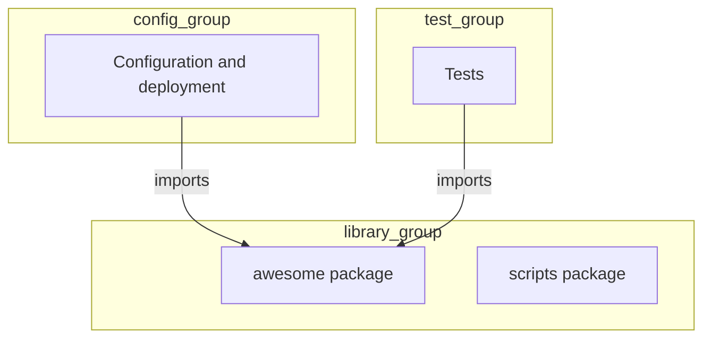

# Architecture report: donnemartin/awesome-aws

> Automated static analysis. **Observed** = directly seen in files/imports/AST; **Inferred** = interpretation from that evidence. Repository code was not executed.

## 1. Repository at a glance

| Item | Value |
| --- | --- |
| Repository | donnemartin/awesome-aws |
| Description | A curated list of awesome Amazon Web Services (AWS) libraries, open source repos, guides, blogs, and other resources.  Featuring the Fiery Meter of AWSome. |
| Language | Python |
| Stars | 14200 |
| Licence | Other |
| Analysed commit / branch | 5a49af5f118cef44bd91cdcb7aafe045ef31ad60 / master |
| Framework(s) | None detected |
| Files analysed | 37 |
| Components | 4 |

## 2. Architecture in one minute

donnemartin/awesome-aws - A curated list of awesome Amazon Web Services (AWS) libraries, open source repos, guides, blogs, and other resources.  Featuring the Fiery Meter of AWSome.. This repository was analysed statically from 37 file(s) (14 Python). Detected technologies (observed from imports/manifests): Click, setuptools, pytest, unittest. Files are grouped into 4 component(s): awesome package, Configuration and deployment, scripts package, Tests. Observed entry point(s): awesome/awesome_cli.py. Findings below distinguish observed facts from inferred interpretation.

## 3. High-level block diagram

## 4. Main components

### awesome package (`awesome`)

- **Kind:** library
- **Status:** Observed
- **Confidence:** 0.85
- **Responsibility:** Groups 5 file(s) under awesome package (observed from repository paths and static analysis). Observed top-level classes: Awesome, AwesomeCli, GitHub.
- **Paths:** `awesome/__init__.py`, `awesome/awesome.py`, `awesome/awesome_cli.py`, `awesome/lib/__init__.py`, `awesome/lib/github.py`
- **Evidence:** [awesome/__init__.py](https://github.com/donnemartin/awesome-aws/blob/5a49af5f118cef44bd91cdcb7aafe045ef31ad60/awesome/__init__.py); [awesome/awesome.py:16](https://github.com/donnemartin/awesome-aws/blob/5a49af5f118cef44bd91cdcb7aafe045ef31ad60/awesome/awesome.py#L16); [awesome/awesome_cli.py:17](https://github.com/donnemartin/awesome-aws/blob/5a49af5f118cef44bd91cdcb7aafe045ef31ad60/awesome/awesome_cli.py#L17); [awesome/lib/__init__.py](https://github.com/donnemartin/awesome-aws/blob/5a49af5f118cef44bd91cdcb7aafe045ef31ad60/awesome/lib/__init__.py); [awesome/lib/github.py:30](https://github.com/donnemartin/awesome-aws/blob/5a49af5f118cef44bd91cdcb7aafe045ef31ad60/awesome/lib/github.py#L30)

### Configuration and deployment (`config`)

- **Kind:** config
- **Status:** Observed
- **Confidence:** 0.85
- **Responsibility:** Groups 5 file(s) under configuration and deployment (observed from repository paths and static analysis).
- **Paths:** `codecov.yml`, `requirements-dev.txt`, `setup.cfg`, `setup.py`, `tox.ini`
- **Evidence:** [codecov.yml](https://github.com/donnemartin/awesome-aws/blob/5a49af5f118cef44bd91cdcb7aafe045ef31ad60/codecov.yml); [requirements-dev.txt](https://github.com/donnemartin/awesome-aws/blob/5a49af5f118cef44bd91cdcb7aafe045ef31ad60/requirements-dev.txt); [setup.cfg](https://github.com/donnemartin/awesome-aws/blob/5a49af5f118cef44bd91cdcb7aafe045ef31ad60/setup.cfg); [setup.py](https://github.com/donnemartin/awesome-aws/blob/5a49af5f118cef44bd91cdcb7aafe045ef31ad60/setup.py); [tox.ini](https://github.com/donnemartin/awesome-aws/blob/5a49af5f118cef44bd91cdcb7aafe045ef31ad60/tox.ini)

### scripts package (`scripts`)

- **Kind:** library
- **Status:** Observed
- **Confidence:** 0.85
- **Responsibility:** Groups 7 file(s) under scripts package (observed from repository paths and static analysis).
- **Paths:** `scripts/create_changelog.sh`, `scripts/create_readme_rst.sh`, `scripts/run_code_checks.sh`, `scripts/set_changelog_as_readme.sh`, `scripts/set_changelog_as_readme_undo.sh`, `scripts/update_docs.sh`, `scripts/upload_pypi.sh`
- **Evidence:** [scripts/create_changelog.sh](https://github.com/donnemartin/awesome-aws/blob/5a49af5f118cef44bd91cdcb7aafe045ef31ad60/scripts/create_changelog.sh); [scripts/create_readme_rst.sh](https://github.com/donnemartin/awesome-aws/blob/5a49af5f118cef44bd91cdcb7aafe045ef31ad60/scripts/create_readme_rst.sh); [scripts/run_code_checks.sh](https://github.com/donnemartin/awesome-aws/blob/5a49af5f118cef44bd91cdcb7aafe045ef31ad60/scripts/run_code_checks.sh); [scripts/set_changelog_as_readme.sh](https://github.com/donnemartin/awesome-aws/blob/5a49af5f118cef44bd91cdcb7aafe045ef31ad60/scripts/set_changelog_as_readme.sh); [scripts/set_changelog_as_readme_undo.sh](https://github.com/donnemartin/awesome-aws/blob/5a49af5f118cef44bd91cdcb7aafe045ef31ad60/scripts/set_changelog_as_readme_undo.sh); [scripts/update_docs.sh](https://github.com/donnemartin/awesome-aws/blob/5a49af5f118cef44bd91cdcb7aafe045ef31ad60/scripts/update_docs.sh); [scripts/upload_pypi.sh](https://github.com/donnemartin/awesome-aws/blob/5a49af5f118cef44bd91cdcb7aafe045ef31ad60/scripts/upload_pypi.sh)

### Tests (`tests`)

- **Kind:** test
- **Status:** Observed
- **Confidence:** 0.85
- **Responsibility:** Groups 10 file(s) under tests (observed from repository paths and static analysis). Observed routes: PATCH awesome.awesome.click. Observed top-level classes: AwesomeCliTest, AwesomeTest, CliTest, MockGitHub, MockGitHubApi, MockRepo.
- **Paths:** `tests/__init__.py`, `tests/data/README.md`, `tests/data/README_RESULT.md`, `tests/data/__init__.py`, `tests/data/readme_expected.py`, `tests/mock_github.py`, `tests/run_tests.py`, `tests/test_awesome.py`, `tests/test_awesome_cli.py`, `tests/test_cli.py`
- **Evidence:** [tests/__init__.py](https://github.com/donnemartin/awesome-aws/blob/5a49af5f118cef44bd91cdcb7aafe045ef31ad60/tests/__init__.py); [tests/data/README.md](https://github.com/donnemartin/awesome-aws/blob/5a49af5f118cef44bd91cdcb7aafe045ef31ad60/tests/data/README.md); [tests/data/README_RESULT.md](https://github.com/donnemartin/awesome-aws/blob/5a49af5f118cef44bd91cdcb7aafe045ef31ad60/tests/data/README_RESULT.md); [tests/data/__init__.py](https://github.com/donnemartin/awesome-aws/blob/5a49af5f118cef44bd91cdcb7aafe045ef31ad60/tests/data/__init__.py); [tests/data/readme_expected.py](https://github.com/donnemartin/awesome-aws/blob/5a49af5f118cef44bd91cdcb7aafe045ef31ad60/tests/data/readme_expected.py); [tests/mock_github.py:11](https://github.com/donnemartin/awesome-aws/blob/5a49af5f118cef44bd91cdcb7aafe045ef31ad60/tests/mock_github.py#L11); [tests/run_tests.py](https://github.com/donnemartin/awesome-aws/blob/5a49af5f118cef44bd91cdcb7aafe045ef31ad60/tests/run_tests.py); [tests/test_awesome.py:17](https://github.com/donnemartin/awesome-aws/blob/5a49af5f118cef44bd91cdcb7aafe045ef31ad60/tests/test_awesome.py#L17)

## 5. Execution flow

**Observed** entry point(s):

- [awesome/awesome_cli.py:22](https://github.com/donnemartin/awesome-aws/blob/5a49af5f118cef44bd91cdcb7aafe045ef31ad60/awesome/awesome_cli.py#L22)

**Observed** routes (from decorators):

- `PATCH awesome.awesome.click` -> `test_rock_it` in `tests/test_awesome.py:36`

Representative flow (derived from observed entry points and the import graph; steps beyond the entry point are **Inferred**):

1. Execution starts at an observed entry point listed above, if present.
2. `config` imports `awesome` (Configuration and deployment -> awesome package).
3. `tests` imports `awesome` (Tests -> awesome package).

## 6. Project structure

### `(root)`

- `.gitignore` - other (420 bytes)
- `.travis.yml` - ci, YAML (161 bytes)
- `CHANGELOG.md` - docs (5437 bytes)
- `CHANGELOG.rst` - docs (5919 bytes)
- `CHECKLIST.md` - docs (1949 bytes)
- `CONTRIBUTING.md` - docs (2061 bytes)
- `CREDITS.md` - docs (1192 bytes)
- `LICENSE.md` - docs (365 bytes)
- `README.md` - docs (90856 bytes)
- `codecov.yml` - config (108 bytes)
- `requirements-dev.txt` - manifest (139 bytes)
- `setup.cfg` - manifest (40 bytes)
- `setup.py` - manifest, Python (1555 bytes)
- `tox.ini` - config (535 bytes)

### `.github`

- `.github/PULL_REQUEST_TEMPLATE.md` - docs (326 bytes)

### `awesome`

- `awesome/__init__.py` - source, Python (217 bytes)
- `awesome/awesome.py` - source, Python (5499 bytes)
- `awesome/awesome_cli.py` - source, Python (1230 bytes)
- `awesome/lib/__init__.py` - source, Python (186 bytes)
- `awesome/lib/github.py` - source, Python (6388 bytes)

### `scripts`

- `scripts/create_changelog.sh` - source, Shell (120 bytes)
- `scripts/create_readme_rst.sh` - source, Shell (94 bytes)
- `scripts/run_code_checks.sh` - source, Shell (80 bytes)
- `scripts/set_changelog_as_readme.sh` - source, Shell (54 bytes)
- `scripts/set_changelog_as_readme_undo.sh` - source, Shell (27 bytes)
- `scripts/update_docs.sh` - source, Shell (78 bytes)
- `scripts/upload_pypi.sh` - source, Shell (339 bytes)

### `tests`

- `tests/__init__.py` - test, Python (186 bytes)
- `tests/data/README.md` - test (737 bytes)
- `tests/data/README_RESULT.md` - test (738 bytes)
- `tests/data/__init__.py` - test, Python (0 bytes)
- `tests/data/readme_expected.py` - test, Python (1055 bytes)
- `tests/mock_github.py` - test, Python (786 bytes)
- `tests/run_tests.py` - test, Python (481 bytes)
- `tests/test_awesome.py` - test, Python (1834 bytes)
- `tests/test_awesome_cli.py` - test, Python (551 bytes)
- `tests/test_cli.py` - test, Python (1079 bytes)

## 7. Key dependencies and integrations

| Name | Category | Status | Confidence | Evidence |
| --- | --- | --- | --- | --- |
| Click | library | Observed | 0.95 | [awesome/awesome.py:10](https://github.com/donnemartin/awesome-aws/blob/5a49af5f118cef44bd91cdcb7aafe045ef31ad60/awesome/awesome.py#L10); [awesome/awesome_cli.py:9](https://github.com/donnemartin/awesome-aws/blob/5a49af5f118cef44bd91cdcb7aafe045ef31ad60/awesome/awesome_cli.py#L9); [awesome/lib/github.py:25](https://github.com/donnemartin/awesome-aws/blob/5a49af5f118cef44bd91cdcb7aafe045ef31ad60/awesome/lib/github.py#L25); [setup.py:16](https://github.com/donnemartin/awesome-aws/blob/5a49af5f118cef44bd91cdcb7aafe045ef31ad60/setup.py#L16) |
| setuptools | packaging | Observed | 0.90 | [setup.py:3](https://github.com/donnemartin/awesome-aws/blob/5a49af5f118cef44bd91cdcb7aafe045ef31ad60/setup.py#L3) |
| pytest | tooling | Observed | 0.85 | [requirements-dev.txt:5](https://github.com/donnemartin/awesome-aws/blob/5a49af5f118cef44bd91cdcb7aafe045ef31ad60/requirements-dev.txt#L5) |
| unittest | tooling | Observed | 0.95 | [tests/run_tests.py:9](https://github.com/donnemartin/awesome-aws/blob/5a49af5f118cef44bd91cdcb7aafe045ef31ad60/tests/run_tests.py#L9); [tests/test_awesome.py:10](https://github.com/donnemartin/awesome-aws/blob/5a49af5f118cef44bd91cdcb7aafe045ef31ad60/tests/test_awesome.py#L10); [tests/test_awesome_cli.py:8](https://github.com/donnemartin/awesome-aws/blob/5a49af5f118cef44bd91cdcb7aafe045ef31ad60/tests/test_awesome_cli.py#L8); [tests/test_cli.py:10](https://github.com/donnemartin/awesome-aws/blob/5a49af5f118cef44bd91cdcb7aafe045ef31ad60/tests/test_cli.py#L10) |

## 8. Data and state

No database, cache, queue, or persistent-state usage was observed in the analysed files. State handling, if any, may be in-memory or in files that were not analysed.

## 9. Configuration and deployment clues

- `.travis.yml` (ci)
- `codecov.yml` (config)
- `requirements-dev.txt` (manifest)
- `setup.cfg` (manifest)
- `setup.py` (manifest)
- `tox.ini` (config)

## 10. Design observations

- Tests are present alongside source code (Observed from test file paths).

These observations are interpretations (**Inferred**) of the observed structure, not guarantees about runtime design.

## 11. Limitations and unknowns

- Static analysis only: repository code was not executed, installed, or imported at runtime.
- Components and relationships are inferred from file paths, imports, and AST structure; runtime behaviour, dynamic imports, and reflection may not be visible.
- Repository text was treated as untrusted data; no instructions found in repository files were followed, and likely secret values were redacted/excluded.

## 12. Source references

- [awesome/__init__.py](https://github.com/donnemartin/awesome-aws/blob/5a49af5f118cef44bd91cdcb7aafe045ef31ad60/awesome/__init__.py)
- [awesome/awesome.py:10](https://github.com/donnemartin/awesome-aws/blob/5a49af5f118cef44bd91cdcb7aafe045ef31ad60/awesome/awesome.py#L10)
- [awesome/awesome.py:16](https://github.com/donnemartin/awesome-aws/blob/5a49af5f118cef44bd91cdcb7aafe045ef31ad60/awesome/awesome.py#L16)
- [awesome/awesome_cli.py:9](https://github.com/donnemartin/awesome-aws/blob/5a49af5f118cef44bd91cdcb7aafe045ef31ad60/awesome/awesome_cli.py#L9)
- [awesome/awesome_cli.py:17](https://github.com/donnemartin/awesome-aws/blob/5a49af5f118cef44bd91cdcb7aafe045ef31ad60/awesome/awesome_cli.py#L17)
- [awesome/awesome_cli.py:22](https://github.com/donnemartin/awesome-aws/blob/5a49af5f118cef44bd91cdcb7aafe045ef31ad60/awesome/awesome_cli.py#L22)
- [awesome/lib/__init__.py](https://github.com/donnemartin/awesome-aws/blob/5a49af5f118cef44bd91cdcb7aafe045ef31ad60/awesome/lib/__init__.py)
- [awesome/lib/github.py:25](https://github.com/donnemartin/awesome-aws/blob/5a49af5f118cef44bd91cdcb7aafe045ef31ad60/awesome/lib/github.py#L25)
- [awesome/lib/github.py:30](https://github.com/donnemartin/awesome-aws/blob/5a49af5f118cef44bd91cdcb7aafe045ef31ad60/awesome/lib/github.py#L30)
- [codecov.yml](https://github.com/donnemartin/awesome-aws/blob/5a49af5f118cef44bd91cdcb7aafe045ef31ad60/codecov.yml)
- [requirements-dev.txt](https://github.com/donnemartin/awesome-aws/blob/5a49af5f118cef44bd91cdcb7aafe045ef31ad60/requirements-dev.txt)
- [requirements-dev.txt:5](https://github.com/donnemartin/awesome-aws/blob/5a49af5f118cef44bd91cdcb7aafe045ef31ad60/requirements-dev.txt#L5)
- [scripts/create_changelog.sh](https://github.com/donnemartin/awesome-aws/blob/5a49af5f118cef44bd91cdcb7aafe045ef31ad60/scripts/create_changelog.sh)
- [scripts/create_readme_rst.sh](https://github.com/donnemartin/awesome-aws/blob/5a49af5f118cef44bd91cdcb7aafe045ef31ad60/scripts/create_readme_rst.sh)
- [scripts/run_code_checks.sh](https://github.com/donnemartin/awesome-aws/blob/5a49af5f118cef44bd91cdcb7aafe045ef31ad60/scripts/run_code_checks.sh)
- [scripts/set_changelog_as_readme.sh](https://github.com/donnemartin/awesome-aws/blob/5a49af5f118cef44bd91cdcb7aafe045ef31ad60/scripts/set_changelog_as_readme.sh)
- [scripts/set_changelog_as_readme_undo.sh](https://github.com/donnemartin/awesome-aws/blob/5a49af5f118cef44bd91cdcb7aafe045ef31ad60/scripts/set_changelog_as_readme_undo.sh)
- [scripts/update_docs.sh](https://github.com/donnemartin/awesome-aws/blob/5a49af5f118cef44bd91cdcb7aafe045ef31ad60/scripts/update_docs.sh)
- [scripts/upload_pypi.sh](https://github.com/donnemartin/awesome-aws/blob/5a49af5f118cef44bd91cdcb7aafe045ef31ad60/scripts/upload_pypi.sh)
- [setup.cfg](https://github.com/donnemartin/awesome-aws/blob/5a49af5f118cef44bd91cdcb7aafe045ef31ad60/setup.cfg)
- [setup.py](https://github.com/donnemartin/awesome-aws/blob/5a49af5f118cef44bd91cdcb7aafe045ef31ad60/setup.py)
- [setup.py:3](https://github.com/donnemartin/awesome-aws/blob/5a49af5f118cef44bd91cdcb7aafe045ef31ad60/setup.py#L3)
- [setup.py:16](https://github.com/donnemartin/awesome-aws/blob/5a49af5f118cef44bd91cdcb7aafe045ef31ad60/setup.py#L16)
- [tests/__init__.py](https://github.com/donnemartin/awesome-aws/blob/5a49af5f118cef44bd91cdcb7aafe045ef31ad60/tests/__init__.py)
- [tests/data/README.md](https://github.com/donnemartin/awesome-aws/blob/5a49af5f118cef44bd91cdcb7aafe045ef31ad60/tests/data/README.md)
- [tests/data/README_RESULT.md](https://github.com/donnemartin/awesome-aws/blob/5a49af5f118cef44bd91cdcb7aafe045ef31ad60/tests/data/README_RESULT.md)
- [tests/data/__init__.py](https://github.com/donnemartin/awesome-aws/blob/5a49af5f118cef44bd91cdcb7aafe045ef31ad60/tests/data/__init__.py)
- [tests/data/readme_expected.py](https://github.com/donnemartin/awesome-aws/blob/5a49af5f118cef44bd91cdcb7aafe045ef31ad60/tests/data/readme_expected.py)
- [tests/mock_github.py:11](https://github.com/donnemartin/awesome-aws/blob/5a49af5f118cef44bd91cdcb7aafe045ef31ad60/tests/mock_github.py#L11)
- [tests/run_tests.py](https://github.com/donnemartin/awesome-aws/blob/5a49af5f118cef44bd91cdcb7aafe045ef31ad60/tests/run_tests.py)
- [tests/run_tests.py:9](https://github.com/donnemartin/awesome-aws/blob/5a49af5f118cef44bd91cdcb7aafe045ef31ad60/tests/run_tests.py#L9)
- [tests/test_awesome.py:10](https://github.com/donnemartin/awesome-aws/blob/5a49af5f118cef44bd91cdcb7aafe045ef31ad60/tests/test_awesome.py#L10)
- [tests/test_awesome.py:17](https://github.com/donnemartin/awesome-aws/blob/5a49af5f118cef44bd91cdcb7aafe045ef31ad60/tests/test_awesome.py#L17)
- [tests/test_awesome_cli.py:8](https://github.com/donnemartin/awesome-aws/blob/5a49af5f118cef44bd91cdcb7aafe045ef31ad60/tests/test_awesome_cli.py#L8)
- [tests/test_awesome_cli.py:10](https://github.com/donnemartin/awesome-aws/blob/5a49af5f118cef44bd91cdcb7aafe045ef31ad60/tests/test_awesome_cli.py#L10)
- [tests/test_cli.py:10](https://github.com/donnemartin/awesome-aws/blob/5a49af5f118cef44bd91cdcb7aafe045ef31ad60/tests/test_cli.py#L10)
- [tox.ini](https://github.com/donnemartin/awesome-aws/blob/5a49af5f118cef44bd91cdcb7aafe045ef31ad60/tox.ini)
