# Architecture report: donnemartin/data-science-ipython-notebooks

> Automated static analysis. **Observed** = directly seen in files/imports/AST; **Inferred** = interpretation from that evidence. Repository code was not executed.

## 1. Repository at a glance

| Item | Value |
| --- | --- |
| Repository | donnemartin/data-science-ipython-notebooks |
| Description | Data science Python notebooks: Deep learning (TensorFlow, Theano, Caffe, Keras), scikit-learn, Kaggle, big data (Spark, Hadoop MapReduce, HDFS), matplotlib, pandas, NumPy, SciPy, Python essentials, AWS, and various command lines. |
| Language | Python |
| Stars | 29391 |
| Licence | Other |
| Analysed commit / branch | 5b3c00d462c6e9200315afe46d0093948621eb95 / master |
| Framework(s) | None detected |
| Files analysed | 170 |
| Components | 18 |

## 2. Architecture in one minute

donnemartin/data-science-ipython-notebooks - Data science Python notebooks: Deep learning (TensorFlow, Theano, Caffe, Keras), scikit-learn, Kaggle, big data (Spark, Hadoop MapReduce, HDFS), matplotlib, pandas, NumPy, SciPy, Python essentials, A…. This repository was analysed statically from 170 file(s) (57 Python). Detected technologies (observed from imports/manifests): NumPy, pandas, Docker. Files are grouped into 18 component(s): analyses package, aws package, commands package, Configuration and deployment, Core modules, Data layer, deep-learning package, Application entry point. Observed entry point(s): deep-learning/keras-tutorial/deep_learning_models/resnet50.py, deep-learning/keras-tutorial/deep_learning_models/vgg16.py, deep-learning/keras-tutorial/deep_learning_models/vgg19.py. Findings below distinguish observed facts from inferred interpretation.

## 3. High-level block diagram

```mermaid
flowchart TD
    subgraph config_group
        config["Configuration and deployment"]
    end
    subgraph core_group
        core["Core modules"]
    end
    subgraph data_group
        data_layer["Data layer"]
    end
    subgraph entrypoint_group
        entrypoint["Application entry point"]
    end
    subgraph library_group
        analyses["analyses package"]
        aws["aws package"]
        commands["commands package"]
        deep_learning["deep-learning package"]
        kaggle["kaggle package"]
        mapreduce["mapreduce package"]
        matplotlib["matplotlib package"]
        numpy["numpy package"]
        pandas["pandas package"]
        python_data["python-data package"]
        scikit_learn["scikit-learn package"]
        scipy["scipy package"]
        spark["spark package"]
    end
    subgraph test_group
        tests["Tests"]
    end
    analyses -->|imports| numpy
    data_layer -->|imports| numpy
    deep_learning -->|imports| numpy
    entrypoint -->|imports| matplotlib
    entrypoint -->|imports| numpy
    entrypoint -->|imports| pandas
    entrypoint -->|imports| scipy
    scikit_learn -->|imports| matplotlib
    scikit_learn -->|imports| numpy
    tests -->|imports| python_data
```

## 4. Main components

### analyses package (`analyses`)

- **Kind:** library
- **Status:** Observed
- **Confidence:** 0.85
- **Responsibility:** Groups 2 file(s) under analyses package (observed from repository paths and static analysis). Observed top-level functions: calibration, discrimination.
- **Paths:** `analyses/__init__.py`, `analyses/churn_measurements.py`
- **Evidence:** [analyses/__init__.py](https://github.com/donnemartin/data-science-ipython-notebooks/blob/5b3c00d462c6e9200315afe46d0093948621eb95/analyses/__init__.py); [analyses/churn_measurements.py:17](https://github.com/donnemartin/data-science-ipython-notebooks/blob/5b3c00d462c6e9200315afe46d0093948621eb95/analyses/churn_measurements.py#L17)

### aws package (`aws`)

- **Kind:** library
- **Status:** Observed
- **Confidence:** 0.85
- **Responsibility:** Groups 1 file(s) under aws package (observed from repository paths and static analysis).
- **Paths:** `aws/__init__.py`
- **Evidence:** [aws/__init__.py](https://github.com/donnemartin/data-science-ipython-notebooks/blob/5b3c00d462c6e9200315afe46d0093948621eb95/aws/__init__.py)

### commands package (`commands`)

- **Kind:** library
- **Status:** Observed
- **Confidence:** 0.85
- **Responsibility:** Groups 1 file(s) under commands package (observed from repository paths and static analysis).
- **Paths:** `commands/__init__.py`
- **Evidence:** [commands/__init__.py](https://github.com/donnemartin/data-science-ipython-notebooks/blob/5b3c00d462c6e9200315afe46d0093948621eb95/commands/__init__.py)

### Configuration and deployment (`config`)

- **Kind:** config
- **Status:** Observed
- **Confidence:** 0.85
- **Responsibility:** Groups 3 file(s) under configuration and deployment (observed from repository paths and static analysis).
- **Paths:** `deep-learning/keras-tutorial/deep-learning-osx.yml`, `deep-learning/keras-tutorial/deep-learning.yml`, `deep-learning/tensor-flow-exercises/Dockerfile`
- **Evidence:** [deep-learning/keras-tutorial/deep-learning-osx.yml](https://github.com/donnemartin/data-science-ipython-notebooks/blob/5b3c00d462c6e9200315afe46d0093948621eb95/deep-learning/keras-tutorial/deep-learning-osx.yml); [deep-learning/keras-tutorial/deep-learning.yml](https://github.com/donnemartin/data-science-ipython-notebooks/blob/5b3c00d462c6e9200315afe46d0093948621eb95/deep-learning/keras-tutorial/deep-learning.yml); [deep-learning/tensor-flow-exercises/Dockerfile](https://github.com/donnemartin/data-science-ipython-notebooks/blob/5b3c00d462c6e9200315afe46d0093948621eb95/deep-learning/tensor-flow-exercises/Dockerfile)

### Core modules (`core`)

- **Kind:** core
- **Status:** Observed
- **Confidence:** 0.85
- **Responsibility:** Groups 1 file(s) under core modules (observed from repository paths and static analysis).
- **Paths:** `__init__.py`
- **Evidence:** [__init__.py](https://github.com/donnemartin/data-science-ipython-notebooks/blob/5b3c00d462c6e9200315afe46d0093948621eb95/__init__.py)

### Data layer (`data_layer`)

- **Kind:** data
- **Status:** Observed
- **Confidence:** 0.85
- **Responsibility:** Groups 3 file(s) under data layer (observed from repository paths and static analysis).
- **Paths:** `data/titanic/genderclassmodel.py`, `data/titanic/gendermodel.py`, `data/titanic/myfirstforest.py`
- **Evidence:** [data/titanic/genderclassmodel.py](https://github.com/donnemartin/data-science-ipython-notebooks/blob/5b3c00d462c6e9200315afe46d0093948621eb95/data/titanic/genderclassmodel.py); [data/titanic/gendermodel.py](https://github.com/donnemartin/data-science-ipython-notebooks/blob/5b3c00d462c6e9200315afe46d0093948621eb95/data/titanic/gendermodel.py); [data/titanic/myfirstforest.py](https://github.com/donnemartin/data-science-ipython-notebooks/blob/5b3c00d462c6e9200315afe46d0093948621eb95/data/titanic/myfirstforest.py)

### deep-learning package (`deep_learning`)

- **Kind:** library
- **Status:** Observed
- **Confidence:** 0.85
- **Responsibility:** Groups 12 file(s) under deep-learning package (observed from repository paths and static analysis). Observed top-level classes: DataSet, LogisticRegression, LstmLayer, SimpleRNN. Observed top-level functions: _read32, batch_iter, build_input_data, build_vocab, clean_str, decode_predictions.
- **Paths:** `deep-learning/keras-tutorial/data_helpers.py`, `deep-learning/keras-tutorial/deep_learning_models/imagenet_utils.py`, `deep-learning/keras-tutorial/solutions/sol_111.py`, `deep-learning/keras-tutorial/solutions/sol_112.py`, `deep-learning/tensor-flow-examples/input_data.py`, `deep-learning/tensor-flow-examples/multigpu_basics.py`, `deep-learning/theano-tutorial/intro_theano/utils.py`, `deep-learning/theano-tutorial/rnn_tutorial/lstm_text.py`, `deep-learning/theano-tutorial/rnn_tutorial/rnn_precompile.py`, `deep-learning/theano-tutorial/rnn_tutorial/synthetic.py`, `deep-learning/theano-tutorial/scan_tutorial/scan_ex1_solution.py`, `deep-learning/theano-tutorial/scan_tutorial/scan_ex2_solution.py`
- **Evidence:** [deep-learning/keras-tutorial/data_helpers.py:9](https://github.com/donnemartin/data-science-ipython-notebooks/blob/5b3c00d462c6e9200315afe46d0093948621eb95/deep-learning/keras-tutorial/data_helpers.py#L9); [deep-learning/keras-tutorial/deep_learning_models/imagenet_utils.py:11](https://github.com/donnemartin/data-science-ipython-notebooks/blob/5b3c00d462c6e9200315afe46d0093948621eb95/deep-learning/keras-tutorial/deep_learning_models/imagenet_utils.py#L11); [deep-learning/keras-tutorial/solutions/sol_111.py](https://github.com/donnemartin/data-science-ipython-notebooks/blob/5b3c00d462c6e9200315afe46d0093948621eb95/deep-learning/keras-tutorial/solutions/sol_111.py); [deep-learning/keras-tutorial/solutions/sol_112.py](https://github.com/donnemartin/data-science-ipython-notebooks/blob/5b3c00d462c6e9200315afe46d0093948621eb95/deep-learning/keras-tutorial/solutions/sol_112.py); [deep-learning/tensor-flow-examples/input_data.py:8](https://github.com/donnemartin/data-science-ipython-notebooks/blob/5b3c00d462c6e9200315afe46d0093948621eb95/deep-learning/tensor-flow-examples/input_data.py#L8); [deep-learning/tensor-flow-examples/multigpu_basics.py](https://github.com/donnemartin/data-science-ipython-notebooks/blob/5b3c00d462c6e9200315afe46d0093948621eb95/deep-learning/tensor-flow-examples/multigpu_basics.py); [deep-learning/theano-tutorial/intro_theano/utils.py:14](https://github.com/donnemartin/data-science-ipython-notebooks/blob/5b3c00d462c6e9200315afe46d0093948621eb95/deep-learning/theano-tutorial/intro_theano/utils.py#L14); [deep-learning/theano-tutorial/rnn_tutorial/lstm_text.py](https://github.com/donnemartin/data-science-ipython-notebooks/blob/5b3c00d462c6e9200315afe46d0093948621eb95/deep-learning/theano-tutorial/rnn_tutorial/lstm_text.py)

### Application entry point (`entrypoint`)

- **Kind:** entrypoint
- **Status:** Observed
- **Confidence:** 0.85
- **Responsibility:** Groups 13 file(s) under application entry point (observed from repository paths and static analysis). Observed top-level classes: Beta, Cdf, ControllBar, Controller, Dirichlet, EstimatedPdf. Observed top-level functions: Bar, BinomialCoef, Cdf, Cdfs, CentralMoment, CleanFemPreg.
- **Paths:** `deep-learning/keras-tutorial/deep_learning_models/resnet50.py`, `deep-learning/keras-tutorial/deep_learning_models/vgg16.py`, `deep-learning/keras-tutorial/deep_learning_models/vgg19.py`, `deep-learning/keras-tutorial/w2v.py`, `mapreduce/mr_s3_log_parser.py`, `scikit-learn/fig_code/ML_flow_chart.py`, `scikit-learn/fig_code/linear_regression.py`, `scikit-learn/fig_code/sgd_separator.py`, `scikit-learn/fig_code/svm_gui.py`, `scipy/first.py`, `scipy/nsfg.py`, `scipy/thinkplot.py`, `scipy/thinkstats2.py`
- **Evidence:** [deep-learning/keras-tutorial/deep_learning_models/resnet50.py:32](https://github.com/donnemartin/data-science-ipython-notebooks/blob/5b3c00d462c6e9200315afe46d0093948621eb95/deep-learning/keras-tutorial/deep_learning_models/resnet50.py#L32); [deep-learning/keras-tutorial/deep_learning_models/vgg16.py:30](https://github.com/donnemartin/data-science-ipython-notebooks/blob/5b3c00d462c6e9200315afe46d0093948621eb95/deep-learning/keras-tutorial/deep_learning_models/vgg16.py#L30); [deep-learning/keras-tutorial/deep_learning_models/vgg19.py:29](https://github.com/donnemartin/data-science-ipython-notebooks/blob/5b3c00d462c6e9200315afe46d0093948621eb95/deep-learning/keras-tutorial/deep_learning_models/vgg19.py#L29); [deep-learning/keras-tutorial/w2v.py:6](https://github.com/donnemartin/data-science-ipython-notebooks/blob/5b3c00d462c6e9200315afe46d0093948621eb95/deep-learning/keras-tutorial/w2v.py#L6); [mapreduce/mr_s3_log_parser.py:8](https://github.com/donnemartin/data-science-ipython-notebooks/blob/5b3c00d462c6e9200315afe46d0093948621eb95/mapreduce/mr_s3_log_parser.py#L8); [scikit-learn/fig_code/ML_flow_chart.py:12](https://github.com/donnemartin/data-science-ipython-notebooks/blob/5b3c00d462c6e9200315afe46d0093948621eb95/scikit-learn/fig_code/ML_flow_chart.py#L12); [scikit-learn/fig_code/linear_regression.py:6](https://github.com/donnemartin/data-science-ipython-notebooks/blob/5b3c00d462c6e9200315afe46d0093948621eb95/scikit-learn/fig_code/linear_regression.py#L6); [scikit-learn/fig_code/sgd_separator.py:6](https://github.com/donnemartin/data-science-ipython-notebooks/blob/5b3c00d462c6e9200315afe46d0093948621eb95/scikit-learn/fig_code/sgd_separator.py#L6)

### kaggle package (`kaggle`)

- **Kind:** library
- **Status:** Observed
- **Confidence:** 0.85
- **Responsibility:** Groups 1 file(s) under kaggle package (observed from repository paths and static analysis).
- **Paths:** `kaggle/__init__.py`
- **Evidence:** [kaggle/__init__.py](https://github.com/donnemartin/data-science-ipython-notebooks/blob/5b3c00d462c6e9200315afe46d0093948621eb95/kaggle/__init__.py)

### mapreduce package (`mapreduce`)

- **Kind:** library
- **Status:** Observed
- **Confidence:** 0.85
- **Responsibility:** Groups 1 file(s) under mapreduce package (observed from repository paths and static analysis).
- **Paths:** `mapreduce/__init__.py`
- **Evidence:** [mapreduce/__init__.py](https://github.com/donnemartin/data-science-ipython-notebooks/blob/5b3c00d462c6e9200315afe46d0093948621eb95/mapreduce/__init__.py)

### matplotlib package (`matplotlib`)

- **Kind:** library
- **Status:** Observed
- **Confidence:** 0.85
- **Responsibility:** Groups 1 file(s) under matplotlib package (observed from repository paths and static analysis).
- **Paths:** `matplotlib/__init__.py`
- **Evidence:** [matplotlib/__init__.py](https://github.com/donnemartin/data-science-ipython-notebooks/blob/5b3c00d462c6e9200315afe46d0093948621eb95/matplotlib/__init__.py)

### numpy package (`numpy`)

- **Kind:** library
- **Status:** Observed
- **Confidence:** 0.85
- **Responsibility:** Groups 1 file(s) under numpy package (observed from repository paths and static analysis).
- **Paths:** `numpy/__init__.py`
- **Evidence:** [numpy/__init__.py](https://github.com/donnemartin/data-science-ipython-notebooks/blob/5b3c00d462c6e9200315afe46d0093948621eb95/numpy/__init__.py)

### pandas package (`pandas`)

- **Kind:** library
- **Status:** Observed
- **Confidence:** 0.85
- **Responsibility:** Groups 1 file(s) under pandas package (observed from repository paths and static analysis).
- **Paths:** `pandas/__init__.py`
- **Evidence:** [pandas/__init__.py](https://github.com/donnemartin/data-science-ipython-notebooks/blob/5b3c00d462c6e9200315afe46d0093948621eb95/pandas/__init__.py)

### python-data package (`python_data`)

- **Kind:** library
- **Status:** Observed
- **Confidence:** 0.85
- **Responsibility:** Groups 3 file(s) under python-data package (observed from repository paths and static analysis). Observed top-level classes: TransformUtil, TypeUtil.
- **Paths:** `python-data/__init__.py`, `python-data/transform_util.py`, `python-data/type_util.py`
- **Evidence:** [python-data/__init__.py](https://github.com/donnemartin/data-science-ipython-notebooks/blob/5b3c00d462c6e9200315afe46d0093948621eb95/python-data/__init__.py); [python-data/transform_util.py:4](https://github.com/donnemartin/data-science-ipython-notebooks/blob/5b3c00d462c6e9200315afe46d0093948621eb95/python-data/transform_util.py#L4); [python-data/type_util.py:1](https://github.com/donnemartin/data-science-ipython-notebooks/blob/5b3c00d462c6e9200315afe46d0093948621eb95/python-data/type_util.py#L1)

### scikit-learn package (`scikit_learn`)

- **Kind:** library
- **Status:** Observed
- **Confidence:** 0.85
- **Responsibility:** Groups 5 file(s) under scikit-learn package (observed from repository paths and static analysis). Observed top-level functions: linear_data_sample, linear_data_sample_big_errs, plot_example_decision_tree, plot_image_components, plot_iris_knn, plot_kmeans_interactive.
- **Paths:** `scikit-learn/__init__.py`, `scikit-learn/fig_code/__init__.py`, `scikit-learn/fig_code/data.py`, `scikit-learn/fig_code/figures.py`, `scikit-learn/fig_code/helpers.py`
- **Evidence:** [scikit-learn/__init__.py](https://github.com/donnemartin/data-science-ipython-notebooks/blob/5b3c00d462c6e9200315afe46d0093948621eb95/scikit-learn/__init__.py); [scikit-learn/fig_code/__init__.py](https://github.com/donnemartin/data-science-ipython-notebooks/blob/5b3c00d462c6e9200315afe46d0093948621eb95/scikit-learn/fig_code/__init__.py); [scikit-learn/fig_code/data.py:4](https://github.com/donnemartin/data-science-ipython-notebooks/blob/5b3c00d462c6e9200315afe46d0093948621eb95/scikit-learn/fig_code/data.py#L4); [scikit-learn/fig_code/figures.py:6](https://github.com/donnemartin/data-science-ipython-notebooks/blob/5b3c00d462c6e9200315afe46d0093948621eb95/scikit-learn/fig_code/figures.py#L6); [scikit-learn/fig_code/helpers.py:14](https://github.com/donnemartin/data-science-ipython-notebooks/blob/5b3c00d462c6e9200315afe46d0093948621eb95/scikit-learn/fig_code/helpers.py#L14)

### scipy package (`scipy`)

- **Kind:** library
- **Status:** Observed
- **Confidence:** 0.85
- **Responsibility:** Groups 1 file(s) under scipy package (observed from repository paths and static analysis).
- **Paths:** `scipy/__init__.py`
- **Evidence:** [scipy/__init__.py](https://github.com/donnemartin/data-science-ipython-notebooks/blob/5b3c00d462c6e9200315afe46d0093948621eb95/scipy/__init__.py)

### spark package (`spark`)

- **Kind:** library
- **Status:** Observed
- **Confidence:** 0.85
- **Responsibility:** Groups 1 file(s) under spark package (observed from repository paths and static analysis).
- **Paths:** `spark/__init__.py`
- **Evidence:** [spark/__init__.py](https://github.com/donnemartin/data-science-ipython-notebooks/blob/5b3c00d462c6e9200315afe46d0093948621eb95/spark/__init__.py)

### Tests (`tests`)

- **Kind:** test
- **Status:** Observed
- **Confidence:** 0.85
- **Responsibility:** Groups 9 file(s) under tests (observed from repository paths and static analysis). Observed top-level classes: MrTestsUtil, TestMrS3LogParser, TestTransformUtil, TestUtil.
- **Paths:** `mapreduce/test_mr_s3_log_parser.py`, `matplotlib/tests/__init__.py`, `numpy/tests/__init__.py`, `pandas/tests/__init__.py`, `python-data/tests/__init__.py`, `python-data/tests/test_transform_util.py`, `python-data/tests/test_type_util.py`, `scikit-learn/tests/__init__.py`, `scipy/tests/__init__.py`
- **Evidence:** [mapreduce/test_mr_s3_log_parser.py:7](https://github.com/donnemartin/data-science-ipython-notebooks/blob/5b3c00d462c6e9200315afe46d0093948621eb95/mapreduce/test_mr_s3_log_parser.py#L7); [matplotlib/tests/__init__.py](https://github.com/donnemartin/data-science-ipython-notebooks/blob/5b3c00d462c6e9200315afe46d0093948621eb95/matplotlib/tests/__init__.py); [numpy/tests/__init__.py](https://github.com/donnemartin/data-science-ipython-notebooks/blob/5b3c00d462c6e9200315afe46d0093948621eb95/numpy/tests/__init__.py); [pandas/tests/__init__.py](https://github.com/donnemartin/data-science-ipython-notebooks/blob/5b3c00d462c6e9200315afe46d0093948621eb95/pandas/tests/__init__.py); [python-data/tests/__init__.py](https://github.com/donnemartin/data-science-ipython-notebooks/blob/5b3c00d462c6e9200315afe46d0093948621eb95/python-data/tests/__init__.py); [python-data/tests/test_transform_util.py:5](https://github.com/donnemartin/data-science-ipython-notebooks/blob/5b3c00d462c6e9200315afe46d0093948621eb95/python-data/tests/test_transform_util.py#L5); [python-data/tests/test_type_util.py:5](https://github.com/donnemartin/data-science-ipython-notebooks/blob/5b3c00d462c6e9200315afe46d0093948621eb95/python-data/tests/test_type_util.py#L5); [scikit-learn/tests/__init__.py](https://github.com/donnemartin/data-science-ipython-notebooks/blob/5b3c00d462c6e9200315afe46d0093948621eb95/scikit-learn/tests/__init__.py)

## 5. Execution flow

**Observed** entry point(s):

- [deep-learning/keras-tutorial/deep_learning_models/resnet50.py:235](https://github.com/donnemartin/data-science-ipython-notebooks/blob/5b3c00d462c6e9200315afe46d0093948621eb95/deep-learning/keras-tutorial/deep_learning_models/resnet50.py#L235)
- [deep-learning/keras-tutorial/deep_learning_models/vgg16.py:154](https://github.com/donnemartin/data-science-ipython-notebooks/blob/5b3c00d462c6e9200315afe46d0093948621eb95/deep-learning/keras-tutorial/deep_learning_models/vgg16.py#L154)
- [deep-learning/keras-tutorial/deep_learning_models/vgg19.py:156](https://github.com/donnemartin/data-science-ipython-notebooks/blob/5b3c00d462c6e9200315afe46d0093948621eb95/deep-learning/keras-tutorial/deep_learning_models/vgg19.py#L156)
- [deep-learning/keras-tutorial/w2v.py:53](https://github.com/donnemartin/data-science-ipython-notebooks/blob/5b3c00d462c6e9200315afe46d0093948621eb95/deep-learning/keras-tutorial/w2v.py#L53)
- [mapreduce/mr_s3_log_parser.py:136](https://github.com/donnemartin/data-science-ipython-notebooks/blob/5b3c00d462c6e9200315afe46d0093948621eb95/mapreduce/mr_s3_log_parser.py#L136)
- [scikit-learn/fig_code/ML_flow_chart.py:129](https://github.com/donnemartin/data-science-ipython-notebooks/blob/5b3c00d462c6e9200315afe46d0093948621eb95/scikit-learn/fig_code/ML_flow_chart.py#L129)
- [scikit-learn/fig_code/linear_regression.py:35](https://github.com/donnemartin/data-science-ipython-notebooks/blob/5b3c00d462c6e9200315afe46d0093948621eb95/scikit-learn/fig_code/linear_regression.py#L35)
- [scikit-learn/fig_code/sgd_separator.py:38](https://github.com/donnemartin/data-science-ipython-notebooks/blob/5b3c00d462c6e9200315afe46d0093948621eb95/scikit-learn/fig_code/sgd_separator.py#L38)
- [scikit-learn/fig_code/svm_gui.py:340](https://github.com/donnemartin/data-science-ipython-notebooks/blob/5b3c00d462c6e9200315afe46d0093948621eb95/scikit-learn/fig_code/svm_gui.py#L340)
- [scipy/first.py:156](https://github.com/donnemartin/data-science-ipython-notebooks/blob/5b3c00d462c6e9200315afe46d0093948621eb95/scipy/first.py#L156)
- [scipy/nsfg.py:105](https://github.com/donnemartin/data-science-ipython-notebooks/blob/5b3c00d462c6e9200315afe46d0093948621eb95/scipy/nsfg.py#L105)
- [scipy/thinkplot.py:715](https://github.com/donnemartin/data-science-ipython-notebooks/blob/5b3c00d462c6e9200315afe46d0093948621eb95/scipy/thinkplot.py#L715)

Representative flow (derived from observed entry points and the import graph; steps beyond the entry point are **Inferred**):

1. Execution starts at an observed entry point listed above, if present.
2. `analyses` imports `numpy` (analyses package -> numpy package).
3. `data_layer` imports `numpy` (Data layer -> numpy package).
4. `deep_learning` imports `numpy` (deep-learning package -> numpy package).
5. `entrypoint` imports `matplotlib` (Application entry point -> matplotlib package).
6. `entrypoint` imports `numpy` (Application entry point -> numpy package).
7. `entrypoint` imports `pandas` (Application entry point -> pandas package).
8. `entrypoint` imports `scipy` (Application entry point -> scipy package).
9. `scikit_learn` imports `matplotlib` (scikit-learn package -> matplotlib package).

## 6. Project structure

### `(root)`

- `.gitattributes` - other (33 bytes)
- `.gitignore` - other (766 bytes)
- `LICENSE` - docs (1052 bytes)
- `README.md` - docs (43957 bytes)
- `__init__.py` - source, Python (0 bytes)

### `analyses`

- `analyses/__init__.py` - source, Python (0 bytes)
- `analyses/churn_measurements.py` - source, Python (2795 bytes)

### `aws`

- `aws/__init__.py` - source, Python (0 bytes)
- `aws/aws.ipynb` - other (29817 bytes)

### `commands`

- `commands/__init__.py` - source, Python (0 bytes)
- `commands/linux.ipynb` - other (10199 bytes)
- `commands/misc.ipynb` - other (16285 bytes)
- `commands/styles/custom.css` - other (1612 bytes)

### `data`

- `data/ozone.csv` - data (2902 bytes)
- `data/ozone_copy.csv` - data (3324 bytes)
- `data/titanic/genderclassmodel.csv` - data (3258 bytes)
- `data/titanic/genderclassmodel.py` - source, Python (5760 bytes)
- `data/titanic/gendermodel.csv` - data (3258 bytes)
- `data/titanic/gendermodel.py` - source, Python (3666 bytes)
- `data/titanic/myfirstforest.py` - source, Python (4081 bytes)
- `data/titanic/results-rf.csv` - data (3675 bytes)
- `data/titanic/test.csv` - data (28629 bytes)
- `data/titanic/train.csv` - data (61194 bytes)

### `deep-learning`

- `deep-learning/keras-tutorial/0. Preamble.ipynb` - other (20553 bytes)
- `deep-learning/keras-tutorial/1.2 Introduction - Theano.ipynb` - other (21173 bytes)
- `deep-learning/keras-tutorial/1.3 Introduction - Keras.ipynb` - other (19512 bytes)
- `deep-learning/keras-tutorial/1.4 (Extra) A Simple Implementation of ANN for MNIST.ipynb` - other (13804 bytes)
- `deep-learning/keras-tutorial/2.1 Supervised Learning - ConvNets.ipynb` - other (23039 bytes)
- `deep-learning/keras-tutorial/2.2.1 Supervised Learning - ConvNet HandsOn Part I.ipynb` - other (20129 bytes)
- `deep-learning/keras-tutorial/2.2.2 Supervised Learning - ConvNet HandsOn Part II.ipynb` - other (37508 bytes)
- `deep-learning/keras-tutorial/2.3 Supervised Learning - Famous Models with Keras.ipynb` - other (23381 bytes)
- `deep-learning/keras-tutorial/3.2 RNN and LSTM.ipynb` - other (18890 bytes)
- `deep-learning/keras-tutorial/3.3 (Extra) LSTM for Sentence Generation.ipynb` - other (25968 bytes)
- `deep-learning/keras-tutorial/4. Conclusions.ipynb` - other (2335 bytes)
- `deep-learning/keras-tutorial/LICENSE` - docs (1071 bytes)
- `deep-learning/keras-tutorial/data/intro_to_ann.csv` - data (13236 bytes)
- `deep-learning/keras-tutorial/data_helpers.py` - source, Python (4273 bytes)
- `deep-learning/keras-tutorial/deep-learning-osx.yml` - config (3219 bytes)
- `deep-learning/keras-tutorial/deep-learning.yml` - config (3517 bytes)
- `deep-learning/keras-tutorial/deep_learning_models/LICENSE` - docs (1074 bytes)
- `deep-learning/keras-tutorial/deep_learning_models/README.md` - docs (3374 bytes)
- `deep-learning/keras-tutorial/deep_learning_models/imagenet_utils.py` - source, Python (1233 bytes)
- `deep-learning/keras-tutorial/deep_learning_models/resnet50.py` - source, Python (10194 bytes)
- `deep-learning/keras-tutorial/deep_learning_models/vgg16.py` - source, Python (7227 bytes)
- `deep-learning/keras-tutorial/deep_learning_models/vgg19.py` - source, Python (7444 bytes)
- `deep-learning/keras-tutorial/outline.md` - docs (2163 bytes)
- `deep-learning/keras-tutorial/solutions/sol_111.py` - source, Python (149 bytes)
- `deep-learning/keras-tutorial/solutions/sol_112.py` - source, Python (165 bytes)
- `deep-learning/keras-tutorial/w2v.py` - source, Python (2550 bytes)
- `deep-learning/tensor-flow-examples/Setup_TensorFlow.md` - docs (16739 bytes)
- `deep-learning/tensor-flow-examples/input_data.py` - source, Python (5709 bytes)
- `deep-learning/tensor-flow-examples/multigpu_basics.py` - source, Python (2031 bytes)
- `deep-learning/tensor-flow-examples/notebooks/1_intro/basic_operations.ipynb` - other (5552 bytes)
- `deep-learning/tensor-flow-examples/notebooks/2_basic_classifiers/linear_regression.ipynb` - other (41597 bytes)
- `deep-learning/tensor-flow-examples/notebooks/2_basic_classifiers/logistic_regression.ipynb` - other (6089 bytes)
- `deep-learning/tensor-flow-examples/notebooks/2_basic_classifiers/nearest_neighbor.ipynb` - other (13905 bytes)
- `deep-learning/tensor-flow-examples/notebooks/3_neural_networks/alexnet.ipynb` - other (12745 bytes)
- `deep-learning/tensor-flow-examples/notebooks/3_neural_networks/convolutional_network.ipynb` - other (11282 bytes)
- `deep-learning/tensor-flow-examples/notebooks/3_neural_networks/multilayer_perceptron.ipynb` - other (6906 bytes)
- `deep-learning/tensor-flow-examples/notebooks/3_neural_networks/recurrent_network.ipynb` - other (13174 bytes)
- `deep-learning/tensor-flow-examples/notebooks/4_multi_gpu/multigpu_basics.ipynb` - other (4610 bytes)
- `deep-learning/tensor-flow-exercises/1_notmnist.ipynb` - other (20935 bytes)
- `deep-learning/tensor-flow-exercises/2_fullyconnected.ipynb` - other (19272 bytes)
- `deep-learning/tensor-flow-exercises/3_regularization.ipynb` - other (8658 bytes)
- `deep-learning/tensor-flow-exercises/4_convolutions.ipynb` - other (14985 bytes)
- `deep-learning/tensor-flow-exercises/6_lstm.ipynb` - other (42558 bytes)
- `deep-learning/tensor-flow-exercises/Dockerfile` - container (191 bytes)
- `deep-learning/tensor-flow-exercises/README.md` - docs (269 bytes)
- `deep-learning/theano-tutorial/intro_theano/Makefile` - other (146 bytes)
- `deep-learning/theano-tutorial/intro_theano/logistic_regression.ipynb` - other (17060 bytes)
- `deep-learning/theano-tutorial/intro_theano/utils.py` - source, Python (5130 bytes)
- `deep-learning/theano-tutorial/rnn_tutorial/Makefile` - other (538 bytes)
- `deep-learning/theano-tutorial/rnn_tutorial/lstm_text.ipynb` - other (23894 bytes)
- `deep-learning/theano-tutorial/rnn_tutorial/lstm_text.py` - source, Python (11250 bytes)
- `deep-learning/theano-tutorial/rnn_tutorial/rnn_precompile.py` - source, Python (8337 bytes)
- `deep-learning/theano-tutorial/rnn_tutorial/simple_rnn.ipynb` - other (133107 bytes)
- `deep-learning/theano-tutorial/rnn_tutorial/synthetic.py` - source, Python (2930 bytes)
- `deep-learning/theano-tutorial/scan_tutorial/scan_ex1_solution.py` - source, Python (952 bytes)
- `deep-learning/theano-tutorial/scan_tutorial/scan_ex2_solution.py` - source, Python (1394 bytes)
- `deep-learning/theano-tutorial/scan_tutorial/scan_tutorial.ipynb` - other (26572 bytes)
- `deep-learning/theano-tutorial/theano_mlp/theano_mlp.ipynb` - other (30422 bytes)

### `kaggle`

- `kaggle/__init__.py` - source, Python (0 bytes)

### `mapreduce`

- `mapreduce/__init__.py` - source, Python (0 bytes)
- `mapreduce/mapreduce-python.ipynb` - other (15033 bytes)
- `mapreduce/mr_s3_log_parser.py` - source, Python (4497 bytes)
- `mapreduce/test_mr_s3_log_parser.py` - test, Python (3179 bytes)

### `matplotlib`

- `matplotlib/04.00-Introduction-To-Matplotlib.ipynb` - other (100603 bytes)
- `matplotlib/04.02-Simple-Scatter-Plots.ipynb` - other (197227 bytes)
- `matplotlib/04.03-Errorbars.ipynb` - other (47226 bytes)
- `matplotlib/04.05-Histograms-and-Binnings.ipynb` - other (124829 bytes)
- `matplotlib/04.08-Multiple-Subplots.ipynb` - other (150312 bytes)
- `matplotlib/04.09-Text-and-Annotation.ipynb` - other (195318 bytes)
- `matplotlib/04.15-Further-Resources.ipynb` - other (5234 bytes)
- `matplotlib/__init__.py` - source, Python (0 bytes)
- `matplotlib/matplotlib-applied.ipynb` - other (192690 bytes)
- `matplotlib/matplotlib.ipynb` - other (123716 bytes)
- `matplotlib/tests/__init__.py` - test, Python (0 bytes)

### `misc`

- `misc/Algorithmia.ipynb` - other (135595 bytes)
- `misc/regex.ipynb` - other (1168 bytes)

### `numpy`

- `numpy/02.00-Introduction-to-NumPy.ipynb` - other (6546 bytes)
- `numpy/02.01-Understanding-Data-Types.ipynb` - other (23347 bytes)
- `numpy/02.02-The-Basics-Of-NumPy-Arrays.ipynb` - other (32939 bytes)
- `numpy/02.03-Computation-on-arrays-ufuncs.ipynb` - other (31494 bytes)
- `numpy/02.04-Computation-on-arrays-aggregates.ipynb` - other (30732 bytes)
- `numpy/02.05-Computation-on-arrays-broadcasting.ipynb` - other (101645 bytes)
- `numpy/02.06-Boolean-Arrays-and-Masks.ipynb` - other (40596 bytes)
- `numpy/02.07-Fancy-Indexing.ipynb` - other (62454 bytes)
- `numpy/02.08-Sorting.ipynb` - other (61697 bytes)
- `numpy/02.09-Structured-Data-NumPy.ipynb` - other (16685 bytes)
- `numpy/__init__.py` - source, Python (0 bytes)
- `numpy/numpy.ipynb` - other (66920 bytes)
- `numpy/tests/__init__.py` - test, Python (0 bytes)

### `pandas`

- `pandas/03.00-Introduction-to-Pandas.ipynb` - other (6503 bytes)
- `pandas/03.01-Introducing-Pandas-Objects.ipynb` - other (39542 bytes)
- `pandas/03.02-Data-Indexing-and-Selection.ipynb` - other (40744 bytes)
- `pandas/03.03-Operations-in-Pandas.ipynb` - other (27031 bytes)
- `pandas/03.04-Missing-Values.ipynb` - other (36878 bytes)
- `pandas/03.05-Hierarchical-Indexing.ipynb` - other (70595 bytes)
- `pandas/03.06-Concat-And-Append.ipynb` - other (46932 bytes)
- `pandas/03.07-Merge-and-Join.ipynb` - other (106861 bytes)
- `pandas/03.08-Aggregation-and-Grouping.ipynb` - other (78691 bytes)
- `pandas/03.09-Pivot-Tables.ipynb` - other (185308 bytes)
- `pandas/03.10-Working-With-Strings.ipynb` - other (41704 bytes)
- `pandas/03.12-Performance-Eval-and-Query.ipynb` - other (30580 bytes)
- `pandas/03.13-Further-Resources.ipynb` - other (4244 bytes)
- `pandas/__init__.py` - source, Python (0 bytes)
- `pandas/pandas.ipynb` - other (150821 bytes)
- `pandas/tests/__init__.py` - test, Python (0 bytes)

### `python-data`

- `python-data/__init__.py` - source, Python (0 bytes)
- `python-data/datetime.ipynb` - other (6170 bytes)
- `python-data/files.ipynb` - other (3495 bytes)
- `python-data/functions.ipynb` - other (14183 bytes)
- `python-data/hello_world.txt` - docs (12 bytes)
- `python-data/logs.ipynb` - other (4758 bytes)
- `python-data/pdb.ipynb` - other (2377 bytes)
- `python-data/structs.ipynb` - other (25161 bytes)
- `python-data/structs_utils.ipynb` - other (19780 bytes)
- `python-data/tests/__init__.py` - test, Python (0 bytes)
- `python-data/tests/test_transform_util.py` - test, Python (1046 bytes)
- `python-data/tests/test_type_util.py` - test, Python (420 bytes)
- `python-data/transform_util.py` - source, Python (571 bytes)
- `python-data/type_util.py` - source, Python (680 bytes)
- `python-data/unit_tests.ipynb` - other (4485 bytes)

### `scikit-learn`

- `scikit-learn/__init__.py` - source, Python (0 bytes)
- `scikit-learn/fig_code/ML_flow_chart.py` - source, Python (4970 bytes)
- `scikit-learn/fig_code/__init__.py` - source, Python (179 bytes)
- `scikit-learn/fig_code/data.py` - source, Python (980 bytes)
- `scikit-learn/fig_code/figures.py` - source, Python (8633 bytes)
- `scikit-learn/fig_code/helpers.py` - source, Python (2301 bytes)
- `scikit-learn/fig_code/linear_regression.py` - source, Python (735 bytes)
- `scikit-learn/fig_code/scikit-learn.ipynb` - other (2787 bytes)
- `scikit-learn/fig_code/sgd_separator.py` - source, Python (1148 bytes)
- `scikit-learn/fig_code/svm_gui.py` - source, Python (11549 bytes)
- `scikit-learn/scikit-learn-gmm.ipynb` - other (161892 bytes)
- `scikit-learn/scikit-learn-linear-reg.ipynb` - other (24809 bytes)
- `scikit-learn/scikit-learn-pca.ipynb` - other (86195 bytes)
- `scikit-learn/tests/__init__.py` - test, Python (0 bytes)

### `scipy`

- `scipy/2002FemPreg.dct` - other (28607 bytes)
- `scipy/__init__.py` - source, Python (0 bytes)
- `scipy/effect_size.ipynb` - other (74316 bytes)
- `scipy/first.py` - source, Python (4169 bytes)
- `scipy/hypothesis.ipynb` - other (30506 bytes)
- `scipy/nsfg.py` - source, Python (3012 bytes)
- `scipy/sampling.ipynb` - other (102795 bytes)
- `scipy/tests/__init__.py` - test, Python (0 bytes)
- `scipy/thinkplot.py` - source, Python (18140 bytes)
- `scipy/thinkstats2.py` - source, Python (68825 bytes)

### `spark`

- `spark/__init__.py` - source, Python (0 bytes)
- `spark/hdfs.ipynb` - other (4425 bytes)
- `spark/spark.ipynb` - other (38153 bytes)

## 7. Key dependencies and integrations

| Name | Category | Status | Confidence | Evidence |
| --- | --- | --- | --- | --- |
| NumPy | library | Observed | 0.95 | [analyses/churn_measurements.py:2](https://github.com/donnemartin/data-science-ipython-notebooks/blob/5b3c00d462c6e9200315afe46d0093948621eb95/analyses/churn_measurements.py#L2); [data/titanic/genderclassmodel.py:10](https://github.com/donnemartin/data-science-ipython-notebooks/blob/5b3c00d462c6e9200315afe46d0093948621eb95/data/titanic/genderclassmodel.py#L10); [deep-learning/keras-tutorial/data_helpers.py:1](https://github.com/donnemartin/data-science-ipython-notebooks/blob/5b3c00d462c6e9200315afe46d0093948621eb95/deep-learning/keras-tutorial/data_helpers.py#L1); [deep-learning/keras-tutorial/deep_learning_models/imagenet_utils.py:1](https://github.com/donnemartin/data-science-ipython-notebooks/blob/5b3c00d462c6e9200315afe46d0093948621eb95/deep-learning/keras-tutorial/deep_learning_models/imagenet_utils.py#L1) |
| pandas | library | Observed | 0.95 | [scipy/thinkplot.py:14](https://github.com/donnemartin/data-science-ipython-notebooks/blob/5b3c00d462c6e9200315afe46d0093948621eb95/scipy/thinkplot.py#L14); [scipy/thinkstats2.py:37](https://github.com/donnemartin/data-science-ipython-notebooks/blob/5b3c00d462c6e9200315afe46d0093948621eb95/scipy/thinkstats2.py#L37) |
| Docker | tooling | Observed | 0.85 | [deep-learning/tensor-flow-exercises/Dockerfile](https://github.com/donnemartin/data-science-ipython-notebooks/blob/5b3c00d462c6e9200315afe46d0093948621eb95/deep-learning/tensor-flow-exercises/Dockerfile) |

## 8. Data and state

- Data component `data_layer` (Observed): Groups 3 file(s) under data layer (observed from repository paths and static analysis).

## 9. Configuration and deployment clues

- `deep-learning/keras-tutorial/deep-learning-osx.yml` (config)
- `deep-learning/keras-tutorial/deep-learning.yml` (config)
- `deep-learning/tensor-flow-exercises/Dockerfile` (container)

## 10. Design observations

- An entry/API layer is separated from other code (Inferred from paths and decorators).
- Data-related code is grouped separately, suggesting a data-layer boundary (Inferred).
- Tests are present alongside source code (Observed from test file paths).

These observations are interpretations (**Inferred**) of the observed structure, not guarantees about runtime design.

## 11. Limitations and unknowns

- Static analysis only: repository code was not executed, installed, or imported at runtime.
- Components and relationships are inferred from file paths, imports, and AST structure; runtime behaviour, dynamic imports, and reflection may not be visible.
- File data/titanic/gendermodel.py could not be parsed as Python (possible SyntaxError) and was skipped for AST analysis.
- File data/titanic/myfirstforest.py could not be parsed as Python (possible SyntaxError) and was skipped for AST analysis.
- File deep-learning/keras-tutorial/solutions/sol_111.py could not be parsed as Python (possible SyntaxError) and was skipped for AST analysis.
- File deep-learning/keras-tutorial/solutions/sol_112.py could not be parsed as Python (possible SyntaxError) and was skipped for AST analysis.
- File deep-learning/tensor-flow-examples/multigpu_basics.py could not be parsed as Python (possible SyntaxError) and was skipped for AST analysis.
- File deep-learning/theano-tutorial/rnn_tutorial/lstm_text.py could not be parsed as Python (possible SyntaxError) and was skipped for AST analysis.
- Repository text was treated as untrusted data; no instructions found in repository files were followed, and likely secret values were redacted/excluded.

## 12. Source references

- [__init__.py](https://github.com/donnemartin/data-science-ipython-notebooks/blob/5b3c00d462c6e9200315afe46d0093948621eb95/__init__.py)
- [analyses/__init__.py](https://github.com/donnemartin/data-science-ipython-notebooks/blob/5b3c00d462c6e9200315afe46d0093948621eb95/analyses/__init__.py)
- [analyses/churn_measurements.py:2](https://github.com/donnemartin/data-science-ipython-notebooks/blob/5b3c00d462c6e9200315afe46d0093948621eb95/analyses/churn_measurements.py#L2)
- [analyses/churn_measurements.py:17](https://github.com/donnemartin/data-science-ipython-notebooks/blob/5b3c00d462c6e9200315afe46d0093948621eb95/analyses/churn_measurements.py#L17)
- [aws/__init__.py](https://github.com/donnemartin/data-science-ipython-notebooks/blob/5b3c00d462c6e9200315afe46d0093948621eb95/aws/__init__.py)
- [commands/__init__.py](https://github.com/donnemartin/data-science-ipython-notebooks/blob/5b3c00d462c6e9200315afe46d0093948621eb95/commands/__init__.py)
- [data/titanic/genderclassmodel.py](https://github.com/donnemartin/data-science-ipython-notebooks/blob/5b3c00d462c6e9200315afe46d0093948621eb95/data/titanic/genderclassmodel.py)
- [data/titanic/genderclassmodel.py:10](https://github.com/donnemartin/data-science-ipython-notebooks/blob/5b3c00d462c6e9200315afe46d0093948621eb95/data/titanic/genderclassmodel.py#L10)
- [data/titanic/gendermodel.py](https://github.com/donnemartin/data-science-ipython-notebooks/blob/5b3c00d462c6e9200315afe46d0093948621eb95/data/titanic/gendermodel.py)
- [data/titanic/myfirstforest.py](https://github.com/donnemartin/data-science-ipython-notebooks/blob/5b3c00d462c6e9200315afe46d0093948621eb95/data/titanic/myfirstforest.py)
- [deep-learning/keras-tutorial/data_helpers.py:1](https://github.com/donnemartin/data-science-ipython-notebooks/blob/5b3c00d462c6e9200315afe46d0093948621eb95/deep-learning/keras-tutorial/data_helpers.py#L1)
- [deep-learning/keras-tutorial/data_helpers.py:9](https://github.com/donnemartin/data-science-ipython-notebooks/blob/5b3c00d462c6e9200315afe46d0093948621eb95/deep-learning/keras-tutorial/data_helpers.py#L9)
- [deep-learning/keras-tutorial/deep-learning-osx.yml](https://github.com/donnemartin/data-science-ipython-notebooks/blob/5b3c00d462c6e9200315afe46d0093948621eb95/deep-learning/keras-tutorial/deep-learning-osx.yml)
- [deep-learning/keras-tutorial/deep-learning.yml](https://github.com/donnemartin/data-science-ipython-notebooks/blob/5b3c00d462c6e9200315afe46d0093948621eb95/deep-learning/keras-tutorial/deep-learning.yml)
- [deep-learning/keras-tutorial/deep_learning_models/imagenet_utils.py:1](https://github.com/donnemartin/data-science-ipython-notebooks/blob/5b3c00d462c6e9200315afe46d0093948621eb95/deep-learning/keras-tutorial/deep_learning_models/imagenet_utils.py#L1)
- [deep-learning/keras-tutorial/deep_learning_models/imagenet_utils.py:11](https://github.com/donnemartin/data-science-ipython-notebooks/blob/5b3c00d462c6e9200315afe46d0093948621eb95/deep-learning/keras-tutorial/deep_learning_models/imagenet_utils.py#L11)
- [deep-learning/keras-tutorial/deep_learning_models/resnet50.py:12](https://github.com/donnemartin/data-science-ipython-notebooks/blob/5b3c00d462c6e9200315afe46d0093948621eb95/deep-learning/keras-tutorial/deep_learning_models/resnet50.py#L12)
- [deep-learning/keras-tutorial/deep_learning_models/resnet50.py:32](https://github.com/donnemartin/data-science-ipython-notebooks/blob/5b3c00d462c6e9200315afe46d0093948621eb95/deep-learning/keras-tutorial/deep_learning_models/resnet50.py#L32)
- [deep-learning/keras-tutorial/deep_learning_models/resnet50.py:235](https://github.com/donnemartin/data-science-ipython-notebooks/blob/5b3c00d462c6e9200315afe46d0093948621eb95/deep-learning/keras-tutorial/deep_learning_models/resnet50.py#L235)
- [deep-learning/keras-tutorial/deep_learning_models/vgg16.py:11](https://github.com/donnemartin/data-science-ipython-notebooks/blob/5b3c00d462c6e9200315afe46d0093948621eb95/deep-learning/keras-tutorial/deep_learning_models/vgg16.py#L11)
- [deep-learning/keras-tutorial/deep_learning_models/vgg16.py:30](https://github.com/donnemartin/data-science-ipython-notebooks/blob/5b3c00d462c6e9200315afe46d0093948621eb95/deep-learning/keras-tutorial/deep_learning_models/vgg16.py#L30)
- [deep-learning/keras-tutorial/deep_learning_models/vgg16.py:154](https://github.com/donnemartin/data-science-ipython-notebooks/blob/5b3c00d462c6e9200315afe46d0093948621eb95/deep-learning/keras-tutorial/deep_learning_models/vgg16.py#L154)
- [deep-learning/keras-tutorial/deep_learning_models/vgg19.py:11](https://github.com/donnemartin/data-science-ipython-notebooks/blob/5b3c00d462c6e9200315afe46d0093948621eb95/deep-learning/keras-tutorial/deep_learning_models/vgg19.py#L11)
- [deep-learning/keras-tutorial/deep_learning_models/vgg19.py:29](https://github.com/donnemartin/data-science-ipython-notebooks/blob/5b3c00d462c6e9200315afe46d0093948621eb95/deep-learning/keras-tutorial/deep_learning_models/vgg19.py#L29)
- [deep-learning/keras-tutorial/deep_learning_models/vgg19.py:156](https://github.com/donnemartin/data-science-ipython-notebooks/blob/5b3c00d462c6e9200315afe46d0093948621eb95/deep-learning/keras-tutorial/deep_learning_models/vgg19.py#L156)
- [deep-learning/keras-tutorial/solutions/sol_111.py](https://github.com/donnemartin/data-science-ipython-notebooks/blob/5b3c00d462c6e9200315afe46d0093948621eb95/deep-learning/keras-tutorial/solutions/sol_111.py)
- [deep-learning/keras-tutorial/solutions/sol_112.py](https://github.com/donnemartin/data-science-ipython-notebooks/blob/5b3c00d462c6e9200315afe46d0093948621eb95/deep-learning/keras-tutorial/solutions/sol_112.py)
- [deep-learning/keras-tutorial/w2v.py:4](https://github.com/donnemartin/data-science-ipython-notebooks/blob/5b3c00d462c6e9200315afe46d0093948621eb95/deep-learning/keras-tutorial/w2v.py#L4)
- [deep-learning/keras-tutorial/w2v.py:6](https://github.com/donnemartin/data-science-ipython-notebooks/blob/5b3c00d462c6e9200315afe46d0093948621eb95/deep-learning/keras-tutorial/w2v.py#L6)
- [deep-learning/keras-tutorial/w2v.py:53](https://github.com/donnemartin/data-science-ipython-notebooks/blob/5b3c00d462c6e9200315afe46d0093948621eb95/deep-learning/keras-tutorial/w2v.py#L53)
- [deep-learning/tensor-flow-examples/input_data.py:8](https://github.com/donnemartin/data-science-ipython-notebooks/blob/5b3c00d462c6e9200315afe46d0093948621eb95/deep-learning/tensor-flow-examples/input_data.py#L8)
- [deep-learning/tensor-flow-examples/multigpu_basics.py](https://github.com/donnemartin/data-science-ipython-notebooks/blob/5b3c00d462c6e9200315afe46d0093948621eb95/deep-learning/tensor-flow-examples/multigpu_basics.py)
- [deep-learning/tensor-flow-exercises/Dockerfile](https://github.com/donnemartin/data-science-ipython-notebooks/blob/5b3c00d462c6e9200315afe46d0093948621eb95/deep-learning/tensor-flow-exercises/Dockerfile)
- [deep-learning/theano-tutorial/intro_theano/utils.py:14](https://github.com/donnemartin/data-science-ipython-notebooks/blob/5b3c00d462c6e9200315afe46d0093948621eb95/deep-learning/theano-tutorial/intro_theano/utils.py#L14)
- [deep-learning/theano-tutorial/rnn_tutorial/lstm_text.py](https://github.com/donnemartin/data-science-ipython-notebooks/blob/5b3c00d462c6e9200315afe46d0093948621eb95/deep-learning/theano-tutorial/rnn_tutorial/lstm_text.py)
- [kaggle/__init__.py](https://github.com/donnemartin/data-science-ipython-notebooks/blob/5b3c00d462c6e9200315afe46d0093948621eb95/kaggle/__init__.py)
- [mapreduce/__init__.py](https://github.com/donnemartin/data-science-ipython-notebooks/blob/5b3c00d462c6e9200315afe46d0093948621eb95/mapreduce/__init__.py)
- [mapreduce/mr_s3_log_parser.py:8](https://github.com/donnemartin/data-science-ipython-notebooks/blob/5b3c00d462c6e9200315afe46d0093948621eb95/mapreduce/mr_s3_log_parser.py#L8)
- [mapreduce/mr_s3_log_parser.py:136](https://github.com/donnemartin/data-science-ipython-notebooks/blob/5b3c00d462c6e9200315afe46d0093948621eb95/mapreduce/mr_s3_log_parser.py#L136)
- [mapreduce/test_mr_s3_log_parser.py:7](https://github.com/donnemartin/data-science-ipython-notebooks/blob/5b3c00d462c6e9200315afe46d0093948621eb95/mapreduce/test_mr_s3_log_parser.py#L7)
- [matplotlib/__init__.py](https://github.com/donnemartin/data-science-ipython-notebooks/blob/5b3c00d462c6e9200315afe46d0093948621eb95/matplotlib/__init__.py)
- [matplotlib/tests/__init__.py](https://github.com/donnemartin/data-science-ipython-notebooks/blob/5b3c00d462c6e9200315afe46d0093948621eb95/matplotlib/tests/__init__.py)
- [numpy/__init__.py](https://github.com/donnemartin/data-science-ipython-notebooks/blob/5b3c00d462c6e9200315afe46d0093948621eb95/numpy/__init__.py)
- [numpy/tests/__init__.py](https://github.com/donnemartin/data-science-ipython-notebooks/blob/5b3c00d462c6e9200315afe46d0093948621eb95/numpy/tests/__init__.py)
- [pandas/__init__.py](https://github.com/donnemartin/data-science-ipython-notebooks/blob/5b3c00d462c6e9200315afe46d0093948621eb95/pandas/__init__.py)
- [pandas/tests/__init__.py](https://github.com/donnemartin/data-science-ipython-notebooks/blob/5b3c00d462c6e9200315afe46d0093948621eb95/pandas/tests/__init__.py)
- [python-data/__init__.py](https://github.com/donnemartin/data-science-ipython-notebooks/blob/5b3c00d462c6e9200315afe46d0093948621eb95/python-data/__init__.py)
- [python-data/tests/__init__.py](https://github.com/donnemartin/data-science-ipython-notebooks/blob/5b3c00d462c6e9200315afe46d0093948621eb95/python-data/tests/__init__.py)
- [python-data/tests/test_transform_util.py:5](https://github.com/donnemartin/data-science-ipython-notebooks/blob/5b3c00d462c6e9200315afe46d0093948621eb95/python-data/tests/test_transform_util.py#L5)
- [python-data/tests/test_type_util.py:5](https://github.com/donnemartin/data-science-ipython-notebooks/blob/5b3c00d462c6e9200315afe46d0093948621eb95/python-data/tests/test_type_util.py#L5)
- [python-data/transform_util.py:4](https://github.com/donnemartin/data-science-ipython-notebooks/blob/5b3c00d462c6e9200315afe46d0093948621eb95/python-data/transform_util.py#L4)
- [python-data/type_util.py:1](https://github.com/donnemartin/data-science-ipython-notebooks/blob/5b3c00d462c6e9200315afe46d0093948621eb95/python-data/type_util.py#L1)
- [scikit-learn/__init__.py](https://github.com/donnemartin/data-science-ipython-notebooks/blob/5b3c00d462c6e9200315afe46d0093948621eb95/scikit-learn/__init__.py)
- [scikit-learn/fig_code/ML_flow_chart.py:12](https://github.com/donnemartin/data-science-ipython-notebooks/blob/5b3c00d462c6e9200315afe46d0093948621eb95/scikit-learn/fig_code/ML_flow_chart.py#L12)
- [scikit-learn/fig_code/ML_flow_chart.py:129](https://github.com/donnemartin/data-science-ipython-notebooks/blob/5b3c00d462c6e9200315afe46d0093948621eb95/scikit-learn/fig_code/ML_flow_chart.py#L129)
- [scikit-learn/fig_code/__init__.py](https://github.com/donnemartin/data-science-ipython-notebooks/blob/5b3c00d462c6e9200315afe46d0093948621eb95/scikit-learn/fig_code/__init__.py)
- [scikit-learn/fig_code/data.py:4](https://github.com/donnemartin/data-science-ipython-notebooks/blob/5b3c00d462c6e9200315afe46d0093948621eb95/scikit-learn/fig_code/data.py#L4)
- [scikit-learn/fig_code/figures.py:6](https://github.com/donnemartin/data-science-ipython-notebooks/blob/5b3c00d462c6e9200315afe46d0093948621eb95/scikit-learn/fig_code/figures.py#L6)
- [scikit-learn/fig_code/helpers.py:14](https://github.com/donnemartin/data-science-ipython-notebooks/blob/5b3c00d462c6e9200315afe46d0093948621eb95/scikit-learn/fig_code/helpers.py#L14)
- [scikit-learn/fig_code/linear_regression.py:6](https://github.com/donnemartin/data-science-ipython-notebooks/blob/5b3c00d462c6e9200315afe46d0093948621eb95/scikit-learn/fig_code/linear_regression.py#L6)
- [scikit-learn/fig_code/linear_regression.py:35](https://github.com/donnemartin/data-science-ipython-notebooks/blob/5b3c00d462c6e9200315afe46d0093948621eb95/scikit-learn/fig_code/linear_regression.py#L35)
- [scikit-learn/fig_code/sgd_separator.py:6](https://github.com/donnemartin/data-science-ipython-notebooks/blob/5b3c00d462c6e9200315afe46d0093948621eb95/scikit-learn/fig_code/sgd_separator.py#L6)
- [scikit-learn/fig_code/sgd_separator.py:38](https://github.com/donnemartin/data-science-ipython-notebooks/blob/5b3c00d462c6e9200315afe46d0093948621eb95/scikit-learn/fig_code/sgd_separator.py#L38)
- [scikit-learn/fig_code/svm_gui.py:340](https://github.com/donnemartin/data-science-ipython-notebooks/blob/5b3c00d462c6e9200315afe46d0093948621eb95/scikit-learn/fig_code/svm_gui.py#L340)
- [scikit-learn/tests/__init__.py](https://github.com/donnemartin/data-science-ipython-notebooks/blob/5b3c00d462c6e9200315afe46d0093948621eb95/scikit-learn/tests/__init__.py)
- [scipy/__init__.py](https://github.com/donnemartin/data-science-ipython-notebooks/blob/5b3c00d462c6e9200315afe46d0093948621eb95/scipy/__init__.py)
- [scipy/first.py:156](https://github.com/donnemartin/data-science-ipython-notebooks/blob/5b3c00d462c6e9200315afe46d0093948621eb95/scipy/first.py#L156)
- [scipy/nsfg.py:105](https://github.com/donnemartin/data-science-ipython-notebooks/blob/5b3c00d462c6e9200315afe46d0093948621eb95/scipy/nsfg.py#L105)
- [scipy/thinkplot.py:14](https://github.com/donnemartin/data-science-ipython-notebooks/blob/5b3c00d462c6e9200315afe46d0093948621eb95/scipy/thinkplot.py#L14)
- [scipy/thinkplot.py:715](https://github.com/donnemartin/data-science-ipython-notebooks/blob/5b3c00d462c6e9200315afe46d0093948621eb95/scipy/thinkplot.py#L715)
- [scipy/thinkstats2.py:37](https://github.com/donnemartin/data-science-ipython-notebooks/blob/5b3c00d462c6e9200315afe46d0093948621eb95/scipy/thinkstats2.py#L37)
- [spark/__init__.py](https://github.com/donnemartin/data-science-ipython-notebooks/blob/5b3c00d462c6e9200315afe46d0093948621eb95/spark/__init__.py)
