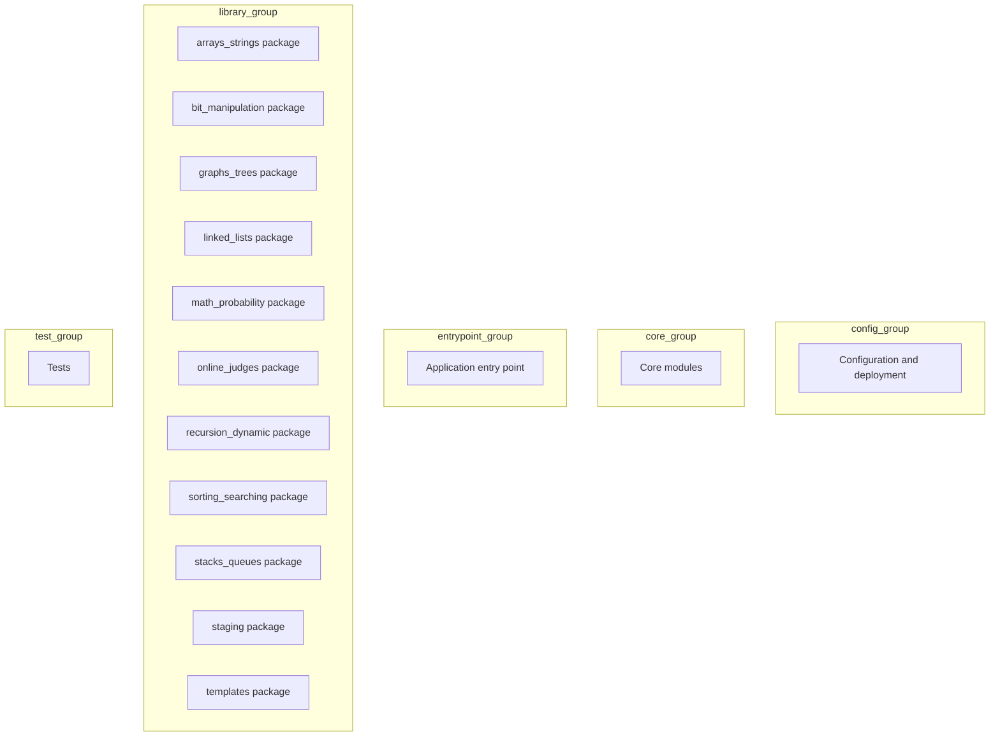

# Architecture report: donnemartin/interactive-coding-challenges

> Automated static analysis. **Observed** = directly seen in files/imports/AST; **Inferred** = interpretation from that evidence. Repository code was not executed.

## 1. Repository at a glance

| Item | Value |
| --- | --- |
| Repository | donnemartin/interactive-coding-challenges |
| Description | 120+ interactive Python coding interview challenges (algorithms and data structures).  Includes Anki flashcards. |
| Language | Python |
| Stars | 31963 |
| Licence | Other |
| Analysed commit / branch | 358f2cc60426d5c4c3d7d580910eec9a7b393fa9 / master |
| Framework(s) | None detected |
| Files analysed | 498 |
| Components | 15 |

## 2. Architecture in one minute

donnemartin/interactive-coding-challenges - 120+ interactive Python coding interview challenges (algorithms and data structures).  Includes Anki flashcards.. This repository was analysed statically from 498 file(s) (260 Python). Detected technologies (observed from imports/manifests): unittest. Files are grouped into 15 component(s): arrays_strings package, bit_manipulation package, Configuration and deployment, Core modules, Application entry point, graphs_trees package, linked_lists package, math_probability package. Observed entry point(s): staging/arrays_strings/reverse_words/reverse_words_solution.py. Findings below distinguish observed facts from inferred interpretation.

## 3. High-level block diagram

## 4. Main components

### arrays_strings package (`arrays_strings`)

- **Kind:** library
- **Status:** Observed
- **Confidence:** 0.85
- **Responsibility:** Groups 14 file(s) under arrays_strings package (observed from repository paths and static analysis). Observed top-level classes: PriorityQueue, PriorityQueueNode.
- **Paths:** `arrays_strings/__init__.py`, `arrays_strings/compress/__init__.py`, `arrays_strings/compress_alt/__init__.py`, `arrays_strings/fizz_buzz/__init__.py`, `arrays_strings/hash_map/__init__.py`, `arrays_strings/permutation/__init__.py`, `arrays_strings/priority_queue/__init__.py`, `arrays_strings/priority_queue/priority_queue.py`, `arrays_strings/reverse_string/__init__.py`, `arrays_strings/reverse_string/reverse_string.cpp`, `arrays_strings/rotation/__init__.py`, `arrays_strings/str_diff/__init__.py`, `arrays_strings/two_sum/__init__.py`, `arrays_strings/unique_chars/__init__.py`
- **Evidence:** [arrays_strings/__init__.py](https://github.com/donnemartin/interactive-coding-challenges/blob/358f2cc60426d5c4c3d7d580910eec9a7b393fa9/arrays_strings/__init__.py); [arrays_strings/compress/__init__.py](https://github.com/donnemartin/interactive-coding-challenges/blob/358f2cc60426d5c4c3d7d580910eec9a7b393fa9/arrays_strings/compress/__init__.py); [arrays_strings/compress_alt/__init__.py](https://github.com/donnemartin/interactive-coding-challenges/blob/358f2cc60426d5c4c3d7d580910eec9a7b393fa9/arrays_strings/compress_alt/__init__.py); [arrays_strings/fizz_buzz/__init__.py](https://github.com/donnemartin/interactive-coding-challenges/blob/358f2cc60426d5c4c3d7d580910eec9a7b393fa9/arrays_strings/fizz_buzz/__init__.py); [arrays_strings/hash_map/__init__.py](https://github.com/donnemartin/interactive-coding-challenges/blob/358f2cc60426d5c4c3d7d580910eec9a7b393fa9/arrays_strings/hash_map/__init__.py); [arrays_strings/permutation/__init__.py](https://github.com/donnemartin/interactive-coding-challenges/blob/358f2cc60426d5c4c3d7d580910eec9a7b393fa9/arrays_strings/permutation/__init__.py); [arrays_strings/priority_queue/__init__.py](https://github.com/donnemartin/interactive-coding-challenges/blob/358f2cc60426d5c4c3d7d580910eec9a7b393fa9/arrays_strings/priority_queue/__init__.py); [arrays_strings/priority_queue/priority_queue.py:4](https://github.com/donnemartin/interactive-coding-challenges/blob/358f2cc60426d5c4c3d7d580910eec9a7b393fa9/arrays_strings/priority_queue/priority_queue.py#L4)

### bit_manipulation package (`bit_manipulation`)

- **Kind:** library
- **Status:** Observed
- **Confidence:** 0.85
- **Responsibility:** Groups 9 file(s) under bit_manipulation package (observed from repository paths and static analysis).
- **Paths:** `bit_manipulation/__init__.py`, `bit_manipulation/bit/__init__.py`, `bit_manipulation/bits_to_flip/__init__.py`, `bit_manipulation/draw_line/__init__.py`, `bit_manipulation/flip_bit/__init__.py`, `bit_manipulation/get_next/__init__.py`, `bit_manipulation/insert_m_into_n/__init__.py`, `bit_manipulation/pairwise_swap/__init__.py`, `bit_manipulation/print_binary/__init__.py`
- **Evidence:** [bit_manipulation/__init__.py](https://github.com/donnemartin/interactive-coding-challenges/blob/358f2cc60426d5c4c3d7d580910eec9a7b393fa9/bit_manipulation/__init__.py); [bit_manipulation/bit/__init__.py](https://github.com/donnemartin/interactive-coding-challenges/blob/358f2cc60426d5c4c3d7d580910eec9a7b393fa9/bit_manipulation/bit/__init__.py); [bit_manipulation/bits_to_flip/__init__.py](https://github.com/donnemartin/interactive-coding-challenges/blob/358f2cc60426d5c4c3d7d580910eec9a7b393fa9/bit_manipulation/bits_to_flip/__init__.py); [bit_manipulation/draw_line/__init__.py](https://github.com/donnemartin/interactive-coding-challenges/blob/358f2cc60426d5c4c3d7d580910eec9a7b393fa9/bit_manipulation/draw_line/__init__.py); [bit_manipulation/flip_bit/__init__.py](https://github.com/donnemartin/interactive-coding-challenges/blob/358f2cc60426d5c4c3d7d580910eec9a7b393fa9/bit_manipulation/flip_bit/__init__.py); [bit_manipulation/get_next/__init__.py](https://github.com/donnemartin/interactive-coding-challenges/blob/358f2cc60426d5c4c3d7d580910eec9a7b393fa9/bit_manipulation/get_next/__init__.py); [bit_manipulation/insert_m_into_n/__init__.py](https://github.com/donnemartin/interactive-coding-challenges/blob/358f2cc60426d5c4c3d7d580910eec9a7b393fa9/bit_manipulation/insert_m_into_n/__init__.py); [bit_manipulation/pairwise_swap/__init__.py](https://github.com/donnemartin/interactive-coding-challenges/blob/358f2cc60426d5c4c3d7d580910eec9a7b393fa9/bit_manipulation/pairwise_swap/__init__.py)

### Configuration and deployment (`config`)

- **Kind:** config
- **Status:** Observed
- **Confidence:** 0.85
- **Responsibility:** Groups 1 file(s) under configuration and deployment (observed from repository paths and static analysis).
- **Paths:** `requirements.txt`
- **Evidence:** [requirements.txt](https://github.com/donnemartin/interactive-coding-challenges/blob/358f2cc60426d5c4c3d7d580910eec9a7b393fa9/requirements.txt)

### Core modules (`core`)

- **Kind:** core
- **Status:** Observed
- **Confidence:** 0.85
- **Responsibility:** Groups 1 file(s) under core modules (observed from repository paths and static analysis).
- **Paths:** `__init__.py`
- **Evidence:** [__init__.py](https://github.com/donnemartin/interactive-coding-challenges/blob/358f2cc60426d5c4c3d7d580910eec9a7b393fa9/__init__.py)

### Application entry point (`entrypoint`)

- **Kind:** entrypoint
- **Status:** Observed
- **Confidence:** 0.85
- **Responsibility:** Groups 1 file(s) under application entry point (observed from repository paths and static analysis). Observed top-level classes: TestReverseWords. Observed top-level functions: main.
- **Paths:** `staging/arrays_strings/reverse_words/reverse_words_solution.py`
- **Evidence:** [staging/arrays_strings/reverse_words/reverse_words_solution.py:4](https://github.com/donnemartin/interactive-coding-challenges/blob/358f2cc60426d5c4c3d7d580910eec9a7b393fa9/staging/arrays_strings/reverse_words/reverse_words_solution.py#L4)

### graphs_trees package (`graphs_trees`)

- **Kind:** library
- **Status:** Observed
- **Confidence:** 0.85
- **Responsibility:** Groups 32 file(s) under graphs_trees package (observed from repository paths and static analysis). Observed top-level classes: Bst, BstHeight, Graph, MinHeap, Node, PriorityQueue. Observed top-level functions: captured_output, in_order_traversal, post_order_traversal, pre_order_traversal.
- **Paths:** `graphs_trees/__init__.py`, `graphs_trees/bst/__init__.py`, `graphs_trees/bst/bst.py`, `graphs_trees/bst/dfs.py`, `graphs_trees/bst_min/__init__.py`, `graphs_trees/bst_second_largest/__init__.py`, `graphs_trees/bst_successor/__init__.py`, `graphs_trees/bst_validate/__init__.py`, `graphs_trees/check_balance/__init__.py`, `graphs_trees/graph/__init__.py`, `graphs_trees/graph/graph.py`, `graphs_trees/graph_bfs/__init__.py`, `graphs_trees/graph_build_order/__init__.py`, `graphs_trees/graph_dfs/__init__.py`, `graphs_trees/graph_path_exists/__init__.py`, `graphs_trees/graph_shortest_path/__init__.py`, `graphs_trees/graph_shortest_path/priority_queue.py`, `graphs_trees/graph_shortest_path_unweighted/__init__.py`, `graphs_trees/invert_tree/__init__.py`, `graphs_trees/min_heap/__init__.py`, `graphs_trees/min_heap/min_heap.py`, `graphs_trees/tree_bfs/__init__.py`, `graphs_trees/tree_dfs/__init__.py`, `graphs_trees/tree_height/__init__.py`, `graphs_trees/tree_height/height.py`, `graphs_trees/tree_lca/__init__.py`, `graphs_trees/tree_level_lists/__init__.py`, `graphs_trees/trie/__init__.py`, `graphs_trees/trie/trie.py`, `graphs_trees/utils/__init__.py`, `graphs_trees/utils/captured_output.py`, `graphs_trees/utils/results.py`
- **Evidence:** [graphs_trees/__init__.py](https://github.com/donnemartin/interactive-coding-challenges/blob/358f2cc60426d5c4c3d7d580910eec9a7b393fa9/graphs_trees/__init__.py); [graphs_trees/bst/__init__.py](https://github.com/donnemartin/interactive-coding-challenges/blob/358f2cc60426d5c4c3d7d580910eec9a7b393fa9/graphs_trees/bst/__init__.py); [graphs_trees/bst/bst.py:1](https://github.com/donnemartin/interactive-coding-challenges/blob/358f2cc60426d5c4c3d7d580910eec9a7b393fa9/graphs_trees/bst/bst.py#L1); [graphs_trees/bst/dfs.py:1](https://github.com/donnemartin/interactive-coding-challenges/blob/358f2cc60426d5c4c3d7d580910eec9a7b393fa9/graphs_trees/bst/dfs.py#L1); [graphs_trees/bst_min/__init__.py](https://github.com/donnemartin/interactive-coding-challenges/blob/358f2cc60426d5c4c3d7d580910eec9a7b393fa9/graphs_trees/bst_min/__init__.py); [graphs_trees/bst_second_largest/__init__.py](https://github.com/donnemartin/interactive-coding-challenges/blob/358f2cc60426d5c4c3d7d580910eec9a7b393fa9/graphs_trees/bst_second_largest/__init__.py); [graphs_trees/bst_successor/__init__.py](https://github.com/donnemartin/interactive-coding-challenges/blob/358f2cc60426d5c4c3d7d580910eec9a7b393fa9/graphs_trees/bst_successor/__init__.py); [graphs_trees/bst_validate/__init__.py](https://github.com/donnemartin/interactive-coding-challenges/blob/358f2cc60426d5c4c3d7d580910eec9a7b393fa9/graphs_trees/bst_validate/__init__.py)

### linked_lists package (`linked_lists`)

- **Kind:** library
- **Status:** Observed
- **Confidence:** 0.85
- **Responsibility:** Groups 10 file(s) under linked_lists package (observed from repository paths and static analysis). Observed top-level classes: LinkedList, Node.
- **Paths:** `linked_lists/__init__.py`, `linked_lists/add_reverse/__init__.py`, `linked_lists/delete_mid/__init__.py`, `linked_lists/find_loop_start/__init__.py`, `linked_lists/kth_to_last_elem/__init__.py`, `linked_lists/linked_list/__init__.py`, `linked_lists/linked_list/linked_list.py`, `linked_lists/palindrome/__init__.py`, `linked_lists/partition/__init__.py`, `linked_lists/remove_duplicates/__init__.py`
- **Evidence:** [linked_lists/__init__.py](https://github.com/donnemartin/interactive-coding-challenges/blob/358f2cc60426d5c4c3d7d580910eec9a7b393fa9/linked_lists/__init__.py); [linked_lists/add_reverse/__init__.py](https://github.com/donnemartin/interactive-coding-challenges/blob/358f2cc60426d5c4c3d7d580910eec9a7b393fa9/linked_lists/add_reverse/__init__.py); [linked_lists/delete_mid/__init__.py](https://github.com/donnemartin/interactive-coding-challenges/blob/358f2cc60426d5c4c3d7d580910eec9a7b393fa9/linked_lists/delete_mid/__init__.py); [linked_lists/find_loop_start/__init__.py](https://github.com/donnemartin/interactive-coding-challenges/blob/358f2cc60426d5c4c3d7d580910eec9a7b393fa9/linked_lists/find_loop_start/__init__.py); [linked_lists/kth_to_last_elem/__init__.py](https://github.com/donnemartin/interactive-coding-challenges/blob/358f2cc60426d5c4c3d7d580910eec9a7b393fa9/linked_lists/kth_to_last_elem/__init__.py); [linked_lists/linked_list/__init__.py](https://github.com/donnemartin/interactive-coding-challenges/blob/358f2cc60426d5c4c3d7d580910eec9a7b393fa9/linked_lists/linked_list/__init__.py); [linked_lists/linked_list/linked_list.py:1](https://github.com/donnemartin/interactive-coding-challenges/blob/358f2cc60426d5c4c3d7d580910eec9a7b393fa9/linked_lists/linked_list/linked_list.py#L1); [linked_lists/palindrome/__init__.py](https://github.com/donnemartin/interactive-coding-challenges/blob/358f2cc60426d5c4c3d7d580910eec9a7b393fa9/linked_lists/palindrome/__init__.py)

### math_probability package (`math_probability`)

- **Kind:** library
- **Status:** Observed
- **Confidence:** 0.85
- **Responsibility:** Groups 7 file(s) under math_probability package (observed from repository paths and static analysis).
- **Paths:** `math_probability/add_digits/__init__.py`, `math_probability/check_prime/__init__.py`, `math_probability/generate_primes/__init__.py`, `math_probability/math_ops/__init__.py`, `math_probability/power_two/__init__.py`, `math_probability/sub_two/__init__.py`, `math_probability/sum_two/__init__.py`
- **Evidence:** [math_probability/add_digits/__init__.py](https://github.com/donnemartin/interactive-coding-challenges/blob/358f2cc60426d5c4c3d7d580910eec9a7b393fa9/math_probability/add_digits/__init__.py); [math_probability/check_prime/__init__.py](https://github.com/donnemartin/interactive-coding-challenges/blob/358f2cc60426d5c4c3d7d580910eec9a7b393fa9/math_probability/check_prime/__init__.py); [math_probability/generate_primes/__init__.py](https://github.com/donnemartin/interactive-coding-challenges/blob/358f2cc60426d5c4c3d7d580910eec9a7b393fa9/math_probability/generate_primes/__init__.py); [math_probability/math_ops/__init__.py](https://github.com/donnemartin/interactive-coding-challenges/blob/358f2cc60426d5c4c3d7d580910eec9a7b393fa9/math_probability/math_ops/__init__.py); [math_probability/power_two/__init__.py](https://github.com/donnemartin/interactive-coding-challenges/blob/358f2cc60426d5c4c3d7d580910eec9a7b393fa9/math_probability/power_two/__init__.py); [math_probability/sub_two/__init__.py](https://github.com/donnemartin/interactive-coding-challenges/blob/358f2cc60426d5c4c3d7d580910eec9a7b393fa9/math_probability/sub_two/__init__.py); [math_probability/sum_two/__init__.py](https://github.com/donnemartin/interactive-coding-challenges/blob/358f2cc60426d5c4c3d7d580910eec9a7b393fa9/math_probability/sum_two/__init__.py)

### online_judges package (`online_judges`)

- **Kind:** library
- **Status:** Observed
- **Confidence:** 0.85
- **Responsibility:** Groups 19 file(s) under online_judges package (observed from repository paths and static analysis).
- **Paths:** `online_judges/__init__.py`, `online_judges/assign_cookies/__init__.py`, `online_judges/busiest_period/__init__.py`, `online_judges/island_perimeter/__init__.py`, `online_judges/license_key/__init__.py`, `online_judges/longest_abs_file_path/__init__.py`, `online_judges/longest_substr_k_distinct/__init__.py`, `online_judges/math_ops/__init__.py`, `online_judges/max_profit/__init__.py`, `online_judges/maximizing_xor/__init__.py`, `online_judges/merge_ranges/__init__.py`, `online_judges/move_zeroes/__init__.py`, `online_judges/mult_other_numbers/__init__.py`, `online_judges/nim/__init__.py`, `online_judges/prod_three/__init__.py`, `online_judges/ransom_note/__init__.py`, `online_judges/sentence_screen_fit/__init__.py`, `online_judges/str_diff/__init__.py`, `online_judges/utopian_tree/__init__.py`
- **Evidence:** [online_judges/__init__.py](https://github.com/donnemartin/interactive-coding-challenges/blob/358f2cc60426d5c4c3d7d580910eec9a7b393fa9/online_judges/__init__.py); [online_judges/assign_cookies/__init__.py](https://github.com/donnemartin/interactive-coding-challenges/blob/358f2cc60426d5c4c3d7d580910eec9a7b393fa9/online_judges/assign_cookies/__init__.py); [online_judges/busiest_period/__init__.py](https://github.com/donnemartin/interactive-coding-challenges/blob/358f2cc60426d5c4c3d7d580910eec9a7b393fa9/online_judges/busiest_period/__init__.py); [online_judges/island_perimeter/__init__.py](https://github.com/donnemartin/interactive-coding-challenges/blob/358f2cc60426d5c4c3d7d580910eec9a7b393fa9/online_judges/island_perimeter/__init__.py); [online_judges/license_key/__init__.py](https://github.com/donnemartin/interactive-coding-challenges/blob/358f2cc60426d5c4c3d7d580910eec9a7b393fa9/online_judges/license_key/__init__.py); [online_judges/longest_abs_file_path/__init__.py](https://github.com/donnemartin/interactive-coding-challenges/blob/358f2cc60426d5c4c3d7d580910eec9a7b393fa9/online_judges/longest_abs_file_path/__init__.py); [online_judges/longest_substr_k_distinct/__init__.py](https://github.com/donnemartin/interactive-coding-challenges/blob/358f2cc60426d5c4c3d7d580910eec9a7b393fa9/online_judges/longest_substr_k_distinct/__init__.py); [online_judges/math_ops/__init__.py](https://github.com/donnemartin/interactive-coding-challenges/blob/358f2cc60426d5c4c3d7d580910eec9a7b393fa9/online_judges/math_ops/__init__.py)

### recursion_dynamic package (`recursion_dynamic`)

- **Kind:** library
- **Status:** Observed
- **Confidence:** 0.85
- **Responsibility:** Groups 20 file(s) under recursion_dynamic package (observed from repository paths and static analysis).
- **Paths:** `recursion_dynamic/__init__.py`, `recursion_dynamic/coin_change/__init__.py`, `recursion_dynamic/coin_change_min/__init__.py`, `recursion_dynamic/coin_change_ways/__init__.py`, `recursion_dynamic/fibonacci/__init__.py`, `recursion_dynamic/grid_path/__init__.py`, `recursion_dynamic/hanoi/__init__.py`, `recursion_dynamic/knapsack_01/__init__.py`, `recursion_dynamic/knapsack_unbounded/__init__.py`, `recursion_dynamic/longest_common_subsequence/__init__.py`, `recursion_dynamic/longest_inc_subseq/__init__.py`, `recursion_dynamic/longest_substr_k_distinct/__init__.py`, `recursion_dynamic/longest_substring/__init__.py`, `recursion_dynamic/magic_index/__init__.py`, `recursion_dynamic/matrix_mult/__init__.py`, `recursion_dynamic/max_profit_k/__init__.py`, `recursion_dynamic/n_pairs_parentheses/__init__.py`, `recursion_dynamic/permutations/__init__.py`, `recursion_dynamic/power_set/__init__.py`, `recursion_dynamic/steps/__init__.py`
- **Evidence:** [recursion_dynamic/__init__.py](https://github.com/donnemartin/interactive-coding-challenges/blob/358f2cc60426d5c4c3d7d580910eec9a7b393fa9/recursion_dynamic/__init__.py); [recursion_dynamic/coin_change/__init__.py](https://github.com/donnemartin/interactive-coding-challenges/blob/358f2cc60426d5c4c3d7d580910eec9a7b393fa9/recursion_dynamic/coin_change/__init__.py); [recursion_dynamic/coin_change_min/__init__.py](https://github.com/donnemartin/interactive-coding-challenges/blob/358f2cc60426d5c4c3d7d580910eec9a7b393fa9/recursion_dynamic/coin_change_min/__init__.py); [recursion_dynamic/coin_change_ways/__init__.py](https://github.com/donnemartin/interactive-coding-challenges/blob/358f2cc60426d5c4c3d7d580910eec9a7b393fa9/recursion_dynamic/coin_change_ways/__init__.py); [recursion_dynamic/fibonacci/__init__.py](https://github.com/donnemartin/interactive-coding-challenges/blob/358f2cc60426d5c4c3d7d580910eec9a7b393fa9/recursion_dynamic/fibonacci/__init__.py); [recursion_dynamic/grid_path/__init__.py](https://github.com/donnemartin/interactive-coding-challenges/blob/358f2cc60426d5c4c3d7d580910eec9a7b393fa9/recursion_dynamic/grid_path/__init__.py); [recursion_dynamic/hanoi/__init__.py](https://github.com/donnemartin/interactive-coding-challenges/blob/358f2cc60426d5c4c3d7d580910eec9a7b393fa9/recursion_dynamic/hanoi/__init__.py); [recursion_dynamic/knapsack_01/__init__.py](https://github.com/donnemartin/interactive-coding-challenges/blob/358f2cc60426d5c4c3d7d580910eec9a7b393fa9/recursion_dynamic/knapsack_01/__init__.py)

### sorting_searching package (`sorting_searching`)

- **Kind:** library
- **Status:** Observed
- **Confidence:** 0.85
- **Responsibility:** Groups 11 file(s) under sorting_searching package (observed from repository paths and static analysis).
- **Paths:** `sorting_searching/__init__.py`, `sorting_searching/anagrams/__init__.py`, `sorting_searching/insertion_sort/__init__.py`, `sorting_searching/merge_into/__init__.py`, `sorting_searching/merge_sort/__init__.py`, `sorting_searching/new_int/__init__.py`, `sorting_searching/quick_sort/__init__.py`, `sorting_searching/radix_sort/__init__.py`, `sorting_searching/rotated_array_search/__init__.py`, `sorting_searching/search_sorted_matrix/__init__.py`, `sorting_searching/selection_sort/__init__.py`
- **Evidence:** [sorting_searching/__init__.py](https://github.com/donnemartin/interactive-coding-challenges/blob/358f2cc60426d5c4c3d7d580910eec9a7b393fa9/sorting_searching/__init__.py); [sorting_searching/anagrams/__init__.py](https://github.com/donnemartin/interactive-coding-challenges/blob/358f2cc60426d5c4c3d7d580910eec9a7b393fa9/sorting_searching/anagrams/__init__.py); [sorting_searching/insertion_sort/__init__.py](https://github.com/donnemartin/interactive-coding-challenges/blob/358f2cc60426d5c4c3d7d580910eec9a7b393fa9/sorting_searching/insertion_sort/__init__.py); [sorting_searching/merge_into/__init__.py](https://github.com/donnemartin/interactive-coding-challenges/blob/358f2cc60426d5c4c3d7d580910eec9a7b393fa9/sorting_searching/merge_into/__init__.py); [sorting_searching/merge_sort/__init__.py](https://github.com/donnemartin/interactive-coding-challenges/blob/358f2cc60426d5c4c3d7d580910eec9a7b393fa9/sorting_searching/merge_sort/__init__.py); [sorting_searching/new_int/__init__.py](https://github.com/donnemartin/interactive-coding-challenges/blob/358f2cc60426d5c4c3d7d580910eec9a7b393fa9/sorting_searching/new_int/__init__.py); [sorting_searching/quick_sort/__init__.py](https://github.com/donnemartin/interactive-coding-challenges/blob/358f2cc60426d5c4c3d7d580910eec9a7b393fa9/sorting_searching/quick_sort/__init__.py); [sorting_searching/radix_sort/__init__.py](https://github.com/donnemartin/interactive-coding-challenges/blob/358f2cc60426d5c4c3d7d580910eec9a7b393fa9/sorting_searching/radix_sort/__init__.py)

### stacks_queues package (`stacks_queues`)

- **Kind:** library
- **Status:** Observed
- **Confidence:** 0.85
- **Responsibility:** Groups 10 file(s) under stacks_queues package (observed from repository paths and static analysis). Observed top-level classes: Node, Queue, Stack.
- **Paths:** `stacks_queues/__init__.py`, `stacks_queues/n_stacks/__init__.py`, `stacks_queues/queue_from_stacks/__init__.py`, `stacks_queues/queue_list/__init__.py`, `stacks_queues/queue_list/queue_list.py`, `stacks_queues/set_of_stacks/__init__.py`, `stacks_queues/sort_stack/__init__.py`, `stacks_queues/stack/__init__.py`, `stacks_queues/stack/stack.py`, `stacks_queues/stack_min/__init__.py`
- **Evidence:** [stacks_queues/__init__.py](https://github.com/donnemartin/interactive-coding-challenges/blob/358f2cc60426d5c4c3d7d580910eec9a7b393fa9/stacks_queues/__init__.py); [stacks_queues/n_stacks/__init__.py](https://github.com/donnemartin/interactive-coding-challenges/blob/358f2cc60426d5c4c3d7d580910eec9a7b393fa9/stacks_queues/n_stacks/__init__.py); [stacks_queues/queue_from_stacks/__init__.py](https://github.com/donnemartin/interactive-coding-challenges/blob/358f2cc60426d5c4c3d7d580910eec9a7b393fa9/stacks_queues/queue_from_stacks/__init__.py); [stacks_queues/queue_list/__init__.py](https://github.com/donnemartin/interactive-coding-challenges/blob/358f2cc60426d5c4c3d7d580910eec9a7b393fa9/stacks_queues/queue_list/__init__.py); [stacks_queues/queue_list/queue_list.py:1](https://github.com/donnemartin/interactive-coding-challenges/blob/358f2cc60426d5c4c3d7d580910eec9a7b393fa9/stacks_queues/queue_list/queue_list.py#L1); [stacks_queues/set_of_stacks/__init__.py](https://github.com/donnemartin/interactive-coding-challenges/blob/358f2cc60426d5c4c3d7d580910eec9a7b393fa9/stacks_queues/set_of_stacks/__init__.py); [stacks_queues/sort_stack/__init__.py](https://github.com/donnemartin/interactive-coding-challenges/blob/358f2cc60426d5c4c3d7d580910eec9a7b393fa9/stacks_queues/sort_stack/__init__.py); [stacks_queues/stack/__init__.py](https://github.com/donnemartin/interactive-coding-challenges/blob/358f2cc60426d5c4c3d7d580910eec9a7b393fa9/stacks_queues/stack/__init__.py)

### staging package (`staging`)

- **Kind:** library
- **Status:** Observed
- **Confidence:** 0.85
- **Responsibility:** Groups 12 file(s) under staging package (observed from repository paths and static analysis). Observed top-level classes: BinaryTree, Node.
- **Paths:** `staging/__init__.py`, `staging/arrays_strings/__init__.py`, `staging/arrays_strings/reverse_words/__init__.py`, `staging/graphs_trees/__init__.py`, `staging/graphs_trees/binary_tree/__init__.py`, `staging/graphs_trees/binary_tree/binary_search_tree.py`, `staging/linked_lists/__init__.py`, `staging/online_judges/__init__.py`, `staging/recursion_dynamic/__init__.py`, `staging/sorting_searching/__init__.py`, `staging/sorting_searching/group_ordered/__init__.py`, `staging/stacks_queues/__init__.py`
- **Evidence:** [staging/__init__.py](https://github.com/donnemartin/interactive-coding-challenges/blob/358f2cc60426d5c4c3d7d580910eec9a7b393fa9/staging/__init__.py); [staging/arrays_strings/__init__.py](https://github.com/donnemartin/interactive-coding-challenges/blob/358f2cc60426d5c4c3d7d580910eec9a7b393fa9/staging/arrays_strings/__init__.py); [staging/arrays_strings/reverse_words/__init__.py](https://github.com/donnemartin/interactive-coding-challenges/blob/358f2cc60426d5c4c3d7d580910eec9a7b393fa9/staging/arrays_strings/reverse_words/__init__.py); [staging/graphs_trees/__init__.py](https://github.com/donnemartin/interactive-coding-challenges/blob/358f2cc60426d5c4c3d7d580910eec9a7b393fa9/staging/graphs_trees/__init__.py); [staging/graphs_trees/binary_tree/__init__.py](https://github.com/donnemartin/interactive-coding-challenges/blob/358f2cc60426d5c4c3d7d580910eec9a7b393fa9/staging/graphs_trees/binary_tree/__init__.py); [staging/graphs_trees/binary_tree/binary_search_tree.py:2](https://github.com/donnemartin/interactive-coding-challenges/blob/358f2cc60426d5c4c3d7d580910eec9a7b393fa9/staging/graphs_trees/binary_tree/binary_search_tree.py#L2); [staging/linked_lists/__init__.py](https://github.com/donnemartin/interactive-coding-challenges/blob/358f2cc60426d5c4c3d7d580910eec9a7b393fa9/staging/linked_lists/__init__.py); [staging/online_judges/__init__.py](https://github.com/donnemartin/interactive-coding-challenges/blob/358f2cc60426d5c4c3d7d580910eec9a7b393fa9/staging/online_judges/__init__.py)

### templates package (`templates`)

- **Kind:** library
- **Status:** Observed
- **Confidence:** 0.85
- **Responsibility:** Groups 1 file(s) under templates package (observed from repository paths and static analysis).
- **Paths:** `templates/__init__.py`
- **Evidence:** [templates/__init__.py](https://github.com/donnemartin/interactive-coding-challenges/blob/358f2cc60426d5c4c3d7d580910eec9a7b393fa9/templates/__init__.py)

### Tests (`tests`)

- **Kind:** test
- **Status:** Observed
- **Confidence:** 0.85
- **Responsibility:** Groups 114 file(s) under tests (observed from repository paths and static analysis). Observed top-level classes: Challenge, Test, TestAddDigits, TestAddReverse, TestAnagrams, TestArray. Observed top-level functions: height, main.
- **Paths:** `arrays_strings/compress/test_compress.py`, `arrays_strings/compress_alt/test_compress.py`, `arrays_strings/fizz_buzz/test_fizz_buzz.py`, `arrays_strings/hash_map/test_hash_map.py`, `arrays_strings/permutation/test_permutation_solution.py`, `arrays_strings/priority_queue/test_priority_queue.py`, `arrays_strings/reverse_string/test_reverse_string.py`, `arrays_strings/rotation/test_rotation.py`, `arrays_strings/str_diff/test_str_diff.py`, `arrays_strings/two_sum/test_two_sum.py`, `arrays_strings/unique_chars/test_unique_chars.py`, `bit_manipulation/bit/test_bit.py`, `bit_manipulation/bits_to_flip/test_bits_to_flip.py`, `bit_manipulation/draw_line/test_draw_line.py`, `bit_manipulation/flip_bit/test_flip_bit.py`, `bit_manipulation/get_next/test_get_next_largest.py`, `bit_manipulation/insert_m_into_n/test_insert_m_into_n.py`, `bit_manipulation/pairwise_swap/test_pairwise_swap.py`, `bit_manipulation/print_binary/test_print_binary.py`, `graphs_trees/bst/test_bst.py`, `graphs_trees/bst_min/test_bst_min.py`, `graphs_trees/bst_second_largest/test_bst_second_largest.py`, `graphs_trees/bst_successor/test_bst_successor.py`, `graphs_trees/bst_validate/test_bst_validate.py`, `graphs_trees/check_balance/test_check_balance.py`, `graphs_trees/graph/test_graph.py`, `graphs_trees/graph_bfs/test_bfs.py`, `graphs_trees/graph_build_order/test_build_order.py`, `graphs_trees/graph_dfs/test_dfs.py`, `graphs_trees/graph_path_exists/test_path_exists.py`, `graphs_trees/graph_shortest_path/test_shortest_path.py`, `graphs_trees/graph_shortest_path_unweighted/test_shortest_path.py`, `graphs_trees/invert_tree/test_invert_tree.py`, `graphs_trees/min_heap/test_min_heap.py`, `graphs_trees/tree_bfs/test_bfs.py`, `graphs_trees/tree_dfs/test_dfs.py`, `graphs_trees/tree_height/test_height.py`, `graphs_trees/tree_lca/test_lca.py`, `graphs_trees/tree_level_lists/test_tree_level_lists.py`, `graphs_trees/trie/test_trie.py`, `linked_lists/add_reverse/test_add_reverse.py`, `linked_lists/delete_mid/test_delete_mid.py`, `linked_lists/find_loop_start/test_find_loop_start.py`, `linked_lists/kth_to_last_elem/test_kth_to_last_elem.py`, `linked_lists/linked_list/test_linked_list.py`, `linked_lists/palindrome/test_palindrome.py`, `linked_lists/partition/test_partition.py`, `linked_lists/remove_duplicates/test_remove_duplicates.py`, `math_probability/add_digits/test_add_digits.py`, `math_probability/check_prime/test_check_prime.py`, `math_probability/generate_primes/test_generate_primes.py`, `math_probability/math_ops/test_math_ops.py`, `math_probability/power_two/test_is_power_of_two.py`, `math_probability/sub_two/test_sub_two.py`, `math_probability/sum_two/test_sum_two.py`, `online_judges/assign_cookies/test_assign_cookie.py`, `online_judges/busiest_period/test_find_busiest_period.py`, `online_judges/island_perimeter/test_island_perimeter.py`, `online_judges/license_key/test_format_license_key.py`, `online_judges/longest_abs_file_path/test_length_longest_path.py`, `online_judges/longest_substr_k_distinct/test_longest_substr.py`, `online_judges/math_ops/test_math_ops.py`, `online_judges/max_profit/test_max_profit.py`, `online_judges/maximizing_xor/test_maximizing_xor.py`, `online_judges/merge_ranges/test_merge_ranges.py`, `online_judges/move_zeroes/test_move_zeroes.py`, `online_judges/mult_other_numbers/test_mult_other_numbers.py`, `online_judges/nim/test_can_win_nim.py`, `online_judges/prod_three/test_prod_three.py`, `online_judges/ransom_note/test_ransom_note.py`, `online_judges/sentence_screen_fit/test_count_sentence_fit.py`, `online_judges/str_diff/test_str_diff.py`, `online_judges/sub_two/test_sub_two.py`, `online_judges/sum_two/test_sum_two.py`, `online_judges/utopian_tree/test_utopian_tree.py`, `recursion_dynamic/coin_change/test_coin_change.py`, `recursion_dynamic/coin_change_min/test_coin_change_min.py`, `recursion_dynamic/coin_change_ways/test_coin_change_ways.py`, `recursion_dynamic/fibonacci/test_fibonacci.py`, `recursion_dynamic/grid_path/test_grid_path.py`, `recursion_dynamic/hanoi/test_hanoi.py`, `recursion_dynamic/knapsack_01/test_knapsack.py`, `recursion_dynamic/knapsack_unbounded/test_knapsack_unbounded.py`, `recursion_dynamic/longest_common_subsequence/test_longest_common_subseq.py`, `recursion_dynamic/longest_inc_subseq/test_longest_increasing_subseq.py`, `recursion_dynamic/longest_substr_k_distinct/test_longest_substr.py`, `recursion_dynamic/longest_substring/test_longest_common_substr.py`, `recursion_dynamic/magic_index/test_find_magic_index.py`, `recursion_dynamic/matrix_mult/test_find_min_cost.py`, `recursion_dynamic/max_profit_k/test_max_profit.py`, `recursion_dynamic/n_pairs_parentheses/test_n_pairs_parentheses.py`, `recursion_dynamic/permutations/test_permutations.py`, `recursion_dynamic/power_set/test_power_set.py`, `recursion_dynamic/steps/test_steps.py`, `sorting_searching/anagrams/test_anagrams.py`, `sorting_searching/insertion_sort/test_insertion_sort.py`, `sorting_searching/merge_into/test_merge_into.py`, `sorting_searching/merge_sort/test_merge_sort.py`, `sorting_searching/new_int/test_new_int.py`, `sorting_searching/quick_sort/test_quick_sort.py`, `sorting_searching/radix_sort/test_radix_sort.py`, `sorting_searching/rotated_array_search/test_search_sorted_array.py`, `sorting_searching/search_sorted_matrix/test_search_sorted_matrix.py`, `sorting_searching/selection_sort/test_selection_sort.py`, `stacks_queues/n_stacks/test_n_stacks.py`, `stacks_queues/queue_from_stacks/test_queue_from_stacks.py`, `stacks_queues/queue_list/test_queue_list.py`, `stacks_queues/set_of_stacks/test_set_of_stacks.py`, `stacks_queues/sort_stack/test_sort_stack.py`, `stacks_queues/stack/test_stack.py`, `stacks_queues/stack_min/test_stack_min.py`, `staging/graphs_trees/binary_tree/test_binary_search_tree.py`, `staging/sorting_searching/group_ordered/test_group_ordered.py`, `templates/test_foo.py`
- **Evidence:** [arrays_strings/compress/test_compress.py:4](https://github.com/donnemartin/interactive-coding-challenges/blob/358f2cc60426d5c4c3d7d580910eec9a7b393fa9/arrays_strings/compress/test_compress.py#L4); [arrays_strings/compress_alt/test_compress.py:4](https://github.com/donnemartin/interactive-coding-challenges/blob/358f2cc60426d5c4c3d7d580910eec9a7b393fa9/arrays_strings/compress_alt/test_compress.py#L4); [arrays_strings/fizz_buzz/test_fizz_buzz.py:4](https://github.com/donnemartin/interactive-coding-challenges/blob/358f2cc60426d5c4c3d7d580910eec9a7b393fa9/arrays_strings/fizz_buzz/test_fizz_buzz.py#L4); [arrays_strings/hash_map/test_hash_map.py:4](https://github.com/donnemartin/interactive-coding-challenges/blob/358f2cc60426d5c4c3d7d580910eec9a7b393fa9/arrays_strings/hash_map/test_hash_map.py#L4); [arrays_strings/permutation/test_permutation_solution.py:4](https://github.com/donnemartin/interactive-coding-challenges/blob/358f2cc60426d5c4c3d7d580910eec9a7b393fa9/arrays_strings/permutation/test_permutation_solution.py#L4); [arrays_strings/priority_queue/test_priority_queue.py:4](https://github.com/donnemartin/interactive-coding-challenges/blob/358f2cc60426d5c4c3d7d580910eec9a7b393fa9/arrays_strings/priority_queue/test_priority_queue.py#L4); [arrays_strings/reverse_string/test_reverse_string.py:4](https://github.com/donnemartin/interactive-coding-challenges/blob/358f2cc60426d5c4c3d7d580910eec9a7b393fa9/arrays_strings/reverse_string/test_reverse_string.py#L4); [arrays_strings/rotation/test_rotation.py:4](https://github.com/donnemartin/interactive-coding-challenges/blob/358f2cc60426d5c4c3d7d580910eec9a7b393fa9/arrays_strings/rotation/test_rotation.py#L4)

## 5. Execution flow

**Observed** entry point(s):

- [staging/arrays_strings/reverse_words/reverse_words_solution.py:19](https://github.com/donnemartin/interactive-coding-challenges/blob/358f2cc60426d5c4c3d7d580910eec9a7b393fa9/staging/arrays_strings/reverse_words/reverse_words_solution.py#L19)

Representative flow (derived from observed entry points and the import graph; steps beyond the entry point are **Inferred**):

1. Execution starts at an observed entry point listed above, if present.
2. No internal import relationships between components were observed.

## 6. Project structure

### `(root)`

- `.gitattributes` - other (33 bytes)
- `.gitignore` - other (793 bytes)
- `CONTRIBUTING.md` - docs (5661 bytes)
- `LICENSE` - docs (775 bytes)
- `README.md` - docs (67239 bytes)
- `__init__.py` - source, Python (0 bytes)
- `requirements.txt` - manifest (13 bytes)

### `arrays_strings`

- `arrays_strings/__init__.py` - source, Python (0 bytes)
- `arrays_strings/compress/__init__.py` - source, Python (0 bytes)
- `arrays_strings/compress/compress_challenge.ipynb` - other (4240 bytes)
- `arrays_strings/compress/compress_solution.ipynb` - other (5274 bytes)
- `arrays_strings/compress/test_compress.py` - test, Python (608 bytes)
- `arrays_strings/compress_alt/__init__.py` - source, Python (0 bytes)
- `arrays_strings/compress_alt/better_compress_challenge.ipynb` - other (4205 bytes)
- `arrays_strings/compress_alt/better_compress_solution.ipynb` - other (9330 bytes)
- `arrays_strings/compress_alt/test_compress.py` - test, Python (603 bytes)
- `arrays_strings/fizz_buzz/__init__.py` - source, Python (0 bytes)
- `arrays_strings/fizz_buzz/fizz_buzz_challenge.ipynb` - other (4751 bytes)
- `arrays_strings/fizz_buzz/fizz_buzz_solution.ipynb` - other (5439 bytes)
- `arrays_strings/fizz_buzz/test_fizz_buzz.py` - test, Python (761 bytes)
- `arrays_strings/hash_map/__init__.py` - source, Python (0 bytes)
- `arrays_strings/hash_map/hash_map_challenge.ipynb` - other (6023 bytes)
- `arrays_strings/hash_map/hash_map_solution.ipynb` - other (7575 bytes)
- `arrays_strings/hash_map/test_hash_map.py` - test, Python (1438 bytes)
- `arrays_strings/permutation/__init__.py` - source, Python (0 bytes)
- `arrays_strings/permutation/permutation_challenge.ipynb` - other (4694 bytes)
- `arrays_strings/permutation/permutation_solution.ipynb` - other (7145 bytes)
- `arrays_strings/permutation/test_permutation_solution.py` - test, Python (855 bytes)
- `arrays_strings/priority_queue/__init__.py` - source, Python (0 bytes)
- `arrays_strings/priority_queue/priority_queue.py` - source, Python (932 bytes)
- `arrays_strings/priority_queue/priority_queue_challenge.ipynb` - other (5277 bytes)
- `arrays_strings/priority_queue/priority_queue_solution.ipynb` - other (6516 bytes)
- `arrays_strings/priority_queue/test_priority_queue.py` - test, Python (958 bytes)
- `arrays_strings/reverse_string/__init__.py` - source, Python (0 bytes)
- `arrays_strings/reverse_string/reverse_string.cpp` - source, C++ (654 bytes)
- `arrays_strings/reverse_string/reverse_string_challenge.ipynb` - other (4568 bytes)
- `arrays_strings/reverse_string/reverse_string_solution.ipynb` - other (7802 bytes)
- `arrays_strings/reverse_string/test_reverse_string.py` - test, Python (811 bytes)
- `arrays_strings/rotation/__init__.py` - source, Python (0 bytes)
- `arrays_strings/rotation/rotation_challenge.ipynb` - other (4487 bytes)
- `arrays_strings/rotation/rotation_solution.ipynb` - other (4495 bytes)
- `arrays_strings/rotation/test_rotation.py` - test, Python (599 bytes)
- `arrays_strings/str_diff/__init__.py` - source, Python (0 bytes)
- `arrays_strings/str_diff/str_diff_challenge.ipynb` - other (4445 bytes)
- `arrays_strings/str_diff/str_diff_solution.ipynb` - other (5796 bytes)
- `arrays_strings/str_diff/test_str_diff.py` - test, Python (880 bytes)
- `arrays_strings/two_sum/__init__.py` - source, Python (0 bytes)
- `arrays_strings/two_sum/test_two_sum.py` - test, Python (529 bytes)
- `arrays_strings/two_sum/two_sum_challenge.ipynb` - other (3890 bytes)
- `arrays_strings/two_sum/two_sum_solution.ipynb` - other (6022 bytes)
- `arrays_strings/unique_chars/__init__.py` - source, Python (0 bytes)
- `arrays_strings/unique_chars/test_unique_chars.py` - test, Python (849 bytes)
- `arrays_strings/unique_chars/unique_chars_challenge.ipynb` - other (4516 bytes)
- `arrays_strings/unique_chars/unique_chars_solution.ipynb` - other (7574 bytes)

### `bit_manipulation`

- `bit_manipulation/__init__.py` - source, Python (0 bytes)
- `bit_manipulation/bit/__init__.py` - source, Python (0 bytes)
- `bit_manipulation/bit/bit_challenge.ipynb` - other (6001 bytes)
- `bit_manipulation/bit/bit_solution.ipynb` - other (9886 bytes)
- `bit_manipulation/bit/test_bit.py` - test, Python (1208 bytes)
- `bit_manipulation/bits_to_flip/__init__.py` - source, Python (0 bytes)
- `bit_manipulation/bits_to_flip/bits_to_flip_challenge.ipynb` - other (3737 bytes)
- `bit_manipulation/bits_to_flip/bits_to_flip_solution.ipynb` - other (4287 bytes)
- `bit_manipulation/bits_to_flip/test_bits_to_flip.py` - test, Python (405 bytes)
- `bit_manipulation/draw_line/__init__.py` - source, Python (0 bytes)
- `bit_manipulation/draw_line/draw_line_challenge.ipynb` - other (4580 bytes)
- `bit_manipulation/draw_line/draw_line_solution.ipynb` - other (8053 bytes)
- `bit_manipulation/draw_line/test_draw_line.py` - test, Python (863 bytes)
- `bit_manipulation/flip_bit/__init__.py` - source, Python (0 bytes)
- `bit_manipulation/flip_bit/flip_bit_challenge.ipynb` - other (4400 bytes)
- `bit_manipulation/flip_bit/flip_bit_solution.ipynb` - other (7946 bytes)
- `bit_manipulation/flip_bit/test_flip_bit.py` - test, Python (829 bytes)
- `bit_manipulation/get_next/__init__.py` - source, Python (0 bytes)
- `bit_manipulation/get_next/get_next_challenge.ipynb` - other (4702 bytes)
- `bit_manipulation/get_next/get_next_solution.ipynb` - other (8474 bytes)
- `bit_manipulation/get_next/test_get_next_largest.py` - test, Python (1095 bytes)
- `bit_manipulation/insert_m_into_n/__init__.py` - source, Python (0 bytes)
- `bit_manipulation/insert_m_into_n/insert_m_into_n_challenge.ipynb` - other (3926 bytes)
- `bit_manipulation/insert_m_into_n/insert_m_into_n_solution.ipynb` - other (5317 bytes)
- `bit_manipulation/insert_m_into_n/test_insert_m_into_n.py` - test, Python (477 bytes)
- `bit_manipulation/pairwise_swap/__init__.py` - source, Python (0 bytes)
- `bit_manipulation/pairwise_swap/pairwise_swap_challenge.ipynb` - other (3910 bytes)
- `bit_manipulation/pairwise_swap/pairwise_swap_solution.ipynb` - other (5109 bytes)
- `bit_manipulation/pairwise_swap/test_pairwise_swap.py` - test, Python (592 bytes)
- `bit_manipulation/print_binary/__init__.py` - source, Python (0 bytes)
- `bit_manipulation/print_binary/print_binary_challenge.ipynb` - other (4171 bytes)
- `bit_manipulation/print_binary/print_binary_solution.ipynb` - other (5030 bytes)
- `bit_manipulation/print_binary/test_print_binary.py` - test, Python (613 bytes)

### `graphs_trees`

- `graphs_trees/__init__.py` - source, Python (0 bytes)
- `graphs_trees/bst/__init__.py` - source, Python (0 bytes)
- `graphs_trees/bst/bst.py` - source, Python (1166 bytes)
- `graphs_trees/bst/bst_challenge.ipynb` - other (5429 bytes)
- `graphs_trees/bst/bst_solution.ipynb` - other (7283 bytes)
- `graphs_trees/bst/dfs.py` - source, Python (604 bytes)
- `graphs_trees/bst/test_bst.py` - test, Python (939 bytes)
- `graphs_trees/bst_min/__init__.py` - source, Python (0 bytes)
- `graphs_trees/bst_min/bst_min_challenge.ipynb` - other (4412 bytes)
- `graphs_trees/bst_min/bst_min_solution.ipynb` - other (5229 bytes)
- `graphs_trees/bst_min/test_bst_min.py` - test, Python (669 bytes)
- `graphs_trees/bst_second_largest/__init__.py` - source, Python (0 bytes)
- `graphs_trees/bst_second_largest/bst_second_largest_challenge.ipynb` - other (5343 bytes)
- `graphs_trees/bst_second_largest/bst_second_largest_solution.ipynb` - other (6766 bytes)
- `graphs_trees/bst_second_largest/test_bst_second_largest.py` - test, Python (962 bytes)
- `graphs_trees/bst_successor/__init__.py` - source, Python (0 bytes)
- `graphs_trees/bst_successor/bst_successor_challenge.ipynb` - other (5460 bytes)
- `graphs_trees/bst_successor/bst_successor_solution.ipynb` - other (6378 bytes)
- `graphs_trees/bst_successor/test_bst_successor.py` - test, Python (1192 bytes)
- `graphs_trees/bst_validate/__init__.py` - source, Python (0 bytes)
- `graphs_trees/bst_validate/bst_validate_challenge.ipynb` - other (4875 bytes)
- `graphs_trees/bst_validate/bst_validate_solution.ipynb` - other (5655 bytes)
- `graphs_trees/bst_validate/test_bst_validate.py` - test, Python (857 bytes)
- `graphs_trees/check_balance/__init__.py` - source, Python (0 bytes)
- `graphs_trees/check_balance/check_balance_challenge.ipynb` - other (5037 bytes)
- `graphs_trees/check_balance/check_balance_solution.ipynb` - other (6042 bytes)
- `graphs_trees/check_balance/test_check_balance.py` - test, Python (1043 bytes)
- `graphs_trees/graph/__init__.py` - source, Python (0 bytes)
- `graphs_trees/graph/graph.py` - source, Python (2079 bytes)
- `graphs_trees/graph/graph_challenge.ipynb` - other (8873 bytes)
- `graphs_trees/graph/graph_solution.ipynb` - other (11719 bytes)
- `graphs_trees/graph/test_graph.py` - test, Python (2840 bytes)
- `graphs_trees/graph_bfs/__init__.py` - source, Python (0 bytes)
- `graphs_trees/graph_bfs/bfs_challenge.ipynb` - other (5008 bytes)
- `graphs_trees/graph_bfs/bfs_solution.ipynb` - other (6245 bytes)
- `graphs_trees/graph_bfs/test_bfs.py` - test, Python (820 bytes)
- `graphs_trees/graph_build_order/__init__.py` - source, Python (0 bytes)
- `graphs_trees/graph_build_order/build_order_challenge.ipynb` - other (6479 bytes)
- `graphs_trees/graph_build_order/build_order_solution.ipynb` - other (8562 bytes)
- `graphs_trees/graph_build_order/test_build_order.py` - test, Python (1633 bytes)
- `graphs_trees/graph_dfs/__init__.py` - source, Python (0 bytes)
- `graphs_trees/graph_dfs/dfs_challenge.ipynb` - other (5169 bytes)
- `graphs_trees/graph_dfs/dfs_solution.ipynb` - other (5407 bytes)
- `graphs_trees/graph_dfs/test_dfs.py` - test, Python (820 bytes)
- `graphs_trees/graph_path_exists/__init__.py` - source, Python (0 bytes)
- `graphs_trees/graph_path_exists/path_exists_challenge.ipynb` - other (5157 bytes)
- `graphs_trees/graph_path_exists/path_exists_solution.ipynb` - other (6270 bytes)
- `graphs_trees/graph_path_exists/test_path_exists.py` - test, Python (843 bytes)
- `graphs_trees/graph_shortest_path/__init__.py` - source, Python (0 bytes)
- `graphs_trees/graph_shortest_path/graph_shortest_path_challenge.ipynb` - other (7555 bytes)
- `graphs_trees/graph_shortest_path/graph_shortest_path_solution.ipynb` - other (12334 bytes)
- `graphs_trees/graph_shortest_path/priority_queue.py` - source, Python (957 bytes)
- `graphs_trees/graph_shortest_path/test_shortest_path.py` - test, Python (1321 bytes)
- `graphs_trees/graph_shortest_path_unweighted/__init__.py` - source, Python (0 bytes)
- `graphs_trees/graph_shortest_path_unweighted/shortest_path_challenge.ipynb` - other (5446 bytes)
- `graphs_trees/graph_shortest_path_unweighted/shortest_path_solution.ipynb` - other (7558 bytes)
- `graphs_trees/graph_shortest_path_unweighted/test_shortest_path.py` - test, Python (867 bytes)
- `graphs_trees/invert_tree/__init__.py` - source, Python (0 bytes)
- `graphs_trees/invert_tree/invert_tree_challenge.ipynb` - other (4604 bytes)
- `graphs_trees/invert_tree/invert_tree_solution.ipynb` - other (5015 bytes)
- `graphs_trees/invert_tree/test_invert_tree.py` - test, Python (848 bytes)
- `graphs_trees/min_heap/__init__.py` - source, Python (0 bytes)
- `graphs_trees/min_heap/min_heap.py` - source, Python (2192 bytes)
- `graphs_trees/min_heap/min_heap_challenge.ipynb` - other (5227 bytes)
- `graphs_trees/min_heap/min_heap_solution.ipynb` - other (11008 bytes)
- `graphs_trees/min_heap/test_min_heap.py` - test, Python (1563 bytes)
- `graphs_trees/tree_bfs/__init__.py` - source, Python (0 bytes)
- `graphs_trees/tree_bfs/bfs_challenge.ipynb` - other (4189 bytes)
- `graphs_trees/tree_bfs/bfs_solution.ipynb` - other (4626 bytes)
- `graphs_trees/tree_bfs/test_bfs.py` - test, Python (545 bytes)
- `graphs_trees/tree_dfs/__init__.py` - source, Python (0 bytes)
- `graphs_trees/tree_dfs/dfs_challenge.ipynb` - other (6010 bytes)
- `graphs_trees/tree_dfs/dfs_solution.ipynb` - other (7438 bytes)
- `graphs_trees/tree_dfs/test_dfs.py` - test, Python (1531 bytes)
- `graphs_trees/tree_height/__init__.py` - source, Python (0 bytes)
- `graphs_trees/tree_height/height.py` - source, Python (191 bytes)
- `graphs_trees/tree_height/height_challenge.ipynb` - other (3978 bytes)
- `graphs_trees/tree_height/height_solution.ipynb` - other (3876 bytes)
- `graphs_trees/tree_height/test_height.py` - test, Python (444 bytes)
- `graphs_trees/tree_lca/__init__.py` - source, Python (0 bytes)
- `graphs_trees/tree_lca/test_lca.py` - test, Python (1312 bytes)
- `graphs_trees/tree_lca/tree_lca_challenge.ipynb` - other (5487 bytes)
- `graphs_trees/tree_lca/tree_lca_solution.ipynb` - other (8657 bytes)
- `graphs_trees/tree_level_lists/__init__.py` - source, Python (0 bytes)
- `graphs_trees/tree_level_lists/test_tree_level_lists.py` - test, Python (1062 bytes)
- `graphs_trees/tree_level_lists/tree_level_lists_challenge.ipynb` - other (5211 bytes)
- `graphs_trees/tree_level_lists/tree_level_lists_solution.ipynb` - other (6088 bytes)
- `graphs_trees/trie/__init__.py` - source, Python (0 bytes)
- `graphs_trees/trie/test_trie.py` - test, Python (2160 bytes)
- `graphs_trees/trie/trie.py` - source, Python (2321 bytes)
- `graphs_trees/trie/trie_challenge.ipynb` - other (7541 bytes)
- `graphs_trees/trie/trie_solution.ipynb` - other (12375 bytes)
- `graphs_trees/utils/__init__.py` - source, Python (0 bytes)
- `graphs_trees/utils/captured_output.py` - source, Python (370 bytes)
- `graphs_trees/utils/results.py` - source, Python (406 bytes)

### `linked_lists`

- `linked_lists/__init__.py` - source, Python (0 bytes)
- `linked_lists/add_reverse/__init__.py` - source, Python (0 bytes)
- `linked_lists/add_reverse/add_reverse_challenge.ipynb` - other (5952 bytes)
- `linked_lists/add_reverse/add_reverse_solution.ipynb` - other (7643 bytes)
- `linked_lists/add_reverse/test_add_reverse.py` - test, Python (1482 bytes)
- `linked_lists/delete_mid/__init__.py` - source, Python (0 bytes)
- `linked_lists/delete_mid/delete_mid_challenge.ipynb` - other (5398 bytes)
- `linked_lists/delete_mid/delete_mid_solution.ipynb` - other (5633 bytes)
- `linked_lists/delete_mid/test_delete_mid.py` - test, Python (1402 bytes)
- `linked_lists/find_loop_start/__init__.py` - source, Python (0 bytes)
- `linked_lists/find_loop_start/find_loop_start_challenge.ipynb` - other (5583 bytes)
- `linked_lists/find_loop_start/find_loop_start_solution.ipynb` - other (6484 bytes)
- `linked_lists/find_loop_start/test_find_loop_start.py` - test, Python (1440 bytes)
- `linked_lists/kth_to_last_elem/__init__.py` - source, Python (0 bytes)
- `linked_lists/kth_to_last_elem/kth_to_last_elem_challenge.ipynb` - other (5097 bytes)
- `linked_lists/kth_to_last_elem/kth_to_last_elem_solution.ipynb` - other (5651 bytes)
- `linked_lists/kth_to_last_elem/test_kth_to_last_elem.py` - test, Python (907 bytes)
- `linked_lists/linked_list/__init__.py` - source, Python (0 bytes)
- `linked_lists/linked_list/linked_list.py` - source, Python (2549 bytes)
- `linked_lists/linked_list/linked_list_challenge.ipynb` - other (9795 bytes)
- `linked_lists/linked_list/linked_list_solution.ipynb` - other (14945 bytes)
- `linked_lists/linked_list/test_linked_list.py` - test, Python (3582 bytes)
- `linked_lists/palindrome/__init__.py` - source, Python (0 bytes)
- `linked_lists/palindrome/palindrome_challenge.ipynb` - other (5518 bytes)
- `linked_lists/palindrome/palindrome_solution.ipynb` - other (6661 bytes)
- `linked_lists/palindrome/test_palindrome.py` - test, Python (1291 bytes)
- `linked_lists/partition/__init__.py` - source, Python (0 bytes)
- `linked_lists/partition/partition_challenge.ipynb` - other (5888 bytes)
- `linked_lists/partition/partition_solution.ipynb` - other (6694 bytes)
- `linked_lists/partition/test_partition.py` - test, Python (1463 bytes)
- `linked_lists/remove_duplicates/__init__.py` - source, Python (0 bytes)
- `linked_lists/remove_duplicates/remove_duplicates_challenge.ipynb` - other (5312 bytes)
- `linked_lists/remove_duplicates/remove_duplicates_solution.ipynb` - other (7132 bytes)
- `linked_lists/remove_duplicates/test_remove_duplicates.py` - test, Python (1185 bytes)

### `math_probability`

- `math_probability/add_digits/__init__.py` - source, Python (0 bytes)
- `math_probability/add_digits/add_digits_challenge.ipynb` - other (3989 bytes)
- `math_probability/add_digits/add_digits_solution.ipynb` - other (5343 bytes)
- `math_probability/add_digits/test_add_digits.py` - test, Python (726 bytes)
- `math_probability/check_prime/__init__.py` - source, Python (0 bytes)
- `math_probability/check_prime/check_prime_challenge.ipynb` - other (3660 bytes)
- `math_probability/check_prime/check_prime_solution.ipynb` - other (4995 bytes)
- `math_probability/check_prime/test_check_prime.py` - test, Python (536 bytes)
- `math_probability/generate_primes/__init__.py` - source, Python (0 bytes)
- `math_probability/generate_primes/check_prime_challenge.ipynb` - other (4263 bytes)
- `math_probability/generate_primes/check_prime_solution.ipynb` - other (6078 bytes)
- `math_probability/generate_primes/test_generate_primes.py` - test, Python (991 bytes)
- `math_probability/math_ops/__init__.py` - source, Python (0 bytes)
- `math_probability/math_ops/math_ops_challenge.ipynb` - other (4526 bytes)
- `math_probability/math_ops/math_ops_solution.ipynb` - other (6239 bytes)
- `math_probability/math_ops/test_math_ops.py` - test, Python (793 bytes)
- `math_probability/power_two/__init__.py` - source, Python (0 bytes)
- `math_probability/power_two/power_two_challenge.ipynb` - other (3860 bytes)
- `math_probability/power_two/power_two_solution.ipynb` - other (4463 bytes)
- `math_probability/power_two/test_is_power_of_two.py` - test, Python (656 bytes)
- `math_probability/sub_two/__init__.py` - source, Python (0 bytes)
- `math_probability/sub_two/sub_two_challenge.ipynb` - other (3658 bytes)
- `math_probability/sub_two/sub_two_solution.ipynb` - other (4624 bytes)
- `math_probability/sub_two/test_sub_two.py` - test, Python (531 bytes)
- `math_probability/sum_two/__init__.py` - source, Python (0 bytes)
- `math_probability/sum_two/sum_two_challenge.ipynb` - other (3527 bytes)
- `math_probability/sum_two/sum_two_solution.ipynb` - other (4861 bytes)
- `math_probability/sum_two/test_sum_two.py` - test, Python (479 bytes)

### `online_judges`

- `online_judges/__init__.py` - source, Python (0 bytes)
- `online_judges/assign_cookies/__init__.py` - source, Python (0 bytes)
- `online_judges/assign_cookies/assign_cookies_challenge.ipynb` - other (5724 bytes)
- `online_judges/assign_cookies/assign_cookies_solution.ipynb` - other (6750 bytes)
- `online_judges/assign_cookies/test_assign_cookie.py` - test, Python (780 bytes)
- `online_judges/busiest_period/__init__.py` - source, Python (0 bytes)
- `online_judges/busiest_period/busiest_period_challenge.ipynb` - other (6046 bytes)
- `online_judges/busiest_period/busiest_period_solution.ipynb` - other (8493 bytes)
- `online_judges/busiest_period/test_find_busiest_period.py` - test, Python (778 bytes)
- `online_judges/island_perimeter/__init__.py` - source, Python (0 bytes)
- `online_judges/island_perimeter/island_perimeter_challenge.ipynb` - other (4713 bytes)
- `online_judges/island_perimeter/island_perimeter_solution.ipynb` - other (5748 bytes)
- `online_judges/island_perimeter/test_island_perimeter.py` - test, Python (693 bytes)
- `online_judges/license_key/__init__.py` - source, Python (0 bytes)
- `online_judges/license_key/format_license_key_challenge.ipynb` - other (5902 bytes)
- `online_judges/license_key/format_license_key_solution.ipynb` - other (7151 bytes)
- `online_judges/license_key/test_format_license_key.py` - test, Python (834 bytes)
- `online_judges/longest_abs_file_path/__init__.py` - source, Python (0 bytes)
- `online_judges/longest_abs_file_path/longest_path_challenge.ipynb` - other (5990 bytes)
- `online_judges/longest_abs_file_path/longest_path_solution.ipynb` - other (7239 bytes)
- `online_judges/longest_abs_file_path/test_length_longest_path.py` - test, Python (644 bytes)
- `online_judges/longest_substr_k_distinct/__init__.py` - source, Python (0 bytes)
- `online_judges/longest_substr_k_distinct/longest_substr_challenge.ipynb` - other (3934 bytes)
- `online_judges/longest_substr_k_distinct/longest_substr_solution.ipynb` - other (5253 bytes)
- `online_judges/longest_substr_k_distinct/test_longest_substr.py` - test, Python (566 bytes)
- `online_judges/math_ops/__init__.py` - source, Python (0 bytes)
- `online_judges/math_ops/math_ops_challenge.ipynb` - other (4527 bytes)
- `online_judges/math_ops/math_ops_solution.ipynb` - other (5434 bytes)
- `online_judges/math_ops/test_math_ops.py` - test, Python (793 bytes)
- `online_judges/max_profit/__init__.py` - source, Python (0 bytes)
- `online_judges/max_profit/max_profit_challenge.ipynb` - other (4097 bytes)
- `online_judges/max_profit/max_profit_solution.ipynb` - other (4717 bytes)
- `online_judges/max_profit/test_max_profit.py` - test, Python (556 bytes)
- `online_judges/maximizing_xor/__init__.py` - source, Python (0 bytes)
- `online_judges/maximizing_xor/maximizing_xor_challenge.ipynb` - other (3634 bytes)
- `online_judges/maximizing_xor/maximizing_xor_solution.ipynb` - other (3960 bytes)
- `online_judges/maximizing_xor/test_maximizing_xor.py` - test, Python (344 bytes)
- `online_judges/merge_ranges/__init__.py` - source, Python (0 bytes)
- `online_judges/merge_ranges/merge_ranges_challenge.ipynb` - other (4679 bytes)
- `online_judges/merge_ranges/merge_ranges_solution.ipynb` - other (6988 bytes)
- `online_judges/merge_ranges/test_merge_ranges.py` - test, Python (841 bytes)
- `online_judges/move_zeroes/__init__.py` - source, Python (0 bytes)
- `online_judges/move_zeroes/move_zeroes_challenge.ipynb` - other (4443 bytes)
- `online_judges/move_zeroes/move_zeroes_solution.ipynb` - other (5574 bytes)
- `online_judges/move_zeroes/test_move_zeroes.py` - test, Python (942 bytes)
- `online_judges/mult_other_numbers/__init__.py` - source, Python (0 bytes)
- `online_judges/mult_other_numbers/mult_other_numbers_challenge.ipynb` - other (3974 bytes)
- `online_judges/mult_other_numbers/mult_other_numbers_solution.ipynb` - other (6399 bytes)
- `online_judges/mult_other_numbers/test_mult_other_numbers.py` - test, Python (673 bytes)
- `online_judges/nim/__init__.py` - source, Python (0 bytes)
- `online_judges/nim/nim_challenge.ipynb` - other (4657 bytes)
- `online_judges/nim/nim_solution.ipynb` - other (4743 bytes)
- `online_judges/nim/test_can_win_nim.py` - test, Python (675 bytes)
- `online_judges/prod_three/__init__.py` - source, Python (0 bytes)
- `online_judges/prod_three/prod_three_challenge.ipynb` - other (3930 bytes)
- `online_judges/prod_three/prod_three_solution.ipynb` - other (7024 bytes)
- `online_judges/prod_three/test_prod_three.py` - test, Python (552 bytes)
- `online_judges/ransom_note/__init__.py` - source, Python (0 bytes)
- `online_judges/ransom_note/ransom_note_challenge.ipynb` - other (4097 bytes)
- `online_judges/ransom_note/ransom_note_solution.ipynb` - other (5072 bytes)
- `online_judges/ransom_note/test_ransom_note.py` - test, Python (658 bytes)
- `online_judges/sentence_screen_fit/__init__.py` - source, Python (0 bytes)
- `online_judges/sentence_screen_fit/sentence_screen_fit_challenge.ipynb` - other (6232 bytes)
- `online_judges/sentence_screen_fit/sentence_screen_fit_solution.ipynb` - other (9659 bytes)
- `online_judges/sentence_screen_fit/test_count_sentence_fit.py` - test, Python (1033 bytes)
- `online_judges/str_diff/__init__.py` - source, Python (0 bytes)
- `online_judges/str_diff/str_diff_challenge.ipynb` - other (3624 bytes)
- `online_judges/str_diff/str_diff_solution.ipynb` - other (4353 bytes)
- `online_judges/str_diff/test_str_diff.py` - test, Python (403 bytes)
- `online_judges/sub_two/sub_two_challenge.ipynb` - other (3814 bytes)
- `online_judges/sub_two/sub_two_solution.ipynb` - other (4778 bytes)
- `online_judges/sub_two/test_sub_two.py` - test, Python (531 bytes)
- `online_judges/sum_two/sum_two_challenge.ipynb` - other (3668 bytes)
- `online_judges/sum_two/sum_two_solution.ipynb` - other (5002 bytes)
- `online_judges/sum_two/test_sum_two.py` - test, Python (479 bytes)
- `online_judges/utopian_tree/__init__.py` - source, Python (0 bytes)
- `online_judges/utopian_tree/test_utopian_tree.py` - test, Python (478 bytes)
- `online_judges/utopian_tree/utopian_tree_challenge.ipynb` - other (3783 bytes)
- `online_judges/utopian_tree/utopian_tree_solution.ipynb` - other (3902 bytes)

### `recursion_dynamic`

- `recursion_dynamic/__init__.py` - source, Python (0 bytes)
- `recursion_dynamic/coin_change/__init__.py` - source, Python (0 bytes)
- `recursion_dynamic/coin_change/coin_change_challenge.ipynb` - other (4151 bytes)
- `recursion_dynamic/coin_change/coin_change_solution.ipynb` - other (5680 bytes)
- `recursion_dynamic/coin_change/test_coin_change.py` - test, Python (479 bytes)
- `recursion_dynamic/coin_change_min/__init__.py` - source, Python (0 bytes)
- `recursion_dynamic/coin_change_min/coin_change_min_challenge.ipynb` - other (4373 bytes)
- `recursion_dynamic/coin_change_min/coin_change_min_solution.ipynb` - other (6156 bytes)
- `recursion_dynamic/coin_change_min/test_coin_change_min.py` - test, Python (622 bytes)
- `recursion_dynamic/coin_change_ways/__init__.py` - source, Python (0 bytes)
- `recursion_dynamic/coin_change_ways/coin_change_ways_challenge.ipynb` - other (4047 bytes)
- `recursion_dynamic/coin_change_ways/coin_change_ways_solution.ipynb` - other (4143 bytes)
- `recursion_dynamic/coin_change_ways/test_coin_change_ways.py` - test, Python (487 bytes)
- `recursion_dynamic/fibonacci/__init__.py` - source, Python (0 bytes)
- `recursion_dynamic/fibonacci/fibonacci_challenge.ipynb` - other (4264 bytes)
- `recursion_dynamic/fibonacci/fibonacci_solution.ipynb` - other (4750 bytes)
- `recursion_dynamic/fibonacci/test_fibonacci.py` - test, Python (513 bytes)
- `recursion_dynamic/grid_path/__init__.py` - source, Python (0 bytes)
- `recursion_dynamic/grid_path/grid_path_challenge.ipynb` - other (5238 bytes)
- `recursion_dynamic/grid_path/grid_path_solution.ipynb` - other (7362 bytes)
- `recursion_dynamic/grid_path/test_grid_path.py` - test, Python (1020 bytes)
- `recursion_dynamic/hanoi/__init__.py` - source, Python (0 bytes)
- `recursion_dynamic/hanoi/hanoi_challenge.ipynb` - other (4825 bytes)
- `recursion_dynamic/hanoi/hanoi_solution.ipynb` - other (5328 bytes)
- `recursion_dynamic/hanoi/test_hanoi.py` - test, Python (1002 bytes)
- `recursion_dynamic/knapsack_01/__init__.py` - source, Python (0 bytes)
- `recursion_dynamic/knapsack_01/knapsack_challenge.ipynb` - other (6398 bytes)
- `recursion_dynamic/knapsack_01/knapsack_solution.ipynb` - other (13538 bytes)
- `recursion_dynamic/knapsack_01/test_knapsack.py` - test, Python (1701 bytes)
- `recursion_dynamic/knapsack_unbounded/__init__.py` - source, Python (0 bytes)
- `recursion_dynamic/knapsack_unbounded/knapsack_unbounded_challenge.ipynb` - other (5256 bytes)
- `recursion_dynamic/knapsack_unbounded/knapsack_unbounded_solution.ipynb` - other (8132 bytes)
- `recursion_dynamic/knapsack_unbounded/test_knapsack_unbounded.py` - test, Python (862 bytes)
- `recursion_dynamic/longest_common_subsequence/__init__.py` - source, Python (0 bytes)
- `recursion_dynamic/longest_common_subsequence/longest_common_subseq_challenge.ipynb` - other (4107 bytes)
- `recursion_dynamic/longest_common_subsequence/longest_common_subseq_solution.ipynb` - other (7040 bytes)
- `recursion_dynamic/longest_common_subsequence/test_longest_common_subseq.py` - test, Python (639 bytes)
- `recursion_dynamic/longest_inc_subseq/__init__.py` - source, Python (0 bytes)
- `recursion_dynamic/longest_inc_subseq/longest_inc_subseq_challenge.ipynb` - other (3903 bytes)
- `recursion_dynamic/longest_inc_subseq/longest_inc_subseq_solution.ipynb` - other (5732 bytes)
- `recursion_dynamic/longest_inc_subseq/test_longest_increasing_subseq.py` - test, Python (611 bytes)
- `recursion_dynamic/longest_substr_k_distinct/__init__.py` - source, Python (0 bytes)
- `recursion_dynamic/longest_substr_k_distinct/longest_substr_challenge.ipynb` - other (3920 bytes)
- `recursion_dynamic/longest_substr_k_distinct/longest_substr_solution.ipynb` - other (5280 bytes)
- `recursion_dynamic/longest_substr_k_distinct/test_longest_substr.py` - test, Python (566 bytes)
- `recursion_dynamic/longest_substring/__init__.py` - source, Python (0 bytes)
- `recursion_dynamic/longest_substring/longest_common_substr_challenge.ipynb` - other (4099 bytes)
- `recursion_dynamic/longest_substring/longest_common_substr_solution.ipynb` - other (7000 bytes)
- `recursion_dynamic/longest_substring/test_longest_common_substr.py` - test, Python (639 bytes)
- `recursion_dynamic/magic_index/__init__.py` - source, Python (0 bytes)
- `recursion_dynamic/magic_index/magic_index_challenge.ipynb` - other (4620 bytes)
- `recursion_dynamic/magic_index/magic_index_solution.ipynb` - other (6483 bytes)
- `recursion_dynamic/magic_index/test_find_magic_index.py` - test, Python (753 bytes)
- `recursion_dynamic/matrix_mult/__init__.py` - source, Python (0 bytes)
- `recursion_dynamic/matrix_mult/find_min_cost_challenge.ipynb` - other (4271 bytes)
- `recursion_dynamic/matrix_mult/find_min_cost_solution.ipynb` - other (7805 bytes)
- `recursion_dynamic/matrix_mult/test_find_min_cost.py` - test, Python (718 bytes)
- `recursion_dynamic/max_profit_k/__init__.py` - source, Python (0 bytes)
- `recursion_dynamic/max_profit_k/max_profit_challenge.ipynb` - other (6665 bytes)
- `recursion_dynamic/max_profit_k/max_profit_solution.ipynb` - other (10459 bytes)
- `recursion_dynamic/max_profit_k/test_max_profit.py` - test, Python (1564 bytes)
- `recursion_dynamic/n_pairs_parentheses/__init__.py` - source, Python (0 bytes)
- `recursion_dynamic/n_pairs_parentheses/n_pairs_parentheses_challenge.ipynb` - other (4644 bytes)
- `recursion_dynamic/n_pairs_parentheses/n_pairs_parentheses_solution.ipynb` - other (6549 bytes)
- `recursion_dynamic/n_pairs_parentheses/test_n_pairs_parentheses.py` - test, Python (963 bytes)
- `recursion_dynamic/permutations/__init__.py` - source, Python (0 bytes)
- `recursion_dynamic/permutations/permutations_challenge.ipynb` - other (4173 bytes)
- `recursion_dynamic/permutations/permutations_solution.ipynb` - other (6223 bytes)
- `recursion_dynamic/permutations/test_permutations.py` - test, Python (685 bytes)
- `recursion_dynamic/power_set/__init__.py` - source, Python (0 bytes)
- `recursion_dynamic/power_set/power_set_challenge.ipynb` - other (5065 bytes)
- `recursion_dynamic/power_set/power_set_solution.ipynb` - other (7624 bytes)
- `recursion_dynamic/power_set/test_power_set.py` - test, Python (1069 bytes)
- `recursion_dynamic/steps/__init__.py` - source, Python (0 bytes)
- `recursion_dynamic/steps/steps_challenge.ipynb` - other (4011 bytes)
- `recursion_dynamic/steps/steps_solution.ipynb` - other (5815 bytes)
- `recursion_dynamic/steps/test_steps.py` - test, Python (658 bytes)

### `sorting_searching`

- `sorting_searching/__init__.py` - source, Python (0 bytes)
- `sorting_searching/anagrams/__init__.py` - source, Python (0 bytes)
- `sorting_searching/anagrams/anagrams_challenge.ipynb` - other (4007 bytes)
- `sorting_searching/anagrams/anagrams_solution.ipynb` - other (5100 bytes)
- `sorting_searching/anagrams/test_anagrams.py` - test, Python (531 bytes)
- `sorting_searching/insertion_sort/__init__.py` - source, Python (0 bytes)
- `sorting_searching/insertion_sort/insertion_sort_challenge.ipynb` - other (4210 bytes)
- `sorting_searching/insertion_sort/insertion_sort_solution.ipynb` - other (5148 bytes)
- `sorting_searching/insertion_sort/test_insertion_sort.py` - test, Python (715 bytes)
- `sorting_searching/merge_into/__init__.py` - source, Python (0 bytes)
- `sorting_searching/merge_into/merge_into_challenge.ipynb` - other (4463 bytes)
- `sorting_searching/merge_into/merge_into_solution.ipynb` - other (6878 bytes)
- `sorting_searching/merge_into/test_merge_into.py` - test, Python (788 bytes)
- `sorting_searching/merge_sort/__init__.py` - source, Python (0 bytes)
- `sorting_searching/merge_sort/merge_sort_challenge.ipynb` - other (4195 bytes)
- `sorting_searching/merge_sort/merge_sort_solution.ipynb` - other (6195 bytes)
- `sorting_searching/merge_sort/test_merge_sort.py` - test, Python (671 bytes)
- `sorting_searching/new_int/__init__.py` - source, Python (0 bytes)
- `sorting_searching/new_int/new_int_challenge.ipynb` - other (4253 bytes)
- `sorting_searching/new_int/new_int_solution.ipynb` - other (5629 bytes)
- `sorting_searching/new_int/test_new_int.py` - test, Python (650 bytes)
- `sorting_searching/quick_sort/__init__.py` - source, Python (0 bytes)
- `sorting_searching/quick_sort/quick_sort_challenge.ipynb` - other (4159 bytes)
- `sorting_searching/quick_sort/quick_sort_solution.ipynb` - other (6308 bytes)
- `sorting_searching/quick_sort/test_quick_sort.py` - test, Python (673 bytes)
- `sorting_searching/radix_sort/__init__.py` - source, Python (0 bytes)
- `sorting_searching/radix_sort/radix_sort_challenge.ipynb` - other (4004 bytes)
- `sorting_searching/radix_sort/radix_sort_solution.ipynb` - other (5690 bytes)
- `sorting_searching/radix_sort/test_radix_sort.py` - test, Python (543 bytes)
- `sorting_searching/rotated_array_search/__init__.py` - source, Python (0 bytes)
- `sorting_searching/rotated_array_search/rotated_array_search_challenge.ipynb` - other (4392 bytes)
- `sorting_searching/rotated_array_search/rotated_array_search_solution.ipynb` - other (7877 bytes)
- `sorting_searching/rotated_array_search/test_search_sorted_array.py` - test, Python (745 bytes)
- `sorting_searching/search_sorted_matrix/__init__.py` - source, Python (0 bytes)
- `sorting_searching/search_sorted_matrix/search_sorted_matrix_challenge.ipynb` - other (4390 bytes)
- `sorting_searching/search_sorted_matrix/search_sorted_matrix_solution.ipynb` - other (5238 bytes)
- `sorting_searching/search_sorted_matrix/test_search_sorted_matrix.py` - test, Python (638 bytes)
- `sorting_searching/selection_sort/__init__.py` - source, Python (0 bytes)
- `sorting_searching/selection_sort/selection_sort_challenge.ipynb` - other (4531 bytes)
- `sorting_searching/selection_sort/selection_sort_solution.ipynb` - other (7532 bytes)
- `sorting_searching/selection_sort/test_selection_sort.py` - test, Python (932 bytes)

### `stacks_queues`

- `stacks_queues/__init__.py` - source, Python (0 bytes)
- `stacks_queues/n_stacks/__init__.py` - source, Python (0 bytes)
- `stacks_queues/n_stacks/n_stacks_challenge.ipynb` - other (5634 bytes)
- `stacks_queues/n_stacks/n_stacks_solution.ipynb` - other (7116 bytes)
- `stacks_queues/n_stacks/test_n_stacks.py` - test, Python (1356 bytes)
- `stacks_queues/queue_from_stacks/__init__.py` - source, Python (0 bytes)
- `stacks_queues/queue_from_stacks/queue_from_stacks_challenge.ipynb` - other (5230 bytes)
- `stacks_queues/queue_from_stacks/queue_from_stacks_solution.ipynb` - other (6536 bytes)
- `stacks_queues/queue_from_stacks/test_queue_from_stacks.py` - test, Python (1039 bytes)
- `stacks_queues/queue_list/__init__.py` - source, Python (0 bytes)
- `stacks_queues/queue_list/queue_list.py` - source, Python (834 bytes)
- `stacks_queues/queue_list/queue_list_challenge.ipynb` - other (5271 bytes)
- `stacks_queues/queue_list/queue_list_solution.ipynb` - other (8098 bytes)
- `stacks_queues/queue_list/test_queue_list.py` - test, Python (977 bytes)
- `stacks_queues/set_of_stacks/__init__.py` - source, Python (0 bytes)
- `stacks_queues/set_of_stacks/set_of_stacks_challenge.ipynb` - other (5645 bytes)
- `stacks_queues/set_of_stacks/set_of_stacks_solution.ipynb` - other (7062 bytes)
- `stacks_queues/set_of_stacks/test_set_of_stacks.py` - test, Python (853 bytes)
- `stacks_queues/sort_stack/__init__.py` - source, Python (0 bytes)
- `stacks_queues/sort_stack/sort_stack_challenge.ipynb` - other (5247 bytes)
- `stacks_queues/sort_stack/sort_stack_solution.ipynb` - other (6339 bytes)
- `stacks_queues/sort_stack/test_sort_stack.py` - test, Python (1183 bytes)
- `stacks_queues/stack/__init__.py` - source, Python (0 bytes)
- `stacks_queues/stack/stack.py` - source, Python (559 bytes)
- `stacks_queues/stack/stack_challenge.ipynb` - other (5624 bytes)
- `stacks_queues/stack/stack_solution.ipynb` - other (7538 bytes)
- `stacks_queues/stack/test_stack.py` - test, Python (1158 bytes)
- `stacks_queues/stack_min/__init__.py` - source, Python (0 bytes)
- `stacks_queues/stack_min/stack_min_challenge.ipynb` - other (5638 bytes)
- `stacks_queues/stack_min/stack_min_solution.ipynb` - other (6422 bytes)
- `stacks_queues/stack_min/test_stack_min.py` - test, Python (1244 bytes)

### `staging`

- `staging/README.md` - docs (194 bytes)
- `staging/__init__.py` - source, Python (0 bytes)
- `staging/arrays_strings/__init__.py` - source, Python (0 bytes)
- `staging/arrays_strings/reverse_words/__init__.py` - source, Python (0 bytes)
- `staging/arrays_strings/reverse_words/reverse_words_challenge.ipynb` - other (3817 bytes)
- `staging/arrays_strings/reverse_words/reverse_words_solution.ipynb` - other (3815 bytes)
- `staging/arrays_strings/reverse_words/reverse_words_solution.py` - source, Python (499 bytes)
- `staging/graphs_trees/__init__.py` - source, Python (0 bytes)
- `staging/graphs_trees/binary_tree/__init__.py` - source, Python (0 bytes)
- `staging/graphs_trees/binary_tree/binary_search_tree.py` - source, Python (3231 bytes)
- `staging/graphs_trees/binary_tree/binary_tree_challenge.ipynb` - other (8597 bytes)
- `staging/graphs_trees/binary_tree/binary_tree_solution.ipynb` - other (15002 bytes)
- `staging/graphs_trees/binary_tree/test_binary_search_tree.py` - test, Python (2238 bytes)
- `staging/linked_lists/__init__.py` - source, Python (0 bytes)
- `staging/online_judges/__init__.py` - source, Python (0 bytes)
- `staging/recursion_dynamic/__init__.py` - source, Python (0 bytes)
- `staging/sorting_searching/__init__.py` - source, Python (0 bytes)
- `staging/sorting_searching/group_ordered/__init__.py` - source, Python (0 bytes)
- `staging/sorting_searching/group_ordered/group_ordered_challenge.ipynb` - other (4544 bytes)
- `staging/sorting_searching/group_ordered/group_ordered_solution.ipynb` - other (6905 bytes)
- `staging/sorting_searching/group_ordered/test_group_ordered.py` - test, Python (1040 bytes)
- `staging/stacks_queues/__init__.py` - source, Python (0 bytes)

### `templates`

- `templates/__init__.py` - source, Python (0 bytes)
- `templates/foo_challenge.ipynb` - other (2595 bytes)
- `templates/foo_solution.ipynb` - other (2987 bytes)
- `templates/test_foo.py` - test, Python (329 bytes)

## 7. Key dependencies and integrations

| Name | Category | Status | Confidence | Evidence |
| --- | --- | --- | --- | --- |
| unittest | tooling | Observed | 0.95 | [arrays_strings/compress/test_compress.py:1](https://github.com/donnemartin/interactive-coding-challenges/blob/358f2cc60426d5c4c3d7d580910eec9a7b393fa9/arrays_strings/compress/test_compress.py#L1); [arrays_strings/compress_alt/test_compress.py:1](https://github.com/donnemartin/interactive-coding-challenges/blob/358f2cc60426d5c4c3d7d580910eec9a7b393fa9/arrays_strings/compress_alt/test_compress.py#L1); [arrays_strings/fizz_buzz/test_fizz_buzz.py:1](https://github.com/donnemartin/interactive-coding-challenges/blob/358f2cc60426d5c4c3d7d580910eec9a7b393fa9/arrays_strings/fizz_buzz/test_fizz_buzz.py#L1); [arrays_strings/hash_map/test_hash_map.py:1](https://github.com/donnemartin/interactive-coding-challenges/blob/358f2cc60426d5c4c3d7d580910eec9a7b393fa9/arrays_strings/hash_map/test_hash_map.py#L1) |

## 8. Data and state

No database, cache, queue, or persistent-state usage was observed in the analysed files. State handling, if any, may be in-memory or in files that were not analysed.

## 9. Configuration and deployment clues

- `requirements.txt` (manifest)

## 10. Design observations

- An entry/API layer is separated from other code (Inferred from paths and decorators).
- Tests are present alongside source code (Observed from test file paths).

These observations are interpretations (**Inferred**) of the observed structure, not guarantees about runtime design.

## 11. Limitations and unknowns

- Static analysis only: repository code was not executed, installed, or imported at runtime.
- Components and relationships are inferred from file paths, imports, and AST structure; runtime behaviour, dynamic imports, and reflection may not be visible.
- Repository text was treated as untrusted data; no instructions found in repository files were followed, and likely secret values were redacted/excluded.

## 12. Source references

- [__init__.py](https://github.com/donnemartin/interactive-coding-challenges/blob/358f2cc60426d5c4c3d7d580910eec9a7b393fa9/__init__.py)
- [arrays_strings/__init__.py](https://github.com/donnemartin/interactive-coding-challenges/blob/358f2cc60426d5c4c3d7d580910eec9a7b393fa9/arrays_strings/__init__.py)
- [arrays_strings/compress/__init__.py](https://github.com/donnemartin/interactive-coding-challenges/blob/358f2cc60426d5c4c3d7d580910eec9a7b393fa9/arrays_strings/compress/__init__.py)
- [arrays_strings/compress/test_compress.py:1](https://github.com/donnemartin/interactive-coding-challenges/blob/358f2cc60426d5c4c3d7d580910eec9a7b393fa9/arrays_strings/compress/test_compress.py#L1)
- [arrays_strings/compress/test_compress.py:4](https://github.com/donnemartin/interactive-coding-challenges/blob/358f2cc60426d5c4c3d7d580910eec9a7b393fa9/arrays_strings/compress/test_compress.py#L4)
- [arrays_strings/compress_alt/__init__.py](https://github.com/donnemartin/interactive-coding-challenges/blob/358f2cc60426d5c4c3d7d580910eec9a7b393fa9/arrays_strings/compress_alt/__init__.py)
- [arrays_strings/compress_alt/test_compress.py:1](https://github.com/donnemartin/interactive-coding-challenges/blob/358f2cc60426d5c4c3d7d580910eec9a7b393fa9/arrays_strings/compress_alt/test_compress.py#L1)
- [arrays_strings/compress_alt/test_compress.py:4](https://github.com/donnemartin/interactive-coding-challenges/blob/358f2cc60426d5c4c3d7d580910eec9a7b393fa9/arrays_strings/compress_alt/test_compress.py#L4)
- [arrays_strings/fizz_buzz/__init__.py](https://github.com/donnemartin/interactive-coding-challenges/blob/358f2cc60426d5c4c3d7d580910eec9a7b393fa9/arrays_strings/fizz_buzz/__init__.py)
- [arrays_strings/fizz_buzz/test_fizz_buzz.py:1](https://github.com/donnemartin/interactive-coding-challenges/blob/358f2cc60426d5c4c3d7d580910eec9a7b393fa9/arrays_strings/fizz_buzz/test_fizz_buzz.py#L1)
- [arrays_strings/fizz_buzz/test_fizz_buzz.py:4](https://github.com/donnemartin/interactive-coding-challenges/blob/358f2cc60426d5c4c3d7d580910eec9a7b393fa9/arrays_strings/fizz_buzz/test_fizz_buzz.py#L4)
- [arrays_strings/hash_map/__init__.py](https://github.com/donnemartin/interactive-coding-challenges/blob/358f2cc60426d5c4c3d7d580910eec9a7b393fa9/arrays_strings/hash_map/__init__.py)
- [arrays_strings/hash_map/test_hash_map.py:1](https://github.com/donnemartin/interactive-coding-challenges/blob/358f2cc60426d5c4c3d7d580910eec9a7b393fa9/arrays_strings/hash_map/test_hash_map.py#L1)
- [arrays_strings/hash_map/test_hash_map.py:4](https://github.com/donnemartin/interactive-coding-challenges/blob/358f2cc60426d5c4c3d7d580910eec9a7b393fa9/arrays_strings/hash_map/test_hash_map.py#L4)
- [arrays_strings/permutation/__init__.py](https://github.com/donnemartin/interactive-coding-challenges/blob/358f2cc60426d5c4c3d7d580910eec9a7b393fa9/arrays_strings/permutation/__init__.py)
- [arrays_strings/permutation/test_permutation_solution.py:1](https://github.com/donnemartin/interactive-coding-challenges/blob/358f2cc60426d5c4c3d7d580910eec9a7b393fa9/arrays_strings/permutation/test_permutation_solution.py#L1)
- [arrays_strings/permutation/test_permutation_solution.py:4](https://github.com/donnemartin/interactive-coding-challenges/blob/358f2cc60426d5c4c3d7d580910eec9a7b393fa9/arrays_strings/permutation/test_permutation_solution.py#L4)
- [arrays_strings/priority_queue/__init__.py](https://github.com/donnemartin/interactive-coding-challenges/blob/358f2cc60426d5c4c3d7d580910eec9a7b393fa9/arrays_strings/priority_queue/__init__.py)
- [arrays_strings/priority_queue/priority_queue.py:4](https://github.com/donnemartin/interactive-coding-challenges/blob/358f2cc60426d5c4c3d7d580910eec9a7b393fa9/arrays_strings/priority_queue/priority_queue.py#L4)
- [arrays_strings/priority_queue/test_priority_queue.py:1](https://github.com/donnemartin/interactive-coding-challenges/blob/358f2cc60426d5c4c3d7d580910eec9a7b393fa9/arrays_strings/priority_queue/test_priority_queue.py#L1)
- [arrays_strings/priority_queue/test_priority_queue.py:4](https://github.com/donnemartin/interactive-coding-challenges/blob/358f2cc60426d5c4c3d7d580910eec9a7b393fa9/arrays_strings/priority_queue/test_priority_queue.py#L4)
- [arrays_strings/reverse_string/test_reverse_string.py:1](https://github.com/donnemartin/interactive-coding-challenges/blob/358f2cc60426d5c4c3d7d580910eec9a7b393fa9/arrays_strings/reverse_string/test_reverse_string.py#L1)
- [arrays_strings/reverse_string/test_reverse_string.py:4](https://github.com/donnemartin/interactive-coding-challenges/blob/358f2cc60426d5c4c3d7d580910eec9a7b393fa9/arrays_strings/reverse_string/test_reverse_string.py#L4)
- [arrays_strings/rotation/test_rotation.py:1](https://github.com/donnemartin/interactive-coding-challenges/blob/358f2cc60426d5c4c3d7d580910eec9a7b393fa9/arrays_strings/rotation/test_rotation.py#L1)
- [arrays_strings/rotation/test_rotation.py:4](https://github.com/donnemartin/interactive-coding-challenges/blob/358f2cc60426d5c4c3d7d580910eec9a7b393fa9/arrays_strings/rotation/test_rotation.py#L4)
- [bit_manipulation/__init__.py](https://github.com/donnemartin/interactive-coding-challenges/blob/358f2cc60426d5c4c3d7d580910eec9a7b393fa9/bit_manipulation/__init__.py)
- [bit_manipulation/bit/__init__.py](https://github.com/donnemartin/interactive-coding-challenges/blob/358f2cc60426d5c4c3d7d580910eec9a7b393fa9/bit_manipulation/bit/__init__.py)
- [bit_manipulation/bits_to_flip/__init__.py](https://github.com/donnemartin/interactive-coding-challenges/blob/358f2cc60426d5c4c3d7d580910eec9a7b393fa9/bit_manipulation/bits_to_flip/__init__.py)
- [bit_manipulation/draw_line/__init__.py](https://github.com/donnemartin/interactive-coding-challenges/blob/358f2cc60426d5c4c3d7d580910eec9a7b393fa9/bit_manipulation/draw_line/__init__.py)
- [bit_manipulation/flip_bit/__init__.py](https://github.com/donnemartin/interactive-coding-challenges/blob/358f2cc60426d5c4c3d7d580910eec9a7b393fa9/bit_manipulation/flip_bit/__init__.py)
- [bit_manipulation/get_next/__init__.py](https://github.com/donnemartin/interactive-coding-challenges/blob/358f2cc60426d5c4c3d7d580910eec9a7b393fa9/bit_manipulation/get_next/__init__.py)
- [bit_manipulation/insert_m_into_n/__init__.py](https://github.com/donnemartin/interactive-coding-challenges/blob/358f2cc60426d5c4c3d7d580910eec9a7b393fa9/bit_manipulation/insert_m_into_n/__init__.py)
- [bit_manipulation/pairwise_swap/__init__.py](https://github.com/donnemartin/interactive-coding-challenges/blob/358f2cc60426d5c4c3d7d580910eec9a7b393fa9/bit_manipulation/pairwise_swap/__init__.py)
- [graphs_trees/__init__.py](https://github.com/donnemartin/interactive-coding-challenges/blob/358f2cc60426d5c4c3d7d580910eec9a7b393fa9/graphs_trees/__init__.py)
- [graphs_trees/bst/__init__.py](https://github.com/donnemartin/interactive-coding-challenges/blob/358f2cc60426d5c4c3d7d580910eec9a7b393fa9/graphs_trees/bst/__init__.py)
- [graphs_trees/bst/bst.py:1](https://github.com/donnemartin/interactive-coding-challenges/blob/358f2cc60426d5c4c3d7d580910eec9a7b393fa9/graphs_trees/bst/bst.py#L1)
- [graphs_trees/bst/dfs.py:1](https://github.com/donnemartin/interactive-coding-challenges/blob/358f2cc60426d5c4c3d7d580910eec9a7b393fa9/graphs_trees/bst/dfs.py#L1)
- [graphs_trees/bst_min/__init__.py](https://github.com/donnemartin/interactive-coding-challenges/blob/358f2cc60426d5c4c3d7d580910eec9a7b393fa9/graphs_trees/bst_min/__init__.py)
- [graphs_trees/bst_second_largest/__init__.py](https://github.com/donnemartin/interactive-coding-challenges/blob/358f2cc60426d5c4c3d7d580910eec9a7b393fa9/graphs_trees/bst_second_largest/__init__.py)
- [graphs_trees/bst_successor/__init__.py](https://github.com/donnemartin/interactive-coding-challenges/blob/358f2cc60426d5c4c3d7d580910eec9a7b393fa9/graphs_trees/bst_successor/__init__.py)
- [graphs_trees/bst_validate/__init__.py](https://github.com/donnemartin/interactive-coding-challenges/blob/358f2cc60426d5c4c3d7d580910eec9a7b393fa9/graphs_trees/bst_validate/__init__.py)
- [linked_lists/__init__.py](https://github.com/donnemartin/interactive-coding-challenges/blob/358f2cc60426d5c4c3d7d580910eec9a7b393fa9/linked_lists/__init__.py)
- [linked_lists/add_reverse/__init__.py](https://github.com/donnemartin/interactive-coding-challenges/blob/358f2cc60426d5c4c3d7d580910eec9a7b393fa9/linked_lists/add_reverse/__init__.py)
- [linked_lists/delete_mid/__init__.py](https://github.com/donnemartin/interactive-coding-challenges/blob/358f2cc60426d5c4c3d7d580910eec9a7b393fa9/linked_lists/delete_mid/__init__.py)
- [linked_lists/find_loop_start/__init__.py](https://github.com/donnemartin/interactive-coding-challenges/blob/358f2cc60426d5c4c3d7d580910eec9a7b393fa9/linked_lists/find_loop_start/__init__.py)
- [linked_lists/kth_to_last_elem/__init__.py](https://github.com/donnemartin/interactive-coding-challenges/blob/358f2cc60426d5c4c3d7d580910eec9a7b393fa9/linked_lists/kth_to_last_elem/__init__.py)
- [linked_lists/linked_list/__init__.py](https://github.com/donnemartin/interactive-coding-challenges/blob/358f2cc60426d5c4c3d7d580910eec9a7b393fa9/linked_lists/linked_list/__init__.py)
- [linked_lists/linked_list/linked_list.py:1](https://github.com/donnemartin/interactive-coding-challenges/blob/358f2cc60426d5c4c3d7d580910eec9a7b393fa9/linked_lists/linked_list/linked_list.py#L1)
- [linked_lists/palindrome/__init__.py](https://github.com/donnemartin/interactive-coding-challenges/blob/358f2cc60426d5c4c3d7d580910eec9a7b393fa9/linked_lists/palindrome/__init__.py)
- [math_probability/add_digits/__init__.py](https://github.com/donnemartin/interactive-coding-challenges/blob/358f2cc60426d5c4c3d7d580910eec9a7b393fa9/math_probability/add_digits/__init__.py)
- [math_probability/check_prime/__init__.py](https://github.com/donnemartin/interactive-coding-challenges/blob/358f2cc60426d5c4c3d7d580910eec9a7b393fa9/math_probability/check_prime/__init__.py)
- [math_probability/generate_primes/__init__.py](https://github.com/donnemartin/interactive-coding-challenges/blob/358f2cc60426d5c4c3d7d580910eec9a7b393fa9/math_probability/generate_primes/__init__.py)
- [math_probability/math_ops/__init__.py](https://github.com/donnemartin/interactive-coding-challenges/blob/358f2cc60426d5c4c3d7d580910eec9a7b393fa9/math_probability/math_ops/__init__.py)
- [math_probability/power_two/__init__.py](https://github.com/donnemartin/interactive-coding-challenges/blob/358f2cc60426d5c4c3d7d580910eec9a7b393fa9/math_probability/power_two/__init__.py)
- [math_probability/sub_two/__init__.py](https://github.com/donnemartin/interactive-coding-challenges/blob/358f2cc60426d5c4c3d7d580910eec9a7b393fa9/math_probability/sub_two/__init__.py)
- [math_probability/sum_two/__init__.py](https://github.com/donnemartin/interactive-coding-challenges/blob/358f2cc60426d5c4c3d7d580910eec9a7b393fa9/math_probability/sum_two/__init__.py)
- [online_judges/__init__.py](https://github.com/donnemartin/interactive-coding-challenges/blob/358f2cc60426d5c4c3d7d580910eec9a7b393fa9/online_judges/__init__.py)
- [online_judges/assign_cookies/__init__.py](https://github.com/donnemartin/interactive-coding-challenges/blob/358f2cc60426d5c4c3d7d580910eec9a7b393fa9/online_judges/assign_cookies/__init__.py)
- [online_judges/busiest_period/__init__.py](https://github.com/donnemartin/interactive-coding-challenges/blob/358f2cc60426d5c4c3d7d580910eec9a7b393fa9/online_judges/busiest_period/__init__.py)
- [online_judges/island_perimeter/__init__.py](https://github.com/donnemartin/interactive-coding-challenges/blob/358f2cc60426d5c4c3d7d580910eec9a7b393fa9/online_judges/island_perimeter/__init__.py)
- [online_judges/license_key/__init__.py](https://github.com/donnemartin/interactive-coding-challenges/blob/358f2cc60426d5c4c3d7d580910eec9a7b393fa9/online_judges/license_key/__init__.py)
- [online_judges/longest_abs_file_path/__init__.py](https://github.com/donnemartin/interactive-coding-challenges/blob/358f2cc60426d5c4c3d7d580910eec9a7b393fa9/online_judges/longest_abs_file_path/__init__.py)
- [online_judges/longest_substr_k_distinct/__init__.py](https://github.com/donnemartin/interactive-coding-challenges/blob/358f2cc60426d5c4c3d7d580910eec9a7b393fa9/online_judges/longest_substr_k_distinct/__init__.py)
- [online_judges/math_ops/__init__.py](https://github.com/donnemartin/interactive-coding-challenges/blob/358f2cc60426d5c4c3d7d580910eec9a7b393fa9/online_judges/math_ops/__init__.py)
- [recursion_dynamic/__init__.py](https://github.com/donnemartin/interactive-coding-challenges/blob/358f2cc60426d5c4c3d7d580910eec9a7b393fa9/recursion_dynamic/__init__.py)
- [recursion_dynamic/coin_change/__init__.py](https://github.com/donnemartin/interactive-coding-challenges/blob/358f2cc60426d5c4c3d7d580910eec9a7b393fa9/recursion_dynamic/coin_change/__init__.py)
- [recursion_dynamic/coin_change_min/__init__.py](https://github.com/donnemartin/interactive-coding-challenges/blob/358f2cc60426d5c4c3d7d580910eec9a7b393fa9/recursion_dynamic/coin_change_min/__init__.py)
- [recursion_dynamic/coin_change_ways/__init__.py](https://github.com/donnemartin/interactive-coding-challenges/blob/358f2cc60426d5c4c3d7d580910eec9a7b393fa9/recursion_dynamic/coin_change_ways/__init__.py)
- [recursion_dynamic/fibonacci/__init__.py](https://github.com/donnemartin/interactive-coding-challenges/blob/358f2cc60426d5c4c3d7d580910eec9a7b393fa9/recursion_dynamic/fibonacci/__init__.py)
- [recursion_dynamic/grid_path/__init__.py](https://github.com/donnemartin/interactive-coding-challenges/blob/358f2cc60426d5c4c3d7d580910eec9a7b393fa9/recursion_dynamic/grid_path/__init__.py)
- [recursion_dynamic/hanoi/__init__.py](https://github.com/donnemartin/interactive-coding-challenges/blob/358f2cc60426d5c4c3d7d580910eec9a7b393fa9/recursion_dynamic/hanoi/__init__.py)
- [recursion_dynamic/knapsack_01/__init__.py](https://github.com/donnemartin/interactive-coding-challenges/blob/358f2cc60426d5c4c3d7d580910eec9a7b393fa9/recursion_dynamic/knapsack_01/__init__.py)
- [requirements.txt](https://github.com/donnemartin/interactive-coding-challenges/blob/358f2cc60426d5c4c3d7d580910eec9a7b393fa9/requirements.txt)
- [sorting_searching/__init__.py](https://github.com/donnemartin/interactive-coding-challenges/blob/358f2cc60426d5c4c3d7d580910eec9a7b393fa9/sorting_searching/__init__.py)
- [sorting_searching/anagrams/__init__.py](https://github.com/donnemartin/interactive-coding-challenges/blob/358f2cc60426d5c4c3d7d580910eec9a7b393fa9/sorting_searching/anagrams/__init__.py)
- [sorting_searching/insertion_sort/__init__.py](https://github.com/donnemartin/interactive-coding-challenges/blob/358f2cc60426d5c4c3d7d580910eec9a7b393fa9/sorting_searching/insertion_sort/__init__.py)
- [sorting_searching/merge_into/__init__.py](https://github.com/donnemartin/interactive-coding-challenges/blob/358f2cc60426d5c4c3d7d580910eec9a7b393fa9/sorting_searching/merge_into/__init__.py)
- [sorting_searching/merge_sort/__init__.py](https://github.com/donnemartin/interactive-coding-challenges/blob/358f2cc60426d5c4c3d7d580910eec9a7b393fa9/sorting_searching/merge_sort/__init__.py)
- [sorting_searching/new_int/__init__.py](https://github.com/donnemartin/interactive-coding-challenges/blob/358f2cc60426d5c4c3d7d580910eec9a7b393fa9/sorting_searching/new_int/__init__.py)
- [sorting_searching/quick_sort/__init__.py](https://github.com/donnemartin/interactive-coding-challenges/blob/358f2cc60426d5c4c3d7d580910eec9a7b393fa9/sorting_searching/quick_sort/__init__.py)
- [sorting_searching/radix_sort/__init__.py](https://github.com/donnemartin/interactive-coding-challenges/blob/358f2cc60426d5c4c3d7d580910eec9a7b393fa9/sorting_searching/radix_sort/__init__.py)
- [stacks_queues/__init__.py](https://github.com/donnemartin/interactive-coding-challenges/blob/358f2cc60426d5c4c3d7d580910eec9a7b393fa9/stacks_queues/__init__.py)
- [stacks_queues/n_stacks/__init__.py](https://github.com/donnemartin/interactive-coding-challenges/blob/358f2cc60426d5c4c3d7d580910eec9a7b393fa9/stacks_queues/n_stacks/__init__.py)
- [stacks_queues/queue_from_stacks/__init__.py](https://github.com/donnemartin/interactive-coding-challenges/blob/358f2cc60426d5c4c3d7d580910eec9a7b393fa9/stacks_queues/queue_from_stacks/__init__.py)
- [stacks_queues/queue_list/__init__.py](https://github.com/donnemartin/interactive-coding-challenges/blob/358f2cc60426d5c4c3d7d580910eec9a7b393fa9/stacks_queues/queue_list/__init__.py)
- [stacks_queues/queue_list/queue_list.py:1](https://github.com/donnemartin/interactive-coding-challenges/blob/358f2cc60426d5c4c3d7d580910eec9a7b393fa9/stacks_queues/queue_list/queue_list.py#L1)
- [stacks_queues/set_of_stacks/__init__.py](https://github.com/donnemartin/interactive-coding-challenges/blob/358f2cc60426d5c4c3d7d580910eec9a7b393fa9/stacks_queues/set_of_stacks/__init__.py)
- [stacks_queues/sort_stack/__init__.py](https://github.com/donnemartin/interactive-coding-challenges/blob/358f2cc60426d5c4c3d7d580910eec9a7b393fa9/stacks_queues/sort_stack/__init__.py)
- [stacks_queues/stack/__init__.py](https://github.com/donnemartin/interactive-coding-challenges/blob/358f2cc60426d5c4c3d7d580910eec9a7b393fa9/stacks_queues/stack/__init__.py)
- [staging/__init__.py](https://github.com/donnemartin/interactive-coding-challenges/blob/358f2cc60426d5c4c3d7d580910eec9a7b393fa9/staging/__init__.py)
- [staging/arrays_strings/__init__.py](https://github.com/donnemartin/interactive-coding-challenges/blob/358f2cc60426d5c4c3d7d580910eec9a7b393fa9/staging/arrays_strings/__init__.py)
- [staging/arrays_strings/reverse_words/__init__.py](https://github.com/donnemartin/interactive-coding-challenges/blob/358f2cc60426d5c4c3d7d580910eec9a7b393fa9/staging/arrays_strings/reverse_words/__init__.py)
- [staging/arrays_strings/reverse_words/reverse_words_solution.py:4](https://github.com/donnemartin/interactive-coding-challenges/blob/358f2cc60426d5c4c3d7d580910eec9a7b393fa9/staging/arrays_strings/reverse_words/reverse_words_solution.py#L4)
- [staging/arrays_strings/reverse_words/reverse_words_solution.py:19](https://github.com/donnemartin/interactive-coding-challenges/blob/358f2cc60426d5c4c3d7d580910eec9a7b393fa9/staging/arrays_strings/reverse_words/reverse_words_solution.py#L19)
- [staging/graphs_trees/__init__.py](https://github.com/donnemartin/interactive-coding-challenges/blob/358f2cc60426d5c4c3d7d580910eec9a7b393fa9/staging/graphs_trees/__init__.py)
- [staging/graphs_trees/binary_tree/__init__.py](https://github.com/donnemartin/interactive-coding-challenges/blob/358f2cc60426d5c4c3d7d580910eec9a7b393fa9/staging/graphs_trees/binary_tree/__init__.py)
- [staging/graphs_trees/binary_tree/binary_search_tree.py:2](https://github.com/donnemartin/interactive-coding-challenges/blob/358f2cc60426d5c4c3d7d580910eec9a7b393fa9/staging/graphs_trees/binary_tree/binary_search_tree.py#L2)
- [staging/linked_lists/__init__.py](https://github.com/donnemartin/interactive-coding-challenges/blob/358f2cc60426d5c4c3d7d580910eec9a7b393fa9/staging/linked_lists/__init__.py)
- [staging/online_judges/__init__.py](https://github.com/donnemartin/interactive-coding-challenges/blob/358f2cc60426d5c4c3d7d580910eec9a7b393fa9/staging/online_judges/__init__.py)
- [templates/__init__.py](https://github.com/donnemartin/interactive-coding-challenges/blob/358f2cc60426d5c4c3d7d580910eec9a7b393fa9/templates/__init__.py)
