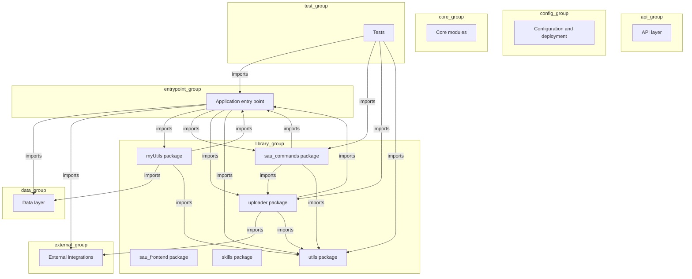

# Architecture report: dreammis/social-auto-upload

> Automated static analysis. **Observed** = directly seen in files/imports/AST; **Inferred** = interpretation from that evidence. Repository code was not executed.

## 1. Repository at a glance

| Item | Value |
| --- | --- |
| Repository | dreammis/social-auto-upload |
| Description | 自动化上传视频到社交媒体：抖音、小红书、视频号、tiktok、youtube、bilibili |
| Language | Python |
| Stars | 16542 |
| Licence | MIT |
| Analysed commit / branch | 3847fff01f5434a8a32829833163cd6723cabc59 / main |
| Framework(s) | Flask, Vue |
| Files analysed | 262 |
| Components | 13 |

## 2. Architecture in one minute

dreammis/social-auto-upload - 自动化上传视频到社交媒体：抖音、小红书、视频号、tiktok、youtube、bilibili. This repository was analysed statically from 262 file(s) (147 Python). Detected technologies (observed from imports/manifests): SQLite, Flask, Vue, axios, NumPy, requests. Files are grouped into 13 component(s): API layer, Configuration and deployment, Core modules, Data layer, Application entry point, External integrations, myUtils package, sau_commands package. Observed entry point(s): sau_backend.py, sau_cli.py, uploader/xhs_uploader/xhs_login_qrcode.py. Findings below distinguish observed facts from inferred interpretation.

## 3. High-level block diagram

## 4. Main components

### API layer (`api_layer`)

- **Kind:** api
- **Status:** Observed
- **Confidence:** 0.85
- **Responsibility:** Groups 9 file(s) under api layer (observed from repository paths and static analysis).
- **Paths:** `sau_frontend/src/api/account.js`, `sau_frontend/src/api/index.js`, `sau_frontend/src/api/material.js`, `sau_frontend/src/api/user.js`, `sau_frontend/src/views/About.vue`, `sau_frontend/src/views/AccountManagement.vue`, `sau_frontend/src/views/Dashboard.vue`, `sau_frontend/src/views/MaterialManagement.vue`, `sau_frontend/src/views/PublishCenter.vue`
- **Evidence:** [sau_frontend/src/api/account.js](https://github.com/dreammis/social-auto-upload/blob/3847fff01f5434a8a32829833163cd6723cabc59/sau_frontend/src/api/account.js); [sau_frontend/src/api/index.js](https://github.com/dreammis/social-auto-upload/blob/3847fff01f5434a8a32829833163cd6723cabc59/sau_frontend/src/api/index.js); [sau_frontend/src/api/material.js](https://github.com/dreammis/social-auto-upload/blob/3847fff01f5434a8a32829833163cd6723cabc59/sau_frontend/src/api/material.js); [sau_frontend/src/api/user.js](https://github.com/dreammis/social-auto-upload/blob/3847fff01f5434a8a32829833163cd6723cabc59/sau_frontend/src/api/user.js); [sau_frontend/src/views/About.vue](https://github.com/dreammis/social-auto-upload/blob/3847fff01f5434a8a32829833163cd6723cabc59/sau_frontend/src/views/About.vue); [sau_frontend/src/views/AccountManagement.vue](https://github.com/dreammis/social-auto-upload/blob/3847fff01f5434a8a32829833163cd6723cabc59/sau_frontend/src/views/AccountManagement.vue); [sau_frontend/src/views/Dashboard.vue](https://github.com/dreammis/social-auto-upload/blob/3847fff01f5434a8a32829833163cd6723cabc59/sau_frontend/src/views/Dashboard.vue); [sau_frontend/src/views/MaterialManagement.vue](https://github.com/dreammis/social-auto-upload/blob/3847fff01f5434a8a32829833163cd6723cabc59/sau_frontend/src/views/MaterialManagement.vue)

### Configuration and deployment (`config`)

- **Kind:** config
- **Status:** Observed
- **Confidence:** 0.85
- **Responsibility:** Groups 5 file(s) under configuration and deployment (observed from repository paths and static analysis).
- **Paths:** `Dockerfile`, `pyproject.toml`, `sau_frontend/package.json`, `uploader/xhs_uploader/accounts.ini`, `utils/article_renderer/package.json`
- **Evidence:** [Dockerfile](https://github.com/dreammis/social-auto-upload/blob/3847fff01f5434a8a32829833163cd6723cabc59/Dockerfile); [pyproject.toml](https://github.com/dreammis/social-auto-upload/blob/3847fff01f5434a8a32829833163cd6723cabc59/pyproject.toml); [sau_frontend/package.json](https://github.com/dreammis/social-auto-upload/blob/3847fff01f5434a8a32829833163cd6723cabc59/sau_frontend/package.json); [uploader/xhs_uploader/accounts.ini](https://github.com/dreammis/social-auto-upload/blob/3847fff01f5434a8a32829833163cd6723cabc59/uploader/xhs_uploader/accounts.ini); [utils/article_renderer/package.json](https://github.com/dreammis/social-auto-upload/blob/3847fff01f5434a8a32829833163cd6723cabc59/utils/article_renderer/package.json)

### Core modules (`core`)

- **Kind:** core
- **Status:** Observed
- **Confidence:** 0.85
- **Responsibility:** Groups 3 file(s) under core modules (observed from repository paths and static analysis).
- **Paths:** `__init__.py`, `conf.example.py`, `export_douyin_cookie.sh`
- **Evidence:** [__init__.py](https://github.com/dreammis/social-auto-upload/blob/3847fff01f5434a8a32829833163cd6723cabc59/__init__.py); [conf.example.py](https://github.com/dreammis/social-auto-upload/blob/3847fff01f5434a8a32829833163cd6723cabc59/conf.example.py); [export_douyin_cookie.sh](https://github.com/dreammis/social-auto-upload/blob/3847fff01f5434a8a32829833163cd6723cabc59/export_douyin_cookie.sh)

### Data layer (`data_layer`)

- **Kind:** data
- **Status:** Observed
- **Confidence:** 0.85
- **Responsibility:** Groups 1 file(s) under data layer (observed from repository paths and static analysis).
- **Paths:** `db/createTable.py`
- **Evidence:** [db/createTable.py](https://github.com/dreammis/social-auto-upload/blob/3847fff01f5434a8a32829833163cd6723cabc59/db/createTable.py)

### Application entry point (`entrypoint`)

- **Kind:** entrypoint
- **Status:** Observed
- **Confidence:** 0.85
- **Responsibility:** Groups 22 file(s) under application entry point (observed from repository paths and static analysis). Observed application object created via Flask. Observed routes: ROUTE /assets/<filename>, ROUTE /favicon.ico, ROUTE /vite.svg, ROUTE /, ROUTE /upload. Observed top-level classes: AlipayVideo, BaiJiaHaoVideo, DayuVideo, DouYinBaseUploader, DouYinNote, DouYinVideo. Observed top-level functions: _build_launch_kwargs, _build_login_result, _build_xhs_creator_url, _capture_alipay_qr, _click_if_present, _click_visible_publish_confirm.
- **Paths:** `sau_backend.py`, `sau_cli.py`, `skills/bilibili-upload/scripts/examples/bilibili_cli_template.py`, `skills/douyin-upload/scripts/examples/douyin_cli_template.py`, `skills/kuaishou-upload/scripts/examples/kuaishou_cli_template.py`, `skills/xiaohongshu-upload/scripts/examples/xiaohongshu_cli_template.py`, `uploader/alipay_uploader/main.py`, `uploader/baijiahao_uploader/main.py`, `uploader/dayu_uploader/main.py`, `uploader/douyin_uploader/main.py`, `uploader/hupu_uploader/main.py`, `uploader/ks_uploader/main.py`, `uploader/meta_uploader/facebook_page_uploader/main.py`, `uploader/meta_uploader/facebook_uploader/main.py`, `uploader/meta_uploader/insgraph_uploader/main.py`, `uploader/tencent_uploader/main.py`, `uploader/tk_uploader/main.py`, `uploader/weibo_uploader/main.py`, `uploader/xhs_uploader/main.py`, `uploader/xhs_uploader/xhs_login_qrcode.py`, `uploader/xiaohongshu_uploader/main.py`, `uploader/youtube_uploader/main.py`
- **Evidence:** [sau_backend.py:18](https://github.com/dreammis/social-auto-upload/blob/3847fff01f5434a8a32829833163cd6723cabc59/sau_backend.py#L18); [sau_cli.py:37](https://github.com/dreammis/social-auto-upload/blob/3847fff01f5434a8a32829833163cd6723cabc59/sau_cli.py#L37); [skills/bilibili-upload/scripts/examples/bilibili_cli_template.py:11](https://github.com/dreammis/social-auto-upload/blob/3847fff01f5434a8a32829833163cd6723cabc59/skills/bilibili-upload/scripts/examples/bilibili_cli_template.py#L11); [skills/douyin-upload/scripts/examples/douyin_cli_template.py:7](https://github.com/dreammis/social-auto-upload/blob/3847fff01f5434a8a32829833163cd6723cabc59/skills/douyin-upload/scripts/examples/douyin_cli_template.py#L7); [skills/kuaishou-upload/scripts/examples/kuaishou_cli_template.py:7](https://github.com/dreammis/social-auto-upload/blob/3847fff01f5434a8a32829833163cd6723cabc59/skills/kuaishou-upload/scripts/examples/kuaishou_cli_template.py#L7); [skills/xiaohongshu-upload/scripts/examples/xiaohongshu_cli_template.py:7](https://github.com/dreammis/social-auto-upload/blob/3847fff01f5434a8a32829833163cd6723cabc59/skills/xiaohongshu-upload/scripts/examples/xiaohongshu_cli_template.py#L7); [uploader/alipay_uploader/main.py:30](https://github.com/dreammis/social-auto-upload/blob/3847fff01f5434a8a32829833163cd6723cabc59/uploader/alipay_uploader/main.py#L30); [uploader/baijiahao_uploader/main.py:37](https://github.com/dreammis/social-auto-upload/blob/3847fff01f5434a8a32829833163cd6723cabc59/uploader/baijiahao_uploader/main.py#L37)

### External integrations (`external_integrations`)

- **Kind:** external
- **Status:** Inferred
- **Confidence:** 0.70
- **Responsibility:** Groups 0 file(s) under external integrations (observed from repository paths and static analysis).
- **Evidence:** [db/createTable.py:1](https://github.com/dreammis/social-auto-upload/blob/3847fff01f5434a8a32829833163cd6723cabc59/db/createTable.py#L1); [myUtils/login.py:2](https://github.com/dreammis/social-auto-upload/blob/3847fff01f5434a8a32829833163cd6723cabc59/myUtils/login.py#L2); [sau_backend.py:3](https://github.com/dreammis/social-auto-upload/blob/3847fff01f5434a8a32829833163cd6723cabc59/sau_backend.py#L3); [uploader/bilibili_uploader/runtime.py:12](https://github.com/dreammis/social-auto-upload/blob/3847fff01f5434a8a32829833163cd6723cabc59/uploader/bilibili_uploader/runtime.py#L12); [uploader/xhs_uploader/main.py:6](https://github.com/dreammis/social-auto-upload/blob/3847fff01f5434a8a32829833163cd6723cabc59/uploader/xhs_uploader/main.py#L6)

### myUtils package (`myutils`)

- **Kind:** library
- **Status:** Observed
- **Confidence:** 0.85
- **Responsibility:** Groups 4 file(s) under myutils package (observed from repository paths and static analysis). Observed top-level functions: check_cookie, cookie_auth_douyin, cookie_auth_ks, cookie_auth_tencent, cookie_auth_xhs, douyin_cookie_gen.
- **Paths:** `myUtils/__init__.py`, `myUtils/auth.py`, `myUtils/login.py`, `myUtils/postVideo.py`
- **Evidence:** [myUtils/__init__.py](https://github.com/dreammis/social-auto-upload/blob/3847fff01f5434a8a32829833163cd6723cabc59/myUtils/__init__.py); [myUtils/auth.py:15](https://github.com/dreammis/social-auto-upload/blob/3847fff01f5434a8a32829833163cd6723cabc59/myUtils/auth.py#L15); [myUtils/login.py:13](https://github.com/dreammis/social-auto-upload/blob/3847fff01f5434a8a32829833163cd6723cabc59/myUtils/login.py#L13); [myUtils/postVideo.py:13](https://github.com/dreammis/social-auto-upload/blob/3847fff01f5434a8a32829833163cd6723cabc59/myUtils/postVideo.py#L13)

### sau_commands package (`sau_commands`)

- **Kind:** library
- **Status:** Observed
- **Confidence:** 0.85
- **Responsibility:** Groups 19 file(s) under sau_commands package (observed from repository paths and static analysis). Observed top-level classes: AlipayVideoUploadRequest, BaijiahaoVideoUploadRequest, BilibiliVideoUploadRequest, DouyinNoteUploadRequest, DouyinVideoUploadRequest, FacebookVideoUploadRequest. Observed top-level functions: add_runtime_flags, check_alipay_account, check_baijiahao_account, check_bilibili_account, check_douyin_account, check_facebook_account.
- **Paths:** `sau_commands/__init__.py`, `sau_commands/alipay.py`, `sau_commands/arguments.py`, `sau_commands/article.py`, `sau_commands/baijiahao.py`, `sau_commands/bilibili.py`, `sau_commands/dayu.py`, `sau_commands/douyin.py`, `sau_commands/facebook.py`, `sau_commands/facebook_page.py`, `sau_commands/hupu.py`, `sau_commands/instagram.py`, `sau_commands/kuaishou.py`, `sau_commands/tencent.py`, `sau_commands/weibo.py`, `sau_commands/xiaohongshu.py`, `sau_commands/xueqiu.py`, `sau_commands/youtube.py`, `sau_commands/zhihu.py`
- **Evidence:** [sau_commands/__init__.py](https://github.com/dreammis/social-auto-upload/blob/3847fff01f5434a8a32829833163cd6723cabc59/sau_commands/__init__.py); [sau_commands/alipay.py:15](https://github.com/dreammis/social-auto-upload/blob/3847fff01f5434a8a32829833163cd6723cabc59/sau_commands/alipay.py#L15); [sau_commands/arguments.py:12](https://github.com/dreammis/social-auto-upload/blob/3847fff01f5434a8a32829833163cd6723cabc59/sau_commands/arguments.py#L12); [sau_commands/article.py:9](https://github.com/dreammis/social-auto-upload/blob/3847fff01f5434a8a32829833163cd6723cabc59/sau_commands/article.py#L9); [sau_commands/baijiahao.py:19](https://github.com/dreammis/social-auto-upload/blob/3847fff01f5434a8a32829833163cd6723cabc59/sau_commands/baijiahao.py#L19); [sau_commands/bilibili.py:17](https://github.com/dreammis/social-auto-upload/blob/3847fff01f5434a8a32829833163cd6723cabc59/sau_commands/bilibili.py#L17); [sau_commands/dayu.py:34](https://github.com/dreammis/social-auto-upload/blob/3847fff01f5434a8a32829833163cd6723cabc59/sau_commands/dayu.py#L34); [sau_commands/douyin.py:26](https://github.com/dreammis/social-auto-upload/blob/3847fff01f5434a8a32829833163cd6723cabc59/sau_commands/douyin.py#L26)

### sau_frontend package (`sau_frontend`)

- **Kind:** library
- **Status:** Observed
- **Confidence:** 0.85
- **Responsibility:** Groups 9 file(s) under sau_frontend package (observed from repository paths and static analysis).
- **Paths:** `sau_frontend/src/App.vue`, `sau_frontend/src/main.js`, `sau_frontend/src/router/index.js`, `sau_frontend/src/stores/account.js`, `sau_frontend/src/stores/app.js`, `sau_frontend/src/stores/index.js`, `sau_frontend/src/stores/user.js`, `sau_frontend/src/utils/request.js`, `sau_frontend/vite.config.js`
- **Evidence:** [sau_frontend/src/App.vue](https://github.com/dreammis/social-auto-upload/blob/3847fff01f5434a8a32829833163cd6723cabc59/sau_frontend/src/App.vue); [sau_frontend/src/main.js](https://github.com/dreammis/social-auto-upload/blob/3847fff01f5434a8a32829833163cd6723cabc59/sau_frontend/src/main.js); [sau_frontend/src/router/index.js](https://github.com/dreammis/social-auto-upload/blob/3847fff01f5434a8a32829833163cd6723cabc59/sau_frontend/src/router/index.js); [sau_frontend/src/stores/account.js](https://github.com/dreammis/social-auto-upload/blob/3847fff01f5434a8a32829833163cd6723cabc59/sau_frontend/src/stores/account.js); [sau_frontend/src/stores/app.js](https://github.com/dreammis/social-auto-upload/blob/3847fff01f5434a8a32829833163cd6723cabc59/sau_frontend/src/stores/app.js); [sau_frontend/src/stores/index.js](https://github.com/dreammis/social-auto-upload/blob/3847fff01f5434a8a32829833163cd6723cabc59/sau_frontend/src/stores/index.js); [sau_frontend/src/stores/user.js](https://github.com/dreammis/social-auto-upload/blob/3847fff01f5434a8a32829833163cd6723cabc59/sau_frontend/src/stores/user.js); [sau_frontend/src/utils/request.js](https://github.com/dreammis/social-auto-upload/blob/3847fff01f5434a8a32829833163cd6723cabc59/sau_frontend/src/utils/request.js)

### skills package (`skills`)

- **Kind:** library
- **Status:** Observed
- **Confidence:** 0.85
- **Responsibility:** Groups 16 file(s) under skills package (observed from repository paths and static analysis).
- **Paths:** `skills/bilibili-upload/scripts/examples/bilibili_commands.sh`, `skills/dayu-upload/scripts/examples/dayu_cli_template.py`, `skills/dayu-upload/scripts/examples/dayu_commands.sh`, `skills/douyin-upload/scripts/examples/douyin_commands.sh`, `skills/facebook-upload/scripts/examples/facebook_cli_template.py`, `skills/facebook-upload/scripts/examples/facebook_commands.sh`, `skills/instagram-upload/scripts/examples/instagram_cli_template.py`, `skills/instagram-upload/scripts/examples/instagram_commands.sh`, `skills/kuaishou-upload/scripts/examples/kuaishou_commands.sh`, `skills/meta-upload/scripts/examples/meta_cli_template.py`, `skills/meta-upload/scripts/examples/meta_commands.sh`, `skills/xiaohongshu-upload/scripts/examples/xiaohongshu_commands.sh`, `skills/xueqiu-upload/scripts/examples/xueqiu_cli_template.py`, `skills/xueqiu-upload/scripts/examples/xueqiu_commands.sh`, `skills/zhihu-upload/scripts/examples/zhihu_cli_template.py`, `skills/zhihu-upload/scripts/examples/zhihu_commands.sh`
- **Evidence:** [skills/bilibili-upload/scripts/examples/bilibili_commands.sh](https://github.com/dreammis/social-auto-upload/blob/3847fff01f5434a8a32829833163cd6723cabc59/skills/bilibili-upload/scripts/examples/bilibili_commands.sh); [skills/dayu-upload/scripts/examples/dayu_cli_template.py](https://github.com/dreammis/social-auto-upload/blob/3847fff01f5434a8a32829833163cd6723cabc59/skills/dayu-upload/scripts/examples/dayu_cli_template.py); [skills/dayu-upload/scripts/examples/dayu_commands.sh](https://github.com/dreammis/social-auto-upload/blob/3847fff01f5434a8a32829833163cd6723cabc59/skills/dayu-upload/scripts/examples/dayu_commands.sh); [skills/douyin-upload/scripts/examples/douyin_commands.sh](https://github.com/dreammis/social-auto-upload/blob/3847fff01f5434a8a32829833163cd6723cabc59/skills/douyin-upload/scripts/examples/douyin_commands.sh); [skills/facebook-upload/scripts/examples/facebook_cli_template.py](https://github.com/dreammis/social-auto-upload/blob/3847fff01f5434a8a32829833163cd6723cabc59/skills/facebook-upload/scripts/examples/facebook_cli_template.py); [skills/facebook-upload/scripts/examples/facebook_commands.sh](https://github.com/dreammis/social-auto-upload/blob/3847fff01f5434a8a32829833163cd6723cabc59/skills/facebook-upload/scripts/examples/facebook_commands.sh); [skills/instagram-upload/scripts/examples/instagram_cli_template.py](https://github.com/dreammis/social-auto-upload/blob/3847fff01f5434a8a32829833163cd6723cabc59/skills/instagram-upload/scripts/examples/instagram_cli_template.py); [skills/instagram-upload/scripts/examples/instagram_commands.sh](https://github.com/dreammis/social-auto-upload/blob/3847fff01f5434a8a32829833163cd6723cabc59/skills/instagram-upload/scripts/examples/instagram_commands.sh)

### Tests (`tests`)

- **Kind:** test
- **Status:** Observed
- **Confidence:** 0.85
- **Responsibility:** Groups 19 file(s) under tests (observed from repository paths and static analysis). Observed routes: PATCH uploader.bilibili_uploader.runtime.fetch_latest_release, PATCH uploader.bilibili_uploader.runtime.fetch_latest_release, PATCH uploader.bilibili_uploader.runtime.subprocess.run, PATCH uploader.bilibili_uploader.runtime.ensure_biliup_binary, PATCH uploader.bilibili_uploader.runtime.subprocess.run. Observed top-level classes: ArticleRenderTests, BilibiliCliTests, BiliupRuntimeTests, BrowserCliDispatchTests, BrowserCliParserTests, DayuArticleBrowserTests. Observed top-level functions: main,…
- **Paths:** `examples/test_alipay_upload.py`, `tests/__init__.py`, `tests/test_article_render.py`, `tests/test_bilibili_runtime.py`, `tests/test_dayu_article.py`, `tests/test_dayu_schedule.py`, `tests/test_dayu_uploader.py`, `tests/test_douyin_declaration.py`, `tests/test_facebook_posts.py`, `tests/test_facebook_uploader.py`, `tests/test_instagram_uploader.py`, `tests/test_kuaishou_publish_dialog.py`, `tests/test_meta_uploader.py`, `tests/test_sau_bilibili_cli.py`, `tests/test_sau_browser_cli.py`, `tests/test_tencent_verification_dialog.py`, `tests/test_xiaohongshu_uploader.py`, `tests/test_xueqiu_uploader.py`, `tests/test_zhihu_uploader.py`
- **Evidence:** [examples/test_alipay_upload.py:13](https://github.com/dreammis/social-auto-upload/blob/3847fff01f5434a8a32829833163cd6723cabc59/examples/test_alipay_upload.py#L13); [tests/__init__.py](https://github.com/dreammis/social-auto-upload/blob/3847fff01f5434a8a32829833163cd6723cabc59/tests/__init__.py); [tests/test_article_render.py:12](https://github.com/dreammis/social-auto-upload/blob/3847fff01f5434a8a32829833163cd6723cabc59/tests/test_article_render.py#L12); [tests/test_bilibili_runtime.py:12](https://github.com/dreammis/social-auto-upload/blob/3847fff01f5434a8a32829833163cd6723cabc59/tests/test_bilibili_runtime.py#L12); [tests/test_dayu_article.py:19](https://github.com/dreammis/social-auto-upload/blob/3847fff01f5434a8a32829833163cd6723cabc59/tests/test_dayu_article.py#L19); [tests/test_dayu_schedule.py:17](https://github.com/dreammis/social-auto-upload/blob/3847fff01f5434a8a32829833163cd6723cabc59/tests/test_dayu_schedule.py#L17); [tests/test_dayu_uploader.py:15](https://github.com/dreammis/social-auto-upload/blob/3847fff01f5434a8a32829833163cd6723cabc59/tests/test_dayu_uploader.py#L15); [tests/test_douyin_declaration.py:10](https://github.com/dreammis/social-auto-upload/blob/3847fff01f5434a8a32829833163cd6723cabc59/tests/test_douyin_declaration.py#L10)

### uploader package (`uploader`)

- **Kind:** library
- **Status:** Observed
- **Confidence:** 0.85
- **Responsibility:** Groups 46 file(s) under uploader package (observed from repository paths and static analysis). Observed top-level classes: BaseVideoUploader, DayuArticle, TiktokVideo, Tk_Locator, XueqiuArticle, XueqiuHTML. Observed top-level functions: _build_biliup_version_path, _build_platform_key, _normalize_machine, _normalize_system, _pick_executable, _select_release_asset.
- **Paths:** `uploader/__init__.py`, `uploader/alipay_uploader/__init__.py`, `uploader/baijiahao_uploader/__init__.py`, `uploader/base_video.py`, `uploader/bilibili_uploader/__init__.py`, `uploader/bilibili_uploader/runtime.py`, `uploader/dayu_uploader/__init__.py`, `uploader/dayu_uploader/article.py`, `uploader/dayu_uploader/article_content.py`, `uploader/dayu_uploader/article_style.py`, `uploader/dayu_uploader/constants.py`, `uploader/dayu_uploader/publication.py`, `uploader/dayu_uploader/schedule.py`, `uploader/dayu_uploader/session.py`, `uploader/dayu_uploader/verification.py`, `uploader/douyin_uploader/__init__.py`, `uploader/hupu_uploader/__init__.py`, `uploader/ks_uploader/__init__.py`, `uploader/meta_uploader/__init__.py`, `uploader/meta_uploader/facebook_page_uploader/__init__.py`, `uploader/meta_uploader/facebook_page_uploader/posts.py`, `uploader/meta_uploader/facebook_uploader/__init__.py`, `uploader/meta_uploader/facebook_uploader/posts.py`, `uploader/meta_uploader/insgraph_uploader/__init__.py`, `uploader/meta_uploader/insgraph_uploader/posts.py`, `uploader/tencent_uploader/__init__.py`, `uploader/tk_uploader/__init__.py`, `uploader/tk_uploader/main_chrome.py`, `uploader/tk_uploader/tk_config.py`, `uploader/weibo_uploader/__init__.py`, `uploader/xhs_uploader/__init__.py`, `uploader/xiaohongshu_uploader/__init__.py`, `uploader/xueqiu_uploader/__init__.py`, `uploader/xueqiu_uploader/article.py`, `uploader/xueqiu_uploader/constants.py`, `uploader/xueqiu_uploader/content.py`, `uploader/xueqiu_uploader/session.py`, `uploader/xueqiu_uploader/verification.py`, `uploader/youtube_uploader/__init__.py`, `uploader/zhihu_uploader/__init__.py`, `uploader/zhihu_uploader/article.py`, `uploader/zhihu_uploader/constants.py`, `uploader/zhihu_uploader/schedule.py`, `uploader/zhihu_uploader/session.py`, `uploader/zhihu_uploader/verification.py`, `uploader/zhihu_uploader/video.py`
- **Evidence:** [uploader/__init__.py](https://github.com/dreammis/social-auto-upload/blob/3847fff01f5434a8a32829833163cd6723cabc59/uploader/__init__.py); [uploader/alipay_uploader/__init__.py](https://github.com/dreammis/social-auto-upload/blob/3847fff01f5434a8a32829833163cd6723cabc59/uploader/alipay_uploader/__init__.py); [uploader/baijiahao_uploader/__init__.py](https://github.com/dreammis/social-auto-upload/blob/3847fff01f5434a8a32829833163cd6723cabc59/uploader/baijiahao_uploader/__init__.py); [uploader/base_video.py:7](https://github.com/dreammis/social-auto-upload/blob/3847fff01f5434a8a32829833163cd6723cabc59/uploader/base_video.py#L7); [uploader/bilibili_uploader/__init__.py](https://github.com/dreammis/social-auto-upload/blob/3847fff01f5434a8a32829833163cd6723cabc59/uploader/bilibili_uploader/__init__.py); [uploader/bilibili_uploader/runtime.py:18](https://github.com/dreammis/social-auto-upload/blob/3847fff01f5434a8a32829833163cd6723cabc59/uploader/bilibili_uploader/runtime.py#L18); [uploader/dayu_uploader/__init__.py](https://github.com/dreammis/social-auto-upload/blob/3847fff01f5434a8a32829833163cd6723cabc59/uploader/dayu_uploader/__init__.py); [uploader/dayu_uploader/article.py:32](https://github.com/dreammis/social-auto-upload/blob/3847fff01f5434a8a32829833163cd6723cabc59/uploader/dayu_uploader/article.py#L32)

### utils package (`utils`)

- **Kind:** library
- **Status:** Observed
- **Confidence:** 0.85
- **Responsibility:** Groups 11 file(s) under utils package (observed from repository paths and static analysis). Observed top-level classes: ArticleDocument, TencentZoneTypes, VideoZoneTypes. Observed top-level functions: _print_ascii_qrcode, async_retry, build_login_qrcode_path, create_logger, decode_qrcode_from_path, generate_schedule_time_next_day.
- **Paths:** `utils/__init__.py`, `utils/article_content.py`, `utils/article_render.py`, `utils/article_renderer/render.mjs`, `utils/base_social_media.py`, `utils/browser_hook.py`, `utils/constant.py`, `utils/files_times.py`, `utils/log.py`, `utils/login_qrcode.py`, `utils/network.py`
- **Evidence:** [utils/__init__.py](https://github.com/dreammis/social-auto-upload/blob/3847fff01f5434a8a32829833163cd6723cabc59/utils/__init__.py); [utils/article_content.py:24](https://github.com/dreammis/social-auto-upload/blob/3847fff01f5434a8a32829833163cd6723cabc59/utils/article_content.py#L24); [utils/article_render.py:26](https://github.com/dreammis/social-auto-upload/blob/3847fff01f5434a8a32829833163cd6723cabc59/utils/article_render.py#L26); [utils/article_renderer/render.mjs](https://github.com/dreammis/social-auto-upload/blob/3847fff01f5434a8a32829833163cd6723cabc59/utils/article_renderer/render.mjs); [utils/base_social_media.py:13](https://github.com/dreammis/social-auto-upload/blob/3847fff01f5434a8a32829833163cd6723cabc59/utils/base_social_media.py#L13); [utils/browser_hook.py:3](https://github.com/dreammis/social-auto-upload/blob/3847fff01f5434a8a32829833163cd6723cabc59/utils/browser_hook.py#L3); [utils/constant.py:4](https://github.com/dreammis/social-auto-upload/blob/3847fff01f5434a8a32829833163cd6723cabc59/utils/constant.py#L4); [utils/files_times.py:9](https://github.com/dreammis/social-auto-upload/blob/3847fff01f5434a8a32829833163cd6723cabc59/utils/files_times.py#L9)

## 5. Execution flow

**Observed** entry point(s):

- [sau_backend.py:18](https://github.com/dreammis/social-auto-upload/blob/3847fff01f5434a8a32829833163cd6723cabc59/sau_backend.py#L18)
- [sau_cli.py](https://github.com/dreammis/social-auto-upload/blob/3847fff01f5434a8a32829833163cd6723cabc59/sau_cli.py)
- [sau_frontend/src/api/index.js](https://github.com/dreammis/social-auto-upload/blob/3847fff01f5434a8a32829833163cd6723cabc59/sau_frontend/src/api/index.js)
- [sau_frontend/src/main.js](https://github.com/dreammis/social-auto-upload/blob/3847fff01f5434a8a32829833163cd6723cabc59/sau_frontend/src/main.js)
- [sau_frontend/src/router/index.js](https://github.com/dreammis/social-auto-upload/blob/3847fff01f5434a8a32829833163cd6723cabc59/sau_frontend/src/router/index.js)
- [sau_frontend/src/stores/app.js](https://github.com/dreammis/social-auto-upload/blob/3847fff01f5434a8a32829833163cd6723cabc59/sau_frontend/src/stores/app.js)
- [sau_frontend/src/stores/index.js](https://github.com/dreammis/social-auto-upload/blob/3847fff01f5434a8a32829833163cd6723cabc59/sau_frontend/src/stores/index.js)
- [uploader/xhs_uploader/xhs_login_qrcode.py:11](https://github.com/dreammis/social-auto-upload/blob/3847fff01f5434a8a32829833163cd6723cabc59/uploader/xhs_uploader/xhs_login_qrcode.py#L11)

**Observed** routes (from decorators):

- `ROUTE /assets/<filename>` -> `custom_static` in `sau_backend.py:31`
- `ROUTE /favicon.ico` -> `favicon` in `sau_backend.py:36`
- `ROUTE /vite.svg` -> `vite_svg` in `sau_backend.py:40`
- `ROUTE /` -> `index` in `sau_backend.py:45`
- `ROUTE /upload` -> `upload_file` in `sau_backend.py:49`
- `ROUTE /getFile` -> `get_file` in `sau_backend.py:77`
- `ROUTE /uploadSave` -> `upload_save` in `sau_backend.py:96`
- `ROUTE /getFiles` -> `get_all_files` in `sau_backend.py:160`
- `ROUTE /getAccounts` -> `getAccounts` in `sau_backend.py:200`
- `ROUTE /getValidAccounts` -> `getValidAccounts` in `sau_backend.py:231`
- `ROUTE /deleteFile` -> `delete_file` in `sau_backend.py:262`
- `ROUTE /deleteAccount` -> `delete_account` in `sau_backend.py:324`
- `ROUTE /login` -> `login` in `sau_backend.py:385`
- `ROUTE /postVideo` -> `postVideo` in `sau_backend.py:409`
- `ROUTE /updateUserinfo` -> `updateUserinfo` in `sau_backend.py:483`
- `ROUTE /postVideoBatch` -> `postVideoBatch` in `sau_backend.py:520`
- `ROUTE /uploadCookie` -> `upload_cookie` in `sau_backend.py:569`
- `ROUTE /downloadCookie` -> `download_cookie` in `sau_backend.py:644`
- `PATCH uploader.bilibili_uploader.runtime.fetch_latest_release` -> `test_ensure_biliup_binary_downloads_when_missing` in `tests/test_bilibili_runtime.py:18`
- `PATCH uploader.bilibili_uploader.runtime.fetch_latest_release` -> `test_ensure_biliup_binary_reuses_local_when_up_to_date` in `tests/test_bilibili_runtime.py:33`
- `PATCH uploader.bilibili_uploader.runtime.subprocess.run` -> `test_run_biliup_command_returns_completed_process` in `tests/test_bilibili_runtime.py:49`
- `PATCH uploader.bilibili_uploader.runtime.ensure_biliup_binary` -> `test_run_biliup_command_returns_completed_process` in `tests/test_bilibili_runtime.py:49`
- `PATCH uploader.bilibili_uploader.runtime.subprocess.run` -> `test_run_biliup_command_login_uses_interactive_stdio` in `tests/test_bilibili_runtime.py:57`
- `PATCH uploader.bilibili_uploader.runtime.ensure_biliup_binary` -> `test_run_biliup_command_login_uses_interactive_stdio` in `tests/test_bilibili_runtime.py:57`
- `PATCH uploader.dayu_uploader.publication.read_dayu_schedule` -> `test_submission_saves_ids_and_never_confirms_twice` in `tests/test_dayu_article.py:136`
- `PATCH uploader.dayu_uploader.publication.read_dayu_schedule` -> `test_styled_submission_checks_server_preview_before_confirming` in `tests/test_dayu_article.py:241`

Representative flow (derived from observed entry points and the import graph; steps beyond the entry point are **Inferred**):

1. Execution starts at an observed entry point listed above, if present.
2. `entrypoint` imports `data_layer` (Application entry point -> Data layer).
3. `entrypoint` imports `external_integrations` (Application entry point -> External integrations).
4. `entrypoint` imports `myutils` (Application entry point -> myUtils package).
5. `entrypoint` imports `sau_commands` (Application entry point -> sau_commands package).
6. `entrypoint` imports `uploader` (Application entry point -> uploader package).
7. `entrypoint` imports `utils` (Application entry point -> utils package).
8. `myutils` imports `data_layer` (myUtils package -> Data layer).
9. `myutils` imports `entrypoint` (myUtils package -> Application entry point).

## 6. Project structure

### `(root)`

- `.dockerignore` - container (107 bytes)
- `.gitignore` - other (3628 bytes)
- `CHANGELOG.md` - docs (1922 bytes)
- `Dockerfile` - container (1404 bytes)
- `LICENSE` - docs (1065 bytes)
- `README.md` - docs (21633 bytes)
- `__init__.py` - source, Python (0 bytes)
- `conf.example.py` - source, Python (626 bytes)
- `export_douyin_cookie.sh` - source, Shell (7045 bytes)
- `pyproject.toml` - manifest (929 bytes)
- `sau_backend.py` - source, Python (24311 bytes)
- `sau_cli.py` - source, Python (1908 bytes)
- `start-win.bat` - other (993 bytes)

### `.github`

- `.github/FUNDING.yml` - config (64 bytes)
- `.github/pull_request_template.md` - docs (1170 bytes)

### `db`

- `db/createTable.py` - source, Python (1158 bytes)

### `docs`

- `docs/CLI.md` - docs (26080 bytes)
- `docs/agent-bootstrap.md` - docs (4733 bytes)
- `docs/article.md` - docs (3847 bytes)
- `docs/dayu-article.md` - docs (8901 bytes)
- `docs/dayu.md` - docs (6683 bytes)
- `docs/install.md` - docs (7963 bytes)
- `docs/legacy-web.md` - docs (1210 bytes)
- `docs/skill-distribution.md` - docs (7119 bytes)
- `docs/superpowers/plans/2026-03-25-bilibili-cli-implementation.md` - docs (13438 bytes)
- `docs/superpowers/plans/2026-03-25-browser-cli-unification-implementation.md` - docs (16817 bytes)
- `docs/superpowers/plans/2026-03-25-xiaohongshu-shallow-alignment.md` - docs (2242 bytes)
- `docs/superpowers/specs/2026-03-25-bilibili-cli-design.md` - docs (6976 bytes)
- `docs/superpowers/specs/2026-03-25-browser-cli-unification-design.md` - docs (9411 bytes)
- `docs/update.md` - docs (3290 bytes)
- `docs/xueqiu.md` - docs (6020 bytes)

### `examples`

- `examples/__init__.py` - source, Python (0 bytes)
- `examples/article.md` - docs (548 bytes)
- `examples/dayu_article.html` - other (1447 bytes)
- `examples/get_alipay_cookie.py` - source, Python (545 bytes)
- `examples/get_baijiahao_cookie.py` - source, Python (367 bytes)
- `examples/get_baijiahao_cookie_headless.py` - source, Python (4034 bytes)
- `examples/get_bilibili_cookie.py` - source, Python (573 bytes)
- `examples/get_douyin_cookie.py` - source, Python (355 bytes)
- `examples/get_kuaishou_cookie.py` - source, Python (492 bytes)
- `examples/get_tencent_cookie.py` - source, Python (345 bytes)
- `examples/get_tk_cookie.py` - source, Python (354 bytes)
- `examples/get_xiaohongshu_cookie.py` - source, Python (624 bytes)
- `examples/test_alipay_upload.py` - test, Python (957 bytes)
- `examples/upload_to_douyin.py` - source, Python (2177 bytes)
- `examples/upload_to_kuaishou.py` - source, Python (2205 bytes)
- `examples/upload_video_to_baijiahao.py` - source, Python (1162 bytes)
- `examples/upload_video_to_bilibili.py` - source, Python (1356 bytes)
- `examples/upload_video_to_tencent.py` - source, Python (4237 bytes)
- `examples/upload_video_to_tiktok.py` - source, Python (1347 bytes)
- `examples/upload_video_to_xhs.py` - source, Python (2466 bytes)
- `examples/upload_video_to_xiaohongshu.py` - source, Python (3970 bytes)
- `examples/xueqiu_article.html` - other (542 bytes)
- `examples/xueqiu_article.md` - docs (1359 bytes)

### `myUtils`

- `myUtils/__init__.py` - source, Python (0 bytes)
- `myUtils/auth.py` - source, Python (5008 bytes)
- `myUtils/login.py` - source, Python (12637 bytes)
- `myUtils/postVideo.py` - source, Python (4596 bytes)

### `sau_backend`

- `sau_backend/README.md` - docs (2260 bytes)

### `sau_commands`

- `sau_commands/__init__.py` - source, Python (76 bytes)
- `sau_commands/alipay.py` - source, Python (4861 bytes)
- `sau_commands/arguments.py` - source, Python (2029 bytes)
- `sau_commands/article.py` - source, Python (1913 bytes)
- `sau_commands/baijiahao.py` - source, Python (4967 bytes)
- `sau_commands/bilibili.py` - source, Python (5788 bytes)
- `sau_commands/dayu.py` - source, Python (10056 bytes)
- `sau_commands/douyin.py` - source, Python (9951 bytes)
- `sau_commands/facebook.py` - source, Python (8647 bytes)
- `sau_commands/facebook_page.py` - source, Python (8981 bytes)
- `sau_commands/hupu.py` - source, Python (4499 bytes)
- `sau_commands/instagram.py` - source, Python (6935 bytes)
- `sau_commands/kuaishou.py` - source, Python (8110 bytes)
- `sau_commands/tencent.py` - source, Python (7081 bytes)
- `sau_commands/weibo.py` - source, Python (4787 bytes)
- `sau_commands/xiaohongshu.py` - source, Python (8603 bytes)
- `sau_commands/xueqiu.py` - source, Python (3942 bytes)
- `sau_commands/youtube.py` - source, Python (5330 bytes)
- `sau_commands/zhihu.py` - source, Python (6236 bytes)

### `sau_frontend`

- `sau_frontend/README.md` - docs (3465 bytes)
- `sau_frontend/index.html` - other (380 bytes)
- `sau_frontend/package.json` - manifest (507 bytes)
- `sau_frontend/public/vite.svg` - other (1497 bytes)
- `sau_frontend/src/App.vue` - source, Vue (4350 bytes)
- `sau_frontend/src/api/account.js` - source, JavaScript (595 bytes)
- `sau_frontend/src/api/index.js` - source, JavaScript (229 bytes)
- `sau_frontend/src/api/material.js` - source, JavaScript (834 bytes)
- `sau_frontend/src/api/user.js` - source, JavaScript (170 bytes)
- `sau_frontend/src/assets/vue.svg` - other (496 bytes)
- `sau_frontend/src/main.js` - source, JavaScript (521 bytes)
- `sau_frontend/src/router/index.js` - source, JavaScript (902 bytes)
- `sau_frontend/src/stores/account.js` - source, JavaScript (1510 bytes)
- `sau_frontend/src/stores/app.js` - source, JavaScript (1771 bytes)
- `sau_frontend/src/stores/index.js` - source, JavaScript (258 bytes)
- `sau_frontend/src/stores/user.js` - source, JavaScript (507 bytes)
- `sau_frontend/src/styles/index.scss` - other (2547 bytes)
- `sau_frontend/src/styles/reset.scss` - other (2033 bytes)
- `sau_frontend/src/styles/variables.scss` - other (1155 bytes)
- `sau_frontend/src/utils/request.js` - source, JavaScript (2327 bytes)
- `sau_frontend/src/views/About.vue` - source, Vue (2663 bytes)
- `sau_frontend/src/views/AccountManagement.vue` - source, Vue (35680 bytes)
- `sau_frontend/src/views/Dashboard.vue` - source, Vue (12995 bytes)
- `sau_frontend/src/views/MaterialManagement.vue` - source, Vue (15460 bytes)
- `sau_frontend/src/views/PublishCenter.vue` - source, Vue (40171 bytes)
- `sau_frontend/vite.config.js` - source, JavaScript (885 bytes)

### `skills`

- `skills/alipay-upload/SKILL.md` - docs (1222 bytes)
- `skills/baijiahao-upload/SKILL.md` - docs (1198 bytes)
- `skills/bilibili-upload/SKILL.md` - docs (2141 bytes)
- `skills/bilibili-upload/references/cli-contract.md` - docs (1417 bytes)
- `skills/bilibili-upload/references/runtime-requirements.md` - docs (1453 bytes)
- `skills/bilibili-upload/references/troubleshooting.md` - docs (1610 bytes)
- `skills/bilibili-upload/scripts/examples/bilibili_cli_template.py` - source, Python (960 bytes)
- `skills/bilibili-upload/scripts/examples/bilibili_commands.ps1` - other (641 bytes)
- `skills/bilibili-upload/scripts/examples/bilibili_commands.sh` - source, Shell (616 bytes)
- `skills/dayu-upload/SKILL.md` - docs (5441 bytes)
- `skills/dayu-upload/scripts/examples/dayu_cli_template.py` - source, Python (653 bytes)
- `skills/dayu-upload/scripts/examples/dayu_commands.ps1` - other (407 bytes)
- `skills/dayu-upload/scripts/examples/dayu_commands.sh` - source, Shell (410 bytes)
- `skills/douyin-upload/SKILL.md` - docs (2783 bytes)
- `skills/douyin-upload/references/cli-contract.md` - docs (2295 bytes)
- `skills/douyin-upload/references/runtime-requirements.md` - docs (1415 bytes)
- `skills/douyin-upload/references/troubleshooting.md` - docs (1416 bytes)
- `skills/douyin-upload/scripts/examples/douyin_cli_template.py` - source, Python (1549 bytes)
- `skills/douyin-upload/scripts/examples/douyin_commands.ps1` - other (831 bytes)
- `skills/douyin-upload/scripts/examples/douyin_commands.sh` - source, Shell (770 bytes)
- `skills/facebook-upload/SKILL.md` - docs (3080 bytes)
- `skills/facebook-upload/scripts/examples/facebook_cli_template.py` - source, Python (634 bytes)
- `skills/facebook-upload/scripts/examples/facebook_commands.ps1` - other (389 bytes)
- `skills/facebook-upload/scripts/examples/facebook_commands.sh` - source, Shell (392 bytes)
- `skills/hupu-upload/SKILL.md` - docs (1075 bytes)
- `skills/instagram-upload/SKILL.md` - docs (4127 bytes)
- `skills/instagram-upload/scripts/examples/instagram_cli_template.py` - source, Python (639 bytes)
- `skills/instagram-upload/scripts/examples/instagram_commands.ps1` - other (394 bytes)
- `skills/instagram-upload/scripts/examples/instagram_commands.sh` - source, Shell (397 bytes)
- `skills/kuaishou-upload/SKILL.md` - docs (2805 bytes)
- `skills/kuaishou-upload/references/cli-contract.md` - docs (2215 bytes)
- `skills/kuaishou-upload/references/runtime-requirements.md` - docs (1440 bytes)
- `skills/kuaishou-upload/references/troubleshooting.md` - docs (1532 bytes)
- `skills/kuaishou-upload/scripts/examples/kuaishou_cli_template.py` - source, Python (1579 bytes)
- `skills/kuaishou-upload/scripts/examples/kuaishou_commands.ps1` - other (852 bytes)
- `skills/kuaishou-upload/scripts/examples/kuaishou_commands.sh` - source, Shell (790 bytes)
- `skills/meta-upload/SKILL.md` - docs (3427 bytes)
- `skills/meta-upload/scripts/examples/meta_cli_template.py` - source, Python (674 bytes)
- `skills/meta-upload/scripts/examples/meta_commands.ps1` - other (430 bytes)
- `skills/meta-upload/scripts/examples/meta_commands.sh` - source, Shell (433 bytes)
- `skills/social-auto-upload/SKILL.md` - docs (2602 bytes)
- `skills/tencent-upload/SKILL.md` - docs (1558 bytes)
- `skills/tiktok-upload/SKILL.md` - docs (2004 bytes)
- `skills/weibo-upload/SKILL.md` - docs (1150 bytes)
- `skills/xiaohongshu-upload/SKILL.md` - docs (2871 bytes)
- `skills/xiaohongshu-upload/references/cli-contract.md` - docs (2135 bytes)
- `skills/xiaohongshu-upload/references/runtime-requirements.md` - docs (1435 bytes)
- `skills/xiaohongshu-upload/references/troubleshooting.md` - docs (1270 bytes)
- `skills/xiaohongshu-upload/scripts/examples/xiaohongshu_cli_template.py` - source, Python (1589 bytes)
- `skills/xiaohongshu-upload/scripts/examples/xiaohongshu_commands.ps1` - other (871 bytes)
- `skills/xiaohongshu-upload/scripts/examples/xiaohongshu_commands.sh` - source, Shell (810 bytes)
- `skills/xueqiu-upload/SKILL.md` - docs (4356 bytes)
- `skills/xueqiu-upload/scripts/examples/xueqiu_cli_template.py` - source, Python (425 bytes)
- `skills/xueqiu-upload/scripts/examples/xueqiu_commands.ps1` - other (255 bytes)
- `skills/xueqiu-upload/scripts/examples/xueqiu_commands.sh` - source, Shell (258 bytes)
- `skills/youtube-upload/SKILL.md` - docs (1426 bytes)
- `skills/zhihu-upload/SKILL.md` - docs (4315 bytes)
- `skills/zhihu-upload/scripts/examples/zhihu_cli_template.py` - source, Python (594 bytes)
- `skills/zhihu-upload/scripts/examples/zhihu_commands.ps1` - other (369 bytes)
- `skills/zhihu-upload/scripts/examples/zhihu_commands.sh` - source, Shell (365 bytes)

### `tests`

- `tests/__init__.py` - test, Python (1 bytes)
- `tests/test_article_render.py` - test, Python (7810 bytes)
- `tests/test_bilibili_runtime.py` - test, Python (3220 bytes)
- `tests/test_dayu_article.py` - test, Python (18672 bytes)
- `tests/test_dayu_schedule.py` - test, Python (10352 bytes)
- `tests/test_dayu_uploader.py` - test, Python (10785 bytes)
- `tests/test_douyin_declaration.py` - test, Python (3993 bytes)
- `tests/test_facebook_posts.py` - test, Python (3918 bytes)
- `tests/test_facebook_uploader.py` - test, Python (4897 bytes)
- `tests/test_instagram_uploader.py` - test, Python (18351 bytes)
- `tests/test_kuaishou_publish_dialog.py` - test, Python (1591 bytes)
- `tests/test_meta_uploader.py` - test, Python (2696 bytes)
- `tests/test_sau_bilibili_cli.py` - test, Python (2737 bytes)
- `tests/test_sau_browser_cli.py` - test, Python (13083 bytes)
- `tests/test_tencent_verification_dialog.py` - test, Python (1595 bytes)
- `tests/test_xiaohongshu_uploader.py` - test, Python (9361 bytes)
- `tests/test_xueqiu_uploader.py` - test, Python (12045 bytes)
- `tests/test_zhihu_uploader.py` - test, Python (6235 bytes)

### `uploader`

- `uploader/__init__.py` - source, Python (100 bytes)
- `uploader/alipay_uploader/__init__.py` - source, Python (121 bytes)
- `uploader/alipay_uploader/main.py` - source, Python (35150 bytes)
- `uploader/baijiahao_uploader/__init__.py` - source, Python (0 bytes)
- `uploader/baijiahao_uploader/main.py` - source, Python (28319 bytes)
- `uploader/base_video.py` - source, Python (2377 bytes)
- `uploader/bilibili_uploader/__init__.py` - source, Python (33 bytes)
- `uploader/bilibili_uploader/runtime.py` - source, Python (6667 bytes)
- `uploader/dayu_uploader/__init__.py` - source, Python (52 bytes)
- `uploader/dayu_uploader/article.py` - source, Python (18823 bytes)
- `uploader/dayu_uploader/article_content.py` - source, Python (2304 bytes)
- `uploader/dayu_uploader/article_style.py` - source, Python (8516 bytes)
- `uploader/dayu_uploader/constants.py` - source, Python (1758 bytes)
- `uploader/dayu_uploader/main.py` - source, Python (13833 bytes)
- `uploader/dayu_uploader/publication.py` - source, Python (6849 bytes)
- `uploader/dayu_uploader/schedule.py` - source, Python (6088 bytes)
- `uploader/dayu_uploader/session.py` - source, Python (4875 bytes)
- `uploader/dayu_uploader/verification.py` - source, Python (13328 bytes)
- `uploader/douyin_uploader/__init__.py` - source, Python (120 bytes)
- `uploader/douyin_uploader/main.py` - source, Python (61829 bytes)
- `uploader/hupu_uploader/__init__.py` - source, Python (0 bytes)
- `uploader/hupu_uploader/main.py` - source, Python (23139 bytes)
- `uploader/ks_uploader/__init__.py` - source, Python (116 bytes)
- `uploader/ks_uploader/main.py` - source, Python (39692 bytes)
- `uploader/meta_uploader/__init__.py` - source, Python (97 bytes)
- `uploader/meta_uploader/facebook_page_uploader/__init__.py` - source, Python (225 bytes)
- `uploader/meta_uploader/facebook_page_uploader/main.py` - source, Python (25867 bytes)
- `uploader/meta_uploader/facebook_page_uploader/posts.py` - source, Python (11142 bytes)
- `uploader/meta_uploader/facebook_uploader/__init__.py` - source, Python (176 bytes)
- `uploader/meta_uploader/facebook_uploader/main.py` - source, Python (12871 bytes)
- `uploader/meta_uploader/facebook_uploader/posts.py` - source, Python (11601 bytes)
- `uploader/meta_uploader/insgraph_uploader/__init__.py` - source, Python (191 bytes)
- `uploader/meta_uploader/insgraph_uploader/main.py` - source, Python (21268 bytes)
- `uploader/meta_uploader/insgraph_uploader/posts.py` - source, Python (7937 bytes)
- `uploader/tencent_uploader/__init__.py` - source, Python (1126 bytes)
- `uploader/tencent_uploader/main.py` - source, Python (55702 bytes)
- `uploader/tk_uploader/__init__.py` - source, Python (116 bytes)
- `uploader/tk_uploader/main.py` - source, Python (11136 bytes)
- `uploader/tk_uploader/main_chrome.py` - source, Python (13589 bytes)
- `uploader/tk_uploader/tk_config.py` - source, Python (98 bytes)
- `uploader/weibo_uploader/__init__.py` - source, Python (0 bytes)
- `uploader/weibo_uploader/main.py` - source, Python (38332 bytes)
- `uploader/xhs_uploader/__init__.py` - source, Python (0 bytes)
- `uploader/xhs_uploader/accounts.ini` - config (30 bytes)
- `uploader/xhs_uploader/main.py` - source, Python (2322 bytes)
- `uploader/xhs_uploader/xhs_login_qrcode.py` - source, Python (950 bytes)
- `uploader/xiaohongshu_uploader/__init__.py` - source, Python (125 bytes)
- `uploader/xiaohongshu_uploader/main.py` - source, Python (36794 bytes)
- `uploader/xueqiu_uploader/__init__.py` - source, Python (46 bytes)
- `uploader/xueqiu_uploader/article.py` - source, Python (19556 bytes)
- `uploader/xueqiu_uploader/constants.py` - source, Python (422 bytes)
- `uploader/xueqiu_uploader/content.py` - source, Python (3666 bytes)
- `uploader/xueqiu_uploader/session.py` - source, Python (4969 bytes)
- `uploader/xueqiu_uploader/verification.py` - source, Python (8681 bytes)
- `uploader/youtube_uploader/__init__.py` - source, Python (122 bytes)
- `uploader/youtube_uploader/main.py` - source, Python (16443 bytes)
- `uploader/zhihu_uploader/AUTOMATION.md` - docs (3602 bytes)
- `uploader/zhihu_uploader/__init__.py` - source, Python (34 bytes)
- `uploader/zhihu_uploader/article.py` - source, Python (14580 bytes)
- `uploader/zhihu_uploader/constants.py` - source, Python (1969 bytes)
- `uploader/zhihu_uploader/schedule.py` - source, Python (6774 bytes)
- `uploader/zhihu_uploader/session.py` - source, Python (4881 bytes)
- `uploader/zhihu_uploader/verification.py` - source, Python (2806 bytes)
- `uploader/zhihu_uploader/video.py` - source, Python (16317 bytes)

### `utils`

- `utils/__init__.py` - source, Python (0 bytes)
- `utils/article_content.py` - source, Python (8771 bytes)
- `utils/article_render.py` - source, Python (4771 bytes)
- `utils/article_renderer/BAOYU-LICENSE` - other (1064 bytes)
- `utils/article_renderer/DOOCS-LICENSE` - other (650 bytes)
- `utils/article_renderer/NOTICE.md` - docs (740 bytes)
- `utils/article_renderer/package.json` - manifest (174 bytes)
- `utils/article_renderer/render.mjs` - source, JavaScript (3009 bytes)
- `utils/base_social_media.py` - source, Python (642 bytes)
- `utils/browser_hook.py` - source, Python (500 bytes)
- `utils/constant.py` - source, Python (8051 bytes)
- `utils/files_times.py` - source, Python (2677 bytes)
- `utils/log.py` - source, Python (2456 bytes)
- `utils/login_qrcode.py` - source, Python (2811 bytes)
- `utils/network.py` - source, Python (1133 bytes)

### `videos`

- `videos/demo.txt` - docs (102 bytes)

## 7. Key dependencies and integrations

| Name | Category | Status | Confidence | Evidence |
| --- | --- | --- | --- | --- |
| SQLite | database | Observed | 0.95 | [db/createTable.py:1](https://github.com/dreammis/social-auto-upload/blob/3847fff01f5434a8a32829833163cd6723cabc59/db/createTable.py#L1); [myUtils/login.py:2](https://github.com/dreammis/social-auto-upload/blob/3847fff01f5434a8a32829833163cd6723cabc59/myUtils/login.py#L2); [sau_backend.py:3](https://github.com/dreammis/social-auto-upload/blob/3847fff01f5434a8a32829833163cd6723cabc59/sau_backend.py#L3) |
| Flask | framework | Observed | 0.90 | [pyproject.toml:26](https://github.com/dreammis/social-auto-upload/blob/3847fff01f5434a8a32829833163cd6723cabc59/pyproject.toml#L26); [sau_backend.py:11](https://github.com/dreammis/social-auto-upload/blob/3847fff01f5434a8a32829833163cd6723cabc59/sau_backend.py#L11) |
| Vue | framework | Observed | 0.85 | [sau_frontend/package.json:13](https://github.com/dreammis/social-auto-upload/blob/3847fff01f5434a8a32829833163cd6723cabc59/sau_frontend/package.json#L13) |
| axios | library | Observed | 0.85 | [sau_frontend/package.json:14](https://github.com/dreammis/social-auto-upload/blob/3847fff01f5434a8a32829833163cd6723cabc59/sau_frontend/package.json#L14) |
| NumPy | library | Observed | 0.95 | [uploader/dayu_uploader/article_content.py:7](https://github.com/dreammis/social-auto-upload/blob/3847fff01f5434a8a32829833163cd6723cabc59/uploader/dayu_uploader/article_content.py#L7); [utils/login_qrcode.py:8](https://github.com/dreammis/social-auto-upload/blob/3847fff01f5434a8a32829833163cd6723cabc59/utils/login_qrcode.py#L8) |
| requests | library | Observed | 0.95 | [pyproject.toml:16](https://github.com/dreammis/social-auto-upload/blob/3847fff01f5434a8a32829833163cd6723cabc59/pyproject.toml#L16); [uploader/bilibili_uploader/runtime.py:12](https://github.com/dreammis/social-auto-upload/blob/3847fff01f5434a8a32829833163cd6723cabc59/uploader/bilibili_uploader/runtime.py#L12); [uploader/xhs_uploader/main.py:6](https://github.com/dreammis/social-auto-upload/blob/3847fff01f5434a8a32829833163cd6723cabc59/uploader/xhs_uploader/main.py#L6) |
| Poetry | packaging | Observed | 0.85 | [pyproject.toml](https://github.com/dreammis/social-auto-upload/blob/3847fff01f5434a8a32829833163cd6723cabc59/pyproject.toml) |
| setuptools | packaging | Observed | 0.85 | [pyproject.toml:2](https://github.com/dreammis/social-auto-upload/blob/3847fff01f5434a8a32829833163cd6723cabc59/pyproject.toml#L2) |
| Docker | tooling | Observed | 0.85 | [Dockerfile](https://github.com/dreammis/social-auto-upload/blob/3847fff01f5434a8a32829833163cd6723cabc59/Dockerfile) |
| unittest | tooling | Observed | 0.95 | [tests/test_article_render.py:3](https://github.com/dreammis/social-auto-upload/blob/3847fff01f5434a8a32829833163cd6723cabc59/tests/test_article_render.py#L3); [tests/test_bilibili_runtime.py:1](https://github.com/dreammis/social-auto-upload/blob/3847fff01f5434a8a32829833163cd6723cabc59/tests/test_bilibili_runtime.py#L1); [tests/test_bilibili_runtime.py:3](https://github.com/dreammis/social-auto-upload/blob/3847fff01f5434a8a32829833163cd6723cabc59/tests/test_bilibili_runtime.py#L3); [tests/test_dayu_article.py:4](https://github.com/dreammis/social-auto-upload/blob/3847fff01f5434a8a32829833163cd6723cabc59/tests/test_dayu_article.py#L4) |
| Vite | tooling | Observed | 0.85 | [sau_frontend/package.json:8](https://github.com/dreammis/social-auto-upload/blob/3847fff01f5434a8a32829833163cd6723cabc59/sau_frontend/package.json#L8) |

## 8. Data and state

- **SQLite** (Observed, confidence 0.95) - evidence: [db/createTable.py:1](https://github.com/dreammis/social-auto-upload/blob/3847fff01f5434a8a32829833163cd6723cabc59/db/createTable.py#L1); [myUtils/login.py:2](https://github.com/dreammis/social-auto-upload/blob/3847fff01f5434a8a32829833163cd6723cabc59/myUtils/login.py#L2); [sau_backend.py:3](https://github.com/dreammis/social-auto-upload/blob/3847fff01f5434a8a32829833163cd6723cabc59/sau_backend.py#L3)
- Data component `data_layer` (Observed): Groups 1 file(s) under data layer (observed from repository paths and static analysis).

## 9. Configuration and deployment clues

- `.dockerignore` (container)
- `.github/FUNDING.yml` (config)
- `Dockerfile` (container)
- `pyproject.toml` (manifest)
- `sau_frontend/package.json` (manifest)
- `uploader/xhs_uploader/accounts.ini` (config)
- `utils/article_renderer/package.json` (manifest)

Console scripts declared in packaging metadata (**Observed**):

- `sau` -> `sau_cli:main`

## 10. Design observations

- An entry/API layer is separated from other code (Inferred from paths and decorators).
- Data-related code is grouped separately, suggesting a data-layer boundary (Inferred).
- Tests are present alongside source code (Observed from test file paths).
- External integrations appear isolated behind a boundary component (Inferred from imports/paths).

These observations are interpretations (**Inferred**) of the observed structure, not guarantees about runtime design.

## 11. Limitations and unknowns

- Static analysis only: repository code was not executed, installed, or imported at runtime.
- Components and relationships are inferred from file paths, imports, and AST structure; runtime behaviour, dynamic imports, and reflection may not be visible.
- 4 file(s) were skipped during inventory (2 x likely secret file excluded; 2 x lockfile excluded).
- Repository text was treated as untrusted data; no instructions found in repository files were followed, and likely secret values were redacted/excluded.

## 12. Source references

- [Dockerfile](https://github.com/dreammis/social-auto-upload/blob/3847fff01f5434a8a32829833163cd6723cabc59/Dockerfile)
- [__init__.py](https://github.com/dreammis/social-auto-upload/blob/3847fff01f5434a8a32829833163cd6723cabc59/__init__.py)
- [conf.example.py](https://github.com/dreammis/social-auto-upload/blob/3847fff01f5434a8a32829833163cd6723cabc59/conf.example.py)
- [db/createTable.py](https://github.com/dreammis/social-auto-upload/blob/3847fff01f5434a8a32829833163cd6723cabc59/db/createTable.py)
- [db/createTable.py:1](https://github.com/dreammis/social-auto-upload/blob/3847fff01f5434a8a32829833163cd6723cabc59/db/createTable.py#L1)
- [examples/test_alipay_upload.py:13](https://github.com/dreammis/social-auto-upload/blob/3847fff01f5434a8a32829833163cd6723cabc59/examples/test_alipay_upload.py#L13)
- [export_douyin_cookie.sh](https://github.com/dreammis/social-auto-upload/blob/3847fff01f5434a8a32829833163cd6723cabc59/export_douyin_cookie.sh)
- [myUtils/__init__.py](https://github.com/dreammis/social-auto-upload/blob/3847fff01f5434a8a32829833163cd6723cabc59/myUtils/__init__.py)
- [myUtils/auth.py:15](https://github.com/dreammis/social-auto-upload/blob/3847fff01f5434a8a32829833163cd6723cabc59/myUtils/auth.py#L15)
- [myUtils/login.py:2](https://github.com/dreammis/social-auto-upload/blob/3847fff01f5434a8a32829833163cd6723cabc59/myUtils/login.py#L2)
- [myUtils/login.py:13](https://github.com/dreammis/social-auto-upload/blob/3847fff01f5434a8a32829833163cd6723cabc59/myUtils/login.py#L13)
- [myUtils/postVideo.py:13](https://github.com/dreammis/social-auto-upload/blob/3847fff01f5434a8a32829833163cd6723cabc59/myUtils/postVideo.py#L13)
- [pyproject.toml](https://github.com/dreammis/social-auto-upload/blob/3847fff01f5434a8a32829833163cd6723cabc59/pyproject.toml)
- [pyproject.toml:2](https://github.com/dreammis/social-auto-upload/blob/3847fff01f5434a8a32829833163cd6723cabc59/pyproject.toml#L2)
- [pyproject.toml:16](https://github.com/dreammis/social-auto-upload/blob/3847fff01f5434a8a32829833163cd6723cabc59/pyproject.toml#L16)
- [pyproject.toml:26](https://github.com/dreammis/social-auto-upload/blob/3847fff01f5434a8a32829833163cd6723cabc59/pyproject.toml#L26)
- [sau_backend.py:3](https://github.com/dreammis/social-auto-upload/blob/3847fff01f5434a8a32829833163cd6723cabc59/sau_backend.py#L3)
- [sau_backend.py:11](https://github.com/dreammis/social-auto-upload/blob/3847fff01f5434a8a32829833163cd6723cabc59/sau_backend.py#L11)
- [sau_backend.py:18](https://github.com/dreammis/social-auto-upload/blob/3847fff01f5434a8a32829833163cd6723cabc59/sau_backend.py#L18)
- [sau_cli.py](https://github.com/dreammis/social-auto-upload/blob/3847fff01f5434a8a32829833163cd6723cabc59/sau_cli.py)
- [sau_cli.py:37](https://github.com/dreammis/social-auto-upload/blob/3847fff01f5434a8a32829833163cd6723cabc59/sau_cli.py#L37)
- [sau_commands/__init__.py](https://github.com/dreammis/social-auto-upload/blob/3847fff01f5434a8a32829833163cd6723cabc59/sau_commands/__init__.py)
- [sau_commands/alipay.py:15](https://github.com/dreammis/social-auto-upload/blob/3847fff01f5434a8a32829833163cd6723cabc59/sau_commands/alipay.py#L15)
- [sau_commands/arguments.py:12](https://github.com/dreammis/social-auto-upload/blob/3847fff01f5434a8a32829833163cd6723cabc59/sau_commands/arguments.py#L12)
- [sau_commands/article.py:9](https://github.com/dreammis/social-auto-upload/blob/3847fff01f5434a8a32829833163cd6723cabc59/sau_commands/article.py#L9)
- [sau_commands/baijiahao.py:19](https://github.com/dreammis/social-auto-upload/blob/3847fff01f5434a8a32829833163cd6723cabc59/sau_commands/baijiahao.py#L19)
- [sau_commands/bilibili.py:17](https://github.com/dreammis/social-auto-upload/blob/3847fff01f5434a8a32829833163cd6723cabc59/sau_commands/bilibili.py#L17)
- [sau_commands/dayu.py:34](https://github.com/dreammis/social-auto-upload/blob/3847fff01f5434a8a32829833163cd6723cabc59/sau_commands/dayu.py#L34)
- [sau_commands/douyin.py:26](https://github.com/dreammis/social-auto-upload/blob/3847fff01f5434a8a32829833163cd6723cabc59/sau_commands/douyin.py#L26)
- [sau_frontend/package.json](https://github.com/dreammis/social-auto-upload/blob/3847fff01f5434a8a32829833163cd6723cabc59/sau_frontend/package.json)
- [sau_frontend/package.json:8](https://github.com/dreammis/social-auto-upload/blob/3847fff01f5434a8a32829833163cd6723cabc59/sau_frontend/package.json#L8)
- [sau_frontend/package.json:13](https://github.com/dreammis/social-auto-upload/blob/3847fff01f5434a8a32829833163cd6723cabc59/sau_frontend/package.json#L13)
- [sau_frontend/package.json:14](https://github.com/dreammis/social-auto-upload/blob/3847fff01f5434a8a32829833163cd6723cabc59/sau_frontend/package.json#L14)
- [sau_frontend/src/App.vue](https://github.com/dreammis/social-auto-upload/blob/3847fff01f5434a8a32829833163cd6723cabc59/sau_frontend/src/App.vue)
- [sau_frontend/src/api/account.js](https://github.com/dreammis/social-auto-upload/blob/3847fff01f5434a8a32829833163cd6723cabc59/sau_frontend/src/api/account.js)
- [sau_frontend/src/api/index.js](https://github.com/dreammis/social-auto-upload/blob/3847fff01f5434a8a32829833163cd6723cabc59/sau_frontend/src/api/index.js)
- [sau_frontend/src/api/material.js](https://github.com/dreammis/social-auto-upload/blob/3847fff01f5434a8a32829833163cd6723cabc59/sau_frontend/src/api/material.js)
- [sau_frontend/src/api/user.js](https://github.com/dreammis/social-auto-upload/blob/3847fff01f5434a8a32829833163cd6723cabc59/sau_frontend/src/api/user.js)
- [sau_frontend/src/main.js](https://github.com/dreammis/social-auto-upload/blob/3847fff01f5434a8a32829833163cd6723cabc59/sau_frontend/src/main.js)
- [sau_frontend/src/router/index.js](https://github.com/dreammis/social-auto-upload/blob/3847fff01f5434a8a32829833163cd6723cabc59/sau_frontend/src/router/index.js)
- [sau_frontend/src/stores/account.js](https://github.com/dreammis/social-auto-upload/blob/3847fff01f5434a8a32829833163cd6723cabc59/sau_frontend/src/stores/account.js)
- [sau_frontend/src/stores/app.js](https://github.com/dreammis/social-auto-upload/blob/3847fff01f5434a8a32829833163cd6723cabc59/sau_frontend/src/stores/app.js)
- [sau_frontend/src/stores/index.js](https://github.com/dreammis/social-auto-upload/blob/3847fff01f5434a8a32829833163cd6723cabc59/sau_frontend/src/stores/index.js)
- [sau_frontend/src/stores/user.js](https://github.com/dreammis/social-auto-upload/blob/3847fff01f5434a8a32829833163cd6723cabc59/sau_frontend/src/stores/user.js)
- [sau_frontend/src/utils/request.js](https://github.com/dreammis/social-auto-upload/blob/3847fff01f5434a8a32829833163cd6723cabc59/sau_frontend/src/utils/request.js)
- [sau_frontend/src/views/About.vue](https://github.com/dreammis/social-auto-upload/blob/3847fff01f5434a8a32829833163cd6723cabc59/sau_frontend/src/views/About.vue)
- [sau_frontend/src/views/AccountManagement.vue](https://github.com/dreammis/social-auto-upload/blob/3847fff01f5434a8a32829833163cd6723cabc59/sau_frontend/src/views/AccountManagement.vue)
- [sau_frontend/src/views/Dashboard.vue](https://github.com/dreammis/social-auto-upload/blob/3847fff01f5434a8a32829833163cd6723cabc59/sau_frontend/src/views/Dashboard.vue)
- [sau_frontend/src/views/MaterialManagement.vue](https://github.com/dreammis/social-auto-upload/blob/3847fff01f5434a8a32829833163cd6723cabc59/sau_frontend/src/views/MaterialManagement.vue)
- [skills/bilibili-upload/scripts/examples/bilibili_cli_template.py:11](https://github.com/dreammis/social-auto-upload/blob/3847fff01f5434a8a32829833163cd6723cabc59/skills/bilibili-upload/scripts/examples/bilibili_cli_template.py#L11)
- [skills/bilibili-upload/scripts/examples/bilibili_commands.sh](https://github.com/dreammis/social-auto-upload/blob/3847fff01f5434a8a32829833163cd6723cabc59/skills/bilibili-upload/scripts/examples/bilibili_commands.sh)
- [skills/dayu-upload/scripts/examples/dayu_cli_template.py](https://github.com/dreammis/social-auto-upload/blob/3847fff01f5434a8a32829833163cd6723cabc59/skills/dayu-upload/scripts/examples/dayu_cli_template.py)
- [skills/dayu-upload/scripts/examples/dayu_commands.sh](https://github.com/dreammis/social-auto-upload/blob/3847fff01f5434a8a32829833163cd6723cabc59/skills/dayu-upload/scripts/examples/dayu_commands.sh)
- [skills/douyin-upload/scripts/examples/douyin_cli_template.py:7](https://github.com/dreammis/social-auto-upload/blob/3847fff01f5434a8a32829833163cd6723cabc59/skills/douyin-upload/scripts/examples/douyin_cli_template.py#L7)
- [skills/douyin-upload/scripts/examples/douyin_commands.sh](https://github.com/dreammis/social-auto-upload/blob/3847fff01f5434a8a32829833163cd6723cabc59/skills/douyin-upload/scripts/examples/douyin_commands.sh)
- [skills/facebook-upload/scripts/examples/facebook_cli_template.py](https://github.com/dreammis/social-auto-upload/blob/3847fff01f5434a8a32829833163cd6723cabc59/skills/facebook-upload/scripts/examples/facebook_cli_template.py)
- [skills/facebook-upload/scripts/examples/facebook_commands.sh](https://github.com/dreammis/social-auto-upload/blob/3847fff01f5434a8a32829833163cd6723cabc59/skills/facebook-upload/scripts/examples/facebook_commands.sh)
- [skills/instagram-upload/scripts/examples/instagram_cli_template.py](https://github.com/dreammis/social-auto-upload/blob/3847fff01f5434a8a32829833163cd6723cabc59/skills/instagram-upload/scripts/examples/instagram_cli_template.py)
- [skills/instagram-upload/scripts/examples/instagram_commands.sh](https://github.com/dreammis/social-auto-upload/blob/3847fff01f5434a8a32829833163cd6723cabc59/skills/instagram-upload/scripts/examples/instagram_commands.sh)
- [skills/kuaishou-upload/scripts/examples/kuaishou_cli_template.py:7](https://github.com/dreammis/social-auto-upload/blob/3847fff01f5434a8a32829833163cd6723cabc59/skills/kuaishou-upload/scripts/examples/kuaishou_cli_template.py#L7)
- [skills/xiaohongshu-upload/scripts/examples/xiaohongshu_cli_template.py:7](https://github.com/dreammis/social-auto-upload/blob/3847fff01f5434a8a32829833163cd6723cabc59/skills/xiaohongshu-upload/scripts/examples/xiaohongshu_cli_template.py#L7)
- [tests/__init__.py](https://github.com/dreammis/social-auto-upload/blob/3847fff01f5434a8a32829833163cd6723cabc59/tests/__init__.py)
- [tests/test_article_render.py:3](https://github.com/dreammis/social-auto-upload/blob/3847fff01f5434a8a32829833163cd6723cabc59/tests/test_article_render.py#L3)
- [tests/test_article_render.py:12](https://github.com/dreammis/social-auto-upload/blob/3847fff01f5434a8a32829833163cd6723cabc59/tests/test_article_render.py#L12)
- [tests/test_bilibili_runtime.py:1](https://github.com/dreammis/social-auto-upload/blob/3847fff01f5434a8a32829833163cd6723cabc59/tests/test_bilibili_runtime.py#L1)
- [tests/test_bilibili_runtime.py:3](https://github.com/dreammis/social-auto-upload/blob/3847fff01f5434a8a32829833163cd6723cabc59/tests/test_bilibili_runtime.py#L3)
- [tests/test_bilibili_runtime.py:12](https://github.com/dreammis/social-auto-upload/blob/3847fff01f5434a8a32829833163cd6723cabc59/tests/test_bilibili_runtime.py#L12)
- [tests/test_dayu_article.py:4](https://github.com/dreammis/social-auto-upload/blob/3847fff01f5434a8a32829833163cd6723cabc59/tests/test_dayu_article.py#L4)
- [tests/test_dayu_article.py:7](https://github.com/dreammis/social-auto-upload/blob/3847fff01f5434a8a32829833163cd6723cabc59/tests/test_dayu_article.py#L7)
- [tests/test_dayu_article.py:19](https://github.com/dreammis/social-auto-upload/blob/3847fff01f5434a8a32829833163cd6723cabc59/tests/test_dayu_article.py#L19)
- [tests/test_dayu_schedule.py:2](https://github.com/dreammis/social-auto-upload/blob/3847fff01f5434a8a32829833163cd6723cabc59/tests/test_dayu_schedule.py#L2)
- [tests/test_dayu_schedule.py:5](https://github.com/dreammis/social-auto-upload/blob/3847fff01f5434a8a32829833163cd6723cabc59/tests/test_dayu_schedule.py#L5)
- [tests/test_dayu_schedule.py:17](https://github.com/dreammis/social-auto-upload/blob/3847fff01f5434a8a32829833163cd6723cabc59/tests/test_dayu_schedule.py#L17)
- [tests/test_dayu_uploader.py:3](https://github.com/dreammis/social-auto-upload/blob/3847fff01f5434a8a32829833163cd6723cabc59/tests/test_dayu_uploader.py#L3)
- [tests/test_dayu_uploader.py:15](https://github.com/dreammis/social-auto-upload/blob/3847fff01f5434a8a32829833163cd6723cabc59/tests/test_dayu_uploader.py#L15)
- [tests/test_douyin_declaration.py:10](https://github.com/dreammis/social-auto-upload/blob/3847fff01f5434a8a32829833163cd6723cabc59/tests/test_douyin_declaration.py#L10)
- [uploader/__init__.py](https://github.com/dreammis/social-auto-upload/blob/3847fff01f5434a8a32829833163cd6723cabc59/uploader/__init__.py)
- [uploader/alipay_uploader/__init__.py](https://github.com/dreammis/social-auto-upload/blob/3847fff01f5434a8a32829833163cd6723cabc59/uploader/alipay_uploader/__init__.py)
- [uploader/alipay_uploader/main.py:30](https://github.com/dreammis/social-auto-upload/blob/3847fff01f5434a8a32829833163cd6723cabc59/uploader/alipay_uploader/main.py#L30)
- [uploader/baijiahao_uploader/__init__.py](https://github.com/dreammis/social-auto-upload/blob/3847fff01f5434a8a32829833163cd6723cabc59/uploader/baijiahao_uploader/__init__.py)
- [uploader/baijiahao_uploader/main.py:37](https://github.com/dreammis/social-auto-upload/blob/3847fff01f5434a8a32829833163cd6723cabc59/uploader/baijiahao_uploader/main.py#L37)
- [uploader/base_video.py:7](https://github.com/dreammis/social-auto-upload/blob/3847fff01f5434a8a32829833163cd6723cabc59/uploader/base_video.py#L7)
- [uploader/bilibili_uploader/__init__.py](https://github.com/dreammis/social-auto-upload/blob/3847fff01f5434a8a32829833163cd6723cabc59/uploader/bilibili_uploader/__init__.py)
- [uploader/bilibili_uploader/runtime.py:12](https://github.com/dreammis/social-auto-upload/blob/3847fff01f5434a8a32829833163cd6723cabc59/uploader/bilibili_uploader/runtime.py#L12)
- [uploader/bilibili_uploader/runtime.py:18](https://github.com/dreammis/social-auto-upload/blob/3847fff01f5434a8a32829833163cd6723cabc59/uploader/bilibili_uploader/runtime.py#L18)
- [uploader/dayu_uploader/__init__.py](https://github.com/dreammis/social-auto-upload/blob/3847fff01f5434a8a32829833163cd6723cabc59/uploader/dayu_uploader/__init__.py)
- [uploader/dayu_uploader/article.py:32](https://github.com/dreammis/social-auto-upload/blob/3847fff01f5434a8a32829833163cd6723cabc59/uploader/dayu_uploader/article.py#L32)
- [uploader/dayu_uploader/article_content.py:7](https://github.com/dreammis/social-auto-upload/blob/3847fff01f5434a8a32829833163cd6723cabc59/uploader/dayu_uploader/article_content.py#L7)
- [uploader/xhs_uploader/accounts.ini](https://github.com/dreammis/social-auto-upload/blob/3847fff01f5434a8a32829833163cd6723cabc59/uploader/xhs_uploader/accounts.ini)
- [uploader/xhs_uploader/main.py:6](https://github.com/dreammis/social-auto-upload/blob/3847fff01f5434a8a32829833163cd6723cabc59/uploader/xhs_uploader/main.py#L6)
- [uploader/xhs_uploader/xhs_login_qrcode.py:11](https://github.com/dreammis/social-auto-upload/blob/3847fff01f5434a8a32829833163cd6723cabc59/uploader/xhs_uploader/xhs_login_qrcode.py#L11)
- [utils/__init__.py](https://github.com/dreammis/social-auto-upload/blob/3847fff01f5434a8a32829833163cd6723cabc59/utils/__init__.py)
- [utils/article_content.py:24](https://github.com/dreammis/social-auto-upload/blob/3847fff01f5434a8a32829833163cd6723cabc59/utils/article_content.py#L24)
- [utils/article_render.py:26](https://github.com/dreammis/social-auto-upload/blob/3847fff01f5434a8a32829833163cd6723cabc59/utils/article_render.py#L26)
- [utils/article_renderer/package.json](https://github.com/dreammis/social-auto-upload/blob/3847fff01f5434a8a32829833163cd6723cabc59/utils/article_renderer/package.json)
- [utils/article_renderer/render.mjs](https://github.com/dreammis/social-auto-upload/blob/3847fff01f5434a8a32829833163cd6723cabc59/utils/article_renderer/render.mjs)
- [utils/base_social_media.py:13](https://github.com/dreammis/social-auto-upload/blob/3847fff01f5434a8a32829833163cd6723cabc59/utils/base_social_media.py#L13)
- [utils/browser_hook.py:3](https://github.com/dreammis/social-auto-upload/blob/3847fff01f5434a8a32829833163cd6723cabc59/utils/browser_hook.py#L3)
- [utils/constant.py:4](https://github.com/dreammis/social-auto-upload/blob/3847fff01f5434a8a32829833163cd6723cabc59/utils/constant.py#L4)
- [utils/files_times.py:9](https://github.com/dreammis/social-auto-upload/blob/3847fff01f5434a8a32829833163cd6723cabc59/utils/files_times.py#L9)
- [utils/login_qrcode.py:8](https://github.com/dreammis/social-auto-upload/blob/3847fff01f5434a8a32829833163cd6723cabc59/utils/login_qrcode.py#L8)
