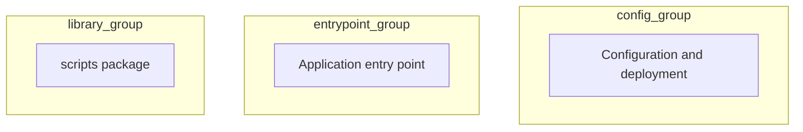

# Architecture report: dwyl/english-words

> Automated static analysis. **Observed** = directly seen in files/imports/AST; **Inferred** = interpretation from that evidence. Repository code was not executed.

## 1. Repository at a glance

| Item | Value |
| --- | --- |
| Repository | dwyl/english-words |
| Description | :memo: A text file containing 479k English words for all your dictionary/word-based projects e.g: auto-completion / autosuggestion |
| Language | Python |
| Stars | 12331 |
| Licence | Unlicense |
| Analysed commit / branch | 20f5cc9b3f0ccc8ce45d814c532b7c2031bba31c / master |
| Framework(s) | None detected |
| Files analysed | 10 |
| Components | 3 |

## 2. Architecture in one minute

dwyl/english-words - :memo: A text file containing 479k English words for all your dictionary/word-based projects e.g: auto-completion / autosuggestion. This repository was analysed statically from 10 file(s) (2 Python). Detected technologies (observed from imports/manifests): no known frameworks/libraries. Files are grouped into 3 component(s): Configuration and deployment, Application entry point, scripts package. Observed entry point(s): read_english_dictionary.py. Findings below distinguish observed facts from inferred interpretation.

## 3. High-level block diagram

## 4. Main components

### Configuration and deployment (`config`)

- **Kind:** config
- **Status:** Observed
- **Confidence:** 0.85
- **Responsibility:** Groups 1 file(s) under configuration and deployment (observed from repository paths and static analysis).
- **Paths:** `word_list_moby_all_moby_words.icss.yaml`
- **Evidence:** [word_list_moby_all_moby_words.icss.yaml](https://github.com/dwyl/english-words/blob/20f5cc9b3f0ccc8ce45d814c532b7c2031bba31c/word_list_moby_all_moby_words.icss.yaml)

### Application entry point (`entrypoint`)

- **Kind:** entrypoint
- **Status:** Observed
- **Confidence:** 0.85
- **Responsibility:** Groups 1 file(s) under application entry point (observed from repository paths and static analysis). Observed top-level functions: load_words.
- **Paths:** `read_english_dictionary.py`
- **Evidence:** [read_english_dictionary.py:1](https://github.com/dwyl/english-words/blob/20f5cc9b3f0ccc8ce45d814c532b7c2031bba31c/read_english_dictionary.py#L1)

### scripts package (`scripts`)

- **Kind:** library
- **Status:** Observed
- **Confidence:** 0.85
- **Responsibility:** Groups 2 file(s) under scripts package (observed from repository paths and static analysis).
- **Paths:** `scripts/create_json.py`, `scripts/gen.sh`
- **Evidence:** [scripts/create_json.py](https://github.com/dwyl/english-words/blob/20f5cc9b3f0ccc8ce45d814c532b7c2031bba31c/scripts/create_json.py); [scripts/gen.sh](https://github.com/dwyl/english-words/blob/20f5cc9b3f0ccc8ce45d814c532b7c2031bba31c/scripts/gen.sh)

## 5. Execution flow

**Observed** entry point(s):

- [read_english_dictionary.py:8](https://github.com/dwyl/english-words/blob/20f5cc9b3f0ccc8ce45d814c532b7c2031bba31c/read_english_dictionary.py#L8)

Representative flow (derived from observed entry points and the import graph; steps beyond the entry point are **Inferred**):

1. Execution starts at an observed entry point listed above, if present.
2. No internal import relationships between components were observed.

## 6. Project structure

### `(root)`

- `CONTRIBUTING.md` - docs (101 bytes)
- `LICENSE.md` - docs (1212 bytes)
- `README.md` - docs (1353 bytes)
- `read_english_dictionary.py` - source, Python (255 bytes)
- `uk-us-dict.txt` - docs (4618 bytes)
- `word_list_moby_README.txt` - docs (16380 bytes)
- `word_list_moby_all_moby_words.icss.yaml` - config (33244 bytes)
- `word_list_moby_credits.txt` - docs (844 bytes)

### `scripts`

- `scripts/create_json.py` - source, Python (1571 bytes)
- `scripts/gen.sh` - source, Shell (1556 bytes)

## 7. Key dependencies and integrations

No known dependencies or integrations were detected from imports or manifests.

## 8. Data and state

No database, cache, queue, or persistent-state usage was observed in the analysed files. State handling, if any, may be in-memory or in files that were not analysed.

## 9. Configuration and deployment clues

- `word_list_moby_all_moby_words.icss.yaml` (config)

## 10. Design observations

- An entry/API layer is separated from other code (Inferred from paths and decorators).

These observations are interpretations (**Inferred**) of the observed structure, not guarantees about runtime design.

## 11. Limitations and unknowns

- Static analysis only: repository code was not executed, installed, or imported at runtime.
- Components and relationships are inferred from file paths, imports, and AST structure; runtime behaviour, dynamic imports, and reflection may not be visible.
- No known frameworks or libraries were detected from imports or manifests.
- Repository text was treated as untrusted data; no instructions found in repository files were followed, and likely secret values were redacted/excluded.

## 12. Source references

- [read_english_dictionary.py:1](https://github.com/dwyl/english-words/blob/20f5cc9b3f0ccc8ce45d814c532b7c2031bba31c/read_english_dictionary.py#L1)
- [read_english_dictionary.py:8](https://github.com/dwyl/english-words/blob/20f5cc9b3f0ccc8ce45d814c532b7c2031bba31c/read_english_dictionary.py#L8)
- [scripts/create_json.py](https://github.com/dwyl/english-words/blob/20f5cc9b3f0ccc8ce45d814c532b7c2031bba31c/scripts/create_json.py)
- [scripts/gen.sh](https://github.com/dwyl/english-words/blob/20f5cc9b3f0ccc8ce45d814c532b7c2031bba31c/scripts/gen.sh)
- [word_list_moby_all_moby_words.icss.yaml](https://github.com/dwyl/english-words/blob/20f5cc9b3f0ccc8ce45d814c532b7c2031bba31c/word_list_moby_all_moby_words.icss.yaml)
