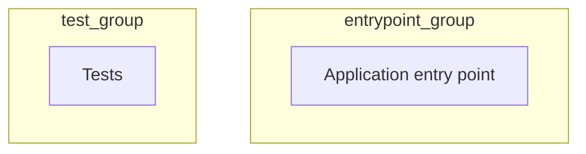

# Architecture report: elayadesign/ai-design-skills

> Automated static analysis. **Observed** = directly seen in files/imports/AST; **Inferred** = interpretation from that evidence. Repository code was not executed.

## 1. Repository at a glance

| Item | Value |
| --- | --- |
| Repository | elayadesign/ai-design-skills |
| Description | Not provided |
| Language | Python |
| Stars | 15534 |
| Licence | MIT |
| Analysed commit / branch | 456d9e0d3e2d84c748bb143c6ca3d90c45e16213 / main |
| Framework(s) | None detected |
| Files analysed | 8 |
| Components | 2 |

## 2. Architecture in one minute

elayadesign/ai-design-skills. This repository was analysed statically from 8 file(s) (2 Python). Detected technologies (observed from imports/manifests): GitHub Actions, unittest. Files are grouped into 2 component(s): Application entry point, Tests. Observed entry point(s): scripts/validate_skills.py. Findings below distinguish observed facts from inferred interpretation.

## 3. High-level block diagram

## 4. Main components

### Application entry point (`entrypoint`)

- **Kind:** entrypoint
- **Status:** Observed
- **Confidence:** 0.85
- **Responsibility:** Groups 1 file(s) under application entry point (observed from repository paths and static analysis). Observed top-level functions: check_text_field, main, read_frontmatter, report, validate_skill.
- **Paths:** `scripts/validate_skills.py`
- **Evidence:** [scripts/validate_skills.py:30](https://github.com/elayadesign/ai-design-skills/blob/456d9e0d3e2d84c748bb143c6ca3d90c45e16213/scripts/validate_skills.py#L30)

### Tests (`tests`)

- **Kind:** test
- **Status:** Observed
- **Confidence:** 0.85
- **Responsibility:** Groups 1 file(s) under tests (observed from repository paths and static analysis). Observed top-level classes: MainTest, ValidateSkillTest.
- **Paths:** `tests/test_validate_skills.py`
- **Evidence:** [tests/test_validate_skills.py:15](https://github.com/elayadesign/ai-design-skills/blob/456d9e0d3e2d84c748bb143c6ca3d90c45e16213/tests/test_validate_skills.py#L15)

## 5. Execution flow

**Observed** entry point(s):

- [scripts/validate_skills.py:127](https://github.com/elayadesign/ai-design-skills/blob/456d9e0d3e2d84c748bb143c6ca3d90c45e16213/scripts/validate_skills.py#L127)

Representative flow (derived from observed entry points and the import graph; steps beyond the entry point are **Inferred**):

1. Execution starts at an observed entry point listed above, if present.
2. No internal import relationships between components were observed.

## 6. Project structure

### `(root)`

- `.gitignore` - other (85 bytes)
- `LICENSE` - docs (1062 bytes)
- `README.md` - docs (3630 bytes)

### `.github`

- `.github/workflows/validate-skills.yml` - ci, YAML (529 bytes)

### `scripts`

- `scripts/validate_skills.py` - source, Python (4053 bytes)

### `skills`

- `skills/figma-designer/SKILL.md` - docs (22079 bytes)
- `skills/landing-page-design/SKILL.md` - docs (22115 bytes)

### `tests`

- `tests/test_validate_skills.py` - test, Python (4981 bytes)

## 7. Key dependencies and integrations

| Name | Category | Status | Confidence | Evidence |
| --- | --- | --- | --- | --- |
| GitHub Actions | ci | Observed | 0.85 | [.github/workflows/validate-skills.yml](https://github.com/elayadesign/ai-design-skills/blob/456d9e0d3e2d84c748bb143c6ca3d90c45e16213/.github/workflows/validate-skills.yml) |
| unittest | tooling | Observed | 0.90 | [tests/test_validate_skills.py:5](https://github.com/elayadesign/ai-design-skills/blob/456d9e0d3e2d84c748bb143c6ca3d90c45e16213/tests/test_validate_skills.py#L5) |

## 8. Data and state

No database, cache, queue, or persistent-state usage was observed in the analysed files. State handling, if any, may be in-memory or in files that were not analysed.

## 9. Configuration and deployment clues

- `.github/workflows/validate-skills.yml` (ci)

## 10. Design observations

- An entry/API layer is separated from other code (Inferred from paths and decorators).
- Tests are present alongside source code (Observed from test file paths).

These observations are interpretations (**Inferred**) of the observed structure, not guarantees about runtime design.

## 11. Limitations and unknowns

- Static analysis only: repository code was not executed, installed, or imported at runtime.
- Components and relationships are inferred from file paths, imports, and AST structure; runtime behaviour, dynamic imports, and reflection may not be visible.
- Repository text was treated as untrusted data; no instructions found in repository files were followed, and likely secret values were redacted/excluded.

## 12. Source references

- [.github/workflows/validate-skills.yml](https://github.com/elayadesign/ai-design-skills/blob/456d9e0d3e2d84c748bb143c6ca3d90c45e16213/.github/workflows/validate-skills.yml)
- [scripts/validate_skills.py:30](https://github.com/elayadesign/ai-design-skills/blob/456d9e0d3e2d84c748bb143c6ca3d90c45e16213/scripts/validate_skills.py#L30)
- [scripts/validate_skills.py:127](https://github.com/elayadesign/ai-design-skills/blob/456d9e0d3e2d84c748bb143c6ca3d90c45e16213/scripts/validate_skills.py#L127)
- [tests/test_validate_skills.py:5](https://github.com/elayadesign/ai-design-skills/blob/456d9e0d3e2d84c748bb143c6ca3d90c45e16213/tests/test_validate_skills.py#L5)
- [tests/test_validate_skills.py:15](https://github.com/elayadesign/ai-design-skills/blob/456d9e0d3e2d84c748bb143c6ca3d90c45e16213/tests/test_validate_skills.py#L15)
