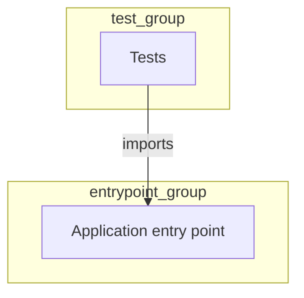

# Architecture report: emmabostian/developer-portfolios

> Automated static analysis. **Observed** = directly seen in files/imports/AST; **Inferred** = interpretation from that evidence. Repository code was not executed.

## 1. Repository at a glance

| Item | Value |
| --- | --- |
| Repository | emmabostian/developer-portfolios |
| Description | A list of developer portfolios for your inspiration |
| Language | Python |
| Stars | 27698 |
| Licence | Not detected |
| Analysed commit / branch | cecf27d06a4cdb391ad4a031afc0d510ef71a0a2 / master |
| Framework(s) | None detected |
| Files analysed | 23 |
| Components | 2 |

## 2. Architecture in one minute

emmabostian/developer-portfolios - A list of developer portfolios for your inspiration. This repository was analysed statically from 23 file(s) (14 Python). Detected technologies (observed from imports/manifests): GitHub Actions, unittest. Files are grouped into 2 component(s): Application entry point, Tests. Observed entry point(s): run_tests.py, src/alphabetical.py, src/check_parking_redirects.py. Findings below distinguish observed facts from inferred interpretation.

## 3. High-level block diagram

## 4. Main components

### Application entry point (`entrypoint`)

- **Kind:** entrypoint
- **Status:** Observed
- **Confidence:** 0.85
- **Responsibility:** Groups 5 file(s) under application entry point (observed from repository paths and static analysis). Observed top-level functions: _follow, _has_gambling_title, _has_parking_content, _is_emoji_codepoint, _is_parking_domain, _make_request.
- **Paths:** `src/alphabetical.py`, `src/check_parking_redirects.py`, `src/generate_feed.py`, `src/remove_emoji_in_readme.py`, `src/run_dup_report.py`
- **Evidence:** [src/alphabetical.py:7](https://github.com/emmabostian/developer-portfolios/blob/cecf27d06a4cdb391ad4a031afc0d510ef71a0a2/src/alphabetical.py#L7); [src/check_parking_redirects.py:83](https://github.com/emmabostian/developer-portfolios/blob/cecf27d06a4cdb391ad4a031afc0d510ef71a0a2/src/check_parking_redirects.py#L83); [src/generate_feed.py:17](https://github.com/emmabostian/developer-portfolios/blob/cecf27d06a4cdb391ad4a031afc0d510ef71a0a2/src/generate_feed.py#L17); [src/remove_emoji_in_readme.py:29](https://github.com/emmabostian/developer-portfolios/blob/cecf27d06a4cdb391ad4a031afc0d510ef71a0a2/src/remove_emoji_in_readme.py#L29); [src/run_dup_report.py:13](https://github.com/emmabostian/developer-portfolios/blob/cecf27d06a4cdb391ad4a031afc0d510ef71a0a2/src/run_dup_report.py#L13)

### Tests (`tests`)

- **Kind:** test
- **Status:** Observed
- **Confidence:** 0.85
- **Responsibility:** Groups 9 file(s) under tests (observed from repository paths and static analysis). Observed top-level classes: TestAlphabetical, TestEmojiDetection, TestFindMalformedUrls, TestFixEscapedUrlScheme, TestFullStackVariants, TestIsWellFormedUrl. Observed top-level functions: main, test_extract_portfolio_data, test_feed_json_structure.
- **Paths:** `run_tests.py`, `src/run_tests.py`, `tests/test_alphabetical.py`, `tests/test_emoji_detection.py`, `tests/test_feed_json.py`, `tests/test_fullstack_variants.py`, `tests/test_main_e2e.py`, `tests/test_remove_emoji.py`, `tests/test_url_format.py`
- **Evidence:** [run_tests.py:14](https://github.com/emmabostian/developer-portfolios/blob/cecf27d06a4cdb391ad4a031afc0d510ef71a0a2/run_tests.py#L14); [src/run_tests.py:20](https://github.com/emmabostian/developer-portfolios/blob/cecf27d06a4cdb391ad4a031afc0d510ef71a0a2/src/run_tests.py#L20); [tests/test_alphabetical.py:5](https://github.com/emmabostian/developer-portfolios/blob/cecf27d06a4cdb391ad4a031afc0d510ef71a0a2/tests/test_alphabetical.py#L5); [tests/test_emoji_detection.py:5](https://github.com/emmabostian/developer-portfolios/blob/cecf27d06a4cdb391ad4a031afc0d510ef71a0a2/tests/test_emoji_detection.py#L5); [tests/test_feed_json.py:16](https://github.com/emmabostian/developer-portfolios/blob/cecf27d06a4cdb391ad4a031afc0d510ef71a0a2/tests/test_feed_json.py#L16); [tests/test_fullstack_variants.py:7](https://github.com/emmabostian/developer-portfolios/blob/cecf27d06a4cdb391ad4a031afc0d510ef71a0a2/tests/test_fullstack_variants.py#L7); [tests/test_main_e2e.py:7](https://github.com/emmabostian/developer-portfolios/blob/cecf27d06a4cdb391ad4a031afc0d510ef71a0a2/tests/test_main_e2e.py#L7); [tests/test_remove_emoji.py:5](https://github.com/emmabostian/developer-portfolios/blob/cecf27d06a4cdb391ad4a031afc0d510ef71a0a2/tests/test_remove_emoji.py#L5)

## 5. Execution flow

**Observed** entry point(s):

- [run_tests.py:25](https://github.com/emmabostian/developer-portfolios/blob/cecf27d06a4cdb391ad4a031afc0d510ef71a0a2/run_tests.py#L25)
- [src/alphabetical.py:802](https://github.com/emmabostian/developer-portfolios/blob/cecf27d06a4cdb391ad4a031afc0d510ef71a0a2/src/alphabetical.py#L802)
- [src/check_parking_redirects.py:354](https://github.com/emmabostian/developer-portfolios/blob/cecf27d06a4cdb391ad4a031afc0d510ef71a0a2/src/check_parking_redirects.py#L354)
- [src/generate_feed.py:85](https://github.com/emmabostian/developer-portfolios/blob/cecf27d06a4cdb391ad4a031afc0d510ef71a0a2/src/generate_feed.py#L85)
- [src/remove_emoji_in_readme.py:57](https://github.com/emmabostian/developer-portfolios/blob/cecf27d06a4cdb391ad4a031afc0d510ef71a0a2/src/remove_emoji_in_readme.py#L57)
- [src/run_dup_report.py:91](https://github.com/emmabostian/developer-portfolios/blob/cecf27d06a4cdb391ad4a031afc0d510ef71a0a2/src/run_dup_report.py#L91)
- [src/run_tests.py:44](https://github.com/emmabostian/developer-portfolios/blob/cecf27d06a4cdb391ad4a031afc0d510ef71a0a2/src/run_tests.py#L44)

Representative flow (derived from observed entry points and the import graph; steps beyond the entry point are **Inferred**):

1. Execution starts at an observed entry point listed above, if present.
2. `tests` imports `entrypoint` (Tests -> Application entry point).

## 6. Project structure

### `(root)`

- `.gitignore` - other (3771 bytes)
- `.lycheeignore` - other (1320 bytes)
- `.lycherc.toml` - config (1941 bytes)
- `CONTRIBUTING.md` - docs (9239 bytes)
- `FEED_JSON.md` - docs (2448 bytes)
- `README.md` - docs (150670 bytes)
- `run_tests.py` - test, Python (695 bytes)

### `.github`

- `.github/pull_request_template.md` - docs (409 bytes)
- `.github/workflows/link-checker.yml` - ci, YAML (2773 bytes)
- `.github/workflows/parking-redirect-checker.yml` - ci, YAML (984 bytes)

### `src`

- `src/alphabetical.py` - source, Python (30527 bytes)
- `src/check_parking_redirects.py` - source, Python (12772 bytes)
- `src/generate_feed.py` - source, Python (2270 bytes)
- `src/remove_emoji_in_readme.py` - source, Python (2087 bytes)
- `src/run_dup_report.py` - source, Python (3135 bytes)
- `src/run_tests.py` - test, Python (1638 bytes)

### `tests`

- `tests/test_alphabetical.py` - test, Python (6709 bytes)
- `tests/test_emoji_detection.py` - test, Python (1455 bytes)
- `tests/test_feed_json.py` - test, Python (3996 bytes)
- `tests/test_fullstack_variants.py` - test, Python (3342 bytes)
- `tests/test_main_e2e.py` - test, Python (1929 bytes)
- `tests/test_remove_emoji.py` - test, Python (1251 bytes)
- `tests/test_url_format.py` - test, Python (3242 bytes)

## 7. Key dependencies and integrations

| Name | Category | Status | Confidence | Evidence |
| --- | --- | --- | --- | --- |
| GitHub Actions | ci | Observed | 0.90 | [.github/workflows/link-checker.yml](https://github.com/emmabostian/developer-portfolios/blob/cecf27d06a4cdb391ad4a031afc0d510ef71a0a2/.github/workflows/link-checker.yml); [.github/workflows/parking-redirect-checker.yml](https://github.com/emmabostian/developer-portfolios/blob/cecf27d06a4cdb391ad4a031afc0d510ef71a0a2/.github/workflows/parking-redirect-checker.yml) |
| unittest | tooling | Observed | 0.95 | [run_tests.py:11](https://github.com/emmabostian/developer-portfolios/blob/cecf27d06a4cdb391ad4a031afc0d510ef71a0a2/run_tests.py#L11); [src/run_tests.py:12](https://github.com/emmabostian/developer-portfolios/blob/cecf27d06a4cdb391ad4a031afc0d510ef71a0a2/src/run_tests.py#L12); [tests/test_alphabetical.py:1](https://github.com/emmabostian/developer-portfolios/blob/cecf27d06a4cdb391ad4a031afc0d510ef71a0a2/tests/test_alphabetical.py#L1); [tests/test_emoji_detection.py:1](https://github.com/emmabostian/developer-portfolios/blob/cecf27d06a4cdb391ad4a031afc0d510ef71a0a2/tests/test_emoji_detection.py#L1) |

## 8. Data and state

No database, cache, queue, or persistent-state usage was observed in the analysed files. State handling, if any, may be in-memory or in files that were not analysed.

## 9. Configuration and deployment clues

- `.github/workflows/link-checker.yml` (ci)
- `.github/workflows/parking-redirect-checker.yml` (ci)
- `.lycherc.toml` (config)

## 10. Design observations

- An entry/API layer is separated from other code (Inferred from paths and decorators).
- Tests are present alongside source code (Observed from test file paths).

These observations are interpretations (**Inferred**) of the observed structure, not guarantees about runtime design.

## 11. Limitations and unknowns

- Static analysis only: repository code was not executed, installed, or imported at runtime.
- Components and relationships are inferred from file paths, imports, and AST structure; runtime behaviour, dynamic imports, and reflection may not be visible.
- Repository text was treated as untrusted data; no instructions found in repository files were followed, and likely secret values were redacted/excluded.

## 12. Source references

- [.github/workflows/link-checker.yml](https://github.com/emmabostian/developer-portfolios/blob/cecf27d06a4cdb391ad4a031afc0d510ef71a0a2/.github/workflows/link-checker.yml)
- [.github/workflows/parking-redirect-checker.yml](https://github.com/emmabostian/developer-portfolios/blob/cecf27d06a4cdb391ad4a031afc0d510ef71a0a2/.github/workflows/parking-redirect-checker.yml)
- [run_tests.py:11](https://github.com/emmabostian/developer-portfolios/blob/cecf27d06a4cdb391ad4a031afc0d510ef71a0a2/run_tests.py#L11)
- [run_tests.py:14](https://github.com/emmabostian/developer-portfolios/blob/cecf27d06a4cdb391ad4a031afc0d510ef71a0a2/run_tests.py#L14)
- [run_tests.py:25](https://github.com/emmabostian/developer-portfolios/blob/cecf27d06a4cdb391ad4a031afc0d510ef71a0a2/run_tests.py#L25)
- [src/alphabetical.py:7](https://github.com/emmabostian/developer-portfolios/blob/cecf27d06a4cdb391ad4a031afc0d510ef71a0a2/src/alphabetical.py#L7)
- [src/alphabetical.py:802](https://github.com/emmabostian/developer-portfolios/blob/cecf27d06a4cdb391ad4a031afc0d510ef71a0a2/src/alphabetical.py#L802)
- [src/check_parking_redirects.py:83](https://github.com/emmabostian/developer-portfolios/blob/cecf27d06a4cdb391ad4a031afc0d510ef71a0a2/src/check_parking_redirects.py#L83)
- [src/check_parking_redirects.py:354](https://github.com/emmabostian/developer-portfolios/blob/cecf27d06a4cdb391ad4a031afc0d510ef71a0a2/src/check_parking_redirects.py#L354)
- [src/generate_feed.py:17](https://github.com/emmabostian/developer-portfolios/blob/cecf27d06a4cdb391ad4a031afc0d510ef71a0a2/src/generate_feed.py#L17)
- [src/generate_feed.py:85](https://github.com/emmabostian/developer-portfolios/blob/cecf27d06a4cdb391ad4a031afc0d510ef71a0a2/src/generate_feed.py#L85)
- [src/remove_emoji_in_readme.py:29](https://github.com/emmabostian/developer-portfolios/blob/cecf27d06a4cdb391ad4a031afc0d510ef71a0a2/src/remove_emoji_in_readme.py#L29)
- [src/remove_emoji_in_readme.py:57](https://github.com/emmabostian/developer-portfolios/blob/cecf27d06a4cdb391ad4a031afc0d510ef71a0a2/src/remove_emoji_in_readme.py#L57)
- [src/run_dup_report.py:13](https://github.com/emmabostian/developer-portfolios/blob/cecf27d06a4cdb391ad4a031afc0d510ef71a0a2/src/run_dup_report.py#L13)
- [src/run_dup_report.py:91](https://github.com/emmabostian/developer-portfolios/blob/cecf27d06a4cdb391ad4a031afc0d510ef71a0a2/src/run_dup_report.py#L91)
- [src/run_tests.py:12](https://github.com/emmabostian/developer-portfolios/blob/cecf27d06a4cdb391ad4a031afc0d510ef71a0a2/src/run_tests.py#L12)
- [src/run_tests.py:20](https://github.com/emmabostian/developer-portfolios/blob/cecf27d06a4cdb391ad4a031afc0d510ef71a0a2/src/run_tests.py#L20)
- [src/run_tests.py:44](https://github.com/emmabostian/developer-portfolios/blob/cecf27d06a4cdb391ad4a031afc0d510ef71a0a2/src/run_tests.py#L44)
- [tests/test_alphabetical.py:1](https://github.com/emmabostian/developer-portfolios/blob/cecf27d06a4cdb391ad4a031afc0d510ef71a0a2/tests/test_alphabetical.py#L1)
- [tests/test_alphabetical.py:5](https://github.com/emmabostian/developer-portfolios/blob/cecf27d06a4cdb391ad4a031afc0d510ef71a0a2/tests/test_alphabetical.py#L5)
- [tests/test_emoji_detection.py:1](https://github.com/emmabostian/developer-portfolios/blob/cecf27d06a4cdb391ad4a031afc0d510ef71a0a2/tests/test_emoji_detection.py#L1)
- [tests/test_emoji_detection.py:5](https://github.com/emmabostian/developer-portfolios/blob/cecf27d06a4cdb391ad4a031afc0d510ef71a0a2/tests/test_emoji_detection.py#L5)
- [tests/test_feed_json.py:16](https://github.com/emmabostian/developer-portfolios/blob/cecf27d06a4cdb391ad4a031afc0d510ef71a0a2/tests/test_feed_json.py#L16)
- [tests/test_fullstack_variants.py:3](https://github.com/emmabostian/developer-portfolios/blob/cecf27d06a4cdb391ad4a031afc0d510ef71a0a2/tests/test_fullstack_variants.py#L3)
- [tests/test_fullstack_variants.py:7](https://github.com/emmabostian/developer-portfolios/blob/cecf27d06a4cdb391ad4a031afc0d510ef71a0a2/tests/test_fullstack_variants.py#L7)
- [tests/test_main_e2e.py:3](https://github.com/emmabostian/developer-portfolios/blob/cecf27d06a4cdb391ad4a031afc0d510ef71a0a2/tests/test_main_e2e.py#L3)
- [tests/test_main_e2e.py:7](https://github.com/emmabostian/developer-portfolios/blob/cecf27d06a4cdb391ad4a031afc0d510ef71a0a2/tests/test_main_e2e.py#L7)
- [tests/test_remove_emoji.py:1](https://github.com/emmabostian/developer-portfolios/blob/cecf27d06a4cdb391ad4a031afc0d510ef71a0a2/tests/test_remove_emoji.py#L1)
- [tests/test_remove_emoji.py:5](https://github.com/emmabostian/developer-portfolios/blob/cecf27d06a4cdb391ad4a031afc0d510ef71a0a2/tests/test_remove_emoji.py#L5)
- [tests/test_url_format.py:2](https://github.com/emmabostian/developer-portfolios/blob/cecf27d06a4cdb391ad4a031afc0d510ef71a0a2/tests/test_url_format.py#L2)
